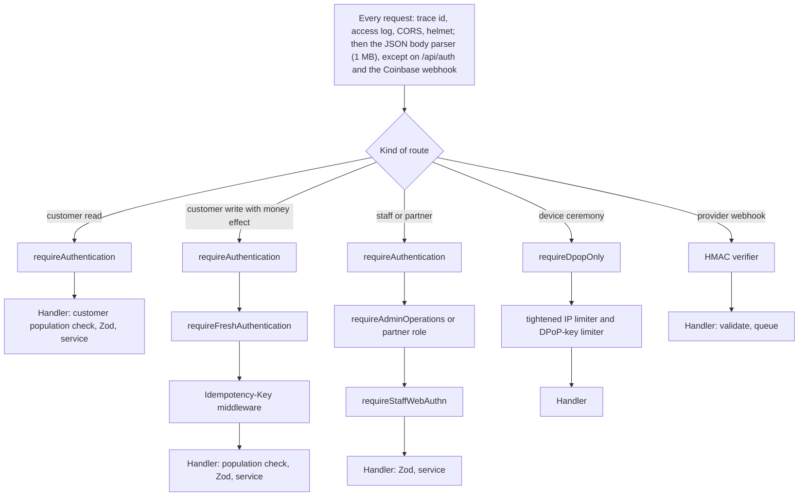

# API reference: conventions, error codes and route gating

Valid for main at 48aa967 (2026-11-18).

This chapter explains how to read and call the VistaBlox API: the prefixes and who may call them, the content types and size limits, the authentication schemes and headers, the response and error envelope, the catalogue of error codes, pagination, rate limiting, idempotency, versioning, and the conditions under which each route group exists at all. The per-route chapters listed below refer back to it for everything that is common. It is read by the mobile and admin-console developers who call the API, by engineers who change it, and by operators who need to know which configuration switches a route on.

## 1. Chapters

| File | Routes |
| --- | --- |
| [platform.md](platform.md) | Health and worker probes, `/.well-known/*`, account search, investor profile, investor activity, KYC and the Didit webhook |
| [better-auth.md](better-auth.md) | `/api/auth/*` (Better Auth endpoints and the VistaBlox hooks in front of them) |
| [auth-customer.md](auth-customer.md) | `/v1/app/config`, `/v1/auth/*` for customers and devices |
| [auth-staff.md](auth-staff.md) | `/internal/v1/auth/*`, staff invitation acceptance, account recovery and closure review |
| [intake-customer.md](intake-customer.md) | `/v1/intake-cases/*` |
| [intake-staff.md](intake-staff.md) | `/internal/v1/intake-cases/*`, partner organisations, partner case routes |
| [offering.md](offering.md) | `/v1/offerings/*`, `/internal/v1/offerings/*`, `/webhooks/coinbase-onramp` |
| [wallet.md](wallet.md) | `/v1/investor-profile/wallet*`, `/internal/v1/wallet-accounts/*` |

Concepts behind the authentication routes (DPoP, device keys, fresh authentication) are in [../authentication.md](../authentication.md); staff roles in [../staff-access.md](../staff-access.md); the layer structure and request lifecycle in [../architecture.md](../architecture.md); variables in [../configuration.md](../configuration.md).

### 1.1 How a route entry is laid out

Each route chapter starts with a table of method, path, authentication and purpose, then gives one entry per route under a heading that names the method and path. An entry lists, in this order: **Auth** (the guards that run and in which order, the population or role, whether fresh authentication, a DPoP proof or an `Idempotency-Key` is needed, and the rate-limit tier); **Mounted when** (the configuration under which the route exists at all; section 12 collects them); **Request** (path and query parameters, headers and body fields with their types and limits, from the Zod schema, with its file and line); **Success** (status and body, and whether the body goes through a response schema); **Errors** (the codes that only this route raises; the common ones are stated once at the top of each chapter and in section 7); **Notes** (rows written, jobs enqueued in the same transaction, audit rows, outbound calls); **Source** (router, service, repository). Citations have the form `path:line` or `path:from-to` at commit 48aa967, with the function or identifier named in the text, because line numbers drift. A line `> Pending #N: ...` under a statement says what an open pull request changes there; nothing in a pending line is true of main.

## 2. Base URLs and prefixes

The process listens on `HOST` and `PORT` (defaults `0.0.0.0` and `3000`) (`src/config/environment.ts:9-10`). Staging answers on `https://api.vistablox.io` behind Traefik (`docker-compose.staging.yml:127`). `BETTER_AUTH_URL` (default `http://localhost:3000`) is the public base URL the server uses to check the `htu` claim of a DPoP proof and to build Better Auth links; it is never taken from the `Host` header (`src/config/environment.ts:17`, `src/modules/auth/application/shared/dpop-proof-verifier.ts:102-111`).

| Prefix | Surface | Who calls it | Authentication | Error shape |
| --- | --- | --- | --- | --- |
| `/v1` | Product API | Customer apps (and, for a few routes, any visitor) | Customer session with DPoP, or none (`GET /v1/offerings`, `POST /v1/auth/staff-invitations/accept`), or DPoP proof only (device ceremony start) | VistaBlox envelope |
| `/internal/v1` | Operations API | The admin console and partner workspaces | Staff or partner session, a role, and a WebAuthn-verified session | VistaBlox envelope |
| `/api/auth` | Better Auth | Mobile app (sign-in with Google or Apple, session reads), admin console (passkeys) | Per endpoint | Better Auth `{ code, message }`, except the path guard and the limiter, which use the VistaBlox envelope |
| `/health` | Liveness and readiness | Docker, load balancers | none | VistaBlox envelope |
| `/webhooks/didit`, `/webhooks/coinbase-onramp` | Provider callbacks | Didit, Coinbase CDP | HMAC signature | VistaBlox envelope; success `{ "received": true }` |
| `/.well-known/*` | Association files | Operating systems, browsers | none | raw JSON |
| `127.0.0.1:3001` in the worker process | Worker probe | Docker health check | none (loopback only) | JSON or Prometheus text |

(`src/app.ts:568-595`, `:908-935`; `src/shared/health/worker-heartbeat.ts:4`, `:34-59`.)

A request whose path no router answers, including a route that is not mounted (section 12), gets `404 resource.not_found` with the detail `No route exists for <METHOD> <path>.` (`src/shared/http/not-found.ts:5-14`). A wrong method on an existing path is also this 404: the code has no 405 (Better Auth's own `get-session` is the exception, in [better-auth.md](better-auth.md)).

## 3. Content types, size limits and response headers

| Topic | Rule | Source |
| --- | --- | --- |
| Request body | JSON only. `express.json` reads a body when `Content-Type` is `application/json`, up to 1 MB. Any other content type is not parsed and `request.body` is `undefined` | `src/app.ts:588` |
| Missing body | A route that parses a body with Zod answers `422 validation.invalid_field` with `field: "request"` when `Content-Type` is not JSON. With `Content-Type: application/json` and no body the parser yields `{}`. Observed with express 5.2.1 and body-parser 2.3.0 in a scratch process: no content type gives `undefined`, `application/json` with an empty body gives `{}`, `text/plain` gives `undefined` | `package.json:46`; `src/shared/http/error-handler.ts:51-64` |
| Character set and encoding | UTF-8 only; an unsupported charset or `Content-Encoding` is 415 | `src/shared/http/body-parser-error.ts:21-76` |
| Provider webhook (Coinbase) | The raw bytes are kept for the HMAC: `express.raw`, 256 kb, type `application/json`, mounted before the JSON parser | `src/app.ts:576-587` |
| Provider webhook (Didit) | Parsed by the JSON parser (1 MB); the signature is computed over the re-serialised, key-sorted body, not the raw bytes | `src/modules/identity/infrastructure/didit-webhook-verifier.ts:27-29`, `:41-49` |
| File upload | The body is the file itself (not multipart). `Content-Type` is the file's MIME type; metadata travels in headers (section 5). At most 100 MB, checked while the stream is read, and the whole file is held in memory before it is scanned and stored | `src/modules/offering/application/upload-offering-document.service.ts:11`, `:83`; `src/modules/intake/application/upload-case-document.service.ts:11`, `:102-104` |
| Response body | JSON, except document downloads (stored MIME type, `Content-Disposition`), `GET /api/auth/error` (HTML) and the worker `/metrics` (Prometheus text) | `src/modules/offering/api/offering.router.ts:109-131`; `src/shared/health/worker-heartbeat.ts:45-53` |
| Caching | Customer and operations reads set `Cache-Control: no-store`; downloads set `private, no-store`; the three `.well-known` files set `public, max-age=3600`. A route that does not set the header (for example `GET /internal/v1/accounts`) leaves it unset. The application does not change Express's default `etag` behaviour (no `etag` setting in `src`); observed with express 5.2.1, a JSON `GET` answer carries a weak `ETag` | `src/app.ts:524`, `:536`, `:561`; `src/modules/account/api/account.router.ts:15-19` |
| Security headers | `helmet()` with its default options; `X-Powered-By` is removed | `src/app.ts:503`, `:521` |
| Cross-origin | `cors({ origin: corsOrigins, credentials: true })`. `corsOrigins` is the Better Auth trusted-origin list: `AUTH_TRUSTED_ORIGINS` (default `http://localhost:3000`), plus `exp://`, `exp://**` and `exp://192.168.*.*:*/**` when `NODE_ENV` is not `production`, plus `https://appleid.apple.com` when Apple sign-in is enabled. The `cors` package compares each list entry with the request `Origin` literally, so the three `exp://` entries match no browser origin (a scratch probe with cors 2.8.5 sent no `Access-Control-Allow-Origin` for `exp://192.168.1.5:8081`); they matter to Better Auth only | `src/app.ts:520`; `src/server.ts:224-230`, `:582`; `src/config/environment.ts:135-138` |

Every response carries `x-trace-id` (section 5).

## 4. Authentication schemes

### 4.1 Legend

Each route entry in the chapters names one of these. "Session" always means `requireAuthentication` (4.2) first.

| Scheme | Routes | What the caller sends | What runs | Refusal |
| --- | --- | --- | --- | --- |
| None | Probes, `GET /v1/offerings`, `.well-known`, `POST /v1/auth/staff-invitations/accept` (the invitation token is in the body), `GET /api/auth/ok` and similar | Nothing | Nothing (the public offering list has the baseline limiter keyed by IP; the invitation acceptance has the tightened one) | none |
| Customer device session | Most of `/v1` | `Authorization: Bearer <signed session token>` and `DPoP: <proof>` on every request. The token is the `set-auth-token` response header of device enrolment or login (`E2`, `L2`) and is bound to the key of the proof presented then | `requireAuthentication`; the handlers of the offering, KYC, profile, investor-activity, wallet and account-closure routers also check `population === "customer"`. The intake, own-session, login-method, device-replacement and signing-request routers do not (section 13.2) | 401 `authentication.required`, `DPOP_*`, `REAUTH_REQUIRED`; 403 `account.restricted`, `authorization.forbidden` |
| Customer fresh | Reservation creation and reconfirmation, login-method unlink, session revocation | As above, and the session was created in the last 5 minutes | `requireFreshAuthentication` after the session check | 403 `authentication.fresh_auth_required` |
| DPoP proof only | `GET /v1/app/config`, the four `/v1/auth/mobile/{enrol,login}/*` ceremony routes | `DPoP` only (the `Authorization` header is ignored) | `requireDpopOnly` | 401 `DPOP_PROOF_MISSING`, `DPOP_PROOF_INVALID`, `DPOP_REPLAY` |
| Staff or partner session | `/internal/v1` | The Better Auth session as a cookie (`vb.session_token`, or `__Secure-vb.session_token` when `NODE_ENV=production`; see below) or as a signed bearer token. A session is bound to a key when a valid proof accompanied the request that created it (`src/modules/auth/infrastructure/shared/dpop-session-creation.ts:109-125`) or, for an unbound session created before `DPOP_PHASE1_CUTOVER_AT` (any unbound session while it is unset), when it presents its first valid proof later (4.2 step 2). A staff session created without a proof is unbound and needs none; a bound one needs the proof as a customer's does | `requireAuthentication` | as above |
| Admin operations | Most of `/internal/v1` | The staff session above | `requireAdminOperations` (active `admin_operations` role, population `staff_partner`), then `requireStaffWebAuthn` (session created by a staff passkey login, or a legacy WebAuthn proof row) | 403 `authorization.forbidden`, 403 `authentication.staff_mfa_required` |
| Partner | `/internal/v1/legal-partner/cases`, `/internal/v1/appraisal-partner/cases` | The staff session | The partner role check, `requireStaffWebAuthn`, and a check that the caller's organisation is assigned to the case | 403 `authorization.forbidden`, `authentication.staff_mfa_required` |
| Any staff role | `/internal/v1/auth/webauthn/*` | The staff session | `requireStaffIdentity` (any active staff or partner role) | 403 `authorization.forbidden` |
| Didit webhook | `POST /webhooks/didit` | `X-Signature-V2` (64 hex characters) and `X-Timestamp` (10 digits, within 300 s of the server clock and equal to the body's `timestamp`) | HMAC-SHA256 of `JSON.stringify` of the key-sorted body with `DIDIT_WEBHOOK_SECRET` | 401 `identity.didit_webhook_invalid` |
| Coinbase webhook | `POST /webhooks/coinbase-onramp` | `X-Webhook-Signature` (or the deprecated `X-Hook0-Signature`): `t=<unix seconds>,v0=<hex>,...` | HMAC-SHA256 of `<t>.<raw body>` with `COINBASE_ONRAMP_WEBHOOK_SECRET`, `t` within 300 s | 401 `offering.coinbase_webhook_invalid` |
| Better Auth | `/api/auth/*` | Depends on the endpoint | The path guard, the tightened limiter, then Better Auth and its hooks | Better Auth `{ code, message }` |

(`src/modules/auth/api/shared/require-authentication.ts:39-129`; `src/modules/auth/api/customer/require-dpop-only.ts:51-96`; `src/modules/auth/api/staff/require-staff-role.ts:7-116`; `src/modules/auth/repository/staff/prisma-staff-webauthn.repository.ts:32-54`; `src/modules/identity/infrastructure/didit-webhook-verifier.ts:11-38`; `src/modules/offering/infrastructure/coinbase-onramp-webhook-verifier.ts:28-72`; `src/modules/auth/infrastructure/customer/better-auth-device-auth.plugin.ts:235-248`; `src/modules/offering/api/offering.router.ts:61-65`; `src/modules/auth/infrastructure/shared/better-auth.factory.ts:456-457`, `:476-483`.)

The session resolver accepts only sessions whose authentication level is `staff_passkey` or `device_biometric` (a level `oauth_pending` is accepted only when the resolver is built with `allowPendingOAuth`, which `src/server.ts:476-481` does not set); a session of a user with `disabledAt` or `recoveryRequiredAt` set is treated as no session (`src/modules/auth/infrastructure/shared/better-auth-session.resolver.ts:61-71`). The cookie is named `vb.session_token` (cookie prefix `vb`) and `__Secure-vb.session_token` when `NODE_ENV=production`, because Better Auth puts `__Secure-` in front of the name whenever secure cookies are on (library code `createCookieGetter` in better-auth 1.7.2, read and not observed on a response); it is `HttpOnly`, `SameSite=Lax`, path `/`, and `Secure` when `NODE_ENV=production` (`src/modules/auth/infrastructure/shared/better-auth.factory.ts:456-457`, `:476-483`). The bearer token must be the signed `value.signature` form: a bare token is ignored (`src/modules/auth/infrastructure/shared/better-auth.factory.ts:304-314`).

### 4.2 What `requireAuthentication` does, in order

| # | Step | Failure |
| --- | --- | --- |
| 1 | Resolve the session from the request headers (cookie or signed bearer) | `401 authentication.required` when there is none; `401 REAUTH_REQUIRED` when a device session is past its idle (5 minutes) or absolute (30 minutes) limit |
| 2 | A session bound to a key needs a valid, matching, unreplayed `DPoP` proof. An unbound session is never required to present one; a valid proof from an unbound session created before `DPOP_PHASE1_CUTOVER_AT` binds it, and one from an unbound session created after the cutover is refused | `401` with `DPOP_PROOF_MISSING`, `DPOP_PROOF_INVALID`, `DPOP_REPLAY` or `DPOP_KEY_MISMATCH`, and the header `WWW-Authenticate: DPoP error="invalid_dpop_proof"` |
| 3 | Look up the account for the Better Auth user | `500 account.mapping_missing` |
| 4 | Require account status `active` | `403 account.restricted` |
| 5 | Set `response.locals.authContext` (`accountId`, `providerSessionId`, `population`, `sessionCreatedAt`, `authenticationLevel`, `dpopJkt`) | none |
| 6 | Run the baseline limiter, keyed by `account:<id>`, when a rate-limit store is connected | `429 rate_limit.exceeded` |
| 7 | Record session activity (a failed write is logged and the request continues) | none |

(`src/modules/auth/api/shared/require-authentication.ts:45-128`, `:158-201`, `:203-240`; `src/modules/auth/infrastructure/shared/better-auth-session.resolver.ts:46-57`; `src/modules/auth/domain/device-session-lifetime.ts:10-11`.)

A request with a missing or invalid token is refused at step 1 or 2, before any limiter, so a flood of unauthenticated requests against a protected route is never counted (`src/modules/auth/api/shared/require-authentication.ts:45-68`, `:114-124`).

The guards that run before a handler, by kind of route, in order (the mount lines are in section 12):



### 4.3 The DPoP proof

The proof is a JWT in the `DPoP` header. The server checks: three dot-separated parts; header `typ` `dpop+jwt` and `alg` `ES256`; an embedded public `jwk` of type EC, curve P-256, without private members; a valid signature; claim `htm` equal to the request method; claim `htu` equal to `BETTER_AUTH_URL` plus the request path (no query string, default port omitted); `iat` within 60 seconds of the server clock; `jti` of 16 to 64 base64url characters; and, when the request carries a bearer token, `ath` equal to the base64url SHA-256 of the token characters after `Bearer `. The key thumbprint (`jkt`) and `jti` are recorded in `auth.dpop_replays` for 120 seconds by default; a pair seen before is a replay (`src/modules/auth/application/shared/dpop-proof-verifier.ts:5-9`, `:102-111`, `:121-208`; `src/modules/auth/api/shared/require-authentication.ts:241-248`). The full rules and the device ceremonies are in [../authentication.md](../authentication.md).

### 4.4 Fresh authentication

A customer session is fresh for 5 minutes after it was created, which is when the device key last signed a login: only a `device_biometric` session qualifies, and signing in again starts a new window. Any other session goes to a repository check, `hasFreshAuthentication`: an active mirrored session whose `last_fresh_auth_at` is within the window (`src/modules/auth/domain/fresh-authentication.ts:10-32`; `src/modules/auth/api/customer/require-fresh-authentication.ts:19-49`; `src/modules/auth/repository/customer/prisma-customer-session.repository.ts:79-94`). One route, `POST /v1/investor-profile/wallet`, asks the same question without the middleware and needs freshness only when it replaces the account's own pending claim with a different address (`src/app.ts:635-641`, `:827-863`).

### 4.5 A complete call

A customer request to a protected route, with every credential it carries (placeholders only; the proof is a JWT built from the claims of 4.3):

```http
GET /v1/investor-profile HTTP/1.1
Host: api.vistablox.io
Authorization: Bearer <value of the set-auth-token header from enrolment or login>
DPoP: <proof: typ dpop+jwt, alg ES256, jwk of the device key; htm GET, htu https://api.vistablox.io/v1/investor-profile, iat, jti, ath>
x-trace-id: <optional correlation id>
Accept: application/json
```

A staff call to `/internal/v1` sends the session cookie (`vb.session_token`, `__Secure-vb.session_token` in production) or the signed bearer token instead and no proof when the session is unbound. A write sends `Content-Type: application/json`.

## 5. Request and response headers

### 5.1 Request headers

| Header | Where it is read | Meaning | Source |
| --- | --- | --- | --- |
| `Authorization: Bearer <token>` | Every route behind `requireAuthentication` | Signed Better Auth session token (customer device sessions; also accepted for staff sessions) | `src/modules/auth/api/shared/require-authentication.ts:136-141` |
| `Cookie: vb.session_token=...` (`__Secure-vb.session_token=...` in production) | The same routes | Better Auth session cookie (staff browser sessions) | `src/modules/auth/infrastructure/shared/better-auth.factory.ts:456-457`, `:476-483` |
| `DPoP` | The same routes, the DPoP-only routes and the Better Auth hooks | The proof (4.3) | `src/modules/auth/api/shared/require-authentication.ts:131-134` |
| `x-trace-id` | Every route | Caller-supplied correlation id. The value is trimmed and used as is: no length or character check. Without it the server creates `req_` plus a ULID. The value is echoed in the response header and in `trace_id` of error bodies, and reaches logs, audit rows and job payloads | `src/shared/http/request-context.ts:7-15` |
| `Idempotency-Key` | Reservation creation, reservation reconfirmation, offering finalization (shared middleware); the four intake correction commands (read by hand) | Client-chosen key for a retry-safe write (section 10) | `src/app.ts:490-501`; `src/modules/intake/api/intake-operations.router.ts:204` |
| `If-Match-Stage`, `If-Match-Workflow-Sequence` | The four intake correction commands (`return-to-draft`, `reopen-pre-offering`, `reopen-structuring`, `reopen-final-offering-review`) | The stage and workflow event sequence the staff member saw; the command is refused with `409 intake.reversal_conflict` if the case has moved (`src/modules/intake/application/intake-reversal.service.ts:87`). A missing or non-integer value is `422 intake.reversal_headers_required` | `src/modules/intake/api/intake-operations.router.ts:191-209` |
| `X-Revision-Number` | `POST /internal/v1/intake-cases/:case_id/documents` | The case revision the document belongs to; `Number(header ?? "1")`, not validated by a schema | `src/modules/intake/api/intake-operations.router.ts:232` |
| `X-Document-Type`, `X-Original-Filename`, `X-Room-Id` | The staff document uploads | Upload metadata. `X-Original-Filename` may be percent-encoded and is cut to 255 characters | `src/modules/offering/api/offering-operations.router.ts:109-122`, `:153-167`; `src/modules/intake/api/intake-operations.router.ts:230-234` |
| `X-Signature-V2`, `X-Timestamp` | `POST /webhooks/didit` | Didit signature and timestamp | `src/modules/identity/api/kyc.router.ts:99-104` |
| `X-Webhook-Signature` (or `X-Hook0-Signature`), `X-Event-Id` | `POST /webhooks/coinbase-onramp` | CDP signature; delivery id (when absent or unusable the SHA-256 of the body stands in) | `src/modules/offering/api/coinbase-onramp-webhook.router.ts:52-66` |
| `X-Passkey-Challenge` | The Better Auth passkey `verify-*` endpoints | The signed WebAuthn challenge, relayed in a header for a client with no cookie jar; the response header `set-passkey-challenge` of the `generate-*-options` endpoints carries it out. It is injected as the challenge cookie before the passkey plugin runs; without the header the real cookie is used | `src/modules/auth/infrastructure/shared/better-auth-passkey-challenge-header.plugin.ts:25-40`, `:93-96` |

The access log redacts the request headers `authorization`, `cookie`, `x-csrf-token`, `x-internal-signature`, `x-passkey-challenge`, `dpop` and `x-original-filename`, the response headers `set-cookie`, `set-auth-token` and `set-passkey-challenge`, and the top-level fields `password`, `token`, `access_token` and `refresh_token`; it masks the values of sensitive query parameters (names containing `email`, `token`, `secret`, `signature`, `challenge` and similar, any value containing `@`) (`src/infrastructure/logging/logger.ts:6-24`; `src/infrastructure/logging/request-log-redaction.ts:1-60`; [../architecture.md](../architecture.md) section 6).

### 5.2 Response headers

| Header | When | Source |
| --- | --- | --- |
| `x-trace-id` | Always | `src/shared/http/request-context.ts:14` |
| `Retry-After: 60` | A 429 from either limiter; the value is the window length, not the time left | `src/shared/http/rate-limit.ts:41` |
| `WWW-Authenticate: DPoP error="invalid_dpop_proof"` | Any `DPOP_*` 401 | `src/modules/auth/application/shared/dpop-proof-verifier.ts:64` |
| `set-auth-token` | Successful device enrolment and login (`E2`, `L2`): the signed session token | `src/modules/auth/api/customer/device-auth.router.ts:277-285` |
| `Cache-Control`, `Content-Type`, `Content-Disposition`, `Content-Length`, `X-Content-Type-Options` | Document downloads | `src/modules/offering/api/offering.router.ts:121-128` |

The API sends no `RateLimit-*` or `X-RateLimit-*` headers and no deprecation or version headers (a search of `src` finds none).

## 6. Response and error envelope

### 6.1 Success

A success body that is JSON is wrapped in `data`: `{ "data": { ... } }` for one object, `{ "data": [ ... ], "page": { "next_cursor": "..." | null } }` for a paginated list. The exceptions are the health probes (`{ "status": "ok" }`), the two webhook acknowledgements (`{ "received": true }`), the `.well-known` files, streamed downloads, and the responses with no body (`202`, `204`). Most routers send the body through a Zod response schema before it leaves; a few send an unparsed value ([../architecture.md](../architecture.md) section 8 lists them). Status codes are `200` for reads and most commands, `201` for a created resource, `202` for an accepted request, `204` for an action with no result (`src/modules/health/health.router.ts:14-31`; `src/modules/identity/api/kyc.schemas.ts:148-150`; `src/modules/auth/api/customer/device-replacement.router.ts:34`, `:46`).

> Pending #244: a response that fails its own schema answers `500 internal.response_invalid` with a fixed detail, where main answers 422 (section 6.3); #245 applies the same handling to every remaining router.

### 6.2 Error envelope

Every error raised inside a VistaBlox handler or middleware is one JSON object validated before it is sent (`src/shared/http/error-schema.ts:9-17`, `src/shared/http/error-handler.ts:43`):

| Field | Type | Meaning |
| --- | --- | --- |
| `type` | string | `https://api.vistablox.io/errors/<code>` unless the raise site passes another (`src/shared/errors/app-error.ts:30`) |
| `code` | string | Stable machine-readable code; section 7 lists them |
| `title` | string | Short summary |
| `status` | integer | The HTTP status of the response |
| `detail` | string | Explanation of this occurrence. Fixed text for body-parser errors, because the parser's own message can quote the body |
| `trace_id` | string | The request's trace id, or `unknown` |
| `field_errors` | array, optional | One `{ field, code, message }` per problem: `field` is the issue path joined with `.` (`request` for the root), for a validation failure `code` and `message` are the Zod issue's; the services that build `field_errors` themselves use their own: `cursor.invalid` (`field` `after`), the reservation blocker codes (`field` `reservation`, for example `funding_rail_unavailable`) and `exceeds_remaining_capacity`, `number.min`, `evidence.required` and `offering.disclosure_document_unknown` (`src/modules/offering/application/create-reservation.service.ts:281-308`; `src/modules/intake/application/create-draft-intake.service.ts:119`; `src/modules/intake/application/operations-case.service.ts:916`, `:945`; `src/modules/intake/application/submit-initial-case.service.ts:110`; `src/modules/offering/application/publish-disclosure-pack.service.ts:63-69`) |

```json
{
  "type": "https://api.vistablox.io/errors/validation.invalid_field",
  "code": "validation.invalid_field",
  "title": "Request validation failed",
  "status": 422,
  "detail": "One or more fields did not pass validation.",
  "trace_id": "req_01JABCDEF1234567890ABCDEFG",
  "field_errors": [
    { "field": "amount_eur", "code": "invalid_format", "message": "Invalid string: must match pattern /^\\d+\\.\\d{2}$/" }
  ]
}
```

Only a status of 500 or above is logged by the error handler (`error` level, "request failed", with the error object and the trace id); a `ZodError` is not logged, and a rejected body is logged at `warn` without the body (`src/shared/http/error-handler.ts:27-41`).

### 6.3 How an error is classified

| Thrown value | Answer |
| --- | --- |
| A body-parser or raw-body error with a known type | The matching `request.*` code (section 7) |
| `AppError` | Its own status, code, title, detail and `field_errors` |
| `ZodError` (a bad path, query or body field, and also a response that fails its schema) | `422 validation.invalid_field`, detail "One or more fields did not pass validation." |
| Anything else | `500 internal.unexpected`, detail "An unexpected error occurred." |

(`src/shared/http/error-handler.ts:8-72`.) The body parser's `request.body_rejected` carries the parser's own 4xx status (`src/shared/http/body-parser-error.ts:98-112`).

> Pending #244: every 5xx carries a fixed detail, and a response that fails its own schema answers `500 internal.response_invalid`, where main answers `422 validation.invalid_field`.

Responses that are not in this envelope: everything Better Auth itself produces under `/api/auth/*` (`{ "code": "...", "message": "..." }`), binary downloads, the webhook acknowledgements and the `.well-known` files. The device routes under `/v1/auth/mobile` convert a Better Auth error into the envelope and keep its code (`src/modules/auth/api/customer/device-auth.router.ts:287-308`).

## 7. Error code catalogue

### 7.1 How it was built

The code has no central list of error codes: a code is a string literal at the place that raises it. This catalogue was built by a script that walks `src/**/*.ts`, finds every `new AppError({...})`, reads the `code`, `title` and `status` fields, and adds the codes that are defined in other forms (the body-parser table, the wallet transfer failure table, the DPoP error classes, and the intake codes that are built from a template string). It found 268 `new AppError(` constructions (the count `grep -rn 'new AppError(' src` gives; no file under `src` that ends in `.test.ts` builds one); 250 give `code` as a string literal (161 lower-case dotted codes and `REAUTH_REQUIRED`) and 18 compute it. A second script compared the 161 literal codes, their statuses, their titles and the line of each `new AppError(` with section 7.2 and found no difference. After the additions section 7.2 lists 189 lower-case dotted codes: the 161 literal ones, the 6 of the body-parser table, the 6 of the wallet transfer failure table, and the 16 intake codes that are built from a template string. Section 7.3 lists 22 upper-case codes fixed by the shared wire contract: `REAUTH_REQUIRED`, the only one of them that the script found, the four DPoP codes, which are defined as error classes, and 17 device, attestation and signing-request codes that are defined as error classes or in the device plugin and reach the envelope through a mapping function; the fallback `device_auth.failed` is not one of the 22. Codes of the Better Auth handler have their own list (7.4). To find a code in the source: `grep -rn '"area.reason"' src`.

A site is written as `path:line` of the `new AppError({` call (or of the table entry). Where a code is raised at several sites with different titles, the titles are joined with ` / `; where the status differs it is joined with `or`. The detail text is not listed: it is fixed for most codes, and some details carry the offending value.

The area prefix tells where to read more: the per-route chapters list, for each route, the codes that route can raise beyond the common ones.

### 7.2 Codes of the form `area.reason`

#### `account.*`

Account lookup in the authentication middleware. Documented per route in this file (common errors) and [platform.md](platform.md).

| Code | Status | Title | Raised at |
| --- | --- | --- | --- |
| `account.mapping_missing` | 500 | Account unavailable | `src/modules/auth/api/shared/require-authentication.ts:70` |
| `account.restricted` | 403 | Account restricted | `src/modules/auth/api/shared/require-authentication.ts:78` |

#### `account_closure.*`

Customer account closure and its staff review. Documented per route in [auth-customer.md](auth-customer.md), [auth-staff.md](auth-staff.md).

| Code | Status | Title | Raised at |
| --- | --- | --- | --- |
| `account_closure.no_pending_request` | 404 | No pending closure request | `src/modules/auth/application/shared/account-closure.service.ts:127` |
| `account_closure.request_already_pending` | 409 | Closure request already pending | `src/modules/auth/application/shared/account-closure.service.ts:118` |
| `account_closure.request_not_pending` | 409 | Closure request not pending | `src/modules/auth/application/shared/account-closure.service.ts:136` |
| `account_closure.target_not_active` | 409 | Account not active | `src/modules/auth/application/shared/account-closure.service.ts:109` |
| `account_closure.target_not_found` | 404 | Account not found | `src/modules/auth/application/shared/account-closure.service.ts:100` |

#### `authentication.*`

Sessions, fresh authentication, staff WebAuthn, invitations, recovery, device replacement. Documented per route in [auth-customer.md](auth-customer.md), [auth-staff.md](auth-staff.md).

| Code | Status | Title | Raised at |
| --- | --- | --- | --- |
| `authentication.account_recovery_case_already_open` | 409 | Recovery case already open | `src/modules/auth/application/staff/account-recovery.service.ts:511` |
| `authentication.account_recovery_case_not_approved` | 409 | Recovery case not approved | `src/modules/auth/application/staff/account-recovery.service.ts:567` |
| `authentication.account_recovery_case_not_found` | 404 | Recovery case not found | `src/modules/auth/application/staff/account-recovery.service.ts:529` |
| `authentication.account_recovery_case_not_open` | 409 | Recovery case not open | `src/modules/auth/application/staff/account-recovery.service.ts:520` |
| `authentication.account_recovery_completion_delivery_failed` | 503 | Recovery completion email could not be delivered | `src/modules/auth/application/staff/account-recovery.service.ts:341` |
| `authentication.account_recovery_completion_failed` | 503 | Recovery completion could not finish | `src/modules/auth/application/staff/account-recovery.service.ts:431` |
| `authentication.account_recovery_decision_unavailable` | 409 | Decision unavailable | `src/modules/auth/application/staff/account-recovery.service.ts:557` |
| `authentication.account_recovery_primary_review_unavailable` | 409 | Primary review unavailable | `src/modules/auth/application/staff/account-recovery.service.ts:538` |
| `authentication.account_recovery_same_reviewer` | 409 | A second, different reviewer is required | `src/modules/auth/application/staff/account-recovery.service.ts:548` |
| `authentication.account_recovery_target_is_staff` | 409 | Not a customer account | `src/modules/auth/application/staff/account-recovery.service.ts:492` |
| `authentication.account_recovery_target_not_active` | 409 | Account not eligible for recovery | `src/modules/auth/application/staff/account-recovery.service.ts:502` |
| `authentication.account_recovery_target_not_found` | 404 | Account not found | `src/modules/auth/application/staff/account-recovery.service.ts:483` |
| `authentication.context_missing` | 500 | Authentication unavailable | `src/modules/auth/api/customer/account-closure.router.ts:57`, `src/modules/auth/api/customer/customer-session.router.ts:95`, `src/modules/auth/api/customer/device-replacement.router.ts:60`, `src/modules/auth/api/customer/login-methods.router.ts:29`, `src/modules/auth/api/staff/account-closure-operations.router.ts:65`, `src/modules/auth/api/staff/account-recovery.router.ts:166`, `src/modules/auth/api/staff/require-staff-role.ts:14`, `src/modules/auth/api/staff/require-staff-role.ts:119`, `src/modules/auth/api/staff/staff-account-lifecycle.router.ts:111`, `src/modules/auth/api/staff/staff-invitation-issue.router.ts:42`, `src/modules/auth/api/staff/staff-webauthn.router.ts:72`, `src/modules/identity/api/kyc.router.ts:128`, `src/modules/intake/api/intake-operations.router.ts:466`, `src/modules/intake/api/intake.router.ts:132`, `src/modules/intake/api/partner-case.router.ts:129`, `src/modules/intake/api/partner-organization.router.ts:120`, `src/modules/intake/api/require-partner-case-assignment.ts:66`, `src/modules/investor-activity/api/investor-activity.router.ts:47`, `src/modules/offering/api/offering-operations.router.ts:178`, `src/modules/offering/api/offering.router.ts:149`, `src/modules/offering/api/onramp-late-evidence.router.ts:39`, `src/modules/profile/api/profile.router.ts:44`, `src/modules/wallet/api/wallet.router.ts:91` |
| `authentication.customer_account_target_invalid` | 409 | Customer account unavailable | `src/modules/auth/infrastructure/customer/better-auth-customer-account-administrator.ts:100` |
| `authentication.device_replacement_code_invalid` | 400 | Invalid or expired code | `src/modules/auth/application/customer/device-replacement.service.ts:227` |
| `authentication.device_replacement_cooldown` | 409 | Device replacement recently completed | `src/modules/auth/application/customer/device-replacement.service.ts:209` |
| `authentication.device_replacement_request_rate_limited` | 429 | Too many replacement requests | `src/modules/auth/application/customer/device-replacement.service.ts:218` |
| `authentication.device_replacement_target_is_staff` | 409 | Not a customer account | `src/modules/auth/application/customer/device-replacement.service.ts:200` |
| `authentication.device_replacement_target_not_found` | 404 | Account not found | `src/modules/auth/application/customer/device-replacement.service.ts:191` |
| `authentication.fresh_auth_required` | 403 | Fresh authentication required | `src/shared/errors/fresh-authentication-required-error.ts:10` |
| `authentication.login_method_not_linked` | 404 | Sign-in method not linked | `src/modules/auth/application/customer/unlink-login-method.service.ts:31` |
| `authentication.registration_login_method_locked` | 409 | Sign-in method can't be removed | `src/modules/auth/application/customer/unlink-login-method.service.ts:22` |
| `authentication.required` | 401 | Authentication required | `src/modules/auth/api/shared/require-authentication.ts:49` |
| `authentication.staff_account_disabled` | 409 | Staff account disabled | `src/modules/auth/infrastructure/staff/better-auth-staff-account-administrator.ts:101` |
| `authentication.staff_account_self_action_forbidden` | 403 | Self-service action unavailable | `src/modules/auth/application/staff/staff-account-lifecycle.service.ts:209` |
| `authentication.staff_account_target_invalid` | 409 | Staff account unavailable | `src/modules/auth/infrastructure/staff/better-auth-staff-account-administrator.ts:83` |
| `authentication.staff_account_target_unavailable` | 409 | Staff account unavailable | `src/modules/auth/application/staff/staff-account-lifecycle.service.ts:219` |
| `authentication.staff_identity_creation_failed` | 503 | Staff identity could not be created | `src/modules/auth/infrastructure/staff/better-auth-staff-identity.provider.ts:83` |
| `authentication.staff_identity_invalid` | 422 | Staff identity could not be created | `src/modules/auth/infrastructure/staff/better-auth-staff-identity.provider.ts:75` |
| `authentication.staff_invitation_delivery_failed` | 503 | Staff invitation could not be delivered | `src/modules/auth/application/staff/staff-invitation.service.ts:67` |
| `authentication.staff_invitation_email_unavailable` | 409 | Email is unavailable | `src/modules/auth/infrastructure/staff/better-auth-staff-identity.provider.ts:93` |
| `authentication.staff_invitation_unavailable` | 409 | Staff invitation unavailable | `src/modules/auth/application/staff/staff-invitation.service.ts:150` |
| `authentication.staff_mfa_required` | 403 | Staff MFA required | `src/modules/auth/api/staff/require-staff-role.ts:104`, `src/modules/auth/application/staff/staff-webauthn.service.ts:210` |
| `authentication.staff_recovery_delivery_failed` | 503 | Staff recovery email could not be delivered | `src/modules/auth/application/staff/staff-account-lifecycle.service.ts:61` |
| `authentication.staff_role_already_granted` | 409 | Role already granted | `src/modules/auth/application/staff/staff-account-lifecycle.service.ts:228` |
| `authentication.staff_webauthn_enrollment_required` | 409 | WebAuthn enrollment required | `src/modules/auth/application/staff/staff-webauthn.service.ts:247` |
| `authentication.webauthn_challenge_invalid` | 409 | WebAuthn challenge unavailable | `src/modules/auth/application/staff/staff-webauthn.service.ts:229` |
| `authentication.webauthn_verification_failed` | 401 | WebAuthn verification failed | `src/modules/auth/application/staff/staff-webauthn.service.ts:238` |

#### `authorization.*`

Role and population checks. Documented per route in every chapter.

| Code | Status | Title | Raised at |
| --- | --- | --- | --- |
| `authorization.forbidden` | 403 | Action not permitted | `src/modules/auth/api/customer/account-closure.router.ts:65`, `src/modules/auth/api/staff/require-staff-role.ts:26`, `src/modules/auth/api/staff/require-staff-role.ts:128`, `src/modules/identity/api/kyc.router.ts:136`, `src/modules/intake/api/require-partner-case-assignment.ts:75`, `src/modules/investor-activity/api/investor-activity.router.ts:55`, `src/modules/offering/api/offering.router.ts:157`, `src/modules/profile/api/profile.router.ts:52`, `src/modules/wallet/api/wallet.router.ts:99` |

#### `idempotency.*`

The shared Idempotency-Key middleware and the reservation route. Documented per route in this file, [offering.md](offering.md).

| Code | Status | Title | Raised at |
| --- | --- | --- | --- |
| `idempotency.body_mismatch` | 409 | Duplicate idempotent operation | `src/shared/http/idempotency.ts:83` |
| `idempotency.key_required` | 400 | Idempotency-Key required | `src/modules/offering/api/offering.router.ts:70`, `src/shared/http/idempotency.ts:26` |
| `idempotency.store_unavailable` | 503 | Service unavailable | `src/shared/http/idempotency.ts:47` |

#### `identity.*`

KYC, proof of address, the Didit webhook. Documented per route in [platform.md](platform.md).

| Code | Status | Title | Raised at |
| --- | --- | --- | --- |
| `identity.didit_webhook_invalid` | 401 | Webhook authentication failed | `src/modules/identity/infrastructure/didit-webhook-verifier.ts:66` |
| `identity.kyc_account_not_found` | 404 | KYC record not found | `src/modules/identity/application/kyc.service.ts:232` |
| `identity.kyc_provider_response_invalid` | 502 | Identity verification unavailable | `src/modules/identity/application/kyc.service.ts:72`, `src/modules/identity/application/kyc.service.ts:570`, `src/modules/identity/infrastructure/didit.client.ts:273` |
| `identity.kyc_provider_unavailable` | 503 | Identity verification unavailable | `src/modules/identity/infrastructure/didit.client.ts:263` |
| `identity.kyc_required` | 403 | KYC required / Identity verification required | `src/modules/intake/application/create-draft-intake.service.ts:84`, `src/modules/wallet/application/register-wallet.service.ts:57` |
| `identity.kyc_session_persistence_failed` | 500 | Identity verification session unavailable | `src/modules/identity/application/kyc.service.ts:102` |
| `identity.kyc_session_unavailable` | 409 | Identity verification session unavailable | `src/modules/identity/application/kyc.service.ts:551` |
| `identity.proof_of_address_not_configured` | 404 | Not found | `src/modules/identity/api/kyc.router.ts:86` |
| `identity.proof_of_address_required` | 403 | Current proof of address required | `src/modules/intake/application/create-draft-intake.service.ts:90` |
| `identity.proof_of_address_session_persistence_failed` | 500 | Proof of address session unavailable | `src/modules/identity/application/kyc.service.ts:304` |
| `identity.proof_of_address_session_unavailable` | 409 | Proof of address session unavailable | `src/modules/identity/application/kyc.service.ts:560` |

#### `infrastructure.*`

Database and document-storage dependencies. Documented per route in this file, [platform.md](platform.md), [offering.md](offering.md).

| Code | Status | Title | Raised at |
| --- | --- | --- | --- |
| `infrastructure.database_unavailable` | 503 | Service unavailable | `src/modules/health/health.router.ts:22` |
| `infrastructure.document_storage_invalid_response` | 503 | Document storage unavailable | `src/infrastructure/storage/minio-disclosure-document.store.ts:148` |
| `infrastructure.document_storage_unavailable` | 503 | Document storage unavailable | `src/infrastructure/storage/minio-disclosure-document.store.ts:114`, `src/infrastructure/storage/minio-disclosure-document.store.ts:157` |

#### `intake.*`

Owner intake cases, staff operations, partners, document upload. Documented per route in [intake-customer.md](intake-customer.md), [intake-staff.md](intake-staff.md).

| Code | Status | Title | Raised at |
| --- | --- | --- | --- |
| `intake.applicant_account_not_found` | 404 | Applicant account not found | `src/modules/intake/application/operations-case.service.ts:496` |
| `intake.applicant_contact_email_missing` | 409 | Applicant contact email unavailable | `src/modules/intake/application/operations-case.service.ts:672` |
| `intake.appraisal_firm_not_active` | 409 | Partner organization not active | `src/modules/intake/application/operations-case.service.ts:965` |
| `intake.appraisal_firm_not_found` | 404 | Partner organization not found | `src/modules/intake/application/operations-case.service.ts:900`, `src/modules/intake/application/partner-organization.service.ts:143` |
| `intake.case_not_found` | 404 | Intake case not found / Case not found | `src/modules/intake/application/case-message.service.ts:91`, `src/modules/intake/application/get-intake-workflow.service.ts:60`, `src/modules/intake/application/get-operations-readiness.service.ts:22`, `src/modules/intake/application/intake-reversal.service.ts:37`, `src/modules/intake/application/intake-reversal.service.ts:86`, `src/modules/intake/application/operations-case.service.ts:530`, `src/modules/intake/application/operations-case.service.ts:849`, `src/modules/intake/application/partner-case.service.ts:297`, `src/modules/intake/application/read-own-cases.service.ts:66`, `src/modules/intake/application/respond-to-information-request.service.ts:146`, `src/modules/intake/application/submit-initial-case.service.ts:148`, `src/modules/intake/application/upload-case-document.service.ts:92` |
| `intake.case_not_submittable` | 409 | Case cannot be submitted | `src/modules/intake/application/operations-case.service.ts:532` |
| `intake.case_submission_conflict` | 409 | Case cannot be submitted | `src/modules/intake/application/operations-case.service.ts:931`, `src/modules/intake/application/submit-initial-case.service.ts:88`, `src/modules/intake/application/submit-initial-case.service.ts:125` |
| `intake.document_empty` | 422 | Empty document | `src/modules/intake/application/upload-case-document.service.ts:103` |
| `intake.document_malware_detected` | 422 | Document rejected | `src/modules/intake/application/upload-case-document.service.ts:112` |
| `intake.document_mime_unsupported` | 422 | Unsupported document / Unsupported image | `src/modules/intake/application/upload-case-document.service.ts:87`, `src/modules/intake/application/upload-case-document.service.ts:88` |
| `intake.document_not_found` | 404 | Document not found | `src/modules/intake/application/get-case-document.service.ts:18` |
| `intake.document_scanner_unavailable` | 503 | Document scanner unavailable | `src/modules/intake/application/upload-case-document.service.ts:111` |
| `intake.document_too_large` | 413 | Document too large | `src/modules/intake/application/upload-case-document.service.ts:102` |
| `intake.document_type_unsupported` | 422 | Unsupported document | `src/modules/intake/application/upload-case-document.service.ts:86` |
| `intake.document_unavailable` | 503 | Document unavailable | `src/modules/intake/application/get-case-document.service.ts:21` |
| `intake.duplicate_evidence_type` | 422 | Duplicate evidence type | `src/modules/intake/application/operations-case.service.ts:924`, `src/modules/intake/application/respond-to-information-request.service.ts:70`, `src/modules/intake/application/submit-initial-case.service.ts:118` |
| `intake.evidence_case_mismatch` | 409 | Evidence does not belong to this case | `src/modules/intake/application/operations-case.service.ts:887` |
| `intake.evidence_not_found` | 404 | Evidence not found | `src/modules/intake/application/operations-case.service.ts:878` |
| `intake.image_dimensions_too_large` | 422 | Image dimensions too large | `src/modules/intake/application/upload-case-document.service.ts:156` |
| `intake.information_request_response_conflict` | 409 | Information request cannot be answered | `src/modules/intake/application/respond-to-information-request.service.ts:155` |
| `intake.intake_not_allowed` | 422 | Property intake not allowed | `src/modules/intake/application/create-draft-intake.service.ts:128` |
| `intake.invalid_history_cursor` | 400 | Invalid history cursor | `src/modules/intake/application/get-intake-workflow.service.ts:80` |
| `intake.invalid_image` | 422 | Invalid image | `src/modules/intake/application/upload-case-document.service.ts:105`, `src/modules/intake/application/upload-case-document.service.ts:162` |
| `intake.legal_practice_not_active` | 409 | Partner organization not active | `src/modules/intake/application/operations-case.service.ts:965` |
| `intake.legal_practice_not_found` | 404 | Partner organization not found | `src/modules/intake/application/operations-case.service.ts:900`, `src/modules/intake/application/partner-organization.service.ts:143` |
| `intake.one_title_required` | 422 | One title per case | `src/modules/intake/application/create-draft-intake.service.ts:102` |
| `intake.post_ipo_handoff_not_ready` | 409 | Post-IPO structuring handoff not ready | `src/modules/intake/application/operations-case.service.ts:868` |
| `intake.property_value_below_minimum` | 422 | Property value below minimum | `src/modules/intake/application/create-draft-intake.service.ts:114`, `src/modules/intake/application/operations-case.service.ts:515`, `src/modules/intake/application/operations-case.service.ts:940` |
| `intake.required_evidence_missing` | 422 | Required intake evidence missing | `src/modules/intake/application/operations-case.service.ts:911`, `src/modules/intake/application/respond-to-information-request.service.ts:62`, `src/modules/intake/application/submit-initial-case.service.ts:105` |
| `intake.residential_only` | 422 | Residential property required | `src/modules/intake/application/create-draft-intake.service.ts:108` |
| `intake.resubmission_kyc_not_eligible` | 403 | Case resubmission requirements not met | `src/modules/intake/application/respond-to-information-request.service.ts:93` |
| `intake.resubmission_one_title_required` | 422 | Case resubmission requirements not met | `src/modules/intake/application/respond-to-information-request.service.ts:93` |
| `intake.resubmission_proof_of_address_required` | 403 | Case resubmission requirements not met | `src/modules/intake/application/respond-to-information-request.service.ts:93` |
| `intake.resubmission_property_value_below_minimum` | 422 | Case resubmission requirements not met | `src/modules/intake/application/respond-to-information-request.service.ts:93` |
| `intake.resubmission_residential_only` | 422 | Case resubmission requirements not met | `src/modules/intake/application/respond-to-information-request.service.ts:93` |
| `intake.resubmission_terms_not_accepted` | 422 | Case resubmission requirements not met | `src/modules/intake/application/respond-to-information-request.service.ts:93` |
| `intake.reversal_conflict` | 409 | Case changed | `src/modules/intake/application/intake-reversal.service.ts:130` |
| `intake.reversal_headers_required` | 422 | Correction headers required | `src/modules/intake/api/intake-operations.router.ts:205` |
| `intake.reversal_not_allowed` | 409 | Correction not allowed | `src/modules/intake/application/intake-reversal.service.ts:146` |
| `intake.reversal_not_cancellable` | 409 | Correction cannot be cancelled | `src/modules/intake/application/intake-reversal.service.ts:142` |
| `intake.reversal_not_pending_approval` | 409 | Correction not awaiting approval | `src/modules/intake/application/intake-reversal.service.ts:138` |
| `intake.reversal_operation_not_found` | 404 | Correction not found | `src/modules/intake/application/intake-reversal.service.ts:102`, `src/modules/intake/application/intake-reversal.service.ts:115`, `src/modules/intake/application/intake-reversal.service.ts:124` |
| `intake.reversal_self_approval_forbidden` | 403 | Approval by the requester not allowed | `src/modules/intake/application/intake-reversal.service.ts:134` |
| `intake.review_transition_conflict` | 409 | Review action unavailable | `src/modules/intake/application/operations-case.service.ts:858`, `src/modules/intake/application/partner-case.service.ts:306` |
| `intake.revision_not_found` | 404 | Revision not found | `src/modules/intake/application/upload-case-document.service.ts:94` |
| `intake.room_id_required` | 422 | Room required | `src/modules/intake/application/upload-case-document.service.ts:89` |
| `intake.room_id_unexpected` | 422 | Room not applicable | `src/modules/intake/application/upload-case-document.service.ts:90` |
| `intake.room_not_found` | 404 | Room not found | `src/modules/intake/application/upload-case-document.service.ts:26`, `src/modules/intake/application/upload-case-document.service.ts:58`, `src/modules/intake/application/upload-case-document.service.ts:97` |
| `intake.room_photo_limit_reached` | 409 | Room photo limit reached | `src/modules/intake/application/upload-case-document.service.ts:99`, `src/modules/intake/application/upload-case-document.service.ts:125` |
| `intake.room_photo_not_found` | 404 | Room photo not found | `src/modules/intake/application/upload-case-document.service.ts:24` |
| `intake.submission_kyc_not_eligible` | 403 | Case submission requirements not met | `src/modules/intake/application/submit-initial-case.service.ts:140` |
| `intake.submission_one_title_required` | 422 | Case submission requirements not met | `src/modules/intake/application/submit-initial-case.service.ts:140` |
| `intake.submission_proof_of_address_required` | 403 | Case submission requirements not met | `src/modules/intake/application/submit-initial-case.service.ts:140` |
| `intake.submission_property_value_below_minimum` | 422 | Case submission requirements not met | `src/modules/intake/application/submit-initial-case.service.ts:140` |
| `intake.submission_residential_only` | 422 | Case submission requirements not met | `src/modules/intake/application/submit-initial-case.service.ts:140` |
| `intake.submission_terms_not_accepted` | 422 | Case submission requirements not met | `src/modules/intake/application/submit-initial-case.service.ts:140` |
| `intake.terms_required` | 422 | Intake terms required | `src/modules/intake/application/create-draft-intake.service.ts:96` |

#### `internal.*`

Unexpected failures and missing server-side context. Documented per route in every chapter.

| Code | Status | Title | Raised at |
| --- | --- | --- | --- |
| `internal.auth_context_missing` | 500 | Internal server error | `src/modules/auth/api/customer/signing-requests.router.ts:161` |
| `internal.dpop_jkt_missing` | 500 | Internal server error | `src/modules/auth/api/customer/device-auth.router.ts:267`, `src/modules/auth/api/customer/signing-requests.router.ts:172` |
| `internal.unexpected` | 500 | Internal server error | `src/modules/auth/api/customer/device-auth.router.ts:301`, `src/modules/offering/application/classify-materiality.service.ts:60`, `src/modules/offering/application/create-reservation.service.ts:146`, `src/modules/offering/application/finalize-offering.service.ts:79`, `src/modules/offering/application/publish-disclosure-pack.service.ts:79`, `src/modules/offering/application/reconfirm-reservation.service.ts:79`, `src/shared/http/error-handler.ts:66` |

#### `investor_profile.*`

Investor profile read. Documented per route in [platform.md](platform.md).

| Code | Status | Title | Raised at |
| --- | --- | --- | --- |
| `investor_profile.not_found` | 404 | Investor profile not found | `src/modules/profile/application/get-profile.service.ts:16` |

#### `offering.*`

Offerings, reservations, disclosure packs, Coinbase onramp, late evidence. Documented per route in [offering.md](offering.md).

| Code | Status | Title | Raised at |
| --- | --- | --- | --- |
| `offering.coinbase_provider_auth_rejected` | 500 | Onramp unavailable | `src/modules/offering/infrastructure/http-coinbase-cdp.client.ts:326` |
| `offering.coinbase_provider_key_invalid` | 500 | Onramp unavailable | `src/modules/offering/infrastructure/http-coinbase-cdp.client.ts:247` |
| `offering.coinbase_provider_request_rejected` | 422 | Onramp request rejected | `src/modules/offering/infrastructure/http-coinbase-cdp.client.ts:336` |
| `offering.coinbase_provider_response_invalid` | 502 | Onramp unavailable | `src/modules/offering/infrastructure/http-coinbase-cdp.client.ts:346` |
| `offering.coinbase_provider_unavailable` | 503 | Onramp unavailable | `src/modules/offering/infrastructure/http-coinbase-cdp.client.ts:316` |
| `offering.coinbase_webhook_invalid` | 401 | Webhook authentication failed | `src/modules/offering/infrastructure/coinbase-onramp-webhook-verifier.ts:75` |
| `offering.disclosure_document_unknown` | 422 | Disclosure document unknown | `src/modules/offering/application/publish-disclosure-pack.service.ts:58` |
| `offering.disclosure_pack_not_available` | 409 | Disclosure pack cannot be published | `src/modules/offering/application/publish-disclosure-pack.service.ts:49` |
| `offering.document_empty` | 422 | Empty document | `src/modules/offering/application/upload-offering-document.service.ts:95` |
| `offering.document_malware_detected` | 422 | Document rejected | `src/modules/offering/application/upload-offering-document.service.ts:117` |
| `offering.document_mime_unsupported` | 422 | Unsupported document | `src/modules/offering/application/upload-offering-document.service.ts:61` |
| `offering.document_not_found` | 404 | Disclosure document not found | `src/modules/offering/application/download-disclosure-document.service.ts:25`, `src/modules/offering/application/get-offering-document.service.ts:46` |
| `offering.document_reference_invalid` | 503 | Disclosure document unavailable | `src/infrastructure/storage/minio-disclosure-document.store.ts:129` |
| `offering.document_scanner_unavailable` | 503 | Document scanner unavailable | `src/modules/offering/application/upload-offering-document.service.ts:109` |
| `offering.document_storage_inconsistent` | 503 | Disclosure document unavailable | `src/modules/offering/application/download-disclosure-document.service.ts:35`, `src/modules/offering/application/get-offering-document.service.ts:55` |
| `offering.document_too_large` | 413 | Document too large | `src/modules/offering/application/upload-offering-document.service.ts:84` |
| `offering.document_type_unsupported` | 422 | Unsupported document type | `src/modules/offering/application/upload-offering-document.service.ts:52` |
| `offering.finalization_disclosure_pack_incomplete` | 409 | Offering cannot be finalized | `src/modules/offering/application/finalize-offering.service.ts:68` |
| `offering.finalization_not_available` | 409 | Offering cannot be finalized | `src/modules/offering/application/finalize-offering.service.ts:49` |
| `offering.finalization_target_not_reached` | 409 | Offering cannot be finalized | `src/modules/offering/application/finalize-offering.service.ts:60` |
| `offering.idempotency_key_reused` | 409 | Idempotency key already used | `src/modules/offering/application/create-reservation.service.ts:263` |
| `offering.materiality_classification_not_available` | 409 | Materiality change cannot be recorded | `src/modules/offering/application/classify-materiality.service.ts:49` |
| `offering.not_found` | 404 | Offering not found | `src/modules/offering/application/classify-materiality.service.ts:41`, `src/modules/offering/application/create-reservation.service.ts:81`, `src/modules/offering/application/finalize-offering.service.ts:41`, `src/modules/offering/application/get-investor-offering.service.ts:26`, `src/modules/offering/application/get-offering-document.service.ts:73`, `src/modules/offering/application/publish-disclosure-pack.service.ts:41`, `src/modules/offering/application/update-offering-presentation.service.ts:40`, `src/modules/offering/application/upload-offering-document.service.ts:69` |
| `offering.onramp_late_evidence_not_found` | 404 | Late onramp evidence not found | `src/modules/offering/application/mark-onramp-late-evidence-reviewed.service.ts:27` |
| `offering.reconfirmation_disclosure_pack_incomplete` | 409 | Reservation cannot be reconfirmed | `src/modules/offering/application/reconfirm-reservation.service.ts:58` |
| `offering.reconfirmation_disclosure_pack_outdated` | 409 | Reservation cannot be reconfirmed | `src/modules/offering/application/reconfirm-reservation.service.ts:67` |
| `offering.reconfirmation_window_closed` | 409 | Reservation cannot be reconfirmed | `src/modules/offering/application/reconfirm-reservation.service.ts:50` |
| `offering.reservation_amount_exceeds_capacity` | 422 | Amount exceeds remaining capacity | `src/modules/offering/application/create-reservation.service.ts:297` |
| `offering.reservation_not_available` | 409 | Reservation not available | `src/modules/offering/application/create-reservation.service.ts:287` |
| `offering.reservation_not_awaiting_reconfirmation` | 409 | Reservation cannot be reconfirmed | `src/modules/offering/application/reconfirm-reservation.service.ts:42` |
| `offering.reservation_not_found` | 404 | Reservation not found | `src/modules/offering/application/reconfirm-reservation.service.ts:34` |
| `offering.reservation_replay_unavailable` | 409 | Reservation can no longer be retried | `src/modules/offering/application/create-reservation.service.ts:272` |

> Pending #244: `offering.coinbase_provider_request_rejected` answers `502`, where main answers `422`.

#### `pagination.*`

Cursor decoding. Documented per route in this file.

| Code | Status | Title | Raised at |
| --- | --- | --- | --- |
| `pagination.invalid_cursor` | 422 | Invalid pagination cursor | `src/modules/intake/application/read-own-cases.service.ts:158`, `src/modules/investor-activity/application/list-investor-activity.service.ts:174`, `src/modules/offering/application/list-public-offerings.service.ts:72` |

#### `rate_limit.*`

The rate limiters. Documented per route in this file.

| Code | Status | Title | Raised at |
| --- | --- | --- | --- |
| `rate_limit.exceeded` | 429 | Too many requests | `src/shared/http/rate-limit.ts:43` |

#### `request.*`

Body-parser failures. Documented per route in this file.

| Code | Status | Title | Raised at |
| --- | --- | --- | --- |
| `request.aborted` | 400 | Request aborted | `src/shared/http/body-parser-error.ts:61` |
| `request.body_rejected` | 4xx (the parser's own status) | Request body rejected | `src/shared/http/body-parser-error.ts:104` |
| `request.invalid_json` | 400 | Request body is not valid JSON | `src/shared/http/body-parser-error.ts:25` |
| `request.payload_too_large` | 413 | Request body too large | `src/shared/http/body-parser-error.ts:34` |
| `request.size_mismatch` | 400 | Request size mismatch | `src/shared/http/body-parser-error.ts:70` |
| `request.unsupported_charset` | 415 | Unsupported request charset | `src/shared/http/body-parser-error.ts:43` |
| `request.unsupported_encoding` | 415 | Unsupported request content encoding | `src/shared/http/body-parser-error.ts:52` |

#### `resource.*`

Unknown routes and unknown sessions. Documented per route in this file.

| Code | Status | Title | Raised at |
| --- | --- | --- | --- |
| `resource.not_found` | 404 | Resource not found / Session not found | `src/modules/auth/api/shared/reject-disabled-auth.ts:31`, `src/modules/auth/application/customer/customer-session.service.ts:66`, `src/shared/http/not-found.ts:7` |

#### `signing_request.*`

Signing request preparation (not reachable over HTTP on main). Documented per route in [auth-customer.md](auth-customer.md).

| Code | Status | Title | Raised at |
| --- | --- | --- | --- |
| `signing_request.invalid_expiry` | 422 | Invalid signing request | `src/modules/auth/application/customer/prepare-signing-request.service.ts:21` |

#### `validation.*`

Zod validation failures. Documented per route in every chapter.

| Code | Status | Title | Raised at |
| --- | --- | --- | --- |
| `validation.invalid_field` | 422 | Request validation failed | `src/shared/http/error-handler.ts:52` |

#### `wallet.*`

Wallet registration, balance, transfer preparation, staff reconciliation. Documented per route in [wallet.md](wallet.md).

| Code | Status | Title | Raised at |
| --- | --- | --- | --- |
| `wallet.account_not_found` | 404 | Wallet account not found | `src/modules/wallet/application/get-wallet-account-for-operations.service.ts:62`, `src/modules/wallet/application/reconcile-wallet-registration.service.ts:194` |
| `wallet.address_already_claimed` | 409 | Wallet address unavailable | `src/modules/wallet/application/reconcile-wallet-registration.service.ts:136`, `src/modules/wallet/application/register-wallet.service.ts:98` |
| `wallet.chain_unavailable` | 503 | Chain unavailable / Chain state unavailable | `src/modules/wallet/application/reconcile-wallet-registration.service.ts:234`, `src/modules/wallet/application/request-wallet-transfer.service.ts:153` |
| `wallet.insufficient_balance` | 422 | Insufficient balance | `src/modules/wallet/application/request-wallet-transfer.service.ts:60` |
| `wallet.not_registered` | 404 | Wallet not registered | `src/modules/wallet/application/get-wallet-balance.service.ts:25`, `src/modules/wallet/application/get-wallet-status.service.ts:18`, `src/modules/wallet/application/request-wallet-transfer.service.ts:84` |
| `wallet.on_chain_registration_unavailable` | 503 | Wallet registration unavailable | `src/modules/wallet/application/register-wallet.service.ts:39` |
| `wallet.piv_not_held` | 404 | No holding for this PIV | `src/modules/wallet/application/request-wallet-transfer.service.ts:124` |
| `wallet.recipient_cannot_receive` | 422 | Recipient cannot receive | `src/modules/wallet/application/request-wallet-transfer.service.ts:65` |
| `wallet.recipient_not_authorized` | 422 | Recipient not authorized | `src/modules/wallet/application/request-wallet-transfer.service.ts:55` |
| `wallet.reconciliation_unavailable` | 503 | Wallet reconciliation unavailable | `src/modules/wallet/application/reconcile-wallet-registration.service.ts:72` |
| `wallet.registration_address_mismatch` | 409 | Wallet already registered | `src/modules/wallet/application/register-wallet.service.ts:90` |
| `wallet.registration_changed` | 409 | Wallet registration changed | `src/modules/wallet/application/reconcile-wallet-registration.service.ts:133` |
| `wallet.registration_event_already_used` | 409 | Registration event already used | `src/modules/wallet/application/reconcile-wallet-registration.service.ts:144` |
| `wallet.registration_event_not_found` | 422 | Registration event not found | `src/modules/wallet/application/reconcile-wallet-registration.service.ts:220` |
| `wallet.registration_evidence_conflict` | 409 | Registration already confirmed by another event | `src/modules/wallet/application/reconcile-wallet-registration.service.ts:150` |
| `wallet.registration_transaction_not_found` | 422 | Transaction not found | `src/modules/wallet/application/reconcile-wallet-registration.service.ts:205` |
| `wallet.registration_transaction_reverted` | 422 | Transaction reverted | `src/modules/wallet/application/reconcile-wallet-registration.service.ts:212` |
| `wallet.registration_transaction_unconfirmed` | 409 | Transaction not confirmed yet | `src/modules/wallet/application/reconcile-wallet-registration.service.ts:227` |
| `wallet.token_paused` | 422 | Token transfers paused | `src/modules/wallet/application/request-wallet-transfer.service.ts:50` |
| `wallet.transfer_lane_closed` | 422 | Transfers not open | `src/modules/wallet/application/request-wallet-transfer.service.ts:45` |
| `wallet.transfer_would_revert` | 422 | Transfer would be rejected | `src/modules/wallet/application/request-wallet-transfer.service.ts:70` |

> Pending #239: a failed chain read in the wallet balance route also answers `503 wallet.chain_unavailable`, where main answers `500 internal.unexpected`.

The 12 intake codes `intake.submission_<reason>` and `intake.resubmission_<reason>` are built from a template string. The six reasons are the union in `src/modules/intake/domain/intake-entry.policy.ts:16-22`; `kyc_not_eligible` and `proof_of_address_required` are 403 and the other four are 422 (`src/modules/intake/application/submit-initial-case.service.ts:140-142`; `src/modules/intake/application/respond-to-information-request.service.ts:93-99`). The four `intake.<legal_practice|appraisal_firm>_not_found` and `_not_active` codes are built the same way (`src/modules/intake/application/operations-case.service.ts:900`, `:965`).

Inconsistencies of the vocabulary, each checked in the code: a missing authentication context is `authentication.context_missing` in most routers, `internal.auth_context_missing` in the signing-request router, and a plain `Error` (so `500 internal.unexpected`) in `src/modules/wallet/api/wallet-operations.router.ts:34`; an invalid pagination cursor is `422 pagination.invalid_cursor` on the lists in section 8 but `400 intake.invalid_history_cursor` on the three case-history routes; a missing `Idempotency-Key` is `400 idempotency.key_required` on the shared-middleware routes but `422 intake.reversal_headers_required` on the four intake correction commands; the same condition, a staff lookup of an account that does not exist, has five codes (`identity.kyc_account_not_found`, `wallet.account_not_found`, `account_closure.target_not_found`, `intake.applicant_account_not_found`, `authentication.account_recovery_target_not_found`).

### 7.3 Upper-case codes of the wire contract

The device ceremonies, DPoP and the signing requests use upper-case codes with underscores, fixed by section 3.6 of `docs/plans/device-bound-auth-backend.md`. On `/v1` they are sent in the envelope; on `/api/auth/*` the same codes are sent in the Better Auth shape.

| Code | Status | Raised when | Source |
| --- | --- | --- | --- |
| `DPOP_PROOF_MISSING` | 401 | A session bound to a key sends no proof, or a DPoP-only route gets none | `src/modules/auth/application/shared/dpop-proof-verifier.ts:11-17`, `:85-91`; `src/modules/auth/api/shared/require-authentication.ts:154-155` |
| `DPOP_PROOF_INVALID` | 401 | The proof is malformed, has the wrong `typ`, `alg`, `jwk`, signature, `htm`, `htu`, `iat`, `jti` or `ath` | `src/modules/auth/application/shared/dpop-proof-verifier.ts:19-25` |
| `DPOP_REPLAY` | 401 | The `(jkt, jti)` pair was seen within the replay window | `src/modules/auth/application/shared/dpop-proof-verifier.ts:27-33` |
| `DPOP_KEY_MISMATCH` | 401 | The proof's key is not the session's key, or an unbound session created after `DPOP_PHASE1_CUTOVER_AT` presents a valid proof | `src/modules/auth/application/shared/dpop-proof-verifier.ts:35-41`; `src/modules/auth/api/shared/require-authentication.ts:179-181` (bound session, other key), `:228-232` (unbound session after the cutover) |
| `REAUTH_REQUIRED` | 401 | A `device_biometric` session is past its idle (5 minutes) or absolute (30 minutes) limit | `src/modules/auth/application/shared/session-resolver.ts:46-53`; `src/modules/auth/domain/device-session-lifetime.ts:10-11` |
| `DEVICE_CHALLENGE_EXPIRED` | 400 | The challenge is unknown, expired, or used too long ago | `src/modules/auth/application/customer/device-auth-errors.ts:8` |
| `DEVICE_CHALLENGE_REPLAYED` | 400 | The challenge was used moments ago | `src/modules/auth/application/customer/device-auth-errors.ts:20` |
| `DEVICE_CHALLENGE_PURPOSE_MISMATCH` | 400 | The challenge was issued for another purpose | `src/modules/auth/application/customer/device-auth-jws-verifier.ts:17` |
| `DEVICE_JWS_INVALID` | 400 | The device signature is invalid, or its DPoP binding does not match; also a missing pending session or an unbound session on enrolment | `src/modules/auth/application/customer/device-auth-jws-verifier.ts:9`, `:25`; `src/modules/auth/infrastructure/customer/better-auth-device-auth.plugin.ts:86`, `:106` |
| `ATTESTATION_INVALID`, `ATTESTATION_CHALLENGE_MISMATCH` | 400 | Android key attestation was rejected; the message never carries the reason | `src/modules/auth/application/customer/android-attestation-verifier.ts:86`, `:94`; `src/modules/auth/infrastructure/customer/better-auth-device-auth.plugin.ts:454-462` |
| `MOBILE_PLATFORM_NOT_SUPPORTED` | 400 | The platform is not enabled (the policy is Android only) | `src/modules/auth/application/customer/device-auth-errors.ts:51`; `src/modules/auth/infrastructure/customer/better-auth-device-auth.plugin.ts:469-473`; `src/server.ts:279` |
| `DEVICE_ALREADY_ENROLLED` | 409 | The key or the account already has an active device | `src/modules/auth/application/customer/device-auth-errors.ts:43`; `src/modules/auth/infrastructure/customer/better-auth-device-auth.plugin.ts:463-465` |
| `DEVICE_LOGIN_FAILED` | 401 | Unknown device, bad signature or key id mismatch (one undifferentiated message) | `src/modules/auth/application/customer/device-auth-errors.ts:59`; `src/modules/auth/infrastructure/customer/better-auth-device-auth.plugin.ts:466-468` |
| `ACCOUNT_RESTRICTED` | 403 | A frozen or closed account tries to enrol or log in a device | `src/modules/auth/infrastructure/customer/better-auth-device-auth.plugin.ts:404-409` |
| `SIGNING_REQUEST_NOT_FOUND` | 404 | The signing request is not the caller's, or does not exist. Route group not mounted on main | `src/modules/auth/application/customer/signing-request-errors.ts:11`; `src/modules/auth/api/customer/signing-requests.router.ts:253` |
| `REQUEST_EXPIRED`, `REQUEST_CANCELLED`, `REQUEST_ALREADY_CONSUMED` | 409 | The signing request is past its expiry, was cancelled, or was already signed. Not mounted on main | `src/modules/auth/application/customer/signing-request-errors.ts:20`, `:29`, `:44`; `src/modules/auth/api/customer/signing-requests.router.ts:262`, `:271`, `:280` |
| `TX_WRONG_DEVICE` | 403 | The signing device is not the one the request names. Not mounted on main | `src/modules/auth/application/customer/signing-request-errors.ts:57`; `src/modules/auth/api/customer/signing-requests.router.ts:289` |
| `TX_SIGNATURE_INVALID` | 401 | The transaction signature does not verify. Not mounted on main | `src/modules/auth/application/customer/signing-request-errors.ts:66`; `src/modules/auth/api/customer/signing-requests.router.ts:298` |
| `TX_FIELD_MISMATCH` | 409 | A signed field differs from the stored request. Not mounted on main | `src/modules/auth/application/customer/signing-request-errors.ts:75`; `src/modules/auth/api/customer/signing-requests.router.ts:307` |

On the `/v1/auth/mobile/*/verify` routes a Better Auth error without a `code` becomes `device_auth.failed` and keeps Better Auth's status (`src/modules/auth/api/customer/device-auth.router.ts:287-299`). The signing-request router also turns the two challenge errors into 400 (`src/modules/auth/api/customer/signing-requests.router.ts:319`).

### 7.4 Codes of the Better Auth handler

Under `/api/auth/*` the VistaBlox plugins raise the codes below with Better Auth's own error shape, `{ "code": "...", "message": "..." }` (`src/modules/auth/api/customer/device-auth.router.ts:289-291` reads exactly these two fields). Better Auth's own library codes are not listed here: they belong to the library. The path guard (`404 resource.not_found`) and the limiter (`429 rate_limit.exceeded`) answer in the VistaBlox envelope. Each endpoint's chapter is [better-auth.md](better-auth.md).

| Code | Status | Raised when | Source |
| --- | --- | --- | --- |
| `OAUTH_EMAIL_NOT_VERIFIED` | 403 | The identity provider did not verify the email address | `src/modules/auth/infrastructure/shared/better-auth.factory.ts:252`; `src/modules/auth/infrastructure/staff/better-auth-staff-account-guard.plugin.ts:46` |
| `REGISTRATION_LOGIN_METHOD_LOCKED` | 403 | The sign-in method that created the account is unlinked | `src/modules/auth/infrastructure/customer/better-auth-registration-account-guard.plugin.ts:31` |
| `FRESH_AUTHENTICATION_REQUIRED` | 403 | A customer calls `/unlink-account`, `/revoke-session`, `/revoke-sessions` or `/revoke-other-sessions` without a fresh session | `src/modules/auth/infrastructure/customer/better-auth-fresh-authentication.plugin.ts:88` |
| `PASSKEY_ALREADY_ENROLLED` | 403 | A passkey registration is verified without an enrolment link for a staff user who already has a passkey | `src/modules/auth/infrastructure/shared/better-auth.factory.ts:379` |
| `PASSKEY_BOOTSTRAP_INVALID` | 401 | The passkey enrolment link is invalid or expired | `src/modules/auth/infrastructure/shared/better-auth.factory.ts:605` |
| `PASSKEY_STAFF_ONLY` | 403 | A customer account uses a passkey endpoint | `src/modules/auth/infrastructure/shared/better-auth.factory.ts:646` |
| `PASSKEY_NOT_RECOGNIZED` | 401 | The passkey is not registered | `src/modules/auth/infrastructure/shared/better-auth.factory.ts:655` |
| `SESSION_CONTEXT_REQUIRED` | 403 | A session is created outside an authentication endpoint | `src/modules/auth/infrastructure/staff/better-auth-staff-account-guard.plugin.ts:37` |
| `STAFF_ACCOUNT_DISABLED`, `STAFF_ACCOUNT_RECOVERY_REQUIRED`, `STAFF_PASSKEY_REQUIRED` | 403 | A staff account is disabled, awaits recovery, or tries a non-passkey sign-in | `src/modules/auth/infrastructure/staff/better-auth-staff-account-guard.plugin.ts:52`, `:58`, `:64` |
| `DPOP_*` (four codes, 7.3) | 401 | The DPoP hook refuses the proof, with `WWW-Authenticate` | `src/modules/auth/infrastructure/shared/better-auth-dpop.plugin.ts:99`; `src/modules/auth/infrastructure/shared/dpop-session-creation.ts:313-325` |
| `REAUTH_REQUIRED` | 401 | A device session past its limit calls `/get-session` | `src/modules/auth/infrastructure/customer/better-auth-device-session-lifetime.plugin.ts:177` |
| The device codes of 7.3 | 400, 401, 403, 409 | The `/device/enrol/verify` and `/device/login/verify` endpoints | `src/modules/auth/infrastructure/customer/better-auth-device-auth.plugin.ts:443-473` |
| `device.account_mapping_missing`, `device.session_creation_failed` | 500 | The identity has no account, or the session could not be created | `src/modules/auth/infrastructure/customer/better-auth-device-auth.plugin.ts:115`, `:161`, `:268`, `:276` |

## 8. Pagination and filtering

A list that can grow without bound is paginated by cursor, never by offset. The query parameters are `limit` (an integer from 1 to 100; the default is 20, or 25 on the late-evidence list and the case history lists) and `after` (an opaque string taken from the previous page). The body is `{ "data": [...], "page": { "next_cursor": "<string>" | null } }`; `next_cursor` is `null` on the last page. The code fetches one row more than `limit` and reports a next page only when that extra row exists, so `next_cursor` is never set for an empty continuation. There is no total count, no sort parameter and no backward cursor. A `limit` that is not an integer in range is `422 validation.invalid_field` (`src/modules/offering/api/offering.schemas.ts:9-12`, `:31-37`; `src/modules/investor-activity/application/list-investor-activity.service.ts:36-41`, `:73-76`).

| Route | Default `limit` | Order | Cursor | Filter |
| --- | --- | --- | --- | --- |
| `GET /v1/offerings` | 20 | featured first, then newest (`created_at`, `id` descending) | base64url JSON `{ featured?, created_at, id }` | none |
| `GET /v1/investor-profile/reservations` | 20 | newest (`created_at`, `id` descending) | base64url JSON `{ kind: "investor_reservations", created_at, id }` | none |
| `GET /v1/investor-profile/positions` | 20 | `activated_at` descending with nulls last, then `id` descending | base64url JSON `{ kind: "investor_positions", activated_at \| null, id }` | none |
| `GET /v1/intake-cases` | 20 | newest | base64url JSON `{ created_at, id }` | none |
| `GET /internal/v1/intake-cases` | 20 | newest | the same | `stage` (a stage name) |
| `GET /internal/v1/legal-partner/cases`, `GET /internal/v1/appraisal-partner/cases` | 20 | newest | the same | none |
| `GET /internal/v1/intake-cases/:case_id/history` and the two partner history routes | 25 | `occurred_at`, `id` descending | base64url JSON `{ occurred_at, event_id }` | none |
| `GET /internal/v1/offerings/onramp-late-evidence` | 25 | `id` descending | the raw evidence id | `review_state` (`unreviewed` or `reviewed`) |

(`src/modules/offering/repository/prisma-offering.repository.ts:310`; `src/modules/offering/application/list-public-offerings.service.ts:50-82`; `src/modules/investor-activity/api/investor-activity.schemas.ts:5-8`; `src/modules/investor-activity/repository/prisma-investor-activity.repository.ts:58`, `:146-149`; `src/modules/intake/repository/prisma-intake.repository.ts:536`, `:672`, `:1053-1054`, `:1260`; `src/modules/intake/application/read-own-cases.service.ts:146-165`; `src/modules/intake/application/get-intake-workflow.service.ts:68-82`; `src/modules/intake/api/intake-operations.schemas.ts:165-169`, `:210-213`; `src/modules/intake/api/partner-case.schemas.ts:20-24`, `:32-36`; `src/modules/offering/api/onramp-late-evidence.schemas.ts:6`; `src/modules/offering/repository/prisma-onramp-late-evidence.repository.ts:112-123`.)

Illustration of a page (values are placeholders):

```json
{
  "data": [ { "reservation_id": "res_...", "offering_id": "off_...", "amount_eur": "1000.00" } ],
  "page": { "next_cursor": "eyJraW5kIjoiaW52ZXN0b3JfcmVzZXJ2YXRpb25zIiwi..." }
}
```

The next request repeats the same query with `after=<next_cursor>`. A client stops when `next_cursor` is `null`.

An invalid cursor is `422 pagination.invalid_cursor` with `field_errors: [{ "field": "after", "code": "cursor.invalid", "message": "Invalid cursor." }]` on the offering list, the owner's case lists (customer, staff and partner) and the investor activity lists. The three case-history routes answer `400 intake.invalid_history_cursor` instead. The late-evidence list does not validate its cursor: any string is used as `id < after`, and a value that matches no row returns an empty page. The positions cursor follows a nullable and mutable sort key (`activated_at` is set when a position activates), so a position that activates between two page requests moves from the end of the order to the front and can be missed by a client that is already past the front (`src/modules/investor-activity/repository/prisma-investor-activity.repository.ts:127-150`).

Lists without a `page` object return every matching row: the staff roster (deliberately unpaginated, `README.md:31`), `GET /internal/v1/accounts` (`src/modules/account/api/account.schemas.ts:13-15`) and others named in their chapters. The only filters in the API are the query parameters in the table above, `email` on the account search, `lane`, `document_type`, `document_ref` and `room_id` on message and document reads. A filter value that fails its schema is a 422; an unknown query parameter is ignored (Zod objects strip unknown keys).

## 9. Rate limiting

### 9.1 Tiers

| Tier | Limit | Window | Key | Source |
| --- | --- | --- | --- | --- |
| Baseline | 300 requests | 60 s | `rate_limit_hint:baseline:account:<account_id>` once authenticated, otherwise `rate_limit_hint:baseline:ip:<ip>` | `src/shared/http/rate-limit.ts:17-21`, `:35`, `:68-73` |
| Tightened | 10 requests | 60 s | `rate_limit_hint:tightened:ip:<ip>` | `src/shared/http/rate-limit.ts:23-27`, `:35` |
| Tightened, per DPoP key | 10 requests | 60 s | `rate_limit_hint:tightened:dpop_jkt:<jkt>` | `src/shared/http/rate-limit.ts:129-133`; `src/app.ts:478-481` |

`<ip>` is the caller's address as Express resolves it (`TRUST_PROXY`, section 12.3): an IPv4-mapped IPv6 address becomes the IPv4 address, any other IPv6 address becomes its `/64`, and a value that is not an IP address becomes `unknown` (`src/shared/http/rate-limit.ts:86-105`). The key has no route component, so every mount that uses the tightened tier shares one bucket per address. The counter is a fixed window: Redis `INCR`, and `EXPIRE` set when the count is 1 (`src/infrastructure/rate-limit/redis-rate-limit-store.ts:12-19`). The thresholds are a starting point, not tuned to traffic (`src/shared/http/rate-limit.ts:14-16`).

Over the limit the answer is `429 rate_limit.exceeded` ("Too many requests", detail "Too many requests. Please slow down and try again shortly.") with `Retry-After: 60`, which is the window length, not the time left (`src/shared/http/rate-limit.ts:40-50`). No other rate-limit header is sent.

### 9.2 Where each tier applies

| Where | Tier and key | Source |
| --- | --- | --- |
| Inside `requireAuthentication`, so every route that uses it | Baseline, `account:<id>`, after the session, the DPoP proof and the account checks | `src/modules/auth/api/shared/require-authentication.ts:114-124` |
| Every path under `/v1/offerings`, authenticated or not | Baseline, `ip:<ip>`. The limiter is mounted on the prefix, not on `GET /`, so it also counts the detail, reservation, reconfirmation and download routes, in addition to the per-account count. Observed with express 5.2.1 in a scratch process: middleware mounted with `app.use("/v1/offerings", ...)` ran for `GET /v1/offerings/abc` | `src/app.ts:591-595` |
| `/api/auth/*splat`, including read endpoints such as `get-session` | Tightened, `ip:<ip>` | `src/app.ts:568-575` |
| The four device ceremony routes under `/v1/auth/mobile` (`enrol/challenge`, `enrol/verify`, `login/challenge`, `login/verify`) | Tightened by IP and tightened by DPoP key, after the proof check | `src/app.ts:778-790`; `src/modules/auth/api/customer/device-auth.router.ts:163`, `:178`, `:211`, `:231` |
| `/v1/auth/staff-invitations` (public acceptance) | Tightened, `ip:<ip>` | `src/app.ts:948-952` |
| `/internal/v1/auth/webauthn/*` | Tightened, `ip:<ip>`, before authentication | `src/app.ts:1045-1053` |
| Health, `.well-known`, both webhooks, `GET /v1/app/config` | none | `src/app.ts:522-590`, `:777` |

The limiters exist only when `RATE_LIMIT_CACHE_URL` is set and the Redis client is ready after the connection attempt at boot (3 s connect timeout, no reconnect strategy). Without a ready store `createApp` builds no limiter and every route runs unmetered; a store that fails during a request is logged at `warn` and the request is allowed (fail open) (`src/server.ts:142-158`, `:202-205`; `src/app.ts:467-481`; `src/shared/http/rate-limit.ts:54-62`). The policy for an unavailable store is an open founder decision (issue #175). Which of these variables are set on staging or production is not verifiable here (section 13.3).

## 10. Idempotency

### 10.1 Routes

| Route | Endpoint id in `audit.idempotency_keys` | Mount order |
| --- | --- | --- |
| `POST /v1/offerings/:offering_id/reservations` | `offering.reservation.create` | `requireAuthentication`, `requireFreshAuthentication`, idempotency, handler |
| `POST /v1/offerings/:offering_id/reservations/:reservation_id/reconfirm` | `offering.reservation.reconfirm` | the same |
| `POST /internal/v1/offerings/:offering_id/finalize` | `offering.finalize` | `requireAuthentication`, `requireAdminOperations`, `requireStaffWebAuthn`, idempotency, handler |

(`src/app.ts:490-501`; `src/modules/offering/api/offering.router.ts:61-65`, `:90-96`; `src/modules/offering/api/offering-operations.router.ts:46-52`.) The four intake correction commands also require an `Idempotency-Key`, but read it in the router and store it per case in the intake module's own operations table, not in this one (`src/modules/intake/api/intake-operations.router.ts:204-206`; `src/modules/intake/repository/prisma-intake.repository.ts:156`). The reservation route has a third layer: the key (at most 128 characters) is also stored on the reservation as `client_idempotency_key`, unique per account and offering; the same key with another amount is `409 offering.idempotency_key_reused` (`src/modules/offering/api/offering.router.ts:68-76`; `src/modules/offering/application/create-reservation.service.ts:241`, `:262-268`; `src/modules/offering/repository/prisma-offering.repository.ts:697-705`). The record lists four more high-risk writes (reservation cancellation, refund initiation, payout execution, legal direct-contact release) that have no route yet (`src/app.ts:483-489`).

### 10.2 Semantics of the shared middleware

1. A missing or blank `Idempotency-Key` header is `400 idempotency.key_required` (`src/shared/http/idempotency.ts:23-34`).
2. The row is looked up by `(key, endpoint)`. If the lookup fails, the request is refused with `503 idempotency.store_unavailable`: it fails closed, because a duplicate write must not run (`src/shared/http/idempotency.ts:44-54`).
3. No row: the handler runs. Its `response.json` call is intercepted; if the status is below 500 the row is saved (key, endpoint, SHA-256 of the key-sorted JSON of the parsed body, status, body, account id, creation time and creation time plus 48 hours) and then the original response is sent. A failed save is logged at `warn` and the response is sent anyway (fails open). A response with status 500 or more is not stored, so a retry with the same key runs the handler again (`src/shared/http/idempotency.ts:56-78`, `:97-132`).
4. A row with the same body hash: the stored status and body are sent and the handler does not run. Headers set by the first answer, such as `Cache-Control: no-store`, are not replayed (`src/shared/http/idempotency.ts:91`).
5. A row with a different body hash: `409 idempotency.body_mismatch` (`src/shared/http/idempotency.ts:82-89`).

A client picks a new key for every new attempt it does not intend as a retry. Because a stored 4xx is a final outcome that is replayed too, a request refused for a reason the user then fixes (a blocker on the reservation, a validation error) replays the same refusal if it is sent again with the same key and body. Validation runs after the middleware, so a 422 is stored as well.

### 10.3 Limits of the mechanism

- The key is scoped to `(Idempotency-Key, endpoint)` only. The account, the offering and reservation ids in the path and the method are not part of the lookup, and the stored account id is never compared on replay. Another account that sends the same key with the same body receives the first caller's stored response and its own handler does not run. The record has the same key shape (AD-147; `04-Engineering/DATA/CORE_TABLES.md`), so this is a gap in the record and not a conflict, and it is part of conflict-register entry C-006 (`src/shared/http/idempotency.ts:44-45`, `:82`; `src/infrastructure/idempotency/prisma-idempotency-store.ts:12-14`; `prisma/schema/schema.prisma:1097`).
- There is no lock between the lookup and the save. Two concurrent first requests with the same key both run the handler; `save` returns the winning row on a unique violation, but the middleware discards that value and sends the loser's own result (`src/shared/http/idempotency.ts:57-77`; `src/infrastructure/idempotency/prisma-idempotency-store.ts:43-52`). The handlers' own checks (the reservation key above, row locks, stage checks) are the only protection in that window.
- The 48-hour retention is a column value only. No code compares `expires_at` and no job deletes rows: the lookup has no expiry condition and `src/worker.ts` does not mention the table, so a stored response is served for as long as the row exists (`src/shared/http/idempotency.ts:11`, `:75`; `src/infrastructure/idempotency/prisma-idempotency-store.ts:12-14`). Conflict-register entry C-006 records the same.
- A stored response is the body of the first answer, including its `trace_id` if it was an error, and for reservation creation the first answer's onramp session URL (`src/shared/http/idempotency.ts:91`).

> Pending #244: idempotency keys are scoped to the account plus the path ids; same-key retries stored before the deploy answer `409 idempotency.body_mismatch`.

## 11. Versioning

The code defines one version, `v1`, as a path prefix: `/v1` and `/internal/v1`. There is no `/v2` route, no version negotiation by header, no deprecation or sunset header, and no policy text in the repository about how a `/v1` contract may change (a search of `src` for `deprecat`, `api-version` and `/v2` finds only the Coinbase `X-Hook0-Signature` note and unrelated comments). `/api/auth`, `/webhooks/*`, `/health` and `/.well-known/*` carry no version because their shapes belong to Better Auth, to the providers or to the platforms that read them.

The mobile app learns what the server supports from `GET /v1/app/config`: `min_app_version` (`ios` and `android`, both `0.0.0` in `src/server.ts:661`, which gates nothing), `features` (`device_auth` true; `device_enrolment_required`, `signing_requests`, `recovery_v2` and `safe_account` false, set in code and not by a variable), `mobile_auth_platforms`, and, when the chain network and the wallet registry address are configured, `deployment_identity` (`src/server.ts:660-678`; `src/modules/auth/api/customer/device-auth.router.ts:103-119`). The device-bound authentication wire contract, section 3 of `docs/plans/device-bound-auth-backend.md`, is the one part with a written compatibility rule: it must stay byte-identical with the mobile plan (`AGENTS.md`).

The record fixes path-based versioning at `/v1` (AD-057; `API_BOUNDARY.md` "Phase-1 API Conventions") and says nothing more.

## 12. Gating matrix: which routes exist

A route group is mounted by `createApp` (`src/app.ts`) only when the object that backs it was passed in; `src/server.ts` decides that from the environment. Everything under `protectedApi` is passed unconditionally except the items in the table. A route that is not mounted answers `404 resource.not_found`. Mount lines are the `app.use` calls; condition lines are in `src/server.ts` unless named.

> Pending #237: `createApp` is split into per-module compose functions under `src/composition`; the mount lines cited below move, the conditions do not change.

### 12.1 Route groups

| # | Group | Routes | Mounted when | Source |
| --- | --- | --- | --- | --- |
| 1 | Health | `GET /health/live`, `GET /health/ready` | always | `src/app.ts:590` |
| 2 | Public offering list | `GET /v1/offerings` | always | `src/app.ts:591-595` |
| 3 | Better Auth | `/api/auth/*splat` | an `authHandler` is passed; `server.ts` always passes one | `src/app.ts:568-575`; `src/server.ts:583` |
| 4 | Coinbase onramp webhook | `POST /webhooks/coinbase-onramp` | the CDP client exists (`COINBASE_CDP_API_KEY_ID`, `COINBASE_CDP_API_KEY_SECRET` and `COINBASE_ONRAMP_REDIRECT_URL`, which the schema requires together) and `COINBASE_ONRAMP_WEBHOOK_SECRET` is set (the schema requires the client for the secret) | `src/server.ts:445-467`; `src/app.ts:576-587`; `src/config/environment.ts:463-489` |
| 5 | Apple association file | `GET /.well-known/apple-app-site-association` | `PASSKEY_APPLE_TEAM_ID` is set. The bundle id is fixed in code as `com.vistablox.app` | `src/server.ts:585-590`; `src/app.ts:522-533` |
| 6 | Android association file | `GET /.well-known/assetlinks.json` | `PASSKEY_ANDROID_SHA256_CERT_FINGERPRINTS` is set. The package name is fixed as `com.vistablox.app` | `src/server.ts:585-597`; `src/app.ts:534-552` |
| 7 | WebAuthn related origins | `GET /.well-known/webauthn` | at least one `WEBAUTHN_ORIGIN` entry has a host that is neither `WEBAUTHN_RP_ID` (default: the host of `BETTER_AUTH_URL`) nor a subdomain of it | `src/config/environment.ts:699-714`; `src/server.ts:598`; `src/app.ts:558-567` |
| 8 | Investor offering detail and disclosure download | `GET /v1/offerings/:offering_id`, `GET /v1/offerings/:offering_id/documents/:document_id/download` | always mounted. The download answers `503 infrastructure.document_storage_unavailable` unless the document-storage group (12.2) is configured | `src/app.ts:642-680`; `src/server.ts:498-511`, `:697-700`; `src/infrastructure/storage/minio-disclosure-document.store.ts:99-120` |
| 9 | Reservation creation | `POST /v1/offerings/:offering_id/reservations` | the CDP client exists (as in row 4). Otherwise `404`. Even when mounted it answers `409` while the funding rail is closed (12.3) | `src/server.ts:701-711`; `src/modules/offering/api/offering.router.ts:60` |
| 10 | Reservation reconfirmation | `POST /v1/offerings/:offering_id/reservations/:reservation_id/reconfirm` | always | `src/server.ts:620-624`; `src/modules/offering/api/offering.router.ts:89` |
| 11 | Offering operations | `POST /internal/v1/offerings/:offering_id/finalize`, `.../materiality-records`, `.../disclosure-packs`, `PATCH .../presentation` | always | `src/app.ts:695-717`; `src/server.ts:620-624` |
| 12 | Staff disclosure documents | `POST` and `GET /internal/v1/offerings/:offering_id/documents` | the document-storage group (12.2) is configured | `src/server.ts:498-523`; `src/modules/offering/api/offering-operations.router.ts:106` |
| 13 | Late onramp evidence | `GET /internal/v1/offerings/onramp-late-evidence`, `POST .../:evidence_id/mark-reviewed` | always | `src/app.ts:682-694`; `src/server.ts:619` |
| 14 | Investor profile | `GET /v1/investor-profile`, `PATCH /v1/investor-profile/preferences` | always | `src/app.ts:718-728` |
| 15 | Investor activity | `GET /v1/investor-profile/reservations`, `.../positions` | always | `src/app.ts:875-885` |
| 16 | Wallet registration and status | `POST` and `GET /v1/investor-profile/wallet` | always. The `POST` answers `503 wallet.on_chain_registration_unavailable` while `VISTABLOX_WALLET_REGISTRY_CONTRACT_ADDRESS` is unset | `src/app.ts:827-863`; `src/modules/wallet/application/register-wallet.service.ts:36-44` |
| 17 | Wallet balance and transfer preparation | `GET /v1/investor-profile/wallet/balance`, `POST .../wallet/transfers` | `CHAIN_NETWORK`, `CHAIN_RPC_URL`, `VISTABLOX_PROPERTY_CONTRACT_ADDRESS` and `EURC_TOKEN_ADDRESS` are all set. The API process never uses the value of `CHAIN_OPERATOR_PRIVATE_KEY` (it tests only whether it is set, for the escrow gate: `src/infrastructure/blockchain/settlement-bundle.ts:24-34`), but the schema accepts these four values only as the whole bundle of 12.2, so in practice all seven variables are set (`src/config/environment.ts:490-534`) | `src/server.ts:552-568`; `src/modules/wallet/api/wallet.router.ts:62-79` |
| 18 | Wallet staff read | `GET /internal/v1/wallet-accounts/:account_id` | always | `src/app.ts:864-873` |
| 19 | Wallet staff reconciliation | `POST /internal/v1/wallet-accounts/:account_id/reconcile` | `CHAIN_NETWORK`, `CHAIN_RPC_URL` and `VISTABLOX_WALLET_REGISTRY_CONTRACT_ADDRESS` are set. The API process never uses the value of `CHAIN_OPERATOR_PRIVATE_KEY`, but the schema allows `CHAIN_NETWORK` and `CHAIN_RPC_URL` only together with it (`src/config/environment.ts:490-507`) | `src/server.ts:689-691`; `src/modules/wallet/api/wallet-operations.router.ts:32` |
| 20 | KYC and the Didit webhook | `/v1/kyc`, `/internal/v1/kyc-accounts/:account_id`, `POST /webhooks/didit` | always; the six `DIDIT_*` variables without a default (`DIDIT_API_KEY`, `DIDIT_WORKFLOW_ID`, `DIDIT_CALLBACK_URL`, `DIDIT_WEBHOOK_SECRET`, `DIDIT_APPLICATION_ID`, `DIDIT_ENVIRONMENT`) are required at boot, so there is no disabled mode; `DIDIT_API_BASE_URL` has a default and `DIDIT_POA_WORKFLOW_ID` is optional | `src/app.ts:908-935`; `src/server.ts:724-732`; `src/config/environment.ts:241-247` |
| 21 | Proof-of-address session | `POST /v1/kyc/proof-of-address/sessions` | always mounted; answers `404 identity.proof_of_address_not_configured` unless `DIDIT_POA_WORKFLOW_ID` is set | `src/server.ts:423-429`; `src/modules/identity/api/kyc.router.ts:62-81` |
| 22 | Account search | `GET /internal/v1/accounts` | always | `src/app.ts:1068-1076` |
| 23 | App config and device ceremonies | `GET /v1/app/config`, `/v1/auth/mobile/{enrol,login}/{challenge,verify}` | always (`deviceAuth` is always passed and needs `dpop`, which `server.ts` always passes) | `src/app.ts:745-790`; `src/server.ts:606-613`, `:639-679` |
| 24 | Signing requests | `/v1/auth/signing-requests/*` (four routes) | never on main: the group needs `features.signing_requests === true`, which `server.ts` sets to the constant `false` with no variable behind it | `src/app.ts:795-810`; `src/server.ts:665` |
| 25 | Device replacement | `/v1/auth/mobile/replacement/*` | always | `src/app.ts:812-826`; `src/server.ts:680-684` |
| 26 | Customer sessions, login methods, account closure | `/v1/auth/sessions*`, `/v1/auth/login-methods/*`, `/v1/auth/account-closure*` | always | `src/app.ts:729-744`, `:886-907`, `:1024-1033` |
| 27 | Staff and partner administration | `/v1/auth/staff-invitations` (acceptance), `/internal/v1/auth/staff-invitations`, `/internal/v1/auth/staff-accounts`, `/internal/v1/account-recovery-cases`, `/internal/v1/account-closure-requests`, `/internal/v1/auth/webauthn` | always | `src/app.ts:936-1053` |
| 28 | Owner intake | `/v1/intake-cases/*` | always | `src/app.ts:1054-1067` |
| 29 | Staff intake | `/internal/v1/intake-cases/*` | always. Its case-document routes need `MINIO_ENDPOINT`, `MINIO_ACCESS_KEY`, `MINIO_SECRET_KEY` and `MINIO_PRIVATE_BUCKET` (12.2); partner assignment is mounted because the partner repository is always passed | `src/app.ts:1081-1122`; `src/server.ts:524-544`; `src/modules/intake/api/intake-operations.router.ts:226`, `:260`, `:422` |
| 30 | Partner organisations | `/internal/v1/legal-practices`, `/internal/v1/appraisal-firms` | always | `src/app.ts:1123-1146`; `src/server.ts:615` |
| 31 | Partner case routes | `/internal/v1/legal-partner/cases`, `/internal/v1/appraisal-partner/cases` | always | `src/app.ts:1147-1187` |

> Pending #244: a new route, `POST /v1/offerings/:offering_id/reservations/:reservation_id/payment-session`, is added to the offering routes.

### 12.2 Variable groups that switch a feature

| Group | Variables | What it switches | Rule in the schema |
| --- | --- | --- | --- |
| Document storage (disclosures) | `MINIO_ENDPOINT`, `MINIO_ACCESS_KEY`, `MINIO_SECRET_KEY`, `MINIO_DISCLOSURES_BUCKET` (plus `MINIO_PORT`, `MINIO_USE_SSL`) | Row 12; the real store for row 8; `document_ref` values on disclosure-pack publication | All four together or none (`src/config/environment.ts:391-408`) |
| Document storage (intake) | `MINIO_ENDPOINT`, `MINIO_ACCESS_KEY`, `MINIO_SECRET_KEY`, `MINIO_PRIVATE_BUCKET` | The staff case-document upload, download and photo routes of row 29 | `MINIO_PRIVATE_BUCKET` is not in the together-or-none rule: the other three can be set with the private bucket missing, and then the intake document routes are silently not mounted (`src/server.ts:524-544`) |
| Malware scanning | `CLAMAV_HOST` (default `127.0.0.1`), `CLAMAV_PORT` (default 3310) | Not a mount switch: the scanner is always built, and an upload answers `503 *.document_scanner_unavailable` when the scan call fails for any reason, a refused connection or a timeout (120 s) as well as an unexpected answer (`src/infrastructure/antivirus/clamav-scanner.ts:8`, `:25`; `src/modules/offering/application/upload-offering-document.service.ts:106-115`; `src/modules/intake/application/upload-case-document.service.ts:110-111`) | `src/server.ts:497`; `src/config/environment.ts:229-230` |
| Coinbase onramp | `COINBASE_CDP_API_KEY_ID`, `COINBASE_CDP_API_KEY_SECRET`, `COINBASE_ONRAMP_REDIRECT_URL`; `COINBASE_ONRAMP_WEBHOOK_SECRET` | Rows 4 and 9 | The first three together or none; the secret needs the first (`src/config/environment.ts:463-489`) |
| IPO escrow bundle (settlement) | `CHAIN_NETWORK`, `CHAIN_RPC_URL`, `CHAIN_OPERATOR_PRIVATE_KEY`, `VISTABLOX_PROPERTY_CONTRACT_ADDRESS`, `VISTABLOX_IPO_ESCROW_CONTRACT_ADDRESS`, `EURC_TOKEN_ADDRESS`, `PIV_TREASURY_ADDRESS` | No route of its own. Where all seven are set, offerings take reservations only while the offering's escrow campaign was observed open (blocker `settlement_escrow_not_ready`); the worker creates and consumes the escrow queues; rows 17 and 19 need part of the set | Base trio together or none; the four contract and treasury values together or none, and only with the trio (`src/config/environment.ts:490-534`; `src/infrastructure/blockchain/settlement-bundle.ts:24-34`; `src/modules/offering/domain/reservation-eligibility.policy.ts:94-135`, `:201`) |
| Wallet registry | `VISTABLOX_WALLET_REGISTRY_CONTRACT_ADDRESS` | Wallet registration (row 16); with `CHAIN_NETWORK` and `CHAIN_RPC_URL`, the reconcile route (row 19) and the worker's watcher | independent of the bundle (`src/config/environment.ts:314-323`) |
| Rate-limit store | `RATE_LIMIT_CACHE_URL` | The limiters of section 9 | optional; a Redis URL (`src/config/environment.ts:168-177`) |
| Display-name cache | `PROFILE_CACHE_URL` | `display_profile` in `GET /v1/investor-profile` is `null` without it | optional; a Redis URL (`src/config/environment.ts:204-212`) |

> Pending #225: the scanner writes a NUL byte after `zINSTREAM` (main writes the two characters backslash and zero, section 13.2 row 10) and `npm run clamav:smoke` is added; #229 duplicates it.

### 12.3 Switches that change what a mounted route does

| Variable | Effect | Source |
| --- | --- | --- |
| `RESERVATION_FUNDING_RAIL_ENABLED` (default `false`) | The funding rail counts as available only when this is `true` and the CDP client exists. While it is closed, reservation creation is refused with `409 offering.reservation_not_available` and the blocker `funding_rail_unavailable` in `field_errors`, and the offering detail lists the same blocker | `src/server.ts:474-475`; `src/modules/offering/domain/reservation-eligibility.policy.ts:200`; `src/modules/offering/application/create-reservation.service.ts:15-26`, `:93-116` |
| `APP_ENV` (`staging` or `production`; unset means production) with `ACCOUNT_RECOVERY_SINGLE_REVIEWER_MODE` and `ACCOUNT_RECOVERY_SKIP_DIDIT_IN_STAGING` | The two flags are accepted only when `APP_ENV=staging`; they relax the customer account-recovery review routes | `src/config/environment.ts:99-109`, `:553-570`; `src/server.ts:404-407` |
| `GOOGLE_OAUTH_ENABLED` with `GOOGLE_CLIENT_ID` and `GOOGLE_CLIENT_SECRET`; `APPLE_OAUTH_ENABLED` with the four `APPLE_*` values | The provider is registered with Better Auth only when enabled and complete | `src/server.ts:329-356` |
| `TRUST_PROXY` | Express `trust proxy`; unset trusts no proxy, so `req.ip` is the connecting address and, behind a reverse proxy, every unauthenticated caller shares one IP bucket. A warning is logged at start when limiting is on, `NODE_ENV=production` and the value is unset | `src/app.ts:463-465`; `src/server.ts:206-212`; `src/config/environment.ts:178-200` |
| `DPOP_PHASE1_CUTOVER_AT` | Unset: every unbound session may bind to the first valid proof it presents. Set: an unbound session created after that instant that presents a valid proof is refused with `DPOP_KEY_MISMATCH` | `src/modules/auth/api/shared/require-authentication.ts:228-232` |
| `NODE_ENV` | `production` turns on `Secure` cookies (and the `__Secure-` cookie name prefix) and removes the `exp://` trusted origins. The images set `NODE_ENV=production`; the staging anchor does not pin it, so a `NODE_ENV` line in `.env.staging` (not in the repository) would override it | `src/server.ts:224-227`; `src/modules/auth/infrastructure/shared/better-auth.factory.ts:457`; `Dockerfile:33`, `:44`; `docker-compose.staging.yml:133-248` |
| `OPERATING_DISTRIBUTION_ENABLED` | Worker only; no HTTP route | `src/config/environment.ts:280-283` |

> Pending #238: `ACCOUNT_RECOVERY_SINGLE_REVIEWER_MODE` and the staging single-reviewer behaviour are removed.

### 12.4 What reaches the container on staging

`docker-compose.staging.yml` passes variables to the `vistablox-api` and `worker` services through the `&app-environment` anchor and also gives both services `env_file: .env.staging` (`docker-compose.staging.yml:131-133`, `:275-276`). The anchor passes the `DIDIT_*` set, the `WALLET_REGISTRY_*` thresholds, the `CHAIN_*` and contract addresses (empty by default), `RESERVATION_FUNDING_RAIL_ENABLED` (default `false`), `MINIO_*`, `SMTP_*`, `PASSKEY_*`, `WEBAUTHN_*`, `TRUST_PROXY` and `APP_ENV` (`docker-compose.staging.yml:133-248`). It does not pass `COINBASE_*`, `RATE_LIMIT_CACHE_URL`, `PROFILE_CACHE_URL` or `CLAMAV_*`: those reach the containers only if `.env.staging` defines them, and that file is not in the repository. `AGENTS.md` says a variable reaches the containers only through the anchor; the `env_file` line shows that every key in `.env.staging` reaches them too (the anchor wins for the names it lists). Whether rows 4, 9 and the limiters of section 9 exist on staging therefore cannot be read from the repository.

> Pending #236: `CLAMAV_HOST` and `CLAMAV_PORT` (defaults `clamav` and `3310`) join the `&app-environment` anchor and leave `storage-init`; on main only the `storage-init` service gets them (`docker-compose.staging.yml:89-90`).

## 13. Known gaps and limitations

### 13.1 Where the code and the design record differ

| # | Subject | Code | Record | Register |
| --- | --- | --- | --- | --- |
| 1 | Provider callback prefix | `/webhooks/didit` and `/webhooks/coinbase-onramp` (`src/app.ts:576-587`, `:931-934`) | Provider callbacks enter only through `/provider/v1` (AD-066; `04-Engineering/API/API_BOUNDARY.md:27`, `:84`, `:134`) | C-015, decided in part by AD-289: the route is kept; the record text is not edited |
| 2 | Scope of the tightened rate-limit tier | Only `/api/auth/*`, the device ceremony routes, staff invitation acceptance and the staff WebAuthn routes (section 9.2). Reservation creation, reconfirmation, finalization, wallet registration and transfer preparation and account closure get only the baseline tier | The tightened tier covers fresh-auth attempts, money-movement actions and other idempotency-key-bearing high-risk writes (`04-Engineering/PLATFORM-OPERATIONS/RATE_LIMITING.md:39`; AD-129) | No entry found among C-001 to C-024 on the design repository's `origin/main` |
| 3 | Rate-limit key | `rate_limit_hint:<tier>:<subject>` (`src/shared/http/rate-limit.ts:35`) | `rate_limit_hint:{subject}` (`04-Engineering/PLATFORM-OPERATIONS/RATE_LIMITING.md:28`; AD-129) | No entry found |
| 4 | Error `type` | `https://api.vistablox.io/errors/<code>` (`src/shared/errors/app-error.ts:30`) | The example in `04-Engineering/API/ERROR_HANDLING.md:58` uses `https://api.vistablox.eu/errors/validation` | No entry found |
| 5 | Fresh-authentication window | 5 minutes (`src/modules/auth/domain/fresh-authentication.ts:10`) | 15 minutes in four places | C-010 (section "The fresh-authentication window") |
| 6 | Idempotency | One shared table for three writes, plus a second key on the reservation; replay of stored 4xx; `expires_at` never applied; key not scoped to the account (section 10.3) | AD-147: one shared table, retention "not decided here"; `04-Engineering/API/API_BOUNDARY.md:57-63` lists seven high-risk writes | C-006 |
| 7 | Staff origination route | `POST /internal/v1/intake-cases` (and `/drafts`, `/:case_id/submit`) | `POST /internal/v1/origination-cases` (`04-Engineering/API/API_BOUNDARY.md:119`) | C-018 covers the schema name, not the route; no entry found for the route |
| 8 | Automatic audit rows | A search of `src` finds no shared wrapper that writes `audit.audit_log` for a state-changing call; each repository writes its own rows, and some changing routes (for example `PATCH /v1/investor-profile/preferences`) write none | AD-148: every state-mutating application-service call is audited by a common wrapper | No entry found |

### 13.2 Known limitations of the code

| # | Limitation | Where | Issue |
| --- | --- | --- | --- |
| 1 | `x-trace-id` is accepted from the caller with no length or character check and flows into logs, audit rows, job payloads and the dead-letter alert line | `src/shared/http/request-context.ts:8-9` | #217 |
| 2 | Rate limiting fails open on a store error and is off for the life of the process when Redis is unreachable at boot | `src/shared/http/rate-limit.ts:54-62`; `src/server.ts:142-158` | #175 |
| 3 | The rate-limit counter increments and then sets the expiry in two calls. If the `EXPIRE` call fails after the first increment, the key has no expiry, later calls only increment, and that address or account is refused for good once the count passes the limit | `src/infrastructure/rate-limit/redis-rate-limit-store.ts:14-18` | none |
| 4 | The baseline IP bucket also counts authenticated requests under `/v1/offerings`; with `TRUST_PROXY` unset behind a proxy every caller shares it | `src/app.ts:591-595` | none (see `README.md:116` for the proxy note) |
| 5 | A response that fails its own schema is answered as `422 validation.invalid_field` with internal paths in `field_errors`, and is not logged | `src/shared/http/error-handler.ts:39-41`, `:51-64` | open PRs #244 and #245 |
| 6 | The idempotency key is not scoped to account or path, has no in-flight lock, and its retention is not applied (section 10.3) | `src/shared/http/idempotency.ts` | PR #244 changes the scope; none for the rest |
| 7 | `GET /v1/app/config` is unauthenticated, unthrottled, and writes a replay row for every request | `src/app.ts:777`; `src/modules/auth/api/customer/require-dpop-only.ts:61-76` | none |
| 8 | Uploads are held in memory up to 100 MB per request before scanning | `src/modules/offering/application/upload-offering-document.service.ts:77-92`; `src/modules/intake/application/upload-case-document.service.ts:102-104` | none |
| 9 | The staging `.env.staging` can change what is mounted and is not visible in the repository | section 12.4 | none for the general point; #208 (open PR #236) for `CLAMAV_HOST` and `CLAMAV_PORT` |
| 10 | `ClamAvScanner` writes `"zINSTREAM\\0"`, which is the command name followed by the two characters backslash and zero, where a NUL byte is meant. Not verified: the answer of a real clamd, because none was available; the scan rejects any answer that contains neither `FOUND` nor `OK`, and both upload services turn every scan failure into `503 *.document_scanner_unavailable` and drop the reason, so an upload through a reachable clamd is refused if clamd rejects the command | `src/infrastructure/antivirus/clamav-scanner.ts:16`, `:25`; `src/modules/offering/application/upload-offering-document.service.ts:106-115`; `src/modules/intake/application/upload-case-document.service.ts:110-111` | #205 (open PR #225); #247 for the dropped reason |
| 11 | The handlers of the intake, own-session, login-method, device-replacement and signing-request routers read only the account id from the auth context and do not check `population === "customer"`, so a staff session that passes `requireAuthentication` can call them (the offering, KYC, profile, investor-activity, wallet and account-closure routers do check it) | `src/modules/intake/api/intake.router.ts:130-140`; `src/modules/auth/api/customer/customer-session.router.ts:91-103`; `src/modules/auth/api/customer/login-methods.router.ts:27-36`; `src/modules/auth/api/customer/device-replacement.router.ts:57-68`; `src/modules/auth/api/customer/signing-requests.router.ts:158-169` | none |

### 13.3 Not verified

- Not verified: the contents of `.env.staging` and any production configuration, because neither is in the repository. The "Mounted when" conditions state what the code needs, not what is deployed.
- Not verified: behaviour against PostgreSQL 18, because the local checks ran on 16.15. No route was called against a database for this chapter.
- Not verified: real Redis, real Coinbase and real clamd 1.4.6 behaviour, because none was available. The rate-limit counter, the Coinbase signature scheme and the scanner were read, not exercised.
- Not verified: the HTTP statuses that Better Auth derives from its status names (`FORBIDDEN`, `UNAUTHORIZED`, `BAD_REQUEST`, `CONFLICT`, `INTERNAL_SERVER_ERROR`), because they are the library's and the library was not read.
- Not verified: the CORS and body-parser behaviours named here against the whole application, because they were checked in a scratch process with express 5.2.1 and body-parser 2.3.0 (the versions pinned in `package.json:46`), not by starting the server.
