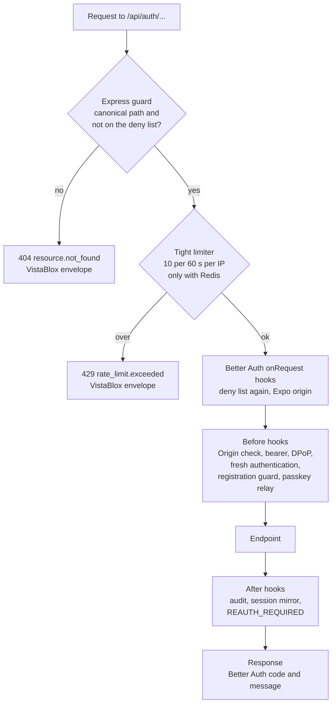

# Better Auth routes (`/api/auth/*`)

Valid for main at 48aa967 (2026-11-18).

This reference lists every endpoint that the running API answers under `/api/auth`: which Better Auth plugin provides it, whether it is usable, what it needs, what it accepts and returns, and which VistaBlox hooks, limiters and DPoP or fresh-authentication guards sit in front of it. It is read by the mobile developers who call the sign-in and linking endpoints, by the staff-console developers who call the passkey endpoints, and by engineers who change the auth configuration. The concepts behind it (session levels, DPoP, the device ceremonies, fresh authentication) are in [../authentication.md](../authentication.md); the `/v1/auth/*` routes are in [auth-customer.md](auth-customer.md) and [auth-staff.md](auth-staff.md).

## Routes

All paths are under `/api/auth`. "Anonymous" means no session is needed; "Session" means a live session from a signed bearer token or the session cookie.

| Method | Path | Provided by | State | Auth | Purpose |
| --- | --- | --- | --- | --- | --- |
| [GET](#get-ok) | `/ok` | core | on | Anonymous | Liveness answer of the auth handler |
| [GET](#get-error) | `/error` | core | on | Anonymous | Error landing for redirect flows |
| [POST](#post-sign-insocial) | `/sign-in/social` | core | on for Google and Apple when configured | Anonymous | Sign in with an ID token, or start a redirect flow |
| [GET, POST](#get-post-callbackid) | `/callback/:id` | core | on | Anonymous | Finish a redirect flow |
| [GET, POST](#get-post-get-session) | `/get-session` | core | on (POST answers 405) | Anonymous; DPoP when the session is bound | Read the current session |
| [POST](#post-sign-out) | `/sign-out` | core | on | Anonymous; DPoP when the session is bound | End the presented session |
| [GET](#get-list-sessions) | `/list-sessions` | core | on | Session | List the caller's live sessions |
| [POST](#post-revoke-session) | `/revoke-session` | core | on | Session; fresh for customers | End one session by token |
| [POST](#post-revoke-sessions) | `/revoke-sessions` | core | on | Session; fresh for customers | End every session, the current one included |
| [POST](#post-revoke-other-sessions) | `/revoke-other-sessions` | core | on | Session; fresh for customers | End every session but the current one |
| [POST](#post-update-session) | `/update-session` | core | on, accepts nothing | Session | Update custom session fields (none are writable) |
| [POST](#post-update-user) | `/update-user` | core | on | Session | Change the caller's `name` or `image` |
| [POST](#post-change-email) | `/change-email` | core | off by configuration | Session | Always answers 400 |
| [POST](#post-delete-user) | `/delete-user` | core | off by configuration | Session | Always answers 404 |
| [GET](#get-delete-usercallback) | `/delete-user/callback` | core | off by configuration | Anonymous | Always answers 404 |
| [GET](#get-verify-email) | `/verify-email` | core | token check only | Anonymous | Verify an email token (none is ever issued) |
| [POST](#post-send-verification-email) | `/send-verification-email` | core | off by configuration | Anonymous | Always answers 400 |
| [POST](#post-link-social) | `/link-social` | core | on | Session | Link a Google or Apple identity |
| [GET](#get-list-accounts) | `/list-accounts` | core | on | Session | List the linked identities |
| [POST](#post-unlink-account) | `/unlink-account` | core | on | Session; fresh for customers | Unlink an identity |
| [POST](#post-refresh-token) | `/refresh-token` | core | on | Session | Refresh and return provider tokens |
| [POST](#post-get-access-token) | `/get-access-token` | core | on | Session | Return a valid provider access token |
| [GET](#get-account-info) | `/account-info` | core | on | Session | Return the provider profile |
| [POST](#post-deviceenrolverify) | `/device/enrol/verify` | vistablox-device-auth | on | Pending session and DPoP proof | Device enrolment (E2), second door |
| [POST](#post-deviceloginverify) | `/device/login/verify` | vistablox-device-auth | on | DPoP proof and device signature | Device login (L2), second door |
| [GET](#get-passkeygenerate-register-options) | `/passkey/generate-register-options` | passkey | on, staff only | Bootstrap context | WebAuthn registration options |
| [GET](#get-passkeygenerate-authenticate-options) | `/passkey/generate-authenticate-options` | passkey | on, staff only | Anonymous | WebAuthn authentication options |
| [POST](#post-passkeyverify-registration) | `/passkey/verify-registration` | passkey | on, staff only | Bootstrap context | Store a new passkey |
| [POST](#post-passkeyverify-authentication) | `/passkey/verify-authentication` | passkey | on, staff only | Anonymous | Sign in with a passkey |
| [GET](#get-passkeylist-user-passkeys) | `/passkey/list-user-passkeys` | passkey | on | Session | List the caller's passkeys |
| [POST](#post-passkeyupdate-passkey) | `/passkey/update-passkey` | passkey | on | Session | Rename a passkey |

Blocked, answering `404`: `POST /sign-up/email`, `POST /sign-in/email`, `POST /change-password`, `POST /request-password-reset`, `POST /reset-password`, `GET /reset-password/:token`, `POST /verify-password`, `GET /expo-authorization-proxy` and `POST /passkey/delete-passkey` ([details](#blocked-endpoints)).

## How this reference was made

Better Auth, not this repository, defines most of these endpoints. The statements below come from three sources, and the source is marked where it matters.

| Mark | Source |
| --- | --- |
| (repository) | Code in this repository, cited as `path:line` at 48aa967 |
| (library) | The installed packages `better-auth`, `@better-auth/core`, `@better-auth/passkey` and `@better-auth/expo`, all 1.7.2 as pinned in `package.json` and `package-lock.json` (read in `node_modules/better-auth/dist/api/routes/*.mjs`, `node_modules/@better-auth/passkey/dist/index.mjs` and `node_modules/@better-auth/expo/dist/index.js`). Library behaviour is cited by file and function, not by line, because the files are not part of this repository |
| (observed) | The repository's own `createBetterAuth` factory was built from this tree in a scratch directory with every plugin the HTTP instance uses, its database pool pointing at nothing, and called directly through `auth.handler` with anonymous requests. This shows the status and body of calls that need no database row. It does not show anything that needs a session |

The endpoint list is exact: the instance exposes 41 entries in `auth.api`, 40 of them with an HTTP path (`setPassword` is server-only and has none). 9 of the 40 are blocked by the deny list ([Blocked endpoints](#blocked-endpoints)), which leaves 31 reachable. Of those 31, four answer an error to every caller because the feature behind them is not configured (`change-email`, `delete-user`, `delete-user/callback`, `send-verification-email`), and `verify-email` accepts only a token that this API never issues.

Not verified: authenticated outcomes of these endpoints (the success bodies after a real sign-in, a real link, a real revoke) were read from code and were not run against a database; the Google and Apple token checks were not run against the providers; which of these endpoints the mobile app actually calls could not be checked (the `vistablox-mobile` repository was not available). The one statement in the code about the app is a comment saying that it calls `unlink-account` directly (`src/modules/auth/infrastructure/customer/better-auth-fresh-authentication.plugin.ts:9-11`).

## What every request goes through

1. **Mount.** `app.all("/api/auth/*splat", ...)` runs the path guard, then the tight limiter when one exists, then Better Auth's Node handler, before the JSON body parser (`src/app.ts:570-573`, `src/app.ts:588`). Better Auth reads its own body. `/api/auth` and `/api/auth/` do not match the mount (the Express 5 pattern needs at least one more path segment) and fall through to `404 resource.not_found`; the match is case-insensitive and tolerates a trailing or doubled slash, which is why the guard in item 2 judges the raw path again (observed on a bare Express 5.2.1 app with the same pattern).

   > Pending #237: `createApp` is split into per-module compose functions under `src/composition`; the mount does not change, but the `src/app.ts` line numbers cited here move.
2. **Path guard.** `rejectDisabledAuthRoutes` refuses with `404 resource.not_found` any path that is not canonical (lower-case `/api/auth/` plus segments of unreserved characters only, no dot segments, no encoded dots or slashes, no backslash, no `;` parameter, no trailing slash) and any path on the deny list (`src/modules/auth/api/shared/reject-disabled-auth.ts:28`, `src/modules/auth/domain/disabled-auth-routes.ts:63`, `src/modules/auth/domain/disabled-auth-routes.ts:78`). The deny list is: any path containing `password`, `/sign-in/email` and `/sign-up/email`, the `/email-otp` and `/sign-in/email-otp` prefixes, `/passkey/delete-passkey`, and `/expo-authorization-proxy` (`src/modules/auth/domain/disabled-auth-routes.ts:37-52`). The same list is applied a second time inside Better Auth by the plugin `vistablox-disabled-routes`, which answers an empty `404` on the pathname Better Auth is about to route (`src/modules/auth/infrastructure/shared/better-auth-disabled-routes.plugin.ts:22-28`).
3. **Tight limiter.** `TIGHTENED_RATE_LIMIT` is 10 requests per 60 seconds (`src/shared/http/rate-limit.ts:23-26`). No account is known at this mount, so the key is `rate_limit_hint:tightened:ip:<address>`, the address normalised (an IPv6 address becomes its /64) (`src/shared/http/rate-limit.ts:68-129`). The same bucket counts the four `/v1/auth/mobile` device routes, the staff invitation accept route and the staff WebAuthn routes from the same address. The limiter exists only when `RATE_LIMIT_CACHE_URL` connected at boot, and it lets a request through when the store errors (`src/shared/http/rate-limit.ts:54-61`). A refused request answers `429 rate_limit.exceeded` with `Retry-After: 60`. Better Auth's own limiter is on by default in production but has no key here, because the factory turns IP tracking off, so it never limits (`src/modules/auth/infrastructure/shared/better-auth.factory.ts:455`) (library `api/rate-limiter`).
4. **Origin check (library).** For a non-`GET` request that carries a `Cookie` header, the `Origin` (or `Referer`) must match `trustedOrigins`, else `403 INVALID_ORIGIN` or `403 MISSING_OR_NULL_ORIGIN`. For every non-`GET` request, a `callbackURL`, `redirectTo`, `errorCallbackURL` or `newUserCallbackURL` in the body, and a `callbackURL` in the query, must be a trusted origin or a relative path, else `403 INVALID_CALLBACK_URL` (or the matching `INVALID_*` code). A native client that sends a bearer token and no cookie is not subject to the first rule. `trustedOrigins` is `AUTH_TRUSTED_ORIGINS`, plus `https://appleid.apple.com` when Apple is enabled, plus the Expo wildcards outside production (`src/server.ts:224-230`); the same list is the CORS allow-list (`src/server.ts:582`).
5. **Credentials.** A native client sends `Authorization: Bearer <value.signature>`, the exact value of the `set-auth-token` response header. The factory registers `bearer({ requireSignature: true })`, so a bare session token (such as the `token` field in some response bodies) is not accepted (`src/modules/auth/infrastructure/shared/better-auth.factory.ts:314`). A browser client sends the session cookie `vb.session_token`, named `__Secure-vb.session_token` when `NODE_ENV` is `production` (library cookie naming, with the factory's `cookiePrefix` `vb`). When both are present the bearer wins.
6. **Session level.** No `/api/auth` endpoint looks at the session level, with two exceptions: the four fresh-authentication paths and `/device/enrol/verify`. An `oauth_pending` session can therefore read `get-session`, link, list and unlink accounts, and sign out ([../authentication.md](../authentication.md#authentication-levels)).
7. **DPoP.** The plugin `vistablox-dpop` runs for every HTTP request that presents a live session, except the four ceremony paths (`/passkey/verify-registration`, `/passkey/verify-authentication`, `/device/enrol/verify`, `/device/login/verify`), which verify the proof themselves. A bound session needs a fresh, matching, unreplayed proof with the `ath` claim over the bearer token; an unbound session is never required to present one (`src/modules/auth/infrastructure/shared/better-auth-dpop.plugin.ts:49-54`); the rules are in [../authentication.md](../authentication.md#dpop-proofs). Failures answer `401` with `code` `DPOP_PROOF_MISSING`, `DPOP_PROOF_INVALID`, `DPOP_REPLAY` or `DPOP_KEY_MISMATCH` and the header `WWW-Authenticate: DPoP error="invalid_dpop_proof"`. The proof's `htu` for this surface is `BETTER_AUTH_URL` plus `/api/auth/<path>`. Calls that the `/v1` routes make to Better Auth through `auth.api.*` carry headers but no request and are not checked here; `/v1` checks them in its own middleware.
8. **Session creation.** Every session created through any endpoint passes a database hook that refuses it in these cases (the error is Better Auth's `{ code, message }`):

| Status | Code | Condition |
| --- | --- | --- |
| 403 | `SESSION_CONTEXT_REQUIRED` | The session is created outside an authentication endpoint |
| 403 | `OAUTH_EMAIL_NOT_VERIFIED` | An OAuth sign-in (`/sign-in/social`, `/callback/google`, `/callback/apple`) whose user has no verified email. The same code is raised when the user row is created (`src/modules/auth/infrastructure/staff/better-auth-staff-account-guard.plugin.ts:47`, `src/modules/auth/infrastructure/shared/better-auth.factory.ts:253`) |
| 403 | `STAFF_ACCOUNT_DISABLED` | The user has `disabledAt` set (customers too) |
| 403 | `STAFF_ACCOUNT_RECOVERY_REQUIRED` | The user has `recoveryRequiredAt` set and the path is not `/passkey/verify-registration` (customers too) |
| 403 | `STAFF_PASSKEY_REQUIRED` | A staff user signs in by any path other than the two passkey verify paths |

The checks run in that order (`src/modules/auth/infrastructure/staff/better-auth-staff-account-guard.plugin.ts:36-68`). The level the new session gets is decided in the same place: `staff_passkey` for a staff passkey verification, `oauth_pending` for a social sign-in, `device_biometric` for E2 and L2, otherwise `unassured` (`src/modules/auth/infrastructure/shared/better-auth.factory.ts:498-513`).

### Errors every endpoint can answer

| Status | Code | Condition |
| --- | --- | --- |
| 404 | `resource.not_found` (VistaBlox envelope) | The path guard refused the path, or the path is not an endpoint |
| 404 | none (empty body) | The second deny-list layer inside Better Auth refused the path |
| 429 | `rate_limit.exceeded` (VistaBlox envelope) | The tight limiter refused; `Retry-After: 60` |
| 401 | `DPOP_PROOF_MISSING`, `DPOP_PROOF_INVALID`, `DPOP_REPLAY`, `DPOP_KEY_MISMATCH` | The request carries a live bound session and its proof fails (see item 7) |
| 400 | `VALIDATION_ERROR` | The body or query fails the library's schema, for example `[body.provider] Invalid input` (observed) |
| 403 | `INVALID_ORIGIN`, `MISSING_OR_NULL_ORIGIN`, `INVALID_CALLBACK_URL`, `INVALID_REDIRECT_URL`, `INVALID_ERROR_CALLBACK_URL`, `INVALID_NEW_USER_CALLBACK_URL` | Item 4 (library) |

Errors from Better Auth endpoints use the body `{ "code": "...", "message": "..." }`. They do not use the VistaBlox envelope (`type`, `code`, `title`, `status`, `detail`, `trace_id`), which only the guard and the limiter produce. The two parse failures of the VistaBlox JSON error handler do not apply here, because Better Auth parses its own body.

### Shapes of the objects these endpoints return

Better Auth returns a model's columns unless the field is declared `returned: false`. The factory declares none, so these are the keys, measured on the repository's own configuration (observed):

| Object | Keys |
| --- | --- |
| user | `id`, `name`, `email`, `emailVerified`, `image`, `createdAt`, `updatedAt`, `population`, `disabledAt`, `disabledReason`, `recoveryRequiredAt` |
| session | `id`, `token`, `userId`, `expiresAt`, `createdAt`, `updatedAt`, `ipAddress`, `userAgent`, `authenticationLevel`, `dpopJkt` |
| account (list-accounts) | `id`, `issuer`, `accountId`, `providerId`, `userId`, `createdAt`, `updatedAt`, `scopes`. Provider tokens and the password column are removed (library `parseAccountOutput`) |

`ipAddress` is always `null`, because IP tracking is off. `token` is the bare session token, which is not accepted as a bearer credential ([Credentials](#what-every-request-goes-through), item 5). `GET /api/auth/list-sessions` returns the `token` of each of the caller's own sessions, and `POST /api/auth/revoke-session` takes one.

## Health and error landing

### GET /ok

- **Provided by.** core (`ok`). **State.** On.
- **Auth.** Anonymous. Items 1 to 3 above apply (guard, tight limiter); nothing else.
- **Success.** `200 { "ok": true }` (observed).
- **Notes.** This is the auth handler's own liveness answer. It is not a health probe for the API (use `/health/live` and `/health/ready`, see [platform.md](platform.md)), and it counts against the tight limiter.

### GET /error

- **Provided by.** core (`error`). **State.** On.
- **Auth.** Anonymous.
- **Request.** Query `error` (a code; a value with any character outside letters, digits, `_`, `-` and `'` becomes `UNKNOWN`) and `error_description` (HTML-escaped when rendered) (library).
- **Success.** When `NODE_ENV` is `production`, which the images set on staging too, the answer is `302` with `Location: /?error=<code>` and `&error_description=...` when one was sent. In any other environment it is `200 text/html`, an error page (observed). The repository sets neither `onAPIError.errorURL` nor a custom error page, so the production redirect applies (library `error`, `isProduction`). This API serves nothing at `/`, so the redirect lands on `404 resource.not_found`.
- **Notes.** Redirect-flow failures of `/callback/:id` end here: for example a callback with no `state` answers `302` to `<BETTER_AUTH_URL>/api/auth/error?error=state_not_found` (observed).

## Sign-in and callback

### POST /sign-in/social

- **Provided by.** core (`signInSocial`) with the Google and Apple providers configured in the factory. **State.** On for a provider only when it is configured: Google needs `GOOGLE_OAUTH_ENABLED=true` with a client id and secret, Apple needs `APPLE_OAUTH_ENABLED=true` with all four `APPLE_*` values (`src/server.ts:329-331`, `src/server.ts:339-343`). An unconfigured or unknown provider answers `404 PROVIDER_NOT_FOUND` (observed).
- **Auth.** Anonymous; the request creates the session. A DPoP proof is optional for the call itself but decides whether the new session is bound (below).
- **Request.** JSON body (library schema):

| Field | Type | Meaning |
| --- | --- | --- |
| `provider` | string, required | A Better Auth provider name. Only `google` and `apple` can work here |
| `idToken` | object, optional | `token` (required), `nonce`, `accessToken`, `refreshToken`, `expiresAt`, and for Apple `user` (`name.firstName`, `name.lastName`, `email`). With it the call is the native token exchange; without it the call starts a redirect flow |
| `callbackURL`, `newUserCallbackURL`, `errorCallbackURL` | string | Must be a trusted origin or a relative path (item 4) |
| `disableRedirect` | boolean | Return the authorize URL in the body instead of redirecting |
| `scopes`, `loginHint`, `additionalParams`, `additionalData`, `requestSignUp` | various | Passed to the provider; not used by the app flow |

- **ID-token checks (library, with this configuration).** Google: the token's signature (Google's published keys), issuer `https://accounts.google.com` or `accounts.google.com`, audience `GOOGLE_CLIENT_ID`, age at most 1 hour. Apple: Apple's published keys, issuer `https://appleid.apple.com`, audience `APPLE_CLIENT_ID` (the factory sets neither `audience` nor `appBundleIdentifier`), age at most 1 hour, nonce compared exactly or as its SHA-256. For both, the `nonce` claim is checked only when the request sends `idToken.nonce`; without it the token is accepted for its whole hour of validity ([Known limitations](#known-limitations), item 1). A token without an email is refused.
- **Success, token branch.** `200 { "redirect": false, "token": "<bare session token>", "user": { ... } }`, the response header `set-auth-token: <value.signature>` (the only form the API accepts back as a bearer credential) and a `Set-Cookie` for `vb.session_token`. The new session has level `oauth_pending`. Without `idToken`: `200 { "url": "<authorize URL>", "redirect": true }` with a `Location` header, or `redirect: false` when `disableRedirect` is true; state is stored in `auth_verification` (library).
- **Errors.** In addition to [the common errors](#errors-every-endpoint-can-answer) and the session-creation table:

| Status | Code | Condition |
| --- | --- | --- |
| 404 | `PROVIDER_NOT_FOUND` | The provider is not configured, or is not a known provider name |
| 401 | `INVALID_TOKEN` | The ID token fails any check above |
| 401 | `FAILED_TO_GET_USER_INFO`, `USER_EMAIL_NOT_FOUND` | The provider gave no profile, or no email |
| 401 | `OAUTH_LINK_ERROR` | An existing user has the same email and the identity cannot be linked automatically (Apple, which is not a trusted provider here, with an unverified email), or linking, user creation or session creation failed; the `message` carries the library's reason (`account not linked`, `unable to link account`, `unable to create user`, `unable to update account`, `unable to create session`; library `oauth2/link-account.mjs`) |
| 403 | `OAUTH_EMAIL_NOT_VERIFIED` | The provider did not verify the email of a user that would be created, or of the session about to be created |
| 403 | `STAFF_PASSKEY_REQUIRED`, `STAFF_ACCOUNT_DISABLED`, `STAFF_ACCOUNT_RECOVERY_REQUIRED` | Session-creation table above |

- **Hooks and side effects.** A valid DPoP proof on this request (`htm` `POST`, `htu` `<BETTER_AUTH_URL>/api/auth/sign-in/social`, `ath` over the bearer token when an `Authorization` header is present) binds the new session to the proof's key; without one the session is created unbound and `/v1/auth/mobile/enrol/verify` later refuses it (`src/modules/auth/infrastructure/shared/dpop-session-creation.ts:109-148`). The factory's hooks write the local account `account.accounts` (status `active`) through `onUserCreated`, and the audit plugin writes `authentication.identity_created`, `authentication.session_created`, `authentication.oauth_verified`, the `auth.sessions` mirror row, and the `auth.login_methods` row for the provider (`src/modules/auth/infrastructure/shared/better-auth.factory.ts:247-259`, `src/modules/auth/infrastructure/shared/better-auth-audit.plugin.ts:208-215`).
- **Source.** (`src/modules/auth/infrastructure/shared/better-auth.factory.ts:243-244`); library `api/routes/sign-in.mjs`.

### GET, POST /callback/:id

- **Provided by.** core (`callbackOAuth`). **State.** On; `:id` is a provider id (`google` or `apple`; any other id ends in a redirect with `error=oauth_provider_not_found`).
- **Auth.** Anonymous; the signed `state` created by a prior `sign-in/social` or `link-social` call is the credential.
- **Request.** Query or form body with `code`, `state`, `error`, `error_description`, `device_id`, `user` (Apple's JSON, first sign-in only), `iss`. A `POST` (Apple's form post) is merged with the query and answered with a redirect to the same URL as `GET` (library).
- **Success.** `302` to the `callbackURL` that was stored with the state, with the session cookie set. When that URL has a non-HTTP scheme and is a trusted origin, the Expo hook appends the cookie as a `cookie` query parameter ([plugin table](../authentication.md#plugins)). The new session has level `oauth_pending`. For a link flow the identity is added to the user in the state and the browser is redirected; no session is created.
- **Errors.** Every failure is a `302` to `<BETTER_AUTH_URL>/api/auth/error?error=<code>` (or to the `errorCallbackURL` in the state), for example `state_not_found`, `no_code`, `invalid_code`, `oauth_provider_not_found`, `issuer_mismatch`, `unable_to_get_user_info`, `email_not_found`, `no_callback_url`, `unable_to_link_account`, `email_does_not_match`, `account_already_linked_to_different_user` (library; only the first is observed). Session-creation refusals (item 8) surface the same way.
- **Notes.** The design record and the app use the ID-token exchange; this redirect flow exists because Better Auth provides it. It was not exercised in this analysis. Apple's redirect form post needs `https://appleid.apple.com` among the trusted origins, which the server adds when Apple is enabled.

## Sessions

### GET, POST /get-session

- **Provided by.** core (`getSession`). **State.** On for `GET`. `POST` answers `405 METHOD_NOT_ALLOWED_DEFER_SESSION_REQUIRED`, because the factory does not enable `deferSessionRefresh` (observed).
- **Auth.** Anonymous: without a session credential the answer is `200` with the body `null` (observed). With one, DPoP applies when the session is bound.
- **Request.** Query `disableCookieCache` and `disableRefresh`, both optional booleans. Header `Authorization: Bearer <value.signature>` or the session cookie; `DPoP` when bound.
- **Success.** `200 { "session": { ... }, "user": { ... } }` with the key sets in [Shapes](#shapes-of-the-objects-these-endpoints-return), `Cache-Control: no-store`. For a rolling session (`oauth_pending`, `staff_passkey`) older than the 5-minute update age, the call moves `expiresAt` to 30 minutes from now and re-issues the cookie (library). The 30 minutes and the 5 minutes are set at (`src/modules/auth/infrastructure/shared/better-auth.factory.ts:194-195`). A `device_biometric` session is never refreshed.
- **Errors.** `401 REAUTH_REQUIRED` (message "This session reached its time limit. Sign in on this device again.") when a `device_biometric` session is past its idle (5 minutes) or absolute (30 minutes) limit; the row is deleted by that call and the audit reason is `expired` (`src/modules/auth/infrastructure/customer/better-auth-device-session-lifetime.plugin.ts:158-178`). A session that is unknown, expired or signed wrongly answers `200 null`. DPoP failures as in item 7.
- **Notes.** The `/v1` middleware does not call this HTTP route; it calls `auth.api.getSession` in-process ([../authentication.md](../authentication.md#requireauthentication)). A client can use this route to learn whether a stored token is still alive.

### POST /sign-out

- **Provided by.** core (`signOut`). **State.** On.
- **Auth.** Anonymous endpoint that acts on the credential it is given. If the credential is a live bound session, the DPoP plugin demands a valid proof first. With no credential or a dead one, the answer is still `200 { "success": true }` (observed).
- **Request.** Optional JSON `{ callbackURL, disableRedirect, state }` (provider logout; neither Google nor Apple has a logout URL in the library, so these have no effect here).
- **Success.** `200 { "success": true }`; the session row is deleted (audit reason `sign_out`) and the session cookie cleared.
- **Notes.** The design record says the customer app has no user-facing sign-out (AD-259 item 7); the endpoint exists in the library and is reachable.

### GET /list-sessions

- **Provided by.** core (`listSessions`). **State.** On.
- **Auth.** Session. The library requires the session to be younger than 24 hours (its `freshAge` default, not set by the repository), else `403 SESSION_NOT_FRESH`; customer device sessions never reach that age. DPoP applies.
- **Success.** `200` and an array of the caller's unexpired sessions as session objects ([Shapes](#shapes-of-the-objects-these-endpoints-return)), each with its bare `token`.
- **Errors.** `401 UNAUTHORIZED` without a session (observed); `403 SESSION_NOT_FRESH` (library).
- **Notes.** This is Better Auth's own table, not the product mirror. The customer-facing list is `GET /v1/auth/sessions` ([auth-customer.md](auth-customer.md#get-v1authsessions)).

### POST /revoke-session

- **Provided by.** core (`revokeSession`). **State.** On.
- **Auth.** Session (read without any cookie cache). **Customer sessions must be fresh**: a `device_biometric` session created within the last 5 minutes. A staff session skips this check. DPoP applies.
- **Request.** `{ "token": "<bare session token>" }`, a token from `list-sessions`.
- **Success.** `200 { "status": true }`. The session is deleted only when it belongs to the caller; for any other token the answer is the same `200 { "status": true }` and nothing is deleted (library). Audit reason `self_revoke_one`.
- **Errors.** `401 UNAUTHORIZED`; `403 FRESH_AUTHENTICATION_REQUIRED` ("Sign in again on this device before continuing."); DPoP.
- **Hooks.** `vistablox-fresh-authentication`, `vistablox-dpop` (`src/modules/auth/infrastructure/customer/better-auth-fresh-authentication.plugin.ts:12-16`). The `/v1` equivalent is `POST /v1/auth/sessions/:session_id/revoke`.

### POST /revoke-sessions

- As `revoke-session`, with no body. Deletes every session of the caller, the current one included. `200 { "status": true }`; audit reason `self_revoke_all`. Fresh for customers; DPoP applies.

### POST /revoke-other-sessions

- As `revoke-sessions`, but spares the session that made the call. `200 { "status": true }`; audit reason `self_revoke_others`. Fresh for customers; DPoP applies. The `/v1` routes have no equivalent.

### POST /update-session

- **Provided by.** core (`updateSession`). **State.** On, but nothing can be written.
- **Auth.** Session; DPoP applies.
- **Request.** Any JSON object. The only fields the library could write are session fields with `input: true`; the factory declares `authenticationLevel` and `dpopJkt` with `input: false` and nothing else (`src/modules/auth/infrastructure/shared/better-auth.factory.ts:163-207`). A truthy value for either is refused with `400 FIELD_NOT_ALLOWED` ("authenticationLevel is not allowed to be set"). Any other key is ignored.
- **Success.** None: with nothing to write the answer is `400` with the message `No fields to update` (library).
- **Notes.** This is what stops a client from rebinding its session's DPoP key or raising its authentication level through the library's generic update route.

## User

### POST /update-user

- **Provided by.** core (`updateUser`). **State.** On.
- **Auth.** Session; DPoP applies. No fresh-authentication check.
- **Request.** A JSON object. `name` and `image` are accepted. `email` is refused with `400 EMAIL_CAN_NOT_BE_UPDATED`. A truthy `population`, `disabledAt`, `disabledReason` or `recoveryRequiredAt` is refused with `400 FIELD_NOT_ALLOWED`, because these are declared `input: false` on the HTTP instance (`src/modules/auth/infrastructure/shared/better-auth.factory.ts:163-173`). Other keys are ignored; an empty result is `400`.
- **Success.** `200 { "status": true }` (library).
- **Hooks.** After any user update, including a name change, `onUserUpdated` copies the user's email to `account.accounts.protected_contact_email` when the email is verified; because `email` cannot be changed here, it writes the value that is already there (`src/modules/account/application/account-provisioner.ts:15-21`).

### POST /change-email

- **State.** Off by configuration: `user.changeEmail` is not enabled, so an authenticated call answers `400 CHANGE_EMAIL_DISABLED` ("Change email is disabled") (library). Anonymous: `401 UNAUTHORIZED` (observed).
- **Notes.** Changing an email address is a staff operation in this product; no route exists.

### POST /delete-user

- **State.** Off by configuration: `user.deleteUser` is not enabled, so an authenticated call answers `404 NOT_FOUND` (library). Anonymous: `401 UNAUTHORIZED` (observed).
- **Notes.** Account closure is `POST /v1/auth/account-closure` ([auth-customer.md](auth-customer.md#post-v1authaccount-closure)).

### GET /delete-user/callback

- **State.** Off by configuration. Always `404 NOT_FOUND` (observed).

## Email verification

### GET /verify-email

- **Provided by.** core (`verifyEmail`). **State.** Reachable; no code path in the repository issues a verification token.
- **Auth.** Anonymous; the credential is the `token` query parameter, an HS256 JWT signed with `BETTER_AUTH_SECRET`.
- **Request.** Query `token` (required), `callbackURL` (optional, must be a trusted origin).
- **Success.** `200 { "user": ..., "status": true }`, or a redirect to `callbackURL`; an email that matches is marked verified (library).
- **Errors.** `401 INVALID_TOKEN` for any token that does not verify (observed with the token `x`), `TOKEN_EXPIRED`, `USER_NOT_FOUND`; with a `callbackURL` the same codes arrive as `?error=` on a redirect.
- **Notes.** A valid token can only be made by someone who holds `BETTER_AUTH_SECRET`.

### POST /send-verification-email

- **State.** Off by configuration: the factory sets no `emailVerification.sendVerificationEmail`, so the endpoint answers `400 VERIFICATION_EMAIL_NOT_ENABLED` ("Verification email isn't enabled") to every caller (observed). The `EMAIL_VERIFICATION_ENABLED` variable in `docker-compose.staging.yml` is read by no code (`docker-compose.staging.yml:192`).

## Linked identities

### POST /link-social

- **Provided by.** core (`linkSocialAccount`). **State.** On.
- **Auth.** Session; DPoP applies. **Not** guarded by fresh authentication (`link-social` is not in the sensitive-path set), although the design record lists linking among the actions that need it ([../authentication.md](../authentication.md#known-gaps-against-the-design-record)).
- **Request.** Like `sign-in/social`: `provider`, optional `idToken` (`token`, `nonce`, `accessToken`, `refreshToken`), `callbackURL`, `errorCallbackURL`, `disableRedirect`, `scopes`, `loginHint`, `additionalParams`, `additionalData`, `requestSignUp`.
- **Success.** Token branch: `200 { "url": "", "status": true, "redirect": false }` after the identity is added. Redirect branch: `200 { "url": "<authorize URL>", "redirect": true }`; the callback completes the link.
- **Rules (library, with this configuration).** The identity must not already belong to another user (`409 SOCIAL_ACCOUNT_ALREADY_LINKED`). The provider must be trusted (`google` is) or its email verified. The provider's email must equal the session user's email, else `401 LINKING_DIFFERENT_EMAILS_NOT_ALLOWED`; an Apple private-relay address therefore cannot be linked to a Google-registered account. An identity already linked to the same user only has its tokens refreshed.
- **Errors.** `401 UNAUTHORIZED`; `404 PROVIDER_NOT_FOUND`; `401 INVALID_TOKEN`; `401 LINKING_NOT_ALLOWED`; `401 LINKING_DIFFERENT_EMAILS_NOT_ALLOWED`; `417 LINKING_FAILED`; `409 SOCIAL_ACCOUNT_ALREADY_LINKED`; DPoP.
- **Notes.** No audit row is written for a link, and no `auth.login_methods` row: that row appears when the user next signs in through the new provider ([Known limitations](#known-limitations), item 4).

### GET /list-accounts

- **Provided by.** core (`listUserAccounts`). **State.** On.
- **Auth.** Session; DPoP applies.
- **Success.** `200` and an array of `{ id, providerId, issuer, accountId, userId, createdAt, updatedAt, scopes }` (library). `id` is the value `unlink-account` takes.

### POST /unlink-account

- **Provided by.** core (`unlinkAccount`) with two repository hooks. **State.** On.
- **Auth.** Session; **fresh for customers**; DPoP applies. The library also demands a session younger than 24 hours (`403 SESSION_NOT_FRESH`).
- **Request.** `{ "accountId": "<id from list-accounts>" }`.
- **Success.** `200 { "status": true }` after the `auth_account` row is deleted.
- **Errors.** `403 FRESH_AUTHENTICATION_REQUIRED`; `403 REGISTRATION_LOGIN_METHOD_LOCKED` (the identity the user registered with, which is the `auth_account` row with the earliest `createdAt`, whatever else is linked) (`src/modules/auth/infrastructure/customer/better-auth-registration-account-guard.plugin.ts:45-57`); `400 FAILED_TO_UNLINK_LAST_ACCOUNT` (the library's own refusal; for a customer the registration guard answers first, because the last remaining account is the registration account); `400 ACCOUNT_NOT_FOUND`; `401 UNAUTHORIZED`; DPoP.
- **Hooks.** Order: fresh authentication, then the registration guard; the guard also runs for the in-process call the `/v1` route makes. The `/v1` equivalent is `POST /v1/auth/login-methods/:method_type/unlink`, which looks the account up by provider and maps the two refusals to `409 authentication.registration_login_method_locked` ([auth-customer.md](auth-customer.md#post-v1authlogin-methodsmethod_typeunlink)).
- **Notes.** The `auth.login_methods` row is not deleted, and no audit row is written ([Known limitations](#known-limitations), item 4).

### POST /refresh-token

- **Provided by.** core (`refreshToken`). **State.** On.
- **Auth.** Session (an anonymous HTTP call answers `401` with an empty body, observed); DPoP applies.
- **Request.** `{ "accountId": "<auth_account id>" }` (or `{ "useAccountCookie": true }`, which does nothing here because the factory does not store an account cookie), optional `userId` ignored when a session exists.
- **Success.** `200` with the decrypted `accessToken`, `refreshToken`, `accessTokenExpiresAt`, `refreshTokenExpiresAt`, `scope`, `idToken`, `providerId`, `accountId`; the stored tokens are replaced (encrypted, `encryptOAuthTokens: true`) (library).
- **Errors.** `400 ACCOUNT_NOT_FOUND`, `PROVIDER_NOT_SUPPORTED`, `TOKEN_REFRESH_NOT_SUPPORTED`, `REFRESH_TOKEN_NOT_FOUND`, `FAILED_TO_REFRESH_ACCESS_TOKEN`; `401`.
- **Notes.** The tokens belong to the caller's own linked identity. Because ID-token sign-in stores only what the app sent, a customer who signed in with the token exchange usually has no refresh token and gets `REFRESH_TOKEN_NOT_FOUND`.

### POST /get-access-token

- As `refresh-token`, answering `200 { accessToken, accessTokenExpiresAt, scopes, idToken }` (library `getValidAccessToken`; the library's OpenAPI text also lists `tokenType`, which the handler does not return); it refreshes first when the stored access token expires within 5 seconds and a refresh token exists. Errors `400 ACCOUNT_NOT_FOUND`, `PROVIDER_NOT_SUPPORTED`, `FAILED_TO_GET_ACCESS_TOKEN`; `401`. Session; DPoP applies; no fresh check.

### GET /account-info

- **Provided by.** core (`accountInfo`). **State.** On.
- **Auth.** Session; DPoP applies. Query `accountId` (required unless `useAccountCookie=true`).
- **Success.** `200 { user: { name, email, image, emailVerified }, account: { id, providerId, issuer, accountId }, data: { ...provider profile } }` after a call to the provider with the stored access token (library).
- **Errors.** `400 ACCOUNT_NOT_FOUND`, `PROVIDER_NOT_CONFIGURED`, `ACCESS_TOKEN_NOT_FOUND`; `401`.

## Device ceremonies (second door)

The two endpoints below are the real implementation of enrolment (E2) and login (L2). The `/v1/auth/mobile/enrol/verify` and `/v1/auth/mobile/login/verify` routes call them in-process and reshape the result. Better Auth also mounts them at their own paths, and the deny list does not cover them (`src/modules/auth/infrastructure/customer/better-auth-device-auth.plugin.ts:72-224`). The plugin's own comment calls these paths "unused, never client-facing". Differences from the `/v1` doors: the DPoP `htu` is `<BETTER_AUTH_URL>/api/auth/device/...`; the VistaBlox DPoP-key limiter does not run (only the tight IP limiter does); errors have the Better Auth shape, and a response is not parsed through a Zod schema. The plugin repeats every check on both doors, so the second door grants nothing the first does not ([../authentication.md](../authentication.md#device-bound-login)).

### POST /device/enrol/verify

- **Provided by.** `vistablox-device-auth`. **State.** On.
- **Auth.** A live `oauth_pending` session bound to the request's DPoP key, and a proof with `ath` over that session's bearer token. The DPoP plugin skips this path; the plugin verifies the proof itself.
- **Request / success.** As E2 in [auth-customer.md](auth-customer.md#post-v1authmobileenrolverify), except that the body is parsed by the plugin and a wrong body answers `400 VALIDATION_ERROR`. Success is `200 { device_id, status: "active", session_expires_at, authentication_level: "device_biometric" }` with `set-auth-token`.
- **Errors.** `400 DEVICE_JWS_INVALID` for no session, a non-pending session or an unbound one (observed anonymous); the codes in the E2 table of [auth-customer.md](auth-customer.md#post-v1authmobileenrolverify).

### POST /device/login/verify

- **Provided by.** `vistablox-device-auth`. **State.** On.
- **Auth.** A DPoP proof (no `ath`; any `Authorization` header is ignored) and the device signature.
- **Request / success.** As L2 in [auth-customer.md](auth-customer.md#post-v1authmobileloginverify). Success is `200 { device_id, session_expires_at, authentication_level: "device_biometric" }` with `set-auth-token`.
- **Errors.** `401 DPOP_PROOF_MISSING` without a proof (observed); the codes in the L2 table.

## Passkeys (staff only)

Every passkey ceremony, from every origin, checks that the passkey's user is a `staff_partner`; a customer is refused with `403 PASSKEY_STAFF_ONLY`. The relying party is `WEBAUTHN_RP_ID` (or the host of `BETTER_AUTH_URL`), the name `VistaBlox`, the accepted origins `WEBAUTHN_ORIGIN` and `PASSKEY_ANDROID_ORIGINS`; resident keys and user verification are required, attestation is `none`, and a challenge lives 300 seconds (`src/modules/auth/infrastructure/shared/better-auth.factory.ts:349-355`) (library `MAX_AGE_IN_SECONDS`). The challenge is a signed cookie `vb.better-auth-passkey` (`__Secure-` prefixed in production); for clients without a cookie jar, the plugin `vistablox-passkey-challenge-header` also returns it in the response header `set-passkey-challenge` (listed in `Access-Control-Expose-Headers`) and reads it back from the request header `x-passkey-challenge` on both verify paths (`src/modules/auth/infrastructure/shared/better-auth-passkey-challenge-header.plugin.ts:11-17`). The staff flows built on these endpoints are in [../staff-access.md](../staff-access.md) and [auth-staff.md](auth-staff.md).

### GET /passkey/generate-register-options

- **Provided by.** passkey. **State.** On, staff only.
- **Auth.** Without a live session, a single-use bootstrap `context` is required (an `auth_verification` row of the form `passkey-bootstrap:<value>`, 15 minutes, created by a staff invitation or a recovery) (`src/modules/auth/infrastructure/shared/passkey-bootstrap.ts:5`, `src/modules/auth/infrastructure/shared/better-auth.factory.ts:359-368`). With a live session the library takes the session's user and does not call the bootstrap check (library `@better-auth/passkey` `resolveRegistrationUser`); a customer session then gets options and is refused only at `verify-registration` (below).
- **Request.** Query `context` (the bootstrap value), `name`, `authenticatorAttachment` (`platform` or `cross-platform`).
- **Success.** `200` WebAuthn registration options (challenge, `rp`, `user`, `pubKeyCredParams`, `excludeCredentials`, `authenticatorSelection`, `attestation: "none"`) and the challenge cookie and header (library).
- **Errors.** `401 PASSKEY_BOOTSTRAP_INVALID` ("This passkey enrollment link is invalid or expired.", observed without a context); `403 PASSKEY_STAFF_ONLY` (raised through the bootstrap path only).

### GET /passkey/generate-authenticate-options

- **Provided by.** passkey. **State.** On.
- **Auth.** Anonymous; with a session the options list that user's credentials as `allowCredentials`.
- **Success.** `200` WebAuthn authentication options, `userVerification: "preferred"` (library), and the challenge cookie and header. DPoP applies when a live bound session is presented.

### POST /passkey/verify-registration

- **Provided by.** passkey. **State.** On, staff only.
- **Auth.** The challenge from `generate-register-options`; no session is required. The factory's hook refuses a non-staff user, checks that a presented bound session of the same user uses the proof key, and consumes the bootstrap context. It deletes the user's earlier passkeys when the bootstrap says `replaceCredentials`, and clears `recoveryRequiredAt` (`src/modules/auth/infrastructure/shared/better-auth.factory.ts:369-404`). The hook also has a branch that refuses a registration carrying no bootstrap context with `403 PASSKEY_ALREADY_ENROLLED` when the user already has a passkey. It is reachable: when `generate-register-options` was called with a live session and no `context`, the stored context is null, and a staff user, who can hold a session only through a passkey, then gets this refusal here (library `@better-auth/passkey` `generate-register-options` and `verify-registration`; read, not run).
- **Request.** `{ response: <WebAuthn attestation>, name?, createSession? }`.
- **Success.** `200` the passkey row, and with `createSession: true` also the session and user (level `staff_passkey`).
- **Errors.** `400 CHALLENGE_NOT_FOUND`, `FAILED_TO_VERIFY_REGISTRATION`; `401 PASSKEY_BOOTSTRAP_INVALID`; `403 PASSKEY_STAFF_ONLY`; DPoP codes from the inline check.

### POST /passkey/verify-authentication

- **Provided by.** passkey. **State.** On, staff only.
- **Auth.** The challenge from `generate-authenticate-options` and a valid assertion. Afterwards the factory's hook looks the credential up (`401 PASSKEY_NOT_RECOGNIZED` when this instance has none), refuses a non-staff user, and checks the presented session's DPoP key (`src/modules/auth/infrastructure/shared/better-auth.factory.ts:406-423`).
- **Request.** `{ response: <WebAuthn assertion> }`.
- **Success.** `200 { session, user }`; the session has level `staff_passkey` and `last_fresh_auth_at` set in the mirror.
- **Errors.** `400 CHALLENGE_NOT_FOUND`; `401 PASSKEY_NOT_FOUND`, `AUTHENTICATION_FAILED`, `PASSKEY_NOT_RECOGNIZED`; `403 PASSKEY_STAFF_ONLY`, `STAFF_ACCOUNT_DISABLED`, `STAFF_ACCOUNT_RECOVERY_REQUIRED`; DPoP codes. A failure is audited as `authentication.login_failed` with `failure_code`.

### GET /passkey/list-user-passkeys

- **Provided by.** passkey. **State.** On.
- **Auth.** Session; DPoP applies. **Success.** `200` and an array of the caller's passkey rows, including `publicKey` (library). Anonymous: `401 UNAUTHORIZED` (observed).

### POST /passkey/update-passkey

- **Provided by.** passkey. **State.** On.
- **Auth.** Session and ownership of the passkey; DPoP applies. **Request.** `{ id, name }` (`name` at least one character after trimming). **Success.** `200 { passkey }`. **Errors.** `401 PASSKEY_NOT_FOUND` or `YOU_ARE_NOT_ALLOWED_TO_REGISTER_THIS_PASSKEY`; `401 UNAUTHORIZED` (observed anonymous).
- **Notes.** Renaming is the only passkey change a session can make; deletion is blocked.

## Blocked endpoints

Nine endpoints that the library registers answer `404` and nothing else. The Express guard answers `404 resource.not_found` (VistaBlox envelope); a request that got past it (by an unexpected path form) meets the second layer inside Better Auth and gets an empty `404` (observed for `POST /sign-in/email` and `GET /expo-authorization-proxy` called directly on the handler).

| Method | Path | What the library does with it | Why it is blocked | Deny-list rule |
| --- | --- | --- | --- | --- |
| POST | `/sign-up/email` | Creates a user with a password | Email and password is not a customer login method (`emailAndPassword.enabled` is `false`) | path is `/sign-up/email` |
| POST | `/sign-in/email` | Signs in with email and password | As above | path is `/sign-in/email` |
| POST | `/change-password` | Changes the password of a credential account | Any path containing `password` | contains `password` |
| POST | `/request-password-reset` | Emails a reset link | As above | contains `password` |
| POST | `/reset-password` | Sets a new password from a token | As above | contains `password` |
| GET | `/reset-password/:token` | Redirects to the reset page | As above | contains `password` |
| POST | `/verify-password` | Checks the caller's password | As above | contains `password` |
| GET | `/expo-authorization-proxy` | Sets a `state` cookie signed with the session secret (or an `oauth_state` cookie) from values the caller chooses, and redirects to an `https` URL the caller names | It needs no session and would let anyone holding a bare session token turn it into a signed bearer, defeating `requireSignature`; the app exchanges native ID tokens and never opens this flow | `/api/auth/expo-authorization-proxy` |
| POST | `/passkey/delete-passkey` | Deletes one of the caller's passkeys | A second, unguarded path to a destructive action; passkeys are replaced only by account recovery | `/api/auth/passkey/delete-passkey` |

The rules are defined in the file cited here (`src/modules/auth/domain/disabled-auth-routes.ts:37-52`); the comments above them give the reasons. The prefixes `/api/auth/email-otp` and `/api/auth/sign-in/email-otp` are on the same list although no email-code plugin is installed, so adding one later does not expose its routes by accident. `setPassword` is a server-only function with no path and cannot be called over HTTP. The unit test `tests/better-auth-disabled-routes.test.ts` compares the deny list with the live route table.

## Known limitations

Defects and sharp edges that touch this surface. They are stated as found and are not fixed here. The numbering is local to this file; the chapter-level list is in [../authentication.md](../authentication.md#known-limitations).

| # | Finding | Evidence | Issue |
| --- | --- | --- | --- |
| 1 | **The ID-token exchange does not require a nonce.** The library checks the token's `nonce` claim only when the request sends `idToken.nonce`; the factory does not make it mandatory. A Google or Apple ID token that was captured can be exchanged by anyone until it is one hour old (its issuer, audience, signature and age are still checked). The mobile app's behaviour (whether it always sends a nonce) was not checked. Derived from the installed library, not run | library `@better-auth/core` `oauth2/verify-id-token.mjs`, `verifyProviderIdToken`; (`src/modules/auth/infrastructure/shared/better-auth.factory.ts:243-244`) | none found |
| 2 | **`link-social` needs no fresh authentication,** although the design record lists "linking or removing login methods" among the sensitive actions. A session that can read `get-session` (including a pending one) can add a Google or Apple identity with the same email | (`src/modules/auth/infrastructure/customer/better-auth-fresh-authentication.plugin.ts:12-16`); [../authentication.md](../authentication.md#known-gaps-against-the-design-record) | none found |
| 3 | **One shared tight bucket for the whole prefix.** Reads such as `get-session` and `ok` count against the same 10 per 60 seconds per address as sign-in and the device routes. Behind a proxy with `TRUST_PROXY` unset every caller shares the proxy's address, and the limiter exists only when `RATE_LIMIT_CACHE_URL` connected at boot | (`src/app.ts:570-573`); (`src/shared/http/rate-limit.ts:68`) | #175 (founder decision) |
| 4 | **Linking and unlinking leave `auth.login_methods` and the audit trail behind.** `link-social` writes no `auth.login_methods` row (the row is written when a session is created through that provider), `unlink-account` deletes none, and neither writes an audit row. `GET /v1/investor-profile` can therefore list a method that is no longer linked. Every row is written with `linked_via_fresh_auth = true` whether or not the link was fresh | (`src/modules/account/repository/prisma-account.repository.ts:100-124`); (`src/modules/auth/infrastructure/customer/better-auth-login-method-unlinker.ts:21-47`) | none found |
| 5 | **The device ceremonies are reachable twice.** `/api/auth/device/enrol/verify` and `/api/auth/device/login/verify` are not deny-listed, have no DPoP-key limiter and no VistaBlox envelope, and their DPoP `htu` is the `/api/auth` URL | (`src/modules/auth/infrastructure/customer/better-auth-device-auth.plugin.ts:72`) | none found |
| 6 | **A session can read the account's Google or Apple tokens.** `get-access-token` and `refresh-token` return the decrypted provider tokens to any live session, a pending one included, with no fresh-authentication check. For a bound session the DPoP key is also needed; an unbound session needs only the bearer token. Tokens exist only when the app sent them at sign-in | library `api/routes/account.mjs`; (`src/modules/auth/infrastructure/customer/better-auth-fresh-authentication.plugin.ts:12-16`) | none found |
| 7 | **The user object carries staff-written fields.** `disabledAt`, `disabledReason` and `recoveryRequiredAt` are returned by `get-session` and `sign-in/social` because the factory does not set `returned: false`. A disabled user cannot hold a session, so the exposure is nominal today | (`src/modules/auth/infrastructure/shared/better-auth.factory.ts:170-180`) | none found |
| 8 | **`account.identityStrategy` is not an option of Better Auth 1.7.2.** The string does not occur in the installed `better-auth` or `@better-auth/core` packages, so the setting has no effect (the library identifies an OAuth account by issuer and account id, which `auth_account` stores) | (`src/modules/auth/infrastructure/shared/better-auth.factory.ts:216`); [../authentication.md](../authentication.md#options) | none found |
| 9 | **`GET /api/auth/error` redirects to a path this API does not serve** when `NODE_ENV=production` (staging included), so a failed redirect-flow sign-in ends in `404 resource.not_found` instead of a message. The app uses the token exchange, which does not use this page | library `api/routes/error.mjs`; (`src/modules/auth/infrastructure/shared/better-auth.factory.ts:154-453`) (no `onAPIError` among the options) | none found |

## Not verified

* **Authenticated behaviour.** No call in this reference was made with a live session, a database or a real provider. The success bodies of the session, link, revoke and passkey endpoints are the library's documented shapes, read from the installed code.
* **Provider behaviour.** Google's and Apple's token checks, key fetching and Apple's form post were not run. The library fetches the providers' keys over the network; the API containers need outbound access to Google and Apple for sign-in to work, and whether the staging and production networks allow it is not known.
* **Which endpoints the app calls.** The `vistablox-mobile` repository was not available. Only the code comment about `unlink-account` is known.
* **The redirect flow.** `POST /sign-in/social` without an ID token, `GET /callback/:id` after a real provider round trip, and `POST /link-social` without one were not exercised; the callback was observed only without or with a bogus `state`.
* **Staging and production configuration.** Which providers are enabled, `AUTH_TRUSTED_ORIGINS`, `RATE_LIMIT_CACHE_URL` and `TRUST_PROXY` in each environment are in `.env.staging` and the production configuration, which are not in the repository.
* **PostgreSQL 18.** The local checks ran on 16.15.

## Related documents

* [../authentication.md](../authentication.md), [../security.md](../security.md), [../staff-access.md](../staff-access.md), [../configuration.md](../configuration.md)
* [auth-customer.md](auth-customer.md), [auth-staff.md](auth-staff.md), [README.md](README.md)
* [../modules/auth.md](../modules/auth.md)
