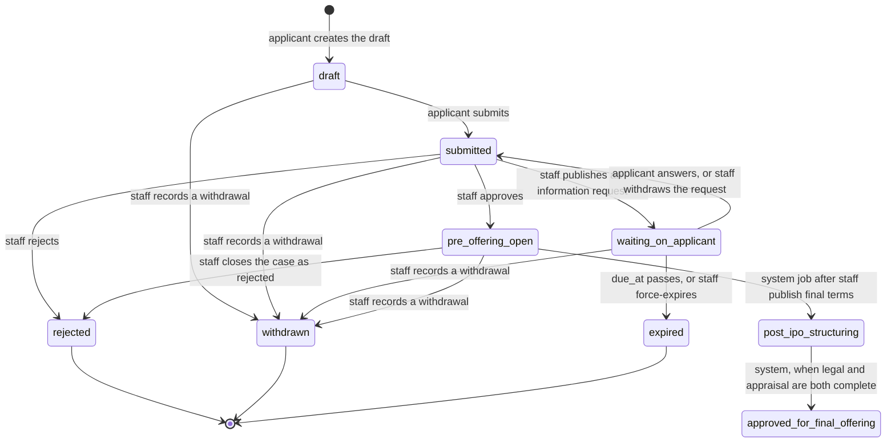
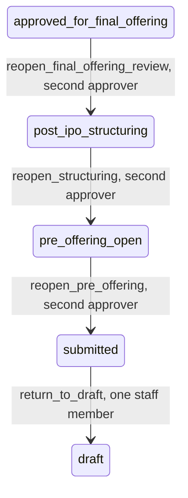

# Customer intake routes

Valid for main at 48aa967 (2026-11-18).

This reference lists every route under `/v1/intake-cases`, the owner (applicant) side of the intake module: starting a draft case, submitting it, reading one's own cases, answering information requests and exchanging messages with staff. It is read by the mobile developers who call these routes, by the people who run the intake process and need to know what an applicant can and cannot do, and by engineers who change the module. The staff side (`/internal/v1/intake-cases`, legal practices, appraisal firms, partner case routes) is in [intake-staff.md](intake-staff.md); the module's layers are in [../modules/intake.md](../modules/intake.md); KYC and proof of address, which gate case creation, are in [../didit-kyc.md](../didit-kyc.md); document storage is in [../document-storage.md](../document-storage.md).

Citations are `(path:line)` at 48aa967, with the function or identifier named next to the number. A line that starts with `> Pending #N:` says what an open pull request changes in the statement above it; nothing under such a line is built on main. Statements marked `Not verified` are collected in [Not verified](#not-verified).

Contents: [State machine](#case-state-machine) · [Routes](#routes) · [What the customer side does not provide](#what-the-customer-side-does-not-provide) · [Behaviour shared by all routes](#behaviour-shared-by-all-routes) · [Starting a case](#starting-a-case) · [Reading cases](#reading-cases) · [Submitting a case](#submitting-a-case) · [Information requests and answers](#information-requests-and-answers) · [Case messages](#case-messages) · [What the applicant is told](#what-the-applicant-sees-and-is-told) · [Data written](#data-written) · [Configuration](#configuration-that-affects-these-routes) · [Known limitations](#known-limitations) · [Known gaps against the design record](#known-gaps-against-the-design-record) · [Not verified](#not-verified) · [Where it is tested](#where-it-is-tested)

## Case state machine

A case has one `stage`. The column `intake.intake_cases.stage` is limited by a database check to nine values (`prisma/migrations/20260831170000_origination_review_workflow/migration.sql:12-26`, constraint `origination_cases_stage_check`, the name predating the rename of the schema to `intake`). The same nine values are the Zod enum `intakeCaseStageSchema` (`src/modules/intake/api/intake.schemas.ts:86-96`) and the list `intakeCaseStageValues` in the workflow catalog (`src/modules/intake/domain/intake-workflow.catalog.ts:3-6`). The label an applicant sees for each is in `intakeStageLabels` (`src/modules/intake/presentation/intake-labels.ts:4-14`).

Of all the transitions on main, an applicant can trigger three: create a draft, submit it, and answer an information request. Everything else is staff, a scheduled job or a job enqueued by another module. In particular there is no route with which an applicant withdraws a case (see [Known limitations](#known-limitations)).

Four further transitions move a case backwards. They are staff corrections, each recorded as an `intake.intake_case_reversal_operations` row, and none is available to an applicant:

### Stages

| Stage | Label shown to the applicant | Workflow type and terminal flag | What the applicant can do on main |
| --- | --- | --- | --- |
| `draft` | Draft | `draft_submission`, not terminal | Submit it (`POST /:case_id/submit`). Post messages |
| `submitted` | Submitted | `operations_review`, not terminal | Read it. Post messages |
| `waiting_on_applicant` | Waiting on applicant | `applicant_information`, not terminal | Answer the published information request (`POST /:case_id/information-requests/:request_id/respond`). Post messages |
| `pre_offering_open` | Pre-offering open | `ipo`, not terminal | Read it. Post messages |
| `post_ipo_structuring` | Post-IPO structuring | `post_ipo_structuring`, not terminal | Read it. Post messages |
| `approved_for_final_offering` | Approved for final offering | `final_offering`, not terminal | Read it. Post messages |
| `rejected` | Rejected | `terminal`, terminal | Read it. Post messages |
| `withdrawn` | Withdrawn | `terminal`, terminal | Read it. Post messages |
| `expired` | Expired | `terminal`, terminal | Read it. Post messages |

Workflow type, label and terminal flag are the catalog `intakeWorkflowCatalog` (`src/modules/intake/domain/intake-workflow.catalog.ts:21-31`). "Post messages" holds at every stage because the message service checks only that the case belongs to the caller (`src/modules/intake/application/case-message.service.ts:23-41`). "Terminal" is the catalog's flag: no staff correction applies to a terminal stage (`evaluateReversalActions` returns nothing for `rejected`, `withdrawn` and `expired`, `src/modules/intake/domain/intake-reversal.policy.ts:127-130`).

### Transitions

| From | To | Who and what triggers it | Route or job | Source |
| --- | --- | --- | --- | --- |
| none | `draft` | Applicant creates the case | `POST /v1/intake-cases` | `createDraftIntake` (`src/modules/intake/repository/prisma-intake.repository.ts:299-374`) |
| none | `draft` or `submitted` | Staff creates a case for an applicant | `POST /internal/v1/intake-cases/drafts`, `POST /internal/v1/intake-cases` | `src/modules/intake/api/intake-operations.router.ts:126-141`; see [intake-staff.md](intake-staff.md) |
| `draft` | `submitted` | Applicant submits; staff can submit a draft for the applicant | `POST /v1/intake-cases/:case_id/submit`; `POST /internal/v1/intake-cases/:case_id/submit` | `submitInitialCase` (`src/modules/intake/repository/prisma-intake.repository.ts:555-650`); `src/modules/intake/api/intake-operations.router.ts:142-146` |
| `submitted` | `waiting_on_applicant` | Staff publishes an information request. Allowed only from `submitted` with a current revision and no published request | `POST /internal/v1/intake-cases/:case_id/information-requests` | `evaluateInformationRequestPublication` (`src/modules/intake/domain/case-review.policy.ts:5-14`); `publishInformationRequest` (`src/modules/intake/repository/prisma-intake.repository.ts:1504-1600`) |
| `waiting_on_applicant` | `submitted` | Applicant answers the published request; the answer is revision 2 or later | `POST /v1/intake-cases/:case_id/information-requests/:request_id/respond` | `evaluateCaseResubmission` (`src/modules/intake/domain/case-submission.policy.ts:45-58`); `resubmitAfterInformationRequest` (`src/modules/intake/repository/prisma-intake.repository.ts:1897-2012`) |
| `waiting_on_applicant` | `submitted` | Staff withdraws the published request; no new revision | `POST /internal/v1/intake-cases/:case_id/information-requests/:request_id/withdraw` | `canWithdrawInformationRequest` (`src/modules/intake/domain/case-review.policy.ts:22-24`); `withdrawInformationRequest` (`src/modules/intake/repository/prisma-intake.repository.ts:1768-1860`) |
| `waiting_on_applicant` | `expired` | System: the hourly job expires a published request whose `due_at` is in the past. Staff can expire one by hand with a reason | queue `case_timers.response_window_expiry`; `POST /internal/v1/intake-cases/:case_id/information-requests/:request_id/force-expire` | `ExpireOverdueInformationRequestsService` (`src/modules/intake/application/case-timer.service.ts:42-65`); `expireInformationRequest` (`src/modules/intake/repository/prisma-intake.repository.ts:1670-1756`) |
| `submitted` | `pre_offering_open` | Staff records an approval with IPO terms; the same transaction enqueues `case_timers.pre_offering_open_handoff` | `POST /internal/v1/intake-cases/:case_id/decisions` | `canRecordFounderDecision` (`src/modules/intake/domain/case-review.policy.ts:28-33`); `recordFounderDecision` (`src/modules/intake/repository/prisma-intake.repository.ts:2014-2146`, enqueue at `src/modules/intake/repository/prisma-intake.repository.ts:2079-2089`) |
| `submitted` | `rejected` | Staff records a rejection with a reason code | `POST /internal/v1/intake-cases/:case_id/decisions` | `recordFounderDecision` (`src/modules/intake/repository/prisma-intake.repository.ts:2044-2069`) |
| `draft`, `submitted`, `waiting_on_applicant`, `pre_offering_open` | `withdrawn` | Staff records a withdrawal. From `pre_offering_open` the same transaction also closes the case's open pre-offering and cancels its open reservations | `POST /internal/v1/intake-cases/:case_id/close` with `outcome: "withdrawn"` | `closableFromStage` and `canCloseCase` (`src/modules/intake/domain/case-review.policy.ts:44-51`); `closeCase` (`src/modules/intake/repository/prisma-intake.repository.ts:2226-2366`); route `src/modules/intake/api/intake-operations.router.ts:373-384` |
| `pre_offering_open` | `rejected` | Staff closes the case with `outcome: "rejected"`. The same transaction closes the case's open pre-offering and cancels its open reservations, as for a withdrawal | `POST /internal/v1/intake-cases/:case_id/close` | `closableFromStage.rejected` (`src/modules/intake/domain/case-review.policy.ts:44-47`); `closeCase` (`src/modules/intake/repository/prisma-intake.repository.ts:2254-2308`) |
| `pre_offering_open` | `post_ipo_structuring` | System job `case_timers.post_ipo_structuring_handoff`, enqueued when staff publish the offering's final terms. Staff can re-run it by hand | `POST /internal/v1/offerings/:offering_id/finalize`; `POST /internal/v1/intake-cases/:case_id/retry-post-ipo-handoff` | enqueue at `src/modules/offering/repository/prisma-offering.repository.ts:1252-1258`; `publishFinalOfferingTerms` called from `src/modules/offering/application/finalize-offering.service.ts:32`; `transitionToPostIpoStructuring` (`src/modules/intake/repository/prisma-intake.repository.ts:1154-1231`); `RetryPostIpoStructuringHandoffService` (`src/modules/intake/application/operations-case.service.ts:734`) |
| `post_ipo_structuring` | `approved_for_final_offering` | System, inside the write of whichever partner (legal practice or appraisal firm) completes second | `PATCH /internal/v1/legal-partner/cases/:case_id`, `PATCH /internal/v1/appraisal-partner/cases/:case_id` | `recordLegalStructuring` (`src/modules/intake/repository/prisma-intake.repository.ts:1327-1346`); `canRecordPartnerWriteback` (`src/modules/intake/domain/case-review.policy.ts:70-72`) |
| `submitted` | `draft` | Staff correction `return_to_draft`, one staff member | `POST /internal/v1/intake-cases/:case_id/commands/return-to-draft` | `evaluateReversalActions` (`src/modules/intake/domain/intake-reversal.policy.ts:132-134`); executor (`src/modules/intake/repository/prisma-intake.repository.ts:254`) |
| `pre_offering_open` | `submitted` | Staff correction `reopen_pre_offering`; a second staff member approves; closes the provisional offering | `.../commands/reopen-pre-offering` | `src/modules/intake/domain/intake-reversal.policy.ts:138-148`; executor (`src/modules/intake/repository/prisma-intake.repository.ts:255-257`) |
| `post_ipo_structuring` | `pre_offering_open` | Staff correction `reopen_structuring`; second approver | `.../commands/reopen-structuring` | `src/modules/intake/domain/intake-reversal.policy.ts:149-158`; executor (`src/modules/intake/repository/prisma-intake.repository.ts:258-259`) |
| `approved_for_final_offering` | `post_ipo_structuring` | Staff correction `reopen_final_offering_review`; second approver | `.../commands/reopen-final-offering-review` | `src/modules/intake/domain/intake-reversal.policy.ts:159-166`; executor (`src/modules/intake/repository/prisma-intake.repository.ts:260-261`) |

Every transition out of an existing stage runs under a row lock on the case (`SELECT ... FOR UPDATE` on `intake.intake_cases`) and re-checks the stage inside the transaction, and every transition in the table writes an `audit.audit_log` row and appends an `intake.intake_case_events` row in the same transaction (for the applicant's own transitions: `src/modules/intake/repository/prisma-intake.repository.ts:347-370,613-640,1973-2003`; for the partner completion: `src/modules/intake/repository/prisma-intake.repository.ts:1350-1381`). The applicant routes check the stage in the service first (`src/modules/intake/application/submit-initial-case.service.ts:30-37`, `src/modules/intake/application/respond-to-information-request.service.ts:54-78`) and again under the lock, so a request that loses a race with a staff action answers `409` instead of overwriting it (`src/modules/intake/application/submit-initial-case.service.ts:86-95`, `src/modules/intake/application/respond-to-information-request.service.ts:139`).

Two behaviours of the state machine matter to an applicant and are easy to miss:

- A case that staff return to draft cannot be submitted again through the API. The correction sets only `stage` (`src/modules/intake/repository/prisma-intake.repository.ts:254`) and leaves `current_submission_revision_id` set, while the initial submission requires a draft with no revision (`evaluateInitialCaseSubmission`, `src/modules/intake/domain/case-submission.policy.ts:35-40`; repository check `src/modules/intake/repository/prisma-intake.repository.ts:574-579`). The customer route answers `409 intake.case_submission_conflict`. The staff submit route calls the same repository method (`src/modules/intake/application/operations-case.service.ts:526-535`) and does not translate its conflict error. See [Known limitations](#known-limitations).
- An answer is accepted until the hourly job expires the request, not until `due_at`. The answer path never compares `due_at` with the clock (`src/modules/intake/application/respond-to-information-request.service.ts:43-102`), and the job runs at minute 0 of every hour UTC (`src/worker.ts:470-473`).

## Routes

| Method and path | Auth | Purpose |
| --- | --- | --- |
| [`POST /v1/intake-cases`](#post-v1intake-cases) | Session | Create a draft case with its property |
| [`GET /v1/intake-cases`](#get-v1intake-cases) | Session | List the caller's cases, newest first, cursor-paginated |
| [`GET /v1/intake-cases/:case_id`](#get-v1intake-casescase_id) | Session | Read one of the caller's cases |
| [`POST /v1/intake-cases/:case_id/submit`](#post-v1intake-casescase_idsubmit) | Session | Submit a draft: revision 1 with its evidence references |
| [`GET /v1/intake-cases/:case_id/information-requests`](#get-v1intake-casescase_idinformation-requests) | Session | List the published information requests of a case |
| [`POST /v1/intake-cases/:case_id/information-requests/:request_id/respond`](#post-v1intake-casescase_idinformation-requestsrequest_idrespond) | Session | Answer the published request with a new revision |
| [`GET /v1/intake-cases/:case_id/messages`](#get-v1intake-casescase_idmessages) | Session | Read the applicant message thread |
| [`POST /v1/intake-cases/:case_id/messages`](#post-v1intake-casescase_idmessages) | Session | Post to the applicant message thread |

"Session" means `requireAuthentication` and nothing else; see [Behaviour shared by all routes](#behaviour-shared-by-all-routes). The eight routes are all that `createIntakeRouter` registers (`src/modules/intake/api/intake.router.ts:45-125`).

## What the customer side does not provide

An applicant might expect the capabilities below. On main, none of them has a customer route. The table says where each one lives, if anywhere.

| Capability | State on main | Evidence |
| --- | --- | --- |
| Edit a draft, or change a case's property data after creation | Not built. The router has no `PUT`, `PATCH` or `DELETE`; property data is written once by `POST /v1/intake-cases` | `src/modules/intake/api/intake.router.ts:45-125` |
| Upload a document or a photo | Not built for customers. Upload is a staff route and needs a case that already has a current submission revision | `POST /internal/v1/intake-cases/:case_id/documents` (`src/modules/intake/api/intake-operations.router.ts:227`); revision check `src/modules/intake/application/upload-case-document.service.ts:91-94`; [../staff-access.md](../staff-access.md) |
| Download a document | Not built for customers. The only intake download is the staff route `GET /internal/v1/intake-cases/:case_id/documents?document_ref=` | `src/modules/intake/api/intake-operations.router.ts:260-286` |
| The `x-revision-number` header | No customer route reads it. Its only reader is the staff upload route | `src/modules/intake/api/intake-operations.router.ts:232` |
| Withdraw a case | Not built for customers. Staff record a withdrawal with `POST /internal/v1/intake-cases/:case_id/close` | `CloseCaseService` and its comment (`src/modules/intake/application/operations-case.service.ts:339-402`) |
| Read the case timeline or event history | Not built for customers. History is a staff route and a filtered partner route | `GET /internal/v1/intake-cases/:case_id/history` (`src/modules/intake/api/intake-operations.router.ts:179`) |
| Read what was submitted, the evidence list or its review status | Not returned. The case object carries only the current revision's number and time | `ownedCaseSchema` (`src/modules/intake/api/intake.schemas.ts:112-160`) |
| Read the decision details (rejection reason, IPO value and period, review notes) | Not returned. The applicant sees the stage only | `ownedCaseSchema` (`src/modules/intake/api/intake.schemas.ts:112-160`); selected columns `ownedCaseSelect` (`src/modules/intake/repository/prisma-intake.repository.ts:2524-2567`) |
| Check eligibility before creating a case | No intake route reports eligibility. The applicant's KYC and proof-of-address state is read through the identity routes | `GET /v1/kyc` and `POST /v1/kyc/proof-of-address/sessions`, see [../didit-kyc.md](../didit-kyc.md) |
| A push or email when staff publish a request or post a message | Not built. The only applicant email is the reminder about a published request | [What the applicant is told](#what-the-applicant-sees-and-is-told) |

Proof of address is the one evidence step an applicant completes outside this module: it is a Didit session started through the identity routes, and this module reads the result (`getIntakePrerequisites`, `src/modules/intake/repository/prisma-intake.repository.ts:270-284`).

## Behaviour shared by all routes

### Mounting

`createApp` mounts the router at `/v1/intake-cases` inside the `if (dependencies.protectedApi !== undefined)` block (`src/app.ts:596`, mount at `src/app.ts:1054-1066`). `server.ts` always passes `protectedApi`, with an intake repository it builds unconditionally (`src/server.ts:133,603-614`), so a process started by `server.ts` always serves these eight routes. They need no storage, scanner or Didit configuration; they need the database, the caller's row in `identity.kyc_eligibility` (an account without one counts as `not_started`) and the `platform.settings` row `intake.minimum_property_value_eur`; the other two `intake.*` settings are read only by staff publication and the reminder job (see [Configuration](#configuration-that-affects-these-routes)). A process built by `createApp` without `protectedApi` answers `404 resource.not_found` for every path below, from the not-found handler (`src/app.ts:1190`, `src/shared/http/not-found.ts:5-14`).

> Pending #237: `createApp` is split into per-module compose functions, so this mount moves from `src/app.ts` into `src/composition/compose-intake.ts`; the routes and their behaviour do not change.

### Authentication and ownership

| Question | Answer on main | Source |
| --- | --- | --- |
| Which middleware runs | `requireAuthentication` only, as the first and only handler before the route function | `src/modules/intake/api/intake.router.ts:45,56,63,70,83,90,108,115` |
| What it accepts | A session at level `device_biometric` or `staff_passkey`. An `oauth_pending` session is refused because the resolver is built without `allowPendingOAuth` | `src/modules/auth/infrastructure/shared/better-auth-session.resolver.ts:61-72`; `src/server.ts:476-486` |
| DPoP | A session bound to a DPoP key must send a valid, unreplayed `DPoP` proof made with that key (`typ`, `ES256`, `htm`, `htu` built from `BETTER_AUTH_URL`, `iat` within 60 seconds, `jti`); the proof's `ath` is compared with the `Authorization: Bearer` token when one is sent. An unbound session is not required to send a proof | `src/modules/auth/api/shared/require-authentication.ts:62-66,158-193,203-239`; `src/modules/auth/application/shared/dpop-proof-verifier.ts:121-208` (`verifyDpopProof`) |
| Account status | The account must be `active`, else `403 account.restricted` | `src/modules/auth/api/shared/require-authentication.ts:77-84` |
| Fresh authentication | Not required on any of these routes | `src/modules/intake/api/intake.router.ts:45-125` (no `requireFreshAuthentication`) |
| Population | Not checked. The handlers read only `authContext.accountId`, so a `staff_partner` session reaches the same code. It is held back, if at all, by the eligibility gate on create and submit, and every read is filtered by the caller's own account | `src/modules/intake/api/intake.router.ts:46,57,64,71,84,91,109,116`; `src/modules/auth/api/shared/require-authentication.ts:86-95` |
| Ownership | Every read and write is filtered by `applicant_account_id` equal to the caller. A case that exists but belongs to someone else is indistinguishable from one that does not exist: both answer `404` | list `src/modules/intake/repository/prisma-intake.repository.ts:523`; get `src/modules/intake/repository/prisma-intake.repository.ts:549`; submit `src/modules/intake/repository/prisma-intake.repository.ts:559-565`; requests `src/modules/intake/repository/prisma-intake.repository.ts:1867-1871,1882-1884`; respond `src/modules/intake/repository/prisma-intake.repository.ts:1901-1906`; messages through `getOwnedCase` (`src/modules/intake/application/case-message.service.ts:16,30`) |

The session mechanics (session levels, the DPoP proof, `REAUTH_REQUIRED`, device login) are in [../authentication.md](../authentication.md) and [auth-customer.md](auth-customer.md). Neither the session nor the DPoP proof is described again here.

### Rate limiting and idempotency

- **Rate limit.** The baseline limiter allows 300 requests per 60 seconds per account. It runs inside `requireAuthentication`, after the session, DPoP and account checks, and its key is `rate_limit_hint:baseline:account:<account_id>` (`src/modules/auth/api/shared/require-authentication.ts:114-124`; `src/shared/http/rate-limit.ts:17-21,35,68-73`). It exists only when `RATE_LIMIT_CACHE_URL` is set and the connection succeeded at boot (`src/server.ts:142-158,202-205`; `src/app.ts:467-470`), and it lets the request through when the store errors (`src/shared/http/rate-limit.ts:54-61`). No tight limiter is mounted on these routes (`src/app.ts:1054-1066`). Production policy for a missing store is an open founder decision, issue #175.
- **Idempotency.** None of the routes uses the `Idempotency-Key` middleware (`src/app.ts:1054-1066`). Posting the same body to `POST /v1/intake-cases` twice creates two cases; posting the same message twice stores two messages. The one write that is safe to repeat is a submit or an answer, which a second request refuses with `409` because the stage has moved on.

### Requests

- **Body.** JSON. `express.json({ limit: "1mb", type: "application/json" })` parses only bodies sent as `application/json`, before every `/v1` router (`src/app.ts:588`). A body sent with another content type is not parsed, `request.body` is `undefined`, and the route answers `422 validation.invalid_field` with a single field error whose `field` is `request` (`src/shared/http/error-handler.ts:57-61`; checked by running the schema on `undefined`).
- **Unknown fields.** A field that the schema does not list is dropped without an error (Zod's default object handling; checked by running `createDraftIntakeBodySchema` on a body with extra keys).
- **Validation.** Path, query and body are parsed with Zod 4.5.4 (`package.json:59`) in the route function. A failure becomes `422 validation.invalid_field` with one `field_errors` entry per issue: `field` is the issue path joined with `.`, `code` is Zod's issue code (`invalid_value`, `invalid_type`, `too_small`, `too_big`, `invalid_format`, `custom`) and `message` is Zod's text (`src/shared/http/error-handler.ts:51-64`).
- **Identifiers.** Case, request, revision, evidence, message and property identifiers are prefixed ULIDs: `case_`, `prop_`, `room_`, `rev_`, `evidence_`, `rfi_`, `thread_`, `msg_`, `audit_`, `evt_` (`src/modules/intake/repository/prisma-intake.repository.ts:302-303,332,581,596,1546,2406,2414`; `audit_` at `src/modules/intake/repository/prisma-intake.repository.ts:349` and `evt_` at `src/modules/intake/repository/intake-case-event.repository.ts:75`). The path schemas only require a non-empty string (`src/modules/intake/api/intake.schemas.ts:103-110`), so a malformed identifier answers `404`, not `422`.
- **Timestamps.** Responses carry ISO 8601 UTC with milliseconds, produced by `toISOString()`. A request datetime (`extract_dated`) must be ISO 8601 UTC ending in `Z`; an offset such as `+01:00` and a date without time are refused with `invalid_format` (checked by running the schema).
- **Money.** `owner_declared_value_eur` is a string with exactly two decimals in requests (`^\d{1,13}\.\d{2}$`) and in responses (`^\d+\.\d{2}$`) (`src/modules/intake/api/intake.schemas.ts:50,128`). It is never a number.

### Responses

Every success body is built by the service and then passed through its response schema with `schema.parse(...)` before it is sent (`src/modules/intake/api/intake.router.ts:53,60,67,80,87,104,112,124`). A body that fails its own schema throws a `ZodError`, which the error handler answers as `422 validation.invalid_field` (`src/shared/http/error-handler.ts:51-64`). A server bug in a response therefore reaches the client as a validation error that blames the client.

> Pending #245: a response that fails its own schema answers `500 internal.response_invalid` with a fixed detail instead of `422 validation.invalid_field`; the pull request is stacked on #244.

Success bodies are `{ "data": ... }`, plus `{ "page": { "next_cursor": ... } }` on the list route. No route in this file sets `Cache-Control`.

### Common errors

Every route in this file can answer these. The route entries do not repeat them.

| Status | Code | Condition |
| --- | --- | --- |
| 400 | `request.invalid_json` | The body cannot be parsed as a JSON object or array |
| 400 | `request.aborted`, `request.size_mismatch` | The body was cut short or does not match `Content-Length` |
| 413 | `request.payload_too_large` | The body is larger than 1 MB |
| 415 | `request.unsupported_charset`, `request.unsupported_encoding` | The charset is not UTF-8 or the `Content-Encoding` is not supported |
| 4xx | `request.body_rejected` | Another client error of the body parser, for example a body that fails to decompress; the status is the parser's own |
| 401 | `authentication.required` | No session, or a session at a level that is not accepted, or a user that is disabled or in recovery |
| 401 | `REAUTH_REQUIRED` | A `device_biometric` session reached its idle or absolute limit |
| 401 | `DPOP_PROOF_MISSING`, `DPOP_PROOF_INVALID`, `DPOP_REPLAY`, `DPOP_KEY_MISMATCH` | The session is bound and the proof is absent, invalid, replayed or made with another key; also `DPOP_KEY_MISMATCH` for an unbound session created after `DPOP_PHASE1_CUTOVER_AT` that presents a valid proof (`src/modules/auth/api/shared/require-authentication.ts:228-232`). The response carries `WWW-Authenticate: DPoP error="invalid_dpop_proof"` |
| 403 | `account.restricted` | The account status is not `active` |
| 422 | `validation.invalid_field` | A path, query or body field fails its Zod schema; `field_errors` lists `field`, `code` and `message` for each issue |
| 429 | `rate_limit.exceeded` | The baseline limiter refused; `Retry-After: 60`. Only when a rate-limit store is connected |
| 500 | `account.mapping_missing` | The session's user has no local account |
| 500 | `authentication.context_missing` | `authContext` was not set; unreachable behind `requireAuthentication` (`src/modules/intake/api/intake.router.ts:130-140`) |
| 500 | `internal.unexpected` | Any other exception, including a database error and a missing platform setting |
| 404 | `resource.not_found` | No route matches |

The body-parser codes are defined in `src/shared/http/body-parser-error.ts:21-115` (`rejectedBodies`, `translateBodyParserError`); the 401, 403 and 500 rows come from `src/modules/auth/api/shared/require-authentication.ts:47-84,145-155`, `REAUTH_REQUIRED` from `src/modules/auth/application/shared/session-resolver.ts:41-53` (raised at `src/modules/auth/infrastructure/shared/better-auth-session.resolver.ts:53-55`), the DPoP codes from `src/modules/auth/application/shared/dpop-proof-verifier.ts:12-36`, the 429 from `src/shared/http/rate-limit.ts:40-51`, the 404 from `src/shared/http/not-found.ts:5-14`. The error envelope is `{ type, code, title, status, detail, trace_id, field_errors? }` with `type` equal to `https://api.vistablox.io/errors/<code>` (`src/shared/http/error-handler.ts:17-25`, `src/shared/errors/app-error.ts:24-30`). A request that sends an `x-trace-id` header gets that value back as `trace_id` and as the `x-trace-id` response header; without one the server generates `req_` plus a ULID (`src/shared/http/request-context.ts:9-14`). The header value is not validated or bounded (issue #217).

> Pending #244: every answer with status 500 or above carries a fixed detail and no `field_errors`, and the real message is only logged.

Routes whose path contains `:case_id` can also answer:

| Status | Code | Condition |
| --- | --- | --- |
| 404 | `intake.case_not_found` | The case does not exist or belongs to another account. The detail is "The requested intake case was not found." on the get, submit and message routes and "The requested intake case or information request was not found." on the two information-request routes (`src/modules/intake/application/read-own-cases.service.ts:66-71`, `src/modules/intake/application/submit-initial-case.service.ts:147-154`, `src/modules/intake/application/case-message.service.ts:90-97`, `src/modules/intake/application/respond-to-information-request.service.ts:145-152`) |

The route entries list only what is specific to the route.

## Starting a case

### The entry gates

Creating a case, submitting it and answering an information request all run the same policy, `evaluateIntakeEntry`, which checks in this order and stops at the first failure (`src/modules/intake/domain/intake-entry.policy.ts:25-47`). The first, second and last checks depend on data outside the request; the other three depend on the request body and are already enforced by the request schema (see the note under [POST /v1/intake-cases](#post-v1intake-cases)).

| Order | Check | Where the data comes from | Create | Submit | Answer |
| --- | --- | --- | --- | --- | --- |
| 1 | `eligibility_state` equals `eligible` | A live read of `identity.kyc_eligibility` on every call; an account with no row counts as `not_started` (`src/modules/intake/repository/prisma-intake.repository.ts:270-284`, `src/modules/identity/repository/prisma-kyc.repository.ts:51-58`) | `403 identity.kyc_required` | `403 intake.submission_kyc_not_eligible` | `403 intake.resubmission_kyc_not_eligible` |
| 2 | `proof_of_address_current_until` is set and later than now | The same row. The Didit proof-of-address workflow writes it; its value is the earliest of the verified documents' issue dates plus three months (`src/modules/identity/domain/proof-of-address-policy.ts:93-113`; written at `src/modules/identity/repository/prisma-kyc.repository.ts:584-590`) | `403 identity.proof_of_address_required` | `403 intake.submission_proof_of_address_required` | `403 intake.resubmission_proof_of_address_required` |
| 3 | Terms accepted | Request body | schema | schema | schema |
| 4 | One title per case confirmed | Request body | schema | schema | schema |
| 5 | Property type is `residential` | Request body on create; the stored property on submit and answer | schema | not reachable | not reachable |
| 6 | Declared value at least the floor | `platform.settings` key `intake.minimum_property_value_eur`, read on every call (`src/modules/intake/repository/prisma-intake.repository.ts:286-297`) | `422 intake.property_value_below_minimum` | `422 intake.submission_property_value_below_minimum` | `422 intake.resubmission_property_value_below_minimum` |

The eligibility values are `not_started`, `in_progress`, `pending_manual_review`, `eligible`, `unsupported_jurisdiction`, `not_eligible`, `requires_renewal` and `suspended_restricted` (`src/modules/identity/domain/kyc-policy.ts:16-24`); only `eligible` passes. A case that is already started is not affected when the applicant's KYC later lapses, until the applicant submits or answers: both re-run checks 1, 2 and 6 at that moment (`src/modules/intake/application/submit-initial-case.service.ts:39-52`, `src/modules/intake/application/respond-to-information-request.service.ts:80-102`). The floor is read live, so a value raised after a draft was created can block that draft's submission.

How an applicant becomes `eligible` and obtains a current proof of address is in [../didit-kyc.md](../didit-kyc.md) and [../modules/identity.md](../modules/identity.md). This module only reads the result.

### POST /v1/intake-cases

- **Auth.** `requireAuthentication` only. Baseline limiter, key `account:<account_id>`. No fresh authentication, no `Idempotency-Key`. Entry gates 1, 2 and 6 above.
- **Mounted when.** Always (see [Mounting](#mounting)).
- **Request.** JSON body `createDraftIntakeBodySchema` (`src/modules/intake/api/intake.schemas.ts:39-73`). No path or query parameters. Unknown fields are dropped.

| Field | Type | Constraint | Default |
| --- | --- | --- | --- |
| `intake_terms_accepted` | boolean | Must be `true` | required |
| `one_title_confirmed` | boolean | Must be `true` | required |
| `property.property_type` | string | Must be `"residential"` | required |
| `property.country_code` | string | Exactly 2 characters, upper-cased by the schema. Not checked against a list of countries: `"12"` passes | required |
| `property.city` | string or null | Trimmed, 1 to 200 characters | `null` |
| `property.address_line` | string or null | Trimmed, 1 to 500 characters | `null` |
| `property.land_registry_reference` | string or null | Trimmed, 1 to 200 characters | `null` |
| `property.latitude` | number or null | -90 to 90 | `null` |
| `property.longitude` | number or null | -180 to 180 | `null` |
| `property.owner_declared_value_eur` | string | `^\d{1,13}\.\d{2}$`: one to thirteen digits, a dot, two decimals. A number or a string without decimals is refused | required |
| `property.has_existing_encumbrance` | boolean | None | `false` |
| `property.residential_subtype` | string or null | `apartment`, `house`, `townhouse`, `multi_family`, `studio`, `other` | `null` |
| `property.living_area_sq_m` | number or null | Greater than 0, at most 9999.99 | `null` |
| `property.bedrooms` | integer or null | At least 0, no upper bound | `null` |
| `property.bathrooms` | integer or null | At least 0, no upper bound | `null` |
| `property.floor` | integer or null | At least -5, no upper bound | `null` |
| `property.total_floors` | integer or null | At least 1, no upper bound | `null` |
| `property.year_built` | integer or null | 1800 to 2100 | `null` |
| `property.condition` | string or null | `new`, `renovated`, `good`, `fair`, `needs_renovation` | `null` |
| `property.energy_rating` | string or null | `A+`, `A`, `B`, `C`, `D`, `E`, `F`, `G` | `null` |
| `property.rooms` | array | 0 to 30 items of `{ room_type, size_sq_m }`; `room_type` is `bedroom`, `bathroom`, `kitchen`, `living_room`, `dining_room`, `office`, `storage` or `other`; `size_sq_m` is greater than 0 and at most 9999.99 | `[]` |

  A string field that is trimmed to nothing is refused (`"   "` fails the minimum length); send `null` or omit the field to leave it empty. The vocabularies are `residentialSubtypeSchema`, `propertyConditionSchema`, `energyRatingSchema` and `roomTypeSchema` (`src/modules/intake/api/intake.schemas.ts:8-37`); the energy scale is the EU EPC scale (`src/modules/intake/api/intake.schemas.ts:25`). The constraints in this table were checked by running the schema file's code against sample bodies.

- **Success.** `201`. Body parsed through `createDraftIntakeResponseSchema` (`src/modules/intake/api/intake.schemas.ts:75-81`):

| Field | Type | Value |
| --- | --- | --- |
| `data.case_id` | string | `case_<ULID>` |
| `data.property_id` | string | `prop_<ULID>` |
| `data.stage` | string | Always `"draft"` |

- **Errors.**

| Status | Code | Condition |
| --- | --- | --- |
| 403 | `identity.kyc_required` | Gate 1. Detail "Eligible KYC status is required before starting property intake." (`src/modules/intake/application/create-draft-intake.service.ts:84-89`) |
| 403 | `identity.proof_of_address_required` | Gate 2. Detail "A current proof of address is required for owner-side property intake." (`src/modules/intake/application/create-draft-intake.service.ts:90-95`) |
| 422 | `intake.property_value_below_minimum` | Gate 6. One `field_errors` entry: `field` `property.owner_declared_value_eur`, `code` `number.min`, `message` "Value must be at least EUR `<minimum>`." (`src/modules/intake/application/create-draft-intake.service.ts:114-126`) |
| 500 | `internal.unexpected` | The `intake.minimum_property_value_eur` setting row is missing (`Error` thrown at `src/modules/intake/repository/prisma-intake.repository.ts:291-295`) |
| 422 | `validation.invalid_field` | The setting row exists but does not match `{ amount, currency: "EUR" }`. `propertyFloorSettingSchema.parse` throws a `ZodError` (`src/modules/intake/repository/prisma-intake.repository.ts:58-61,296`) and the error handler answers every `ZodError` as a client validation error (`src/shared/http/error-handler.ts:51-64`). By reading the code; not exercised. See [Known limitations](#known-limitations), item 20 |

- **Notes.**
  - One transaction writes the property row, one row per room, the case row with `stage = draft` and `applicant_account_id` set to the caller, an `audit.audit_log` row with action `intake.case_draft_created`, and an `intake.intake_case_events` row of type `case_created` with actor type `applicant` (`src/modules/intake/repository/prisma-intake.repository.ts:299-374`). No job is enqueued and no email is sent.
  - `latitude` and `longitude` are stored on the property but no customer route returns them (`ownedCaseSelect`, `src/modules/intake/repository/prisma-intake.repository.ts:2524-2567`).
  - The policy also defines `intake.terms_required`, `intake.one_title_required`, `intake.residential_only` and `intake.intake_not_allowed` (`src/modules/intake/application/create-draft-intake.service.ts:96-113,128-133`). The request schema refuses the same inputs first with `422 validation.invalid_field`, so by reading the code this route cannot answer those four codes; no test names them either.
  - An applicant can hold any number of cases; no code limits the count and the table has no uniqueness on the applicant (`prisma/schema/schema.prisma:259-317`). The record says the same (AD-106, `00-Governance/DECISIONS/ARCHITECTURE_DECISIONS.md:797`).
  - Documents are not part of this request. They arrive as references in the submit request.
- **Source.** Router `src/modules/intake/api/intake.router.ts:45-54`; service `CreateDraftIntakeService` (`src/modules/intake/application/create-draft-intake.service.ts:9-72`); policy `evaluateIntakeEntry`; repository `PrismaIntakeRepository.createDraftIntake` and `getIntakePrerequisites` (`src/modules/intake/repository/prisma-intake.repository.ts:299-374,270-284`).

## Reading cases

### The case object

`GET /v1/intake-cases` and `GET /v1/intake-cases/:case_id` return the same object, `ownedCaseSchema` (`src/modules/intake/api/intake.schemas.ts:112-160`), built by `toOwnedCaseResponse` (`src/modules/intake/application/read-own-cases.service.ts:77-138`).

| Field | Type | Meaning |
| --- | --- | --- |
| `case_id` | string | `case_<ULID>` |
| `stage` | string | One of the nine stages |
| `stage_label` | string | The label for the stage, for example "Waiting on applicant" |
| `created_at`, `updated_at` | string | ISO 8601 UTC. `updated_at` is set to the time of each stage change, submission and answer |
| `current_revision` | object or null | `null` until the first submission; then `{ revision_number, submitted_at }` of the revision the case currently stands on |
| `property.property_id` | string | `prop_<ULID>` |
| `property.property_type` | string | Always `"residential"` (a literal in the mapper, `src/modules/intake/application/read-own-cases.service.ts:93`) |
| `property.country_code` | string | Two characters as stored |
| `property.city`, `address_line`, `land_registry_reference` | string or null | As submitted |
| `property.owner_declared_value_eur` | string | Two decimals, from a `DECIMAL(15,2)` column |
| `property.has_existing_encumbrance` | boolean | As submitted |
| `property.residential_subtype`, `condition`, `energy_rating` | string or null | As submitted, each with a `_label` sibling (`residential_subtype_label`, `condition_label`, `energy_rating_label`) that is `null` when the value is `null` |
| `property.living_area_sq_m`, `bedrooms`, `bathrooms`, `floor`, `total_floors`, `year_built` | number or null | As submitted |
| `property.rooms[]` | array | Ordered by room id ascending |
| `property.rooms[].room_id`, `room_type`, `room_type_label`, `size_sq_m` | | The room as submitted, with its label |
| `property.rooms[].preferred_photo_id` | string or null | The photo staff chose as representative, if any |
| `property.rooms[].representative_photo_id` | string or null | The preferred photo if it is among the room's photos, else the first photo, else `null` (`src/modules/intake/application/read-own-cases.service.ts:140-144`) |
| `property.rooms[].photos[]` | array | Accepted, undeleted `room_photo` documents of the room, oldest first, each `{ document_id, document_ref, thumbnail_ref, content_type, uploaded_at }` (`src/modules/intake/repository/prisma-intake.repository.ts:2558-2562`) |

The labels come from the dictionaries in `src/modules/intake/presentation/intake-labels.ts:4-14,73-110`; a value without an entry is humanised from its code (`displayLabel`, `src/modules/intake/presentation/intake-labels.ts:149-162`). The photos exist only when staff uploaded them: no customer route uploads. `document_ref` and `thumbnail_ref` are storage object keys; no customer route turns one into a download. Not returned: `latitude`, `longitude`, the submission data, the evidence list and its review status, founder notes, rejection reason, IPO value and period, the offering, partner assignments and any event history.

### GET /v1/intake-cases

- **Auth.** `requireAuthentication` only. Baseline limiter, key `account:<account_id>`.
- **Mounted when.** Always.
- **Request.** Query, `listOwnCasesQuerySchema` (`src/modules/intake/api/intake.schemas.ts:98-101`):

| Parameter | Type | Constraint | Default |
| --- | --- | --- | --- |
| `limit` | integer | Coerced from the string; 1 to 100. `abc`, `2.5`, `0`, `101`, an empty value and a repeated parameter all fail with `422` | `20` |
| `after` | string | The `page.next_cursor` of a previous response; at least 1 character | none |

- **Success.** `200`. Body parsed through `listOwnCasesResponseSchema` (`src/modules/intake/api/intake.schemas.ts:162-165`): `data` is an array of case objects, `page.next_cursor` is a string or `null`. Cases are ordered by `created_at` descending, then `id` descending, and include every stage: drafts and terminal cases too (`src/modules/intake/repository/prisma-intake.repository.ts:516-542`). The service asks for `limit + 1` rows and returns `limit`; `next_cursor` is set only when a further row exists (`src/modules/intake/application/read-own-cases.service.ts:38-56`). There is no total count and no filter.
- **Errors.**

| Status | Code | Condition |
| --- | --- | --- |
| 422 | `pagination.invalid_cursor` | `after` is not base64url JSON with `created_at` (ISO datetime) and `id` (non-empty string). One `field_errors` entry: `field` `after`, `code` `cursor.invalid`, `message` "Invalid cursor." (`src/modules/intake/application/read-own-cases.service.ts:29,153-166`) |

- **Notes.** The cursor is the base64url encoding of `{"created_at":"<ISO>","id":"<case id>"}` (`src/modules/intake/application/read-own-cases.service.ts:146-151`); a client treats it as opaque. A cursor built from another account's case id cannot leak anything, because the `WHERE applicant_account_id = caller` clause applies to every page (`src/modules/intake/repository/prisma-intake.repository.ts:521-537`). A request for a page after the last returns an empty `data` and a `null` cursor.
- **Source.** Router `src/modules/intake/api/intake.router.ts:56-61`; `ListOwnCasesService` (`src/modules/intake/application/read-own-cases.service.ts:31-58`); `PrismaIntakeRepository.listOwnedCases` (`src/modules/intake/repository/prisma-intake.repository.ts:516-542`).

### GET /v1/intake-cases/:case_id

- **Auth.** `requireAuthentication` only. Baseline limiter.
- **Mounted when.** Always.
- **Request.** Path `case_id`, any non-empty string (`caseIdParamsSchema`, `src/modules/intake/api/intake.schemas.ts:103-105`). No query, no body.
- **Success.** `200`, `{ "data": <case object> }`, parsed through `getOwnCaseResponseSchema` (`src/modules/intake/api/intake.schemas.ts:167`).
- **Errors.** `404 intake.case_not_found` (shared table above). No other route-specific error.
- **Notes.** A read; nothing is written.
- **Source.** Router `src/modules/intake/api/intake.router.ts:63-68`; `GetOwnCaseService` (`src/modules/intake/application/read-own-cases.service.ts:60-75`); `PrismaIntakeRepository.getOwnedCase` (`src/modules/intake/repository/prisma-intake.repository.ts:544-553`).

## Submitting a case

### The submission body

`POST /:case_id/submit` and `POST /:case_id/information-requests/:request_id/respond` take the same body, `submitInitialCaseBodySchema` (`src/modules/intake/api/intake.schemas.ts:183-199`; the respond route parses its body with it at `src/modules/intake/api/intake.router.ts:96`).

| Field | Type | Constraint |
| --- | --- | --- |
| `intake_terms_accepted` | boolean | Must be `true` |
| `one_title_confirmed` | boolean | Must be `true` |
| `submission_data` | object | A JSON object with at least one key; any JSON values (`z.record(z.string(), z.json())`). An array, or an empty object ("Submission data must not be empty."), is refused |
| `documents` | array | 1 to 50 items, each `{ document_type, document_ref, extract_dated }` |
| `documents[].document_type` | string | One of the 11 values below |
| `documents[].document_ref` | string | Trimmed, 1 to 500 characters |
| `documents[].extract_dated` | string or null | ISO 8601 UTC ending in `Z` (an offset or a date without time is refused); default `null` |

The 11 document types are `ownership_declaration`, `property_facts_sheet`, `encumbrance_declaration`, `photo_set`, `registry_extract`, `title_instrument`, `cadastral_map`, `power_of_attorney`, `name_change_evidence`, `occupancy_evidence` and `succession_evidence` (`submissionDocumentTypeSchema`, `src/modules/intake/api/intake.schemas.ts:169-181`; the list `submissionEvidenceTypes`, `src/modules/intake/domain/case-submission.policy.ts:11-20`). The room photo type `room_photo` is not accepted here; it is a staff upload type.

Evidence rules, applied by the domain policy before any write (`src/modules/intake/domain/case-submission.policy.ts:60-72`):

| Rule | Detail |
| --- | --- |
| Required types | `ownership_declaration`, `property_facts_sheet`, `encumbrance_declaration` and `photo_set` must each be present (`requiredInitialEvidenceTypes`, `src/modules/intake/domain/case-submission.policy.ts:1-6`) |
| Optional types | The other seven |
| Duplicates | Every type, required or optional, may appear at most once in one request. The duplicate check runs before the missing-type check |
| Document references | `document_ref` is stored as given. Nothing checks it against `platform.stored_documents` or the storage bucket, and no customer route produces a reference (see [Known limitations](#known-limitations)) |
| `extract_dated` | Stored; no code compares it with a freshness window (`extractDated` is read only for storage and for staff display, `src/modules/intake/repository/prisma-intake.repository.ts:454,602,741,812,1953`) |

`submission_data` is stored with one addition: the service spreads the client's object first and then sets `attestations` to `{ intake_terms_accepted: true, one_title_confirmed: true, accepted_at: <server time, ISO 8601> }`, so a client-supplied `attestations` key is overwritten (`src/modules/intake/application/submit-initial-case.service.ts:55-66`). The answer route adds `response_to_information_request_id` as well (`src/modules/intake/application/respond-to-information-request.service.ts:111-119`). The stored object is the `submission_data` column of `intake.submission_revisions` (`prisma/schema/schema.prisma:390-409`); no customer route reads it back.

### POST /v1/intake-cases/:case_id/submit

- **Auth.** `requireAuthentication` only. Baseline limiter. No `Idempotency-Key`. Entry gates 1, 2 and 6 are re-checked.
- **Mounted when.** Always.
- **Request.** Path `case_id`. Body: the submission body above.
- **Success.** `200` (not `201`). Body parsed through `submitInitialCaseResponseSchema` (`src/modules/intake/api/intake.schemas.ts:201-209`):

| Field | Type | Value |
| --- | --- | --- |
| `data.case_id` | string | The case |
| `data.revision_id` | string | `rev_<ULID>` |
| `data.revision_number` | number | Always `1` |
| `data.stage` | string | Always `"submitted"` |
| `data.submitted_at` | string | ISO 8601 UTC, the time the repository took |

- **Errors.** Checked in this order (`src/modules/intake/application/submit-initial-case.service.ts:22-97`):

| Status | Code | Condition |
| --- | --- | --- |
| 404 | `intake.case_not_found` | Not found or not owned (shared table) |
| 409 | `intake.case_submission_conflict` | The stage is not `draft`, or the case already has a revision. Detail "Only a draft case without a submission revision can be initially submitted." (`src/modules/intake/application/submit-initial-case.service.ts:125-130`; `src/modules/intake/domain/case-submission.policy.ts:35-40`) |
| 422 | `intake.duplicate_evidence_type` | A `document_type` appears twice (`src/modules/intake/application/submit-initial-case.service.ts:117-124`) |
| 422 | `intake.required_evidence_missing` | A required type is absent. Detail "Required initial evidence is missing: `<types>`." and one `field_errors` entry per missing type with `field` `documents`, `code` `evidence.required`, `message` "`<type>` is required." (`src/modules/intake/application/submit-initial-case.service.ts:104-116`) |
| 403 | `intake.submission_kyc_not_eligible` | Gate 1 at submission time. Detail "Eligible KYC status is required at submission time." (`src/modules/intake/application/submit-initial-case.service.ts:133-145`) |
| 403 | `intake.submission_proof_of_address_required` | Gate 2 at submission time |
| 422 | `intake.submission_property_value_below_minimum` | Gate 6 at submission time; the floor may have been raised since the draft was created |
| 409 | `intake.case_submission_conflict` | A concurrent request or a staff action moved the case between the check and the write. Detail "The case can no longer be submitted from its current `<stage>` stage." (`src/modules/intake/application/submit-initial-case.service.ts:86-95`) |

- **Notes.**
  - One transaction (`src/modules/intake/repository/prisma-intake.repository.ts:555-650`): lock the case row `FOR UPDATE` where `applicant_account_id` is the caller; re-check `stage = draft` and no current revision; insert `intake.submission_revisions` (`revision_number` 1, `reason` `initial`, `submitted_by_account_id` the caller); insert one `intake.documentary_screening_evidence` row per document with `status` `pending`; set the case `stage` to `submitted` and `current_submission_revision_id`; write `audit.audit_log` action `intake.case_submitted`; append event `case_submitted` with actor type `applicant`.
  - No job is enqueued and no email is sent: staff are not notified of the submission by any mechanism in this transaction or in the service.
  - The checks `intake.submission_terms_not_accepted`, `intake.submission_one_title_required` and `intake.submission_residential_only` cannot be reached: the schema refuses the first two and the stored property type is always `residential` (`src/modules/intake/application/submit-initial-case.service.ts:133-145`).
  - A case that staff returned to draft always answers the first `409` row; see [State machine](#case-state-machine).
- **Source.** Router `src/modules/intake/api/intake.router.ts:70-81`; `SubmitInitialCaseService` (`src/modules/intake/application/submit-initial-case.service.ts:10-99`); policy `evaluateInitialCaseSubmission` (`src/modules/intake/domain/case-submission.policy.ts:30-43`) and `evaluateIntakeEntry`; repository `submitInitialCase` (`src/modules/intake/repository/prisma-intake.repository.ts:555-650`); the conflict class `CaseSubmissionConflictError` (`src/modules/intake/repository/intake.repository.ts:754-759`).

## Information requests and answers

Staff ask the applicant for more information by publishing an information request on a `submitted` case. The case moves to `waiting_on_applicant` and the request gets a due date: the response window in business days, counted from publication (`PublishInformationRequestService`, `src/modules/intake/application/operations-case.service.ts:102-158`; `addBusinessDays`, `src/modules/intake/domain/case-review.policy.ts:74-87`). Business days are Monday to Friday in UTC; public holidays are not considered. The window is the `platform.settings` key `intake.applicant_response_window_business_days`, seeded as 10 (`prisma/migrations/20260831170000_origination_review_workflow/migration.sql:6-7`). At most one request is published at a time (`src/modules/intake/domain/case-review.policy.ts:5-14`). The request text is `request_body`; an answer is not a text reply but a complete new submission revision.

A request moves through `published` to one of three endings, enforced by database checks (`prisma/migrations/20260831170000_origination_review_workflow/migration.sql:51-79`, constraints `information_requests_status_check` and `information_requests_resolution_check`; `information_requests_publication_check` at lines 81-86 requires `published_by_account_id`, `published_at` and `due_at` for every status except `proposed`):

| Status | `resolution_type` | How it ends | Who |
| --- | --- | --- | --- |
| `published` | `null` | Open; the case is `waiting_on_applicant` | Staff published it |
| `answered` | `resubmitted` | The applicant answered; `resolving_revision_id` names the new revision | Applicant |
| `withdrawn` | `withdrawn` | Staff withdrew it; the case returns to `submitted` on the same revision | Staff |
| `expired` | `expired` | `due_at` passed and the hourly job ran, or staff expired it by hand; the case becomes `expired` | System or staff |

The check also allows a `proposed` status that no code path creates (the only `informationRequest.create` writes `status: "published"`, `src/modules/intake/repository/prisma-intake.repository.ts:1544-1551`); the list route reads only requests with a `published_at` (`src/modules/intake/repository/prisma-intake.repository.ts:1886`).

### GET /v1/intake-cases/:case_id/information-requests

- **Auth.** `requireAuthentication` only. Baseline limiter.
- **Mounted when.** Always.
- **Request.** Path `case_id`. No query, no body.
- **Success.** `200`. Body parsed through `listInformationRequestsResponseSchema` (`src/modules/intake/api/intake.schemas.ts:225-227`). `data` is an array, newest first (`proposed_at` descending, then id), of requests that have been published, in any status (`src/modules/intake/repository/prisma-intake.repository.ts:1878-1895`):

| Field | Type | Meaning |
| --- | --- | --- |
| `request_id` | string | `rfi_<ULID>` |
| `case_id` | string | The case |
| `status` | string | `published`, `answered`, `withdrawn` or `expired` |
| `status_label` | string | "Published", "Answered", "Withdrawn", "Expired" (`src/modules/intake/presentation/intake-labels.ts:23-29`) |
| `request_body` | string | The staff text |
| `published_at`, `due_at` | string | ISO 8601 UTC |
| `resolved_at` | string or null | When it ended |
| `resolution_type` | string or null | `resubmitted`, `withdrawn` or `expired` |
| `resolution_type_label` | string or null | "Resubmitted", "Withdrawn", "Expired" |
| `resolving_revision_id` | string or null | The revision that answered it, when `answered` |

- **Errors.** `404 intake.case_not_found` (the information-request detail text, shared table). A request without `published_at` or `due_at` would raise a plain `Error` and answer `500 internal.unexpected`; the database check and the filter exclude that case (`src/modules/intake/application/respond-to-information-request.service.ts:19-26`).
- **Notes.** The response carries only the columns of `informationRequestSelect`: no proposer, no publisher and no workstream (`src/modules/intake/repository/prisma-intake.repository.ts:2569-2579`).
- **Source.** Router `src/modules/intake/api/intake.router.ts:83-88`; `ListOwnInformationRequestsService` (`src/modules/intake/application/respond-to-information-request.service.ts:12-28`); mapper `toInformationRequestResponse` (`src/modules/intake/application/operations-case.service.ts:827-840`); `PrismaIntakeRepository.listOwnedInformationRequests` (`src/modules/intake/repository/prisma-intake.repository.ts:1878-1895`).

### POST /v1/intake-cases/:case_id/information-requests/:request_id/respond

- **Auth.** `requireAuthentication` only. Baseline limiter. No `Idempotency-Key`. Entry gates 1, 2 and 6 are re-checked.
- **Mounted when.** Always.
- **Request.** Path `case_id` and `request_id` (`informationRequestParamsSchema`, `src/modules/intake/api/intake.schemas.ts:107-110`). Body: the submission body above. The answer must carry the four required document types again and every type at most once: it is a complete submission, not a delta.
- **Success.** `201`. Body parsed through `resubmitCaseResponseSchema` (`src/modules/intake/api/intake.schemas.ts:229-238`):

| Field | Type | Value |
| --- | --- | --- |
| `data.case_id` | string | The case |
| `data.revision_id` | string | `rev_<ULID>` of the new revision |
| `data.revision_number` | number | The previous revision number plus one; at least 2 |
| `data.stage` | string | Always `"submitted"` |
| `data.submitted_at` | string | ISO 8601 UTC, the time the service took |
| `data.resolved_request_id` | string | The request that was answered |

- **Errors.** Checked in this order (`src/modules/intake/application/respond-to-information-request.service.ts:43-142`):

| Status | Code | Condition |
| --- | --- | --- |
| 404 | `intake.case_not_found` | The case is not the caller's, or the request does not exist on that case. Detail "The requested intake case or information request was not found." |
| 409 | `intake.information_request_response_conflict` | The case is not `waiting_on_applicant`, has no current revision, or the request is not `published`. Detail "Only the current published request on a waiting case can be answered." (`src/modules/intake/application/respond-to-information-request.service.ts:154-162`; `src/modules/intake/domain/case-submission.policy.ts:51-56`). Also raised when the case changes between the check and the write (`src/modules/intake/repository/prisma-intake.repository.ts:1923-1929`) |
| 422 | `intake.duplicate_evidence_type` | A type appears twice. Detail "Each evidence type may appear only once in a resubmission." |
| 422 | `intake.required_evidence_missing` | A required type is absent. Detail "Required resubmission evidence is missing: `<types>`." Unlike the submit route, no `field_errors` entries are attached (`src/modules/intake/application/respond-to-information-request.service.ts:61-68`) |
| 403 | `intake.resubmission_kyc_not_eligible`, `intake.resubmission_proof_of_address_required` | Gates 1 and 2 at answer time. Detail "The case no longer meets owner intake requirements." |
| 422 | `intake.resubmission_property_value_below_minimum` | Gate 6 at answer time. The same detail |

- **Notes.**
  - One transaction (`src/modules/intake/repository/prisma-intake.repository.ts:1897-2012`): lock the case row `FOR UPDATE` for the caller's case; re-check stage, current revision and request status; insert a revision with `revision_number` one above the current one and `reason` `resubmission_after_rfi`; insert one `pending` evidence row per document against the new revision; set the request to `answered` with `resolution_type` `resubmitted`, `resolved_at` and `resolving_revision_id`; set the case back to `submitted` on the new revision; write `audit.audit_log` action `intake.case_resubmitted`; append event `case_resubmitted` with actor type `applicant`.
  - Earlier revisions and their evidence rows are kept. Each revision has its own evidence rows: a document that did not change still needs a new reference in the answer.
  - The service never compares `due_at` with the clock. An answer sent after `due_at` and before the next run of `case_timers.response_window_expiry` is accepted.
  - No job is enqueued and no email is sent.
- **Source.** Router `src/modules/intake/api/intake.router.ts:90-106`; `RespondToInformationRequestService` (`src/modules/intake/application/respond-to-information-request.service.ts:30-143`); policy `evaluateCaseResubmission` (`src/modules/intake/domain/case-submission.policy.ts:45-58`); repository `resubmitAfterInformationRequest` (`src/modules/intake/repository/prisma-intake.repository.ts:1897-2012`).

## Case messages

Each case has at most one message thread per lane, `internal_case` and `applicant` (`ThreadLane`, `src/modules/intake/repository/intake.repository.ts:478`; unique `(case_id, lane)`, `prisma/migrations/20260901180000_case_threads_lane_unique/migration.sql:5-6`). The customer routes always use the `applicant` lane; there is no parameter to pick another, and the `internal_case` lane is not reachable from them (`src/modules/intake/application/case-message.service.ts:18,34`). Staff read and post in both lanes (`src/modules/intake/api/intake-operations.router.ts:441-448`). The lane rows are created on first post (`src/modules/intake/repository/prisma-intake.repository.ts:2403-2411`).

### GET /v1/intake-cases/:case_id/messages

- **Auth.** `requireAuthentication` only. Baseline limiter.
- **Mounted when.** Always.
- **Request.** Path `case_id`. No query, no body.
- **Success.** `200`. Body parsed through `listCaseMessagesResponseSchema` (`src/modules/intake/api/intake.schemas.ts:249-251`): `data` is an array of every message in the applicant lane, oldest first, each:

| Field | Type | Meaning |
| --- | --- | --- |
| `message_id` | string | `msg_<ULID>` |
| `author_account_id` | string or null | The account that posted it: the applicant's own id for the applicant's messages, the staff member's account id for staff messages, `null` when the author's account row was removed (foreign key `ON DELETE SET NULL`, `prisma/migrations/20260831150000_initial_schema/migration.sql:852`) |
| `body` | string | The text as stored (trimmed on the way in) |
| `created_at` | string | ISO 8601 UTC |

- **Errors.** `404 intake.case_not_found` (shared table).
- **Notes.** No pagination, no limit and no "since" parameter: every message is returned on every call. The order is `created_at` ascending with no tie-breaker (`src/modules/intake/repository/prisma-intake.repository.ts:2368-2387`). A case without a thread returns `{ "data": [] }`. The response does not say which messages are the applicant's; compare `author_account_id` with the caller's own account id.
- **Source.** Router `src/modules/intake/api/intake.router.ts:108-113`; `ListOwnCaseMessagesService` (`src/modules/intake/application/case-message.service.ts:12-21`); `PrismaIntakeRepository.listCaseMessages` (`src/modules/intake/repository/prisma-intake.repository.ts:2368-2387`).

### POST /v1/intake-cases/:case_id/messages

- **Auth.** `requireAuthentication` only. Baseline limiter. No `Idempotency-Key`.
- **Mounted when.** Always.
- **Request.** Path `case_id`. Body `postCaseMessageBodySchema` (`src/modules/intake/api/intake.schemas.ts:253-255`):

| Field | Type | Constraint |
| --- | --- | --- |
| `body` | string | Trimmed, 1 to 5000 characters. An empty or blank string and a non-string are refused with `422` |

- **Success.** `201`. Body parsed through `postCaseMessageResponseSchema` (`src/modules/intake/api/intake.schemas.ts:257-259`): `{ "data": { message_id, author_account_id, body, created_at } }` with the caller's account id as `author_account_id`.
- **Errors.** `404 intake.case_not_found` (shared table). No other route-specific error.
- **Notes.**
  - The service checks ownership and then posts. It does not look at the stage: a message can be posted on a draft and on a case in any terminal stage (`src/modules/intake/application/case-message.service.ts:29-41`).
  - One transaction upserts the thread and inserts the message (`src/modules/intake/repository/prisma-intake.repository.ts:2389-2429`). No `audit.audit_log` row, no case event, no job and no email is written: staff learn of a message only by reading the lane.
  - The same message posted twice is stored twice.
  - No limit on the number of messages per case or per account beyond the baseline limiter.
- **Source.** Router `src/modules/intake/api/intake.router.ts:115-125`; `PostOwnCaseMessageService` (`src/modules/intake/application/case-message.service.ts:23-42`); `PrismaIntakeRepository.postCaseMessage` (`src/modules/intake/repository/prisma-intake.repository.ts:2389-2429`).

## What the applicant sees and is told

An applicant learns the state of a case only by asking for it. A client reads `stage` and `stage_label` from `GET /v1/intake-cases/:case_id`, the published requests from `GET .../information-requests` and the thread from `GET .../messages`. No route pushes anything to the client and no route returns the case timeline.

| Event | What changes for the applicant | Notification |
| --- | --- | --- |
| The applicant submits | Stage `submitted`; `current_revision` is set | None |
| Staff publish an information request | Stage `waiting_on_applicant`; a new entry with `due_at` appears in the request list | None. Publication enqueues no job and sends no email (`src/modules/intake/repository/prisma-intake.repository.ts:1504-1600`, `src/modules/intake/application/operations-case.service.ts:102-158`) |
| Time passes on a published request | Nothing changes until the day a reminder is due | A reminder email, below |
| Staff withdraw the request | Stage back to `submitted`; the request shows `withdrawn` | None (`src/modules/intake/repository/prisma-intake.repository.ts:1768-1860`) |
| The request expires | Stage `expired`; the request shows `expired` | None (`src/modules/intake/repository/prisma-intake.repository.ts:1670-1756`) |
| Staff approve or reject | Stage `pre_offering_open` or `rejected`. The applicant does not see the reason, the IPO terms or the staff notes | None (`src/modules/intake/repository/prisma-intake.repository.ts:2014-2146`) |
| Staff close the case as withdrawn | Stage `withdrawn` | None (`src/modules/intake/repository/prisma-intake.repository.ts:2226-2366`) |
| Staff post a message | A new entry in the applicant lane | None |

### Reminder emails

The only email an applicant receives from this module is a reminder about a published information request.

- **Schedule.** The scheduled queue `case_timers.applicant_reminders` runs at 08:00 UTC every day (`src/worker.ts:466-469`); its handler is `SendApplicantResponseRemindersService` (`src/worker.ts:598-600`, `src/modules/intake/application/case-timer.service.ts:9-40`).
- **Rule.** For every published request, a reminder is sent when today's UTC calendar date equals the date reached by adding N business days to `published_at`, for each N in the setting `intake.information_request_reminder_business_days`, seeded as `[3, 7]` (`isApplicantReminderDue`, `src/modules/intake/domain/case-review.policy.ts:97-111`; seed `prisma/migrations/20260901110000_case_timer_settings/migration.sql:6-7`). Business days skip Saturday and Sunday in UTC (`src/modules/intake/domain/case-review.policy.ts:74-87`).
- **Recipient.** The applicant's `account.protected_contact_email`. A request whose applicant has no such address is skipped (`src/modules/intake/application/case-timer.service.ts:25`; `prisma/schema/schema.prisma:14`).
- **Content.** Subject "Response needed on your VistaBlox intake case"; the text says that VistaBlox is waiting for a response to an information request and gives the due date as an ISO 8601 UTC string (`src/infrastructure/email/smtp-email-sender.ts:107-118`).
- **Manual reminder.** Staff can send the same email at once with `POST /internal/v1/intake-cases/:case_id/information-requests/:request_id/send-reminder` (`src/modules/intake/application/operations-case.service.ts:658-693`).
- **Delivery.** SMTP, through `SMTP_HOST`, `SMTP_USER`, `SMTP_PASSWORD` and `SMTP_FROM`, which the environment schema requires at boot, and `SMTP_PORT` (default 587) and `SMTP_SECURE` (default `false`) (`src/config/environment.ts:159-167`).
- **No record of what was sent.** The service writes nothing after a send and the policy comment says that no separate marker exists (`src/modules/intake/application/case-timer.service.ts:16-39`, `src/modules/intake/domain/case-review.policy.ts:93-96`). A day on which the job does not run has no reminder, and the next run does not make it up.

### Expiry

The scheduled queue `case_timers.response_window_expiry` runs at minute 0 of every hour UTC (`src/worker.ts:470-473`, handler `src/worker.ts:601-605`). For every published request whose `due_at` is earlier than now it sets the request to `expired` and the case to `expired` in one transaction (`ExpireOverdueInformationRequestsService`, `src/modules/intake/application/case-timer.service.ts:42-65`; `isInformationRequestOverdue`, `src/modules/intake/domain/case-review.policy.ts:89-91`; `expireInformationRequest`, `src/modules/intake/repository/prisma-intake.repository.ts:1670-1756`). Both queues are owned by `intake` at tier 2 (`src/shared/jobs/job-ownership.ts:24-25`); what a failed run does is in [../dead-letter-jobs.md](../dead-letter-jobs.md).

### Case events

Every stage change and several other writes append a row to `intake.intake_case_events`, an append-only ledger with a per-case sequence (`src/modules/intake/repository/intake-case-event.repository.ts:34-102`). No customer route reads it. The customer routes write three event types:

| Event type | Written by | Actor type | Source |
| --- | --- | --- | --- |
| `case_created` | `POST /v1/intake-cases` | `applicant` | `src/modules/intake/repository/prisma-intake.repository.ts:361-370` |
| `case_submitted` | `POST .../submit` | `applicant` | `src/modules/intake/repository/prisma-intake.repository.ts:629-640` |
| `case_resubmitted` | `POST .../respond` | `applicant` | `src/modules/intake/repository/prisma-intake.repository.ts:1990-2003` |

Staff, partner and system writes add `case_information_requested`, `case_information_request_withdrawn`, `case_expired`, `founder_decision_recorded`, `handoff_queued`, `case_withdrawn`, `case_rejected`, `case_post_ipo_structuring_started`, `case_approved_for_final_offering` and `case_stage_reverted` (`src/modules/intake/repository/prisma-intake.repository.ts:264,1222,1369,1582,1743,1842,2116,2131,2348`), and further types for evidence review, partner assignment, partner writebacks, document and room-photo changes and correction requests (`case_evidence_reviewed`, `partner_assignment_changed`, `legal_structuring_updated`, `appraisal_updated`, `property_document_uploaded`, `room_photo_uploaded`, `room_photo_representative_selected`, `room_photo_deleted`, `room_deleted`, `correction_requested`, `correction_cancelled`; `src/modules/intake/repository/prisma-intake.repository.ts:166,215,1139,1369,1461,2199`; `src/modules/intake/application/upload-case-document.service.ts:29,42,73,129`). The staff create route writes `case_created` and `case_submitted` with actor type `staff` (`src/modules/intake/repository/prisma-intake.repository.ts:482-497`). The staff draft routes call the same `createDraftIntake` and `submitInitialCase` with the applicant's account id (`src/modules/intake/application/operations-case.service.ts:517-521,531`), so their audit rows and their `case_created` and `case_submitted` events carry the applicant as actor (limitation 21). The events are read through the staff history route; see [intake-staff.md](intake-staff.md).

## Data written

All tables are in the `intake` schema except the audit log. Reads are not listed.

| Route | Rows written | Audit action | Event | Job |
| --- | --- | --- | --- | --- |
| `POST /v1/intake-cases` | `properties` (1), `property_rooms` (0 to 30), `intake_cases` (1, stage `draft`) | `intake.case_draft_created` | `case_created` | none |
| `POST .../submit` | `submission_revisions` (1, number 1, reason `initial`), `documentary_screening_evidence` (1 to 50, status `pending`); `intake_cases` updated (stage, `current_submission_revision_id`, `updated_at`) | `intake.case_submitted` | `case_submitted` | none |
| `POST .../respond` | `submission_revisions` (1, number n+1, reason `resubmission_after_rfi`), `documentary_screening_evidence` (1 to 50); `information_requests` updated (`answered`, `resolved_at`, `resolution_type`, `resolving_revision_id`); `intake_cases` updated | `intake.case_resubmitted` | `case_resubmitted` | none |
| `POST .../messages` | `case_threads` (upsert, lane `applicant`), `case_messages` (1) | none | none | none |
| `GET` routes | none | none | none | none |

The audit rows go to `audit.audit_log` with `actor_account_id` set to the caller. `changes` holds the trace id and, for a created case, the stage and the property id (`src/modules/intake/repository/prisma-intake.repository.ts:347-360`); for a submission it holds the previous and new stage and the revision id and number (`src/modules/intake/repository/prisma-intake.repository.ts:613-628`); an answer adds the request id (`src/modules/intake/repository/prisma-intake.repository.ts:1973-1989`). Each event append also increments `intake.intake_cases.workflow_event_sequence` (`src/modules/intake/repository/intake-case-event.repository.ts:70-74`). The model of each table is in `prisma/schema/schema.prisma` (`Property` 166-194, `PropertyRoom` 196-210, `IntakeCase` 259-317, `IntakeCaseEvent` 319-352, `SubmissionRevision` 390-409, `DocumentaryScreeningEvidence` 411-432, `InformationRequest` 482-509, `CaseThread` 511-523, `CaseMessage` 525-539); the schema-wide view is in [../data-model.md](../data-model.md).

## Configuration that affects these routes

| Name | Kind | Effect on the customer routes | Value on main | Source |
| --- | --- | --- | --- | --- |
| `intake.minimum_property_value_eur` | `platform.settings` key, JSON `{ "amount": "<2 decimals>", "currency": "EUR" }` | The declared-value floor on create, submit and answer. Read on every call. A missing row is a 500; a malformed row is answered as a 422 (limitation 20) | Seeded as `150000.00` EUR | `prisma/migrations/20260831160000_platform_defaults/migration.sql:7`; read `src/modules/intake/repository/prisma-intake.repository.ts:286-297` |
| `intake.applicant_response_window_business_days` | `platform.settings` key, JSON `{ "business_days": 1..60 }` | Sets `due_at` when staff publish a request. Not read by the customer routes themselves | Seeded as `10` | `prisma/migrations/20260831170000_origination_review_workflow/migration.sql:7`; read `src/modules/intake/repository/prisma-intake.repository.ts:1478-1489` |
| `intake.information_request_reminder_business_days` | `platform.settings` key, JSON `{ "business_days": [1..60, at least one] }` | Which business days get a reminder email | Seeded as `[3, 7]` | `prisma/migrations/20260901110000_case_timer_settings/migration.sql:7`; read `src/modules/intake/repository/prisma-intake.repository.ts:1491-1502` |
| `RATE_LIMIT_CACHE_URL` | Environment variable | Whether the baseline limiter exists. A `redis://` or `rediss://` URL; an empty value counts as unset | Optional | `src/config/environment.ts:168-177`; `src/server.ts:142-158` |
| `BETTER_AUTH_URL` | Environment variable | Base of the DPoP `htu` that a bound session must prove | Default `http://localhost:3000` | `src/config/environment.ts:17`; `src/server.ts:603-613` |
| `DPOP_PHASE1_CUTOVER_AT` | Environment variable | Whether an unbound session that presents a valid proof is bound or refused: a session created before this instant is bound, one created after it is refused with `DPOP_KEY_MISMATCH`; unset means every such session is bound | Optional | `src/config/environment.ts:25-28`; `src/modules/auth/api/shared/require-authentication.ts:228-232`; `src/server.ts:610-612` |
| `SMTP_HOST`, `SMTP_PORT`, `SMTP_SECURE`, `SMTP_USER`, `SMTP_PASSWORD`, `SMTP_FROM` | Environment variables | Reminder emails sent by the worker | `SMTP_HOST`, `SMTP_USER`, `SMTP_PASSWORD`, `SMTP_FROM` required; port 587 and secure `false` by default | `src/config/environment.ts:159-167`; worker `src/worker.ts:81` |

The platform settings are seeded under `origination.*` names and renamed to `intake.*` by migration `20261018120000_rename_origination_platform_settings_to_intake` (`.../migration.sql:25-27`). The repository throws if an `intake.*` row is missing (`src/modules/intake/repository/prisma-intake.repository.ts:1483-1487`). The values in a deployed database are not verified here (see [Not verified](#not-verified)). All variables are described in [../configuration.md](../configuration.md); the settings table is described in [../data-model.md](../data-model.md).

## Known limitations

Defects and gaps in the code on main, stated as they are. None is fixed by this chapter. An issue number is given only where the issue map has one; otherwise there is none.

| # | Limitation | Where | Issue |
| --- | --- | --- | --- |
| 1 | **An applicant cannot withdraw a case.** No customer route changes the stage after submission except an answer. Withdrawal is recorded by staff with `POST /internal/v1/intake-cases/:case_id/close`. The service comment says the applicant-facing lane "stays founder-mediated in phase 1" and that withdrawal is "recorded here rather than as a self-service endpoint" | `src/modules/intake/application/operations-case.service.ts:339-346`; `src/modules/intake/api/intake.router.ts:45-125` | none |
| 2 | **An applicant cannot edit a draft.** Property data is written once. A draft with a wrong value can only be left, or corrected by staff | `src/modules/intake/api/intake.router.ts:45-125` | none |
| 3 | **A customer cannot upload or download a document, and the references in a submission are not checked.** `document_ref` is free text of 1 to 500 characters, stored as given. No customer route produces a reference. The staff upload route needs a case that already has a current revision, so a reference typed at submission cannot be one that the platform issued earlier | `src/modules/intake/api/intake.schemas.ts:189-198`; `src/modules/intake/repository/prisma-intake.repository.ts:594-604`; `src/modules/intake/application/upload-case-document.service.ts:91-94` | none |
| 4 | **A case that staff return to draft cannot be submitted again.** `return_to_draft` sets only `stage`; the initial submission needs a draft without a revision. The customer route answers `409 intake.case_submission_conflict`. The staff submit route calls the same repository method, whose `CaseSubmissionConflictError` is a plain `Error` that `SubmitStaffDraftCaseService` does not translate; by reading the code that route answers `500 internal.unexpected` (not exercised) | `src/modules/intake/repository/prisma-intake.repository.ts:254,574-579`; `src/modules/intake/application/operations-case.service.ts:526-535`; `src/modules/intake/domain/case-submission.policy.ts:35-40` | none |
| 5 | **An answer is accepted after `due_at`.** The check is the request status, not the clock. The window ends when the hourly job runs, up to one hour after `due_at` | `src/modules/intake/application/respond-to-information-request.service.ts:43-102`; `src/worker.ts:470-473` | none |
| 6 | **No notification on publication, expiry, decision or message.** The applicant is reminded by email on business days 3 and 7 only. Nothing is sent when a request is published or expires | [What the applicant is told](#what-the-applicant-sees-and-is-told) | none |
| 7 | **Reminders are not recorded and a failed send is not isolated.** The loop has no per-recipient error handling, so a failure ends the run; the scheduled job is then retried and, by reading the code, repeats the sends made earlier in the same run (not exercised) | `src/modules/intake/application/case-timer.service.ts:24-37`; retry profile in [../dead-letter-jobs.md](../dead-letter-jobs.md) | none |
| 8 | **`country_code` is any two characters.** `"12"` and `"ZZ"` are accepted and stored upper-cased; no list of supported countries is consulted at intake | `src/modules/intake/api/intake.schemas.ts:44` | none |
| 9 | **Integer property fields have no upper bound.** `bedrooms`, `bathrooms`, `floor` and `total_floors` accept any integer from the minimum up, while the columns are `Int`. By reading the code a value above 2147483647 reaches the database and fails there (not exercised) | `src/modules/intake/api/intake.schemas.ts:54-57`; `prisma/schema/schema.prisma:179-182` | none |
| 10 | **`extract_dated` is not checked.** AD-021 and AD-184 set a currency window for the registry extract; no code or setting compares `extract_dated` with any window | `src/modules/intake/repository/prisma-intake.repository.ts:454,602,1953` | none |
| 11 | **The applicant lane returns `author_account_id` for every message**, including the account id of the staff member who wrote one, and returns the whole thread with no pagination | `src/modules/intake/application/case-message.service.ts:81-88`; `src/modules/intake/repository/prisma-intake.repository.ts:2368-2387` | none |
| 12 | **A message can be posted at any stage**, including on a terminal case, with no count limit besides the baseline limiter | `src/modules/intake/application/case-message.service.ts:29-41` | none |
| 13 | **Creating and posting are not idempotent.** A repeated `POST /v1/intake-cases` creates a second case and a repeated message a second message | `src/app.ts:1054-1066` | none |
| 14 | **A staff session passes the authentication on these routes.** The population is not checked; every query is scoped to the caller's own account, so the effect is an empty list, a 404 or a refusal at the entry gates | `src/modules/intake/api/intake.router.ts:46,57,64`; `src/modules/auth/api/shared/require-authentication.ts:86-95` | none |
| 15 | **The baseline limiter fails open and does not exist without a rate-limit store.** The production policy for a missing store is undecided | `src/shared/http/rate-limit.ts:54-61`; `src/server.ts:142-158` | #175 |
| 16 | **The inbound `x-trace-id` is echoed without validation or bound** into the response header and every error body | `src/shared/http/request-context.ts:9-14` | #217 |
| 17 | **A response that fails its own schema is a 422** that blames the client and is not logged as a server error | `src/shared/http/error-handler.ts:39-41,51-64` | none; see the pending note under [Responses](#responses) |
| 18 | **Business days ignore public holidays**, and `due_at` keeps the time of day of publication | `src/modules/intake/domain/case-review.policy.ts:74-87` | none |
| 19 | **The order of rooms in a response can differ from the order submitted.** Rooms are returned ordered by id; the ids of one request are generated by `ulid()` without a monotonic factory, which does not order ids created in the same millisecond (not exercised) | `src/modules/intake/repository/prisma-intake.repository.ts:332,2552` | none |
| 20 | **A malformed `intake.minimum_property_value_eur` row is answered as a client error.** `getMinimumPropertyValueEur` parses the setting with Zod and does not catch the error. On create, submit and answer, a row that is not `{ amount: "<digits>.<two digits>", currency: "EUR" }` therefore reaches the error handler as a `ZodError` and is answered `422 validation.invalid_field`, with `field_errors` naming the setting's own paths (`amount`, `currency`), where a missing row is a 500. The two other `intake.*` settings are parsed the same way for staff publication and the reminder job. By reading the code; not exercised | `src/modules/intake/repository/prisma-intake.repository.ts:58-69,286-297,1488,1501`; `src/shared/http/error-handler.ts:51-64` | none |
| 21 | **A draft that staff create or submit is recorded as the applicant's own act.** `CreateStaffDraftCaseService` passes the applicant's account id to `createDraftIntake`, and `SubmitStaffDraftCaseService` passes it to `submitInitialCase`. The repository writes that id as the audit actor and as the actor of the `case_created` and `case_submitted` events (actor type `applicant`), and `submitted_by_account_id` carries it too. No row written by these two routes names the staff member | `src/modules/intake/application/operations-case.service.ts:509-535`; `src/modules/intake/repository/prisma-intake.repository.ts:343,350,361-370,589,616,629-640` | none |

## Known gaps against the design record

Where the code and the record differ, the record and `CORE_TABLES.md` win (`AGENTS.md`). Nothing below is resolved here and the record is not edited. Record paths are relative to the `vistablox-design-docs` checkout at commit 65d4ee9. The register `00-Governance/MIGRATION/CONFLICT_REGISTER.md` there holds entries C-001 to C-008; none records any of the points below (C-006 and C-007 mention intake only in passing, for the reversal idempotency header and `ipo_end_at`), so none of them has a register entry.

| # | Point | Record | Code |
| --- | --- | --- | --- |
| 1 | Who withdraws a case | The lifecycle table lists `withdraw` among the exits of the draft, waiting-on-applicant and pre-offering-open rows (its submitted row lists none), the `Withdrawn` row reads "Applicant withdrew the intake", and the diagram labels the withdrawal transitions from draft, submitted, waiting-on-applicant and pre-offering-open "Applicant withdraws" (`04-Engineering/ARCHITECTURE/REAL_ESTATE_INTAKE_LIFECYCLE.md:309,311,312,316,332,337,340,346`). The permission matrix row for rejecting, withdrawing or expiring a case allows admin and operations only (`04-Engineering/IDENTITY-AND-SECURITY/PERMISSION_MATRIX.md:67`). AD-104 (`00-Governance/DECISIONS/ARCHITECTURE_DECISIONS.md:783`) covers a voluntary owner withdrawal | Staff record a withdrawal; no applicant route. The code follows the matrix (limitation 1) |
| 2 | What the applicant keeps seeing after a non-approved end | Status, timeline and the applicant's own communications history (`04-Engineering/IDENTITY-AND-SECURITY/PERMISSION_MATRIX.md:104-106`, AD-105 at `00-Governance/DECISIONS/ARCHITECTURE_DECISIONS.md:790`) | The case object (status) and the applicant lane (communications). No customer timeline route |
| 3 | Documents at initial submission | AD-021 (`00-Governance/DECISIONS/ARCHITECTURE_DECISIONS.md:157-160`) sets the document package at initial submission and a 30-day currency for the registry extract; AD-184 (`00-Governance/DECISIONS/ARCHITECTURE_DECISIONS.md:1385`) puts such thresholds in `platform.settings` | The four required types are enforced as references (`src/modules/intake/domain/case-submission.policy.ts:1-6`); a registry extract is optional and its date is not checked; no owner upload (limitations 3 and 10) |
| 4 | Schema and workstream names | `04-Engineering/DATA/CORE_TABLES.md` names the tables `origination.*` (for example `origination.submission_revisions`, line 306) and lists `requesting_workstream` as `legal`, `appraisal` or `origination` (line 384) | Tables are `intake.*` (`prisma/schema/schema.prisma:193`, migration `20260917150000_rename_origination_to_intake`); staff publish with workstream `intake` (`src/modules/intake/repository/prisma-intake.repository.ts:1548`; check `prisma/migrations/20260921120000_information_request_workstream_intake/migration.sql:5-6`) |
| 5 | Revision reasons | `submission_revisions.reason` is `initial` or `resubmission_after_rfi` (`04-Engineering/DATA/CORE_TABLES.md:313`) | A third value, `initial_staff_created`, is allowed and written by the staff create route (`prisma/migrations/20260913200000_staff_created_case_reason/migration.sql:10`; `src/modules/intake/repository/prisma-intake.repository.ts:443`) |
| 6 | Thread lanes | `internal_case`, `applicant` and `system_timeline` (`04-Engineering/DATA/CORE_TABLES.md:407`) | Two lanes (`ThreadLane`, `src/modules/intake/repository/intake.repository.ts:474-478`, whose comment says nothing writes the third); the system history is the event ledger instead |
| 7 | Role declaration on the routes | AD-153 (`00-Governance/DECISIONS/ARCHITECTURE_DECISIONS.md:1128`): each `/v1` route declares the roles permitted to reach it, and shared middleware checks the declaration before any handler code | The eight routes pass `requireAuthentication` only and declare no role or population, so a `staff_partner` session reaches the handlers (limitation 14; `src/modules/intake/api/intake.router.ts:45-125`; `src/modules/auth/api/shared/require-authentication.ts:86-95`) |
| 8 | Applicant notifications | AD-154 (`00-Governance/DECISIONS/ARCHITECTURE_DECISIONS.md:1135`): domains notify customers through one internal notification service rather than calling the email provider directly | The reminder job and the staff manual reminder call `sendApplicantResponseReminderEmail` on the email sender directly (`src/modules/intake/application/case-timer.service.ts:32`; `src/modules/intake/application/operations-case.service.ts:680`); a search of `src/` for a notification service finds none |

Questions the record does not answer, for the founder: whether an applicant is meant to withdraw through the API or only through staff (point 1); whether an applicant is meant to see the case timeline (point 2); and how an applicant's document reference is meant to be issued (point 3).

## Not verified

- **PostgreSQL 18.** The local checks ran on PostgreSQL 16.15. No SQL in this chapter was run on 18. The SQL read here is Prisma calls and the `SELECT ... FOR UPDATE` row locks, none of which was executed for this chapter.
- **No database-backed test of the customer repository methods.** A search of `tests/` finds database-backed calls to `getOwnedCase`, `publishInformationRequest` and `expireInformationRequest` (`tests/staff-intake-case-repository.integration.test.ts:178,410,455,523,536`) and none to `createDraftIntake`, `submitInitialCase`, `listOwnedCases`, `listOwnedInformationRequests`, `getOwnedInformationRequest`, `resubmitAfterInformationRequest`, `listCaseMessages` or `postCaseMessage`. What those methods do was read, not run. The `tests/*.integration.test.ts` files skip themselves unless `TEST_DATABASE_URL` is set (see [../testing.md](../testing.md)).
- **Live setting values.** The three `intake.*` settings are read from the database. The seeded values are in the migrations; what any staging or production database holds now was not read.
- **Staging file and production configuration.** `.env.staging`, whether `RATE_LIMIT_CACHE_URL` is set in a deployed environment and so whether the baseline limiter is live there, and the SMTP provider in use were not checked.
- **Email delivery.** No reminder was sent. The text and recipient come from reading `smtp-email-sender.ts` and `case-timer.service.ts`.
- **Behaviour reached only by reading.** The 500 for an integer above 2147483647 (limitation 9), the 500 of the staff submit route on a returned-to-draft case (limitation 4), the repeated reminders after a failed run (limitation 7), the room order (limitation 19) and the 422 for a malformed `intake.minimum_property_value_eur` row (limitation 20) are inferred from the code and were not exercised.
- **Authenticated HTTP.** The 401, 403 and 429 rows come from reading `requireAuthentication` and the rate limiter; no real Better Auth session or DPoP proof was used. The request-validation facts (field constraints, defaults, error `field` and `code` values) were checked by running the schema file's code with Zod 4.5.4 on sample bodies in a scratch directory, not through the running application.
- **The mobile client.** How `vistablox-mobile` calls these routes, and which `document_ref` values it sends, was not read.

## Where it is tested

The route tests use `createApp` with fake repositories and a fake session resolver, so they cover routing, validation, policy and error mapping, not SQL. The policy, label and timer tests call the domain functions and services directly.

| Routes | Test file and cases |
| --- | --- |
| `POST /v1/intake-cases` | `tests/intake-api.test.ts:144-276`: session required, restricted account, KYC, proof of address, floor, audited draft, rooms and the 30-room cap |
| `GET /v1/intake-cases`, `GET .../:case_id`, `POST .../submit` | `tests/intake-case-workflow.test.ts:187-290`: owner scoping, hidden foreign case, missing evidence, KYC re-check, already submitted, concurrent race, revision and attestations |
| `GET` and `POST .../messages` | `tests/intake-case-workflow.test.ts:292-365` |
| `GET .../information-requests`, `POST .../respond` | `tests/intake-review-workflow.test.ts:501-564` |
| Entry policy and labels | `tests/intake-entry-policy.test.ts`, `tests/intake-labels.test.ts` |
| Business days, overdue test and reminder milestone | `tests/case-review-policy.test.ts:79-110` (`addBusinessDays`, `isInformationRequestOverdue`, `isApplicantReminderDue`) |
| Reminder and expiry jobs | `tests/case-timer-service.test.ts:81-173`: only matching milestones are emailed, a request without a contact email is skipped, only overdue requests expire, a lost race is not counted |

## Related documents

- [intake-staff.md](intake-staff.md): the staff side of the same module, including the staff create, upload, review, close and correction routes.
- [../modules/intake.md](../modules/intake.md): layers, files and the dependency rules of the module.
- [../authentication.md](../authentication.md) and [auth-customer.md](auth-customer.md): sessions, DPoP and device login.
- [../didit-kyc.md](../didit-kyc.md): how KYC and proof of address are obtained.
- [../document-storage.md](../document-storage.md): buckets, the staff upload path, the malware scan and the 100 MB cap.
- [../dead-letter-jobs.md](../dead-letter-jobs.md): what happens when a scheduled queue fails.
- [../investor-offering.md](../investor-offering.md): what happens to an approved case after `pre_offering_open`.
- [../staff-access.md](../staff-access.md): who may read and act on cases.
