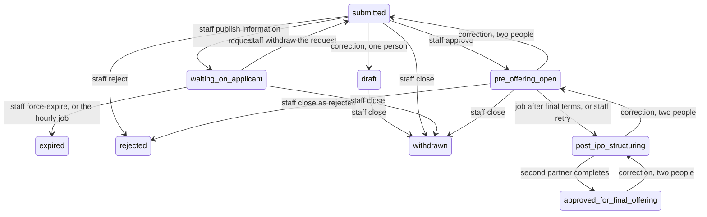
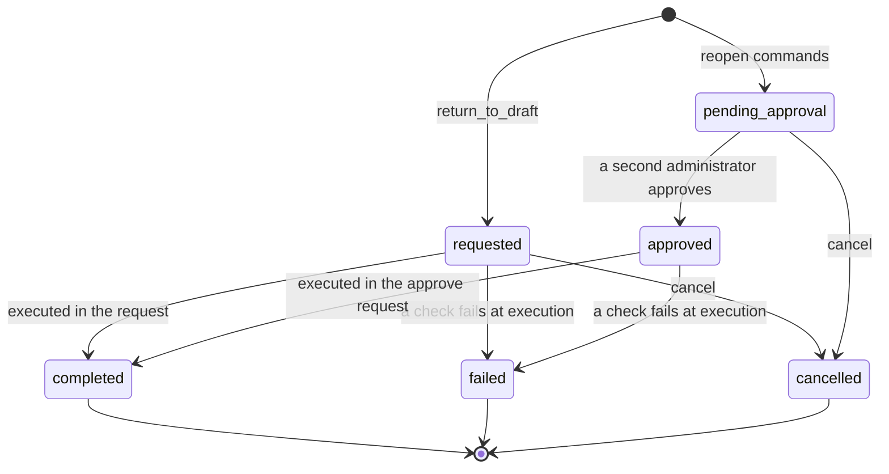
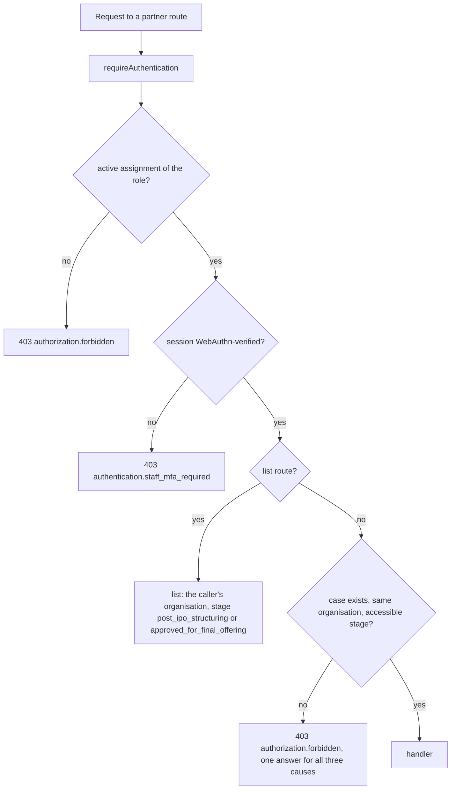

# Staff and partner intake routes

Valid for main at 48aa967 (2026-11-18).

This reference lists every route that staff and partners use on intake cases: the case queue, review and correction routes under `/internal/v1/intake-cases` for `admin_operations` staff, the registers of legal practices and appraisal firms under `/internal/v1/legal-practices` and `/internal/v1/appraisal-firms`, and the case routes of legal partners and appraisal partners under `/internal/v1/legal-partner/cases` and `/internal/v1/appraisal-partner/cases`. It is read by the people who develop the admin console and the partner workspaces, by operators who run the intake process and need to know who may do what and when, and by engineers who change the module. The applicant side (`/v1/intake-cases`) is in [intake-customer.md](intake-customer.md); the module's layers are in [../modules/intake.md](../modules/intake.md); sessions, WebAuthn and the staff roles are in [../authentication.md](../authentication.md) and [../staff-access.md](../staff-access.md); conventions that hold for every API route (envelope, pagination, rate limits, route gating) are in [README.md](README.md).

Citations are `(path:line)` or `(path:from-to)` at 48aa967, with the function or identifier named next to the number. A line that starts with `> Pending #N:` says what an open pull request changes in the statement above it; nothing under such a line is built on main. Statements marked `Not verified` are collected in [Not verified](#not-verified). In the route entries, a bare `:N` after "Mounted when" and the citation after "Router" in a **Source** line name a line of the router file of that entry's section: `src/modules/intake/api/intake-operations.router.ts` for the routes under `/internal/v1/intake-cases`, `src/modules/intake/api/partner-organization.router.ts` for the legal-practice and appraisal-firm routes, `src/modules/intake/api/partner-case.router.ts` for the partner case routes.

Contents: [1 Roles and actions](#1-role-by-action-matrix) · [2 Stage gates](#2-stage-gates) · [3 Corrections and dual control](#3-corrections-and-dual-control) · [4 Route summary](#4-route-summary) · [5 Behaviour shared by all routes](#5-behaviour-shared-by-all-routes) · [6 Case queue and reads](#6-case-queue-and-reads) · [7 Cases created for applicants](#7-cases-created-for-applicants) · [8 Information requests](#8-information-requests) · [9 Evidence review](#9-evidence-review) · [10 Decisions, closure and handoff](#10-decisions-closure-and-handoff) · [11 Correction routes](#11-correction-routes) · [12 Case documents](#12-case-documents) · [13 Messages](#13-messages) · [14 Partner organisations and assignment](#14-partner-organisations-and-assignment) · [15 Legal-partner routes](#15-legal-partner-routes) · [16 Appraisal-partner routes](#16-appraisal-partner-routes) · [17 Backfill command](#17-backfill-command) · [18 Data written](#18-data-written) · [19 Configuration](#19-configuration) · [20 Known limitations](#20-known-limitations) · [21 Known gaps against the design record](#21-known-gaps-against-the-design-record) · [Not verified](#not-verified) · [Where it is tested](#where-it-is-tested)

## 1 Role-by-action matrix

Three roles reach the routes of this chapter. `admin_operations` reaches the 38 routes of the admin chain. `legal_partner` and `appraisal_partner` reach four routes each under their own prefix. The roles do not include one another: an `admin_operations` account that holds no `legal_partner` assignment gets `403 authorization.forbidden` on a legal-partner route, and a partner gets the same answer on an admin route (`src/modules/auth/api/staff/require-staff-role.ts:7-38`, `:54-72`). Each guard asks the database on every request whether the account holds an active assignment of the role (`src/modules/account/repository/prisma-account.repository.ts:41-50`); an account that holds several roles gets the union. "No" in the table is `403 authorization.forbidden`; a customer session, a staff session without an active role and a staff session with another role all get it.

| Action | Routes | `admin_operations` | `legal_partner` | `appraisal_partner` | Applicant (customer session) |
| --- | --- | --- | --- | --- | --- |
| Read the case queue and any case at any stage, with applicant identity, submission, evidence and notes | `GET /`, `GET /:case_id`, `/readiness`, `/workflow`, `/history` | yes | no | no | no; own cases only, through `/v1/intake-cases` |
| Read a case of the own organisation, at `post_ipo_structuring` or `approved_for_final_offering` only | partner `GET /`, `GET /:case_id` | no | yes, own practice | yes, own firm | no |
| Read the filtered event history of such a case | partner `GET /:case_id/history` | no | yes, legal events | yes, appraisal events | no |
| Create a case, a draft, or submit a draft on behalf of an applicant | `POST /`, `POST /drafts`, `POST /:case_id/submit` | yes | no | no | no; own through `/v1/intake-cases` |
| Publish, remind, force-expire or withdraw an information request | `/information-requests...` | yes | no | no | no; answers through `/v1/intake-cases/:case_id/information-requests/:request_id/respond` |
| Record the review of one evidence document | `PUT /evidence/:evidence_id/review` | yes | no | no | no |
| Approve or reject a submitted case | `POST /decisions` | yes | no | no | no |
| Close a case as withdrawn, or as rejected from `pre_offering_open` | `POST /close` | yes | no | no | no |
| Re-run the move to post-IPO structuring | `POST /retry-post-ipo-handoff` | yes | no | no | no |
| Request a correction | `POST /commands/*` | yes | no | no | no |
| Approve a correction | `POST /reversal-operations/:id/approve` | yes, not the account that requested it | no | no | no |
| Cancel or read a correction | `POST .../cancel`, `GET .../:operation_id` | yes, any administrator | no | no | no |
| Upload, delete, choose a representative photo, list or download case documents | `/documents`, `/rooms/...` | yes | no | no | no |
| Read and post the internal lane (staff notes) | `/messages?lane=internal_case` | yes | no | no | no |
| Read and post the applicant lane | `/messages?lane=applicant` | yes | no | no | own lane only, through `/v1/intake-cases/:case_id/messages` |
| Create, list and suspend legal practices and appraisal firms | `/internal/v1/legal-practices`, `/internal/v1/appraisal-firms` | yes | no | no | no |
| Assign a case to a legal practice and an appraisal firm | `POST /partner-assignment` | yes | no | no | no |
| Record legal document references and mark legal structuring complete | legal-partner `PATCH /:case_id` | no | yes, assigned case at `post_ipo_structuring` | no | no |
| Record the appraisal value, references and completion | appraisal-partner `PATCH /:case_id` | no | no | yes, assigned case at `post_ipo_structuring` | no |

(Guards: `src/modules/intake/api/intake-operations.router.ts:114-118` `staffOnly`; `src/modules/intake/api/partner-organization.router.ts:34`, `:81`; `src/modules/intake/api/partner-case.router.ts:42`, `:90`; mounted at `src/app.ts:1081-1187`.) There is no staff role that owns a case: no route assigns a case to a reviewer, and the queue has no assignee filter. Account lookup by email, which staff use to find the applicant's `account_id` before they create a case, is `GET /internal/v1/accounts?email=` in [platform.md](platform.md).

## 2 Stage gates

A case has one `stage` out of nine (the list and the applicant-side transitions are in [intake-customer.md](intake-customer.md#case-state-machine)). Each stage-gated staff write checks the stage from a first read (in the service; for the force-expire and the handoff retry only the repository checks the stage) and again inside its transaction, under a row lock on `intake.intake_cases` (`SELECT ... FOR UPDATE`), so a request that loses a race to another action answers `409` instead of overwriting it. The review of an evidence document, the messages and the case documents take no case lock and check no stage. The table lists, for each action, the stages in which the code accepts it. "yes" means accepted; `-` means refused.

| Action | `draft` | `submitted` | `waiting_on_applicant` | `pre_offering_open` | `post_ipo_structuring` | `approved_for_final_offering` | `rejected` | `withdrawn` | `expired` |
| --- | --- | --- | --- | --- | --- | --- | --- | --- | --- |
| Submit a staff draft | yes (1) | - | - | - | - | - | - | - | - |
| Publish an information request | - | yes (2) | - | - | - | - | - | - | - |
| Withdraw or force-expire a published request | - | - | yes | - | - | - | - | - | - |
| Send a reminder for a published request | (3) | (3) | yes | (3) | (3) | (3) | (3) | (3) | (3) |
| Approve or reject (`/decisions`) | - | yes (2) | - | - | - | - | - | - | - |
| Close as `withdrawn` | yes | yes | yes | yes | - | - | - | - | - |
| Close as `rejected` | - | - | - | yes | - | - | - | - | - |
| Retry the post-IPO handoff | (4) | (4) | (4) | yes (4) | no-op (4) | no-op (4) | (4) | (4) | (4) |
| Review an evidence document | yes | yes | yes | yes | yes | yes | yes | yes | yes |
| Assign a legal practice or appraisal firm | - | - | - | - | yes | yes | - | - | - |
| Partner reads the case (list, detail, history) | - | - | - | - | yes | yes | - | - | - |
| Partner writes back (`PATCH`) | - | - | - | - | yes | - | - | - | - |
| Post or read a message, either lane | yes | yes | yes | yes | yes | yes | yes | yes | yes |
| Upload, delete or download a case document | (5) | (5) | (5) | (5) | (5) | (5) | (5) | (5) | (5) |
| Correction `return_to_draft` | - | yes (6) | - | - | - | - | - | - | - |
| Correction `reopen_pre_offering` | - | - | - | yes (6) | - | - | - | - | - |
| Correction `reopen_structuring` | - | - | - | - | yes (6) | - | - | - | - |
| Correction `reopen_final_offering_review` | - | - | - | - | - | yes (6) | - | - | - |

Notes to the table.

1. The service does not check the stage; the repository does. A case that is not a draft, or that already has a current revision, makes `submitInitialCase` throw `CaseSubmissionConflictError`, a plain `Error`, so the route answers `500 internal.unexpected` and not a 409 (`src/modules/intake/application/operations-case.service.ts:526-535`; `src/modules/intake/repository/prisma-intake.repository.ts:574-579`; `src/modules/intake/repository/intake.repository.ts:754-759`). See [Known limitations](#20-known-limitations), item 2.
2. Also needs a current submission revision, and for an information request no published request already on the case (`evaluateInformationRequestPublication`, `src/modules/intake/domain/case-review.policy.ts:5-14`; `canRecordFounderDecision`, `:28-33`).
3. The stage is not checked. The service looks for an information request with status `published` on the case (`src/modules/intake/repository/prisma-intake.repository.ts:1634-1668`). A published request outlives a close of its case (see [Known limitations](#20-known-limitations), item 7), so a reminder can be sent for a case at any stage.
4. The service refuses unless the case's latest offering has `final_offering_published_at` set (`src/modules/intake/application/operations-case.service.ts:740-745`). The repository then moves `pre_offering_open` to `post_ipo_structuring`, returns the stage unchanged from `post_ipo_structuring` and `approved_for_final_offering`, and throws a plain `Error` (so `500`) from any other stage (`src/modules/intake/repository/prisma-intake.repository.ts:1178-1195`).
5. No stage check on delete, representative photo and download. Upload needs a case with a current submission revision, which a draft has not (`src/modules/intake/application/upload-case-document.service.ts:91-94`).
6. Further preconditions and the second approver are in [section 3](#3-corrections-and-dual-control). A correction is never offered at a terminal stage (`src/modules/intake/domain/intake-reversal.policy.ts:127-130`).

The stage checks are `canCloseCase` (`src/modules/intake/domain/case-review.policy.ts:44-51`), `canAssignPartnerOrganization` (`:59-63`), `canRecordPartnerWriteback` (`:70-72`), `canWithdrawInformationRequest` (`:22-24`) and the repository's own rechecks (`src/modules/intake/repository/prisma-intake.repository.ts:1098-1106`, `:1302-1307`, `:1406-1408`, `:1533-1542`, `:1697-1703`, `:1797-1805`, `:2034-2042`, `:2240-2252`). The repository does not import the domain layer, so each condition is written twice (`src/modules/intake/repository/prisma-intake.repository.ts:1094-1097`).

The next diagram shows the transitions that staff, partners and the system cause. The applicant's own transitions (create, submit, answer) are in [intake-customer.md](intake-customer.md#case-state-machine).

## 3 Corrections and dual control

A correction moves a case back one step. It is a record, an `intake.intake_case_reversal_operations` row, that is requested and, for three of the four commands that have a route, approved by a second person, and then executed in the same request that approves it (the fourth, `return_to_draft`, is executed in the request that asks for it). Rejected, withdrawn and expired cases have no correction (`src/modules/intake/domain/intake-reversal.policy.ts:127-130`), which agrees with AD-082 (a rejected case is never reopened).

| Command | Route segment | From | To | Second person | Preconditions that must all hold (`evaluateReversalActions`) | What execution changes |
| --- | --- | --- | --- | --- | --- | --- |
| `return_to_draft` | `return-to-draft` | `submitted` | `draft` | no | the latest stage transition is the move into `submitted`; no published information request; the case has no offering | `stage` only (`src/modules/intake/repository/prisma-intake.repository.ts:254`) |
| `reopen_pre_offering` | `reopen-pre-offering` | `pre_offering_open` | `submitted` | yes | the case has an offering; it has no reservation other than cancelled or lapsed, no funded reservation, no published disclosure pack, no final terms, no open reconfirmation and no finalized reservation | the offering `status` becomes `closed`; `stage` becomes `submitted`; `approved_at`, `ipo_end_at` and `ipo_value_eur` are set to null (`src/modules/intake/repository/prisma-intake.repository.ts:255-257`) |
| `reopen_structuring` | `reopen-structuring` | `post_ipo_structuring` | `pre_offering_open` | yes | no final terms published, no open reconfirmation, no finalized reservation, legal execution not completed, appraisal not completed | `stage` becomes `pre_offering_open`; `post_ipo_structuring_completed_at` is set to null (`src/modules/intake/repository/prisma-intake.repository.ts:258-259`) |
| `reopen_final_offering_review` | `reopen-final-offering-review` | `approved_for_final_offering` | `post_ipo_structuring` | yes | no final terms published, no open reconfirmation, no finalized reservation | `stage` becomes `post_ipo_structuring`; `approved_for_final_offering_at` and `post_ipo_structuring_completed_at` are set to null (`src/modules/intake/repository/prisma-intake.repository.ts:260-261`) |

(Conditions: `src/modules/intake/domain/intake-reversal.policy.ts:132-166`. A condition that fails removes the action from the list; the preview never reports why, `src/modules/intake/domain/intake-reversal.policy.ts:167`.) A fifth command, `withdraw_information_request`, exists in the enum and the preview but has no route and no executor (`src/modules/intake/domain/intake-reversal.policy.ts:15-21`, `:135-137`; `src/modules/intake/repository/prisma-intake.repository.ts:262`); the staff route that withdraws a request is [section 8](#8-information-requests). `legal_execution_completed` in the blockers reads `legal_execution_event_refs`, which no code writes (`src/modules/intake/repository/prisma-intake.repository.ts:148`).

**An operation.** Its statuses and transitions:

(`src/modules/intake/application/intake-reversal.service.ts:90-93`; `src/modules/intake/repository/prisma-intake.repository.ts:176-194`, `:196-218`, `:236-268`, `:2452-2474`.) The code also sets the status `executing` inside the execution transaction and replaces it with `completed` before the transaction ends (`src/modules/intake/repository/prisma-intake.repository.ts:253`, `:265`); by reading the code no committed row carries it. `requested`, `pending_approval`, `approved` and `executing` count as a correction in progress (`activeReversalStatuses`, `src/modules/intake/domain/intake-reversal.policy.ts:38`).

**Rules, in the order the code applies them.**

| Rule | Where | Answer when it fails |
| --- | --- | --- |
| The request carries `If-Match-Stage` and `If-Match-Workflow-Sequence` (an integer) and `Idempotency-Key`; all three are read by hand. The sequence is `Number(header)`, so an empty or blank value reads as `0` and passes this check (it then fails the next rule unless the case's sequence is `0`) | `src/modules/intake/api/intake-operations.router.ts:202-205` | `422 intake.reversal_headers_required` |
| The case exists | `src/modules/intake/application/intake-reversal.service.ts:85-86` | `404 intake.case_not_found` |
| The stage and the workflow event sequence still equal the headers | `src/modules/intake/application/intake-reversal.service.ts:87` | `409 intake.reversal_conflict` |
| The command is available now: right stage, preconditions, no correction in progress, the latest transition not already reversed | `src/modules/intake/application/intake-reversal.service.ts:88-89`; `src/modules/intake/domain/intake-reversal.policy.ts:130` | `409 intake.reversal_not_allowed` |
| Under the case lock the stage and sequence are compared again | `src/modules/intake/repository/prisma-intake.repository.ts:158-162` | `409 intake.reversal_conflict` |
| `return_to_draft` executes at once; a reopen command waits as `pending_approval` | `src/modules/intake/application/intake-reversal.service.ts:90-93` | none |
| The approver is not the requester. The check reads the stored operation and the claiming `UPDATE` repeats it (`requested_by_account_id <> approver`) | `src/modules/intake/domain/intake-reversal.policy.ts:49-56`; `src/modules/intake/repository/prisma-intake.repository.ts:182-186` | `403 intake.reversal_self_approval_forbidden`, or `409 intake.reversal_not_pending_approval` when the status is not `pending_approval` |
| At execution the stage and sequence are compared with those stored with the operation (the stored sequence is the requested one plus one, for the request's own ledger event), the offering row is locked, and the blockers are evaluated again | `src/modules/intake/repository/prisma-intake.repository.ts:163`, `:243-252` | the operation becomes `failed` with `failure_code` `case_changed` or `not_allowed`, and the route answers `409 intake.reversal_conflict` or `409 intake.reversal_not_allowed` |
| An unexpected error during execution rolls the transaction back and records the operation as `failed` with `execution_error` | `src/modules/intake/repository/prisma-intake.repository.ts:220-234` | `500 internal.unexpected` (the error is rethrown) |

Two further properties. The account that approved an operation can approve it again to finish an approval whose execution never ran (the process ended between the claim and the execution); nobody else can (`canFinishClaimedApproval`, `src/modules/intake/domain/intake-reversal.policy.ts:61-66`; `src/modules/intake/repository/prisma-intake.repository.ts:179-181`). Any administrator, the requester included, can cancel an operation that is `requested` or `pending_approval`; cancelling a cancelled operation returns it unchanged (`src/modules/intake/domain/intake-reversal.policy.ts:42`; `src/modules/intake/repository/prisma-intake.repository.ts:203`). A `requested` operation is one whose request committed but whose execution did not run; it can be cancelled and no route executes it.

The protection against two requests at once is the case lock and the sequence comparison under it: two simultaneous requests with the same headers both pass the service check, and the one that takes the lock second answers `409 intake.reversal_conflict` because the first request's ledger event has moved the sequence (`src/modules/intake/repository/prisma-intake.repository.ts:159-162`; characterised by `tests/intake-reversal.integration.test.ts:838-861`, not run for this chapter).

**Idempotency.** The key is stored per case in the unique pair `(case_id, idempotency_key)` of the operations table, not in the shared `audit.idempotency_keys` table (`prisma/schema/schema.prisma:383`; `src/modules/intake/repository/prisma-intake.repository.ts:156-157`). The repository returns the stored operation for a repeated key, but the service compares the headers with the live case first, and the first request's own events have moved the sequence and, for a reopen command, a correction is in progress. A retry with the same key and the same headers therefore answers `409 intake.reversal_conflict` or `409 intake.reversal_not_allowed` and never the stored operation (`src/modules/intake/application/intake-reversal.service.ts:85-90`; characterised by `tests/intake-reversal.integration.test.ts:1467-1490`). The shared middleware's `400 idempotency.key_required` is not used; a missing key is `422 intake.reversal_headers_required`. The conflict-register entry for the table-local mechanism is C-006.

## 4 Route summary

All 46 routes are listed; each row links to its entry. "Admin" is the chain `requireAuthentication`, `requireAdminOperations`, `requireStaffWebAuthn` (`src/modules/intake/api/intake-operations.router.ts:114-118`). A partner route runs `requireAuthentication`, the role guard and `requireStaffWebAuthn`; "assignment" adds `requirePartnerCaseAssignment` (`src/modules/intake/api/partner-case.router.ts:42`, `:90`).

| Method and path | Auth | Purpose |
| --- | --- | --- |
| [`GET /internal/v1/intake-cases`](#get-internalv1intake-cases) | Admin | List cases, newest first, optional stage filter, cursor-paginated |
| [`POST /internal/v1/intake-cases`](#post-internalv1intake-cases) | Admin | Create a case for an applicant and submit it in one step |
| [`POST /internal/v1/intake-cases/drafts`](#post-internalv1intake-casesdrafts) | Admin | Create a draft case for an applicant |
| [`POST /internal/v1/intake-cases/:case_id/submit`](#post-internalv1intake-casescase_idsubmit) | Admin | Submit a staff-created draft |
| [`GET /internal/v1/intake-cases/:case_id`](#get-internalv1intake-casescase_id) | Admin | Read one case with submission, evidence and information requests |
| [`GET /internal/v1/intake-cases/:case_id/readiness`](#get-internalv1intake-casescase_idreadiness) | Admin | Evaluate blockers and next actions for a case |
| [`GET /internal/v1/intake-cases/:case_id/workflow`](#get-internalv1intake-casescase_idworkflow) | Admin | Read the workflow position, allowed actions and blockers |
| [`GET /internal/v1/intake-cases/:case_id/history`](#get-internalv1intake-casescase_idhistory) | Admin | Read the case event ledger, newest first |
| [`GET /internal/v1/intake-cases/:case_id/reversal-preview`](#get-internalv1intake-casescase_idreversal-preview) | Admin | List the corrections available and the correction in progress |
| [`POST /internal/v1/intake-cases/:case_id/commands/return-to-draft`](#post-internalv1intake-casescase_idcommandsreturn-to-draft) | Admin | Request the correction submitted to draft (one person) |
| [`POST /internal/v1/intake-cases/:case_id/commands/reopen-pre-offering`](#post-internalv1intake-casescase_idcommandsreopen-pre-offering) | Admin | Request the correction pre-offering open to submitted (two people) |
| [`POST /internal/v1/intake-cases/:case_id/commands/reopen-structuring`](#post-internalv1intake-casescase_idcommandsreopen-structuring) | Admin | Request the correction post-IPO structuring to pre-offering open (two people) |
| [`POST /internal/v1/intake-cases/:case_id/commands/reopen-final-offering-review`](#post-internalv1intake-casescase_idcommandsreopen-final-offering-review) | Admin | Request the correction approved for final offering to post-IPO structuring (two people) |
| [`POST /internal/v1/intake-cases/:case_id/reversal-operations/:operation_id/approve`](#post-internalv1intake-casescase_idreversal-operationsoperation_idapprove) | Admin | Approve and execute a pending correction (not the requester) |
| [`POST /internal/v1/intake-cases/:case_id/reversal-operations/:operation_id/cancel`](#post-internalv1intake-casescase_idreversal-operationsoperation_idcancel) | Admin | Cancel a correction that is not yet approved |
| [`GET /internal/v1/intake-cases/:case_id/reversal-operations/:operation_id`](#get-internalv1intake-casescase_idreversal-operationsoperation_id) | Admin | Read one correction |
| [`POST /internal/v1/intake-cases/:case_id/documents`](#post-internalv1intake-casescase_iddocuments) | Admin | Upload a case document or room photo (raw body) |
| [`PATCH /internal/v1/intake-cases/:case_id/rooms/:room_id/representative-photo`](#patch-internalv1intake-casescase_idroomsroom_idrepresentative-photo) | Admin | Choose the representative photo of a room |
| [`DELETE /internal/v1/intake-cases/:case_id/rooms/:room_id`](#delete-internalv1intake-casescase_idroomsroom_id) | Admin | Remove a room and its photos |
| [`DELETE /internal/v1/intake-cases/:case_id/rooms/:room_id/photos/:document_id`](#delete-internalv1intake-casescase_idroomsroom_idphotosdocument_id) | Admin | Remove one room photo |
| [`GET /internal/v1/intake-cases/:case_id/documents`](#get-internalv1intake-casescase_iddocuments) | Admin | List case documents, or download one by document_ref |
| [`POST /internal/v1/intake-cases/:case_id/information-requests`](#post-internalv1intake-casescase_idinformation-requests) | Admin | Publish an information request to the applicant |
| [`POST /internal/v1/intake-cases/:case_id/information-requests/:request_id/send-reminder`](#post-internalv1intake-casescase_idinformation-requestsrequest_idsend-reminder) | Admin | Send the reminder email for a published request now |
| [`POST /internal/v1/intake-cases/:case_id/information-requests/:request_id/force-expire`](#post-internalv1intake-casescase_idinformation-requestsrequest_idforce-expire) | Admin | Expire a published request and the case now |
| [`POST /internal/v1/intake-cases/:case_id/information-requests/:request_id/withdraw`](#post-internalv1intake-casescase_idinformation-requestsrequest_idwithdraw) | Admin | Withdraw a published request, case back to submitted |
| [`POST /internal/v1/intake-cases/:case_id/decisions`](#post-internalv1intake-casescase_iddecisions) | Admin | Approve or reject a submitted case |
| [`POST /internal/v1/intake-cases/:case_id/close`](#post-internalv1intake-casescase_idclose) | Admin | Withdraw a case, or reject one that is pre-offering open |
| [`POST /internal/v1/intake-cases/:case_id/retry-post-ipo-handoff`](#post-internalv1intake-casescase_idretry-post-ipo-handoff) | Admin | Re-run the move to post-IPO structuring |
| [`PUT /internal/v1/intake-cases/:case_id/evidence/:evidence_id/review`](#put-internalv1intake-casescase_idevidenceevidence_idreview) | Admin | Record the review of one evidence document |
| [`POST /internal/v1/intake-cases/:case_id/partner-assignment`](#post-internalv1intake-casescase_idpartner-assignment) | Admin | Assign a legal practice and or an appraisal firm |
| [`GET /internal/v1/intake-cases/:case_id/messages`](#get-internalv1intake-casescase_idmessages) | Admin | Read one message lane of a case |
| [`POST /internal/v1/intake-cases/:case_id/messages`](#post-internalv1intake-casescase_idmessages) | Admin | Post to one message lane of a case |
| [`GET /internal/v1/legal-practices`](#get-internalv1legal-practices) | Admin | List legal practices |
| [`POST /internal/v1/legal-practices`](#post-internalv1legal-practices) | Admin | Create a legal practice |
| [`PATCH /internal/v1/legal-practices/:legal_practice_id/status`](#patch-internalv1legal-practiceslegal_practice_idstatus) | Admin | Activate or suspend a legal practice |
| [`GET /internal/v1/appraisal-firms`](#get-internalv1appraisal-firms) | Admin | List appraisal firms |
| [`POST /internal/v1/appraisal-firms`](#post-internalv1appraisal-firms) | Admin | Create an appraisal firm |
| [`PATCH /internal/v1/appraisal-firms/:appraisal_firm_id/status`](#patch-internalv1appraisal-firmsappraisal_firm_idstatus) | Admin | Activate or suspend an appraisal firm |
| [`GET /internal/v1/legal-partner/cases`](#get-internalv1legal-partnercases) | Legal partner | List the practice's cases at an accessible stage |
| [`GET /internal/v1/legal-partner/cases/:case_id`](#get-internalv1legal-partnercasescase_id) | Legal partner, assignment | Read one assigned case |
| [`GET /internal/v1/legal-partner/cases/:case_id/history`](#get-internalv1legal-partnercasescase_idhistory) | Legal partner, assignment | Read the filtered event history of an assigned case |
| [`PATCH /internal/v1/legal-partner/cases/:case_id`](#patch-internalv1legal-partnercasescase_id) | Legal partner, assignment | Record legal document references and completion |
| [`GET /internal/v1/appraisal-partner/cases`](#get-internalv1appraisal-partnercases) | Appraisal partner | List the firm's cases at an accessible stage |
| [`GET /internal/v1/appraisal-partner/cases/:case_id`](#get-internalv1appraisal-partnercasescase_id) | Appraisal partner, assignment | Read one assigned case |
| [`GET /internal/v1/appraisal-partner/cases/:case_id/history`](#get-internalv1appraisal-partnercasescase_idhistory) | Appraisal partner, assignment | Read the filtered event history of an assigned case |
| [`PATCH /internal/v1/appraisal-partner/cases/:case_id`](#patch-internalv1appraisal-partnercasescase_id) | Appraisal partner, assignment | Record the appraisal value, references and completion |

## 5 Behaviour shared by all routes

### Mounting

`createApp` mounts the staff and partner routers inside the `if (dependencies.protectedApi !== undefined)` block (`src/app.ts:596`; mounts at `src/app.ts:1081-1187`). `server.ts` always passes `protectedApi`, with the intake repository, the partner-organisation repository and the email sender it builds unconditionally (`src/server.ts:133-134`, `:213`, `:603-618`), so a process started by `server.ts` serves every route of this chapter except the case-document routes. Those five routes are registered only when the object that backs them exists: `documentUpload` and `documentDownload` are built only when `MINIO_ENDPOINT`, `MINIO_ACCESS_KEY`, `MINIO_SECRET_KEY` and `MINIO_PRIVATE_BUCKET` are all set (`src/server.ts:524-544`; `src/modules/intake/api/intake-operations.router.ts:226`, `:260`). Without them the five paths answer `404 resource.not_found` from the not-found handler (`src/shared/http/not-found.ts:5-14`). `MINIO_PRIVATE_BUCKET` is not part of the together-or-none rule of the schema, which covers `MINIO_ENDPOINT`, `MINIO_ACCESS_KEY`, `MINIO_SECRET_KEY` and `MINIO_DISCLOSURES_BUCKET` (`src/config/environment.ts:391-408`), so a process can start with those four set and `MINIO_PRIVATE_BUCKET` unset, and then serves no case-document route (see the gating matrix, row 29, in [README.md](README.md#12-gating-matrix-which-routes-exist)).

Inside the operations router the routes `POST /drafts`, `POST /:case_id/submit`, `/workflow`, `/history`, `/reversal-preview`, the four `commands/*` routes, `approve`, `cancel` and `GET /reversal-operations/:operation_id` are each registered only when their service object is passed (`src/modules/intake/api/intake-operations.router.ts:137`, `:142`, `:174`, `:179`, `:185`, `:191`, `:210`, `:215`, `:221`), and `partner-assignment` only when the partner-organisation repository is passed (`:422`); `createApp` passes all of them (`src/app.ts:1094-1121`). The two history routes of the partners are conditional the same way (`src/modules/intake/api/partner-case.router.ts:57`, `:105`) and `createApp` passes them (`src/app.ts:1168`, `:1185`).

> Pending #237: `createApp` is split into per-module compose functions under `src/composition`, so these mounts move out of `src/app.ts`; the routes, the guards and their order do not change.

### Authentication chains

| Chain | Middleware, in order | Used by |
| --- | --- | --- |
| Admin | `requireAuthentication`; `requireAdminOperations`; `requireStaffWebAuthn` | the 38 routes of sections 6 to 14 (`src/modules/intake/api/intake-operations.router.ts:114-118`; `src/modules/intake/api/partner-organization.router.ts:34`, `:81`) |
| Legal partner | `requireAuthentication`; `requireLegalPartner`; `requireStaffWebAuthn`; on `/:case_id` routes `requirePartnerCaseAssignment` | the four legal-partner routes (`src/modules/intake/api/partner-case.router.ts:42`, `:44-63`) |
| Appraisal partner | the same with `requireAppraisalPartner` | the four appraisal-partner routes (`src/modules/intake/api/partner-case.router.ts:90`, `:92-111`) |

What each guard does, with the answer it gives:

| Guard | Passes when | Otherwise |
| --- | --- | --- |
| `requireAuthentication` | A session at an accepted level resolves, a bound session carries a valid `DPoP` proof, the account is `active`, and the baseline limiter (when it exists) lets the request through. The 7 steps are in [README.md](README.md#42-what-requireauthentication-does-in-order) | `401 authentication.required`, `401 DPOP_*`, `403 account.restricted`, `429 rate_limit.exceeded`, `500 account.mapping_missing` |
| `requireAdminOperations` | `population` is `staff_partner` and an active `admin_operations` assignment exists | `403 authorization.forbidden`, detail "The admin operations role is required for this action." (`src/modules/auth/api/staff/require-staff-role.ts:22-32`) |
| `requireLegalPartner`, `requireAppraisalPartner` | `population` is `staff_partner` and an active assignment of that role exists | `403 authorization.forbidden`, detail "An active staff or partner role is required for this action." (`src/modules/auth/api/staff/require-staff-role.ts:54-72`, `:127-134`) |
| `requireStaffWebAuthn` | The session was created by a staff passkey sign-in, or a legacy WebAuthn proof row exists for it | `403 authentication.staff_mfa_required`, detail "Complete WebAuthn verification for this staff session." (`src/modules/auth/api/staff/require-staff-role.ts:99-110`) |
| `requirePartnerCaseAssignment` | The caller's active assignment of the role names an organisation, the case names the same organisation in the matching column, and the case stage is `post_ipo_structuring` or `approved_for_final_offering` | `403 authorization.forbidden`, one detail for all three causes: "This case is not assigned to your organization, or has not reached a stage open to partner formalization work." (`src/modules/intake/api/require-partner-case-assignment.ts:13`, `:26-63`, `:74-82`) |

The order is fixed: a customer who calls an internal route gets `authorization.forbidden`, never `staff_mfa_required`, and a partner whose session is not verified is turned away before any case is looked up. Nothing in the code checks that a new `/internal/v1` router carries these guards; each router receives them as parameters (`src/app.ts:603-624`). The session mechanics, DPoP and the WebAuthn proof are in [../authentication.md](../authentication.md) and [../staff-access.md](../staff-access.md).

### Rate limiting and idempotency

- **Rate limit.** Only the baseline limiter applies: 300 requests per 60 seconds, keyed by `rate_limit_hint:baseline:account:<account_id>`, run inside `requireAuthentication`. No tight limiter is mounted on these prefixes (`src/app.ts:1081-1187`). The limiter exists only when `RATE_LIMIT_CACHE_URL` is set and the store connected at boot, and it lets a request through when the store fails (`src/shared/http/rate-limit.ts:17-21`, `:54-62`; `src/server.ts:142-158`). The production policy for a missing store is open (issue #175). A route that sends an email per call (`send-reminder`) has no further throttle.
- **Idempotency.** None of the routes uses the shared `Idempotency-Key` middleware. A repeated `POST /internal/v1/intake-cases` creates a second case, a repeated message a second message, a repeated `POST /legal-practices` a second practice (no uniqueness on the name, `prisma/schema/schema.prisma:212-225`). The four correction commands read `Idempotency-Key` themselves and store it per case ([section 3](#3-corrections-and-dual-control)). A repeated stage-changing request is usually refused with `409` because the stage has moved.

### Requests

- **Body.** JSON. `express.json({ limit: "1mb", type: "application/json" })` parses a body only when `Content-Type` is `application/json` (`src/app.ts:588`). A route that parses a body with Zod answers `422 validation.invalid_field` with `field: "request"` when the type is another ([README.md](README.md#3-content-types-size-limits-and-response-headers)). The upload route is the exception: its body is the file ([section 12](#12-case-documents)). The routes `POST .../cancel`, `DELETE .../rooms/:room_id` and `DELETE .../photos/:document_id` accept a missing body, because their schema is `.default({})` and the router passes `request.body ?? {}` (`src/modules/intake/api/intake-operations.router.ts:218`, `:247`, `:254`; `src/modules/intake/api/intake-operations.schemas.ts:41-43`, `:49`).
- **Unknown fields.** A field the schema does not list is dropped without an error (Zod's default object handling). Not exercised here: the Zod package is not installed in this environment, so schema behaviour is read from the schema source.
- **Validation.** Path, query and body are parsed in the route function; a failure is `422 validation.invalid_field` with one `field_errors` entry per issue ([README.md](README.md#62-error-envelope)).
- **Identifiers.** `case_<ULID>`, `rfi_<ULID>` (information request), `evidence_<ULID>`, `room_<ULID>`, `doc_<32 hex>` (stored document), `rev_<ULID>` (a correction operation; submission revisions use the same prefix in another table), `legal_practice_<ULID>`, `appraisal_firm_<ULID>`. The path schemas require a non-empty string and nothing more, so a malformed identifier answers `404`, not `422` (`src/modules/intake/api/intake.schemas.ts:103-110`; `src/modules/intake/repository/prisma-intake.repository.ts:163`; `src/modules/intake/application/upload-case-document.service.ts:106`; `src/modules/intake/repository/prisma-partner-organization.repository.ts:24`).
- **Money.** `owner_declared_value_eur`, `ipo_value_eur` and `appraisal_value_opinion_eur` are strings with exactly two decimals and at most 13 integer digits in requests (`^\d{1,13}\.\d{2}$`), and strings with two decimals in responses. Never a number.
- **Timestamps.** Responses carry ISO 8601 UTC with milliseconds from `toISOString()`. A request datetime (`extract_dated`) is `z.iso.datetime()`; [intake-customer.md](intake-customer.md#requests) records that an offset other than `Z` is refused.

### Responses

Success bodies are `{ "data": ... }`, plus `{ "page": { "next_cursor": ... } }` on the three case lists. Most routes pass the body through its response schema with `schema.parse(...)` before sending it (`src/modules/intake/api/intake-operations.router.ts:123`, `:134`, `:151`, ...). A body that fails its own schema throws a `ZodError`, which the error handler answers as `422 validation.invalid_field` and does not log (`src/shared/http/error-handler.ts:39-41`, `:51-64`).

> Pending #245: on the schema-parsed routes of `intake-operations.router.ts`, `partner-case.router.ts` and `partner-organization.router.ts`, a response that fails its own schema answers `500 internal.response_invalid` with a fixed detail instead of `422 validation.invalid_field`.

Three routes of the operations router send a body that no response schema checks: `POST /:case_id/submit` sends the service result as is (`src/modules/intake/api/intake-operations.router.ts:145`), `POST /:case_id/documents` sends `{ data: <record> }` (`:235`) and the document list maps rows into an inline object (`:272`). The download sends raw bytes. Only the two lists of partner organisations set `Cache-Control: no-store` (`src/modules/intake/api/partner-organization.router.ts:38`, `:85`); the download sets `private, no-store` (`src/modules/intake/api/intake-operations.router.ts:278`); the other routes leave the header unset.

### Common errors

Every route of this chapter can answer these. The route entries do not repeat them; a route entry lists only what is specific to it. The envelope and the full catalogue are in [README.md](README.md#6-response-and-error-envelope).

| Status | Code | Condition |
| --- | --- | --- |
| 400, 413, 415, 4xx | `request.invalid_json`, `request.aborted`, `request.size_mismatch`, `request.payload_too_large`, `request.unsupported_charset`, `request.unsupported_encoding`, `request.body_rejected` | The body parser refused the body (1 MB limit) |
| 401 | `authentication.required` | No session, a session at a level that is not accepted, or a disabled user |
| 401 | `DPOP_PROOF_MISSING`, `DPOP_PROOF_INVALID`, `DPOP_REPLAY`, `DPOP_KEY_MISMATCH` | The session is bound to a key and the proof is absent, invalid, replayed or made with another key |
| 403 | `account.restricted` | The account status is not `active` |
| 403 | `authorization.forbidden` | The caller lacks the role of the chain (admin chain, or the partner role), or, on a partner `/:case_id` route, the case is not assigned to the caller's organisation, is at another stage, or does not exist |
| 403 | `authentication.staff_mfa_required` | The session is not WebAuthn-verified |
| 404 | `resource.not_found` | No route matches, including a case-document route while storage is not configured |
| 422 | `validation.invalid_field` | A path, query, header-derived or body field fails its schema; also a stored `intake.*` platform setting that does not parse, and a response body that fails its own schema (both are a `ZodError`) |
| 429 | `rate_limit.exceeded` | The baseline limiter refused; `Retry-After: 60` |
| 500 | `account.mapping_missing` | The session's user has no local account |
| 500 | `authentication.context_missing` | `authContext` is missing; unreachable behind `requireAuthentication` (`src/modules/intake/api/intake-operations.router.ts:464-474`) |
| 500 | `internal.unexpected` | Any other exception, including a database error, a missing `intake.*` platform setting and every plain `Error` named in the entries |

> Pending #244: every answer with status 500 or above carries a fixed detail and no `field_errors`; the real message is only logged.

On the partner case routes the guard runs before any case is read: an unknown case id on a partner `/:case_id` route is a `403`, not a `404 intake.case_not_found` ([section 15](#15-legal-partner-routes)).

## 6 Case queue and reads

There is one queue: all cases, newest first, with an optional filter on the stage. The list carries no applicant, no information-request state and no assignee, so a client opens each case to see whose it is. No route searches by text, by applicant, by property or by date; the only filter is `stage`. To find an applicant's `account_id` for a new case, staff use the account search in [platform.md](platform.md). The queue and the reads below write nothing: no audit row, no event, no job.

The case object in the list is the one the applicant sees, `ownedCaseSchema`, described field by field in [intake-customer.md](intake-customer.md#the-case-object) (`src/modules/intake/api/intake.schemas.ts:112-160`). The detail adds the blocks below.

### GET /internal/v1/intake-cases

- **Auth.** Admin chain. Baseline limiter. No idempotency.
- **Mounted when.** Always (`src/modules/intake/api/intake-operations.router.ts:120`).
- **Request.** Query, parsed by `operationsCaseListQuerySchema` (`src/modules/intake/api/intake-operations.schemas.ts:165-169`):

  | Parameter | Type | Constraint and default |
  | --- | --- | --- |
  | `limit` | integer | 1 to 100, default 20 (`z.coerce.number()`) |
  | `after` | string | Optional, non-empty; the `next_cursor` of the previous page |
  | `stage` | string | Optional; one of the nine stages |

- **Success.** `200` `{ "data": [<case>], "page": { "next_cursor": "<string>" | null } }`, parsed through `operationsCaseListResponseSchema` (`src/modules/intake/api/intake-operations.schemas.ts:171-174`). Order: `created_at` descending, then `id` descending. The service asks for `limit + 1` rows and sets `next_cursor` only when the extra row exists. The cursor is base64url JSON `{ created_at, id }` (`src/modules/intake/application/operations-case.service.ts:52-77`; `src/modules/intake/application/read-own-cases.service.ts:146-165`).
- **Errors.**

  | Status | Code | Condition |
  | --- | --- | --- |
  | 422 | `pagination.invalid_cursor` | `after` does not decode; `field_errors` carries `field: "after"`, `code: "cursor.invalid"` (`src/modules/intake/application/read-own-cases.service.ts:158-166`) |

- **Notes.** A page is not a snapshot: a case created between two calls appears in the first rows of a fresh listing and not in a continuation.
- **Source.** Router `src/modules/intake/api/intake-operations.router.ts:120-124`; service `ListCasesForOperationsService`; repository `listCasesForOperations` (`src/modules/intake/repository/prisma-intake.repository.ts:652-677`).

### GET /internal/v1/intake-cases/:case_id

- **Auth.** Admin chain. Baseline limiter.
- **Mounted when.** Always (`:148`).
- **Request.** Path `case_id`, a non-empty string (`caseIdParamsSchema`, `src/modules/intake/api/intake.schemas.ts:103-105`).
- **Success.** `200` `{ "data": <case> }`, parsed through `operationsCaseDetailResponseSchema` (`src/modules/intake/api/intake-operations.schemas.ts:402-470`). The object is the applicant's case object plus:

  | Field | Type | Meaning |
  | --- | --- | --- |
  | `applicant_account_id` | string | The applicant's account |
  | `applicant` | object | `account_id`, `display_name`, `given_name`, `family_name`, `id_document_country_code` (two upper-case letters or null), `identity_available` (boolean) and `profile_synced_at` (ISO 8601 or null). The identity fields are null when `identity_available` is false |
  | `legal_practice_id`, `appraisal_firm_id` | string or null | The assigned organisations |
  | `offering` | object or null | `offering_id`, `status`, `status_label`, `final_offering_published_at` of the latest offering of the case's latest PIV; null until the handoff job has opened one |
  | `founder_review` | object | `notes`, `reviewed_by_account_id`, `approved_at`, `rejected_at`, `rejection_reason_code`, `rejection_notes`, `ipo_period_days`, `ipo_end_at`, `ipo_value_eur` (two decimals or null) |
  | `submission` | object or null | The current revision: `revision_id`, `revision_number`, `submitted_at`, `submitted_by_account_id`, `submission_data` (the stored JSON as is) and `evidence[]` (below). Null before the first submission |
  | `submission.evidence[]` | array | One per evidence row of the revision, ordered by document type then id: `evidence_id`, `document_type`, `document_type_label`, `status` (`pending`, `mandatory_missing`, `accepted` or `rejected`), `status_label`, `document_ref`, `extract_dated`, `uploaded_at`, `reviewed_by_account_id`, `reviewed_at`, `review_notes` |
  | `information_requests[]` | array | Every request of the case, newest proposal first: `request_id`, `status` (`proposed`, `published`, `answered`, `withdrawn`, `expired`), `status_label`, `request_body`, `published_at`, `due_at`, `resolved_at`, `resolution_type` (`resubmitted`, `withdrawn`, `expired` or null), its label and `resolving_revision_id` |

  (`src/modules/intake/application/operations-case.service.ts:755-840`; `src/modules/intake/repository/prisma-intake.repository.ts:679-823`.)
- **Errors.**

  | Status | Code | Condition |
  | --- | --- | --- |
  | 404 | `intake.case_not_found` | No case with this id (`src/modules/intake/application/operations-case.service.ts:848-855`) |

- **Notes.** The `applicant` block is read best-effort from the identity module. `GetKycDisplayProfileService` returns nothing unless the applicant's eligibility row has a Didit reference and the provider status `Approved`, and returns nothing without the profile cache (`PROFILE_CACHE_URL`). A cached profile younger than six hours is served; an older one is refreshed with a live Didit call (4-second timeout), and when that fails the stale cached profile is served or none. Any failure, including an exception, leaves `identity_available: false` and does not fail the route (`src/modules/intake/application/operations-case.service.ts:85-99`; `src/modules/identity/application/kyc-display-profile.service.ts:26-79`; `src/server.ts:385-389`, `:431-439`, `:724-730`). The read answers `200` while the cache is unconfigured; every applicant then has `identity_available: false`.
- **Source.** Router `:148-152`; service `GetCaseForOperationsService`; repository `getCaseForOperations`.

### GET /internal/v1/intake-cases/:case_id/readiness

- **Auth.** Admin chain. Baseline limiter.
- **Mounted when.** Always (`:154`).
- **Request.** Path `case_id`.
- **Success.** `200` `{ "data": { ... } }`, parsed through `operationsReadinessResponseSchema` (`src/modules/intake/api/intake-operations.schemas.ts:257-400`). The projection is computed on every call from one read transaction and a pure function (`getOperationsReadiness`, `src/modules/intake/repository/prisma-intake.repository.ts:825-950`; `evaluateOperationsReadiness`, `src/modules/intake/domain/operations-readiness.policy.ts:104-453`):

  | Field | Meaning |
  | --- | --- |
  | `case_id`, `stage`, `stage_label`, `evaluated_at` | The case, its stage and the evaluation time |
  | `linked_offering` | The latest offering: id, status and label, `minimum_raise_eur`, `target_raise_eur`, `final_offering_published_at`, `platform_rights_end_at`, `effective_rights_end_at`, `ipo_end_at`; null without an offering |
  | `evidence` | `submission_present`, `revision_number`, the required, present and missing document types with labels, counts by status, `complete` (true when no required type is missing) and the rejected document types. The required types are `ownership_declaration`, `property_facts_sheet`, `encumbrance_declaration` and `photo_set` (`src/modules/intake/domain/operations-readiness.policy.ts:72-77`) |
  | `partner_assignments` | The two organisation ids, the two completion times, `assignment_complete` (both set) and `structuring_complete` (both completed) |
  | `founder_decision` | `status` (`pending`, `approved`, `rejected`), reviewer, approval and rejection times, IPO period, value and end |
  | `disclosure_pack` | The current pack (`current_pack_id`, `version`, `published_at`) and its present and missing document types against the 11 required types; null without a pack |
  | `funding` | `target_raise_eur`, `reserved_eur`, `funded_eur`, `remaining_eur`, `funded_percent`, counts of reservations by stage, and `funded_reservation_count`; null without an offering |
  | `allowed_next_actions`, `allowed_next_action_labels` | The actions in the next table that the evaluator offers |
  | `blockers[]` | `code`, `code_label`, `severity` (`blocking` or `warning`), `severity_label`, `blocks_actions`, `blocks_action_labels`, `message`, optional `metadata` |

- **Errors.**

  | Status | Code | Condition |
  | --- | --- | --- |
  | 404 | `intake.case_not_found` | No case with this id (`src/modules/intake/application/get-operations-readiness.service.ts:19-27`) |

- **Notes.** Read-only, and advisory: no route that changes a case calls the evaluator, and the routes apply their own stage checks ([section 2](#2-stage-gates)). The only other consumer is `/workflow`. Each call writes one `info` log line, "intake readiness evaluated", with the case id, the offering id, the blocker codes and the latency (`src/modules/intake/api/intake-operations.router.ts:160-170`). `funded_eur` counts the reservations whose latest money event has the capital state `eurc_reserved`, `reconfirmation_pending` or `eurc_finalized`; `reserved_eur` counts those that are not `cancelled` or `lapsed`. Both are summed as JavaScript numbers (`Number(...)`) and printed with `toFixed(2)`, not as decimals (`src/modules/intake/domain/operations-readiness.policy.ts:123-133`).
- **Source.** Router `:154-172`; service `GetOperationsReadinessService`; repository `getOperationsReadiness`.

The evaluator offers actions and raises blockers by these rules (`src/modules/intake/domain/operations-readiness.policy.ts:149-313`). A blocker with `blocking` severity removes the actions in its `blocks_actions` from `allowed_next_actions`; a `warning` removes none.

| Blocker code | Severity | Raised when | Blocks |
| --- | --- | --- | --- |
| `case_terminal` | blocking | stage is `rejected`, `withdrawn` or `expired` | all eight actions |
| `submission_missing` | blocking | no current submission | `record_founder_decision`, `request_information` |
| `evidence_missing` | warning | a required evidence type is absent from the current revision | none |
| `evidence_pending_review`, `evidence_rejected`, `evidence_mandatory_missing` | warning | an evidence row has status `pending`, `rejected`, `mandatory_missing` | none |
| `founder_decision_missing` | blocking | neither `approved_at` nor `rejected_at` is set | `publish_disclosure_pack`, `publish_final_offering_terms` |
| `offering_missing` | blocking | no offering | `publish_disclosure_pack`, `publish_final_offering_terms` |
| `disclosure_pack_missing` | blocking | an offering without a current pack | `publish_final_offering_terms` |
| `disclosure_pack_incomplete` | blocking | the pack lacks one of the 11 required document types | `publish_final_offering_terms` |
| `funding_target_not_reached` | blocking | funded amount below the target | `publish_final_offering_terms` |
| `offering_final_terms_already_published` | blocking | `final_offering_published_at` is set | `publish_final_offering_terms`, `publish_disclosure_pack` |
| `ipo_period_expired` | blocking | `ipo_end_at` is past and funded is below the target | `publish_final_offering_terms` |
| `post_ipo_handoff_pending` | blocking | stage `pre_offering_open` and final terms published | `assign_partner` |
| `partner_assignment_missing` | blocking | stage `post_ipo_structuring` or `approved_for_final_offering` and an organisation is unassigned | none |
| `legal_structuring_incomplete`, `appraisal_incomplete` | blocking | the same stages and the completion time is null | none |

The eight actions are offered as follows when no blocker removes them: `review_evidence` at every stage that is not terminal; `request_information` and `record_founder_decision` at `submitted` with a submission; `assign_partner` at `post_ipo_structuring` and `approved_for_final_offering`; `publish_disclosure_pack` and `publish_final_offering_terms` while the offering's status is `pre_offering`; `retry_post_ipo_handoff` when the handoff is pending; `close_case` at `draft`, `submitted`, `waiting_on_applicant` and `pre_offering_open` (`src/modules/intake/domain/operations-readiness.policy.ts:288-314`). `close_case` is offered at `pre_offering_open` for both outcomes of `/close`; the route accepts `rejected` only from that stage. `publish_disclosure_pack` and `publish_final_offering_terms` belong to the offering module ([offering.md](offering.md)).

### GET /internal/v1/intake-cases/:case_id/workflow

- **Auth.** Admin chain. Baseline limiter.
- **Mounted when.** The workflow service is passed (`src/modules/intake/api/intake-operations.router.ts:174`); `createApp` always passes it (`src/app.ts:1111-1114`).
- **Request.** Path `case_id`.
- **Success.** `200` `{ "data": { ... } }`, parsed through `intakeWorkflowResponseSchema` (`src/modules/intake/api/intake-operations.schemas.ts:182-208`):

  | Field | Meaning |
  | --- | --- |
  | `case_id`, `stage`, `stage_label` | The case and its stage; the label is the workflow catalog's label, for example "Operations review" (`src/modules/intake/domain/intake-workflow.catalog.ts:21-31`) |
  | `workflow_type`, `terminal` | One of `draft_submission`, `operations_review`, `applicant_information`, `ipo`, `post_ipo_structuring`, `final_offering`, `terminal`; `terminal` is true for `rejected`, `withdrawn`, `expired` |
  | `workflow_version` | The constant `1` (`src/modules/intake/application/get-intake-workflow.service.ts:150`) |
  | `stage_sequence` | The nine stages in catalog order, each with its label |
  | `created_at`, `updated_at` | The case's timestamps |
  | `workflow` | `current_revision_number`, `active_information_request` (id, status, `published_at`, `due_at`; null when none is published), `information_request_count`, `workflow_type`, plus fields by type: for `ipo` and `final_offering` the reviewer, approval time, IPO period, end and value and the offering; for `post_ipo_structuring` the two organisations and the three completion times; for `terminal` `rejected_at` and `rejection_reason_code` |
  | `allowed_actions`, `allowed_action_labels`, `blockers` | Copied from the readiness evaluation |

- **Errors.**

  | Status | Code | Condition |
  | --- | --- | --- |
  | 404 | `intake.case_not_found` | No case with this id (`src/modules/intake/application/get-intake-workflow.service.ts:59-66`) |

- **Notes.** One call runs the workflow snapshot and the readiness evaluation, two separate reads. Read-only.
- **Source.** Router `:174-177`; service `GetIntakeWorkflowService` (`src/modules/intake/application/get-intake-workflow.service.ts:133-165`); repository `getIntakeWorkflowSnapshot` (`src/modules/intake/repository/prisma-intake.repository.ts:967-1038`).

### GET /internal/v1/intake-cases/:case_id/history

- **Auth.** Admin chain. Baseline limiter.
- **Mounted when.** The history service is passed (`:179`); `createApp` always passes it (`src/app.ts:1115`).
- **Request.** Path `case_id`; query `limit` (integer 1 to 100, default 25) and `after` (non-empty string) (`intakeHistoryQuerySchema`, `src/modules/intake/api/intake-operations.schemas.ts:210-213`).
- **Success.** `200` `{ "data": [<event>], "page": { "next_cursor": "<string>" | null } }`, parsed through `intakeCaseHistoryResponseSchema` (`src/modules/intake/api/intake-operations.schemas.ts:215-231`). Order: `occurred_at` descending, then `id` descending; the cursor is base64url JSON `{ occurred_at, event_id }` (`src/modules/intake/application/get-intake-workflow.service.ts:68-82`). An event:

  | Field | Meaning |
  | --- | --- |
  | `event_id`, `event_sequence` | `evt_<ULID>` and the per-case sequence number |
  | `event_type`, `event_label` | The type, and its label from a fixed table or the type itself when the table has no entry (`src/modules/intake/application/get-intake-workflow.service.ts:8-47`, `:183`) |
  | `workflow_type`, `workflow_version` | The workflow type of the event's target stage when written (of the case's own stage when the event has no stages), and 1 (0 for an imported event) (`src/modules/intake/repository/intake-case-event.repository.ts:44-62`) |
  | `occurred_at` | ISO 8601 UTC |
  | `actor` | `{ type, account_id }`; `type` is `staff`, `applicant`, `partner` or `system` |
  | `stage_transition` | `{ from, from_label, to, to_label }` or null |
  | `related_resource` | `{ type, id }` or null |
  | `source` | `live`, or `legacy_audit` for an event imported by the [backfill command](#17-backfill-command) |
  | `details` | The stored metadata JSON as is |

- **Errors.**

  | Status | Code | Condition |
  | --- | --- | --- |
  | 400 | `intake.invalid_history_cursor` | `after` does not decode to `occurred_at` and `event_id`; not `422 pagination.invalid_cursor` as on the case lists (`src/modules/intake/application/get-intake-workflow.service.ts:72-82`) |
  | 404 | `intake.case_not_found` | No case with this id |

- **Notes.** The list is ordered by `occurred_at`, not by `event_sequence`; the two orders differ for imported events, which keep the audit time and take a new sequence number. The event types that live code writes are in [section 18](#18-data-written). The staff history shows every event with its full metadata.
- **Source.** Router `:179-183`; service `GetIntakeCaseHistoryService` (`src/modules/intake/application/get-intake-workflow.service.ts:167-206`); repository `listIntakeCaseHistory` (`src/modules/intake/repository/prisma-intake.repository.ts:1040-1076`).

## 7 Cases created for applicants

Staff take cases by phone or in person. Two paths exist: one request that creates the case and submits it, or a draft that a second request submits. Neither path runs the applicant's own entry gates (KYC state, proof of address, terms): staff attest eligibility outside the system, and the service comment says so (`src/modules/intake/application/operations-case.service.ts:404-413`). The property-value floor, the platform setting `intake.minimum_property_value_eur`, is checked on the create and the draft routes and not on the submit route. The route names differ from the design record's `POST /internal/v1/origination-cases` ([section 21](#21-known-gaps-against-the-design-record)).

The two property bodies share these fields (`createStaffCaseBodySchema`, `src/modules/intake/api/intake-operations.schemas.ts:87-142`). The staff bodies have no `latitude` and `longitude`; the service stores null for both (`src/modules/intake/repository/prisma-intake.repository.ts:400-401`).

| Field | Type | Constraint and default |
| --- | --- | --- |
| `applicant_account_id` | string | Required, non-empty. The applicant's `account_id` |
| `intake_terms_accepted`, `one_title_confirmed` | boolean | Required; only the value `true` passes |
| `property.property_type` | string | Required; only `residential` |
| `property.country_code` | string | Required; exactly two characters, upper-cased |
| `property.city`, `address_line`, `land_registry_reference` | string or null | Trimmed, 1 to 200, 1 to 500 and 1 to 200 characters; default null |
| `property.owner_declared_value_eur` | string | Required; `^\d{1,13}\.\d{2}$` |
| `property.has_existing_encumbrance` | boolean | Default `false` |
| `property.residential_subtype` | string or null | `apartment`, `house`, `townhouse`, `multi_family`, `studio` or `other`; default null |
| `property.living_area_sq_m` | number or null | Greater than 0, at most 9999.99; default null |
| `property.bedrooms`, `bathrooms` | integer or null | At least 0; default null |
| `property.floor` | integer or null | At least -5; default null |
| `property.total_floors` | integer or null | At least 1; default null |
| `property.year_built` | integer or null | 1800 to 2100; default null |
| `property.condition` | string or null | `new`, `renovated`, `good`, `fair` or `needs_renovation`; default null |
| `property.energy_rating` | string or null | `A+`, `A`, `B`, `C`, `D`, `E`, `F` or `G`; default null |
| `property.rooms[]` | array | At most 30; default empty. Each `{ room_type, size_sq_m }`: `room_type` is `bedroom`, `bathroom`, `kitchen`, `living_room`, `dining_room`, `office`, `storage` or `other`; `size_sq_m` is greater than 0 and at most 9999.99 |

(Enums: `src/modules/intake/api/intake.schemas.ts:8-37`.) The `documents` array used by two of the three routes is `{ document_type, document_ref, extract_dated }`: `document_type` is one of `ownership_declaration`, `property_facts_sheet`, `encumbrance_declaration`, `photo_set`, `registry_extract`, `title_instrument`, `cadastral_map`, `power_of_attorney`, `name_change_evidence`, `occupancy_evidence`, `succession_evidence` (`src/modules/intake/api/intake.schemas.ts:169-181`); `document_ref` is a trimmed string of 1 to 500 characters; `extract_dated` is an ISO datetime or null, default null. The array has 1 to 50 entries. A `document_ref` is free text: no code checks it against a stored document ([Known limitations](#20-known-limitations), item 5).

### POST /internal/v1/intake-cases

- **Auth.** Admin chain. Baseline limiter. No idempotency: a repeated request creates a second case.
- **Mounted when.** Always (`src/modules/intake/api/intake-operations.router.ts:126`).
- **Request.** Body `createStaffCaseBodySchema`: the property fields above plus `documents` (required).
- **Success.** `201` `{ "data": { "case_id", "revision_id", "revision_number": 1, "stage": "submitted", "submitted_at", "applicant_account_id" } }`, parsed through `createStaffCaseResponseSchema` (`src/modules/intake/api/intake-operations.schemas.ts:144-153`).
- **Errors.** The checks run in this order: the evidence set, the value floor, then the database.

  | Status | Code | Condition |
  | --- | --- | --- |
  | 422 | `intake.required_evidence_missing` | One of `ownership_declaration`, `property_facts_sheet`, `encumbrance_declaration` or `photo_set` is absent from `documents`; `field_errors` has one entry per missing type with `field: "documents"`, `code: "evidence.required"` (`src/modules/intake/application/operations-case.service.ts:907-922`; `src/modules/intake/domain/case-submission.policy.ts:1-6`) |
  | 422 | `intake.duplicate_evidence_type` | The same `document_type` appears twice. Checked before the missing types, so a request with both faults gets this code (`src/modules/intake/domain/case-submission.policy.ts:60-70`) |
  | 422 | `intake.property_value_below_minimum` | The value is below the platform floor; `field_errors` has `property.owner_declared_value_eur`, `number.min` (`src/modules/intake/application/operations-case.service.ts:939-953`) |
  | 404 | `intake.applicant_account_not_found` | No account has `applicant_account_id` (`src/modules/intake/application/operations-case.service.ts:494-502`) |

- **Notes.** One transaction writes: a property, its rooms, the case, submission revision 1 (reason `initial_staff_created`, `submitted_by_account_id` the staff account, `submission_data` = `{ "attestations": { "intake_terms_accepted": true, "one_title_confirmed": true, "accepted_at": <ISO time>, "staff_created": true } }`), one `documentary_screening_evidence` row per document with status `pending`, the stage change to `submitted`, the audit row `intake.case_created_by_staff` (actor the staff account; changes hold the trace id, the applicant, the staff account, the property, the revision and the stage) and two ledger events, `case_created` and `case_submitted`, both with actor type `staff`. No job is enqueued. The account is checked for existence only: an account that is a staff account is accepted as applicant. The service's other exit, `intake.case_submission_conflict`, cannot occur here, because the policy is called with a case that is a draft without a revision by construction (`src/modules/intake/application/operations-case.service.ts:425-432`).
- **Source.** Router `:126-135`; service `CreateStaffIntakeCaseService` (`src/modules/intake/application/operations-case.service.ts:414-506`); repository `createStaffCase` (`src/modules/intake/repository/prisma-intake.repository.ts:376-514`).

### POST /internal/v1/intake-cases/drafts

- **Auth.** Admin chain. Baseline limiter. No idempotency.
- **Mounted when.** The staff-draft service is passed (`src/modules/intake/api/intake-operations.router.ts:137`); `createApp` passes it (`src/app.ts:1109`).
- **Request.** Body `createStaffDraftCaseBodySchema`: `createStaffCaseBodySchema` without `documents` (`src/modules/intake/api/intake-operations.schemas.ts:154`).
- **Success.** `201` `{ "data": { "case_id", "property_id", "stage": "draft", "applicant_account_id" } }`, parsed through `createStaffDraftCaseResponseSchema` (`src/modules/intake/api/intake-operations.schemas.ts:155-157`).
- **Errors.**

  | Status | Code | Condition |
  | --- | --- | --- |
  | 422 | `intake.property_value_below_minimum` | The value is below the platform floor (`src/modules/intake/application/operations-case.service.ts:513-516`) |

- **Notes.** The route does not look the applicant up. An id that is not an account violates the foreign key `intake_cases.applicant_account_id` while the case row is written, the transaction rolls back and the route answers `500 internal.unexpected`, not `404 intake.applicant_account_not_found` (by reading `src/modules/intake/repository/prisma-intake.repository.ts:305-346` and the migration `prisma/migrations/20260831150000_initial_schema/migration.sql:783`; not exercised). The write reuses the applicant's own `createDraftIntake` with the applicant as actor: the audit row `intake.case_draft_created` has `actor_account_id` equal to the applicant, and the event `case_created` has actor type `applicant`. The staff account is not passed to the service and appears nowhere in the rows (`src/modules/intake/api/intake-operations.router.ts:137-141`; `src/modules/intake/application/operations-case.service.ts:509-524`). The two attestation fields are required by the schema and stored nowhere. No test calls this route ([Where it is tested](#where-it-is-tested)).
- **Source.** Router `:137-141`; service `CreateStaffDraftCaseService` (`src/modules/intake/application/operations-case.service.ts:509-524`); repository `createDraftIntake` (`src/modules/intake/repository/prisma-intake.repository.ts:299-374`).

### POST /internal/v1/intake-cases/:case_id/submit

- **Auth.** Admin chain. Baseline limiter. No idempotency.
- **Mounted when.** The staff-submit service is passed (`:142`); `createApp` passes it (`src/app.ts:1110`).
- **Request.** Path `case_id`. Body `createStaffDraftSubmitBodySchema` (`src/modules/intake/api/intake-operations.schemas.ts:158-162`): `intake_terms_accepted` and `one_title_confirmed` (only `true`), `submission_data` (an object of JSON values with at least one key) and `documents` (1 to 50 entries, as above).
- **Success.** `200` `{ "data": { "case_id", "revision_id", "revision_number": 1, "stage": "submitted", "submitted_at" } }`. The service result is sent without a response schema (`src/modules/intake/api/intake-operations.router.ts:145`).
- **Errors.**

  | Status | Code | Condition |
  | --- | --- | --- |
  | 404 | `intake.case_not_found` | No case with this id (`src/modules/intake/application/operations-case.service.ts:530`) |
  | 409 | `intake.case_not_submittable` | The repository found no row for the case and its applicant; reachable only if the case disappears between the two reads (`src/modules/intake/application/operations-case.service.ts:531-532`) |
  | 500 | `internal.unexpected` | The case is not a draft, or already has a current revision: the repository throws `CaseSubmissionConflictError`, a plain `Error`, which the service does not translate (`src/modules/intake/repository/prisma-intake.repository.ts:574-579`; `src/modules/intake/repository/intake.repository.ts:754-759`). By reading; not exercised |

- **Notes.** The route does not apply the evidence policy of the create route or of the applicant's own submit: no required document types, no duplicate check, no value floor (`src/modules/intake/application/operations-case.service.ts:526-535`). Any 1 to 50 documents of any types are accepted. The submission is recorded as the applicant's: the repository is called with the applicant's account id, so the revision's `submitted_by_account_id`, the audit row `intake.case_submitted` and the event `case_submitted` (actor type `applicant`) name the applicant, and the staff account appears nowhere (`src/modules/intake/application/operations-case.service.ts:531`; `src/modules/intake/repository/prisma-intake.repository.ts:583-640`). The revision reason is `initial`, the same as an applicant's own submission. A case that staff returned to draft ([section 3](#3-corrections-and-dual-control)) always has a revision, so this route answers 500 for it. No test calls this route.
- **Source.** Router `:142-146`; service `SubmitStaffDraftCaseService` (`src/modules/intake/application/operations-case.service.ts:526-535`); repository `submitInitialCase` (`src/modules/intake/repository/prisma-intake.repository.ts:555-650`).

## 8 Information requests

Staff ask the applicant for more information by publishing one request with free text. A case has at most one published request at a time; it moves the case to `waiting_on_applicant` until the applicant answers (the customer route, [intake-customer.md](intake-customer.md#post-v1intake-casescase_idinformation-requestsrequest_idrespond)), staff withdraw it, or it expires. The applicant is told nothing when a request is published; the only email is the reminder on business days 3 and 7 (the schedule is in [intake-customer.md](intake-customer.md#reminder-emails)). The four routes below are the staff side. For the three that name a request (send-reminder, force-expire and withdraw), a request id that does not belong to the case answers `404 intake.case_not_found`: there is no separate code for an unknown request (`src/modules/intake/application/operations-case.service.ts:702-718` for the first two, `:177-183` for the withdraw).

### POST /internal/v1/intake-cases/:case_id/information-requests

- **Auth.** Admin chain. Baseline limiter. No idempotency.
- **Mounted when.** Always (`src/modules/intake/api/intake-operations.router.ts:288`).
- **Request.** Path `case_id`. Body `publishInformationRequestBodySchema` (`src/modules/intake/api/intake-operations.schemas.ts:502-504`): `request_body`, a trimmed string of 1 to 5000 characters.
- **Success.** `201` `{ "data": { "request_id", "case_id", "status": "published", "request_body", "published_at", "due_at" } }`, parsed through `publishInformationRequestResponseSchema` (`src/modules/intake/api/intake-operations.schemas.ts:506-515`). `due_at` is `published_at` plus the platform setting `intake.applicant_response_window_business_days` business days (1 to 60, seeded as 10), counted by skipping Saturday and Sunday in UTC, keeping the time of day; public holidays are not skipped (`src/modules/intake/domain/case-review.policy.ts:74-87`; `src/modules/intake/repository/prisma-intake.repository.ts:1478-1489`).
- **Errors.**

  | Status | Code | Condition |
  | --- | --- | --- |
  | 404 | `intake.case_not_found` | No case with this id |
  | 409 | `intake.review_transition_conflict` | The stage is not `submitted`, the case has no current revision, or a request is already `published`; the same refusal comes from the recheck under the case lock when another action wins a race (`src/modules/intake/domain/case-review.policy.ts:5-14`; `src/modules/intake/repository/prisma-intake.repository.ts:1533-1542`) |

- **Notes.** One transaction writes the request (`rfi_<ULID>`, status `published`, workstream `intake`, proposer and publisher the staff account), moves the case to `waiting_on_applicant`, writes the audit row `intake.information_request_published` (changes: trace id, request id, previous and new stage, `due_at`) and appends the event `case_information_requested` (actor type `staff`). No job and no email. A missing `intake.applicant_response_window_business_days` row is a plain `Error` and answers `500 internal.unexpected`.
- **Source.** Router `:288-305`; service `PublishInformationRequestService` (`src/modules/intake/application/operations-case.service.ts:102-158`); repository `publishInformationRequest` (`src/modules/intake/repository/prisma-intake.repository.ts:1504-1600`).

### POST /internal/v1/intake-cases/:case_id/information-requests/:request_id/send-reminder

- **Auth.** Admin chain. Baseline limiter. No idempotency and no cooldown: each call sends one email.
- **Mounted when.** Always (`:307`).
- **Request.** Path `case_id` and `request_id` (`informationRequestParamsSchema`, `src/modules/intake/api/intake.schemas.ts:107-110`). No body; a body is ignored.
- **Success.** `200` `{ "data": { "request_id", "case_id", "sent": true } }`, parsed through `sendManualReminderResponseSchema` (`src/modules/intake/api/intake-operations.schemas.ts:538-544`).
- **Errors.**

  | Status | Code | Condition |
  | --- | --- | --- |
  | 404 | `intake.case_not_found` | The case, or a request with this id on it, does not exist |
  | 409 | `intake.review_transition_conflict` | The request exists and its status is not `published` |
  | 409 | `intake.applicant_contact_email_missing` | The applicant's account has no `protected_contact_email` (`src/modules/intake/application/operations-case.service.ts:671-678`) |

- **Notes.** Sends the applicant the reminder email at once, bypassing the milestone rule (subject "Response needed on your VistaBlox intake case"; the text gives `due_at` as an ISO 8601 string) through SMTP (`src/infrastructure/email/smtp-email-sender.ts:107-118`). Nothing is written: no row, no audit, no event, and no record that a reminder was sent. A failure of the mail transport is not caught and answers `500 internal.unexpected`. The case stage is not checked ([section 2](#2-stage-gates), note 3).
- **Source.** Router `:307-318`; service `SendManualReminderService` (`src/modules/intake/application/operations-case.service.ts:658-693`); repository `getPublishedInformationRequestForTimer` (`src/modules/intake/repository/prisma-intake.repository.ts:1634-1668`).

### POST /internal/v1/intake-cases/:case_id/information-requests/:request_id/force-expire

- **Auth.** Admin chain. Baseline limiter. No idempotency.
- **Mounted when.** Always (`:320`).
- **Request.** Path `case_id`, `request_id`. Body `forceExpireInformationRequestBodySchema` (`src/modules/intake/api/intake-operations.schemas.ts:523-525`): `reason`, a trimmed string of 1 to 2000 characters.
- **Success.** `200` `{ "data": { "request_id", "case_id", "status": "expired" } }`, parsed through `forceExpireInformationRequestResponseSchema` (`src/modules/intake/api/intake-operations.schemas.ts:527-533`).
- **Errors.**

  | Status | Code | Condition |
  | --- | --- | --- |
  | 404 | `intake.case_not_found` | The case, or the request on it, does not exist |
  | 409 | `intake.review_transition_conflict` | The request is not `published`, the stage is not `waiting_on_applicant`, or another action won the race (`src/modules/intake/application/operations-case.service.ts:641`) |

- **Notes.** Does the same as the hourly job without waiting for `due_at`: one transaction sets the request to `expired` (`resolved_at`, `resolution_type` `expired`) and the case to the terminal stage `expired` (`expired_at`), writes the audit row `intake.information_request_expired` with `manual_override: true` and the `reason`, and appends the event `case_expired` with actor type `staff` and metadata `{ "manual_override": true }`. The step cannot be undone: an expired case is terminal and has no correction. The applicant is not told.
- **Source.** Router `:320-336`; service `ForceExpireInformationRequestService` (`src/modules/intake/application/operations-case.service.ts:610-651`); repository `expireInformationRequest` (`src/modules/intake/repository/prisma-intake.repository.ts:1670-1756`).

### POST /internal/v1/intake-cases/:case_id/information-requests/:request_id/withdraw

- **Auth.** Admin chain. Baseline limiter. No idempotency.
- **Mounted when.** Always (`:338`).
- **Request.** Path `case_id`, `request_id`. Body `withdrawInformationRequestBodySchema` (`src/modules/intake/api/intake-operations.schemas.ts:546-554`): `founder_review_notes`, a trimmed string of 1 to 5000 characters or null, default null. The body must be a JSON object; `{}` is valid.
- **Success.** `200` `{ "data": { "request_id", "case_id", "status": "withdrawn", "resolved_at", "stage": "submitted" } }`, parsed through `withdrawInformationRequestResponseSchema` (`src/modules/intake/api/intake-operations.schemas.ts:556-564`).
- **Errors.**

  | Status | Code | Condition |
  | --- | --- | --- |
  | 404 | `intake.case_not_found` | The case, or the request on it, does not exist (`src/modules/intake/application/operations-case.service.ts:177-183`) |
  | 409 | `intake.review_transition_conflict` | The stage is not `waiting_on_applicant` or the request is not `published` (`src/modules/intake/domain/case-review.policy.ts:22-24`) |

- **Notes.** One transaction sets the request to `withdrawn` (`resolved_at`, `resolution_type` `withdrawn`) and the case back to `submitted`, leaving `current_submission_revision_id` unchanged, so the case resumes on the revision it was on. It writes the audit row `intake.information_request_withdrawn` (changes: trace id, request id, previous and new stage, `founder_review_notes`) and appends the event `case_information_request_withdrawn`. The notes are kept in the audit row only; the case's own `founder_review_notes` column is not touched. The applicant is not told. This is the route for a mistaken request; the correction `withdraw_information_request` has no route ([section 3](#3-corrections-and-dual-control)).
- **Source.** Router `:338-354`; service `WithdrawInformationRequestService` (`src/modules/intake/application/operations-case.service.ts:164-221`); repository `withdrawInformationRequest` (`src/modules/intake/repository/prisma-intake.repository.ts:1768-1860`).

## 9 Evidence review

Each submitted document is an evidence row with a status. Staff record what they found; the status gates nothing: no decision, no readiness action and no route reads it to refuse an action, and the readiness evaluator turns it into warnings only (`src/modules/intake/api/intake-operations.router.ts:399-403`; `src/modules/intake/domain/operations-readiness.policy.ts:174-194`).

### PUT /internal/v1/intake-cases/:case_id/evidence/:evidence_id/review

- **Auth.** Admin chain. Baseline limiter. No idempotency. The verb is `PUT` because the call replaces the review state (status and notes together) instead of appending.
- **Mounted when.** Always (`src/modules/intake/api/intake-operations.router.ts:404`).
- **Request.** Path `case_id`, `evidence_id` (`evidenceReviewParamsSchema`, `src/modules/intake/api/intake-operations.schemas.ts:24-27`). Body `reviewEvidenceBodySchema`, a union on `status` (`:476-489`):

  | `status` | `review_notes` |
  | --- | --- |
  | `accepted` | A trimmed string of at most 2000 characters, or null; default null |
  | `rejected` | Required; a trimmed string of 1 to 2000 characters |
  | `mandatory_missing` | Required; a trimmed string of 1 to 2000 characters |

  The status `pending` cannot be set: it is the state before any review, and no call returns an evidence row to it.
- **Success.** `200` `{ "data": { "evidence_id", "case_id", "status", "reviewed_by_account_id", "reviewed_at", "review_notes" } }`, parsed through `reviewEvidenceResponseSchema` (`src/modules/intake/api/intake-operations.schemas.ts:491-500`).
- **Errors.**

  | Status | Code | Condition |
  | --- | --- | --- |
  | 404 | `intake.evidence_not_found` | No evidence row has this id (`src/modules/intake/application/operations-case.service.ts:877-884`) |
  | 409 | `intake.evidence_case_mismatch` | The evidence row belongs to another case (`src/modules/intake/application/operations-case.service.ts:886-894`) |

- **Notes.** No stage check: any case, terminal ones included, and any revision's evidence, not only the current one. The call locks the evidence row, not the case. One transaction updates the row (`status`, `reviewed_by_account_id`, `reviewed_at`, `review_notes`), writes the audit row `intake.evidence_reviewed` (changes: trace id, evidence id, status, review notes) and appends the event `case_evidence_reviewed` (actor type `staff`, related resource `evidence`). An unknown case id with an evidence id of another case is a `409`, not a `404`, because the evidence row is looked up first.
- **Source.** Router `:399-420`; service `ReviewEvidenceService` (`src/modules/intake/application/operations-case.service.ts:297-337`); repository `reviewEvidence` (`src/modules/intake/repository/prisma-intake.repository.ts:2154-2217`).

## 10 Decisions, closure and handoff

The decision on a submitted case is one person's: there is no second approver on `/decisions` or `/close`. The design record makes the founder's pre-IPO review the real gate (AD-244, AD-248). No route extends the IPO period: `ipo_end_at` is written by the approval and cleared by `reopen_pre_offering` only (searched `src` for writers of `ipoEndAt`: `src/modules/intake/repository/prisma-intake.repository.ts:2056` and `:257`).

### POST /internal/v1/intake-cases/:case_id/decisions

- **Auth.** Admin chain. Baseline limiter. No idempotency.
- **Mounted when.** Always (`src/modules/intake/api/intake-operations.router.ts:356`).
- **Request.** Path `case_id`. Body `founderDecisionBodySchema`, a union on `decision` (`src/modules/intake/api/intake-operations.schemas.ts:566-591`):

  | `decision` | Fields |
  | --- | --- |
  | `approve` | `founder_review_notes` (trimmed, 1 to 10000 characters); `ipo_period_days` (integer, 1 to 365); `ipo_value_eur` (string `^\d{1,13}\.\d{2}$`, greater than zero) |
  | `reject` | `founder_review_notes` (1 to 10000); `rejection_reason_code` (trimmed, 1 to 100 characters, free text: no list of codes exists); `rejection_notes` (1 to 5000) |

- **Success.** `200` `{ "data": { "case_id", "stage": "pre_offering_open" | "rejected", "decided_at", "ipo_end_at": <ISO> | null } }`, parsed through `founderDecisionResponseSchema` (`src/modules/intake/api/intake-operations.schemas.ts:593-600`). `ipo_end_at` is `decided_at` plus `ipo_period_days` calendar days (UTC date arithmetic, `addCalendarDays`, `src/modules/intake/application/operations-case.service.ts:842-846`); null on a rejection.
- **Errors.**

  | Status | Code | Condition |
  | --- | --- | --- |
  | 404 | `intake.case_not_found` | No case with this id |
  | 409 | `intake.review_transition_conflict` | The stage is not `submitted` or the case has no current revision (`src/modules/intake/domain/case-review.policy.ts:28-33`; recheck under the lock `src/modules/intake/repository/prisma-intake.repository.ts:2034-2042`) |

- **Notes.** One transaction. Approval: stage `pre_offering_open`; `founder_review_notes`, `reviewed_by_account_id`, `approved_at`, `ipo_period_days`, `ipo_end_at`, `ipo_value_eur` and `exclusivity_commenced_at` (the decision time) are set; the job `case_timers.pre_offering_open_handoff` is enqueued with `{ case_id, property_id, ipo_value_eur }` and the request's trace id through `enqueueTransactionalJob`, inside the same transaction, so the approval and its handoff commit together (AD-145). The job, in the offering module, opens the PIV and the offering shell. Rejection: stage `rejected`, `can_reopen` false, `founder_review_notes`, `reviewed_by_account_id`, `rejected_at`, `rejection_reason_code`, `rejection_notes`. Both write the audit row `intake.case_approved` or `intake.case_rejected` (changes: trace id, previous and new stage, the reviewed revision, and the IPO terms or the reason code, not the notes) and the event `founder_decision_recorded` (actor type `staff`); an approval also appends `handoff_queued` (actor type `system`, metadata `{ "queue": "case_timers.pre_offering_open_handoff" }`). The decision does not read evidence statuses or the readiness evaluation. The applicant sees the stage only and is not notified. A dead-lettered handoff job is replayed with the command in [../dead-letter-jobs.md](../dead-letter-jobs.md); `POST /internal/v1/offerings/:offering_id/finalize` and the offering side are in [offering.md](offering.md).
- **Source.** Router `:356-371`; service `RecordFounderDecisionService` (`src/modules/intake/application/operations-case.service.ts:223-288`); repository `recordFounderDecision` (`src/modules/intake/repository/prisma-intake.repository.ts:2014-2146`, enqueue `:2073-2090`).

### POST /internal/v1/intake-cases/:case_id/close

- **Auth.** Admin chain. Baseline limiter. No idempotency.
- **Mounted when.** Always (`:373`).
- **Request.** Path `case_id`. Body `closeCaseBodySchema`, a union on `outcome` (`src/modules/intake/api/intake-operations.schemas.ts:608-619`):

  | `outcome` | Fields | Allowed from |
  | --- | --- | --- |
  | `withdrawn` | `founder_review_notes` (1 to 10000) | `draft`, `submitted`, `waiting_on_applicant`, `pre_offering_open` |
  | `rejected` | `founder_review_notes` (1 to 10000), `rejection_reason_code` (1 to 100), `rejection_notes` (1 to 5000) | `pre_offering_open` only |

- **Success.** `200` `{ "data": { "case_id", "stage": "withdrawn" | "rejected", "closed_at" } }`, parsed through `closeCaseResponseSchema` (`src/modules/intake/api/intake-operations.schemas.ts:621-627`).
- **Errors.**

  | Status | Code | Condition |
  | --- | --- | --- |
  | 404 | `intake.case_not_found` | No case with this id |
  | 409 | `intake.review_transition_conflict` | The outcome is not allowed from the current stage (`src/modules/intake/domain/case-review.policy.ts:44-51`); a case at `post_ipo_structuring` or `approved_for_final_offering` cannot be closed by any route |

- **Notes.** The route records a withdrawal that the applicant asked for outside the API; no customer route withdraws (`src/modules/intake/application/operations-case.service.ts:339-346`). One transaction. First it locks every offering of the case's PIVs whose status is `pre_offering` (`SELECT ... FOR UPDATE`, ordered by id), sets each to `closed`, sets every reservation of it at stage `initiated`, `awaiting_reconfirmation` or `reconfirmed` to `cancelled`, leaves money events as they are (the backend holds no investor funds; the code comment cites AD-240, AD-243, AD-256 and AD-258) and writes one audit row `offering.closed_with_case` per offering with the cancelled reservation ids. Then it sets the case: stage, `can_reopen` false, `founder_review_notes` and `reviewed_by_account_id` overwritten, and `withdrawn_at`, or `rejected_at`, `rejection_reason_code` and `rejection_notes`. It writes the audit row `intake.case_withdrawn` or `intake.case_rejected` and appends the event `case_withdrawn` or `case_rejected` (actor type `staff`; metadata holds the reason code and the closed offering ids). The audit action `intake.case_rejected` is the same as the decision route's; `changes.previous_stage` tells them apart. No investor is notified by this transaction. A published information request on a case closed from `waiting_on_applicant` is not resolved ([Known limitations](#20-known-limitations), item 7). Terminal cases have no correction (AD-082).
- **Source.** Router `:373-384`; service `CloseCaseService` (`src/modules/intake/application/operations-case.service.ts:346-402`); repository `closeCase` (`src/modules/intake/repository/prisma-intake.repository.ts:2226-2366`).

### POST /internal/v1/intake-cases/:case_id/retry-post-ipo-handoff

- **Auth.** Admin chain. Baseline limiter. No idempotency; the call is safe to repeat (see Notes).
- **Mounted when.** Always (`:386`).
- **Request.** Path `case_id`. No body; a body is ignored.
- **Success.** `200` `{ "data": { "case_id", "stage": "post_ipo_structuring" | "approved_for_final_offering" } }`, parsed through `retryPostIpoStructuringHandoffResponseSchema` (`src/modules/intake/api/intake-operations.schemas.ts:657-662`).
- **Errors.**

  | Status | Code | Condition |
  | --- | --- | --- |
  | 404 | `intake.case_not_found` | No case with this id |
  | 409 | `intake.post_ipo_handoff_not_ready` | The case has no offering, or the latest offering has no `final_offering_published_at` (`src/modules/intake/application/operations-case.service.ts:743-745`, `:867-875`) |
  | 500 | `internal.unexpected` | The case is at a stage other than `pre_offering_open`, `post_ipo_structuring` and `approved_for_final_offering`: the repository throws a plain `Error` (`src/modules/intake/repository/prisma-intake.repository.ts:1184-1195`) |

- **Notes.** This is the manual counterpart of the job that moves a case to post-IPO structuring once final terms are published; the job is enqueued by the offering module (`case_timers.post_ipo_structuring_handoff`, [offering.md](offering.md)). The route calls the same service directly, not through the queue. From `pre_offering_open` it sets the stage, writes the audit row `intake.case_post_ipo_structuring_started` with a null actor and appends the event `case_post_ipo_structuring_started` with actor type `system`, so a manual retry carries the request's trace id and no staff account. From `post_ipo_structuring` and `approved_for_final_offering` it returns that stage and writes nothing (`src/modules/intake/repository/prisma-intake.repository.ts:1154-1231`).
- **Source.** Router `:386-397`; service `RetryPostIpoStructuringHandoffService` (`src/modules/intake/application/operations-case.service.ts:734-753`); repository `transitionToPostIpoStructuring`.

## 11 Correction routes

The mechanism, the preconditions and the dual-control rule are in [section 3](#3-corrections-and-dual-control). A client reads the preview, takes `stage` and `workflow_event_sequence` from it, and sends them back as `If-Match-Stage` and `If-Match-Workflow-Sequence` with a fresh `Idempotency-Key`. The operation object that every route in this section returns is `reversalOperationResponseSchema` (`src/modules/intake/api/intake-operations.schemas.ts:74`):

| Field | Meaning |
| --- | --- |
| `operation_id` | `rev_<ULID>` |
| `case_id`, `command` | The case and the command (`return_to_draft`, `reopen_pre_offering`, `reopen_structuring`, `reopen_final_offering_review`; the enum also lists `withdraw_information_request`) |
| `from_stage`, `to_stage` | The correction's source and target stage |
| `status` | `requested`, `pending_approval`, `approved`, `executing`, `completed`, `failed` or `cancelled` |
| `reason_code` | One of `operator_input_error`, `wrong_case_selected`, `duplicate_case`, `missing_evidence_correction`, `partner_assignment_correction`, `founder_decision_correction`, `offering_setup_correction`, `compliance_directed_correction`, `system_recovery` (`src/modules/intake/domain/intake-reversal.policy.ts:3-13`) |
| `requested_by_account_id`, `approved_by_account_id` | The requester, and the approver or null |
| `reversal_of_event_id` | The ledger event the correction reverses, or null |
| `completed_at`, `failed_at`, `failure_code`, `failure_detail` | Outcome; `failure_code` is `case_changed`, `not_allowed` or `execution_error` |

The free-text `reason` is stored and is returned only inside the preview's `pending_operation`, not in this object.

### GET /internal/v1/intake-cases/:case_id/reversal-preview

- **Auth.** Admin chain. Baseline limiter.
- **Mounted when.** The preview service is passed (`src/modules/intake/api/intake-operations.router.ts:185`); `createApp` passes it (`src/app.ts:1116`).
- **Request.** Path `case_id` (`reversalCommandParamsSchema`, `src/modules/intake/api/intake-operations.schemas.ts:45`).
- **Success.** `200`, parsed through `reversalPreviewResponseSchema` (`src/modules/intake/api/intake-operations.schemas.ts:66-73`):

  | Field | Meaning |
  | --- | --- |
  | `case_id`, `stage`, `workflow_event_sequence` | The values to send back as `If-Match-Stage` and `If-Match-Workflow-Sequence` |
  | `latest_transition` | `{ event_id, from_stage, to_stage }` of the latest stage transition that is not itself a correction, or null |
  | `correction_in_progress` | True while an operation is `requested`, `pending_approval`, `approved` or `executing` |
  | `pending_operation` | That operation or null: `operation_id`, `command`, `command_label`, `from_stage`, `to_stage`, `status`, `reason_code`, `reason`, `requested_by_account_id`, `requested_at`, `viewer_can_approve`, `viewer_can_cancel`. The two flags are computed for the caller: `viewer_can_approve` is true for any administrator except the requester while the status is `pending_approval`, and for the approver of an `approved` operation that has not run (`src/modules/intake/domain/intake-reversal.policy.ts:73-81`) |
  | `available` | True when `actions` is not empty |
  | `actions[]` | `action` (the command), `label`, `target_stage`, `requires_reason` (always true), `requires_second_approval`, `execution_mode` (`synchronous` for `return_to_draft`, `asynchronous` for the three reopen commands), `impact_summary`, `blockers` |

- **Errors.**

  | Status | Code | Condition |
  | --- | --- | --- |
  | 404 | `intake.case_not_found` | No case with this id (`src/modules/intake/application/intake-reversal.service.ts:37`) |

- **Notes.** An action with a blocker is removed from the list, so `blockers` is always `[]` and `available: false` does not say why (`src/modules/intake/domain/intake-reversal.policy.ts:167`; characterised by `tests/intake-reversal-api.test.ts:749-759`). `execution_mode: "asynchronous"` is a label: the approve route executes the operation within its own request (`src/modules/intake/application/intake-reversal.service.ts:103`). The preview can list `withdraw_information_request` for a case at `waiting_on_applicant`; no command route exists for it and a request to `/commands/withdraw-information-request` answers `404 resource.not_found` (`tests/intake-reversal-api.test.ts:730-750`).
- **Source.** Router `:185-189`; service `GetIntakeReversalPreviewService` (`src/modules/intake/application/intake-reversal.service.ts:31-52`); repository `getIntakeReversalSnapshot` (`src/modules/intake/repository/prisma-intake.repository.ts:84-153`).

### POST /internal/v1/intake-cases/:case_id/commands/return-to-draft

- **Auth.** Admin chain. Baseline limiter. Idempotency by `Idempotency-Key`, stored per case ([section 3](#3-corrections-and-dual-control)). One person; no approval.
- **Mounted when.** The request service is passed (`src/modules/intake/api/intake-operations.router.ts:191`); `createApp` passes it (`src/app.ts:1117`). The four command routes are registered in one loop (`:198`).
- **Request.** Path `case_id`. Body `reversalRequestBodySchema` (`src/modules/intake/api/intake-operations.schemas.ts:47`): `reason_code` (one of the nine codes above) and `reason` (trimmed, 1 to 500 characters). Headers, all required: `If-Match-Stage` (non-empty, not trimmed), `If-Match-Workflow-Sequence` (read with `Number(...)`, must be an integer; an empty value reads as `0`) and `Idempotency-Key` (non-empty after trimming, no length limit). Checked in this order: path, authentication, body, headers (`src/modules/intake/api/intake-operations.router.ts:199-205`).
- **Success.** `200` and an operation. For this command the operation is already `completed`: the request creates it with status `requested` and executes it in the same call (`src/modules/intake/application/intake-reversal.service.ts:90-93`).
- **Errors.**

  | Status | Code | Condition |
  | --- | --- | --- |
  | 422 | `intake.reversal_headers_required` | `If-Match-Stage` or `Idempotency-Key` is missing or empty, or `If-Match-Workflow-Sequence` is missing or does not read as an integer (`src/modules/intake/api/intake-operations.router.ts:205`) |
  | 404 | `intake.case_not_found` | No case with this id |
  | 409 | `intake.reversal_conflict` | The stage or the sequence differs from the headers, now or under the lock, or execution found that the case had changed |
  | 409 | `intake.reversal_not_allowed` | The command is not available now: wrong stage, a precondition fails, a correction is in progress, or the latest transition was already reversed; also when execution found that the preconditions no longer hold |

- **Notes.** Execution sets `stage` to `draft` and nothing else: `current_submission_revision_id` stays, so neither the applicant nor staff can submit the case again ([Known limitations](#20-known-limitations), item 2); the only exit is `POST /close` as `withdrawn`. Rows: the operation, the audit rows `intake.correction_requested` and `intake.return_to_draft`, the events `correction_requested` and `case_stage_reverted` (with `reversal_of_event_id`). The `Idempotency-Key` does not return the stored operation on a retry ([section 3](#3-corrections-and-dual-control)).
- **Source.** Router `:198-207`; service `RequestIntakeReversalService` (`src/modules/intake/application/intake-reversal.service.ts:79-95`); repository `createReversalOperation`, `executeReversalOperation` (`src/modules/intake/repository/prisma-intake.repository.ts:155-169`, `:220-268`).

### POST /internal/v1/intake-cases/:case_id/commands/reopen-pre-offering

- **Auth.** Admin chain. Baseline limiter. Idempotency as above. Two people: the request waits for a second administrator.
- **Mounted when.** As `return-to-draft` (`src/modules/intake/api/intake-operations.router.ts:191-198`).
- **Request.** The same path, body and headers as `return-to-draft`.
- **Success.** `200` and an operation with status `pending_approval`. Nothing changes on the case except the ledger.
- **Errors.** The same four as `return-to-draft`. A case at `pre_offering_open` with no offering, or an offering that has a reservation (other than cancelled or lapsed), funding, a published disclosure pack, final terms, an open reconfirmation or a finalized reservation, answers `409 intake.reversal_not_allowed`.
- **Notes.** After the second administrator approves ([POST .../approve](#post-internalv1intake-casescase_idreversal-operationsoperation_idapprove)) execution closes the offering (`status` `closed`), moves the case to `submitted` and clears `approved_at`, `ipo_end_at` and `ipo_value_eur`; it leaves `ipo_period_days`, `founder_review_notes`, `reviewed_by_account_id` and `exclusivity_commenced_at` as they were, and it does not touch the queued `settlement.open_ipo_escrow_campaign` job (characterised by `tests/intake-reversal.integration.test.ts:1625-1671`, not run for this chapter). Approving the case again does not reopen the offering: the handoff job finds the existing offering and returns it unchanged, closed and with its earlier target ([Known limitations](#20-known-limitations), item 3). Rows at request time: the operation (`pending_approval`), `intake.correction_requested`, `correction_requested`.
- **Source.** Router `:198-207`; policy `src/modules/intake/domain/intake-reversal.policy.ts:138-148`; executor `src/modules/intake/repository/prisma-intake.repository.ts:255-257`.

### POST /internal/v1/intake-cases/:case_id/commands/reopen-structuring

- **Auth.** Admin chain. Baseline limiter. Idempotency as above. Two people.
- **Mounted when.** As `return-to-draft`.
- **Request.** The same as `return-to-draft`.
- **Success.** `200` and an operation with status `pending_approval`.
- **Errors.** The same four. A case at `post_ipo_structuring` with final terms published, an open reconfirmation, a finalized reservation, legal execution completed or the appraisal completed answers `409 intake.reversal_not_allowed`.
- **Notes.** Execution moves the case to `pre_offering_open` and clears `post_ipo_structuring_completed_at`; the offering and the partner completion times are not touched (`src/modules/intake/repository/prisma-intake.repository.ts:258-259`). The appraisal blocker means the command is unavailable once the appraisal firm has marked its work complete; nothing clears `appraisal_completed_at`.
- **Source.** Router `:198-207`; policy `src/modules/intake/domain/intake-reversal.policy.ts:149-158`.

### POST /internal/v1/intake-cases/:case_id/commands/reopen-final-offering-review

- **Auth.** Admin chain. Baseline limiter. Idempotency as above. Two people.
- **Mounted when.** As `return-to-draft`.
- **Request.** The same as `return-to-draft`.
- **Success.** `200` and an operation with status `pending_approval`.
- **Errors.** The same four. A case at `approved_for_final_offering` with final terms published, an open reconfirmation or a finalized reservation answers `409 intake.reversal_not_allowed`.
- **Notes.** Execution moves the case to `post_ipo_structuring` and clears `approved_for_final_offering_at` and `post_ipo_structuring_completed_at`. It does not clear `legal_structuring_completed_at` or `appraisal_completed_at`, so the next write by either partner finds both completions set and moves the case to `approved_for_final_offering` again ([Known limitations](#20-known-limitations), item 4).
- **Source.** Router `:198-207`; policy `src/modules/intake/domain/intake-reversal.policy.ts:159-166`; executor `src/modules/intake/repository/prisma-intake.repository.ts:260-261`.

### POST /internal/v1/intake-cases/:case_id/reversal-operations/:operation_id/approve

- **Auth.** Admin chain. Baseline limiter. No idempotency; approving again finishes an approval that has not run.
- **Mounted when.** The approve service is passed (`src/modules/intake/api/intake-operations.router.ts:210`); `createApp` passes it (`src/app.ts:1118`).
- **Request.** Path `case_id`, `operation_id` (`reversalOperationParamsSchema`, `src/modules/intake/api/intake-operations.schemas.ts:46`). No body.
- **Success.** `200` and the operation with status `completed`.
- **Errors.**

  | Status | Code | Condition |
  | --- | --- | --- |
  | 404 | `intake.reversal_operation_not_found` | No operation with this id on this case (an operation of another case is a 404) |
  | 403 | `intake.reversal_self_approval_forbidden` | The caller requested the operation and it is `pending_approval` |
  | 409 | `intake.reversal_not_pending_approval` | The operation's status is not `pending_approval`: already run, cancelled, failed, a `requested` one, or claimed by another approver in a race |
  | 409 | `intake.reversal_conflict` | Execution found the case changed since the request (stage or sequence); the operation is recorded as `failed`. Also when the claim lost a race for a reason the code cannot name (detail "This correction cannot be approved right now.", `src/modules/intake/application/intake-reversal.service.ts:101`) |
  | 409 | `intake.reversal_not_allowed` | At execution a blocker has appeared (a reservation, funding, a disclosure pack, final terms, a completion), or the operation targets an event that was already reversed; the operation is recorded as `failed` |

- **Notes.** The approval is one conditional `UPDATE` (`status` to `approved`, `approved_by_account_id`, `approved_at`), so two approvers cannot both claim it, and the requester cannot (`src/modules/intake/repository/prisma-intake.repository.ts:186`). Execution follows in the same request, in a separate transaction: it locks the case and the offering, compares stage and sequence with the stored ones, evaluates the blockers again, applies the change of [section 3](#3-corrections-and-dual-control), writes the audit row `intake.<command>` (for example `intake.reopen_pre_offering`; changes: operation, from and to stage, reason code, reason) and appends the event `case_stage_reverted` (actor type `staff`, `reversal_of_event_id`). The approval itself writes no audit row and no event. A failed execution commits the `failed` status and the audit row `intake.correction_failed`, appends no event, and answers 409; the case is then free for a new correction. If the process ends after the claim and before execution, the operation stays `approved`, blocks every other correction, cannot be cancelled, and only the approver can finish it by calling this route again.
- **Source.** Router `:210-214`; service `ApproveIntakeReversalService` (`src/modules/intake/application/intake-reversal.service.ts:97-106`); repository `approveReversalOperation` (`src/modules/intake/repository/prisma-intake.repository.ts:176-194`), `executeReversalOperation` (`:220-268`).

### POST /internal/v1/intake-cases/:case_id/reversal-operations/:operation_id/cancel

- **Auth.** Admin chain. Baseline limiter. No idempotency; cancelling twice is safe.
- **Mounted when.** The cancel service is passed (`src/modules/intake/api/intake-operations.router.ts:215`); `createApp` passes it (`src/app.ts:1120`).
- **Request.** Path `case_id`, `operation_id`. Optional body `{ "note": <trimmed string, 1 to 500 characters> }`; the body itself is optional (`reversalCancelBodySchema`, `src/modules/intake/api/intake-operations.schemas.ts:49`).
- **Success.** `200` and the operation with status `cancelled`. Cancelling an operation that is already `cancelled` returns it unchanged and records nothing.
- **Errors.**

  | Status | Code | Condition |
  | --- | --- | --- |
  | 404 | `intake.reversal_operation_not_found` | No operation with this id on this case |
  | 409 | `intake.reversal_not_cancellable` | The status is `approved`, `executing`, `completed` or `failed` (`src/modules/intake/domain/intake-reversal.policy.ts:42`) |

- **Notes.** The requester or any other administrator may cancel an operation that is `requested` or `pending_approval`. It takes the case lock, so a cancel and an execution of a `requested` operation cannot interleave. The note is stored in the operation's metadata with the canceller and the time. It writes the audit row `intake.correction_cancelled` and appends the event `correction_cancelled` (actor type `staff`). After a cancel the case offers the correction again.
- **Source.** Router `:215-220`; service `CancelIntakeReversalService` (`src/modules/intake/application/intake-reversal.service.ts:108-118`); repository `cancelReversalOperation` (`src/modules/intake/repository/prisma-intake.repository.ts:196-218`).

### GET /internal/v1/intake-cases/:case_id/reversal-operations/:operation_id

- **Auth.** Admin chain. Baseline limiter.
- **Mounted when.** The read service is passed (`src/modules/intake/api/intake-operations.router.ts:221`); `createApp` passes it (`src/app.ts:1119`).
- **Request.** Path `case_id`, `operation_id`.
- **Success.** `200` and the operation.
- **Errors.**

  | Status | Code | Condition |
  | --- | --- | --- |
  | 404 | `intake.reversal_operation_not_found` | No operation with this id on this case |

- **Notes.** Read-only. The lookup is by operation id and case id together, so an operation is readable only through its own case (`src/modules/intake/repository/prisma-intake.repository.ts:171-174`).
- **Source.** Router `:221-224`; service `GetIntakeReversalOperationService` (`src/modules/intake/application/intake-reversal.service.ts:120-127`).

## 12 Case documents

Staff upload, delete and read the files of a case through the API; no customer route does any of it. Files live in the private bucket named by `MINIO_PRIVATE_BUCKET` (the schema has no default, `src/config/environment.ts:225`; `.env.example:151` and the staging compose file set `vistablox-private`, `docker-compose.staging.yml:238`) and are described by rows of `platform.stored_documents`; the API proxies every read and creates no signed URL. The storage design is in [../document-storage.md](../document-storage.md). An object key has the form `intake/<case_id>/revisions/<revision_number>/<document_id>`, and the thumbnail of a photo has the same key with `-thumbnail` appended to the document id (`src/infrastructure/storage/storage-buckets.ts:13-24`; `src/modules/intake/application/upload-case-document.service.ts:106-107`, `:118`). That key is what the case objects return as `document_ref` and `thumbnail_ref`.

An upload does not create or change an evidence row. The `document_ref` strings of a submission's evidence list are free text typed by whoever submits, and the stored documents of the case are listed by this chapter's `GET .../documents`; nothing connects the two ([Known limitations](#20-known-limitations), item 5).

All five routes are registered only when storage is configured ([section 5](#mounting)).

### POST /internal/v1/intake-cases/:case_id/documents

- **Auth.** Admin chain. Baseline limiter. No idempotency: a repeated upload stores a second file.
- **Mounted when.** `MINIO_ENDPOINT`, `MINIO_ACCESS_KEY`, `MINIO_SECRET_KEY` and `MINIO_PRIVATE_BUCKET` are all set (`src/server.ts:524-540`; `src/modules/intake/api/intake-operations.router.ts:226`).
- **Request.** Path `case_id`. The body is the file itself, not multipart. The metadata travels in headers, read by hand without a schema (`src/modules/intake/api/intake-operations.router.ts:228-234`):

  | Header | Meaning |
  | --- | --- |
  | `Content-Type` | The file's MIME type, cut at the first `;` and compared as sent (not lower-cased, not trimmed) with the allowlist: `application/pdf`, `image/jpeg`, `image/png`, `image/webp`, `application/vnd.openxmlformats-officedocument.wordprocessingml.document`, `application/vnd.openxmlformats-officedocument.spreadsheetml.sheet` (`src/modules/intake/application/upload-case-document.service.ts:14`). A missing header is `application/octet-stream` and refused |
  | `X-Document-Type` | Required. One of the eleven submission document types of [section 7](#7-cases-created-for-applicants) or `room_photo` (`src/modules/intake/application/upload-case-document.service.ts:15-16`). A missing or empty header is refused as an unsupported type |
  | `X-Room-Id` | A `room_photo` needs it; any other type must not carry it |
  | `X-Revision-Number` | The revision the file belongs to. `Number(header ?? "1")`: default 1, no integer check. It must be the case's current revision (`src/modules/intake/api/intake-operations.router.ts:232`) |
  | `X-Original-Filename` | Default `document`. Not decoded; cut to 255 characters |

  A room photo must be `image/jpeg`, `image/png` or `image/webp`, its first bytes must match that type, and the room must have fewer than five accepted photos. The body is held in memory up to the cap `MAX_BYTES`, 100 * 1024 * 1024 bytes, checked while the stream is read (`src/modules/intake/application/upload-case-document.service.ts:11`, `:101-104`).
- **Success.** `201` `{ "data": { "document_id", "document_type", "document_ref", "thumbnail_ref", "upload_status": "accepted", "content_type", "size_bytes", "sha256_checksum", "original_filename" } }`. `document_id` is `doc_` plus 32 hex characters; `thumbnail_ref` is null unless the file is a room photo; `size_bytes` is the byte count; `sha256_checksum` is the SHA-256 in hex. The body is sent as `{ data: <record> }` without a response schema (`src/modules/intake/api/intake-operations.router.ts:235`; `src/modules/intake/application/upload-case-document.service.ts:141`).
- **Errors.** In the order the code evaluates them:

  | Status | Code | Condition |
  | --- | --- | --- |
  | 422 | `intake.document_type_unsupported` | `X-Document-Type` is not in the list (`src/modules/intake/application/upload-case-document.service.ts:86`) |
  | 422 | `intake.document_mime_unsupported` | The `Content-Type` is not in the allowlist, or a room photo is not an image type (`src/modules/intake/application/upload-case-document.service.ts:87-88`) |
  | 422 | `intake.room_id_required`, `intake.room_id_unexpected` | A `room_photo` without `X-Room-Id`, or another type with one (`src/modules/intake/application/upload-case-document.service.ts:89-90`) |
  | 404 | `intake.case_not_found` | No case with this id (`src/modules/intake/application/upload-case-document.service.ts:91-92`) |
  | 404 | `intake.revision_not_found` | The case has no revision with this number, or it is not the current one; a case without a revision, such as a draft, always gets this (`src/modules/intake/application/upload-case-document.service.ts:93-94`) |
  | 404 | `intake.room_not_found` | The room is not a room of the case's property (`src/modules/intake/application/upload-case-document.service.ts:95-97`) |
  | 409 | `intake.room_photo_limit_reached` | The room already has five accepted photos; checked before reading the body and again under a lock on the room row (`src/modules/intake/application/upload-case-document.service.ts:98-99`, `src/modules/intake/application/upload-case-document.service.ts:122-126`) |
  | 413 | `intake.document_too_large` | More bytes than the cap arrived (`src/modules/intake/application/upload-case-document.service.ts:102`) |
  | 422 | `intake.document_empty` | The body is empty (`src/modules/intake/application/upload-case-document.service.ts:103`) |
  | 422 | `intake.invalid_image` | A room photo whose first bytes do not match its type (checked before the scan), or that the image library cannot decode (raised when the thumbnail is made, after the scan and after the first `PutObject`, so the stored object is deleted again) (`src/modules/intake/application/upload-case-document.service.ts:105`, `src/modules/intake/application/upload-case-document.service.ts:145-150`, `src/modules/intake/application/upload-case-document.service.ts:160-163`) |
  | 503 | `intake.document_scanner_unavailable` | The malware scanner threw for any reason: unreachable, timeout (120 seconds), or an answer that is neither `OK` nor `FOUND` (`src/modules/intake/application/upload-case-document.service.ts:109-111`; `src/infrastructure/antivirus/clamav-scanner.ts:7-29`; built at `src/server.ts:497`). The cause is not kept (issue #247). On main the scanner writes `zINSTREAM` followed by a backslash and the digit `0`, not a NUL byte (checked with `od -c` on the source line, `src/infrastructure/antivirus/clamav-scanner.ts:16`); the description of #225 reports that clamd 1.4.6 then answers `UNKNOWN COMMAND`, which was not exercised here (issue #205) |
  | 422 | `intake.document_malware_detected` | The scanner answered `FOUND` (`src/modules/intake/application/upload-case-document.service.ts:112`) |
  | 422 | `intake.image_dimensions_too_large` | A room photo with more than `MAX_IMAGE_PIXELS` pixels, 40 000 000 (`src/modules/intake/application/upload-case-document.service.ts:12`, `src/modules/intake/application/upload-case-document.service.ts:155-157`); raised when the thumbnail is made, after the object was stored, and the object is then deleted |
  | 500 | `internal.unexpected` | A storage or database error; an `X-Revision-Number` that is not an integer reaches a database filter and is expected to fail the same way (not exercised) |

  > Pending #225: the scanner sends a NUL byte after `zINSTREAM` instead of a backslash and the digit `0`, and `npm run clamav:smoke` is added; #229 duplicates it.

- **Notes.** The order of work: validation of the headers, the case and revision and room checks, reading the whole body into memory with a running SHA-256, the signature check of a photo, the malware scan, `PutObject` of the file, for a photo a JPEG thumbnail scaled to fit 640 by 480 (`PutObject` again), then one database transaction that writes the `stored_documents` row (`upload_status` `accepted`, classification `private`), the thumbnail row (`document_type` `room_photo_thumbnail`, `variant_type` `thumbnail`) and the ledger event. When any step after the first `PutObject` fails, both objects are deleted and the error is rethrown. The event is `room_photo_uploaded` for a photo and `property_document_uploaded` for any other type (actor type `staff`; metadata: document type, revision number, room id). No `audit.audit_log` row is written for an upload. The original filename is returned and kept in the object's `original-filename` metadata; it is not written to `stored_documents.original_filename` (`src/modules/intake/application/upload-case-document.service.ts:127`, `src/modules/intake/application/upload-case-document.service.ts:133`). The chunks and the joined buffer are in memory at the same time (`src/modules/intake/application/upload-case-document.service.ts:101-104`), and nothing limits the number of uploads in flight.
- **Source.** Router `src/modules/intake/api/intake-operations.router.ts:227-236`; service `UploadCaseDocumentService.execute` (`src/modules/intake/application/upload-case-document.service.ts:85-142`).

### PATCH /internal/v1/intake-cases/:case_id/rooms/:room_id/representative-photo

- **Auth.** Admin chain. Baseline limiter. No idempotency; repeating it is harmless.
- **Mounted when.** As the upload route (`src/modules/intake/api/intake-operations.router.ts:237`).
- **Request.** Path `case_id`, `room_id` (trimmed, non-empty; `roomParamsSchema`, `src/modules/intake/api/intake-operations.schemas.ts:29-35`). Body `{ "document_id": <trimmed non-empty string> }` (`:37-39`).
- **Success.** `204`, no body.
- **Errors.**

  | Status | Code | Condition |
  | --- | --- | --- |
  | 404 | `intake.room_photo_not_found` | No accepted, undeleted `room_photo` document has this id on this case and room; an unknown case also lands here (`src/modules/intake/application/upload-case-document.service.ts:22-24`) |
  | 404 | `intake.room_not_found` | The room is not a room of the case's property (`src/modules/intake/application/upload-case-document.service.ts:25-26`). The photo lookup, which names the same case and room, runs first, so this answer needs a photo row that names a room of another case |

- **Notes.** Sets `property_rooms.preferred_photo_id` of the room. The case objects expose it as `preferred_photo_id` and as `representative_photo_id`, which falls back to the room's first photo when none is chosen. Writes the audit row `intake.room_photo_representative_selected` (changes: room id, document id) and the event `room_photo_representative_selected`. The event key contains the trace id, so a repeat with the same `x-trace-id` appends no second event (`src/modules/intake/application/upload-case-document.service.ts:27-29`).
- **Source.** Router `:237-243`; service `UploadCaseDocumentService.setRepresentative` (`src/modules/intake/application/upload-case-document.service.ts:21-31`).

### DELETE /internal/v1/intake-cases/:case_id/rooms/:room_id

- **Auth.** Admin chain. Baseline limiter. No idempotency.
- **Mounted when.** As the upload route (`:244`).
- **Request.** Path `case_id`, `room_id`. Optional body `{ "reason": <trimmed string, 1 to 500 characters> }`; the body itself is optional (`deleteRoomPhotoBodySchema`, `src/modules/intake/api/intake-operations.schemas.ts:41-43`).
- **Success.** `204`, no body.
- **Errors.**

  | Status | Code | Condition |
  | --- | --- | --- |
  | 404 | `intake.room_not_found` | The room is not a room of the case's property (`src/modules/intake/application/upload-case-document.service.ts:54-58`) |

- **Notes.** No stage check and no revision requirement. One transaction marks every not yet deleted document of the room as deleted (`deleted_at`, `deleted_by_account_id`, `deletion_reason` the given reason or `room_deleted`, `retention_until` 30 days later), clears the `room_id` of all its documents, deletes the room row, writes the audit row `intake.room_deleted` (changes: room id, room type, size, photo count, reason) and appends the event `room_deleted`. Afterwards the objects and thumbnails are deleted from storage one by one; a failed deletion is ignored without a log line, so an object can stay in the bucket while the row says deleted. The code comment names a purge job that retries; no such job exists in `src` ([Known limitations](#20-known-limitations), item 6). The room disappears from every case object, and the property data the applicant submitted changes. The `photo_count` of the audit row and of the event counts every not yet deleted document row of the room, and the thumbnail of each photo is such a row, so a room with two photos records `4` ([Known limitations](#20-known-limitations), item 25).
- **Source.** Router `:244-250`; service `UploadCaseDocumentService.deleteRoom` (`src/modules/intake/application/upload-case-document.service.ts:52-83`).

### DELETE /internal/v1/intake-cases/:case_id/rooms/:room_id/photos/:document_id

- **Auth.** Admin chain. Baseline limiter. No idempotency.
- **Mounted when.** As the upload route (`:251`).
- **Request.** Path `case_id`, `room_id`, `document_id` (`roomPhotoParamsSchema`, `src/modules/intake/api/intake-operations.schemas.ts:29-33`). Optional body `{ "reason": ... }` as for the room.
- **Success.** `204`, no body, including when nothing matched.
- **Errors.** None specific. A photo that does not exist, is already deleted, or belongs to another case or room is not an error: the transaction finds nothing, writes nothing, and the route answers `204` (`src/modules/intake/application/upload-case-document.service.ts:35-36`, `:45`).
- **Notes.** When the photo exists, one transaction marks it and its thumbnail variant as deleted (reason default `staff_deleted`, retention 30 days), clears the room's `preferred_photo_id` if it pointed to the photo, writes the audit row `intake.room_photo_deleted` and appends the event `room_photo_deleted`; the objects are then deleted best-effort as for a room.
- **Source.** Router `:251-257`; service `UploadCaseDocumentService.deletePhoto` (`src/modules/intake/application/upload-case-document.service.ts:33-50`).

### GET /internal/v1/intake-cases/:case_id/documents

- **Auth.** Admin chain. Baseline limiter.
- **Mounted when.** `documentDownload` exists: the same four `MINIO_*` variables (`src/modules/intake/api/intake-operations.router.ts:260`; `src/server.ts:541-544`).
- **Request.** Path `case_id`. Query, read by hand without a schema (`src/modules/intake/api/intake-operations.router.ts:263-266`):

  | Parameter | Meaning |
  | --- | --- |
  | `document_ref` | When non-empty, the route downloads that one document. The other parameters are then ignored |
  | `room_id` | Without `document_ref`: restricts the list to that room |
  | `document_type` | Without `document_ref`: the type to list. Default `photo_set`, or `room_photo` when `room_id` is given. There is no value that lists every type |

- **Success.** Without `document_ref`: `200` `{ "data": [ { "document_id", "document_ref", "document_type", "content_type" } ] }`, oldest first, without a response schema and without a `page`. The list holds the accepted, undeleted, non-variant documents of this case in the private bucket; thumbnails are not listed (`src/modules/intake/application/get-case-document.service.ts:25-31`). With `document_ref`: `200` and the file's bytes, `Content-Type` the stored MIME type, `Content-Length` the stored size, `Cache-Control: private, no-store`; there is no `Content-Disposition`. The whole object is read into memory and sent as a `Buffer` (`src/modules/intake/api/intake-operations.router.ts:275-284`; characterised by `tests/intake-readiness-api.test.ts:142-161`).
- **Errors.**

  | Status | Code | Condition |
  | --- | --- | --- |
  | 404 | `intake.document_not_found` | No accepted, undeleted document of this case in the bucket has the object key `document_ref` (`src/modules/intake/application/get-case-document.service.ts:13-19`) |
  | 503 | `intake.document_unavailable` | The storage answered without a body (`src/modules/intake/application/get-case-document.service.ts:20-21`) |

- **Notes.** The lookup is scoped by case id, bucket and object key together, so a `document_ref` of another case answers 404 and a key cannot be used to read across cases. A thumbnail's `thumbnail_ref` works as a `document_ref`; the lookup does not exclude variants. An error thrown by the storage client itself, such as an unreachable MinIO or a missing object, is not mapped and answers `500 internal.unexpected` (by reading). No read is audited. Partners have no route to documents.
- **Source.** Router `:261-285`; service `GetCaseDocumentService` (`src/modules/intake/application/get-case-document.service.ts:5-32`).

## 13 Messages

Each case has two message lanes, stored as `intake.case_threads` (unique per case and lane) with their `intake.case_messages`. `internal_case` holds staff notes and is never shown to the applicant; `applicant` is the conversation with the applicant. A third lane, `system_timeline`, is named in the record and written by no code (`src/modules/intake/api/intake-operations.schemas.ts:14-18`). The applicant reads and writes only the `applicant` lane through `/v1/intake-cases/:case_id/messages` ([intake-customer.md](intake-customer.md#case-messages)). A thread row is created by the first post.

### GET /internal/v1/intake-cases/:case_id/messages

- **Auth.** Admin chain. Baseline limiter.
- **Mounted when.** Always (`src/modules/intake/api/intake-operations.router.ts:441`).
- **Request.** Path `case_id`. Query `lane`, required: `internal_case` or `applicant` (`listCaseMessagesQuerySchema`, `src/modules/intake/api/intake-operations.schemas.ts:20-22`).
- **Success.** `200` `{ "data": [ { "message_id", "author_account_id", "body", "created_at" } ] }`, every message of the lane oldest first, no pagination, parsed through `listCaseMessagesResponseSchema` (`src/modules/intake/api/intake.schemas.ts:242-251`). A lane that has no thread returns an empty list.
- **Errors.**

  | Status | Code | Condition |
  | --- | --- | --- |
  | 404 | `intake.case_not_found` | No case with this id (`src/modules/intake/application/case-message.service.ts:47-52`) |
  | 422 | `validation.invalid_field` | `lane` is missing or not one of the two values |

- **Notes.** Read-only. `author_account_id` is the staff or applicant account that wrote the message.
- **Source.** Router `:441-446`; service `ListCaseMessagesForOperationsService`; repository `listCaseMessages` (`src/modules/intake/repository/prisma-intake.repository.ts:2368-2387`).

### POST /internal/v1/intake-cases/:case_id/messages

- **Auth.** Admin chain. Baseline limiter. No idempotency: a repeated post stores a second message.
- **Mounted when.** Always (`:448`).
- **Request.** Path `case_id`. Body `postOperationsCaseMessageBodySchema` (`src/modules/intake/api/intake-operations.schemas.ts:76-79`): `lane` (`internal_case` or `applicant`) and `body` (trimmed, 1 to 5000 characters).
- **Success.** `201` `{ "data": { "message_id", "author_account_id", "body", "created_at" } }`, parsed through `postCaseMessageResponseSchema` (`src/modules/intake/api/intake.schemas.ts:257-259`).
- **Errors.**

  | Status | Code | Condition |
  | --- | --- | --- |
  | 404 | `intake.case_not_found` | No case with this id (`src/modules/intake/application/case-message.service.ts:67-68`, `:76`) |

- **Notes.** A message can be posted at any stage, terminal ones included. The thread is created on the first post (`upsert`); the message id is `msg_<ULID>`. Nothing else is written: no audit row, no event, no job, and the applicant is not notified of a post to the `applicant` lane.
- **Source.** Router `:448-459`; service `PostCaseMessageForOperationsService` (`src/modules/intake/application/case-message.service.ts:55-79`); repository `postCaseMessage` (`src/modules/intake/repository/prisma-intake.repository.ts:2389-2429`).

## 14 Partner organisations and assignment

A legal practice (`intake.legal_practices`) and an appraisal firm (`intake.appraisal_firms`) are the organisations a partner belongs to. Administrators create them and set their status; a staff invitation or a role grant must name an existing organisation ([../staff-access.md](../staff-access.md)). A case is assigned to one practice and one firm once it reaches post-IPO structuring. Only an `active` organisation can be assigned. A suspension changes nothing else: the staff of a suspended organisation keep their roles and their access to the cases already assigned ([Known limitations](#20-known-limitations), item 9).

The six organisation routes differ only in the resource. Both lists are not paginated, are ordered by `name` ascending and carry `Cache-Control: no-store` (`src/modules/intake/repository/prisma-partner-organization.repository.ts:48-53`, `:128-133`; `src/modules/intake/api/partner-organization.router.ts:38`, `:85`). An organisation is `{ "<kind>_id", "name", "country_code", "status" }` with `status` `active` or `suspended`; the id is `legal_practice_<ULID>` or `appraisal_firm_<ULID>` (`src/modules/intake/api/partner-organization.schemas.ts:24-31`, `:47-54`).

### GET /internal/v1/legal-practices

- **Auth.** Admin chain. Baseline limiter.
- **Mounted when.** The partner-organisation repository is passed (`src/app.ts:1123-1134`); `server.ts` always passes it (`src/server.ts:615`).
- **Request.** None.
- **Success.** `200` `{ "data": [ { "legal_practice_id", "name", "country_code", "status" } ] }`, parsed through `listLegalPracticesResponseSchema` (`src/modules/intake/api/partner-organization.schemas.ts:32`).
- **Errors.** None specific.
- **Notes.** Read-only; lists suspended practices too.
- **Source.** Router `src/modules/intake/api/partner-organization.router.ts:36-40`; service `ListLegalPracticesService` (`src/modules/intake/application/partner-organization.service.ts:32-39`); repository `listLegalPractices`.

### POST /internal/v1/legal-practices

- **Auth.** Admin chain. Baseline limiter. No idempotency: a repeat creates a second practice, and the name is not unique (`prisma/schema/schema.prisma:212-225`).
- **Mounted when.** As the list (`:42`).
- **Request.** Body `createLegalPracticeBodySchema` (`src/modules/intake/api/partner-organization.schemas.ts:15-18`): `name` (trimmed, 1 to 200 characters) and `country_code` (exactly two characters, upper-cased; any two characters pass).
- **Success.** `201` `{ "data": <practice> }` with `status` `active`, parsed through `legalPracticeResponseSchema` (`src/modules/intake/api/partner-organization.schemas.ts:31`).
- **Errors.** None specific.
- **Notes.** One transaction writes the row and the audit row `intake.legal_practice_created` (resource type `legal_practice`; changes: trace id, name, country code).
- **Source.** Router `:42-53`; service `CreateLegalPracticeService` (`src/modules/intake/application/partner-organization.service.ts:9-30`); repository `createLegalPractice` (`src/modules/intake/repository/prisma-partner-organization.repository.ts:14-46`).

### PATCH /internal/v1/legal-practices/:legal_practice_id/status

- **Auth.** Admin chain. Baseline limiter. No idempotency.
- **Mounted when.** As the list (`:55`).
- **Request.** Path `legal_practice_id` (trimmed, non-empty). Body `{ "status": "active" | "suspended" }` (`src/modules/intake/api/partner-organization.schemas.ts:11-22`).
- **Success.** `200` `{ "data": <practice> }`.
- **Errors.**

  | Status | Code | Condition |
  | --- | --- | --- |
  | 404 | `intake.legal_practice_not_found` | No practice with this id (`src/modules/intake/application/partner-organization.service.ts:60`, `:139-148`) |

- **Notes.** Writes the audit row `intake.legal_practice_status_updated` (changes: trace id, previous status, new status), also when the status does not change. Suspension blocks new assignments only.
- **Source.** Router `:55-67`; service `UpdateLegalPracticeStatusService` (`src/modules/intake/application/partner-organization.service.ts:41-63`); repository `updateLegalPracticeStatus` (`src/modules/intake/repository/prisma-partner-organization.repository.ts:60-92`).

### GET /internal/v1/appraisal-firms

- **Auth.** Admin chain. Baseline limiter.
- **Mounted when.** As the legal-practice routes (`src/app.ts:1135-1145`).
- **Request.** None.
- **Success.** `200` `{ "data": [ { "appraisal_firm_id", "name", "country_code", "status" } ] }`, parsed through `listAppraisalFirmsResponseSchema` (`src/modules/intake/api/partner-organization.schemas.ts:55`).
- **Errors.** None specific.
- **Notes.** Read-only.
- **Source.** Router `src/modules/intake/api/partner-organization.router.ts:83-87`; service `ListAppraisalFirmsService` (`src/modules/intake/application/partner-organization.service.ts:88-95`).

### POST /internal/v1/appraisal-firms

- **Auth.** Admin chain. Baseline limiter. No idempotency.
- **Mounted when.** As above (`:89`).
- **Request.** Body `createAppraisalFirmBodySchema` (`src/modules/intake/api/partner-organization.schemas.ts:38-41`): `name` and `country_code` as for a practice.
- **Success.** `201` `{ "data": <firm> }` with `status` `active`.
- **Errors.** None specific.
- **Notes.** Writes the row and the audit row `intake.appraisal_firm_created`.
- **Source.** Router `:89-100`; service `CreateAppraisalFirmService` (`src/modules/intake/application/partner-organization.service.ts:65-86`); repository `createAppraisalFirm` (`src/modules/intake/repository/prisma-partner-organization.repository.ts:94-126`).

### PATCH /internal/v1/appraisal-firms/:appraisal_firm_id/status

- **Auth.** Admin chain. Baseline limiter. No idempotency.
- **Mounted when.** As above (`:102`).
- **Request.** Path `appraisal_firm_id`. Body `{ "status": "active" | "suspended" }` (`src/modules/intake/api/partner-organization.schemas.ts:34-45`).
- **Success.** `200` `{ "data": <firm> }`.
- **Errors.**

  | Status | Code | Condition |
  | --- | --- | --- |
  | 404 | `intake.appraisal_firm_not_found` | No firm with this id (`src/modules/intake/application/partner-organization.service.ts:116`) |

- **Notes.** Writes the audit row `intake.appraisal_firm_status_updated` (changes: trace id, previous status, new status).
- **Source.** Router `:102-114`; service `UpdateAppraisalFirmStatusService` (`src/modules/intake/application/partner-organization.service.ts:97-119`); repository `updateAppraisalFirmStatus` (`src/modules/intake/repository/prisma-partner-organization.repository.ts:140-172`).

### POST /internal/v1/intake-cases/:case_id/partner-assignment

- **Auth.** Admin chain. Baseline limiter. No idempotency; repeating the same body changes nothing but writes a new audit row and event.
- **Mounted when.** The partner-organisation repository is passed (`src/modules/intake/api/intake-operations.router.ts:422`; `src/app.ts:1106-1108`); `server.ts` always passes it (`src/server.ts:615`).
- **Request.** Path `case_id`. Body `assignPartnerOrganizationBodySchema` (`src/modules/intake/api/intake-operations.schemas.ts:629-642`): `legal_practice_id` and `appraisal_firm_id`, each a trimmed non-empty string and optional, at least one present; a body with neither is `422` with `field: "request"` and the message "At least one of legal_practice_id or appraisal_firm_id is required."
- **Success.** `200` `{ "data": { "case_id", "legal_practice_id", "appraisal_firm_id" } }` with the values after the write, either of which can be null; parsed through `assignPartnerOrganizationResponseSchema` (`src/modules/intake/api/intake-operations.schemas.ts:644-650`).
- **Errors.** In the order the code evaluates them (the legal practice is looked up and checked for status first, then the appraisal firm, so a suspended practice is reported before a missing firm):

  | Status | Code | Condition |
  | --- | --- | --- |
  | 404 | `intake.case_not_found` | No case with this id (`src/modules/intake/application/operations-case.service.ts:550-551`) |
  | 409 | `intake.review_transition_conflict` | The stage is not `post_ipo_structuring` or `approved_for_final_offering` (`src/modules/intake/application/operations-case.service.ts:552-554`; recheck under the lock `src/modules/intake/repository/prisma-intake.repository.ts:1098-1106`) |
  | 404 | `intake.legal_practice_not_found`, `intake.appraisal_firm_not_found` | The id does not exist (`src/modules/intake/application/operations-case.service.ts:556-569`, `src/modules/intake/application/operations-case.service.ts:896-905`) |
  | 409 | `intake.legal_practice_not_active`, `intake.appraisal_firm_not_active` | The organisation is `suspended` (`src/modules/intake/application/operations-case.service.ts:961-970`) |

- **Notes.** Only the ids sent are written; the other organisation keeps its value. There is no way to remove an assignment. The completion times and document references already recorded are not reset: a replacement organisation finds the earlier organisation's `legal_structuring_completed_at` and `legal_document_refs` on the case. Access moves at once: the previous organisation's partners lose the case on their next request, the new one's gain it. One transaction writes the case, the audit row `intake.case_partner_organization_assigned` (changes: trace id and both organisation ids as they stand) and the event `partner_assignment_changed` (actor type `staff`; metadata both ids), which the partners see in their history. The stage rule is wider than the record's "Post-IPO structuring" ([section 21](#21-known-gaps-against-the-design-record)). The readiness action `assign_partner` is advisory; this route does not consult it.
- **Source.** Router `:422-439`; service `AssignPartnerOrganizationService` (`src/modules/intake/application/operations-case.service.ts:537-599`); repository `assignPartnerOrganization` (`src/modules/intake/repository/prisma-intake.repository.ts:1078-1152`).

## 15 Legal-partner routes

A partner's work starts after the founder's pre-IPO review and the funding are done: it is formalisation, not review, and no partner write can block, reject or reopen a case (AD-248; `PERMISSION_MATRIX.md` in the record). The legal practice records document references and marks its structuring complete; the appraisal firm does the same for its appraisal ([section 16](#16-appraisal-partner-routes)). When both are complete the case moves to `approved_for_final_offering`.

### What a partner can reach, and what the guard hides

- **One answer for three causes.** A case that does not exist, a case assigned to another organisation (or to none) and a case at a stage before `post_ipo_structuring` or after approval all answer the same `403 authorization.forbidden` with the same detail, so a partner cannot learn which case ids exist. A closed case, for example `withdrawn`, is also `403` (`src/modules/intake/api/require-partner-case-assignment.ts:7-24`, `:44-56`). The two reads are made in parallel, the caller's organisation and the case's assignment (`:37-42`).
- **The organisation is read once per request.** `getActivePartnerOrganizationId` takes the first active assignment of the role, with no ordering (`src/modules/account/repository/prisma-account.repository.ts:60-70`); an account with two active assignments of one role gets an arbitrary one ([../staff-access.md](../staff-access.md#role-assignments)).
- **The organisation's status is not read.** A suspended practice's staff keep their access.
- **The list.** `GET /` has no case id and no assignment middleware: the service resolves the caller's organisation and lists the cases of that organisation at the two accessible stages, so a case at another stage does not appear. A caller with the role but no active assignment of it gets `200` with an empty list, not an error (`src/modules/intake/application/partner-case.service.ts:40-55`; `src/modules/intake/repository/prisma-intake.repository.ts:1233-1265`).
- **What a case shows a partner.** `partnerCaseSchema` (`src/modules/intake/api/partner-case.schemas.ts:11-18`): the applicant's case object ([intake-customer.md](intake-customer.md#the-case-object): `case_id`, `stage`, `stage_label`, timestamps, `current_revision`, and the `property` with address, land registry reference, declared value, facts, rooms and photo references) plus `legal_document_refs`, `legal_structuring_completed_at`, `appraisal_value_opinion_eur`, `appraisal_document_refs`, `appraisal_completed_at` and `post_ipo_structuring_completed_at`. It has no field for the applicant's account or identity, the founder's notes, the IPO terms or period, the submission and its evidence, the information requests, the offering, the other partner's organisation or the messages; the schema drops any other field. Both partner roles read both workstreams; only the write side is split by role. No route gives a partner a document: the references name objects that only the admin routes of [section 12](#12-case-documents) can read.
- **What the history shows.** The service keeps only these event types, then the legal events for a legal partner or `appraisal_updated` for an appraisal partner (`src/modules/intake/application/partner-case.service.ts:101-109`):

  | Event type | Written by live code | `details` of the event |
  | --- | --- | --- |
  | `partner_assignment_changed` | yes, `partner-assignment` | both organisation ids |
  | `case_post_ipo_structuring_started` | yes, the handoff | an empty object |
  | `case_approved_for_final_offering` | yes, the second partner's write | the completion time of the writing side |
  | `handoff_queued` | yes, the approval decision | `{ "queue": "case_timers.pre_offering_open_handoff" }` |
  | `handoff_started`, `handoff_succeeded` | no code writes them | |
  | `legal_structuring_updated` (legal partner) | yes | `legal_structuring_completed_at` |
  | `legal_execution_requested`, `_confirmed`, `_completed`, `_failed` (legal partner) | no code writes them | |
  | `appraisal_updated` (appraisal partner) | yes | `appraisal_completed_at` |

  The `actor.account_id` of each event is returned. A partner therefore sees the account id of the administrator who assigned the case, and, on `case_approved_for_final_offering`, the account id of whichever partner completed second; `partner_assignment_changed` shows the other partner's organisation id (`src/modules/intake/repository/prisma-intake.repository.ts:1136-1145`, `:1366-1376`, `:2128-2137`). The record says partner history never exposes unrelated partner work ([section 21](#21-known-gaps-against-the-design-record)).

### GET /internal/v1/legal-partner/cases

- **Auth.** `requireAuthentication`, `requireLegalPartner`, `requireStaffWebAuthn`. Baseline limiter.
- **Mounted when.** Always (`src/modules/intake/api/partner-case.router.ts:44`; `src/app.ts:1154-1170`).
- **Request.** Query `limit` (integer 1 to 100, default 20) and `after` (non-empty cursor) (`partnerCaseListQuerySchema`, `src/modules/intake/api/partner-case.schemas.ts:20-23`).
- **Success.** `200` `{ "data": [<partner case>], "page": { "next_cursor": ... } }`, newest first, parsed through `partnerCaseListResponseSchema` (`src/modules/intake/api/partner-case.schemas.ts:25-28`). The cursor is the one of the operations list.
- **Errors.**

  | Status | Code | Condition |
  | --- | --- | --- |
  | 422 | `pagination.invalid_cursor` | `after` does not decode (`src/modules/intake/application/read-own-cases.service.ts:153-166`) |

- **Notes.** Read-only. The practice is the caller's first active `legal_partner` assignment; no assignment means an empty list.
- **Source.** Router `:44-49`; service `ListCasesForPartnerService` (`src/modules/intake/application/partner-case.service.ts:33-77`); repository `listCasesForPartner`.

### GET /internal/v1/legal-partner/cases/:case_id

- **Auth.** The same three guards, then `requirePartnerCaseAssignment`. Baseline limiter.
- **Mounted when.** Always (`:51`).
- **Request.** Path `case_id`.
- **Success.** `200` `{ "data": <partner case> }`, parsed through `partnerCaseDetailResponseSchema` (`src/modules/intake/api/partner-case.schemas.ts:30`).
- **Errors.** `403 authorization.forbidden` from the guard, for all three causes above. The handler's `404 intake.case_not_found` is reachable only if the case disappears after the guard (`src/modules/intake/application/partner-case.service.ts:82-86`).
- **Notes.** Read-only; the read is not audited.
- **Source.** Router `:51-55`; service `GetCaseForPartnerService` (`src/modules/intake/application/partner-case.service.ts:79-87`); repository `getCaseForPartner` (`src/modules/intake/repository/prisma-intake.repository.ts:1267-1276`).

### GET /internal/v1/legal-partner/cases/:case_id/history

- **Auth.** As the detail route.
- **Mounted when.** The history service is passed (`src/modules/intake/api/partner-case.router.ts:57`); `createApp` passes it (`src/app.ts:1168`).
- **Request.** Path `case_id`; query `limit` (1 to 100, default 25) and `after` (`partnerCaseHistoryQuerySchema`, `src/modules/intake/api/partner-case.schemas.ts:32-35`).
- **Success.** `200` `{ "data": [<event>], "page": { "next_cursor": ... } }`, parsed through `partnerCaseHistoryResponseSchema` (`src/modules/intake/api/partner-case.schemas.ts:37-53`). The event has the fields of the staff history (`event_id`, `event_sequence`, `event_type`, `event_label`, `workflow_type`, `workflow_version`, `occurred_at`, `actor`, `stage_transition` with `from` and `to` only, `related_resource`, `source`, `details`). `event_label` is the type with underscores replaced by spaces and the first letter capitalised, not the table of the staff history (`src/modules/intake/application/partner-case.service.ts:117`).
- **Errors.**

  | Status | Code | Condition |
  | --- | --- | --- |
  | 400 | `intake.invalid_history_cursor` | `after` does not decode (`src/modules/intake/application/get-intake-workflow.service.ts:72-82`) |

- **Notes.** The service reads `min(limit + 20, 100)` events newest first, drops those the role may not see, keeps the first `limit` and sets `next_cursor` to the last kept event when the read had a next page (`src/modules/intake/application/partner-case.service.ts:95-128`). A page of events that are all hidden has no last event, so `next_cursor` is `null` even when older visible events exist; a case whose newest `limit + 20` events are all hidden from the caller returns an empty page and no way to continue. The cut to `limit` is made after the filter and `next_cursor` is set only when the database read itself had a next page: when the read reached the end of the case's events and more than `limit` of them are visible, the surplus visible events are dropped and `next_cursor` is `null` (for example `limit=1` on a case with three visible events and fewer than 21 events in all) ([Known limitations](#20-known-limitations), item 8).
- **Source.** Router `:57-61`; service `GetPartnerCaseHistoryService` (`src/modules/intake/application/partner-case.service.ts:89-130`).

### PATCH /internal/v1/legal-partner/cases/:case_id

- **Auth.** As the detail route. Baseline limiter. No idempotency.
- **Mounted when.** Always (`src/modules/intake/api/partner-case.router.ts:63`).
- **Request.** Path `case_id`. Body `recordLegalStructuringBodySchema` (`src/modules/intake/api/partner-case.schemas.ts:55-67`), at least one field:

  | Field | Type | Meaning |
  | --- | --- | --- |
  | `legal_document_refs` | array of strings | At most 50, each trimmed, 1 to 500 characters. Replaces the whole stored array; `[]` clears it. The strings are not checked against any stored document |
  | `mark_completed` | boolean | Only `true` passes; `false` is refused. One-way: nothing unsets it |

- **Success.** `200` `{ "data": <partner case> }` after the write, parsed through `recordLegalStructuringResponseSchema` (`src/modules/intake/api/partner-case.schemas.ts:69`).
- **Errors.**

  | Status | Code | Condition |
  | --- | --- | --- |
  | 409 | `intake.review_transition_conflict` | The stage is not `post_ipo_structuring`, which includes `approved_for_final_offering`: the guard lets the partner in, the write-back is closed (`src/modules/intake/domain/case-review.policy.ts:70-72`; `src/modules/intake/application/partner-case.service.ts:146-148`; recheck `src/modules/intake/repository/prisma-intake.repository.ts:1302-1307`) |
  | 422 | `validation.invalid_field` | Neither field is present, `mark_completed` is not `true`, or a reference is out of range |

- **Notes.** One transaction under the case lock. `legal_structuring_completed_at` is set at the first `mark_completed` and never refreshed. If `appraisal_completed_at` is already set, the same write moves the case to `approved_for_final_offering` and sets `approved_for_final_offering_at` and `post_ipo_structuring_completed_at` to the write time; the stage change is a consequence of the second completion, not a staff decision, and the check happens under the lock so two partners finishing together cannot both miss the other's write (`src/modules/intake/repository/prisma-intake.repository.ts:1313-1347`). The references can still be changed after completion while the appraisal is outstanding. Rows: the case; the audit row `intake.case_legal_structuring_recorded` (changes: trace id, references, completion time); the event `legal_structuring_updated`, or `case_approved_for_final_offering` with `from_stage` and `to_stage`, in both cases with actor type `partner` and the partner's account; and, when the case moved, a second audit row `intake.case_approved_for_final_offering` with a null actor. No job and no notification.
- **Source.** Router `:63-74`; service `RecordLegalStructuringService` (`src/modules/intake/application/partner-case.service.ts:132-170`); repository `recordLegalStructuring` (`src/modules/intake/repository/prisma-intake.repository.ts:1278-1384`).

## 16 Appraisal-partner routes

The four routes mirror the legal-partner routes with `requireAppraisalPartner`, the firm instead of the practice, and an appraisal write-back. The guard, what it hides, the case shape and the history rules of [section 15](#15-legal-partner-routes) apply unchanged. A partner role answers only on its own prefix: an appraisal partner on a legal-partner route gets `403 authorization.forbidden` from the role guard.

### GET /internal/v1/appraisal-partner/cases

- **Auth.** `requireAuthentication`, `requireAppraisalPartner`, `requireStaffWebAuthn`. Baseline limiter.
- **Mounted when.** Always (`src/modules/intake/api/partner-case.router.ts:92`; `src/app.ts:1171-1187`).
- **Request.** Query `limit` and `after` as for the legal list.
- **Success.** `200` `{ "data": [<partner case>], "page": { "next_cursor": ... } }`, parsed through `partnerCaseListResponseSchema`.
- **Errors.** `422 pagination.invalid_cursor` as for the legal list.
- **Notes.** The firm is the caller's first active `appraisal_partner` assignment; none means an empty list.
- **Source.** Router `:92-97`; service `ListCasesForPartnerService` constructed with `appraisal_partner` (`src/app.ts:1178-1182`).

### GET /internal/v1/appraisal-partner/cases/:case_id

- **Auth.** The three guards, then `requirePartnerCaseAssignment` for `appraisal_partner` (`src/app.ts:620-624`).
- **Mounted when.** Always (`:99`).
- **Request.** Path `case_id`.
- **Success.** `200` `{ "data": <partner case> }`.
- **Errors.** `403 authorization.forbidden` for an unknown case, a case assigned to another firm or none, or a case at another stage. The firm column checked is `appraisal_firm_id` (`src/modules/intake/api/require-partner-case-assignment.ts:44-49`).
- **Notes.** Read-only.
- **Source.** Router `:99-103`; service `GetCaseForPartnerService`, shared with the legal routes (`src/app.ts:1153`).

### GET /internal/v1/appraisal-partner/cases/:case_id/history

- **Auth.** As the detail route.
- **Mounted when.** The history service is passed (`:105`); `createApp` passes it (`src/app.ts:1185`).
- **Request.** Path `case_id`; query `limit` and `after` as for the legal history.
- **Success.** `200`, the filtered events of [section 15](#15-legal-partner-routes) with `appraisal_updated` in place of the legal types.
- **Errors.** `400 intake.invalid_history_cursor` as for the legal history.
- **Notes.** The same read window and cursor behaviour, with the same limitation.
- **Source.** Router `:105-109`; service `GetPartnerCaseHistoryService` constructed with `appraisal_partner` (`src/app.ts:1185`).

### PATCH /internal/v1/appraisal-partner/cases/:case_id

- **Auth.** As the detail route. Baseline limiter. No idempotency.
- **Mounted when.** Always (`:111`).
- **Request.** Path `case_id`. Body `recordAppraisalBodySchema` (`src/modules/intake/api/partner-case.schemas.ts:71-97`), at least one field:

  | Field | Type | Meaning |
  | --- | --- | --- |
  | `appraisal_value_opinion_eur` | string | `^\d{1,13}\.\d{2}$` and greater than zero. Replaces the stored value |
  | `appraisal_document_refs` | array of strings | At most 50, each trimmed, 1 to 500 characters; replaces the stored array. Not checked against any stored document |
  | `mark_completed` | boolean | Only `true` passes; one-way |

- **Success.** `200` `{ "data": <partner case> }`, parsed through `recordAppraisalResponseSchema` (`src/modules/intake/api/partner-case.schemas.ts:99`).
- **Errors.** As the legal write-back: `409 intake.review_transition_conflict` unless the stage is `post_ipo_structuring` (`src/modules/intake/application/partner-case.service.ts:184-188`), `422 validation.invalid_field`.
- **Notes.** As the legal write-back with the roles swapped: `appraisal_completed_at` is set once; if `legal_structuring_completed_at` is already set the case moves to `approved_for_final_offering`. Audit row `intake.case_appraisal_recorded` (changes: trace id, value, references, completion time); event `appraisal_updated`, or `case_approved_for_final_offering`, with actor type `partner`. The value is a number the partner states; nothing validates it against the owner's declared value or the offering.
- **Source.** Router `:111-122`; service `RecordAppraisalService` (`src/modules/intake/application/partner-case.service.ts:172-213`); repository `recordAppraisal` (`src/modules/intake/repository/prisma-intake.repository.ts:1386-1476`).

## 17 Backfill command

`npm run intake:backfill-events` runs `node dist/cli/backfill-intake-case-events.js` (`package.json:16`; source `src/cli/backfill-intake-case-events.ts`). It imports the recoverable intake history from `audit.audit_log` into the case-event ledger that the history routes read. Its header comment says to run it after the ledger migration and before the admin history tab is enabled (`:1-7`). The command reference, with the other operator commands and how to run them in a container, is [../cli.md](../cli.md); this section says what it does to the data these routes serve.

| Aspect | Behaviour |
| --- | --- |
| Input | Every `audit.audit_log` row whose `resource_type` is `intake_case` or `offering`, read in one query ordered by `created_at` then `id`, with no limit (`src/cli/backfill-intake-case-events.ts:52-56`) |
| Mapping | Each action maps to an event type, optional from and to stages and an actor type (table below). A row whose action is not in the table is counted as skipped (`src/cli/backfill-intake-case-events.ts:23-40`, `src/cli/backfill-intake-case-events.ts:60-72`) |
| Case of an offering row | `offering.*` actions name an offering id; the case is found through the offering's PIV. A row whose case does not exist is ignored without a message (`src/cli/backfill-intake-case-events.ts:73-79`) |
| Idempotence | Each event gets the key `legacy:audit:<audit row id>`; the append function returns the existing event for a key it has seen and writes nothing (`src/cli/backfill-intake-case-events.ts:82`; `src/modules/intake/repository/intake-case-event.repository.ts:38-42`). A second run changes nothing |
| Event fields | `event_source` `legacy_audit`, `workflow_version` 0, `occurred_at` the audit row's `created_at`, actor account from the audit row (null for actor type `system`), `source_audit_log_id` the audit row (`src/cli/backfill-intake-case-events.ts:80-95`) |
| Metadata | Only these keys of the audit row's `changes` are kept: `stage`, `previous_stage`, `new_stage`, `revision_id`, `revision_number`, `request_id`, `evidence_id`, `status`, `legal_practice_id`, `appraisal_firm_id`, `property_id`, `ipo_period_days`, `ipo_end_at`, `ipo_value_eur`, `rejection_reason_code` (`src/cli/backfill-intake-case-events.ts:42-47`) |
| Output | `Imported <n> intake audit events; skipped <m> unmapped rows.` on standard output; on failure `Intake history backfill failed: <message>` on standard error and exit code 1; the database connection is closed in both cases (`src/cli/backfill-intake-case-events.ts:99`, `src/cli/backfill-intake-case-events.ts:100-102`, `src/cli/backfill-intake-case-events.ts:105-108`) |
| Environment | `import "dotenv/config"` and `loadEnvironment()`, so every variable the API requires must be present; it uses `DATABASE_URL` only (`src/cli/backfill-intake-case-events.ts:8-10`, `src/cli/backfill-intake-case-events.ts:50`) |

| Audit action | Event type | From, to | Actor type |
| --- | --- | --- | --- |
| `intake.case_draft_created` | `case_created` | none | `applicant` |
| `intake.case_created_by_staff` | `case_created` | none | `staff` |
| `intake.case_submitted` | `case_submitted` | `draft`, `submitted` | `applicant` |
| `intake.case_resubmitted` | `case_resubmitted` | `waiting_on_applicant`, `submitted` | `applicant` |
| `intake.information_request_published` | `case_information_requested` | `submitted`, `waiting_on_applicant` | `staff` |
| `intake.information_request_withdrawn` | `case_information_request_withdrawn` | `waiting_on_applicant`, `submitted` | `staff` |
| `intake.information_request_expired` | `case_expired` | `waiting_on_applicant`, `expired` | `system` |
| `intake.evidence_reviewed` | `case_evidence_reviewed` | none | `staff` |
| `intake.case_approved` | `founder_decision_recorded` | `submitted`, `pre_offering_open` | `staff` |
| `intake.case_rejected` | `founder_decision_recorded` | `submitted`, `rejected` | `staff` |
| `intake.case_withdrawn` | `case_withdrawn` | none | `staff` |
| `intake.case_post_ipo_structuring_started` | `case_post_ipo_structuring_started` | `pre_offering_open`, `post_ipo_structuring` | `system` |
| `intake.case_approved_for_final_offering` | `case_approved_for_final_offering` | `post_ipo_structuring`, `approved_for_final_offering` | `system` |
| `intake.case_partner_organization_assigned` | `partner_assignment_changed` | none | `staff` |
| `intake.case_legal_structuring_recorded` | `legal_structuring_updated` | none | `partner` |
| `intake.case_appraisal_recorded` | `appraisal_updated` | none | `partner` |
| `offering.opened_for_approved_case` | `offering_created` | none | `system` if the audit actor is null, else `staff` |
| `offering.disclosure_pack_published` | `offering_disclosure_pack_published` | none | as above |
| `offering.final_terms_published` | `offering_final_terms_published` | none | as above |
| `offering.finalized` | `offering_finalized` | none | as above |

(`src/cli/backfill-intake-case-events.ts:23-40`, `:60-68`.)

What the command changes for a running system:

- **Every new event moves the case's sequence.** Appending an event increments `intake_cases.workflow_event_sequence` (`src/modules/intake/repository/intake-case-event.repository.ts:70-74`). A staff client that holds a sequence from before the run gets `409 intake.reversal_conflict` on its next correction, and an operation waiting for approval fails at execution with `case_changed` (`src/modules/intake/repository/prisma-intake.repository.ts:243`). Run it while no correction is pending.
- **Order.** An imported event keeps the audit time as `occurred_at` and takes the next sequence number, so after an import the history, ordered by `occurred_at`, no longer follows `event_sequence`.
- **The offering events reach the ledger only here.** Live code appends no `offering_*` event: the only callers of the append function are the intake repository, the case-document service and this command (searched `src` for `appendIntakeCaseEvent(` and `intakeCaseEvent.create`). A history therefore lacks the offering milestones until the command is run again; a second run imports the audit rows written since the first.
- **The count is not the number of new events.** `<n>` counts every row that has a mapping, including rows already imported and rows ignored because the case does not exist (`src/cli/backfill-intake-case-events.ts:97`).
- **A late rejection is imported as a decision from `submitted`.** The close route writes the same audit action `intake.case_rejected` as the decision route, with `previous_stage` `pre_offering_open`; the mapping fixes `from` at `submitted` and the type at `founder_decision_recorded` (`src/cli/backfill-intake-case-events.ts:33`; `src/modules/intake/repository/prisma-intake.repository.ts:2331-2343`).
- **A manual force-expire is imported as a system event.** It writes the audit action `intake.information_request_expired` with the staff account as actor and `manual_override: true`; the mapping fixes the actor type at `system` and drops the account, so the imported `case_expired` event names no staff member (`src/cli/backfill-intake-case-events.ts:30`, `:85`; `src/modules/intake/repository/prisma-intake.repository.ts:1724`, `:1733-1735`).

The command is not covered by any test (searched `tests/`). It was not run for this chapter.

## 18 Data written

All tables are in the `intake` schema unless named. Reads are not listed. Every audit row goes to `audit.audit_log`; every event goes to `intake.intake_case_events` through `appendIntakeCaseEvent`, in the same transaction as the change.

| Route | Rows written or changed | Audit action | Event type | Job |
| --- | --- | --- | --- | --- |
| `POST /internal/v1/intake-cases` | `properties`, `property_rooms`, `intake_cases`, `submission_revisions` (reason `initial_staff_created`), `documentary_screening_evidence` | `intake.case_created_by_staff` | `case_created`, `case_submitted` | none |
| `POST .../drafts` | `properties`, `property_rooms`, `intake_cases` | `intake.case_draft_created` (actor: the applicant) | `case_created` (actor type `applicant`) | none |
| `POST .../:case_id/submit` | `submission_revisions` (reason `initial`), `documentary_screening_evidence`, `intake_cases` | `intake.case_submitted` (actor: the applicant) | `case_submitted` (actor type `applicant`) | none |
| `POST .../information-requests` | `information_requests`, `intake_cases` | `intake.information_request_published` | `case_information_requested` | none |
| `POST .../send-reminder` | none | none | none | none; one email |
| `POST .../force-expire` | `information_requests`, `intake_cases` | `intake.information_request_expired` (`manual_override`) | `case_expired` | none |
| `POST .../withdraw` | `information_requests`, `intake_cases` | `intake.information_request_withdrawn` | `case_information_request_withdrawn` | none |
| `POST .../decisions` approve | `intake_cases` | `intake.case_approved` | `founder_decision_recorded`, `handoff_queued` | pg-boss `case_timers.pre_offering_open_handoff` |
| `POST .../decisions` reject | `intake_cases` | `intake.case_rejected` | `founder_decision_recorded` | none |
| `POST .../close` | `intake_cases`; from `pre_offering_open` also `offering.offerings` (status `closed`) and `offering.reservations` (stage `cancelled`) | `intake.case_withdrawn` or `intake.case_rejected`; `offering.closed_with_case` per offering | `case_withdrawn` or `case_rejected` | none |
| `POST .../retry-post-ipo-handoff` | `intake_cases` (only from `pre_offering_open`) | `intake.case_post_ipo_structuring_started` (null actor) | `case_post_ipo_structuring_started` (actor type `system`) | none |
| `PUT .../evidence/:evidence_id/review` | `documentary_screening_evidence` | `intake.evidence_reviewed` | `case_evidence_reviewed` | none |
| `POST .../commands/*` | `intake_case_reversal_operations`; `intake_cases` for `return_to_draft` | `intake.correction_requested`; for `return_to_draft` also `intake.return_to_draft` | `correction_requested`; for `return_to_draft` also `case_stage_reverted` | none |
| `POST .../approve` | `intake_case_reversal_operations`, `intake_cases`, `offering.offerings` for `reopen_pre_offering` | `intake.reopen_pre_offering`, `intake.reopen_structuring`, `intake.reopen_final_offering_review`; `intake.correction_failed` on a failed execution | `case_stage_reverted` | none |
| `POST .../cancel` | `intake_case_reversal_operations` | `intake.correction_cancelled` | `correction_cancelled` | none |
| `POST .../documents` | `platform.stored_documents` (the file, and a thumbnail for a photo); objects in the private bucket | none | `room_photo_uploaded` or `property_document_uploaded` | none |
| `PATCH .../representative-photo` | `property_rooms` | `intake.room_photo_representative_selected` | `room_photo_representative_selected` | none |
| `DELETE .../photos/:document_id` | `platform.stored_documents` (soft delete), `property_rooms`; objects deleted | `intake.room_photo_deleted` | `room_photo_deleted` | none |
| `DELETE .../rooms/:room_id` | `platform.stored_documents` (soft delete), `property_rooms` (row deleted); objects deleted | `intake.room_deleted` | `room_deleted` | none |
| `POST .../partner-assignment` | `intake_cases` | `intake.case_partner_organization_assigned` | `partner_assignment_changed` | none |
| `POST .../messages` | `case_threads` (upsert), `case_messages` | none | none | none |
| `POST /legal-practices`, `PATCH .../status` | `legal_practices` | `intake.legal_practice_created`, `intake.legal_practice_status_updated` | none | none |
| `POST /appraisal-firms`, `PATCH .../status` | `appraisal_firms` | `intake.appraisal_firm_created`, `intake.appraisal_firm_status_updated` | none | none |
| partner `PATCH /:case_id` | `intake_cases` | `intake.case_legal_structuring_recorded` or `intake.case_appraisal_recorded`; plus `intake.case_approved_for_final_offering` (null actor) when the case moves | `legal_structuring_updated` or `appraisal_updated`; `case_approved_for_final_offering` when the case moves | none |

The audit rows and events carry the request's trace id (`x-trace-id`), which is accepted from the caller without a check (issue #217).

**Event types that live code writes.** `case_created`, `case_submitted`, `case_resubmitted`, `case_information_requested`, `case_information_request_withdrawn`, `case_expired`, `founder_decision_recorded`, `handoff_queued`, `case_withdrawn`, `case_rejected`, `case_post_ipo_structuring_started`, `case_approved_for_final_offering`, `case_evidence_reviewed`, `partner_assignment_changed`, `legal_structuring_updated`, `appraisal_updated`, `correction_requested`, `correction_cancelled`, `case_stage_reverted`, `room_photo_uploaded`, `property_document_uploaded`, `room_photo_representative_selected`, `room_photo_deleted`, `room_deleted`. The label table of the history route also names `case_information_request_expired`, `handoff_started`, `handoff_succeeded`, `handoff_failed`, the four `offering_*` types of the backfill, `offering_funding_target_reached`, `offering_funding_target_no_longer_met`, `offering_reconfirmation_window_opened`, `offering_reconfirmation_window_closed`, `correction_approved`, `correction_completed` and `correction_failed`; no live code writes any of these (`src/modules/intake/application/get-intake-workflow.service.ts:8-47`; searched `src` for each `eventType`).

## 19 Configuration

| Name | Kind | Effect on these routes | Source |
| --- | --- | --- | --- |
| `MINIO_ENDPOINT`, `MINIO_ACCESS_KEY`, `MINIO_SECRET_KEY` (at least 8 characters), `MINIO_PRIVATE_BUCKET` | Environment | The five case-document routes exist only when all four are set. `MINIO_PORT` (default 9000) and `MINIO_USE_SSL` (default `false`) build the endpoint URL. `MINIO_PRIVATE_BUCKET` is outside the together-or-none rule | `src/server.ts:524-544`; `src/config/environment.ts:213-225`, `:391-408` |
| `CLAMAV_HOST`, `CLAMAV_PORT` | Environment | The scanner an upload talks to. `CLAMAV_HOST` falls back to `127.0.0.1` in `server.ts`; `CLAMAV_PORT` defaults to 3310. Without a reachable scanner every upload is `503` | `src/server.ts:497`; `src/config/environment.ts:229-230` |
| `PROFILE_CACHE_URL` | Environment | Without it `GET /:case_id` always reports `identity_available: false` | `src/server.ts:165-187`; `src/modules/identity/application/kyc-display-profile.service.ts:41-42` |
| `DIDIT_API_BASE_URL`, `DIDIT_API_KEY` | Environment | The live profile refresh behind the `applicant` block of `GET /:case_id` (4-second timeout) | `src/server.ts:385-389` |
| `SMTP_HOST`, `SMTP_PORT`, `SMTP_SECURE`, `SMTP_USER`, `SMTP_PASSWORD`, `SMTP_FROM` | Environment | The reminder email of `send-reminder` | `src/config/environment.ts:159-167` |
| `RATE_LIMIT_CACHE_URL` | Environment | Whether the baseline limiter exists | `src/server.ts:142-158` |
| `intake.minimum_property_value_eur` | `platform.settings` key | The value floor on `POST /` and `POST /drafts`. A missing row is a plain `Error` and a `500`; a row whose value does not parse (`propertyFloorSettingSchema`) throws a `ZodError`, which the error handler answers as `422 validation.invalid_field` as though the request were at fault (`src/modules/intake/repository/prisma-intake.repository.ts:58-61`, `:296`; `src/shared/http/error-handler.ts:51-64`). Seeded as `150000.00` EUR | `src/modules/intake/repository/prisma-intake.repository.ts:286-297`; seed in [intake-customer.md](intake-customer.md#configuration-that-affects-these-routes) |
| `intake.applicant_response_window_business_days` | `platform.settings` key | `due_at` of a published request: 1 to 60 business days, seeded as 10. A missing row is a `500`; a value that is not `{ "business_days": n }` with `n` an integer from 1 to 60 is a `ZodError` and answers `422 validation.invalid_field` (`src/modules/intake/repository/prisma-intake.repository.ts:63-65`, `:1483-1488`) | `src/modules/intake/repository/prisma-intake.repository.ts:1478-1489` |
| `intake.information_request_reminder_business_days` | `platform.settings` key | Read by the reminder job, not by these routes | `src/modules/intake/repository/prisma-intake.repository.ts:1491-1502` |

On staging the compose anchor passes the `MINIO_*` set (`docker-compose.staging.yml:232-241`) and does not pass `CLAMAV_HOST` or `CLAMAV_PORT`: only the `storage-init` service gets them (`docker-compose.staging.yml:89-90`). The API therefore scans against `127.0.0.1:3310` unless the host file `.env.staging` sets them, and that file is not in the repository (Not verified).

> Pending #236: `CLAMAV_HOST` and `CLAMAV_PORT` (defaults `clamav` and `3310`) move from the `storage-init` service into the `&app-environment` anchor, so the API container gets them.

The scheduled jobs that act on the cases these routes change (reminders at 08:00 UTC, expiry at minute 0 of every hour, the handoffs) are in [../jobs-and-workers.md](../jobs-and-workers.md) and, for the customer-facing timing, [intake-customer.md](intake-customer.md#reminder-emails).

## 20 Known limitations

Defects and gaps in the code on main, stated as found. None is fixed by this chapter. An issue number is given only where the issue map has one. "By reading" means the outcome follows from the code and was not exercised.

| # | Limitation | Where | Issue |
| --- | --- | --- | --- |
| 1 | **A staff-created draft and a staff submit do not record the staff member, and the submit skips the checks.** Both reuse the applicant's repository methods with the applicant as actor, so the audit row, the event and the revision's `submitted_by_account_id` name the applicant. The submit route applies no required-evidence check, no duplicate check and no value floor. The draft route does not look the applicant up: an unknown id is the foreign-key failure of the case insert, by reading a `500` | `src/modules/intake/application/operations-case.service.ts:509-535`; `src/modules/intake/api/intake-operations.router.ts:137-146`; `src/modules/intake/repository/prisma-intake.repository.ts:339-360`, `:583-640`; `prisma/migrations/20260831150000_initial_schema/migration.sql:783` | none |
| 2 | **A case returned to draft cannot be submitted again.** `return_to_draft` changes `stage` only and leaves the current revision. The applicant's submit answers `409 intake.case_submission_conflict`; the staff submit throws a plain `Error` and answers `500` (by reading). The only exit is `POST /close` as `withdrawn`. The correction is also offered only once per transition | `src/modules/intake/repository/prisma-intake.repository.ts:254`, `:574-579`; `src/modules/intake/application/operations-case.service.ts:526-535`; `src/modules/intake/domain/intake-reversal.policy.ts:130`; the applicant side is item 4 of [intake-customer.md](intake-customer.md#known-limitations) | none |
| 3 | **A case reopened with `reopen_pre_offering` and approved again gets no open offering.** The handoff job finds the existing offering and returns it unchanged, `closed` and with the earlier target; the queued escrow campaign job is not touched. Investors still cannot reserve. Characterised by a test | `src/modules/offering/repository/prisma-offering.repository.ts:168-172`; `src/modules/intake/repository/prisma-intake.repository.ts:255-257`; `tests/intake-reversal.integration.test.ts:1625-1671` | none |
| 4 | **`reopen_final_offering_review` keeps the partners' completion times.** It clears `approved_for_final_offering_at` and `post_ipo_structuring_completed_at` and not `legal_structuring_completed_at` or `appraisal_completed_at`. By reading, the next partner write at `post_ipo_structuring` finds both set and moves the case to `approved_for_final_offering` again, and `reopen_structuring` stays unavailable while the appraisal is marked complete | `src/modules/intake/repository/prisma-intake.repository.ts:260-261`, `:1327-1329`, `:1415-1417`; `src/modules/intake/domain/intake-reversal.policy.ts:154-155` | none |
| 5 | **Document references are free text and uploads are not linked to evidence.** A submission's `document_ref`, a partner's `legal_document_refs` and `appraisal_document_refs` are 1 to 500 character strings that nothing checks against a stored document, and the staff upload creates no evidence row. A reference typed at submission cannot be one the platform issued, because the upload needs an existing revision | `src/modules/intake/api/intake.schemas.ts:189-198`; `src/modules/intake/api/partner-case.schemas.ts:57`, `:85`; `src/modules/intake/application/upload-case-document.service.ts:91-94`, `:121-135` | none |
| 6 | **Deleted objects can stay in the bucket.** The database rows are marked deleted first and the objects are deleted afterwards with every error ignored and no log line. The code comment names a purge job that retries; none exists in `src` (searched for `purge`) | `src/modules/intake/application/upload-case-document.service.ts:46-48`, `:77-82` | none |
| 7 | **Closing a case does not resolve its published information request.** From `waiting_on_applicant` the case becomes `withdrawn` and the request stays `published`. By reading, the reminder job still emails the applicant on business days 3 and 7 with the text "or the request will expire", the request never expires because expiry needs the stage `waiting_on_applicant`, and force-expire answers `409` | `src/modules/intake/repository/prisma-intake.repository.ts:1602-1632`, `:1697-1703`, `:2226-2366`; `src/modules/intake/application/case-timer.service.ts:24-37` | none |
| 8 | **A partner's history page can be empty, or cut short, with no way forward.** The service reads `min(limit + 20, 100)` events, drops those the role may not see, keeps the first `limit` of the rest, and builds `next_cursor` from the last event it kept, and only when the database read had a next page. When none of the newest events is visible to the caller there is no last event, `next_cursor` is `null`, and older visible events are unreachable. When the read reaches the end of the case's events and more than `limit` of them are visible, the visible events beyond `limit` are dropped and `next_cursor` is `null`. By reading; no test covers this route | `src/modules/intake/application/partner-case.service.ts:95-128` | none |
| 9 | **A suspended organisation, and an assignment, change less than they appear to.** Suspension blocks only new assignments; the staff of a suspended organisation keep their access. There is no route that removes an assignment. Reassigning does not reset the completion times or the references the previous organisation recorded | `src/modules/intake/application/operations-case.service.ts:556-569`; `src/modules/intake/api/require-partner-case-assignment.ts:26-63`; `src/modules/intake/repository/prisma-intake.repository.ts:1108-1120`; [../staff-access.md](../staff-access.md) limitation 7 | none |
| 10 | **Uploads depend on a scanner that does not work on main, and its failures are silent.** The scanner sends a literal backslash and `0` instead of a NUL byte after `zINSTREAM`; whatever then fails becomes one `503` with no cause kept; limits of clamd that let large archives pass as clean are not flagged. The decision is `response.includes("FOUND")` over the whole reply | `src/infrastructure/antivirus/clamav-scanner.ts:16`, `:25`; `src/modules/intake/application/upload-case-document.service.ts:109-111` | #205 (PRs #225, #229), #247, #246 |
| 11 | **Whole files are held in memory in both directions, with no cap on concurrency.** An upload collects every chunk and joins them (up to 100 * 1024 * 1024 bytes); a download reads the whole object into a `Buffer`. The staging compose file sets `mem_limit` only on the `clamav` service (`docker-compose.staging.yml:60`), none on the API service | `src/modules/intake/application/upload-case-document.service.ts:101-104`; `src/modules/intake/api/intake-operations.router.ts:284` | none |
| 12 | **Inputs read from headers and the query string are not schema-checked.** `X-Revision-Number` is `Number(header ?? "1")`; `X-Document-Type`, `X-Room-Id` and the list parameters `document_ref`, `room_id`, `document_type` are read by hand. A malformed revision number is expected to fail in the database filter as a `500` and not as a `422` (not exercised) | `src/modules/intake/api/intake-operations.router.ts:230-234`, `:263-266`; `src/modules/intake/application/upload-case-document.service.ts:93` | none |
| 13 | **Some codes are free text.** `rejection_reason_code` is any trimmed string of 1 to 100 characters, so reasons cannot be counted reliably; `country_code` is any two characters on a case and on an organisation | `src/modules/intake/api/intake-operations.schemas.ts:588`, `:616`; `src/modules/intake/api/partner-organization.schemas.ts:6-9` | none |
| 14 | **Closing a case overwrites the decision's notes.** `close` sets `founder_review_notes` and `reviewed_by_account_id` of the case; the approval's notes live only on the case row, and no audit row keeps notes | `src/modules/intake/repository/prisma-intake.repository.ts:2046-2053`, `:2091-2112`, `:2310-2318` | none |
| 15 | **A manual handoff retry is not attributed.** The audit row has a null actor and the event has actor type `system`; only the request's trace id links it to the staff call. A case at a stage that is neither `pre_offering_open` nor one of the two later stages gives a plain `Error` and a `500` | `src/modules/intake/application/operations-case.service.ts:734-753`; `src/modules/intake/repository/prisma-intake.repository.ts:1184-1228` | none |
| 16 | **The case history is not complete, and its order is not the sequence.** Offering milestones and handoff progress are never appended by live code ([section 18](#18-data-written)); the backfill imports offering rows only when it is run; imported events sit out of sequence order; the history is ordered by `occurred_at` | `src/modules/intake/application/get-intake-workflow.service.ts:8-47`; `src/modules/intake/repository/prisma-intake.repository.ts:1053-1054`; [section 17](#17-backfill-command) | none |
| 17 | **The correction preview hides reasons and advertises a missing command.** `blockers` is always empty because blocked actions are removed; `execution_mode: "asynchronous"` describes an operation that runs inside the approving request; `withdraw_information_request` is listed for a case at `waiting_on_applicant` with no route and no executor | `src/modules/intake/domain/intake-reversal.policy.ts:135-137`, `:167`; `src/modules/intake/application/intake-reversal.service.ts:48`, `:103`; `src/modules/intake/repository/prisma-intake.repository.ts:262`; `tests/intake-reversal-api.test.ts:730-759` | none |
| 18 | **A retry of a correction request with the same `Idempotency-Key` answers `409`, not the stored operation.** The headers are compared with the live case before the repository sees the key | `src/modules/intake/application/intake-reversal.service.ts:85-90`; `tests/intake-reversal.integration.test.ts:1467-1490` | none; mechanism in conflict-register entry C-006 |
| 19 | **An operation whose execution did not run blocks the case.** A `requested` operation can be cancelled by any administrator. An `approved` one cannot be cancelled and only its approver can finish it; if that administrator is not available no one else can unblock the case | `src/modules/intake/domain/intake-reversal.policy.ts:38-66`; `src/modules/intake/repository/prisma-intake.repository.ts:176-194`, `:196-218` | none |
| 20 | **The readiness projection sums money as floating-point numbers.** `reserved_eur`, `funded_eur` and `remaining_eur` come from `Number(...)` sums printed with `toFixed(2)` | `src/modules/intake/domain/operations-readiness.policy.ts:101`, `:123-133`, `:405-412` | none |
| 21 | **Vocabulary is not uniform.** An unknown request id answers `intake.case_not_found`; an invalid cursor is `422 pagination.invalid_cursor` on the case lists and `400 intake.invalid_history_cursor` on the history routes; a missing correction header is `422 intake.reversal_headers_required`, not `400 idempotency.key_required`; `DELETE .../photos/:document_id` answers `204` for a photo that does not exist | `src/modules/intake/application/operations-case.service.ts:702-718`; `src/modules/intake/application/get-intake-workflow.service.ts:72-82`; `src/modules/intake/application/upload-case-document.service.ts:35-45`; [README.md](README.md#72-codes-of-the-form-areareason) | none |
| 22 | **Some state-changing routes write no audit row.** The upload writes only a ledger event, a message post writes nothing, `send-reminder` writes nothing, and the approval of a correction writes no row of its own (its execution does) | `src/modules/intake/application/upload-case-document.service.ts:121-135`; `src/modules/intake/repository/prisma-intake.repository.ts:2389-2429`; `src/modules/intake/application/operations-case.service.ts:658-693`; `src/modules/intake/repository/prisma-intake.repository.ts:176-194` | none; see [README.md](README.md#131-where-the-code-and-the-design-record-differ), row 8 |
| 23 | **A staff-created case accepts any account as applicant.** Only existence is checked, so a staff or partner account can be the applicant, and no check refuses a second case for the same property or applicant | `src/modules/intake/repository/prisma-intake.repository.ts:384-390` | none |
| 24 | **The caller's trace id is not bounded, and the limiter is not guaranteed.** The `x-trace-id` header flows into every audit row, event and job payload these routes write; the baseline limiter fails open and does not exist without `RATE_LIMIT_CACHE_URL` | `src/shared/http/request-context.ts:8-9`; `src/shared/http/rate-limit.ts:54-62`; `src/server.ts:142-158` | #217, #175 |
| 25 | **The photo count of a deleted room includes the thumbnails.** `photo_count` in the audit row `intake.room_deleted` and in the event `room_deleted` is the number of not yet deleted `stored_documents` rows with the room id; the thumbnail rows carry the room id too, so each photo counts twice. By reading | `src/modules/intake/application/upload-case-document.service.ts:60-63`, `:72-73`, `:133` | none |

## 21 Known gaps against the design record

Where the code and the record differ, the record and `CORE_TABLES.md` win (`AGENTS.md`). Nothing below is resolved here and the record is not edited. Record paths are relative to the design repository (`vistablox-design-docs`), read on `origin/main` at eadf224; its conflict register `00-Governance/MIGRATION/CONFLICT_REGISTER.md` has entries C-001 to C-024 there, and the entries named below are the only ones that touch this chapter. A local checkout of the repository can be behind that commit.

| # | Subject | Record | Code | Register or decision |
| --- | --- | --- | --- | --- |
| 1 | Name of the staff create route | `POST /internal/v1/origination-cases` (`04-Engineering/API/API_BOUNDARY.md:119`) | `POST /internal/v1/intake-cases`, plus `POST /internal/v1/intake-cases/drafts` and `POST /internal/v1/intake-cases/:case_id/submit` (`src/modules/intake/api/intake-operations.router.ts:126`, `:137`, `:142`) | No entry for the route; C-018 covers the schema name only |
| 2 | Schema name | The case and PIV tables are `origination.*` (`04-Engineering/DATA/CORE_TABLES.md`) | `intake.*` (`prisma/schema/schema.prisma:316`, migration `20260917150000_rename_origination_to_intake`) | C-018 (open) |
| 3 | Who moves a case to `approved_for_final_offering` | "Mark case `Approved for final offering`: admin / operations only"; partners cannot write `stage` or `approved_for_final_offering_at`; only admin / operations moves stage (`04-Engineering/IDENTITY-AND-SECURITY/PERMISSION_MATRIX.md:66`, `04-Engineering/IDENTITY-AND-SECURITY/PERMISSION_MATRIX.md:74`, `04-Engineering/IDENTITY-AND-SECURITY/PERMISSION_MATRIX.md:96`). The same record's `CORE_TABLES.md:294` says the stage moves in the same action as the second completion | The second partner's write sets the stage and both timestamps (`src/modules/intake/repository/prisma-intake.repository.ts:1327-1347`) | No entry; the record disagrees with itself, the code follows `CORE_TABLES.md` |
| 4 | Where a case can be closed | "Reject, withdraw, or expire a case, at any stage" (`PERMISSION_MATRIX.md:67`); the lifecycle diagram has withdrawal from four stages and rejection from `pre_offering_open` only (`04-Engineering/ARCHITECTURE/REAL_ESTATE_INTAKE_LIFECYCLE.md:332-346`) | The diagram, through staff: `canCloseCase` (`src/modules/intake/domain/case-review.policy.ts:44-51`). The lifecycle diagram labels the withdrawals as the applicant's; see item 1 of [intake-customer.md](intake-customer.md#known-gaps-against-the-design-record) | No entry |
| 5 | Stage of partner assignment | "Assign a `Post-IPO structuring` case" (`PERMISSION_MATRIX.md:54-55`) | Also at `approved_for_final_offering` (`src/modules/intake/domain/case-review.policy.ts:59-63`) | No entry |
| 6 | Partner uploads | Partners upload legal documents and the appraisal opinion and documents (`PERMISSION_MATRIX.md:58-59`) | No partner upload route; the write-back takes reference strings only (`src/modules/intake/api/partner-case.schemas.ts:55-97`) | No entry |
| 7 | Legal-execution rows | Request and approve contact unlock, view owner contact details, log the meeting outcome (`PERMISSION_MATRIX.md:62-65`) | No route and no writer of `legal_execution_event_refs`; the legal-execution event types in the partner filter are never written (`src/modules/intake/repository/prisma-intake.repository.ts:148`; `src/modules/intake/application/partner-case.service.ts:108`) | No entry |
| 8 | What a partner's history exposes | It never exposes "applicant identity details, founder notes, IPO values, funding/investor information, KYC data, or unrelated partner work" (`PERMISSION_MATRIX.md:18`) | The filter is by event type; the details and the actor are returned as stored, so a partner sees the other partner's organisation id and the account of the partner who completed second ([section 15](#15-legal-partner-routes)) | No entry |
| 9 | The history is "the complete normalized history" | `REAL_ESTATE_INTAKE_LIFECYCLE.md:23`; `PERMISSION_MATRIX.md:18` | Offering and handoff-progress events are never appended live ([section 18](#18-data-written)) | No entry |
| 10 | Corrections that move a case back | None for the four commands: a search of the ledger, `PERMISSION_MATRIX.md`, the lifecycle document and `API_BOUNDARY.md` for `reopen`, `reversal`, `return to draft` and `correction` finds no text about moving a live case back. It finds the rule that a rejected case is never reopened (AD-082, `00-Governance/DECISIONS/ARCHITECTURE_DECISIONS.md:625`; `04-Engineering/ARCHITECTURE/REAL_ESTATE_INTAKE_LIFECYCLE.md:1039`), with which the code agrees: terminal stages have no correction. For an expired case the lifecycle document says "Do not auto-reopen; require a new intake or explicit internal reopen flow" (`REAL_ESTATE_INTAKE_LIFECYCLE.md:1041`); the code has no reopen flow for it | Four commands, one of them single-person, with a second approver for the other three ([section 3](#3-corrections-and-dual-control)) | C-006 records only the table-local idempotency key (`CONFLICT_REGISTER.md:87`, `00-Governance/MIGRATION/CONFLICT_REGISTER.md:115`) |
| 11 | Upload validation | AD-130: allowlist, size cap and content-sniffing, no malware scanning (`ARCHITECTURE_DECISIONS.md:967`) | ClamAV on every upload, fail closed; content check on room photos only (`src/modules/intake/application/upload-case-document.service.ts:105`, `:109-112`) | C-014 (`CONFLICT_REGISTER.md:686`) |
| 12 | Automatic audit of every state change | AD-148: a shared wrapper writes the audit row (`ARCHITECTURE_DECISIONS.md:1093`) | Each repository writes its own rows; some routes write none (item 22 above) | No entry |
| 13 | Extension of the IPO period | "ipo_period ends underfunded, founder extends" (`REAL_ESTATE_INTAKE_LIFECYCLE.md:344`); one predefined 30-day extension window (AD-260, `ARCHITECTURE_DECISIONS.md:2242`) | No route in this chapter changes `ipo_end_at` after the approval (searched `src` for writers of `ipoEndAt`). Whether the settlement documents cover the extension was not examined here | No entry |
| 14 | Staff create bypasses the applicant gates | The staff attests eligibility outside the system; no KYC or proof-of-address gate on this path (`API_BOUNDARY.md:119`) | As recorded; the draft and submit variants are not in the record | No entry |

Questions the record does not answer, for the founder: whether a staff member's identity is meant to appear on a draft and a submit made for an applicant (item 1 of the limitations); whether `approved_for_final_offering` is meant to be a partner-triggered consequence or a founder action (row 3); what the extension of the IPO period is meant to change in the case (row 13); and whether a closed case at the post-IPO stages is meant to be possible (row 4).

## Not verified

- **No test or request was run for this chapter.** The environment has no installed dependencies, so neither the unit tests nor Zod could be run. Every statement about a test comes from reading the test file; every statement about a schema comes from reading the schema source, including the defaults, the trimming and the stripping of unknown fields.
- **PostgreSQL 18.** The local checks of the other chapters ran on PostgreSQL 16.15. Here no SQL ran at all. The row locks (`SELECT ... FOR UPDATE`), the conditional `UPDATE` of the approval and the foreign-key failure of the staff draft are read from the code and the migrations. The integration tests named in [Where it is tested](#where-it-is-tested) skip themselves without `TEST_DATABASE_URL` and were not run.
- **Behaviour reached only by reading.** The `500` of the staff submit route on a case that is not a draft (limitations 1 and 2), the `500` of the draft route for an unknown applicant (1), the re-approval after `reopen_final_offering_review` (4), the reminders after a close (7), the empty partner history page (8), the `500` for a malformed `X-Revision-Number` (12), the `500` for a storage error on download and for a failed mail transport, and the arithmetic of the readiness sums (20).
- **Real services.** Real clamd 1.4.6 behaviour (the `UNKNOWN COMMAND` answer comes from the description of #225, not from a run), real MinIO and S3 errors, real SMTP, and the live Didit call of `GET /:case_id`.
- **Deployed configuration.** The contents of `.env.staging` and any production configuration: whether the case-document routes are mounted, whether the scanner host is set, whether `PROFILE_CACHE_URL` and `RATE_LIMIT_CACHE_URL` are set, and the values of the three `intake.*` platform settings in a deployed database.
- **Authenticated HTTP.** The 401, 403 and 429 rows come from reading the guards and the limiter; no real Better Auth session, DPoP proof or WebAuthn proof was used.
- **The clients.** How the admin console and the partner workspaces call these routes was not read; neither client is in this repository.
- **Open pull requests.** The heads of #225, #236, #237, #244 and #245 were compared with 48aa967 (the diffs of `src/infrastructure/antivirus/clamav-scanner.ts` and `package.json` for #225, of `docker-compose.staging.yml` for #236, of `src/app.ts` and `src/composition/compose-intake.ts` for #237, of `src/shared/http/error-handler.ts` for #244, of the three intake routers and `src/shared/http/send-validated.ts` for #245). What clamd answers to the corrected command was not run, and #229 was not read.
- **The design record.** Read on `origin/main` of the design repository at eadf224; the local checkout of that repository was on another branch and was not used for line numbers.

## Where it is tested

These tests build `createApp` or the router with fake repositories and a fake session resolver, so they cover routing, validation, policy and error mapping, not SQL, unless the file name says `integration`. Integration files skip themselves without `TEST_DATABASE_URL`. None was run for this chapter.

| Routes | Test file and blocks |
| --- | --- |
| `POST /internal/v1/intake-cases` | `tests/staff-intake-case-creation-api.test.ts:194-410`: customer denied, attribution to the staff caller, structured fields, rooms and the 30-room cap, enum refusals, missing and duplicate evidence, the floor, unknown applicant, non-residential |
| Information requests, decisions, close, evidence review, messages, handoff retry, reminder and force-expire | `tests/intake-review-workflow.test.ts:316-566` (review and requests), `:567-653` (closing), `:654-770` (handoff retry), `:771-921` (evidence review), `:922-1029` (withdraw), `:1030-1109` (messages), `:1110-1280` (reminder and force-expire) |
| `/readiness`, document download | `tests/intake-readiness-api.test.ts:98-161`; `tests/get-operations-readiness.service.test.ts`; `tests/operations-readiness.policy.test.ts:86-207` |
| `/workflow`, `/history` | `tests/intake-workflow.service.test.ts:27-57`: the services only, with fake repositories; the history test returns an empty event list. No test calls the routes |
| Approval handoff and post-IPO transition (repository level) | `tests/intake-offering-handoff.integration.test.ts:119` (approval enqueues the handoff in the same transaction), `:230` (the case detail reads the latest offering), `:264` (the transition and its replay) |
| Corrections | Policy `tests/intake-reversal-policy.test.ts`; service `tests/intake-reversal.service.test.ts:121-743`; routes `tests/intake-reversal-api.test.ts:205-759`, including two blocks that characterise known gaps; database `tests/intake-reversal.integration.test.ts` (request guards, execution re-checks, claimed approvals, cancel, idempotency, the re-approval gap) |
| Close and its effect on the offering | `tests/intake-case-close-offering.integration.test.ts` |
| Partner assignment | `tests/assign-partner-organization-api.test.ts:159-224`; `tests/assign-partner-organization.service.test.ts` |
| Partner organisations | `tests/partner-organization-api.test.ts:172-293`; `tests/partner-organization.service.test.ts` |
| Partner case routes and guard | `tests/partner-case-api.test.ts:182-373`; `tests/partner-case.service.test.ts:108-309`; `tests/require-partner-case-assignment.test.ts:85-167`; `tests/partner-writeback-repository.integration.test.ts`. No test covers the two partner history routes or `GetPartnerCaseHistoryService` (searched `tests/` for the class name and for `history` in the two partner test files) |
| Staff repository | `tests/staff-intake-case-repository.integration.test.ts` |
| Timers behind the information requests | `tests/case-timer-service.test.ts:81-173` |
| `POST .../documents` | Only with a mock service, for log redaction: `tests/request-logging-api.test.ts:156-182`. No test exercises `UploadCaseDocumentService`, the room-photo routes or `GetCaseDocumentService` itself |
| `POST .../drafts`, `POST .../:case_id/submit`, the backfill command | None found (searched `tests/`) |

## Related documents

- [intake-customer.md](intake-customer.md): the applicant side of the same module.
- [README.md](README.md): envelope, error catalogue, pagination, rate limits and the gating matrix.
- [../modules/intake.md](../modules/intake.md): layers, files and dependency rules of the module.
- [../staff-access.md](../staff-access.md) and [../authentication.md](../authentication.md): roles, invitations, passkeys and sessions.
- [../cli.md](../cli.md): the backfill command and the other operator commands.
- [../jobs-and-workers.md](../jobs-and-workers.md) and [../dead-letter-jobs.md](../dead-letter-jobs.md): the queues behind the handoffs and timers.
- [../document-storage.md](../document-storage.md): buckets and the upload contract.
- [../data-model.md](../data-model.md): the `intake` schema.
- [offering.md](offering.md): `POST /internal/v1/offerings/:offering_id/finalize` and the offering side of the handoffs.
- [platform.md](platform.md): account search and the staff KYC read.
