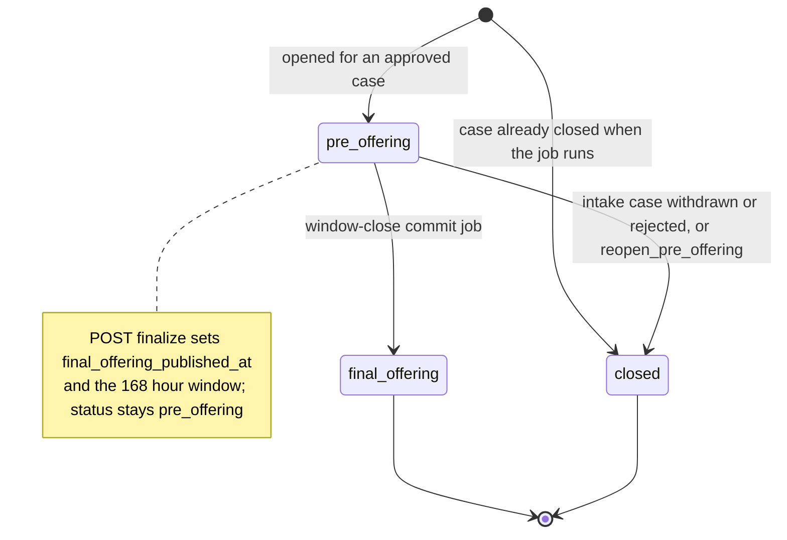
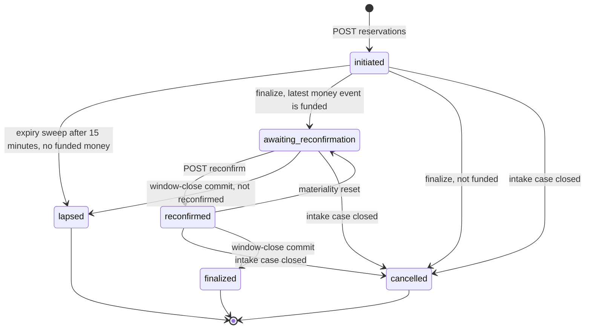

# API reference: offerings, reservations and the Coinbase onramp webhook

Valid for main at 48aa967 (2026-11-18).

This chapter lists every route of the offering module: the public offering list, the authenticated investor detail and disclosure downloads, reservation creation and reconfirmation, the staff routes that publish a disclosure pack, final terms and material changes, and the Coinbase onramp webhook. It also describes the offering and reservation state machines, the reservation blockers, the media rules and the background jobs that move an offering after a request has returned. It is read by the developers of the mobile app and the admin console, by engineers who change the module, and by operators who answer for money-affecting jobs.

Conventions shared by all routes (envelope, error catalogue, pagination, rate limits, idempotency, gating) are in [README.md](README.md) and are not repeated here. Longer narrative guides stay the place for the reasoning behind the rules: [../investor-offering.md](../investor-offering.md) (reservation, finalization, materiality, disclosure packs), [../coinbase-cdp-onramp.md](../coinbase-cdp-onramp.md) (the CDP client, the webhook, late evidence), [../document-storage.md](../document-storage.md) (object storage), [../dead-letter-jobs.md](../dead-letter-jobs.md) (failed jobs). The module page is [../modules/offering.md](../modules/offering.md); the wallet routes that decide whether an investor can pay are in [wallet.md](wallet.md).

## 1. Route summary

| Method | Path | Auth | Purpose |
| --- | --- | --- | --- |
| GET | `/v1/offerings` | none (IP limiter) | Public list of offerings (teasers), featured first |
| GET | `/v1/offerings/:offering_id` | customer session | Offering detail, current disclosure pack, change log, readiness and reservation blockers |
| GET | `/v1/offerings/:offering_id/documents/:document_id/download` | customer session | Stream one disclosure document |
| POST | `/v1/offerings/:offering_id/reservations` | customer session, fresh, `Idempotency-Key` | Create a capacity hold and a Coinbase onramp session |
| POST | `/v1/offerings/:offering_id/reservations/:reservation_id/reconfirm` | customer session, fresh, `Idempotency-Key` | Reconfirm a reservation inside the reconfirmation window |
| POST | `/webhooks/coinbase-onramp` | HMAC signature | Receive a signed onramp event and queue a reconcile job |
| POST | `/internal/v1/offerings/:offering_id/finalize` | staff, `admin_operations`, WebAuthn, `Idempotency-Key` | Publish final terms and open the 168-hour reconfirmation window |
| POST | `/internal/v1/offerings/:offering_id/materiality-records` | staff, `admin_operations`, WebAuthn | Classify a change made after final terms were published |
| POST | `/internal/v1/offerings/:offering_id/disclosure-packs` | staff, `admin_operations`, WebAuthn | Publish a new disclosure pack version |
| PATCH | `/internal/v1/offerings/:offering_id/presentation` | staff, `admin_operations`, WebAuthn | Set the featured flag and the media of an offering |
| POST | `/internal/v1/offerings/:offering_id/documents` | staff, `admin_operations`, WebAuthn | Upload one disclosure document (raw body) |
| GET | `/internal/v1/offerings/:offering_id/documents` | staff, `admin_operations`, WebAuthn | List uploads, or stream one with `document_ref` |
| GET | `/internal/v1/offerings/onramp-late-evidence` | staff, `admin_operations`, WebAuthn | List late onramp funding evidence |
| POST | `/internal/v1/offerings/onramp-late-evidence/:evidence_id/mark-reviewed` | staff, `admin_operations`, WebAuthn | Mark one late evidence entry reviewed |

There is no separate "featured" route: the featured flag is a field of the list items and is set with `PATCH .../presentation` (`src/modules/offering/api/offering-operations.schemas.ts:164-188`). There is no staff route that lists or reads offerings, no route that creates or closes an offering, and no route that cancels a reservation: an offering is opened by the worker job `case_timers.pre_offering_open_handoff` and closed by the intake module (sections 3.1 and 10).

> Pending #244: a new route, `POST /v1/offerings/:offering_id/reservations/:reservation_id/payment-session`, mints a new onramp session for an existing hold; it does not exist on main.

The investor's own reservation history, `GET /v1/investor-profile/reservations`, belongs to the investor-activity module and is in [platform.md](platform.md).

## 2. Behaviour common to the routes of this chapter

### 2.1 Customer routes (`/v1/offerings/...`)

`requireAuthentication` runs first (README section 4.2). The handler then calls `requireCustomerContext`, which refuses a session whose population is not `customer` (`src/modules/offering/api/offering.router.ts:145-165`). On the two reservation routes `requireFreshAuthentication` runs after the session check and the idempotency middleware after that; the population check is the first statement of the handler, so it runs after both (`src/modules/offering/api/offering.router.ts:61-65`, `:92-96`; mount lines `src/app.ts:629-634`, `:642-680`).

> Pending #237: `createApp` is split into per-module compose functions; the `src/app.ts` lines cited in this chapter move, the behaviour does not change.

| Status | Code | Condition |
| --- | --- | --- |
| 401 | `authentication.required`, `DPOP_PROOF_MISSING`, `DPOP_PROOF_INVALID`, `DPOP_KEY_MISMATCH`, `DPOP_REPLAY`, `REAUTH_REQUIRED` | no valid session or proof (README sections 4.2, 7) |
| 403 | `account.restricted` | the account status is not `active` |
| 403 | `authorization.forbidden` | a staff or partner session on a customer route (`src/modules/offering/api/offering.router.ts:156-162`) |
| 403 | `authentication.fresh_auth_required` | reservation create and reconfirm only: the session is neither a `device_biometric` session created in the last 5 minutes nor an active session whose `last_fresh_auth_at` is within 5 minutes (README section 4.4; `src/modules/auth/api/customer/require-fresh-authentication.ts:19-34`; `src/shared/errors/fresh-authentication-required-error.ts:11`) |
| 422 | `validation.invalid_field` | a path parameter, query parameter or body field fails its Zod schema |
| 429 | `rate_limit.exceeded` | the baseline limiter, when `RATE_LIMIT_CACHE_URL` is set |
| 500 | `account.mapping_missing`, `authentication.context_missing` | the session has no account row; the auth context is absent behind the middleware (`src/modules/offering/api/offering.router.ts:148-155`) |

Every path under `/v1/offerings`, including the authenticated ones, also passes the baseline limiter keyed by IP (`src/app.ts:591-595`). The detail, create and reconfirm handlers set `Cache-Control: no-store`, the download sets `private, no-store`, and the list handler sets no `Cache-Control` header (`src/modules/offering/api/offering.router.ts:26-30`, `:56`, `:84`, `:103`, `:121`).

### 2.2 Staff routes (`/internal/v1/offerings/...`)

Every staff route runs `requireAuthentication`, `requireAdminOperations` and `requireStaffWebAuthn`, in that order (`src/modules/offering/api/offering-operations.router.ts:46`, `src/modules/offering/api/onramp-late-evidence.router.ts:28`). The common errors are the 401 codes above, `403 authorization.forbidden` (not an active `admin_operations` staff account) and `403 authentication.staff_mfa_required` (the session was neither created by a staff passkey login nor backed by a legacy WebAuthn proof row, `src/modules/auth/repository/staff/prisma-staff-webauthn.repository.ts:32-50`; `src/modules/auth/api/staff/require-staff-role.ts:92-116`), then `422 validation.invalid_field` and `429 rate_limit.exceeded`. Staff routes have no per-IP limiter. Roles are described in [../staff-access.md](../staff-access.md).

### 2.3 Idempotency on three routes

Reservation creation, reconfirmation and finalization mount the shared middleware (`src/app.ts:490-501`; endpoint ids `offering.reservation.create`, `offering.reservation.reconfirm`, `offering.finalize`). `server.ts` always passes the idempotency store (`src/server.ts:600`); where `createApp` gets no store it mounts these three routes without the middleware (`src/app.ts:490-501`, `:673-678`, `:707`). The middleware's rules, including the 48-hour retention that nothing enforces and the key that is not scoped to the account, are in README section 10. Three consequences matter for these routes:

- A response with a status below 500 is stored and replayed for the same key and the same body, including a 4xx such as `409 offering.reservation_not_available` (`src/shared/http/idempotency.ts:56-64`, `:91`). A client that repeats a refused request after the cause is fixed must send a new key.
- A 5xx is not stored (`src/shared/http/idempotency.ts:64`), so the same key runs the handler again.
- The middleware runs before body validation, so a request refused with 422 is stored too.

> Pending #244: idempotency keys are scoped to the account plus the path ids, and a retry stored before the deploy answers `409 idempotency.body_mismatch`.

### 2.4 Money, identifiers and timestamps

Amounts in EUR are decimal strings with exactly two fraction digits (`^\d+\.\d{2}$`, `src/modules/offering/api/offering.schemas.ts:47`). Timestamps are ISO 8601 strings in UTC. Identifiers are opaque strings with a prefix: `offering_`, `reservation_`, `pack_`, `document_` (a document inside a pack), `doc_` (an uploaded file), `materiality_`, `onramp_late_evidence_` (`src/modules/offering/repository/prisma-offering.repository.ts:175`, `src/modules/offering/application/create-reservation.service.ts:61`, `src/modules/offering/repository/prisma-offering.repository.ts:1720`, `:1730`, `src/modules/offering/application/upload-offering-document.service.ts:125`, `src/modules/offering/repository/prisma-offering.repository.ts:1615`, `src/modules/offering/repository/prisma-onramp-late-evidence.repository.ts:60`). A client must not parse them.

> Pending #244: a response of the list, detail, reservation and reconfirmation routes that fails its own schema answers `500 internal.response_invalid` with a fixed detail where main answers `422 validation.invalid_field` (README section 6.3), and #245 applies the same handling to the remaining routers, which includes the staff routes of this chapter.

## 3. Concepts

### 3.1 Offering status

An offering has one of three statuses, enforced by a database check (`prisma/migrations/20261018131001_money_ledger_amount_and_status_checks/migration.sql:102`): `pre_offering`, `final_offering`, `closed`.

| Transition | Written by | Source |
| --- | --- | --- |
| none to `pre_offering` | `OpenOfferingForApprovedCaseService`, queue `case_timers.pre_offering_open_handoff`; creates the PIV and the offering with `minimum_raise_eur` and `target_raise_eur` both set to the case's `ipo_value_eur` | `src/modules/offering/repository/prisma-offering.repository.ts:153-283` |
| none to `closed` | the same job, when the intake case is already `rejected`, `withdrawn` or `expired` when the job takes the case lock | `src/modules/offering/repository/prisma-offering.repository.ts:94`, `:159-163` |
| `pre_offering` to `closed` | intake close of a case (outcome `withdrawn` or `rejected`), which also cancels every open reservation; and the intake correction `reopen_pre_offering`, which closes the offering only | `src/modules/intake/repository/prisma-intake.repository.ts:2258-2308`, `:255-257` |
| `pre_offering` to `final_offering` | the window-close commit (`commitOfferingFinalization`), the only place that writes `final_offering` | `src/modules/offering/repository/prisma-offering.repository.ts:1402-1537` (status write at `:1512-1515`) |

The status stays `pre_offering` through the whole reconfirmation window. What changes when final terms are published is `final_offering_published_at` (and the two rights-window columns), which is why every "open for reservations" check tests both the status and `final_offering_published_at` (`src/modules/offering/domain/reservation-eligibility.policy.ts:192-198`; `src/modules/offering/repository/prisma-offering.repository.ts:646-653`). No code on main moves an offering out of `final_offering` or `closed` (a search of `src` for `offering.update` finds the status writers above and updates of other columns: the final terms and the rights window, and the presentation).

### 3.2 Reservation stage

A reservation row carries a stage. The column has no database check (the migration that added the status checks leaves it out on purpose, `prisma/migrations/20261018131001_money_ledger_amount_and_status_checks/migration.sql:48-52`); the code writes six values.

| Transition | Written by | Source |
| --- | --- | --- |
| to `initiated` | `createReservation`, in the same transaction as the first money event and an `offering.reservation_created` audit row | `src/modules/offering/repository/prisma-offering.repository.ts:744-780` |
| `initiated` to `lapsed` | `expireReservation`, called by `ExpireUnfundedReservationsService` for a reservation older than 15 minutes whose latest money event is not funded; audit `offering.reservation_lapsed` | `src/modules/offering/repository/prisma-offering.repository.ts:1000-1038`; `src/modules/offering/application/expire-reservations.service.ts:14-44` |
| `initiated` to `awaiting_reconfirmation` or `cancelled` | `publishFinalOfferingTerms`, per reservation: funded goes to `awaiting_reconfirmation` and gets a `reconfirmation_pending` money event, not funded goes to `cancelled`; a code comment calls the cancel branch structurally unreachable while the target must be fully funded | `src/modules/offering/repository/prisma-offering.repository.ts:1151-1187` |
| `awaiting_reconfirmation` to `reconfirmed` | `reconfirmReservation` | `src/modules/offering/repository/prisma-offering.repository.ts:1361-1368` |
| `reconfirmed` to `awaiting_reconfirmation` | `classifyMateriality` with a classification that triggers a reset; clears `reconfirmed_at` and `reconfirmed_disclosure_pack_id` | `src/modules/offering/repository/prisma-offering.repository.ts:1585-1598` |
| `reconfirmed` to `finalized`, `awaiting_reconfirmation` to `lapsed` | `commitOfferingFinalization`; a position row is created only for `reconfirmed` | `src/modules/offering/repository/prisma-offering.repository.ts:1472-1510` |
| `initiated`, `awaiting_reconfirmation` or `reconfirmed` to `cancelled` | the intake close of a case, for every open reservation of the closed offering | `src/modules/intake/repository/prisma-intake.repository.ts:2274-2288` |

The stage is one state machine; the money state is another. `money.money_events` is append-only and the latest event of a reservation (by `recorded_at`, then id) is its capital state.

| `capital_state` | Written by | Meaning |
| --- | --- | --- |
| `initiated` | `createReservation` | hold created, no payment session yet |
| `eurc_purchase_pending` | `CreateReservationService` after the Coinbase token call | an onramp session was issued |
| `purchase_failed` | `CreateReservationService` when the token call fails on a first attempt; the onramp recorder when Coinbase reports a failure or an uncovering success | the purchase did not fund the hold |
| `eurc_reserved` | the onramp recorder (poll or webhook job) | Coinbase reports a success of at least 90% of the reserved amount in `EURC` |
| `reconfirmation_pending` | `publishFinalOfferingTerms` | the hold waits for the investor's reconfirmation |
| `eurc_finalized` | `commitOfferingFinalization` | the position was created |

(`src/modules/offering/repository/prisma-offering.repository.ts:756-765`, `:1160-1169`, `:1489-1498`; `src/modules/offering/application/create-reservation.service.ts:176-207`; `src/modules/offering/application/poll-onramp-transactions.service.ts:355-360`.) "Funded" means the latest event is `eurc_reserved`, `reconfirmation_pending` or `eurc_finalized` (`src/modules/offering/domain/reservation-eligibility.policy.ts:27-31`). The record's reservation stages differ from these (section 12, item 2).

### 3.3 Reservation blockers

`computeReservationBlockers` is the one rule set behind the advisory `reservation.blockers` of the detail route and the check that `POST .../reservations` runs before it writes (`src/modules/offering/domain/reservation-eligibility.policy.ts:145-207`). The order below is the order in which they are added to the list.

| Blocker | Condition | Source |
| --- | --- | --- |
| `account_restricted` | account status is not `active` | `src/modules/offering/domain/reservation-eligibility.policy.ts:176` |
| `kyc_not_eligible` | KYC eligibility state is not `eligible` | `src/modules/offering/domain/reservation-eligibility.policy.ts:177-178` |
| `kyc_renewal_due` | eligible, but `renewal_due_at` is null or not in the future | `src/modules/offering/domain/reservation-eligibility.policy.ts:179-181` |
| `login_methods_incomplete` | the account lacks a `device_key` method, or lacks both `google` and `apple` | `src/modules/offering/domain/reservation-eligibility.policy.ts:50-55`, `:182` |
| `payment_account_not_ready` | no confirmed wallet registration (a pending or expired claim does not count) | `src/modules/offering/domain/reservation-eligibility.policy.ts:183`; `src/modules/offering/repository/prisma-offering.repository.ts:489-492`, `:560` |
| `disclosure_pack_unavailable` | no current pack, or the current pack has no document | `src/modules/offering/domain/reservation-eligibility.policy.ts:184`; `src/modules/offering/application/get-investor-offering.service.ts:60-61`; `src/modules/offering/application/create-reservation.service.ts:98-99` |
| `offering_not_open` | status is not `pre_offering`, or final terms are published, or `ipo_end_at` is null or not after now | `src/modules/offering/domain/reservation-eligibility.policy.ts:192-198`, `:72-74` |
| `capacity_exhausted` | remaining capacity is `0.00` | `src/modules/offering/domain/reservation-eligibility.policy.ts:199` |
| `funding_rail_unavailable` | `RESERVATION_FUNDING_RAIL_ENABLED` is not `true`, or no Coinbase client is configured | `src/modules/offering/domain/reservation-eligibility.policy.ts:200`; `src/server.ts:474-475` |
| `settlement_escrow_not_ready` | the settlement bundle is configured and the offering's IPO escrow campaign was not last observed `open` on the configured contract with its deadline ahead | `src/modules/offering/domain/reservation-eligibility.policy.ts:126-135`, `:201` |
| `recovery_cooldown_active` | a customer account recovery completed and its cooldown has not ended | `src/modules/offering/domain/reservation-eligibility.policy.ts:202-204` |

Remaining capacity is `target_raise_eur` minus the sum of reservations whose stage is not `cancelled` or `lapsed`, floored at zero (`src/modules/offering/application/get-investor-offering.service.ts:46-49`; `src/modules/offering/repository/prisma-offering.repository.ts:444-474`). The rail is reported open only when `RESERVATION_FUNDING_RAIL_ENABLED=true` and the Coinbase client exists; the variable defaults to `false` (`src/config/environment.ts:272-275`), so on a deployment that does not set it every offering reports `funding_rail_unavailable`. Which value staging or production uses is not verifiable here (section 14).

### 3.4 Disclosure packs

A pack is a numbered version of an offering's disclosure documents. Publishing a pack marks the previous current pack `is_current = false` and sets its `superseded_at`; versions count up from 1 per offering (`src/modules/offering/repository/prisma-offering.repository.ts:1708-1721`). A pack holds documents of eleven types, each at most once per pack (a duplicate `document_type` in one request is `422`, `src/modules/offering/api/offering-operations.schemas.ts:61-84`):

`ecsp_kiis`, `priips_kid`, `final_offer_summary`, `final_terms_sheet`, `issuer_offeror_structure_sheet`, `investor_rights_payout_waterfall_summary`, `risk_factors_summary`, `property_appraisal_summary`, `fees_costs_tax_liquidity_summary`, `withdrawal_cancellation_supplement_rights_notice`, `full_prospectus` (`src/modules/offering/domain/disclosure-pack.policy.ts:9-22`).

A pack is complete when it holds all eleven (`isCompleteDisclosurePack`, `src/modules/offering/domain/disclosure-pack.policy.ts:45-48`). `is_core_reading` is computed, true for every type except `full_prospectus` (`:32-34`). A partial pack is accepted when it is published (the response reports `is_complete`); completeness is enforced when final terms are published and when an investor reconfirms (`src/modules/offering/repository/prisma-offering.repository.ts:1119`, `:1341`). After a reset-triggering materiality record, the current pack must also be at least the version the record requires (`:1348-1359`; `src/modules/offering/domain/disclosure-pack.policy.ts:56-68`).

### 3.5 Media (investor image URLs)

An offering can carry a hero image URL and an ordered gallery of image URLs. The platform stores the links only; it never serves an image (`src/modules/offering/domain/offering-media.policy.ts:1-8`).

| Rule | Value | Source |
| --- | --- | --- |
| Scheme | absolute URL that `URL.canParse` accepts and whose protocol is `https:` | `src/modules/offering/api/offering.schemas.ts:5-7` |
| Length | at most 2048 characters per URL | `src/modules/offering/domain/offering-media.policy.ts:7`; `src/modules/offering/api/offering-operations.schemas.ts:152` |
| Gallery size | at most 20 URLs, no URL repeated | `src/modules/offering/domain/offering-media.policy.ts:6`; `src/modules/offering/api/offering-operations.schemas.ts:154-157`, `:170-182` |
| Empty media | a null hero and an empty gallery are stored as no media and shown as `media: null` | `src/modules/offering/domain/offering-media.policy.ts:15-18` |
| Storage | `offering.offerings.hero_image_url` (text) and `gallery_image_urls` (text array, default empty) | `prisma/schema/schema.prisma:599-600`; `prisma/migrations/20261116140000_offering_media/migration.sql` |
| Where shown | `property.media` of the list items and of the detail, as `{ hero_url, gallery_urls }` | `src/modules/offering/api/offering.schemas.ts:24-27`, `:80-83` |

The write path is `PATCH .../presentation` only; the same `https` rule is applied again when a response is built, because the response schemas reuse the validator (`src/modules/offering/api/offering.schemas.ts:25-26`, `:81-82`). The database has no check on these columns. The validator has no check for credentials or control characters in a URL, and a value that passes is stored unchanged (read from the code, not run; section 13, item 2, issue #218).

> Pending #243: a stored URL that is too long or fails the validator is dropped from the list, detail and featured-only presentation responses with a warning log; on main the whole response fails.

## 4. Public and investor routes

### GET /v1/offerings

- **Auth:** none. When a rate-limit store is connected the baseline limiter keyed by IP runs on the mount (`src/app.ts:591-595`).
- **Mounted when:** always (`src/app.ts:591-595`).
- **Request:** query `limit` (integer 1 to 100, default 20; a non-integer or out-of-range value is `422`) and `after` (string of at least one character, the `next_cursor` of the previous page). Schema `listOfferingsQuerySchema`, `src/modules/offering/api/offering.schemas.ts:9-12`.
- **Success:** `200`, body parsed through `listOfferingsResponseSchema` (`src/modules/offering/api/offering.router.ts:26-30`; `src/modules/offering/api/offering.schemas.ts:31-36`). No `Cache-Control` header. `data` is an array of items, `page.next_cursor` is a string or `null`.

  | Field | Type | Meaning |
  | --- | --- | --- |
  | `id` | string | offering id |
  | `status` | `pre_offering` or `final_offering` | a `closed` offering is never listed |
  | `featured` | boolean | the staff-set flag |
  | `target_raise_eur` | string `^\d+\.\d{2}$` | the offering's target |
  | `ipo_end_at` | ISO string or `null` | `intake.intake_cases.ipo_end_at` of the offering's case |
  | `property.property_type` | string | always `residential` (database check on the column) |
  | `property.country_code` | string of 2 characters | |
  | `property.city` | string or `null` | |
  | `property.media` | `{ hero_url, gallery_urls }` or `null` | see section 3.5 |

  Source of the fields: `src/modules/offering/application/list-public-offerings.service.ts:27-46`; `src/modules/offering/repository/prisma-offering.repository.ts:312-349`. The item carries no description and no funded or reserved amount (section 12, item 3).
- **Order and paging:** `featured` descending, then `created_at` descending, then `id` descending; only offerings whose status is `pre_offering` or `final_offering` (`src/modules/offering/repository/prisma-offering.repository.ts:306-310`). The service reads `limit + 1` rows and sets `next_cursor` only when the extra row exists. The cursor is the base64url of a JSON object `{ featured, created_at, id }` of the last item of the page (`src/modules/offering/application/list-public-offerings.service.ts:8-12`, `:17-85`). An offering stays listed after its `ipo_end_at` has passed; the reservation block is enforced by the blocker `offering_not_open`, not by hiding the offering.
- **Errors:**

  | Status | Code | Condition |
  | --- | --- | --- |
  | 422 | `pagination.invalid_cursor` | `after` does not decode to the cursor shape; `field_errors` holds `{ field: "after", code: "cursor.invalid" }` (`src/modules/offering/application/list-public-offerings.service.ts:61-81`) |
  | 422 | `validation.invalid_field` | `limit` is invalid, or a stored media URL fails the response schema, which fails the whole page (section 13, item 1) |
  | 429 | `rate_limit.exceeded` | the per-IP baseline limiter |

> Pending #243: a stored media URL that fails validation is dropped from the item instead of failing the page.

- **Notes:** read only; no audit row, no job. It is the only offering route that needs neither a session nor a webhook signature.
- **Source:** router `src/modules/offering/api/offering.router.ts:23-33`; service `ListPublicOfferingsService`; repository `PrismaOfferingRepository.listPublic` (`src/modules/offering/repository/prisma-offering.repository.ts:285-351`).

### GET /v1/offerings/:offering_id

- **Auth:** `requireAuthentication`, then `requireCustomerContext` in the handler. No fresh authentication, no KYC requirement: any authenticated customer reads the detail and the current disclosure pack of any offering id, including a closed one (`src/modules/offering/api/offering.router.ts:49-58`; no status condition at `src/modules/offering/repository/prisma-offering.repository.ts:358-361`).
- **Mounted when:** always (`src/app.ts:642-680`).
- **Request:** path `offering_id` (string, at least one character), `src/modules/offering/api/offering.schemas.ts:38-40`. No query, no body.
- **Success:** `200`, header `Cache-Control: no-store`, body parsed through `investorOfferingDetailResponseSchema` (`src/modules/offering/api/offering.router.ts:56-57`; `src/modules/offering/api/offering.schemas.ts:50-136`). Values come from `GetInvestorOfferingService.execute` (`src/modules/offering/application/get-investor-offering.service.ts:20-139`).

  | Field | Meaning |
  | --- | --- |
  | `id`, `status` | `status` is `pre_offering`, `final_offering` or `closed` |
  | `terms.minimum_raise_eur`, `terms.target_raise_eur` | decimal strings |
  | `terms.ipo_end_at` | end of the reservation period, or `null` |
  | `terms.final_offering_published_at`, `terms.platform_rights_end_at`, `terms.effective_rights_end_at` | `null` until final terms are published |
  | `progress.reserved_capacity_eur` | sum of reservations whose stage is not `cancelled` or `lapsed` |
  | `progress.funded_eur` | sum of the latest money event amounts of those reservations whose stage is not `cancelled` or `lapsed` and whose latest event is `eurc_reserved`, `reconfirmation_pending` or `eurc_finalized` (`src/modules/offering/repository/prisma-offering.repository.ts:444-474`); the funded sum that gates final terms has no stage filter (section 7) |
  | `progress.remaining_capacity_eur` | target minus reserved, floored at zero |
  | `issuer` | `piv_id`, `legal_name`, `jurisdiction`, `registration_number` (nullable), `structure_pattern`, `incorporated_at` |
  | `property` | `property_id`, `property_type`, `country_code`, `city`, `media`, `address_line`, `owner_declared_value_eur`, `appraisal_value_opinion_eur` (nullable) |
  | `current_disclosure_pack` | `null`, or `disclosure_pack_id`, `version`, `published_at` and `documents[]` of `document_id`, `document_type`, `download_path`, `is_core_reading` |
  | `change_log[]` | the offering's materiality records, newest first: `materiality_record_id`, `description`, `classification`, `reconfirmation_reset`, `classified_at` (`src/modules/offering/repository/prisma-offering.repository.ts:416-425`) |
  | `readiness.investment_eligible` | account `active`, KYC current, and login methods complete (`src/modules/offering/domain/reservation-eligibility.policy.ts:57-63`) |
  | `readiness.payment_account_ready`, `readiness.payout_account_verified` | both true only for a confirmed wallet registration (`src/modules/offering/repository/prisma-offering.repository.ts:560-562`) |
  | `reservation.available`, `reservation.blockers[]` | the blockers of section 3.3; `available` is true when the list is empty |

  `download_path` is `/v1/offerings/<offering_id>/documents/<document_id>/download` with both ids URL-encoded; the stored `document_ref` and any storage URL are never returned (`src/modules/offering/application/get-investor-offering.service.ts:117`). Documents are ordered core reading first, then by type, then by id; the current pack is the row with `is_current` true and `superseded_at` null (`src/modules/offering/repository/prisma-offering.repository.ts:397-415`).
- **Errors:**

  | Status | Code | Condition |
  | --- | --- | --- |
  | 404 | `offering.not_found` | no offering with this id, or no account row for the caller (`src/modules/offering/application/get-investor-offering.service.ts:27`; `src/modules/offering/repository/prisma-offering.repository.ts:478`) |

- **Notes:** read only. Four reads run in parallel: the offering with its pack and records, the account with login methods, wallet registration and recovery cases, the progress aggregate, and the KYC eligibility snapshot (`src/modules/offering/repository/prisma-offering.repository.ts:357-476`). The `payment_account_ready` flag differs from the flag of the same name in `GET /v1/investor-profile`, which is true for any non-expired wallet row (`src/modules/profile/application/get-profile.service.ts:89`; `src/modules/wallet/repository/prisma-wallet.repository.ts:278-283`).
- **Source:** router `src/modules/offering/api/offering.router.ts:49-58`; service `GetInvestorOfferingService`; repository `PrismaOfferingRepository.getInvestorDetail` (`src/modules/offering/repository/prisma-offering.repository.ts:353-566`).

### GET /v1/offerings/:offering_id/documents/:document_id/download

- **Auth:** `requireAuthentication`, then `requireCustomerContext`. No KYC requirement.
- **Mounted when:** the `disclosureDocuments` dependency is passed, which `server.ts` always does (`src/server.ts:697-700`; `src/app.ts:651-656`). Without the `MINIO_*` group the store is `UnavailableDisclosureDocumentStore`, so the route exists and fails after the database lookup (below).
- **Request:** path `offering_id` and `document_id` (strings, at least one character), `src/modules/offering/api/offering.schemas.ts:42-45`.
- **Access rule:** one SQL statement finds the document by `document_id` and `offering_id` in a pack that is either the current pack, or any pack whose version equals the `disclosure_pack_version_at_reservation` of a reservation of this account on this offering (`src/modules/offering/repository/prisma-offering.repository.ts:568-613`). An unknown id, a document of another offering and a document outside both conditions all answer the same `404`.
- **Success:** `200`, streamed with `pipeline` (`src/modules/offering/api/offering.router.ts:109-131`). Headers: `Cache-Control: private, no-store`; `Content-Type` from the object; `Content-Length`; `Content-Disposition: attachment; filename="<name>"`; `X-Content-Type-Options: nosniff`. The name is the object's `original-filename` metadata, or `<document_type>-v<version>`; it is reduced to the characters `A-Z a-z 0-9 . _ -`, at most 120, fallback `disclosure-document` (`src/modules/offering/api/offering.router.ts:137-143`; `src/modules/offering/application/download-disclosure-document.service.ts:45-48`). The body is not a JSON envelope.
- **Errors:**

  | Status | Code | Condition |
  | --- | --- | --- |
  | 404 | `offering.document_not_found` | the access rule finds no document (`src/modules/offering/application/download-disclosure-document.service.ts:26`) |
  | 503 | `offering.document_storage_inconsistent` | the database knows the document, the object is missing (`src/modules/offering/application/download-disclosure-document.service.ts:36`) |
  | 503 | `infrastructure.document_storage_unavailable` | the storage group is not configured, or the object store fails (`src/infrastructure/storage/minio-disclosure-document.store.ts:99-120`, `:156-164`) |
  | 503 | `infrastructure.document_storage_invalid_response` | the object store answers without a readable body or length (`src/infrastructure/storage/minio-disclosure-document.store.ts:147-154`) |
  | 503 | `offering.document_reference_invalid` | the stored reference is empty, longer than 1024 characters or contains a `..` segment (`src/infrastructure/storage/minio-disclosure-document.store.ts:122-137`) |

  Errors are raised before the first byte is sent, so they use the JSON envelope. A failure while the body streams cannot change the status.
- **Notes:** read only, no audit row. A superseded pack stays readable only for an investor whose reservation recorded that pack version at creation; the pack an investor reconfirmed against is not consulted (section 13, item 8).
- **Source:** router `src/modules/offering/api/offering.router.ts:109-131`; service `DownloadDisclosureDocumentService`; repository `PrismaOfferingRepository.getAccessibleDocument`; store `MinioDisclosureDocumentStore.get`.

## 5. Reservations

### POST /v1/offerings/:offering_id/reservations

Creates a capacity-holding reservation and a Coinbase onramp session in one request. This is the route a client calls to pay for an offering. The reasoning behind the capacity hold and the 15-minute expiry is in [../investor-offering.md](../investor-offering.md); the CDP client is in [../coinbase-cdp-onramp.md](../coinbase-cdp-onramp.md).

- **Auth:** `requireAuthentication`, `requireFreshAuthentication` (a `device_biometric` session created in the last 5 minutes, or an active session whose `last_fresh_auth_at` is within the window, README section 4.4), the idempotency middleware with endpoint id `offering.reservation.create`, then `requireCustomerContext` (`src/modules/offering/api/offering.router.ts:60-65`). Header `Idempotency-Key` is required: missing or blank is `400 idempotency.key_required` from the middleware; empty after trimming or longer than 128 characters is the same code from the handler (`src/modules/offering/api/offering.router.ts:68-76`). Rate limit: the baseline account limiter and the baseline IP limiter of the mount; the tightened tier does not apply (README section 13.1, item 2).
- **Mounted when:** `protectedApi.reservations` is passed, which `server.ts` does only when `COINBASE_CDP_API_KEY_ID`, `COINBASE_CDP_API_KEY_SECRET` and `COINBASE_ONRAMP_REDIRECT_URL` are all set (`src/server.ts:701-711`, `:445-457`; the schema requires the three together, `src/config/environment.ts:463-479`). Otherwise the route answers `404 resource.not_found`. When mounted it still answers `409` with blocker `funding_rail_unavailable` until `RESERVATION_FUNDING_RAIL_ENABLED=true` (section 3.3).
- **Request:** path `offering_id`. Body `{ "amount_eur": "<string>" }`, a string matching `^\d+\.\d{2}$` whose number is greater than zero (`src/modules/offering/api/offering.schemas.ts:47`, `:138-142`). Headers: `Idempotency-Key`, `DPoP`, `Authorization`. A JSON number, a one-digit fraction or an integer without a fraction is `422`.
- **Success:** `201`, header `Cache-Control: no-store`, body parsed through `createReservationResponseSchema` (`src/modules/offering/api/offering.router.ts:84-85`; `src/modules/offering/api/offering.schemas.ts:144-156`):

  | Field | Meaning |
  | --- | --- |
  | `reservation_id` | `reservation_<ULID>`; on a retry that finds the stored hold, the stored id |
  | `offering_id`, `amount_eur` | as requested |
  | `status` | always `initiated` |
  | `expires_at` | the hold's `created_at` plus 15 minutes (`src/modules/offering/application/create-reservation.service.ts:66`, `:221`) |
  | `onramp.url` | the hosted Coinbase purchase page with `sessionToken`, `partnerUserRef` (the reservation id) and `redirectUrl` as query parameters (`src/modules/offering/infrastructure/http-coinbase-cdp.client.ts:117-127`) |
  | `onramp.channel_id` | Coinbase's channel id for the session |

  `redirectUrl` is `COINBASE_ONRAMP_REDIRECT_URL` plus `?reservation_id=<id>` (`src/server.ts:708-709`). The blockchain sent to Coinbase is `COINBASE_ONRAMP_BLOCKCHAIN`, default `base` (`src/config/environment.ts:256`). The destination address is the account's confirmed wallet address in EIP-55 spelling (`src/modules/offering/infrastructure/http-coinbase-cdp.client.ts:108-111`; `src/shared/domain/wallet-address.ts:27-29`).
- **What runs, in order** (`src/modules/offering/application/create-reservation.service.ts:69-225`):
  1. Read the offering detail for the caller; unknown offering is `404`.
  2. Compute the blockers (section 3.3). Any blocker is `409 offering.reservation_not_available` with one `field_errors` entry per blocker, `{ field: "reservation", code: <blocker>, message }` (`src/modules/offering/application/create-reservation.service.ts:91-108`, `:281-294`).
  3. If the amount exceeds the remaining capacity: `422 offering.reservation_amount_exceeds_capacity` (`src/modules/offering/application/create-reservation.service.ts:110-112`, `:296-310`).
  4. One database transaction (`src/modules/offering/repository/prisma-offering.repository.ts:615-788`): lock the offering row `FOR UPDATE`; refuse if the status is not `pre_offering`, final terms are published, or `ipo_end_at` is null or past (`409` blocker `offering_not_open`); where the settlement bundle is configured, read the escrow campaign `FOR SHARE` and refuse unless it is ready (`409` blocker `settlement_escrow_not_ready`); look up the client key (below); re-check capacity (`422`); insert the reservation with stage `initiated`, a money event `initiated`, and the audit row `offering.reservation_created`.
  5. Call Coinbase `POST /onramp/v1/token` with an 8-second timeout (`src/server.ts:455`). On failure the error propagates; on a first attempt a money event `purchase_failed` is written first, and the reservation row stays (`src/modules/offering/application/create-reservation.service.ts:174-192`).
  6. Write the money event `eurc_purchase_pending` with the channel id as provider reference. If the reservation left `initiated` or became funded meanwhile the write is refused and the answer is `409 offering.reservation_replay_unavailable` (`src/modules/offering/application/create-reservation.service.ts:198-207`).
  7. Build the onramp URL and answer.
- **Errors:** in addition to section 2.1.

  | Status | Code | Condition |
  | --- | --- | --- |
  | 400 | `idempotency.key_required` | the header is missing, blank, or longer than 128 characters |
  | 404 | `offering.not_found` | unknown offering |
  | 409 | `offering.reservation_not_available` | at least one blocker; `field_errors` lists them |
  | 409 | `offering.idempotency_key_reused` | the key hit a stored hold of another amount (`src/modules/offering/application/create-reservation.service.ts:240-242`, `:262-269`) |
  | 409 | `offering.reservation_replay_unavailable` | the key hit a hold that is no longer `initiated`, is funded, is older than 15 minutes, or whose pending write was refused (`src/modules/offering/application/create-reservation.service.ts:233-258`, `:271-279`) |
  | 409 | `idempotency.body_mismatch` | the middleware found the key with another body |
  | 422 | `offering.reservation_amount_exceeds_capacity` | the amount does not fit the remaining capacity, checked twice (`src/modules/offering/application/create-reservation.service.ts:110-112`, `:141-143`) |
  | 422 | `offering.coinbase_provider_request_rejected` | Coinbase answered a 4xx other than 401, 403, 408, 429 (`src/modules/offering/infrastructure/http-coinbase-cdp.client.ts:41-46`, `:190-200`, `:335-343`) |
  | 500 | `offering.coinbase_provider_auth_rejected` | Coinbase answered 401 or 403 (`src/modules/offering/infrastructure/http-coinbase-cdp.client.ts:179-189`, `:325-333`) |
  | 500 | `offering.coinbase_provider_key_invalid` | `COINBASE_CDP_API_KEY_SECRET` is neither a PEM EC key nor a base64 Ed25519 key (`src/modules/offering/infrastructure/http-coinbase-cdp.client.ts:243-252`) |
  | 502 | `offering.coinbase_provider_response_invalid` | the token or transaction answer fails its schema (`src/modules/offering/infrastructure/http-coinbase-cdp.client.ts:112-113`, `:345-353`) |
  | 503 | `offering.coinbase_provider_unavailable` | network failure, timeout, 5xx, 408 or 429 (`src/modules/offering/infrastructure/http-coinbase-cdp.client.ts:171-173`, `:201-202`, `:315-323`) |
  | 503 | `idempotency.store_unavailable` | the key lookup failed (README section 10.2) |
  | 500 | `internal.unexpected` | the repository returned neither a reservation nor a conflict (`src/modules/offering/application/create-reservation.service.ts:145-152`) |

> Pending #244: a Coinbase 4xx after the hold exists answers `502 offering.coinbase_provider_request_rejected` where main answers 422, every 5xx carries a fixed detail, and a same-key retry is served only until 10 minutes after the hold was created instead of 15.

- **Retries with the same key.** Two mechanisms apply. The shared middleware stores any answer below 500 and answers a repeat with the stored status and body without running the handler, so a repeat of a `201` returns the same `onramp.url` (including its session token) and a repeat of a `409` returns the same refusal (section 2.3). The reservation also stores the key (`client_idempotency_key`, unique per account, offering and key, `prisma/schema/schema.prisma:638`); a handler run that finds the key under the offering lock returns the stored hold and issues a new onramp session for it. That second path runs when no response was stored: after a 5xx, or after a failed save (`src/modules/offering/repository/prisma-offering.repository.ts:697-728`; `src/modules/offering/application/create-reservation.service.ts:165-172`). On that path a failure of the token call does not write `purchase_failed` (`:180`). The advisory checks of steps 2 and 3 run before the key lookup and count the stored hold itself, so a retry of a hold that took the last remaining capacity is refused with `409` (`capacity_exhausted`) or `422` instead of being served (section 13, item 12).

> Pending #244: a same-key hold is looked up before the advisory capacity check.

- **Notes:** rows written: `offering.reservations`, `money.money_events` (the initial event and the pending or failed one; a retry adds one more), `audit.audit_log` (`offering.reservation_created`); the idempotency row. No job is enqueued. The funding outcome arrives later through the poll or the webhook job (section 10). The hold lapses 15 minutes after creation unless a funded money event exists (section 10).
- **Source:** router `src/modules/offering/api/offering.router.ts:60-87`; service `CreateReservationService`; repository `PrismaOfferingRepository.createReservation`, `recordMoneyEvent` (`src/modules/offering/repository/prisma-offering.repository.ts:790-814`); client `HttpCoinbaseCdpClient`.

### POST /v1/offerings/:offering_id/reservations/:reservation_id/reconfirm

Confirms that the investor still wants the reservation after final terms were published. Only a reservation in stage `awaiting_reconfirmation` can be reconfirmed, and only before `effective_rights_end_at`.

- **Auth:** `requireAuthentication`, `requireFreshAuthentication`, the idempotency middleware with endpoint id `offering.reservation.reconfirm`, then `requireCustomerContext` (`src/modules/offering/api/offering.router.ts:89-106`). `Idempotency-Key` is required (`400 idempotency.key_required` from the middleware). No body is read.
- **Mounted when:** `protectedApi.offeringOperations` is passed (`src/app.ts:669-671`), which `server.ts` always does (`src/server.ts:620-624`). The route does not depend on the Coinbase configuration.
- **Request:** path `offering_id` and `reservation_id` (`src/modules/offering/api/offering.schemas.ts:161-164`). The handler uses only `reservation_id`: the `offering_id` of the path is parsed and never compared with the reservation's offering (`src/modules/offering/api/offering.router.ts:96-102`), so the URL is not a check.
- **Success:** `200`, `Cache-Control: no-store`, body parsed through `reconfirmReservationResponseSchema` (`src/modules/offering/api/offering.schemas.ts:166-173`): `reservation_id`, `status` (`reconfirmed`), `reconfirmed_at`, `disclosure_pack_version` (the version of the current pack the investor reconfirmed against).
- **What runs** (`src/modules/offering/repository/prisma-offering.repository.ts:1274-1390`, one transaction): read the reservation; share-lock the offering row; lock the reservation row `FOR UPDATE`; then the checks in the order of the table.

  | Status | Code | Condition |
  | --- | --- | --- |
  | 404 | `offering.reservation_not_found` | no such reservation, or it belongs to another account (the two cases are not distinguishable, `src/modules/offering/repository/prisma-offering.repository.ts:1283-1285`, `:1308-1310`) |
  | 409 | `offering.reservation_not_awaiting_reconfirmation` | stage is not `awaiting_reconfirmation` (`src/modules/offering/repository/prisma-offering.repository.ts:1311-1313`) |
  | 409 | `offering.reconfirmation_window_closed` | `effective_rights_end_at` is null or not after now (`src/modules/offering/repository/prisma-offering.repository.ts:1326-1331`) |
  | 409 | `offering.reconfirmation_disclosure_pack_incomplete` | there is no current pack, or it lacks one of the eleven types (`src/modules/offering/repository/prisma-offering.repository.ts:1337-1343`) |
  | 409 | `offering.reconfirmation_disclosure_pack_outdated` | the current pack's version is below the highest `required_disclosure_pack_version` of the offering's reset records (`src/modules/offering/repository/prisma-offering.repository.ts:1345-1359`) |
  | 409 | `idempotency.body_mismatch` | the middleware found the key with another body |
  | 500 | `internal.unexpected` | the repository returned neither a result nor a conflict (`src/modules/offering/application/reconfirm-reservation.service.ts:80`) |

- **Notes:** writes stage `reconfirmed`, `reconfirmed_at` and `reconfirmed_disclosure_pack_id` on the reservation, and the audit row `offering.reservation_reconfirmed` with the pack id and version (`src/modules/offering/repository/prisma-offering.repository.ts:1361-1386`). No money event, no position and no job. A reconfirmed reservation becomes a position only when the window-close commit runs (section 10).
- **Source:** router `src/modules/offering/api/offering.router.ts:89-106`; service `ReconfirmReservationService`; repository `PrismaOfferingRepository.reconfirmReservation`.

## 6. Coinbase webhook

### POST /webhooks/coinbase-onramp

Receives a signed onramp event, stores a minimised receipt and queues a job that asks Coinbase for the real state. The body is never trusted for a status or an amount.

- **Auth:** none; an HMAC signature. No limiter. The raw bytes are kept: the route is mounted behind `express.raw({ limit: "256kb", type: "application/json" })` before the JSON parser (`src/app.ts:576-588`). The signature header is `X-Webhook-Signature` (the deprecated `X-Hook0-Signature` is read when the first is absent): `t=<unix seconds>,v0=<64 hex>,...`, at most 2048 characters, one `t` of 1 to 12 digits, at least one `v0` (`src/modules/offering/infrastructure/coinbase-onramp-webhook-verifier.ts:52-72`; `src/modules/offering/api/coinbase-onramp-webhook.router.ts:54-60`). The check is `HMAC-SHA256(COINBASE_ONRAMP_WEBHOOK_SECRET, "<t>.<raw body>")` compared in constant time against every `v0`, and `t` must be within 300 seconds of the server clock in either direction (`src/modules/offering/infrastructure/coinbase-onramp-webhook-verifier.ts:5`, `:34-47`). A request whose content type is not `application/json` reaches the handler with no raw body and is verified over an empty body (`src/modules/offering/api/coinbase-onramp-webhook.router.ts:53`).
- **Mounted when:** the CDP client exists and `COINBASE_ONRAMP_WEBHOOK_SECRET` (at least 16 characters) is set; the schema refuses the secret without the CDP settings (`src/server.ts:461-467`; `src/config/environment.ts:263-266`, `:480-489`). Otherwise `404 resource.not_found`.
- **Request:** header `X-Event-Id` (1 to 200 characters); without a usable value the event id is `body-sha256:<hex digest of the raw body>` (`src/modules/offering/api/coinbase-onramp-webhook.router.ts:37`, `:61-64`). Body: a JSON object with `eventType` (string, 1 to 100 characters) and, each optional and read as `null` when absent or not a string of 1 to 200 characters, `partnerUserRef`, `transactionId`, `txHash` (`:17-31`, `:72-87`). These four names are assumed: no real signed delivery has been checked (section 14).
- **Success:** `200` with `{ "received": true }` for every delivery whose signature is valid, whatever the body, so that Coinbase does not retry what a retry cannot fix (`src/modules/offering/api/coinbase-onramp-webhook.router.ts:47-68`). The acknowledgement is a literal and does not go through a response schema.
- **Errors:**

  | Status | Code | Condition |
  | --- | --- | --- |
  | 401 | `offering.coinbase_webhook_invalid` | the header is missing, malformed, stale or does not match (`src/modules/offering/infrastructure/coinbase-onramp-webhook-verifier.ts:74-81`) |
  | 413 | `request.payload_too_large` | the body exceeds 256 kb (README section 3) |

- **What the service does** (`src/modules/offering/application/coinbase-onramp-webhook.service.ts:36-91`): the delivery is acknowledged without action when the body is not recognised JSON of the shape above, when `eventType` does not start with `onramp.transaction.`, or when `partnerUserRef` does not match `^reservation_[A-Za-z0-9_-]{1,120}$`; a warning is logged for the first and third cases and an info line for the second. Otherwise one transaction inserts a row in `money.onramp_webhook_receipts` (event id, event type, transaction id, transaction hash, `partner_user_ref`; unique on the event id, duplicates skipped) and, only if the row was new, enqueues the job `provider_events.coinbase_onramp_webhook` with `{ reservationId, eventId, eventType }` and the trace id (`src/modules/offering/repository/prisma-offering.repository.ts:966-998`). A redelivered event id writes and enqueues nothing and is logged at info.
- **Notes:** the body, the signature and any address in it are never stored or logged. The worker consumes the job only when it has a CDP client; the queue exists in every worker (`src/worker.ts:464`, `:860-884`). The job re-fetches the reservation's transactions from Coinbase and records the outcome through the same method as the minute poll (section 10). The route lives under `/webhooks`, not `/provider/v1` (README section 13.1, item 1).
- **Source:** router `coinbase-onramp-webhook.router.ts`; verifier `CoinbaseOnrampWebhookVerifier`; service `ReceiveCoinbaseOnrampWebhookService`; repository `PrismaOfferingRepository.receiveOnrampWebhook`.

## 7. Staff routes: final terms, materiality, disclosure packs, presentation

### POST /internal/v1/offerings/:offering_id/finalize

Publishes the final terms of an offering whose target is fully funded and opens the 168-hour reconfirmation window. It creates no position: positions are created by the window-close commit (section 10). The route name says "finalize"; what it does is the first of three stages ([../investor-offering.md](../investor-offering.md), "Offering finalization is a three-stage flow").

- **Auth:** `requireAuthentication`, `requireAdminOperations`, `requireStaffWebAuthn`, then the idempotency middleware with endpoint id `offering.finalize` (`src/modules/offering/api/offering-operations.router.ts:48-52`). `Idempotency-Key` is required (`400 idempotency.key_required`). No fresh-authentication check beyond the staff passkey session.
- **Mounted when:** `protectedApi.offeringOperations` is passed, always (`src/app.ts:695-717`; `src/server.ts:620-624`).
- **Request:** path `offering_id`; body `{ "founder_review_notes": "<string>" }`, trimmed, 1 to 10000 characters (`src/modules/offering/api/offering-operations.schemas.ts:8-10`).
- **Success:** `200`, body parsed through `finalizeOfferingResponseSchema` (`src/modules/offering/api/offering-operations.schemas.ts:12-20`; `src/modules/offering/api/offering-operations.router.ts:62`): `offering_id`, `final_offering_published_at`, `effective_rights_end_at` (168 hours later), `reservations_awaiting_reconfirmation`, `reservations_cancelled`. No `Cache-Control` header is set.
- **Errors:**

  | Status | Code | Condition |
  | --- | --- | --- |
  | 404 | `offering.not_found` | unknown offering (`src/modules/offering/application/finalize-offering.service.ts:40-47`) |
  | 409 | `offering.finalization_not_available` | status is not `pre_offering`, or final terms are already published (`src/modules/offering/application/finalize-offering.service.ts:48-58`) |
  | 409 | `offering.finalization_target_not_reached` | funded amount is below `target_raise_eur` (`src/modules/offering/application/finalize-offering.service.ts:59-66`) |
  | 409 | `offering.finalization_disclosure_pack_incomplete` | the current pack is missing or lacks one of the eleven types (`src/modules/offering/application/finalize-offering.service.ts:67-75`) |
  | 409 | `idempotency.body_mismatch` | the middleware found the key with another body |
  | 500 | `internal.unexpected` | neither a result nor a conflict (`src/modules/offering/application/finalize-offering.service.ts:77-85`) |

- **What runs** (`src/modules/offering/repository/prisma-offering.repository.ts:1040-1272`, one transaction): lock the offering row (joined to its PIV for the case id) `FOR UPDATE`; check status, not yet published, funded sum at least the target (`canPublishFinalOfferingTerms`, `src/modules/offering/domain/finalization.policy.ts:18-24`, where "funded" sums the amount of each reservation's latest money event when that event is `eurc_reserved`, `reconfirmation_pending` or `eurc_finalized`, `src/modules/offering/repository/prisma-offering.repository.ts:1075-1090`), and a complete current pack; lock every `initiated` reservation; move each funded one to `awaiting_reconfirmation` with a money event `reconfirmation_pending` (provider `internal`) and each unfunded one to `cancelled`; set `final_offering_published_at`, `platform_rights_end_at` and `effective_rights_end_at` (both `published_at` + 168 hours, `src/modules/offering/domain/finalization.policy.ts:39-43`); write the audit row `offering.final_terms_published` with the notes, the funded and target amounts and both counts.
- **Jobs enqueued in the same transaction** (`enqueueTransactionalJob`): `case_timers.offering_reconfirmation_window_opened` with `{ offering_id, reservation_ids }`, only when at least one reservation moved; `case_timers.post_ipo_structuring_handoff` with `{ case_id }`, always (`src/modules/offering/repository/prisma-offering.repository.ts:1234-1258`).
- **Notes:** the status is not changed. The 168-hour window is the platform default; no jurisdiction-specific window exists in code (`src/modules/offering/domain/finalization.policy.ts:31-43`).
- **Source:** router `src/modules/offering/api/offering-operations.router.ts:48-63`; service `FinalizeOfferingService`; repository `PrismaOfferingRepository.publishFinalOfferingTerms`.

### POST /internal/v1/offerings/:offering_id/materiality-records

Records the classification of a change made after final terms were published. A change that is not `non_material` resets every reconfirmation and restarts the 168-hour window.

- **Auth:** the staff chain (section 2.2). No `Idempotency-Key`.
- **Mounted when:** always (`src/app.ts:695-717`).
- **Request:** path `offering_id`; body `change_description` (trimmed string, 1 to 10000 characters), `classification` (`per_se_material`, `reviewed_material`, `non_material`), `threshold_type` (`valuation`, `cashflow`, `gross_rent`, `closing_delay` or `null`, default `null`). `threshold_type` is allowed only with `reviewed_material`, otherwise `422` with `field_errors[0].field = "threshold_type"` (`src/modules/offering/api/offering-operations.schemas.ts:25-42`; `src/modules/offering/domain/materiality.policy.ts:1-5`).
- **Success:** `201`, body parsed through `classifyMaterialityResponseSchema` (`src/modules/offering/api/offering-operations.schemas.ts:44-56`): `materiality_record_id`, `offering_id`, `classification`, `threshold_type`, `reset_triggered`, `required_disclosure_pack_version` (integer or `null`), `classified_at`, `effective_rights_end_at` (ISO or `null`), `reservations_reset`.
- **Errors:**

  | Status | Code | Condition |
  | --- | --- | --- |
  | 404 | `offering.not_found` | unknown offering |
  | 409 | `offering.materiality_classification_not_available` | the offering is not `pre_offering`, or final terms are not published yet (`src/modules/offering/application/classify-materiality.service.ts:48-56`; `src/modules/offering/repository/prisma-offering.repository.ts:1562-1564`) |
  | 500 | `internal.unexpected` | neither a result nor a conflict |

- **What runs** (`src/modules/offering/repository/prisma-offering.repository.ts:1539-1664`, one transaction): lock the offering `FOR UPDATE`; `reset_triggered` is true unless the classification is `non_material` (`src/modules/offering/domain/materiality.policy.ts:28-30`), and is never a request field. On a reset: `required_disclosure_pack_version` is the highest version ever published plus one (`src/modules/offering/domain/disclosure-pack.policy.ts:56-58`); every `reconfirmed` reservation returns to `awaiting_reconfirmation` with `reconfirmed_at` and `reconfirmed_disclosure_pack_id` cleared; `platform_rights_end_at` and `effective_rights_end_at` become the classification time plus 168 hours. In every case a `materiality_records` row and the audit row `offering.materiality_classified` are written. The record appears in the `change_log` of the investor detail.
- **Notes:** no job is enqueued and no email is sent by this route. After a reset, reconfirmation answers `409 offering.reconfirmation_disclosure_pack_outdated` until staff publish a complete pack of at least the required version.
- **Source:** router `src/modules/offering/api/offering-operations.router.ts:65-76`; service `ClassifyMaterialityService`; repository `PrismaOfferingRepository.classifyMateriality`.

### POST /internal/v1/offerings/:offering_id/disclosure-packs

Publishes a new version of the offering's disclosure pack from documents that were uploaded to the same offering, and supersedes the current one.

- **Auth:** the staff chain. No `Idempotency-Key`.
- **Mounted when:** always (`src/app.ts:695-717`). Without the document storage group no `document_ref` can be accepted (below).
- **Request:** path `offering_id`; body `{ "documents": [ { "document_type": "<one of eleven>", "document_ref": "<string>" } ] }` with 1 to 11 entries, `document_ref` trimmed 1 to 500 characters, no repeated `document_type` (`src/modules/offering/api/offering-operations.schemas.ts:61-84`).
- **Success:** `201`, body parsed through `publishDisclosurePackResponseSchema` (`src/modules/offering/api/offering-operations.schemas.ts:86-102`): `disclosure_pack_id`, `offering_id`, `version`, `published_at`, `documents[]` (`document_id`, `document_type`, `is_core_reading`), `is_complete`, `superseded_pack_id` (string or `null`).
- **Errors:**

  | Status | Code | Condition |
  | --- | --- | --- |
  | 404 | `offering.not_found` | unknown offering |
  | 409 | `offering.disclosure_pack_not_available` | the offering is not `pre_offering` (`src/modules/offering/application/publish-disclosure-pack.service.ts:48-55`) |
  | 422 | `offering.disclosure_document_unknown` | a `document_ref` is not an accepted upload of this offering; `field_errors` has one entry per offending index, `field` `documents.<index>.document_ref` (`src/modules/offering/application/publish-disclosure-pack.service.ts:56-77`) |
  | 500 | `internal.unexpected` | neither a result nor a conflict |

- **What runs** (`src/modules/offering/repository/prisma-offering.repository.ts:1666-1780`, one transaction): lock the offering `FOR UPDATE`; resolve every `document_ref` against `platform.stored_documents` rows with this `offering_id`, the disclosures bucket (`MINIO_DISCLOSURES_BUCKET`), `upload_status = 'accepted'` and `deleted_at` null (with no bucket configured the accepted set is empty and every reference is refused); mark the current pack superseded; create the next version with its documents, `is_core_reading` computed from the type; write the audit row `offering.disclosure_pack_published`. The status check is the only gate on timing: a pack can be published before or after final terms, and during the window.
- **Notes:** the route does not compare the `document_type` the caller states with the `document_type` stored on the upload. No job is enqueued and no investor is notified of a new pack.
- **Source:** router `src/modules/offering/api/offering-operations.router.ts:78-89`; service `PublishDisclosurePackService`; repository `PrismaOfferingRepository.publishDisclosurePack`.

### PATCH /internal/v1/offerings/:offering_id/presentation

Sets the featured flag and the media of an offering. It works in every offering status and is not a materiality event.

- **Auth:** the staff chain. No `Idempotency-Key`, because repeating the request leaves the same state.
- **Mounted when:** `offeringOperations.presentation` is passed, always (`src/server.ts:620-624`; `src/modules/offering/api/offering-operations.router.ts:91-104`).
- **Request:** path `offering_id`; body a strict object (an unknown key is `422`) with `featured` (boolean, optional) and `media` (optional; `null` clears the media; otherwise a strict object with `hero_url`, a media URL or `null`, and `gallery_urls`, an array of at most 20 distinct media URLs). At least one of `featured` and `media` must be present, otherwise `422` (`src/modules/offering/api/offering-operations.schemas.ts:164-188`). A key left out keeps its stored value. The URL rules are in section 3.5.
- **Success:** `200`, body parsed through `updateOfferingPresentationResponseSchema` (`src/modules/offering/api/offering-operations.schemas.ts:190-196`): `offering_id`, `featured`, `media` (`{ hero_url, gallery_urls }` or `null`).
- **Errors:** `404 offering.not_found` (`src/modules/offering/application/update-offering-presentation.service.ts:39-47`); `422 validation.invalid_field` for the cases above.
- **Notes:** the repository locks the row, updates `featured`, `hero_image_url` and `gallery_image_urls`, and writes the audit row `offering.presentation_updated` whose `changes` hold the trace id and the `before` and `after` state (`src/modules/offering/repository/prisma-offering-presentation.repository.ts:14-62`). A media object with a null hero and an empty gallery is stored as no media and answered as `null` (`:65-67`).
- **Source:** router `src/modules/offering/api/offering-operations.router.ts:91-104`; service `UpdateOfferingPresentationService`; repository `PrismaOfferingPresentationRepository`.

> Pending #243: the response of a featured-only update drops a stored media URL that fails validation instead of failing.

## 8. Staff routes: disclosure documents and late evidence

### POST /internal/v1/offerings/:offering_id/documents

Uploads one disclosure document. The body is the file itself, not a multipart form; metadata travels in headers. The stored `document_ref` is what a later disclosure pack quotes.

- **Auth:** the staff chain. No `Idempotency-Key`.
- **Mounted when:** `offeringOperations.documents` is passed, which `server.ts` does only when the store is the real `MinioDisclosureDocumentStore`, that is when `MINIO_ENDPOINT`, `MINIO_ACCESS_KEY`, `MINIO_SECRET_KEY` and `MINIO_DISCLOSURES_BUCKET` are all set (the schema requires the four together) (`src/server.ts:498-523`; `src/config/environment.ts:391-408`; `src/modules/offering/api/offering-operations.router.ts:106-122`). Otherwise `404 resource.not_found`.
- **Request:** path `offering_id`. Headers: `Content-Type` (the media type before any `;`, lower-cased, one of `application/pdf`, `image/jpeg`, `image/png`, `image/webp`, `application/vnd.openxmlformats-officedocument.wordprocessingml.document`, `application/vnd.openxmlformats-officedocument.spreadsheetml.sheet`), `X-Document-Type` (one of the eleven types), `X-Original-Filename` (optional; percent-decoded when it contains `%`, falling back to the raw value if the encoding is invalid; trimmed; at most 255 characters; default `document`). Body: the file, 1 byte to 100 MiB (`src/modules/offering/application/upload-offering-document.service.ts:11-24`; `src/modules/offering/api/offering-operations.router.ts:109-120`, `:153-166`).
- **Success:** `201`, body parsed through `uploadOfferingDocumentResponseSchema` (`src/modules/offering/api/offering-operations.schemas.ts:109-120`): `document_id` (`doc_<32 hex>`), `document_type`, `document_ref` (`offerings/<offering_id>/<document_id>`), `content_type`, `size_bytes`, `sha256_checksum`, `original_filename`, `uploaded_at`.
- **Errors:**

  | Status | Code | Condition |
  | --- | --- | --- |
  | 422 | `offering.document_type_unsupported` | `X-Document-Type` is not one of the eleven (`src/modules/offering/application/upload-offering-document.service.ts:51-58`) |
  | 422 | `offering.document_mime_unsupported` | the content type is not in the list above (`src/modules/offering/application/upload-offering-document.service.ts:60-67`) |
  | 404 | `offering.not_found` | unknown offering (`src/modules/offering/application/upload-offering-document.service.ts:68-75`) |
  | 413 | `offering.document_too_large` | more than 100 MiB were read (`src/modules/offering/application/upload-offering-document.service.ts:83-90`) |
  | 422 | `offering.document_empty` | the body has no bytes (`src/modules/offering/application/upload-offering-document.service.ts:94-101`) |
  | 503 | `offering.document_scanner_unavailable` | the malware scan threw for any reason (`src/modules/offering/application/upload-offering-document.service.ts:105-115`) |
  | 422 | `offering.document_malware_detected` | the scanner reported a hit (`src/modules/offering/application/upload-offering-document.service.ts:116-123`) |
  | 503 | `infrastructure.document_storage_unavailable` | the object store failed (`src/infrastructure/storage/minio-disclosure-document.store.ts:68-85`) |

- **What runs:** the checks above in that order, then the whole body is read into memory while its SHA-256 is computed, scanned by ClamAV at `CLAMAV_HOST` (default `127.0.0.1`) and `CLAMAV_PORT` (default 3310), written to the disclosures bucket, and recorded: one `platform.stored_documents` row (`upload_status` `accepted`, `classification` `disclosure`) and the audit row `offering.disclosure_document_uploaded` in one transaction. If that transaction fails the object is deleted again, best effort and unlogged (`src/modules/offering/application/upload-offering-document.service.ts:77-159`; `src/modules/offering/repository/prisma-offering-document.repository.ts:31-69`).
- **Notes:** an upload is invisible to investors until a pack quotes it. There is no replace and no delete route. The API process builds the scanner at start, whether or not the upload routes are mounted (`src/server.ts:497`); it opens one TCP connection per scan and gives up after 120 seconds (`src/infrastructure/antivirus/clamav-scanner.ts:8`, `:12-14`). The worker does not build it.
- **Scanner address on staging:** `docker-compose.staging.yml` sets `CLAMAV_HOST` and `CLAMAV_PORT` only on the `storage-init` service (`docker-compose.staging.yml:89-90`); the `&app-environment` anchor of the `vistablox-api` service does not list them (`docker-compose.staging.yml:133`). Not verified: whether `.env.staging`, which the service reads through `env_file` (`docker-compose.staging.yml:131-132`), sets them; without them the API dials `127.0.0.1:3310`.

> Pending #236: `CLAMAV_HOST` and `CLAMAV_PORT` become part of the `&app-environment` anchor, with defaults `clamav` and `3310`, and leave `storage-init`.

- **Source:** router `src/modules/offering/api/offering-operations.router.ts:106-122`; service `UploadOfferingDocumentService`; repository `PrismaOfferingDocumentRepository.createOfferingDocument`.

> Pending #225: the scanner sends a real NUL byte after `zINSTREAM` where main sends a backslash and the digit 0 (section 13, item 3), and #229 makes the same change.

### GET /internal/v1/offerings/:offering_id/documents

Two reads on one route, selected by the query.

- **Auth:** the staff chain.
- **Mounted when:** as the upload route (`src/modules/offering/api/offering-operations.router.ts:124-142`).
- **Request:** path `offering_id`; query `document_type` (one of the eleven, optional) and `document_ref` (trimmed, 1 to 1024 characters, optional) (`src/modules/offering/api/offering-operations.schemas.ts:129-132`). When `document_ref` is present the route streams that document and ignores `document_type`; otherwise it lists.
- **Success, list:** `200`, body parsed through `listOfferingDocumentsResponseSchema` (`src/modules/offering/api/offering-operations.schemas.ts:134-147`): `data[]` of `document_id`, `document_type`, `document_ref`, `content_type`, `size_bytes`, `original_filename`, `uploaded_at`, `published_in_pack_id` (the pack with the highest version that quotes the reference, or `null`). The accepted, non-deleted uploads of the offering in the disclosures bucket, newest first, no paging (`src/modules/offering/repository/prisma-offering-document.repository.ts:71-101`).
- **Success, stream:** `200` with the file, headers `Cache-Control: private, no-store`, `Content-Type` and `Content-Length` from the stored row, `Content-Disposition: inline; filename="<sanitised>"`, `X-Content-Type-Options: nosniff` (`src/modules/offering/api/offering-operations.router.ts:135-141`).
- **Errors:** `404 offering.not_found` (list, unknown offering; `src/modules/offering/application/get-offering-document.service.ts:23-26`, `:72-79`); `404 offering.document_not_found` (stream, the reference is not an accepted upload of this offering, `:45-52`); `503 offering.document_storage_inconsistent` (the row exists, the object does not, `:54-61`); `503 infrastructure.document_storage_unavailable`.
- **Notes:** read only, no audit row.
- **Source:** router `src/modules/offering/api/offering-operations.router.ts:124-142`; service `GetOfferingDocumentService`; repository `PrismaOfferingDocumentRepository`.

### GET /internal/v1/offerings/onramp-late-evidence

Lists onramp successes for reservations that had already left `initiated` (lapsed, cancelled or funded already). The entries are an ops-visibility list: nothing is held, reinstated or refunded ([../coinbase-cdp-onramp.md](../coinbase-cdp-onramp.md), "Late evidence").

- **Auth:** the staff chain (`src/modules/offering/api/onramp-late-evidence.router.ts:28-34`).
- **Mounted when:** `protectedApi.onrampLateEvidence` is passed, always; it does not depend on the Coinbase configuration (`src/server.ts:619`; `src/app.ts:682-694`). The router is mounted before the offering-operations router.
- **Request:** query `limit` (1 to 100, default 25), `after` (string of 1 to 200 characters), `review_state` (`unreviewed` or `reviewed`) (`src/modules/offering/api/onramp-late-evidence.schemas.ts:5-9`).
- **Success:** `200`, body parsed through `onrampLateEvidenceListResponseSchema` (`src/modules/offering/api/onramp-late-evidence.schemas.ts:40-43`). Each entry: `evidence_id`, `provider_transaction_id`, `tx_hash` (or `null`), `destination_wallet` (the address Coinbase reported), `reservation_id`, `reservation_stage` (when seen), `current_reservation_stage`, `reason` (`reservation_lapsed`, `reservation_cancelled`, `reservation_funded_already`, `reservation_other_stage`), `amount` (six decimals), `asset`, `state` (`eurc_reserved` or `purchase_failed`: what the outcome would have been), `observed_at`, `reviewed_at` (`:15-36`; `src/modules/offering/domain/onramp-late-evidence.policy.ts:24`, `:45-66`).
- **Order and paging:** `id` descending (ULID, so newest first). `next_cursor` is the `id` of the last entry when more rows exist; `after` is used as `id < after` with no validation, and an unknown value returns an empty page (`src/modules/offering/repository/prisma-onramp-late-evidence.repository.ts:112-123`; `src/modules/offering/application/list-onramp-late-evidence.service.ts:17-29`).
- **Errors:** only the common staff errors.
- **Notes:** read only. The wallet address is personal data linkable to an investor; it is shown here and is never put in a log line or an audit row.
- **Source:** router `src/modules/offering/api/onramp-late-evidence.router.ts:30-34`; service `ListOnrampLateEvidenceService`; repository `PrismaOnrampLateEvidenceRepository.listLateEvidence`.

### POST /internal/v1/offerings/onramp-late-evidence/:evidence_id/mark-reviewed

Marks one entry reviewed. This ends the standing alert for it (section 10). It is the only action staff have on an entry.

- **Auth:** the staff chain. No `Idempotency-Key`; the call is idempotent by itself.
- **Mounted when:** as the list route.
- **Request:** path `evidence_id` (1 to 200 characters, `src/modules/offering/api/onramp-late-evidence.schemas.ts:11-13`). No body is read.
- **Success:** `200`, body parsed through `markOnrampLateEvidenceReviewedResponseSchema` (`src/modules/offering/api/onramp-late-evidence.schemas.ts:45-47`): `data` holds one entry as in the list. Marking an entry that is already reviewed returns it with its first `reviewed_at` and writes nothing.
- **Errors:** `404 offering.onramp_late_evidence_not_found` (`src/modules/offering/application/mark-onramp-late-evidence-reviewed.service.ts:26-33`).
- **Notes:** one transaction: lock the entry `FOR UPDATE`, set `reviewed_at`, write the audit row `offering.onramp_late_evidence_reviewed` naming the staff account (`src/modules/offering/repository/prisma-onramp-late-evidence.repository.ts:125-171`). A database trigger allows `reviewed_at` to be set once and nothing else on the row to change (`prisma/schema/schema.prisma:747-748`).
- **Source:** router `src/modules/offering/api/onramp-late-evidence.router.ts:36-53`; service `MarkOnrampLateEvidenceReviewedService`.

## 9. Audit rows written by these routes and jobs

Rows go to `audit.audit_log`; `actor_account_id` is the caller for a request and null for a job. Every row carries the request's `trace_id` in `changes`. There is no common audit wrapper: each repository writes its own rows (README section 13.1, item 8).

| `action` | Written by | Actor | Source |
| --- | --- | --- | --- |
| `offering.opened_for_approved_case` | `case_timers.pre_offering_open_handoff` | none | `src/modules/offering/repository/prisma-offering.repository.ts:226-243` |
| `offering.reservation_created` | `POST .../reservations` | investor | `src/modules/offering/repository/prisma-offering.repository.ts:766-780` |
| `offering.reservation_lapsed` | `case_timers.reservation_unfunded_expiry` | none | `src/modules/offering/repository/prisma-offering.repository.ts:1021-1035` |
| `offering.final_terms_published` | `POST .../finalize` | staff | `src/modules/offering/repository/prisma-offering.repository.ts:1207-1225` |
| `offering.reservation_reconfirmed` | `POST .../reconfirm` | investor | `src/modules/offering/repository/prisma-offering.repository.ts:1369-1386` |
| `offering.materiality_classified` | `POST .../materiality-records` | staff | `src/modules/offering/repository/prisma-offering.repository.ts:1629-1647` |
| `offering.disclosure_pack_published` | `POST .../disclosure-packs` | staff | `src/modules/offering/repository/prisma-offering.repository.ts:1743-1760` |
| `offering.disclosure_document_uploaded` | `POST .../documents` | staff | `src/modules/offering/repository/prisma-offering-document.repository.ts:49-67` |
| `offering.presentation_updated` | `PATCH .../presentation` | staff | `src/modules/offering/repository/prisma-offering-presentation.repository.ts:45-59` |
| `offering.finalized` | `case_timers.offering_reconfirmation_window_close` | none | `src/modules/offering/repository/prisma-offering.repository.ts:1516-1530` |
| `offering.closed_with_case` | intake close of a case | staff | `src/modules/intake/repository/prisma-intake.repository.ts:2289-2306` |
| `offering.reconfirmation_reminder_sent` | `case_timers.offering_reconfirmation_reminders` | none | `src/modules/offering/repository/prisma-offering.repository.ts:1842-1854` |
| `offering.reconfirmation_window_opened_notification_sent` | `case_timers.offering_reconfirmation_window_opened` | none | `src/modules/offering/repository/prisma-offering.repository.ts:1897-1911` |
| `offering.onramp_late_evidence_recorded` | the late-evidence recorder (poll or webhook job) | none | `src/modules/offering/repository/prisma-onramp-late-evidence.repository.ts:91-107` |
| `offering.onramp_late_evidence_reviewed` | `POST .../mark-reviewed` | staff | `src/modules/offering/repository/prisma-onramp-late-evidence.repository.ts:153-168` |

The Coinbase webhook writes a row in `money.onramp_webhook_receipts` instead of an audit row. A reservation that is cancelled or lapsed by the commit job writes no audit row of its own; the offering's `offering.finalized` row carries the counts (`src/modules/offering/repository/prisma-offering.repository.ts:1523-1528`).

## 10. Background jobs that move an offering after a request

Owner and tier come from `src/shared/jobs/job-ownership.ts`; the retry profile and replay rules are in [../dead-letter-jobs.md](../dead-letter-jobs.md); the variables and worker conditions are collected in [../jobs-and-workers.md](../jobs-and-workers.md).

| Queue | Kind and schedule | Owner, tier | What it does | Exists when |
| --- | --- | --- | --- | --- |
| `case_timers.pre_offering_open_handoff` | event, enqueued when intake approves a case | offering, tier_2 | creates the PIV and the offering, and enqueues `settlement.open_ipo_escrow_campaign` in the same transaction when the settlement bundle is configured | always (`src/worker.ts:416`, `:684`; `src/modules/offering/repository/prisma-offering.repository.ts:153-283`) |
| `case_timers.reservation_unfunded_expiry` | scheduled, `* * * * *` UTC | payments, tier_1 | marks every `initiated` reservation older than 15 minutes `lapsed` unless its latest money event is funded; re-checks the funded state under the row lock | always (`src/worker.ts:479`; `src/modules/offering/application/expire-reservations.service.ts:14-44`) |
| `case_timers.reservation_onramp_poll` | scheduled, `* * * * *` UTC | payments, tier_1 | for each `initiated` reservation whose latest event is `eurc_purchase_pending` or `purchase_failed`, lists its Coinbase transactions (up to 10 pages) and records one outcome | only when the worker has a CDP client (`src/worker.ts:202-205`, `:498-503`, `:621-624`) |
| `provider_events.coinbase_onramp_webhook` | event, enqueued by the webhook route | payments, tier_1 | looks up the reservation in any stage and runs the same reconcile as the poll; throws, so pg-boss retries, when a terminal event finds nothing concluded for a reservation that already left `initiated` | consumed only when the worker has a CDP client; the queue is always created (`src/worker.ts:464`, `:860-884`; `src/modules/offering/application/coinbase-onramp-webhook.service.ts:146-179`) |
| `case_timers.offering_reconfirmation_window_opened` | event, enqueued by `.../finalize` | offering, tier_1 | emails each moved reservation's contact address that the window opened; skips a reservation that has the audit row; at-least-once (the email precedes the audit row) | always (`src/worker.ts:738`; `notify-reconfirmation-window-opened.service.ts`) |
| `case_timers.offering_reconfirmation_reminders` | scheduled, `0 * * * *` UTC | offering, tier_2 | emails each `awaiting_reconfirmation` reservation when the interval since its last reminder (or since publication) has passed and the window is open; interval from `platform.settings` key `offering.reconfirmation_reminder_interval_hours`, seeded to 48; skips an account with no contact email | always (`src/worker.ts:494`; `send-reconfirmation-reminders.service.ts`; `src/modules/offering/domain/reconfirmation-reminder.policy.ts:13-25`; `prisma/migrations/20260902130000_reconfirmation_reminder_settings/migration.sql`) |
| `case_timers.offering_reconfirmation_window_close` | scheduled, `0 * * * *` UTC | offering, tier_1 | for each `pre_offering` offering with published terms whose window has ended: creates a `settlement.position_ledger` row per `reconfirmed` reservation (units and cost basis both equal to `amount_eur`, holder address from a confirmed wallet registration only, else null), marks it `finalized` with an `eurc_finalized` money event, lapses the `awaiting_reconfirmation` ones, sets the offering to `final_offering` | always (`src/worker.ts:486`; `src/modules/offering/application/commit-offering-finalization.service.ts:12-36`; `src/modules/offering/repository/prisma-offering.repository.ts:1402-1537`; `src/shared/domain/position.ts:6-8`) |
| `maintenance.onramp_late_evidence_alert` | scheduled, `0 * * * *` UTC | payments, tier_1 | while any late evidence entry is unreviewed, logs one `warn` line with `event: offering.onramp_late_evidence_unreviewed`, counts and up to 20 ids; repeats every hour; reads the database only | always (`src/worker.ts:593`; `src/modules/offering/application/check-onramp-late-evidence.service.ts:26-44`; `src/modules/offering/domain/onramp-late-evidence-alert.policy.ts:17`, `:24`) |

The funded rule of the onramp recorder is: a Coinbase success whose purchase currency is `EURC` and whose credited amount is at least 90% of the reserved euro amount (computed in micro-units) funds the reservation, wherever it sits in the transaction list and whatever other attempts are in flight. Without such a success, nothing is recorded while an attempt is `created` or `in_progress`, or while the list was not read to its end after 10 pages; after that the first listed success, which does not cover the reservation (below the 90% or in another currency), is recorded as `purchase_failed`, and only without any success the first `failed` attempt is recorded as `purchase_failed` (`src/modules/offering/application/poll-onramp-transactions.service.ts:21`, `:322-338`, `:355-392`). Whether 90% is the right tolerance is open (issue #172, needs a founder decision). The recorder takes the reservation lock and writes at most one event per provider transaction and state; its decision table is in [../coinbase-cdp-onramp.md](../coinbase-cdp-onramp.md) (`src/modules/offering/domain/onramp-outcome-recording.policy.ts:47-62`).

Mail goes through the SMTP sender; where the contact email is null the reminder and the window-opened notice are skipped without failing the run (`src/modules/offering/application/send-reconfirmation-reminders.service.ts:38`; `src/modules/offering/application/notify-reconfirmation-window-opened.service.ts:42-44`).

## 11. Differences from the existing guides

| Guide | What it says | What the code does |
| --- | --- | --- |
| [../investor-offering.md](../investor-offering.md), "Retrying a reservation request" | "Keys are scoped to the account and the offering: another account, or the same key on another offering, is an unrelated request"; a retry "gets a fresh onramp session" | True of the reservation's own `client_idempotency_key` (`prisma/schema/schema.prisma:638`). The shared middleware that runs first keys on the header and the endpoint id only, so another account's identical request is answered from the first caller's stored response; and a repeat is answered from the stored `201` or `4xx` with the same onramp URL unless no response was stored (section 2.3; README section 10.3) |
| [../investor-offering.md](../investor-offering.md), "Uploading disclosure documents" | the staff upload routes are mounted under "the same gate the investor download's `MinioDisclosureDocumentStore` has" | the investor download route is mounted unconditionally and answers `503 infrastructure.document_storage_unavailable` when the storage group is unset (`src/server.ts:498-511`, `:697-700`); only the staff upload and list routes depend on the group (`src/server.ts:516-523`) |
| [../investor-offering.md](../investor-offering.md), "What staff can do" | `reason` values `reservation_lapsed`, `reservation_cancelled`, `reservation_funded_already` | the schema has a fourth, `reservation_other_stage`, for a stage the code does not know (`src/modules/offering/api/onramp-late-evidence.schemas.ts:25-30`; `src/modules/offering/domain/onramp-late-evidence.policy.ts:45-66`) |
| [../investor-offering.md](../investor-offering.md), "Reservations wait for the offering's settlement escrow" and the funding-rail section | the rail and the escrow gate are described as decided and closed by default | consistent with the code: blocker `funding_rail_unavailable` while `RESERVATION_FUNDING_RAIL_ENABLED` is not `true`; blocker `settlement_escrow_not_ready` only where all seven bundle variables are set (`src/modules/offering/repository/offering-repository-options.ts:20-29`; `src/infrastructure/blockchain/settlement-bundle.ts:24-34`) |
| [../coinbase-cdp-onramp.md](../coinbase-cdp-onramp.md) | the webhook body keys are assumptions and no real signed delivery has been checked | consistent; the code reads `eventType`, `partnerUserRef`, `transactionId`, `txHash` and nothing else (`src/modules/offering/api/coinbase-onramp-webhook.router.ts:26-31`). Not verified here either (section 14) |

## 12. Known gaps between the code and the design record

The design record is the sibling repository `vistablox-design-docs`. Entries named C-0nn are in `00-Governance/MIGRATION/CONFLICT_REGISTER.md`. On the record's `main` the register ends at C-008 and the decisions end at AD-278; the entries named below beyond C-008, and AD-285 to AD-289, exist only on its branch `docs/impact-dead-letter-media-mint-nonce`, not on `main`. The code comments cite AD-286, AD-288 and AD-289 as decided on 2026-11-17.

| # | Subject | Code | Record | Register |
| --- | --- | --- | --- | --- |
| 1 | Reservation idempotency | the shared `audit.idempotency_keys` middleware plus a second per-reservation key and replay path (section 5) | AD-147 asks for one shared mechanism for every high-risk write | C-006 |
| 2 | Funding model and reservation stages | a 15-minute hold funded by an onramp success; stages `initiated`, `awaiting_reconfirmation`, `reconfirmed`, `finalized`, `lapsed`, `cancelled`; no `expires_at` column; capital state `eurc_reserved` (`src/modules/offering/application/create-reservation.service.ts:66`; `prisma/schema/schema.prisma:616-641`) | `04-Engineering/DATA/CORE_TABLES.md:470-485` lists eight stages including `escrow_contribution_pending` and `pending_intent_expired` and has `expires_at` and `escrow_contributed_at`; AD-260 narrows the onramp to a wallet top-up and marks `eurc_reserved` superseded | C-007; AD-285 keeps the rail and the bundle off together |
| 3 | Public teaser fields | `GET /v1/offerings` returns type, country, city, media, target, `ipo_end_at`, `featured`, `status`; no description, no raised amount (section 4) | AD-249 says the teaser shows photos, description, location and headline raise progress, and leaves the field boundary open for counsel | C-023 |
| 4 | Offering columns | `featured`, `hero_image_url`, `gallery_image_urls` exist; `max_external_economic_pct` does not (`prisma/schema/schema.prisma:592-614`) | `04-Engineering/DATA/CORE_TABLES.md:457-468` has `max_external_economic_pct` and none of the three presentation columns | C-023 for the presentation columns; for `max_external_economic_pct` no entry names its absence (C-007, item 3, lists the column among the AD-260 intent) |
| 5 | Rights window | `effective_rights_end_at` is publication plus 168 hours, a deliberate simplification (`src/modules/offering/domain/finalization.policy.ts:31-43`) | `CORE_TABLES.md` says it is the maximum over every applicable rights basis (AD-040) | none found among the subject lines of C-001 to C-024 |
| 6 | Disclosure documents | staff upload, ClamAV scan, `platform.stored_documents` rows, `document_ref` quoted by packs (section 8) | AD-130 says uploads are not malware-scanned; the record defines no metadata table for stored files | C-014 |
| 7 | Webhook route, secret and receipt | `/webhooks/coinbase-onramp`, `COINBASE_ONRAMP_WEBHOOK_SECRET`, a minimised receipt without the body | AD-066 puts callbacks under `/provider/v1`; the record names another secret and a raw receipt | C-015 |
| 8 | Late evidence | `money.onramp_late_evidence` and a standing warn alert | the break rule of the reconciliation documents treats unmatched provider evidence as a break | C-016 (AD-288) |
| 9 | Rate-limit tier | reservation create and reconfirm, finalize get the baseline tier only | the tightened tier covers money-movement and idempotency-key-bearing writes | none found (README section 13.1, item 2) |

## 13. Known limitations of the code

Neutral statements of behaviour on main that a client or an operator can run into. They are not fixed here.

| # | Limitation | Where | Issue |
| --- | --- | --- | --- |
| 1 | One stored media URL that fails the response validator turns the whole list page, or the whole detail, into `422 validation.invalid_field`, and the error handler does not log it | `src/modules/offering/api/offering.router.ts:29`, `:57`; `src/modules/offering/api/offering.schemas.ts:5-7`, `:24-27`; `src/shared/http/error-handler.ts:39-41`, `:51-64` | #211, PR #243 |
| 2 | According to issue #218, the media validator accepts a URL with credentials or control characters, and the value is stored as given (the validator is a URL-format check only, and the library behaviour was not run here, section 14) | `src/modules/offering/api/offering.schemas.ts:5-7`; `src/modules/offering/api/offering-operations.schemas.ts:152` | #218 |
| 3 | The ClamAV scanner writes `zINSTREAM` followed by a backslash and the digit 0 instead of a NUL byte (the source line reads `Buffer.from("zINSTREAM\\0")`, checked byte by byte). According to the description of PR #225, clamd answers `UNKNOWN COMMAND` to that command, so an upload through a reachable clamd ends in `503 offering.document_scanner_unavailable` and no document can be uploaded (not observed here, section 14). It fails closed: nothing unscanned is stored | `src/infrastructure/antivirus/clamav-scanner.ts:16`; `src/modules/offering/application/upload-offering-document.service.ts:105-115` | #205, PRs #225 and #229 |
| 4 | A scanner failure of any kind (refused connection, timeout, bad reply) is one 503 with no cause and no log line | `src/modules/offering/application/upload-offering-document.service.ts:105-115` | #247 |
| 5 | Archives that exceed clamd's scan limits are not flagged by the configuration in the repository | `infrastructure/clamav/clamd.conf:13-16` | #246 |
| 6 | An upload is read fully into memory (a chunk list, then `Buffer.concat` into a second buffer while the list is still in scope, up to 100 MiB of file) before it is scanned and stored; there is no concurrency cap and the `vistablox-api` service has no `mem_limit` (the only one in the file is on `clamav`) | `src/modules/offering/application/upload-offering-document.service.ts:77-102`; `docker-compose.staging.yml:60`, `:113-270` | none |
| 7 | A failed delete of an object after a failed metadata insert is swallowed silently, so an orphan object can remain; no purge job exists | `src/modules/offering/application/upload-offering-document.service.ts:154-159` | none |
| 8 | A superseded pack's documents are readable only through `disclosure_pack_version_at_reservation`; the pack the investor reconfirmed against (`reconfirmed_disclosure_pack_id`) is not consulted, although the audit row says the version must remain downloadable | `src/modules/offering/repository/prisma-offering.repository.ts:594-601`, `:1378-1383` | none |
| 9 | Reconfirmation reminders are sent to every `awaiting_reconfirmation` reservation whether or not a reconfirmation is currently possible, including after a reset while the pack is outdated | `src/modules/offering/repository/prisma-offering.repository.ts:1793-1830`; `:1348-1359` | #248 |
| 10 | The publish route does not compare the stated `document_type` with the type stored on the upload | `src/modules/offering/repository/prisma-offering.repository.ts:1688-1703` | none |
| 11 | The `offering_id` in the reconfirm path is parsed and ignored | `src/modules/offering/api/offering.router.ts:96-102` | none |
| 12 | A retry of a hold that consumed the last remaining capacity is refused by the advisory checks before the key lookup | `src/modules/offering/application/create-reservation.service.ts:90-112`; `src/modules/offering/repository/prisma-offering.repository.ts:697-728` | PR #244 (no issue) |
| 13 | The shared idempotency middleware replays a stored `4xx` for the same key and body, scopes the key to the endpoint only, has no in-flight lock, and never expires a row | `src/shared/http/idempotency.ts:44-95` (README section 10.3) | PR #244 changes the scope |
| 14 | A response that fails its own schema is answered as `422 validation.invalid_field` and not logged | `src/shared/http/error-handler.ts:39-41`, `:51-64` | PRs #244, #245 |
| 15 | The 90% funding tolerance is a constant, and the credited amount is recorded as `amount_eurc` only for a funded outcome | `src/modules/offering/application/poll-onramp-transactions.service.ts:355-360`, `:158` | #172 |
| 16 | The Coinbase webhook payload keys are assumed and no real signed delivery has been checked, so the webhook path may acknowledge deliveries it cannot use | `src/modules/offering/api/coinbase-onramp-webhook.router.ts:19-31` | #173 |
| 17 | The funding rail is closed on every deployment that does not set `RESERVATION_FUNDING_RAIL_ENABLED=true`; the Coinbase live EUR and Base support is a human pre-launch check | `src/config/environment.ts:272-275` | #7 |
| 18 | The staging anchor in `docker-compose.staging.yml` does not pass the `COINBASE_*` variables, so whether the reservation and webhook routes exist on staging depends on `.env.staging`, which is not in the repository | `docker-compose.staging.yml:131-133` (README section 12.4) | #173 |
| 19 | An escrow-gated offering refuses reservations until the IPO escrow campaign is observed open; the pre-existing job that opens campaigns automatically still runs where the bundle is configured | `src/modules/offering/domain/reservation-eligibility.policy.ts:126-135`; `src/modules/offering/repository/prisma-offering.repository.ts:266-279` | #176 (founder decision) |
| 20 | A case reopened with the intake correction `reopen_pre_offering` and approved again gets no open offering: the handoff job finds the existing PIV and offering and returns them unchanged, so the offering stays `closed` with the target of the first approval, and investors cannot reserve. A test pins this behaviour. It is also recorded in [intake-staff.md](intake-staff.md) | `src/modules/offering/repository/prisma-offering.repository.ts:168-172`; `src/modules/intake/repository/prisma-intake.repository.ts:255-257`; `tests/intake-reversal.integration.test.ts:1625-1671` | none |

> Pending #243: limitation 1 is removed for the list, the detail and the featured-only update.

## 14. Not verified

- Not verified: any behaviour against PostgreSQL 18, because the local checks ran on 16.15, and no route was called against a database for this chapter; the SQL was read, not run.
- Not verified: real Coinbase behaviour. The token call, the transaction list, the signature scheme and the payload key names were read from the code and from the guide; no signed delivery and no live call were made. The headers `X-Webhook-Signature` and `X-Event-Id` and the keys `eventType`, `partnerUserRef`, `transactionId`, `txHash` are assumptions of the code itself (`src/modules/offering/application/coinbase-onramp-webhook.service.ts:9-18`, `src/modules/offering/infrastructure/coinbase-onramp-webhook-verifier.ts:7-27`).
- Not verified: real clamd 1.4.6 behaviour. That a clamd answers `UNKNOWN COMMAND` to the command the code sends is reported in the description of PR #225, not observed here.
- Not verified: the contents of `.env.staging` and any production configuration, so which of the routes in section 1 exist on staging or production is not known. The "Mounted when" lines state what the code needs.
- Not verified: whether `z.url()` accepts a URL with credentials or control characters; Zod was not installed in the worktree and no script was run. The limitation in section 13, item 2, is read from the validator and from issue #218.
- Not verified: the mobile client's behaviour (its key scheme for `Idempotency-Key`, its handling of `403 authentication.fresh_auth_required`), because the mobile repository was not read.
- Not verified: the contract that every `offering.*` code in this chapter is reachable through the paths named; the codes were collected by reading each service, not by calling the routes.
- Not verified: the behaviour of the open pull requests named in the "Pending" lines. Each line states what the diff of the pull request head shows; no branch was checked out, built or run.
