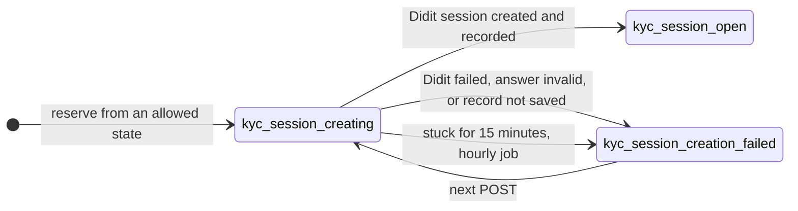
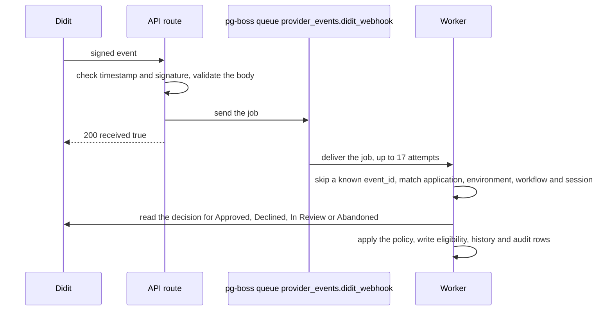

# Platform routes: health, well-known files, accounts, profile, investor activity and KYC

Valid for main at 48aa967 (2026-11-18).

This reference lists every route of the small modules: the health probes and the worker probe, the three `/.well-known` files, the staff account search, the investor profile and its preferences, the investor reservation and position histories, and the identity routes (KYC and proof-of-address sessions for customers, the operations read of one KYC record, and the Didit webhook). It is read by the mobile and admin-console developers who call these routes, by the operators who watch the probes, and by engineers who change them. Conventions that every route shares (authentication schemes, the error envelope, the full error catalogue, pagination, rate limits, idempotency, and the conditions under which a route group is mounted) are in [README.md](README.md). The KYC workflow and its data boundary are in [../didit-kyc.md](../didit-kyc.md), the profile aggregate and the wallet in [../investor-profile.md](../investor-profile.md).

> Pending #237: the wiring cited below as `src/app.ts` and `src/server.ts` moves into per-module compose functions under `src/composition`; the routers cited here do not change.

## Routes

| Method and path | Auth | Purpose |
| --- | --- | --- |
| [`GET /health/live`](#get-healthlive) | none | Process liveness; no dependency is touched |
| [`GET /health/ready`](#get-healthready) | none | Readiness; runs `SELECT 1` against PostgreSQL |
| [`GET /health/live` (worker)](#get-healthlive-worker-process) | none, loopback only | Worker process liveness |
| [`GET /health/ready` (worker)](#get-healthready-worker-process) | none, loopback only | Worker readiness: queues, schedules and consumers registered, heartbeat fresh |
| [`GET /metrics` (worker)](#get-metrics-worker-process) | none, loopback only | Worker counters and gauges in Prometheus text |
| [`GET /.well-known/apple-app-site-association`](#get-well-knownapple-app-site-association) | none | iOS web-credentials association |
| [`GET /.well-known/assetlinks.json`](#get-well-knownassetlinksjson) | none | Android digital asset links |
| [`GET /.well-known/webauthn`](#get-well-knownwebauthn) | none | WebAuthn related origins |
| [`GET /internal/v1/accounts`](#get-internalv1accounts) | staff, admin operations, WebAuthn | Find accounts by contact email |
| [`GET /v1/investor-profile`](#get-v1investor-profile) | customer session | The caller's profile aggregate |
| [`PATCH /v1/investor-profile/preferences`](#patch-v1investor-profilepreferences) | customer session | Change notification, locale and time zone preferences |
| [`GET /v1/investor-profile/reservations`](#get-v1investor-profilereservations) | customer session | Reservation history, newest first |
| [`GET /v1/investor-profile/positions`](#get-v1investor-profilepositions) | customer session | Current positions |
| [`GET /v1/kyc`](#get-v1kyc) | customer session | KYC status and a resumable session link |
| [`POST /v1/kyc/sessions`](#post-v1kycsessions) | customer session | Start a hosted Didit identity verification |
| [`POST /v1/kyc/proof-of-address/sessions`](#post-v1kycproof-of-addresssessions) | customer session | Start a hosted Didit proof-of-address verification |
| [`GET /internal/v1/kyc-accounts/:account_id`](#get-internalv1kyc-accountsaccount_id) | staff, admin operations, WebAuthn | Operational view of one account's KYC record |
| [`POST /webhooks/didit`](#post-webhooksdidit) | HMAC signature | Receive a Didit status or data event and queue it |

The two worker probe routes and `/metrics` answer on any HTTP method; `GET` is what Docker and Prometheus use.

## Conventions in this chapter

Authentication lines use the names of [README.md](README.md#4-authentication-schemes). "Customer session" is `requireAuthentication` followed by a population check in the handler. "Staff" is `requireAuthentication`, `requireAdminOperations` and `requireStaffWebAuthn`, in that order. Every `requireAuthentication` route runs the baseline limiter keyed by account (README section 9) when a rate-limit store is connected. No route in this chapter needs fresh authentication or an `Idempotency-Key`.

### Errors every entry can answer

| Status | Code | Condition |
| --- | --- | --- |
| 400 | `request.invalid_json`, `request.aborted`, `request.size_mismatch`, `request.body_rejected` | The body parser, which runs before every router, could not read the body |
| 413 | `request.payload_too_large` | The body is larger than 1 MB |
| 415 | `request.unsupported_charset`, `request.unsupported_encoding` | The charset is not UTF-8 or the `Content-Encoding` is not supported |
| 404 | `resource.not_found` | No route answers the path, including a route that is not mounted |
| 422 | `validation.invalid_field` | A path, query or body field fails its Zod schema, or the response fails its own schema; `field_errors` lists `field`, `code` and `message` |
| 500 | `internal.unexpected` | Any other exception |

> Pending #244: a response that fails its own schema answers `500 internal.response_invalid` with a fixed detail; main answers 422 (and #245 applies this to every remaining router).

The unauthenticated routes that are mounted after the body parser (the health probes and the Didit webhook) answer the rows above and their own codes. The `.well-known` files are registered before the body parser (`src/app.ts:522-588`), so for them only the 404 row applies. The worker probe is a separate server outside Express and answers none of them. Every route behind `requireAuthentication` also answers the next table.

| Status | Code | Condition |
| --- | --- | --- |
| 401 | `authentication.required` | No valid session |
| 401 | `REAUTH_REQUIRED` | A device session is past its idle (5 minutes) or absolute (30 minutes) limit |
| 401 | `DPOP_PROOF_MISSING`, `DPOP_PROOF_INVALID`, `DPOP_REPLAY`, `DPOP_KEY_MISMATCH` | The session is bound to a DPoP key and the proof is missing, invalid, replayed or made with another key; the response carries `WWW-Authenticate: DPoP error="invalid_dpop_proof"` |
| 403 | `account.restricted` | The account status is not `active` |
| 429 | `rate_limit.exceeded` | The baseline limiter is over 300 requests in 60 seconds; `Retry-After: 60` (only while a rate-limit store is connected) |
| 500 | `account.mapping_missing` | The authenticated identity has no VistaBlox account |

Customer routes add `403 authorization.forbidden` when the session is not a customer's, and `500 authentication.context_missing` when the context is absent (cannot happen behind `requireAuthentication`). Staff routes add `403 authorization.forbidden` when the caller is not a `staff_partner` account with an active `admin_operations` role, and `403 authentication.staff_mfa_required` when the session was not created by a staff passkey login and has no legacy WebAuthn proof row (`src/modules/auth/api/staff/require-staff-role.ts:7-116`; `src/modules/auth/repository/staff/prisma-staff-webauthn.repository.ts:32-54`). The full text of each code is in README section 7.

## Health

### GET /health/live

- **Auth.** None. No limiter.
- **Mounted when.** Always (`src/app.ts:590`).
- **Request.** No parameters.
- **Success.** `200 { "status": "ok" }`, parsed through `healthResponseSchema` (`src/modules/health/health.router.ts:7-9`, `:14-16`). It touches no dependency: a `200` proves only that the event loop answers.
- **Errors.** None of its own.
- **Notes.** No `Cache-Control` header is set. The compose health checks do not use this route; they call `/health/ready` (`docker-compose.yml:137`; `docker-compose.staging.yml:264`).
- **Source.** `src/modules/health/health.router.ts:14-16`, mounted at `src/app.ts:590`.

### GET /health/ready

- **Auth.** None. No limiter, so every call runs a database query.
- **Mounted when.** Always (`src/app.ts:590`).
- **Request.** No parameters.
- **Success.** `200 { "status": "ok" }`, parsed through `healthResponseSchema`.
- **Errors.**

  | Status | Code | Condition |
  | --- | --- | --- |
  | 503 | `infrastructure.database_unavailable` | `SELECT 1` through Prisma failed (title "Service unavailable", detail "The database dependency is unavailable."); the cause is attached to the error and logged |

- **Notes.** Readiness is the database and nothing else: not Redis (rate limiting, display-name cache), not MinIO, not ClamAV, not pg-boss and not the chain RPC. The Compose health check of the API container calls this route every 10 seconds with a 5 second timeout, 5 retries and a 10 second start period (`docker-compose.staging.yml:258-269`). The API process does not check the chain at start.

  > Pending #240: at start the API and the worker check the chain id and the contract code, and an unreachable RPC ends the process.

- **Source.** `src/modules/health/health.router.ts:18-32`; `src/infrastructure/database/database-probe.ts:7-13`; mounted at `src/app.ts:590`.

## Worker probe

The worker is a separate process (`dist/worker.js`) with no public listener. It runs a tiny HTTP server for Docker, bound to `127.0.0.1` on the constant port `3001` (`WORKER_HEALTH_PORT`; there is no environment variable for it). Compose publishes no port for the worker service, so the probe is reachable only from inside the container (`src/shared/health/worker-heartbeat.ts:4`, `:61`; `docker-compose.yml:144-165`; `docker-compose.staging.yml:271-300`). The server compares `request.url` exactly and ignores the method, so `/health/live?x=1` is a `503`. It starts before the queues are created (`src/worker.ts:77`) and the process calls `markReady()` after every queue, schedule and consumer is registered (`src/worker.ts:899-900`).

### GET /health/live (worker process)

- **Auth.** None; loopback only.
- **Mounted when.** In the worker process, from its start.
- **Request.** None; any method.
- **Success.** `200 {"status":"ok"}` with `content-type: application/json` and `cache-control: no-store`.
- **Errors.** `503 {"status":"unavailable"}` for any other URL. This body is not the VistaBlox envelope.
- **Notes.** It answers while the process is up, whether or not the worker finished starting.
- **Source.** `src/shared/health/worker-heartbeat.ts:34-38`, `:99-102`.

### GET /health/ready (worker process)

- **Auth.** None; loopback only.
- **Mounted when.** In the worker process.
- **Request.** None; any method.
- **Success.** `200 {"status":"ok"}` once `markReady()` was called and the last heartbeat is younger than 30 seconds.
- **Errors.** `503 {"status":"unavailable"}` before the worker is ready, or when the heartbeat is older than 30 seconds.
- **Notes.** The heartbeat is a timer that runs every 10 seconds (unreferenced, so it does not keep the process alive) and refreshes a timestamp; the probe is stale after three missed ticks. It detects a blocked event loop, not a failing job (`src/shared/health/worker-heartbeat.ts:6-7`, `:40-44`, `:67-70`, `:95-97`). The Compose health check calls it every 15 seconds with a 5 second timeout, 3 retries and a 30 second start period (`docker-compose.staging.yml:289-300`).
- **Source.** `src/shared/health/worker-heartbeat.ts:22-102`; `src/worker.ts:76-77`, `:899-900`.

### GET /metrics (worker process)

- **Auth.** None; loopback only.
- **Mounted when.** In the worker process. The API process has no metrics route.
- **Request.** None; any method.
- **Success.** `200`, `content-type: text/plain; version=0.0.4; charset=utf-8`, `cache-control: no-store`. The body is one `name value` line per metric, sorted by name, with no `# HELP` or `# TYPE` lines and no labels. An empty registry is an empty body. A metric appears after its first write. A non-finite value is printed as `0`.
- **Errors.** None of its own.
- **Notes.** Values live in the worker process and reset when it restarts. The names in the code are:

  | Metric | Kind | Written by |
  | --- | --- | --- |
  | `vistablox_worker_wallet_registration_runs_total`, `_failures_total`, `_confirmed_total`, `_unmatched_events_total`, `_new_unmatched_events_total`, `_address_mismatches_total`, `_address_mismatch_duplicates_total`, `_heartbeat_write_failures_total`, `_health_check_failures_total` | counter | the wallet registry watcher and its health check (`src/modules/settlement/application/wallet-registry-alert-reporter.ts:25-42`, `:81-98`, `:145-149`, `:172`, `:242`, `:279`) |
  | `vistablox_worker_wallet_registration_pending_overdue`, `_pending_total`, `_watcher_heartbeat_age_seconds`, `_cursor_lag_blocks`, `_address_mismatch_unresolved`, `_evidence_flagged`, `_health_alerts_active` | gauge | the same (`:145`, `:230-237`) |
  | `vistablox_worker_kyc_creating_overdue` | gauge | `maintenance.kyc_stuck_session_expiry` (`src/worker.ts:810`) |
  | `vistablox_worker_kyc_open_overdue` | gauge | `maintenance.kyc_stuck_session_reconciliation` (`src/worker.ts:816`) |
  | `vistablox_worker_account_recovery_overdue` | gauge | `maintenance.account_recovery_alert` (`src/worker.ts:824`) |
  | `vistablox_worker_onramp_late_evidence_unreviewed` | gauge | `maintenance.onramp_late_evidence_alert` (`src/worker.ts:834`) |

  What the wallet metrics count is in [../wallet-registration-operations.md](../wallet-registration-operations.md).
- **Source.** `src/shared/health/worker-heartbeat.ts:45-53`; `src/shared/health/worker-metrics.ts:6-22`.

## Well-known files

The three files are served from the application's own host, before the body parser, with no authentication, no limiter and no `/api` prefix. `PASSKEY_APPLE_TEAM_ID` and `PASSKEY_ANDROID_SHA256_CERT_FINGERPRINTS` come from the environment; the application id (`com.vistablox.app` for iOS and the Android package) is fixed in code (`src/server.ts:585-597`). The host must be `WEBAUTHN_RP_ID` or a subdomain of it, which the schema enforces against `BETTER_AUTH_URL` (`src/config/environment.ts:535-552`).

### GET /.well-known/apple-app-site-association

- **Auth.** None.
- **Mounted when.** `PASSKEY_APPLE_TEAM_ID` is set; otherwise `404 resource.not_found`.
- **Request.** None.
- **Success.** `200`, `Cache-Control: public, max-age=3600`, body `{ "webcredentials": { "apps": ["<PASSKEY_APPLE_TEAM_ID>.com.vistablox.app"] } }`. The body is built in the route and is not parsed through a schema.
- **Errors.** None of its own.
- **Notes.** It carries only the `webcredentials` entry; there is no `applinks` or `appclips` entry. The route is registered after `cors` and `helmet`, so those headers apply.
- **Source.** `src/app.ts:522-533`; `src/server.ts:585-590`.

### GET /.well-known/assetlinks.json

- **Auth.** None.
- **Mounted when.** `PASSKEY_ANDROID_SHA256_CERT_FINGERPRINTS` is set (a comma-separated list; an entry per signing certificate); otherwise `404`.
- **Request.** None.
- **Success.** `200`, `Cache-Control: public, max-age=3600`, a JSON array with one statement: `relation` `["delegate_permission/common.handle_all_urls", "delegate_permission/common.get_login_creds"]` and `target` `{ "namespace": "android_app", "package_name": "com.vistablox.app", "sha256_cert_fingerprints": [ ... ] }`. Not parsed through a schema.
- **Errors.** None of its own.
- **Notes.** The fingerprints are those of the app-signing certificates for Digital Asset Links. They are a different variable from `ANDROID_ATTESTATION_CERT_DIGESTS` (the allowlist for device key attestation) and from `PASSKEY_ANDROID_ORIGINS` (the WebAuthn origin strings), which the schema keeps separate on purpose (`src/config/environment.ts:58-72`, `:115-122`).
- **Source.** `src/app.ts:534-552`; `src/server.ts:591-597`.

### GET /.well-known/webauthn

- **Auth.** None. The data is public by design.
- **Mounted when.** At least one entry of `WEBAUTHN_ORIGIN` has a host that is neither `WEBAUTHN_RP_ID` nor a subdomain of it. `WEBAUTHN_RP_ID` defaults to the host of `BETTER_AUTH_URL`, and an unset `WEBAUTHN_ORIGIN` means the origin of `BETTER_AUTH_URL` alone, so a default local setup has no related origin and the route answers `404`. In production every entry must be `https` on a real host, and at most five distinct registrable-domain labels are accepted (`src/config/environment.ts:611-646`, `:699-714`).
- **Request.** None.
- **Success.** `200 { "origins": ["https://..."] }` with `Cache-Control: public, max-age=3600`, `Access-Control-Allow-Origin: *`, no `Access-Control-Allow-Credentials` header and `Cross-Origin-Resource-Policy: cross-origin`, so a browser on a listed origin can read it from the relying-party host. Not parsed through a schema.
- **Errors.** None of its own.
- **Notes.** The list is the related origins only (for example the admin console); the relying-party host's own origin is not repeated. Passkeys are staff-only on every origin (`src/config/environment.ts:678-690`).
- **Source.** `src/app.ts:553-567`; `src/config/environment.ts:699-714`; `src/server.ts:598`.

## Accounts (staff)

### GET /internal/v1/accounts

- **Auth.** Staff: `requireAuthentication`, `requireAdminOperations`, `requireStaffWebAuthn`. Baseline limiter by account. No fresh authentication, no idempotency.
- **Mounted when.** Always (`src/app.ts:1068-1076`).
- **Request.** Query `email`: a string, trimmed, 1 to 320 characters; required (`searchAccountsQuerySchema`, `src/modules/account/api/account.schemas.ts:3-5`). A missing or empty value is `422 validation.invalid_field` with `field: "email"`.
- **Success.** `200 { "data": [ { "account_id": string, "email": string | null, "status": "active" | "recovery_review" | "suspended_restricted" } ] }`, parsed through `searchAccountsResponseSchema` (`:7-15`). The array is empty when nothing matches. No `Cache-Control` header is set, although the body carries contact emails.
- **Errors.** Only the common ones. A stored status outside the three values throws a plain `Error` and answers `500 internal.unexpected` (`src/modules/account/repository/prisma-account.repository.ts:130-139`).
- **Notes.** The match is an exact, case-insensitive comparison with `account.accounts.protected_contact_email` (`mode: "insensitive"`; no wildcard, no prefix match); every match is returned, oldest first, because the column is not unique; there is no pagination (`src/modules/account/repository/prisma-account.repository.ts:28-39`). Accounts of every status and population are searchable. The call writes nothing and no audit row. Staff intake uses it to pick an applicant before creating a case on the applicant's behalf ([intake-staff.md](intake-staff.md)).
- **Source.** `src/modules/account/api/account.router.ts:15-19`; `src/modules/account/application/search-accounts.service.ts:6-14`; `src/modules/account/repository/prisma-account.repository.ts:28-39`.

## Investor profile

### GET /v1/investor-profile

- **Auth.** Customer session. A staff session gets `403 authorization.forbidden` with the detail "Investor profiles are available only to customer accounts." (`src/modules/profile/api/profile.router.ts:40-60`).
- **Mounted when.** Always (`src/app.ts:718-728`; `profile` is always passed in `src/server.ts:631-635`).
- **Request.** No parameters; unknown query parameters are ignored.
- **Success.** `200`, `Cache-Control: no-store`, `{ "data": { ... } }` parsed through `profileResponseSchema` (`src/modules/profile/api/profile.schemas.ts:37-109`):

  | Field | Type | Meaning |
  | --- | --- | --- |
  | `account_id` | string | The VistaBlox account id |
  | `account_status` | `active`, `recovery_review` or `suspended_restricted` | Always `active` in practice: `requireAuthentication` refuses the other two before the handler runs |
  | `contact_email` | email or `null` | `protected_contact_email` of the account |
  | `member_since` | ISO date-time | Account creation time |
  | `display_profile` | object or `null` | `{ given_name, family_name, full_display_name, last_synced_at }`: the name Didit verified, from a protected cache. `null` unless the account's Didit status is `Approved`, `PROFILE_CACHE_URL` is set and the cache was reachable at boot, and the cache or a live Didit read produced a name |
  | `login_methods` | array | `{ method_type: "passkey" \| "google" \| "apple" \| "device_key", linked_at, is_registration_method }`, earliest first; `is_registration_method` is true for the first entry only |
  | `kyc` | object | `eligibility_state` (`not_started`, `in_progress`, `pending_manual_review`, `eligible`, `unsupported_jurisdiction`, `not_eligible`, `requires_renewal`, `suspended_restricted`), `residence_country_code` and `tax_residence_country_code` (two upper-case letters or `null`), `proof_of_address_status` (`not_started`, `creating`, `creation_failed`, `in_progress`, `pending_manual_review`, `current`, `insufficient`, `expired`, `restart_required`, `integration_anomaly`), `proof_of_address_current_until`, `last_verified_at`, `renewal_due_at` (date-times or `null`). With no KYC record: `not_started`, `not_started` and nulls |
  | `investment_summary` | object | `reservation_count` (all reservations of the account, every stage) and `active_position_count` (positions with status `pending_internal_settlement` or `active`) |
  | `readiness` | object | `investment_eligible`, `payment_account_ready`, `payout_account_verified` (booleans, below) |
  | `wallet` | object | `status` (`not_registered`, `pending`, `registered`), `requested_at`, `registered_at` |
  | `preferences` | object | The five preference fields of the next route |
  | `pending_closure_request` | object or `null` | `{ reason: string \| null, requested_at }` of the account's pending closure request |

  Derived values: `proof_of_address_status` is shown as `expired` when it is stored as `current` and `current_until` is not in the future (`src/modules/profile/application/get-profile.service.ts:29-34`). `investment_eligible` is true only when the account is `active`, the KYC state is `eligible`, `renewal_due_at` exists and is in the future, and the account has a `device_key` login method and a `google` or `apple` one (`:38-46`). `payment_account_ready` is true when the account has a wallet row that is not expired, pending or confirmed; `payout_account_verified` is true only when that row is confirmed on chain (`:87-93`; `src/modules/wallet/repository/prisma-wallet.repository.ts:278-283`). The offering module's own readiness needs a confirmed wallet, so `payment_account_ready` here is true for a pending claim that the offering still treats as no wallet ([../investor-profile.md](../investor-profile.md)).
- **Errors.**

  | Status | Code | Condition |
  | --- | --- | --- |
  | 404 | `investor_profile.not_found` | The account row cannot be read (the middleware just found it; a race with a deletion) |

- **Notes.** Read only; nothing is written. The repository reads the account with its login methods and preferences, the KYC snapshot, the wallet status, the activity counts and the pending closure request in parallel (`src/modules/profile/repository/prisma-profile.repository.ts:18-64`). The display name is the only part that can call out: when the cached copy is younger than 6 hours it is returned as is, otherwise one live Didit decision read refreshes it, and a Didit or cache failure degrades to the cached copy or `null`, never to an error (`src/modules/identity/application/kyc-display-profile.service.ts:29-79`; `src/infrastructure/profile/identity-display-profile.provider.ts:22-48`). The Redis entry lives 24 hours (`src/infrastructure/cache/redis-protected-profile-cache.ts:53-56`).
- **Source.** `src/modules/profile/api/profile.router.ts:18-23`; `src/modules/profile/application/get-profile.service.ts:6-117`; `src/modules/profile/repository/prisma-profile.repository.ts:18-64`.

### PATCH /v1/investor-profile/preferences

- **Auth.** Customer session, as above.
- **Mounted when.** Always (`src/app.ts:718-728`).
- **Request.** JSON body, every field optional, at least one required (`updateAccountPreferencesBodySchema`, `src/modules/profile/api/profile.schemas.ts:111-121`):

  | Field | Type and constraint |
  | --- | --- |
  | `deal_alerts_email` | boolean |
  | `statements_email` | boolean |
  | `marketing_email` | boolean |
  | `locale` | string of 2 to 35 characters that `Intl.Locale` accepts as a BCP 47 tag (`en-US`) (`:5-15`) |
  | `timezone` | string that `Intl.DateTimeFormat` accepts as an IANA time zone (`Europe/Berlin`, `UTC`) (`:20-27`) |

  Unknown keys are dropped before the check, so a body with only unknown keys is the same as `{}`.
- **Success.** `200`, `Cache-Control: no-store`, `{ "data": { "deal_alerts_email", "statements_email", "marketing_email", "locale", "timezone" } }` with the full stored preferences after the change, parsed through `updateAccountPreferencesResponseSchema` (`:123-125`).
- **Errors.**

  | Status | Code | Condition |
  | --- | --- | --- |
  | 422 | `validation.invalid_field` | A value fails its rule (`field` names it), or no known field is present (`field: "request"`, message "At least one preference field is required.") |

- **Notes.** One upsert on `account.account_preferences`: a first call creates the row from the defaults (`deal_alerts_email` true, `statements_email` true, `marketing_email` false, `locale` `en-US`, `timezone` `UTC`) and applies the patch; later calls update only the sent fields (`src/modules/profile/repository/prisma-account-preferences.repository.ts:14-27`; `src/modules/profile/repository/account-preferences.repository.ts:12-18`). No audit row is written and nothing is enqueued. No other code reads these values: a search of `src` finds the preference columns only in the profile module, so no e-mail job or sender consults them on main. `GET /v1/investor-profile` returns the defaults for an account that has no row.
- **Source.** `src/modules/profile/api/profile.router.ts:24-36`; `src/modules/profile/application/update-account-preferences.service.ts:6-23`; `src/modules/profile/repository/prisma-account-preferences.repository.ts:14-27`.

## Investor activity

Both routes list only the caller's own rows: the repository filters on the account id taken from the session (`src/modules/investor-activity/repository/prisma-investor-activity.repository.ts:44-45`, `:128-129`). They are read only and use the pagination of README section 8.

### GET /v1/investor-profile/reservations

- **Auth.** Customer session (`403 authorization.forbidden` for a staff session, detail "Investor profiles are available only to customer accounts.").
- **Mounted when.** Always (`src/app.ts:875-885`).
- **Request.** Query `limit` (1 to 100, default 20) and `after` (the `page.next_cursor` of the previous page) (`investorActivityQuerySchema`, `src/modules/investor-activity/api/investor-activity.schemas.ts:5-8`).
- **Success.** `200`, `Cache-Control: no-store`, `{ "data": [...], "page": { "next_cursor": string | null } }` (`:16-55`). Each element:

  | Field | Type |
  | --- | --- |
  | `reservation_id`, `offering_id` | string |
  | `offering_status` | `pre_offering`, `final_offering` or `closed` |
  | `amount_eur` | string with two decimals (`"1000.00"`) |
  | `reservation_stage` | `initiated`, `awaiting_reconfirmation`, `reconfirmed`, `finalized`, `cancelled` or `lapsed` |
  | `disclosure_pack_version_at_reservation` | string or `null` |
  | `reconfirmed_at`, `reservation_finalized_at` | date-time or `null` |
  | `created_at` | date-time |
  | `latest_capital_state` | `null` or `{ state, amount_eur, amount_eurc, recorded_at }`: the newest money event of the reservation; `state` is `initiated`, `eurc_purchase_pending`, `purchase_failed`, `eurc_reserved`, `reconfirmation_pending`, `eurc_finalized` or `provider_disputed`; `amount_eurc` is a string with six decimals or `null` |
  | `property` | `{ property_type: "residential", country_code, city \| null }` |

- **Errors.**

  | Status | Code | Condition |
  | --- | --- | --- |
  | 422 | `pagination.invalid_cursor` | `after` is not a cursor this route issued (`field_errors`: `after`, `cursor.invalid`) |

- **Notes.** Every stage is listed, including `cancelled` and `lapsed`. The order is newest first (`created_at`, then `id`). The newest money event is chosen by `recorded_at` then `id` (`src/modules/investor-activity/repository/prisma-investor-activity.repository.ts:58`, `:81-90`). A stored stage, status, state or property type outside the lists above throws a plain `Error` and the whole request answers `500 internal.unexpected` (`:184-246`). The cursor is base64url JSON with `kind: "investor_reservations"`, `created_at` and `id` (`src/modules/investor-activity/application/list-investor-activity.service.ts:11-15`, `:133-139`).
- **Source.** `src/modules/investor-activity/api/investor-activity.router.ts:20-29`; `src/modules/investor-activity/application/list-investor-activity.service.ts:23-82`; `src/modules/investor-activity/repository/prisma-investor-activity.repository.ts:38-120`.

### GET /v1/investor-profile/positions

- **Auth.** Customer session, as above.
- **Mounted when.** Always (`src/app.ts:875-885`).
- **Request.** The same query as the reservation history.
- **Success.** `200`, `Cache-Control: no-store`, `{ "data": [...], "page": { "next_cursor": string | null } }` (`src/modules/investor-activity/api/investor-activity.schemas.ts:57-77`). Each element:

  | Field | Type |
  | --- | --- |
  | `position_id` | string |
  | `reservation_id`, `offering_id` | string or `null`. Both are `null` for a position that was not created from a reservation (the escrow mint writes none); `offering_id` is resolved only through the reservation |
  | `piv_id` | string |
  | `unit_count` | string with six decimals |
  | `cost_basis_eur` | string with two decimals |
  | `position_status` | `pending_internal_settlement` or `active` |
  | `activated_at` | date-time or `null` |
  | `property` | `{ property_type: "residential", country_code, city \| null }` |

- **Errors.** `422 pagination.invalid_cursor`, as above.
- **Notes.** Only positions whose status is `pending_internal_settlement` or `active` are listed; other statuses are not shown (`src/modules/investor-activity/repository/prisma-investor-activity.repository.ts:130`). The order is `activated_at` descending with nulls last, then `id` descending, and the cursor carries the nullable `activated_at` (`:122-150`). Because that key changes when a position activates, a position that is still waiting to activate sits at the end of the order and moves to the front when it activates, so a client that is already reading the waiting positions never receives it. The query cannot return a row twice because of this: a row only ever moves from the null group to the front (`src/modules/investor-activity/repository/prisma-investor-activity.repository.ts:127-150`).
- **Source.** `src/modules/investor-activity/api/investor-activity.router.ts:30-39`; `src/modules/investor-activity/application/list-investor-activity.service.ts:84-131`; `src/modules/investor-activity/repository/prisma-investor-activity.repository.ts:122-181`.

## KYC (customer)

Identity verification is done by Didit on a page that Didit hosts; these routes create the hosted session, report where the account stands, and let the app resume an open session. Eligibility changes only through the signed webhook (below) and the worker's maintenance jobs (the renewal timer and the stuck-session jobs), never through a browser redirect (`src/worker.ts:565-575`, `:805-819`; [../didit-kyc.md](../didit-kyc.md)). The six `DIDIT_*` variables without a default (`DIDIT_API_KEY`, `DIDIT_WORKFLOW_ID`, `DIDIT_CALLBACK_URL`, `DIDIT_WEBHOOK_SECRET`, `DIDIT_APPLICATION_ID`, `DIDIT_ENVIRONMENT`) are required at boot, so there is no disabled mode; `DIDIT_API_BASE_URL` has a default and `DIDIT_POA_WORKFLOW_ID` is optional. The Didit client has a 4 second timeout (`src/config/environment.ts:241-251`; `src/server.ts:385-389`).

### GET /v1/kyc

- **Auth.** Customer session (`403 authorization.forbidden`, detail "Individual KYC is available only to customer accounts.", for a staff session) (`src/modules/identity/api/kyc.router.ts:124-144`).
- **Mounted when.** Always (`src/app.ts:908-935`).
- **Request.** No parameters.
- **Success.** `200`, `Cache-Control: no-store`, parsed through `kycStatusResponseSchema` (`src/modules/identity/api/kyc.schemas.ts:83-92`):

  | Field | Type |
  | --- | --- |
  | `eligibility_state` | `not_started`, `in_progress`, `pending_manual_review`, `eligible`, `unsupported_jurisdiction`, `not_eligible`, `requires_renewal` or `suspended_restricted` (`:5-14`). `not_started` when the account has no KYC record |
  | `proof_of_address_status` | `not_started`, `creating`, `creation_failed`, `in_progress`, `pending_manual_review`, `current`, `insufficient`, `expired`, `restart_required` or `integration_anomaly` (`:16-27`). A stored `current` whose `current_until` is not in the future is shown as `expired` |
  | `proof_of_address_current_until`, `last_verified_at`, `renewal_due_at` | date-time or `null` |
  | `active_session` | `null` or `{ verification_session_id: uuid, verification_url: url, expires_at: date-time \| null }` |

- **Errors.** Only the common ones. A Didit failure while looking for a session to resume does not fail the request.
- **Notes.** `active_session` is never stored: the session link is a credential, so it is read live. It is looked up only when the account's operational substatus is `kyc_session_open`, `kyc_pending` or `kyc_resubmission_pending` and a Didit reference exists; the service then calls Didit's decision endpoint (`GET /v3/session/<id>/decision/`) and returns the link only when Didit reports `Not Started`, `In Progress` or `Resubmitted` and a link. Any error from that call, an invalid provider answer included, becomes `active_session: null` (`src/modules/identity/application/kyc.service.ts:120-179`; `src/modules/identity/infrastructure/didit.client.ts:114-118`). The route writes nothing.
- **Source.** `src/modules/identity/api/kyc.router.ts:36-41`; `src/modules/identity/application/kyc.service.ts:120-229`; `src/modules/identity/repository/prisma-kyc.repository.ts:112-117`.

### POST /v1/kyc/sessions

- **Auth.** Customer session. Baseline limiter by account; each call that passes the checks makes one Didit request. No idempotency key: the one-open-session rule below is the guard.
- **Mounted when.** Always.
- **Request.** JSON body (`startKycSessionBodySchema`, `src/modules/identity/api/kyc.schemas.ts:48-52`):

  | Field | Type and constraint |
  | --- | --- |
  | `residence_country_code` | required; two upper-case letters (`^[A-Z]{2}$`) |
  | `tax_residence_country_code` | required; two upper-case letters |
  | `language` | optional; two lower-case letters (`^[a-z]{2}$`), passed to Didit |

  The request accepts any two upper-case letters. The jurisdiction rule is applied when Didit approves: both countries must be in the supported EU/EEA list, otherwise the outcome is `unsupported_jurisdiction` (`src/modules/identity/domain/kyc-policy.ts:108-113`, `:207-224`). A request with no JSON body is `422` with `field: "request"`.
- **Success.** `201`, `Cache-Control: no-store`, `{ "data": { "verification_session_id": uuid, "verification_url": url, "eligibility_state": "not_started" } }` (`:54-60`). The app opens `verification_url`.
- **Errors.**

  | Status | Code | Condition |
  | --- | --- | --- |
  | 409 | `identity.kyc_session_unavailable` | The account row is missing, or its operational substatus does not allow a new session. A new session is allowed only from `kyc_not_started`, `kyc_session_creation_failed`, `kyc_restart_required` and `kyc_reverification_required`; an open, pending, resubmission, verified or blocked state is refused (`src/modules/identity/repository/prisma-kyc.repository.ts:808-815`). `GET /v1/kyc` returns the open session to resume |
  | 502 | `identity.kyc_provider_response_invalid` | Didit answered with a body that does not match the expected shape, a business session, an unknown status, another `vendor_data` or workflow id, or a status other than `Not Started` |
  | 503 | `identity.kyc_provider_unavailable` | The Didit request failed, timed out (4 s) or got a non-2xx answer |
  | 500 | `identity.kyc_session_persistence_failed` | The Didit session exists but the row could not be moved to `kyc_session_open` |

- **Notes.** In order, in the service: (1) in one transaction, lock the account row `FOR UPDATE`, check the allow-list, and upsert `identity.kyc_eligibility` to `kyc_session_creating` with the declared countries and a new `sessionStartId` (`kyc_start_<uuid>`); (2) call Didit `POST /v3/session/` with the workflow id, the account id as `vendor_data`, the callback URL and the start id as metadata; (3) check the answer against the request; (4) in one transaction, move the row to `kyc_session_open` with the Didit session id and provider status, write a `identity.kyc_eligibility_history` row (reason `KYC_SESSION_STARTED`) and an `audit.audit_log` row `identity.kyc_session_started` (event key `didit:session_started:<id>`); (5) drop the cached display name, best effort. If step 2 or 3 fails, or step 4 matches no row, the row is moved to `kyc_session_creation_failed` with an audit row `identity.kyc_session_start_failed`, so a retry is allowed at once (`src/modules/identity/application/kyc.service.ts:14-118`; `src/modules/identity/repository/prisma-kyc.repository.ts:144-277`; `src/modules/identity/infrastructure/didit.client.ts:79-112`). The declared countries are overwritten on every new start. No job is enqueued.
- **Source.** `src/modules/identity/api/kyc.router.ts:42-54`; `src/modules/identity/application/kyc.service.ts:14-118`.

The states of `identity.kyc_eligibility.operational_substatus` that this route moves through:

### POST /v1/kyc/proof-of-address/sessions

- **Auth.** Customer session. Baseline limiter by account.
- **Mounted when.** The route is always mounted. It answers `404 identity.proof_of_address_not_configured` while `DIDIT_POA_WORKFLOW_ID` is unset (the request body is validated first) (`src/modules/identity/api/kyc.router.ts:62-92`; `src/server.ts:423-429`). The variable must differ from `DIDIT_WORKFLOW_ID` (`src/config/environment.ts:454-462`).
- **Request.** JSON body `{ "language"?: two lower-case letters }` (`startProofOfAddressSessionBodySchema`, `src/modules/identity/api/kyc.schemas.ts:62-64`). Send `{}` with `Content-Type: application/json`: with no JSON body the answer is `422` with `field: "request"`.
- **Success.** `201`, `Cache-Control: no-store`, `{ "data": { "verification_session_id": uuid, "verification_url": url, "proof_of_address_status": "in_progress" } }` (`:66-72`).
- **Errors.**

  | Status | Code | Condition |
  | --- | --- | --- |
  | 404 | `identity.proof_of_address_not_configured` | `DIDIT_POA_WORKFLOW_ID` is not set (title "Not found") |
  | 409 | `identity.proof_of_address_session_unavailable` | The account's KYC state is not `eligible`, there is no KYC record, or a current proof of address still has time left, or one is in progress or in manual review. A new session is allowed from `not_started`, `creation_failed`, `insufficient`, `expired`, `restart_required`, `integration_anomaly`, or `current` once `current_until` has passed (`src/modules/identity/repository/prisma-kyc.repository.ts:817-834`) |
  | 502 | `identity.kyc_provider_response_invalid` | Same as the baseline route |
  | 503 | `identity.kyc_provider_unavailable` | Same as the baseline route |
  | 500 | `identity.proof_of_address_session_persistence_failed` | The Didit session exists but the row could not be moved to `in_progress` |

- **Notes.** The same four steps as the baseline route, on the proof-of-address columns: `proof_of_address_status` goes `creating` then `in_progress`, with history reason `OWNER_PROOF_OF_ADDRESS_SESSION_STARTED` and audit rows `identity.proof_of_address_session_started` (`didit:poa_session_started:<id>`) and, on failure, `identity.proof_of_address_session_start_failed`. Unlike the baseline route, a persistence failure after Didit created the session does not move the row to a failed state: it stays `creating` until the hourly job `maintenance.kyc_stuck_session_expiry` fails it, which happens once it is older than 15 minutes (`src/modules/identity/application/kyc.service.ts:240-319`; `src/modules/identity/repository/prisma-kyc.repository.ts:279-407`, `:725-750`; `src/modules/identity/application/kyc-stuck-session.service.ts:32-60`; `src/worker.ts:572`, `:808`). The display-name cache is not touched.
- **Source.** `src/modules/identity/api/kyc.router.ts:62-81`; `src/modules/identity/application/kyc.service.ts:240-319`.

## KYC (staff)

### GET /internal/v1/kyc-accounts/:account_id

- **Auth.** Staff.
- **Mounted when.** Always (`src/app.ts:919-927`).
- **Request.** Path `account_id`: a non-empty string (`kycAccountIdParamsSchema`, `src/modules/identity/api/kyc.schemas.ts:94-96`).
- **Success.** `200`, `Cache-Control: no-store`, parsed through `operationsKycAccountResponseSchema` (`:105-125`):

  | Field | Type |
  | --- | --- |
  | `account_id` | string |
  | `eligibility_state` | as in `GET /v1/kyc` |
  | `operational_substatus` | one of `kyc_not_started`, `kyc_session_creating`, `kyc_session_creation_failed`, `kyc_session_open`, `kyc_pending`, `kyc_resubmission_pending`, `kyc_manual_review`, `kyc_verified_pending_policy_eval`, `kyc_verified`, `kyc_verified_owner_poa_missing`, `kyc_jurisdiction_blocked`, `kyc_failed`, `kyc_restart_required`, `kyc_reverification_required`, `kyc_restricted`, `kyc_integration_anomaly` (`:29-46`) |
  | `didit_reference`, `proof_of_address_didit_reference` | string or `null` |
  | `residence_country_code`, `tax_residence_country_code` | string or `null` |
  | `proof_of_address_status` | as above; `current` past its end is shown as `expired` |
  | `proof_of_address_provider_status` | one of the ten Didit statuses (`Not Started`, `In Progress`, `In Review`, `Approved`, `Declined`, `Resubmitted`, `Expired`, `Abandoned`, `Kyc Expired`, `Awaiting User`) or `null` (`src/modules/identity/domain/kyc-policy.ts:1-12`) |
  | `proof_of_address_provider_updated_at`, `proof_of_address_current_until`, `last_verified_at`, `renewal_due_at` | date-time or `null` |
  | `ever_required_manual_review` | boolean; latched the first time the account resolves to manual review, and the reason the renewal interval is 12 instead of 24 months |

- **Errors.**

  | Status | Code | Condition |
  | --- | --- | --- |
  | 404 | `identity.kyc_account_not_found` | The account has no row in `identity.kyc_eligibility`: it never started KYC or the id is wrong. The route does not check that the account exists |

- **Notes.** Read only, no audit row. It returns the same privacy-minimised record the customer reads, plus the operational fields; Didit documents, biometrics and payloads are never stored, so none can be shown ([../didit-kyc.md](../didit-kyc.md) "Data boundary").
- **Source.** `src/modules/identity/api/kyc-operations.router.ts:19-24`; `src/modules/identity/application/kyc.service.ts:188-218`.

## Didit webhook

### POST /webhooks/didit

- **Auth.** HMAC signature, no session, no limiter. The caller sends `X-Signature-V2` (64 hexadecimal characters) and `X-Timestamp` (exactly 10 digits). The server accepts the call only when the timestamp is within 300 seconds of its own clock in either direction, equals the `timestamp` field of the body, and the signature equals the hex HMAC-SHA256, keyed with `DIDIT_WEBHOOK_SECRET`, of `JSON.stringify` of the parsed body with every object's keys sorted. The comparison is constant time (`src/modules/identity/infrastructure/didit-webhook-verifier.ts:11-49`). The signature covers the re-serialised JSON, not the bytes Didit sent.
- **Mounted when.** With `protectedApi.kyc`, which `server.ts` always passes (`src/app.ts:931-934`; `src/server.ts:724-732`). It sits after the 1 MB JSON parser, so `Content-Type` must be `application/json`; any other type leaves the body unparsed and the signature check fails with 401.
- **Request.** JSON object (`diditWebhookBodySchema`, `src/modules/identity/api/kyc.schemas.ts:127-141`; unknown fields are kept):

  | Field | Type |
  | --- | --- |
  | `event_id` | uuid |
  | `webhook_type` | non-empty string (`status.updated` and `data.updated` are acted on) |
  | `timestamp`, `created_at` | non-negative integers (Unix seconds) |
  | `application_id` | uuid |
  | `environment` | non-empty string |
  | `session_id` | uuid |
  | `session_kind` | string or `null`, optional |
  | `workflow_id`, `vendor_data` | string or `null`, optional |
  | `status` | non-empty string |

- **Success.** `200 { "received": true }` (`diditWebhookResponseSchema`, `:148-150`). It means "verified and queued", not "applied": duplicate, stale and ignored outcomes are decided later by the worker.
- **Errors.**

  | Status | Code | Condition |
  | --- | --- | --- |
  | 401 | `identity.didit_webhook_invalid` | The timestamp is missing, malformed, stale, or different from the body's; or the signature is missing, not 64 hex characters, or wrong (title "Webhook authentication failed") |
  | 422 | `validation.invalid_field` | The signature is valid but the body does not match the schema; checked after the signature |
  | 500 | `internal.unexpected` | The job could not be queued (the database write of pg-boss failed) |

  The body parser answers before the signature is read, so a malformed JSON body is `400 request.invalid_json` even for an unsigned call.
- **Notes.** The route does one thing: it sends the verified fields to the pg-boss queue `provider_events.didit_webhook` as a camelCase payload with the request's `traceId`, with the event retry profile (16 retries, 30 s base delay with backoff, 15 minutes maximum) (`src/modules/identity/repository/prisma-kyc.repository.ts:69-98`; `src/shared/jobs/enqueue-job.ts:21-26`). It is a plain `send`, not part of a database transaction, and it does not deduplicate: a redelivery queues another job. The worker's `ProcessDiditWebhookService` skips an `event_id` already recorded (`didit:webhook:<event_id>` in `audit.audit_log.event_key`), ignores events whose application id, environment or workflow id do not match `DIDIT_APPLICATION_ID`, `DIDIT_ENVIRONMENT`, `DIDIT_WORKFLOW_ID` or `DIDIT_POA_WORKFLOW_ID`, or whose kind is a business session or whose type is not `status.updated` or `data.updated`, and records such events as unmatched (audit action `identity.didit_webhook_unmatched`, reasons `configuration_mismatch`, `session_not_found`, `correlation_mismatch`). For `Approved`, `Declined`, `In Review` and `Abandoned` it first reads the decision from Didit, checks that it names the same session and account, then applies the eligibility policy and writes `identity.kyc_eligibility`, its history and the audit row `identity.didit_webhook_received` (`src/modules/identity/application/kyc.service.ts:331-350`, `:374-523`, `:541-548`; `src/worker.ts:838-855`). The consumer's behaviour is in [../didit-kyc.md](../didit-kyc.md) and [../jobs-and-workers.md](../jobs-and-workers.md).
- **Source.** `src/modules/identity/api/kyc.router.ts:94-122`; `src/modules/identity/application/kyc.service.ts:331-350`.

## Known gaps

Where the code and the design record differ for the routes in this chapter. Nothing is resolved here.

| # | Subject | Code | Record | Register |
| --- | --- | --- | --- | --- |
| 1 | Webhook prefix | `POST /webhooks/didit` | Provider callbacks enter only through `/provider/v1` (AD-066; `04-Engineering/API/API_BOUNDARY.md:27`, `:84`) | C-015; AD-289 keeps `/webhooks/...` |
| 2 | Renewal state shown while a renewal session runs | `Not Started` from Didit becomes `not_started`, so a customer in renewal stops seeing `requires_renewal` (`src/modules/identity/repository/prisma-kyc.repository.ts:189-243`) | The state diagram in `03-Legal-Risk-and-Compliance/KYC_WORKFLOW.md` says `In progress` | C-005 |
| 3 | Automatic audit rows | `PATCH /v1/investor-profile/preferences` and `GET /internal/v1/accounts` write no audit row; the KYC routes write theirs by hand in the repository | AD-148: a shared wrapper audits every state-changing application-service call | No entry found among C-001 to C-024 |
| 4 | `investment_eligible` wording in the existing guide | Needs an enrolled `device_key` and Google or Apple (`src/modules/profile/application/get-profile.service.ts:38-46`) | Not a record statement: `docs/investor-profile.md:40` still says the account needs "both Google and email/password recovery paths" | none (a guide, not the record) |

## Known limitations

| # | Limitation | Where | Issue |
| --- | --- | --- | --- |
| 1 | `GET /v1/investor-profile` reports `payment_account_ready: true` for a pending wallet claim that reservation creation treats as no wallet, so the two readiness answers can disagree | `src/modules/profile/application/get-profile.service.ts:89`; `src/modules/offering/repository/prisma-offering.repository.ts:560` | none; the guide states the profile side (a wallet request makes `payment_account_ready` true) at `docs/investor-profile.md:40`, and the offering side is the comment at `src/modules/offering/repository/prisma-offering.repository.ts:551-560` |
| 2 | A response that fails its schema, for example a stored enum value outside the lists above, is answered as `422 validation.invalid_field` with internal paths, not logged, and not as a server error | `src/shared/http/error-handler.ts:39-41`, `:51-64` | PRs #244 and #245 |
| 3 | The profile and the activity lists convert an unknown stored status into a plain `Error` (`500 internal.unexpected`) for the whole request | `src/modules/profile/repository/prisma-profile.repository.ts:66-85`; `src/modules/investor-activity/repository/prisma-investor-activity.repository.ts:184-246` | none |
| 4 | The positions cursor follows a nullable, mutable key (`activated_at`) | `src/modules/investor-activity/repository/prisma-investor-activity.repository.ts:122-150` | none |
| 5 | The preferences are stored but nothing reads them, so changing them has no effect on e-mail or formatting | search of `src` for the columns | none |
| 6 | The proof-of-address start can leave a row `creating` for up to the next hourly run after 15 minutes | `src/modules/identity/application/kyc.service.ts:303-310` | none |
| 7 | The worker probe port is a constant, and the probe answers `503` for any URL with a query string | `src/shared/health/worker-heartbeat.ts:4`, `:35-56` | none |
| 8 | `GET /health/ready` runs a database query for every call and has no limiter | `src/modules/health/health.router.ts:18-32` | none |
| 9 | `GET /internal/v1/accounts` returns contact emails without `Cache-Control: no-store` | `src/modules/account/api/account.router.ts:15-19` | none |

## Not verified

- Not verified: any route of this chapter against a running server or a database, because none was available for this chapter. Response shapes come from the Zod schemas and the services; the Express and Zod behaviours quoted in [README.md](README.md) (missing body, query coercion) were observed in a scratch process with express 5.2.1 and zod 4.5.4.
- Not verified: real Didit behaviour, because no live call was made. The request and response shapes of `POST /v3/session/` and the decision endpoint are what `src/modules/identity/infrastructure/didit.client.ts` expects, and the webhook signature scheme is implemented from the code, not tested against a signed Didit delivery.
- Not verified: behaviour on PostgreSQL 18, because the local checks ran on 16.15.
- Not verified: whether `.env.staging` or production sets `PASSKEY_APPLE_TEAM_ID`, `PASSKEY_ANDROID_SHA256_CERT_FINGERPRINTS`, `WEBAUTHN_ORIGIN`, `PROFILE_CACHE_URL` or `DIDIT_POA_WORKFLOW_ID`, because neither file is in the repository. The "Mounted when" lines state the code's conditions, not the deployed state.
- Not verified: what the operating systems require of the Apple and Android association files, because the platforms' specifications were not consulted. The code serves what is listed above.
