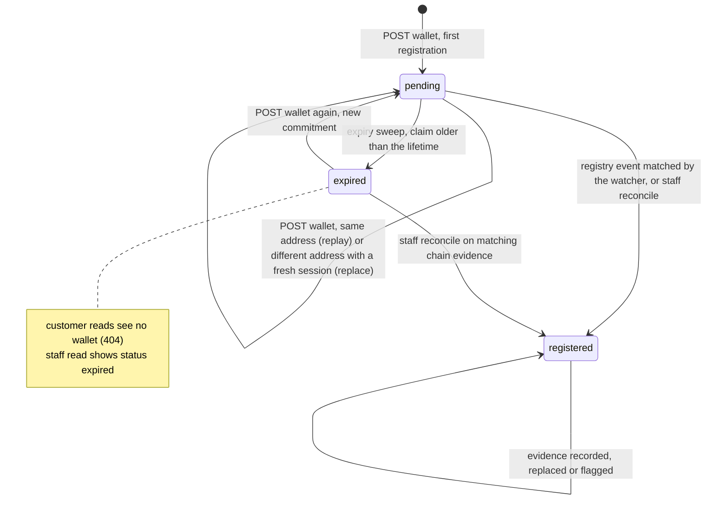
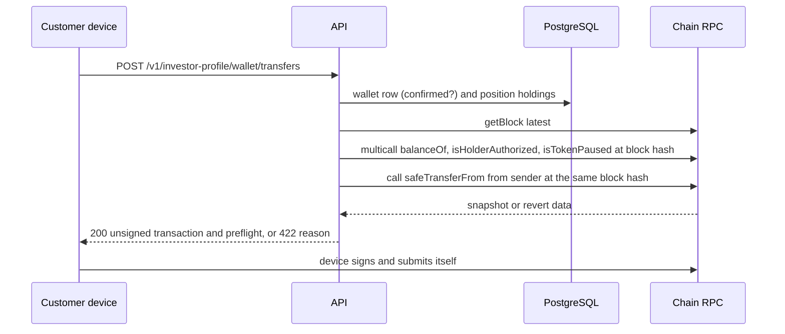

# API reference: wallet registration, balances and transfer preparation

Valid for main at 48aa967 (2026-11-18).

This chapter lists every route of the wallet module: the four customer routes under `/v1/investor-profile/wallet` (register an address, read its status, read balances, prepare an unsigned transfer) and the two staff routes under `/internal/v1/wallet-accounts` (read a registration, reconcile it against a chain transaction). It also describes the registration states, the claim expiry, the address rules and the chain configuration that decides which routes exist. It is read by the mobile developers who call the routes, by engineers who change them, and by operators who answer for the registry watcher.

Conventions shared by all routes (envelope, error catalogue, rate limits, gating) are in [README.md](README.md). The long-form guides stay the place for the reasoning: [../investor-profile.md](../investor-profile.md) (registration, replacement, evidence, transfers) and [../wallet-registration-operations.md](../wallet-registration-operations.md) (the watcher, its alerts and thresholds). The module page is [../modules/wallet.md](../modules/wallet.md); the offering routes that depend on a confirmed wallet are in [offering.md](offering.md).

## 1. Route summary

| Method | Path | Auth | Purpose |
| --- | --- | --- | --- |
| POST | `/v1/investor-profile/wallet` | customer session | Register an address; returns the commitment the device writes to the on-chain registry |
| GET | `/v1/investor-profile/wallet` | customer session | Read the caller's address and status (database only) |
| GET | `/v1/investor-profile/wallet/balance` | customer session | Read the EURC balance and the PIV token balances of the caller's address from the chain |
| POST | `/v1/investor-profile/wallet/transfers` | customer session | Prepare unsigned `safeTransferFrom` calldata after a simulation |
| GET | `/internal/v1/wallet-accounts/:account_id` | staff, `admin_operations`, WebAuthn | Read one account's registration, including expiry and chain evidence |
| POST | `/internal/v1/wallet-accounts/:account_id/reconcile` | staff, `admin_operations`, WebAuthn | Confirm or repair a registration from a registry transaction hash |

There is no route that signs, broadcasts or relays a transaction, no route that deletes or changes a confirmed address, and no route that lists wallets. The platform's own operator key is a separate thing and no wallet route uses it (section 3.1).

> Pending #237: `createApp` is split into per-module compose functions; the `src/app.ts` lines cited in this chapter move, the behaviour does not change.

## 2. Behaviour common to the routes of this chapter

### 2.1 Customer routes

`requireAuthentication` runs first (README section 4.2); the handler then calls `requireCustomerContext`, which refuses a session whose population is not `customer` with `403 authorization.forbidden` and the detail "Investor profiles are available only to customer accounts." (`src/modules/wallet/api/wallet.router.ts:87-107`). The wallet routes use no idempotency middleware and no fresh-authentication middleware: `POST /v1/investor-profile/wallet` asks a fresh-authentication probe instead (section 4). Every customer wallet response sets `Cache-Control: no-store` (`src/modules/wallet/api/wallet.router.ts:49`, `:59`, `:66`, `:80`). Rate limit: the baseline limiter keyed by account inside `requireAuthentication`; the tightened tier does not apply (README sections 9, 13.1).

| Status | Code | Condition |
| --- | --- | --- |
| 401 | `authentication.required`, `DPOP_PROOF_MISSING`, `DPOP_PROOF_INVALID`, `DPOP_KEY_MISMATCH`, `DPOP_REPLAY`, `REAUTH_REQUIRED` | no valid session or proof (README sections 4.2, 7) |
| 403 | `account.restricted` | the account status is not `active` |
| 403 | `authorization.forbidden` | a staff or partner session |
| 422 | `validation.invalid_field` | a body field fails its schema |
| 429 | `rate_limit.exceeded` | the baseline limiter, when `RATE_LIMIT_CACHE_URL` is set |
| 500 | `account.mapping_missing`, `authentication.context_missing` | the session has no account row; the auth context is absent behind the middleware (`src/modules/wallet/api/wallet.router.ts:90-97`) |

> Pending #244: a response that fails its own schema answers `500 internal.response_invalid` with a fixed detail; on main it is `422 validation.invalid_field`, with the internal response path in `field_errors` and no log line (README section 6.3).

### 2.2 Staff routes

`requireAuthentication`, `requireAdminOperations` and `requireStaffWebAuthn` run in that order (`src/modules/wallet/api/wallet-operations.router.ts:24`). Common errors: the 401 codes above, `403 authorization.forbidden` (not an active `admin_operations` staff account), `403 authentication.staff_mfa_required`, `422 validation.invalid_field`, `429 rate_limit.exceeded`. Both staff responses set `Cache-Control: no-store` (`src/modules/wallet/api/wallet-operations.router.ts:29`, `:38`). The account in the path is trusted by design: the caller is a WebAuthn-verified staff member (`src/modules/wallet/api/wallet-operations.router.ts:12-15`).

> Pending #245: the staff wallet router sends its responses through the same schema check, so a response that fails its schema becomes `500 internal.response_invalid` there too.

## 3. Concepts

### 3.1 Self-custody (AD-240)

The investor's wallet key lives on the investor's device. The backend stores an address and reads balances; it never holds a user's key and never signs for a user (AD-240, AD-267). Three facts in the code carry this:

- The API process reads the chain through `ChainReader`, which has no wallet account and no method that sends a transaction; the public client is private so that no caller can reach `sendRawTransaction` (`src/infrastructure/blockchain/chain-client.ts:121-136`, `:196-205`).
- A transfer is prepared, not performed: `encodeTransferCalldata` only encodes the call and the response carries it unsigned for the device to sign and submit (`src/infrastructure/blockchain/chain-client.ts:174-189`; `src/modules/wallet/application/request-wallet-transfer.service.ts:21-30`).
- `CHAIN_OPERATOR_PRIVATE_KEY` is the platform's own wallet. The API process builds its chain reader without it (`src/server.ts:552-568`); it is used by the worker's settlement writes ([../jobs-and-workers.md](../jobs-and-workers.md)).

### 3.2 Address form and the zero address

| Rule | Value | Source |
| --- | --- | --- |
| Accepted input | `0x` followed by exactly 40 hex digits in any case; the prefix is case-sensitive, so `0X...` is refused; leading and trailing whitespace is trimmed first | `src/modules/wallet/api/wallet.schemas.ts:15-20` |
| Refused | the all-zero address, `0x` plus 40 zeros; it cannot send the `register()` transaction and names no holder as a recipient. The check compares the lowercase literal | `src/modules/wallet/api/wallet.schemas.ts:11`, `:19` |
| Stored and returned form | trimmed and lowercased (`canonicalWalletAddress`); not the EIP-55 mixed-case spelling | `src/shared/domain/wallet-address.ts:18-20` |
| Database | `CHECK (wallet_address = lower(wallet_address))`; unique only among confirmed rows (below) | `prisma/migrations/20261113150100_wallet_address_canonical_form/migration.sql:127-132`; `prisma/migrations/20261113150200_wallet_claims_confirmed_address_uniqueness/migration.sql:60-64` |
| Sent to Coinbase | EIP-55 spelling, derived from the lowercase value; a value that is not an address is passed through | `src/shared/domain/wallet-address.ts:27-29`; `src/modules/offering/infrastructure/http-coinbase-cdp.client.ts:108-111` |

No other address is screened: a burn address passes the shape check. Because lowercasing discards the checksum that the letter case carries, a mixed-case address with a wrong checksum is accepted, for the registered address and for a transfer recipient alike (`src/modules/wallet/api/wallet.schemas.ts:15-20`; `src/shared/domain/wallet-address.ts:9-17`).

A confirmed registration binds an address to one account: a unique index on `lower(wallet_address)` where `registered_at` is not null (`wallet_registrations_confirmed_address_key`). A pending or expired claim binds nothing: several accounts may hold a pending claim on the same address, and the account's own claim may be replaced. A second unique index on the confirming event's transaction hash and log index, `uq_wallet_registrations_chain_event`, lets one on-chain event back at most one registration (`src/modules/wallet/repository/prisma-wallet.repository.ts:24-31`; `prisma/migrations/20261113150300_wallet_registration_chain_evidence/migration.sql:133`).

### 3.3 Registration status

A registration is one row per account in `settlement.wallet_registrations` (`prisma/schema/schema.prisma:816-849`). Its status is derived from two columns: `registered_at` set means registered; `expired_at` set (only possible while `registered_at` is null, enforced by `wallet_registrations_expired_only_pending_check`) means expired; neither means pending.

| Surface | `pending` | `registered` | `expired` |
| --- | --- | --- | --- |
| `POST` and `GET /v1/investor-profile/wallet` | `status: "pending"` | `status: "registered"` | not returned: `GET` answers `404 wallet.not_registered`; `POST` registers again |
| `GET /v1/investor-profile/wallet/balance` | answers for the pending address | answers | `404 wallet.not_registered` |
| `POST .../wallet/transfers` | `404 wallet.not_registered` | prepares | `404 wallet.not_registered` |
| Offering readiness (`payment_account_ready`, blocker `payment_account_not_ready`) | not ready | ready | not ready |
| `GET /v1/investor-profile` (`payment_account_ready`) | true | true | false |
| `GET /internal/v1/wallet-accounts/:account_id` | `status: "pending"` | `status: "registered"` | `status: "expired"` |

(`src/modules/wallet/repository/prisma-wallet.repository.ts:278-294`; `src/modules/wallet/application/request-wallet-transfer.service.ts:111-119`; `src/modules/offering/repository/prisma-offering.repository.ts:489-492`, `:560`; `src/modules/profile/application/get-profile.service.ts:89`; `src/modules/wallet/application/get-wallet-account-for-operations.service.ts:30-37`.) `registered_at` is never reverted: a flag on the chain evidence is information for staff and the registration stays registered ([../investor-profile.md](../investor-profile.md), "Chain evidence").

### 3.4 Claim expiry

A claim that stays pending is retired by the worker job `maintenance.wallet_registration_expiry`: it sets `expired_at` and writes the audit row `settlement.wallet_registration_expired` (no actor). The row is kept and nothing deletes it. The job runs in every worker; its owner is `settlement`, tier `tier_1` (`src/worker.ts:456`, `:586`, `:828`; `src/shared/jobs/job-ownership.ts:45`).

| Variable | Default | Range | Meaning | Source |
| --- | --- | --- | --- | --- |
| `WALLET_REGISTRY_PENDING_EXPIRE_AFTER_HOURS` | 24 | 1 to 720 | a claim is expired when `requested_at` is at or before now minus this | `src/config/environment.ts:346` |
| `WALLET_REGISTRY_PENDING_EXPIRE_SWEEP_MINUTES` | 15 | a divisor of 60 | how often the job runs | `src/config/environment.ts:350-359`; `src/modules/wallet/domain/wallet-claim-expiry-schedule.ts:9-20` |
| `WALLET_REGISTRY_PENDING_EXPIRE_BATCH_SIZE` | 500 | 1 to 5000 | most claims expired per run, oldest first | `src/config/environment.ts:362` |

A run expires nothing while the registry watcher is stale, its cursor lags or is ahead of the chain head, or, where the registry address is set, the watcher cannot run in this worker and has run before, nor when its health cannot be read: a claim whose registration event the watcher has not read yet is not abandoned (`src/modules/settlement/application/wallet-registry-expiry-gate.ts:9-20`, `:76-105`). A skipped run logs one line with `event: wallet_registration_expiry.skipped` and reports 0 checked, 0 acted (`src/modules/wallet/application/expire-pending-wallet-registrations.service.ts:54-99`). Rows locked by a concurrent confirmation, replacement or reconcile are skipped (`src/modules/wallet/repository/prisma-wallet.repository.ts:296-361`). The account registers again with a new commitment; an address that differs from the expired one needs a fresh session. Staff can still confirm an expired claim by reconciling it. The thresholds and the runbook are in [../wallet-registration-operations.md](../wallet-registration-operations.md).

### 3.5 Supported chains and tokens

| Item | Value | Source |
| --- | --- | --- |
| Chains | `base` (chain id 8453) and `base-sepolia` (84532), chosen by `CHAIN_NETWORK`; no other value is accepted | `src/config/environment.ts:289-292`; `src/infrastructure/blockchain/chain-client.ts:144-145` |
| Transfer-prepared token | the ERC-1155 property contract at `VISTABLOX_PROPERTY_CONTRACT_ADDRESS`; one token id per PIV (`piv.token_id`); amounts are raw integer units, no decimals | `src/infrastructure/blockchain/chain-client.ts:158-164`, `:178-189`; `src/modules/settlement/repository/prisma-settlement.repository.ts:339-349` |
| Balance-read tokens | the same ERC-1155 (`balanceOfBatch`) and the ERC-20 `EURC_TOKEN_ADDRESS` (`balanceOf`, shown with six decimals) | `src/infrastructure/blockchain/chain-wallet-reader.ts:11-19`; `src/shared/domain/currency.ts:22-28` |
| Registry | `VISTABLOX_WALLET_REGISTRY_CONTRACT_ADDRESS`; the device calls `register(bytes32 commitment)` on it | `src/modules/wallet/application/register-wallet.service.ts:22-28` |

There is no route that prepares a transfer of EURC.

### 3.6 Which routes exist

| Routes | Exist when | Source |
| --- | --- | --- |
| `POST` and `GET /v1/investor-profile/wallet`; `GET /internal/v1/wallet-accounts/:account_id` | `protectedApi.wallet` is passed, which `server.ts` always does; `createApp` refuses to build without `protectedApi.customerSessions` | `src/server.ts:685-693`; `src/app.ts:827-874` |
| `POST /v1/investor-profile/wallet` answers `503` until | `VISTABLOX_WALLET_REGISTRY_CONTRACT_ADDRESS` is set | `src/modules/wallet/application/register-wallet.service.ts:37-45` |
| `GET .../wallet/balance`, `POST .../wallet/transfers` | `CHAIN_NETWORK`, `CHAIN_RPC_URL`, `VISTABLOX_PROPERTY_CONTRACT_ADDRESS` and `EURC_TOKEN_ADDRESS` are all set | `src/server.ts:552-568`; `src/app.ts:848-861` |
| `POST /internal/v1/wallet-accounts/:account_id/reconcile` | `CHAIN_NETWORK`, `CHAIN_RPC_URL` and `VISTABLOX_WALLET_REGISTRY_CONTRACT_ADDRESS` are all set | `src/server.ts:689-691`; `src/modules/wallet/api/wallet-operations.router.ts:32` |

A route that does not exist answers `404 resource.not_found`. The environment schema constrains the combinations: `CHAIN_NETWORK`, `CHAIN_RPC_URL` and `CHAIN_OPERATOR_PRIVATE_KEY` are accepted only together, and `VISTABLOX_PROPERTY_CONTRACT_ADDRESS`, `VISTABLOX_IPO_ESCROW_CONTRACT_ADDRESS`, `EURC_TOKEN_ADDRESS` and `PIV_TREASURY_ADDRESS` only together and only with `CHAIN_NETWORK` (`src/config/environment.ts:490-534`). A process that can pass validation and mount the balance and transfer routes therefore has the whole bundle configured, including the operator key, which the API process then never uses. The registry address is independent of the bundle (`src/config/environment.ts:314-323`). Which of these variables are set on staging or production is not verifiable here (section 10).

> Pending #240: at boot the server checks the RPC's chain id and that each configured contract address has code, and exits when the RPC is unreachable; main has no such check, so a wrong network or address is discovered by the first request.

## 4. Customer routes

### POST /v1/investor-profile/wallet

Registers the address the device generated and returns the commitment the device must write to the on-chain registry. The registration is `pending` until the registry event is seen. A repeated request with the same address returns the same row.

- **Auth:** `requireAuthentication`, then `requireCustomerContext`. After the body is validated the router asks the fresh-authentication probe whether the session was created in the last 5 minutes (a `device_biometric` session created in the window answers from the session itself; any other session goes to a repository lookup) and passes the boolean on; the route itself never refuses on it (`src/modules/wallet/api/wallet.router.ts:35-51`; `src/modules/auth/api/customer/require-fresh-authentication.ts:19-34`). The probe is asked for every valid request, before the registry and KYC checks. No `Idempotency-Key`.
- **Mounted when:** always (section 3.6). It answers `503 wallet.on_chain_registration_unavailable` while `VISTABLOX_WALLET_REGISTRY_CONTRACT_ADDRESS` is unset.
- **Request:** body `{ "wallet_address": "<string>" }`; the string follows section 3.2 (`src/modules/wallet/api/wallet.schemas.ts:22-24`).
- **Success:** `201` for a first registration, a replay, a replacement and a renewal alike, body parsed through `registerWalletResponseSchema` (`src/modules/wallet/api/wallet.schemas.ts:26-35`; `src/modules/wallet/api/wallet.router.ts:50`):

  | Field | Meaning |
  | --- | --- |
  | `wallet_address` | the stored, lowercase address |
  | `registration_commitment` | `0x` plus 64 hex digits (32 random bytes), the argument of `register(bytes32)`; non-public (AD-240) |
  | `registry_contract_address` | the configured `VISTABLOX_WALLET_REGISTRY_CONTRACT_ADDRESS` |
  | `status` | `pending` or `registered` |
  | `requested_at` | when the current commitment was issued |
  | `registered_at` | ISO string, or `null` while pending |

  (`src/modules/wallet/application/register-wallet.service.ts:24-28`, `:106-117`.)
- **What the repository decides**, in one transaction under a lock on the account's row (`src/modules/wallet/repository/prisma-wallet.repository.ts:105-276`):

  | The account's own row | Submitted address | Session | Result |
  | --- | --- | --- | --- |
  | none | any, not confirmed for another account | any | row inserted, `201` `pending`, audit `settlement.wallet_registration_requested` (`src/modules/wallet/repository/prisma-wallet.repository.ts:186-212`) |
  | pending | the same | any | row returned unchanged, same commitment and `requested_at`, nothing written (`src/modules/wallet/repository/prisma-wallet.repository.ts:243-245`) |
  | pending | different | fresh | row replaced in place: new address, commitment and `requested_at`; audit `settlement.wallet_registration_replaced` (`src/modules/wallet/repository/prisma-wallet.repository.ts:247-270`) |
  | pending | different | not fresh | `403 authentication.fresh_auth_required`, nothing written (`src/modules/wallet/repository/prisma-wallet.repository.ts:160-162`) |
  | expired | the same | any | row renewed in place with a new commitment and `requested_at`, `expired_at` cleared; audit `..._requested` with `previous_expired_wallet_address` (`src/modules/wallet/repository/prisma-wallet.repository.ts:214-241`) |
  | expired | different | fresh | as above, with the new address |
  | expired | different | not fresh | `403 authentication.fresh_auth_required`, nothing written |
  | confirmed | the same | any | row returned, `201` `registered` (`src/modules/wallet/repository/prisma-wallet.repository.ts:177-179`) |
  | confirmed | different | any | `409 wallet.registration_address_mismatch`, or `409 wallet.address_already_claimed` when another account has that address confirmed (`src/modules/wallet/repository/prisma-wallet.repository.ts:179`) |
  | pending, expired or none | confirmed for another account | any | `409 wallet.address_already_claimed` (`src/modules/wallet/repository/prisma-wallet.repository.ts:172-184`) |

  "The same" is decided on the trimmed, lowercased form, so a case or whitespace variant of the stored address is a replay (`src/modules/wallet/repository/prisma-wallet.repository.ts:138`). The freshness refusal is decided before any other account's addresses are read, so a session that is not fresh cannot use the replace path to learn which addresses are confirmed elsewhere (`:140-163`). Two concurrent first requests of one account serialise on the row; the loser replays the winner's row (`:117-131`, `:194`).
- **Errors:** in addition to section 2.1.

  | Status | Code | Condition |
  | --- | --- | --- |
  | 403 | `authentication.fresh_auth_required` | the table above; the client signs in again on the device (`POST /v1/auth/mobile/login/challenge`, then `/login/verify`) and repeats the identical request (`src/shared/errors/fresh-authentication-required-error.ts:11-13`) |
  | 403 | `identity.kyc_required` | KYC is not `eligible`, or `renewal_due_at` is null or not in the future (`src/modules/wallet/application/register-wallet.service.ts:47-63`) |
  | 409 | `wallet.registration_address_mismatch` | the account's confirmed address differs from the submitted one (`src/modules/wallet/application/register-wallet.service.ts:88-97`) |
  | 409 | `wallet.address_already_claimed` | the address is confirmed for another account, including the replay of the account's own pending claim on such an address (`src/modules/wallet/application/register-wallet.service.ts:98-103`) |
  | 422 | `validation.invalid_field` | `wallet_address` is missing, not 20 bytes of hex, or the zero address (`field_errors[0].message` "Must not be the zero address", code `custom`) |
  | 500 | `internal.unexpected` | the fresh-authentication lookup failed; nothing is written |
  | 503 | `wallet.on_chain_registration_unavailable` | the registry address is not configured |

- **Notes:** the checks run in this order: authentication, customer population, body validation, the freshness probe, the registry configuration (503), KYC (403), then the repository. A failed probe lookup is a 500 even for a request that would otherwise have been refused with 503 or 403. The route requires current KYC eligibility only, not the broader `investment_eligible` condition (login methods are a separate concern, `src/modules/wallet/application/register-wallet.service.ts:48-52`). Rows written: `settlement.wallet_registrations`, `audit.audit_log`. No job is enqueued; the on-chain confirmation is the watcher's work ([../wallet-registration-operations.md](../wallet-registration-operations.md)).
- **Source:** router `src/modules/wallet/api/wallet.router.ts:35-51`; service `RegisterWalletService`; repository `PrismaWalletRepository.registerWallet`.

### GET /v1/investor-profile/wallet

Reads the caller's own address and status. It is a database read with no chain access, so it works without any `CHAIN_*` variable.

- **Auth:** `requireAuthentication`, then `requireCustomerContext`.
- **Mounted when:** always (section 3.6).
- **Request:** none.
- **Success:** `200`, body parsed through `getWalletStatusResponseSchema` (`src/modules/wallet/api/wallet.schemas.ts:37-44`; `src/modules/wallet/api/wallet.router.ts:56-61`): `wallet_address`, `status` (`pending` or `registered`), `requested_at`, `registered_at` (or `null`). The commitment and the registry address are not in this response; a client that needs them repeats the `POST` with the same address, which returns the stored row.
- **Errors:** `404 wallet.not_registered` when the account has no row, or its claim is expired (`src/modules/wallet/application/get-wallet-status.service.ts:16-26`; `src/modules/wallet/repository/prisma-wallet.repository.ts:285-294`). A pending claim is returned, which is how a client tells a pending claim from no wallet.
- **Source:** router `src/modules/wallet/api/wallet.router.ts:56-61`; service `GetWalletStatusService`; repository `PrismaWalletRepository.findByAccountId`.

### GET /v1/investor-profile/wallet/balance

Reads the EURC balance and the PIV token balances of the caller's address live from the chain. It is advisory: the numbers are read at the time of the call with two independent reads and are not pinned to one block.

- **Auth:** `requireAuthentication`, then `requireCustomerContext`.
- **Mounted when:** the four chain variables of section 3.6 are set (`src/modules/wallet/api/wallet.router.ts:62-69`).
- **Request:** none.
- **Success:** `200`, body parsed through `getWalletBalanceResponseSchema` (`src/modules/wallet/api/wallet.schemas.ts:46-58`; `src/modules/wallet/api/wallet.router.ts:63-68`):

  | Field | Meaning |
  | --- | --- |
  | `wallet_address` | the stored address, pending or confirmed |
  | `capital_eurc` | the `EURC` balance as a decimal string with six fraction digits, from `balanceOf` (`src/shared/domain/currency.ts:22-28`) |
  | `tokens[]` | one entry per PIV in which the account has a position row: `piv_id`, `token_id` (decimal string), `balance` (the contract's `balanceOfBatch` value as an integer string, raw units) |

  The `tokens` list comes from the account's rows in `settlement.position_ledger` joined to PIVs with a token id, one per PIV (`src/modules/settlement/repository/prisma-settlement.repository.ts:339-349`). It does not look at the position's status or at whether anything was minted. The two chain reads run in parallel and are separate calls (`src/modules/wallet/application/get-wallet-balance.service.ts:33-42`; `src/infrastructure/blockchain/chain-wallet-reader.ts:11-19`).
- **Errors:**

  | Status | Code | Condition |
  | --- | --- | --- |
  | 404 | `wallet.not_registered` | no row, or an expired claim (`src/modules/wallet/application/get-wallet-balance.service.ts:23-31`) |
  | 500 | `internal.unexpected` | a chain read fails: the service has no handler for it, so the raw error reaches the error handler |

> Pending #239: a chain read failure answers `503 wallet.chain_unavailable` within a 10-second budget instead of 500.

- **Notes:** the route is not confirmed-only: it reads the balances of a pending claim's address. Transfer preparation, by contrast, requires a confirmed registration. Whether the balance route should also require one is open ([../investor-profile.md](../investor-profile.md), "Wallet transfers").
- **Source:** router `src/modules/wallet/api/wallet.router.ts:62-69`; service `GetWalletBalanceService`; chain reader `ViemWalletChainReader`.

### POST /v1/investor-profile/wallet/transfers

Prepares the calldata of a `safeTransferFrom` of a PIV token from the caller's confirmed address to a recipient, after simulating it. Nothing is signed or sent; the device signs and submits the transaction itself (AD-240, AD-267).

- **Auth:** `requireAuthentication`, then `requireCustomerContext`. No fresh authentication, no idempotency key, no KYC check: KYC gates registration only. Each request reads the chain, so the baseline limiter is the only throttle.
- **Mounted when:** the four chain variables of section 3.6 are set (`src/modules/wallet/api/wallet.router.ts:70-83`).
- **Request:** body parsed by `requestWalletTransferBodySchema` (`src/modules/wallet/api/wallet.schemas.ts:60-64`):

  | Field | Type and rule |
  | --- | --- |
  | `piv_id` | string, at least one character |
  | `to_wallet_address` | an address as in section 3.2 (zero address refused, stored form lowercase) |
  | `amount` | a string matching `^[1-9][0-9]*$`: raw ERC-1155 token units, no decimals, no sign, no leading zero; a JSON number or `"0"` is `422`. There is no maximum length in the schema |

  For a token minted from an IPO escrow campaign one unit equals one EURC base unit contributed, so a client that shows whole euros divides by 10^6 for display only and sends the raw integer ([../investor-profile.md](../investor-profile.md), "Amount unit and range").
- **Success:** `200`, body parsed through `requestWalletTransferResponseSchema` (`src/modules/wallet/api/wallet.schemas.ts:66-93`; `src/modules/wallet/api/wallet.router.ts:81`):

  | Field | Meaning |
  | --- | --- |
  | `piv_id`, `token_id`, `amount` | the PIV, its ERC-1155 token id, the amount exactly as sent |
  | `from_wallet_address`, `to_wallet_address` | the caller's confirmed address and the recipient, lowercase |
  | `unsigned_transaction.chain_id` | 8453 or 84532 |
  | `unsigned_transaction.to` | the property contract |
  | `unsigned_transaction.data` | the `safeTransferFrom(from, to, tokenId, amount, "0x")` calldata |
  | `unsigned_transaction.value` | `"0"` |
  | `preflight.block_number`, `preflight.block_hash` | the block every read and the simulation came from |
  | `preflight.sender_balance` | the sender's balance of the token at that block |
  | `preflight.recipient_authorized`, `preflight.token_paused`, `preflight.simulation` | the literals `true`, `false`, `"passed"`: a response whose preview says otherwise is never sent as a 200 |

  (`src/modules/wallet/application/request-wallet-transfer.service.ts:176-195`; `src/infrastructure/blockchain/transfer-snapshot.ts:148-160`.) A `200` does not mean the transfer happened: the snapshot is advisory and the contract is the final authority.
- **Order of checks** (`src/modules/wallet/application/request-wallet-transfer.service.ts:103-167`): the wallet row (no row, an expired claim and a pending claim all answer `404 wallet.not_registered`; a pending claim has its own detail text, "not confirmed yet", `src/modules/wallet/application/request-wallet-transfer.service.ts:111-119`); the account's holdings, then `404 wallet.piv_not_held`; an amount above 2^256 minus 1 answers `422 wallet.insufficient_balance` without a chain read; the chain snapshot (`503 wallet.chain_unavailable`); the preflight (a `422` from the table below).
- **Errors:** in addition to section 2.1.

  | Status | Code | Condition |
  | --- | --- | --- |
  | 404 | `wallet.not_registered` | no wallet row, an expired claim, or a registration that is not confirmed yet (`src/modules/wallet/application/request-wallet-transfer.service.ts:83-90`, `:111-119`) |
  | 404 | `wallet.piv_not_held` | the account has no position row for the PIV (`src/modules/wallet/application/request-wallet-transfer.service.ts:121-130`) |
  | 422 | `wallet.transfer_lane_closed` | the contract reverts with `TransferLaneClosed` (`src/modules/wallet/application/request-wallet-transfer.service.ts:44-48`; `src/modules/wallet/domain/transfer-preflight-policy.ts:48-49`) |
  | 422 | `wallet.token_paused` | the token or the contract is paused (`TokenIsPaused`, `EnforcedPause`, or `isTokenPaused`) |
  | 422 | `wallet.recipient_not_authorized` | `isHolderAuthorized(to, tokenId)` is false, or `HolderNotAuthorized` |
  | 422 | `wallet.insufficient_balance` | the amount exceeds the sender's balance at the block, the simulation reverts with `ERC1155InsufficientBalance`, or the amount exceeds 2^256 minus 1 (`src/modules/wallet/domain/transfer-preflight-policy.ts:48-55`, `:79-81`) |
  | 422 | `wallet.recipient_cannot_receive` | `ERC1155InvalidReceiver` |
  | 422 | `wallet.transfer_would_revert` | any other revert, or a revert that cannot be decoded |
  | 503 | `wallet.chain_unavailable` | the chain could not be read within the budget (`src/modules/wallet/application/request-wallet-transfer.service.ts:147-162`) |

  When several reasons apply the first in this order is answered: lane closed, paused, recipient not authorized, insufficient balance, recipient cannot receive, any other revert (`src/modules/wallet/domain/transfer-preflight-policy.ts:39-46`, `:48-57`, `:66-92`).
- **How the snapshot is taken** (`src/infrastructure/blockchain/transfer-snapshot.ts:89-195`): the head block is read once; one multicall reads `balanceOf(from, tokenId)`, `isHolderAuthorized(to, tokenId)` and `isTokenPaused(tokenId)`, and one `eth_call` simulates the exact calldata with `from` as the sender, both pinned to the head's block hash with `requireCanonical` (EIP-1898) so that a lagging backend or a reorg fails instead of mixing blocks. The whole snapshot has a 10-second budget (`TRANSFER_SNAPSHOT_BUDGET_MS`) and is taken at most twice, the second time only when the pinned block was not found (`isPinnedBlockUnavailable`). A revert is an answer; any other failure is `ChainStateUnavailableError`, whose message names the kind of failure and never holds the RPC URL. The client never follows an off-chain lookup (`ccipRead: false`, `src/infrastructure/blockchain/chain-client.ts:146`, `:154`).

- **Current behaviour of the contract in the repository:** `VistaBloxProperty.safeTransferFrom` always reverts with `TransferLaneClosed` in its Phase 1 source (`contracts/contracts/VistaBloxProperty.sol:162-164`). Against a contract with that source every request that reaches the simulation answers `422 wallet.transfer_lane_closed`; the route returns a `200` only once a transfer lane is opened in the contract. Whether the contract at the configured address has that source is not verifiable here (section 10).
- **Notes:** read only on the platform side: no row is written, no audit row, no job. `Cache-Control: no-store`.
- **Source:** router `src/modules/wallet/api/wallet.router.ts:70-83`; service `RequestWalletTransferService`; chain `ChainReader.readTransferSnapshot`.

## 5. Staff routes

### GET /internal/v1/wallet-accounts/:account_id

Shows one account's registration to support staff, including an expired claim and the chain evidence that confirmed it. Customers never see the evidence.

- **Auth:** the staff chain (section 2.2).
- **Mounted when:** as the customer wallet routes (section 3.6).
- **Request:** path `account_id` (string, at least one character), `src/modules/wallet/api/wallet.schemas.ts:95-97`.
- **Success:** `200`, body parsed through `operationsWalletAccountResponseSchema` (`src/modules/wallet/api/wallet.schemas.ts:129-154`; `src/modules/wallet/api/wallet-operations.router.ts:26-30`):

  | Field | Meaning |
  | --- | --- |
  | `account_id`, `wallet_address`, `registration_commitment` | the row; the commitment is shown to staff because a stuck `pending` claim is the case this view serves |
  | `status` | `registered` when `registered_at` is set, else `expired` when `expired_at` is set, else `pending` |
  | `requested_at`, `registered_at`, `expired_at` | timestamps, or `null` |
  | `registration_evidence.status` | `none`, `partial` (transaction hash or block number only), `recorded` (full identity, not yet verified), `verified`, `flagged` |
  | `registration_evidence.transaction_hash`, `block_number` (string), `block_hash`, `log_index` | the confirming `WalletRegistered` event, or `null` |
  | `registration_evidence.verified_at`, `flag`, `flagged_at` | the re-check result; `flag` is `transaction_missing`, `transaction_reverted` or `event_missing` |

  (`src/modules/wallet/application/get-wallet-account-for-operations.service.ts:16-57`; `src/shared/domain/wallet-registration-evidence.ts:37-79`.)
- **Errors:** `404 wallet.account_not_found` when the account has no row at all (`src/modules/wallet/application/get-wallet-account-for-operations.service.ts:61-67`); the lookup includes expired claims (`:19`).
- **Notes:** read only, no audit row.
- **Source:** router `src/modules/wallet/api/wallet-operations.router.ts:26-30`; service `GetWalletAccountForOperationsService`.

### POST /internal/v1/wallet-accounts/:account_id/reconcile

Confirms a registration that the watcher missed, attaches evidence to one confirmed without it, or replaces evidence that was flagged or whose transaction was mined again. The transaction is verified on the chain against the address and commitment the row holds.

- **Auth:** the staff chain. No `Idempotency-Key`; repeating a call returns `unchanged` once the row holds the event.
- **Mounted when:** `CHAIN_NETWORK`, `CHAIN_RPC_URL` and `VISTABLOX_WALLET_REGISTRY_CONTRACT_ADDRESS` are set (section 3.6; `src/modules/wallet/api/wallet-operations.router.ts:32`). Otherwise `404 resource.not_found`.
- **Request:** path `account_id`; body `{ "transaction_hash": "<string>" }`, `0x` plus 64 hex digits in any case, stored lowercase (`src/modules/wallet/api/wallet.schemas.ts:98-104`).
- **Success:** `200`, body parsed through `reconcileWalletRegistrationResponseSchema` (`src/modules/wallet/api/wallet.schemas.ts:105-121`): `account_id`, `wallet_address`, `status` (always `registered`), `registration_tx_hash`, `registration_block_number` (string), `registration_block_hash`, `registration_log_index`, `outcome`, `requested_at`, `registered_at`.

  | `outcome` | Meaning |
  | --- | --- |
  | `confirmed` | the row was pending or expired: `registered_at` (the event's own timestamp) and the evidence were written; an expired claim is reinstated (`expired_at` cleared) |
  | `evidence_recorded` | the row was confirmed without full evidence; the evidence was filled in, `registered_at` untouched |
  | `evidence_replaced` | the row was flagged, or its transaction was mined again; the evidence was replaced and the flag cleared |
  | `unchanged` | the row already holds exactly this event; no chain call is made when it holds a complete, unflagged record of this transaction |

  (`src/modules/wallet/repository/prisma-wallet.repository.ts:439-514`; `src/modules/wallet/application/reconcile-wallet-registration.service.ts:80-97`.)
- **Errors:** in addition to section 2.2.

  | Status | Code | Condition |
  | --- | --- | --- |
  | 404 | `wallet.account_not_found` | the account has no row (`src/modules/wallet/application/reconcile-wallet-registration.service.ts:193-200`) |
  | 409 | `wallet.registration_transaction_unconfirmed` | the head is fewer than 3 blocks past the block of the event (`src/modules/wallet/application/reconcile-wallet-registration.service.ts:226-232`; `src/infrastructure/blockchain/wallet-registration-verifier.ts:15`, `:52-55`) |
  | 409 | `wallet.registration_changed` | the account replaced or renewed its claim after the transaction was checked; nothing written, read the registration again and retry (`src/modules/wallet/application/reconcile-wallet-registration.service.ts:132-134`) |
  | 409 | `wallet.address_already_claimed` | another account already has the address confirmed; the conflict is recorded in the audit log with the staff actor (`src/modules/wallet/application/reconcile-wallet-registration.service.ts:135-137`; `src/modules/wallet/repository/prisma-wallet.repository.ts:519-525`, `:528-555`) |
  | 409 | `wallet.registration_event_already_used` | the on-chain event already backs another account's registration (`src/modules/wallet/application/reconcile-wallet-registration.service.ts:143-149`) |
  | 409 | `wallet.registration_evidence_conflict` | the registration is confirmed by a different event and is not flagged; nothing changed (`src/modules/wallet/application/reconcile-wallet-registration.service.ts:150-156`) |
  | 422 | `wallet.registration_transaction_not_found` | no mined transaction with this hash on the configured chain (`src/modules/wallet/application/reconcile-wallet-registration.service.ts:204-210`) |
  | 422 | `wallet.registration_transaction_reverted` | the transaction reverted (`src/modules/wallet/application/reconcile-wallet-registration.service.ts:211-217`) |
  | 422 | `wallet.registration_event_not_found` | no `WalletRegistered` log for this wallet and commitment in the transaction (`src/modules/wallet/application/reconcile-wallet-registration.service.ts:218-225`) |
  | 503 | `wallet.chain_unavailable` | any chain read failed (`src/modules/wallet/application/reconcile-wallet-registration.service.ts:233-240`) |
  | 503 | `wallet.reconciliation_unavailable` | the repository has no reconcile method; not reachable with the Prisma repository (`src/modules/wallet/application/reconcile-wallet-registration.service.ts:71-78`) |
  | 500 | `internal.unexpected` | the auth context is missing: the handler throws a plain `Error` (`src/modules/wallet/api/wallet-operations.router.ts:34`) |

- **Notes:** the chain check finds the first `WalletRegistered` log of the stored address and commitment in the transaction. The write is a compare-and-set on the address and commitment the caller verified, under the row lock; it also takes the confirmed-address and chain-event unique indexes into account (`src/modules/wallet/repository/prisma-wallet.repository.ts:363-526`). Audit rows (actor: the staff account, `created_at`: the time of the call; the chain time stays in `changes.registered_at`): `settlement.wallet_registration_reconciled`, `settlement.wallet_registration_evidence_recorded`, `settlement.wallet_registration_evidence_replaced`. No job is enqueued.
- **Source:** router `src/modules/wallet/api/wallet-operations.router.ts:32-41`; service `ReconcileWalletRegistrationService`; verifier `ViemWalletRegistrationVerifier`; repository `PrismaWalletRepository.reconcileWalletRegistration`.

## 6. Audit rows written by wallet routes and jobs

| `action` | Written by | Actor | Source |
| --- | --- | --- | --- |
| `settlement.wallet_registration_requested` | `POST /v1/investor-profile/wallet`: first registration, and renewal of an expired claim | the customer | `src/modules/wallet/repository/prisma-wallet.repository.ts:195-205`, `:229-239` |
| `settlement.wallet_registration_replaced` | `POST /v1/investor-profile/wallet`: replacement of a pending claim | the customer | `src/modules/wallet/repository/prisma-wallet.repository.ts:259-269` |
| `settlement.wallet_registration_expired` | `maintenance.wallet_registration_expiry` | none | `src/modules/wallet/repository/prisma-wallet.repository.ts:343-357` |
| `settlement.wallet_registration_reconciled`, `settlement.wallet_registration_evidence_recorded`, `settlement.wallet_registration_evidence_replaced` | `POST .../reconcile` | staff | `src/modules/wallet/repository/prisma-wallet.repository.ts:426-460`, `:501-513` |
| `settlement.wallet_registration_confirmation_conflict` | `POST .../reconcile` when the address is confirmed elsewhere (written outside the failed transaction, `changes.source` `manual_reconcile`); the registry watcher writes the same action with `changes.source` `chain_event` | staff for the reconcile, none for the watcher | `src/modules/wallet/repository/prisma-wallet.repository.ts:528-555`; `src/modules/settlement/repository/prisma-settlement.repository.ts:611-620` |

The watcher's own rows (`settlement.wallet_registration_confirmed` and the mismatch rows) belong to the settlement module ([../wallet-registration-operations.md](../wallet-registration-operations.md)). A refusal (`403`, `409`, `422`) writes no audit row, with one exception: the `409 wallet.address_already_claimed` of `POST .../reconcile` writes `settlement.wallet_registration_confirmation_conflict` (row above).

## 7. Differences from the existing guides and other chapters

| Source | What it says | What the code does |
| --- | --- | --- |
| [README.md](README.md), section 12.1, row 17 | the balance and transfer routes exist when `CHAIN_NETWORK`, `CHAIN_RPC_URL`, `VISTABLOX_PROPERTY_CONTRACT_ADDRESS` and `EURC_TOKEN_ADDRESS` are all set; the API process never uses the value of `CHAIN_OPERATOR_PRIVATE_KEY`, but the schema accepts these values only as the whole bundle, so in practice all seven variables are set | consistent: `server.ts` does not read the operator key for these routes (`src/server.ts:552-568`), and the environment schema accepts `CHAIN_NETWORK` only together with `CHAIN_OPERATOR_PRIVATE_KEY`, and the property and EURC addresses only together with the IPO escrow and treasury addresses (`src/config/environment.ts:490-534`), so a valid configuration that mounts the routes includes the key (section 3.6) |
| [../investor-profile.md](../investor-profile.md), "Wallet registration" | the replay, replacement, expiry and conflict rules | consistent with `registerWallet` (section 4); the guide's table of own-row situations matches the repository branches |
| [../investor-profile.md](../investor-profile.md), "Wallet transfers" | every request answers `422 wallet.transfer_lane_closed` today | consistent with the repository's contract source (`contracts/contracts/VistaBloxProperty.sol:162-164`); the deployed contract was not checked (section 10) |
| [../investor-profile.md](../investor-profile.md), "Response sections" | a wallet request makes the profile's `payment_account_ready` true | consistent: the profile flag is true for any non-expired row (`src/modules/profile/application/get-profile.service.ts:89`); the offering detail's flag of the same name is true only for a confirmed registration (`src/modules/offering/repository/prisma-offering.repository.ts:560`) |

## 8. Known gaps between the code and the design record

The design record is the sibling repository `vistablox-design-docs`; C-0nn entries are in `00-Governance/MIGRATION/CONFLICT_REGISTER.md`. On the record's `main` the register ends at C-008 and the decisions end at AD-278; the entries named below beyond C-008, and AD-281 and AD-287, exist only on its branch `docs/impact-dead-letter-media-mint-nonce`, not on `main`. The code comments cite AD-287 as decided on 2026-11-17; issue #148 records AD-281 as decided on 2026-11-14.

| # | Subject | Code | Record | Register |
| --- | --- | --- | --- | --- |
| 1 | Address uniqueness and replacement | `wallet_address` is unique only among confirmed rows; a pending claim is replaced in place behind a fresh session (`prisma/migrations/20261113150200_wallet_claims_confirmed_address_uniqueness/migration.sql:60-64`; `src/modules/wallet/repository/prisma-wallet.repository.ts:140-163`) | `04-Engineering/DATA/CORE_TABLES.md:588` declares `wallet_address TEXT NOT NULL UNIQUE`, and describes replacement as an authenticated update with a new on-chain event | C-010 |
| 2 | Fresh-authentication window | 5 minutes (`src/modules/auth/domain/fresh-authentication.ts:10`) | 15 minutes in four places (README section 13.1, item 5) | C-010 |
| 3 | Registration evidence and expiry columns | `registration_tx_hash`, block and log identity, verification and flag columns, `expired_at` (`prisma/schema/schema.prisma:816-849`) | `04-Engineering/DATA/CORE_TABLES.md:586-592` has `account_id`, `wallet_address`, `registration_commitment`, `requested_at`, `registered_at` only | C-011 for the evidence columns; `expired_at` is AD-287, decided 2026-11-17 |
| 4 | Customer wallet design | self-custodied device wallet; prepare-only transfers; no Safe behaviour (AD-267, AD-281) | the device-bound-auth plan in `vistablox-api` still describes a Safe smart account with the backend relaying signed operations (`docs/plans/device-bound-auth-backend.md:32`, `:118`) | C-009 (issue #148) |
| 5 | Transfer lane | the route is built; the contract's Phase 1 source refuses every transfer | AD-267 makes customer transfers prepare-only; whether and when a lane opens is a product and legal decision outside this repository | none; see [../investor-profile.md](../investor-profile.md) |

## 9. Known limitations of the code

| # | Limitation | Where | Issue |
| --- | --- | --- | --- |
| 1 | A chain read failure on `GET .../wallet/balance` is a `500 internal.unexpected`, while the same failure on transfer preparation is a `503 wallet.chain_unavailable` | `src/modules/wallet/application/get-wallet-balance.service.ts:33-42`; `src/modules/wallet/application/request-wallet-transfer.service.ts:147-162` | #155, PR #239 |
| 2 | The balance route answers for a pending claim's address; transfer preparation does not | `src/modules/wallet/application/get-wallet-balance.service.ts:23`; `src/modules/wallet/application/request-wallet-transfer.service.ts:115-119` | none (open question in the guide; AD-282, item 1 of its "Not decided here", leaves the balance read unchanged, on the record's branch `docs/impact-dead-letter-media-mint-nonce`) |
| 3 | The capital and the token balances are two unpinned calls, so they can differ from the snapshot of a later transfer response | `src/modules/wallet/application/get-wallet-balance.service.ts:34-42` | none |
| 4 | No check at boot that the RPC serves the configured chain or that the configured addresses hold contract code | `src/server.ts:552-568` | #152, PR #240 |
| 5 | A mixed-case address with a wrong EIP-55 checksum is accepted as a registered address and as a recipient, because lowercasing discards the checksum; the transfer is prepared for the address as spelled | `src/modules/wallet/api/wallet.schemas.ts:15-20`; `src/shared/domain/wallet-address.ts:9-20` | none |
| 6 | The freshness probe runs for every valid `POST`, before the registry and KYC checks; if its repository lookup fails the answer is `500` even for a request that would have been refused with `503` or `403` | `src/modules/wallet/api/wallet.router.ts:43-48` | none |
| 7 | The `404 wallet.piv_not_held` detail says "minted token position", but the check is a position row with a token id; a PIV that was never minted can pass it and is refused later by the simulation | `src/modules/wallet/application/request-wallet-transfer.service.ts:121-130`; `src/modules/settlement/repository/prisma-settlement.repository.ts:339-349` | none |
| 8 | A response that fails its own schema is answered `422 validation.invalid_field` and not logged; the comment on `requestWalletTransferResponseSchema` says such a value "fails here (500)" | `src/modules/wallet/api/wallet.schemas.ts:79-93`; `src/shared/http/error-handler.ts:39-41`, `:51-64` | PRs #244, #245 |
| 9 | The staff router throws a plain `Error` for a missing auth context, which surfaces as `internal.unexpected` instead of `authentication.context_missing` | `src/modules/wallet/api/wallet-operations.router.ts:34` | none |
| 10 | The transfer simulation covers the inner `safeTransferFrom` only; it does not simulate a UserOperation (bundler, paymaster, owner signature, gas) | `src/infrastructure/blockchain/transfer-snapshot.ts:227-246` | none |
| 11 | The RPC provider must accept an EIP-1898 block hash with `requireCanonical`; a provider that does not turns every transfer request into `503 wallet.chain_unavailable`. Support is not verified for the planned production provider | `src/infrastructure/blockchain/transfer-snapshot.ts:108-118` | none |
| 12 | Delivery of the wallet registry alerts to a person is not built: the events reach the worker log only | [../wallet-registration-operations.md](../wallet-registration-operations.md) | #150 (closed) |

> Pending #239: limitation 1 is removed; the balance route answers `503 wallet.chain_unavailable` within a 10-second budget.

## 10. Not verified

- Not verified: any behaviour against PostgreSQL 18, because the local checks ran on 16.15; no route was called against a database for this chapter and the SQL was read, not run.
- Not verified: any behaviour against a real chain or RPC provider. The snapshot, the multicall pinning, the retry on a missing block and the 10-second budget were read from the code. Whether the provider planned for production accepts block-hash pinning with `requireCanonical` is not recorded in the repository.
- Not verified: that the contracts deployed at the configured addresses match the sources in `contracts/`, so the statement that every transfer currently answers `422 wallet.transfer_lane_closed` holds for the repository source only.
- Not verified: the contents of `.env.staging` and any production configuration, so which wallet routes exist on staging or production is not known. The "Mounted when" lines state what the code needs.
- Not verified: the mobile client's handling of `403 authentication.fresh_auth_required` on `POST /v1/investor-profile/wallet`, because the mobile repository was not read.
- Not verified: the registry watcher's behaviour (`settlement.confirm_wallet_registrations`), which is described only as far as the wallet routes depend on it; it is documented in [../wallet-registration-operations.md](../wallet-registration-operations.md) and was not exercised.
- Not verified: the behaviour of the open pull requests named in the "Pending" lines. Each line states what the diff of the pull request head shows; no branch was checked out, built or run.
