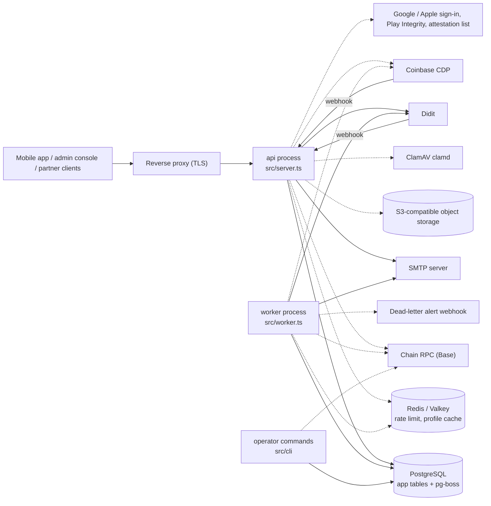
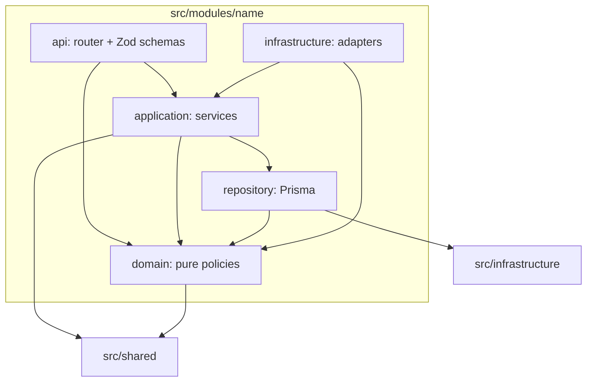
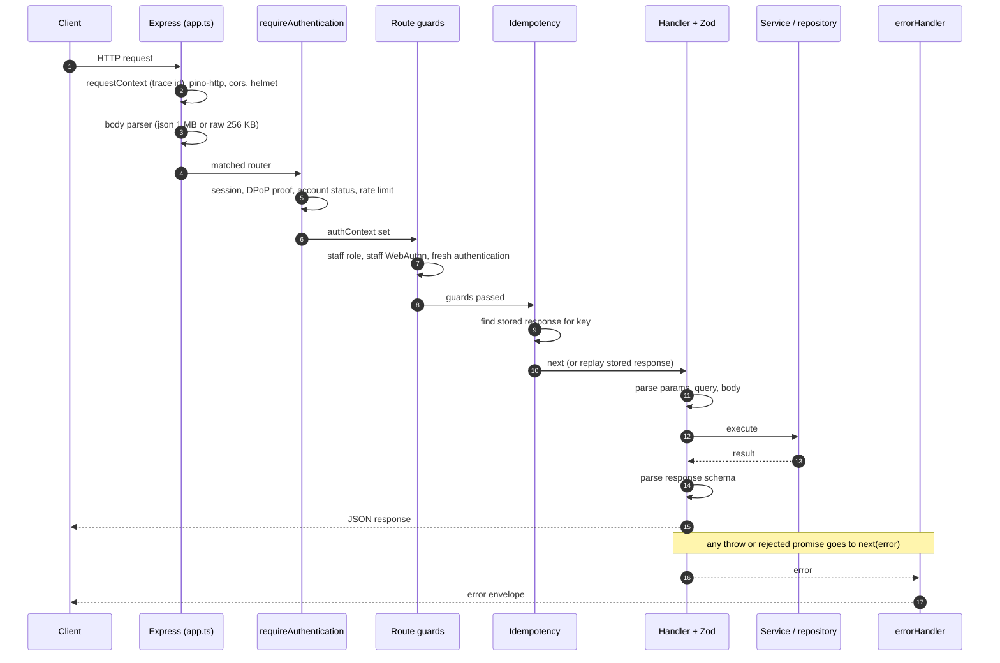

# Architecture

Valid for main at 48aa967 (2026-11-18).

How the VistaBlox API is put together: which processes run and what they depend on, how `src/` is organised, how a request travels through the code, and which conventions every module follows. The readers are engineers who add or change code, and operators who need to know what stops working when a dependency is absent or down. Security controls are in [security.md](security.md), variables in [configuration.md](configuration.md), jobs in [jobs-and-workers.md](jobs-and-workers.md), tables in [data-model.md](data-model.md).

Citations are `(path:line)` at 48aa967; the identifier is named next to the number because line numbers drift. A statement marked `Not verified` could not be checked from the repository or from the checks listed in [Not verified](#not-verified). A line that starts with `> Pending #N:` says what an open pull request changes in the statement above it; nothing under such a line is built on main.

Contents: [1 System context](#1-system-context) · [2 Process model](#2-process-model) · [3 Source layout](#3-source-layout) · [4 Module layering](#4-module-layering) · [5 Composition root](#5-composition-root) · [6 Request lifecycle](#6-request-lifecycle) · [7 Errors](#7-the-error-envelope-and-error-codes) · [8 Responses](#8-response-handling) · [9 Cross-domain jobs](#9-cross-domain-state-changes-through-jobs) · [10 Self-custody](#10-self-custody-and-the-operator-key) · [11 Conventions](#11-conventions) · [12 Module communication](#12-how-modules-talk-to-each-other) · [13 Known gaps](#13-known-gaps) · [Not verified](#not-verified)

## 1. System context



Solid arrows are required dependencies, dashed arrows are optional ones. Better Auth is not a separate system: it is a library that runs inside the api process and stores its data in the same PostgreSQL database through its own `pg` pool (`src/server.ts:101`, `authDatabase`; `src/server.ts:309`, `createBetterAuth`). pg-boss is also a library; its queues live in the `pgboss` schema of the same database (`src/server.ts:102`, `new PgBoss`).

### 1.1 What each dependency is for, and what happens without it

| Dependency | Used by | Required | Configured by | When it is absent | When it is down |
| --- | --- | --- | --- | --- | --- |
| PostgreSQL | api, worker, CLI | yes | `DATABASE_URL` (`src/config/environment.ts:14`) | The process does not start: the environment schema refuses a missing URL, and the first query path awaits the database at boot (`src/server.ts:106`, `jobQueue.start()`). | `GET /health/ready` answers 503 `infrastructure.database_unavailable` (`src/modules/health/health.router.ts:18-32`, the `/ready` handler). Any other request that reaches the database fails with an error that is not an `AppError`, which the error handler turns into 500 `internal.unexpected` (`src/shared/http/error-handler.ts:66-72`). Worker jobs fail and are retried by pg-boss. |
| Redis or Valkey, rate limiting | api | no | `RATE_LIMIT_CACHE_URL` (`src/config/environment.ts:168`) | No limiter is created: `createApp` builds the three limiters only when a store is given (`src/app.ts:467-481`), and `server.ts` gives it one only when the client is ready (`src/server.ts:202-205`). No log line is written for an unset URL. | At boot: a `warn` "rate limit cache unavailable; rate limiting is disabled" and the same effect as absent (`src/server.ts:152-158`). After boot: the store throws, the middleware logs a `warn` per request and lets the request through (`src/shared/http/rate-limit.ts:54-62`, `src/infrastructure/rate-limit/redis-rate-limit-store.ts:13-14`). The client is created with `reconnectStrategy: false` (`src/server.ts:147`). |
| Redis or Valkey, protected profile cache | api, worker | no | `PROFILE_CACHE_URL` (`src/config/environment.ts:204`) | Didit-verified display names are left out of `GET /v1/investor-profile`, and cache invalidation is skipped (`src/server.ts:165-188`; `src/worker.ts:121-146`). | Same as absent, per call; failures are logged at `warn` (`src/server.ts:189-201`). |
| S3-compatible object storage (MinIO in every compose file) | api | no, as a group | `MINIO_ENDPOINT`, `MINIO_ACCESS_KEY`, `MINIO_SECRET_KEY`, `MINIO_DISCLOSURES_BUCKET` together (`src/config/environment.ts:391-408`), plus `MINIO_PRIVATE_BUCKET` for case documents (`src/server.ts:524-544`) | Intake document upload and download routes are not mounted (404). Staff offering-document routes are not mounted. Investor disclosure download is served by `UnavailableDisclosureDocumentStore` and answers 503 `infrastructure.document_storage_unavailable` (`src/server.ts:498-523`, `src/infrastructure/storage/minio-disclosure-document.store.ts:99-115`). | Reads and writes fail with 503 `infrastructure.document_storage_unavailable` (`src/infrastructure/storage/minio-disclosure-document.store.ts:157-158`) or, for case documents, an unmapped error (500). |
| ClamAV (clamd, TCP) | api | not by configuration, by behaviour: every upload needs it | `CLAMAV_HOST`, `CLAMAV_PORT` (`src/config/environment.ts:229-230`) | `CLAMAV_HOST` unset falls back to `127.0.0.1` without a log line (`src/server.ts:497`); `CLAMAV_PORT` defaults to 3310 (`src/config/environment.ts:230`). | An upload is refused with 503 `intake.document_scanner_unavailable` or `offering.document_scanner_unavailable`; nothing is stored (`src/modules/intake/application/upload-case-document.service.ts:109-111`; `src/modules/offering/application/upload-offering-document.service.ts:105-115`). The scan times out after 120 s (`src/infrastructure/antivirus/clamav-scanner.ts:8`). |
| SMTP server | api, worker | yes (`SMTP_HOST`, `SMTP_USER`, `SMTP_PASSWORD`, `SMTP_FROM` are required, `src/config/environment.ts:159-167`) | `SMTP_*` | The process does not start. | The transport is created without a connection test and without timeouts (`src/infrastructure/email/smtp-email-sender.ts:88-93`). Sends that are awaited in a request either fail it (staff invitation: the invitation is revoked and the route answers 503 `authentication.staff_invitation_delivery_failed`, `src/modules/auth/application/staff/staff-invitation.service.ts:68`) or are swallowed (device replacement code, recovery notices: `src/modules/auth/application/customer/device-replacement.service.ts:103-112`; `src/modules/auth/application/staff/account-recovery.service.ts:50-58`). In the worker a failed send fails the job, which pg-boss retries. |
| Didit | api, worker | yes, no disabled mode (`src/server.ts:381-384`; `DIDIT_*` required, `src/config/environment.ts:241-247`) | `DIDIT_*` | The process does not start. | Session creation answers 503 `identity.kyc_provider_unavailable` (`src/modules/identity/infrastructure/didit.client.ts:263`); the client aborts a call after 4 s (`src/server.ts:385-389`). An inbound webhook is still verified and queued, and the worker job that fetches the decision fails and retries. |
| Coinbase CDP | api, worker | no | `COINBASE_CDP_API_KEY_ID`, `COINBASE_CDP_API_KEY_SECRET`, `COINBASE_ONRAMP_REDIRECT_URL`, `COINBASE_ONRAMP_WEBHOOK_SECRET` | `POST /v1/offerings/:offering_id/reservations` is not mounted (404) and the webhook route is not mounted; the worker neither creates nor consumes `case_timers.reservation_onramp_poll` (`src/server.ts:445-475`, `src/server.ts:701-711`; `src/worker.ts:426-428`, `:498-499`, `:621-624`). | Reservation creation answers 503 `offering.coinbase_provider_unavailable` (`src/modules/offering/infrastructure/http-coinbase-cdp.client.ts:316`); the client aborts a call after 8 s (`src/server.ts:455`). The poll job fails and the next tick retries. |
| Chain RPC (Base or Base Sepolia) | api (read only), worker, CLI | no | `CHAIN_NETWORK`, `CHAIN_RPC_URL`, contract and token addresses (`src/config/environment.ts:289-323`) | The api builds no chain reader, so balance and transfer routes are not mounted (`src/server.ts:552-568`). The worker builds no chain clients (`src/worker.ts:228-263`), so it neither creates nor consumes `settlement.open_ipo_escrow_campaign`, `settlement.finalize_ipo_escrow_campaigns` or `settlement.confirm_wallet_registrations` (`src/worker.ts:270-300`, `:432-440`); `settlement.check_wallet_registry_health` is still created and scheduled whenever `VISTABLOX_WALLET_REGISTRY_CONTRACT_ADDRESS` is set (`src/worker.ts:325-358`, `:443-445`, `:526-534`). | `POST /v1/investor-profile/wallet/transfers` and staff wallet reconciliation answer 503 `wallet.chain_unavailable` (`src/modules/wallet/application/request-wallet-transfer.service.ts:154`; `src/modules/wallet/application/reconcile-wallet-registration.service.ts:234`). `GET /v1/investor-profile/wallet/balance` does not map the failure and answers 500 (`src/modules/wallet/application/get-wallet-balance.service.ts:34-42`, the `Promise.all` over the chain reads, with no `try`/`catch`). Worker jobs fail and retry. |
| Google and Apple sign-in | api (inside Better Auth) | no | `GOOGLE_OAUTH_ENABLED` with `GOOGLE_CLIENT_ID` and `GOOGLE_CLIENT_SECRET`; `APPLE_OAUTH_ENABLED` with `APPLE_*` (`src/server.ts:329-356`) | The provider is not registered with Better Auth. | Sign-in with that provider fails inside Better Auth (its own response shape). Not verified at runtime. |
| Google Play Integrity and the Android attestation revocation list | api | Play Integrity: only when `PLAY_INTEGRITY_POLICY` is not `disabled` and the service account is set (`src/server.ts:262-269`); revocation list: every Android enrolment | `PLAY_INTEGRITY_*`, `ANDROID_ATTESTATION_*` | With the policy `disabled` the Play Integrity check is skipped (`src/modules/auth/application/customer/android-attestation-verifier.ts:321`, the `disabled` return). With another policy and no decoder, enrolment is refused (`src/modules/auth/application/customer/device-enrolment.service.ts:192-196`). | A failed Play Integrity call is reported as an invalid token (`src/modules/auth/application/customer/android-attestation-verifier.ts:327-331`); the two Google calls have no timeout (`src/modules/auth/infrastructure/customer/google-play-integrity.decoder.ts:59-70`, `:96-103`). The revocation list is fetched with a 5 s timeout, cached in memory for 24 h, and treated as "everything revoked" after 72 h without a successful fetch and while it has never been fetched (`src/modules/auth/infrastructure/customer/http-android-attestation-revocation-list.ts:3-6`, `:30-35`). |
| Dead-letter alert webhook | worker | no | `DEAD_LETTER_ALERT_WEBHOOK_URL` (`src/config/environment.ts:381`) | Dead-lettered jobs are logged only (`src/worker.ts:891-897`). | A failed delivery is logged at `warn` and not retried (`src/shared/jobs/dead-letter-alert-webhook.ts:84-107`). |
| Reverse proxy | api | in deployment, yes | `TRUST_PROXY` (`src/config/environment.ts:183`) | `req.ip` is the connecting address, so behind a proxy every caller shares one IP bucket; the api logs a `warn` at boot when rate limiting is on, `NODE_ENV=production` and the variable is unset (`src/server.ts:206-212`). | Not applicable. |

> Pending #236: `CLAMAV_HOST` and `CLAMAV_PORT` move into the staging `&app-environment` anchor (defaults `clamav` and `3310`) and out of `storage-init`; on main the compose file gives them only to `storage-init` (`docker-compose.staging.yml:89-90`), and the api receives them only if `.env.staging` sets them (`env_file`, `docker-compose.staging.yml:131-132`; not verified).

> Pending #225: the scanner writes a NUL byte after `zINSTREAM`; on main it writes a backslash and a zero, so a reachable clamd does not understand the command and every upload answers 503 (`src/infrastructure/antivirus/clamav-scanner.ts:16`). #229 duplicates #225.

> Pending #240: the api checks the chain id and the contract code at boot, and an unreachable RPC ends the process; on main the api does not touch the chain until a request needs it.

> Pending #239: a wallet balance read failure answers 503 `wallet.chain_unavailable`; on main it answers 500.

The deployed topology differs by environment. `docker-compose.yml` runs PostgreSQL 18, Valkey 8, Mailpit, MinIO, ClamAV 1.4.6, a one-shot `storage-init`, a one-shot `migrate`, the api and the worker (`docker-compose.yml:2-165`). `docker-compose.staging.yml` runs PostgreSQL 18, a mail catcher, MinIO, ClamAV, `storage-init`, `migrate`, the api behind Traefik and the worker, and has no Redis or Valkey service (`docker-compose.staging.yml:2-301`; grep for `redis`, `valkey` and `RATE_LIMIT_CACHE_URL` finds nothing in it). The staging api also publishes host port 3000 (`docker-compose.staging.yml:119-120`). Not verified: which variables the untracked `.env.staging` sets, and whether the host firewall closes port 3000 and the mail catcher's port 1080 (`docker-compose.staging.yml:28-29`). Production topology is not in the repository: `docs/diagrams/` draws the staging stack only (`docs/diagrams/docker-architecture.drawio`, title "Staging Environment & Request Flow"), and the design record has a deployment topology document (`04-Engineering/ARCHITECTURE/DEPLOYMENT_TOPOLOGY.md` in the design repository; not read for this chapter).

## 2. Process model

Two long-running processes exist, together with two one-shot container jobs and the operator commands.

| Process | Entry point | Started by | Purpose |
| --- | --- | --- | --- |
| api | `src/server.ts` (`dist/server.js`) | `npm run dev`, `npm start`, Dockerfile target `api` (`package.json:10`, `:13`; `Dockerfile:31-38`) | HTTP server on `HOST:PORT` (default `0.0.0.0:3000`, `src/config/environment.ts:9-10`). |
| worker | `src/worker.ts` (`dist/worker.js`) | `npm run worker:dev`, `npm run worker:start`, Dockerfile target `worker` (`package.json:11`, `:14`; `Dockerfile:42-48`) | pg-boss scheduler and consumers; a loopback health and metrics listener on `127.0.0.1:3001` (`src/shared/health/worker-heartbeat.ts:4`, `:61`). |
| migrate | `npm run db:migrate:deploy` (`prisma migrate deploy`) | Dockerfile target `migrate`, compose service `migrate` (`Dockerfile:27-28`) | Applies `prisma/migrations`. |
| storage-init | `dist/infrastructure/storage/ensure-minio-bucket.js` | compose service `storage-init` (`docker-compose.yml:67-71`) | Creates the five buckets with versioning, object lock or expiry as configured (`src/infrastructure/storage/ensure-minio-bucket.ts:25-31`, `buckets`). |
| operator commands | `src/cli/*.ts` | `npm run staff:bootstrap-first-admin`, `intake:backfill-events`, `jobs:replay-dead-letter`, `settlement:open-ipo-escrow-campaigns` (`package.json:15-18`) | One-shot administrative tasks run from a shell inside a container; reference in [cli.md](cli.md). |

The api and the worker are separate image stages with the same contents and a different `CMD` (`Dockerfile:30-48`). Neither copies the `prisma/` folder, so neither carries the schema or the migrations (`Dockerfile:30-48`). Both install their dependencies with `npm ci --omit=dev` (`Dockerfile:19-22`), and the Prisma CLI package `prisma` is still part of that install: the lock file marks it `devOptional`, and `npm ls --package-lock-only --omit=dev` run on the lock file lists `prisma@7.10.0` under `@prisma/client` (`package-lock.json`, `node_modules/prisma`; not checked in a built image). Both validate the whole environment schema, so both need every required variable even when they do not read it (`src/server.ts:98`, `src/worker.ts:72`).

### 2.1 API boot sequence (`src/server.ts`)

The file runs top to bottom as an ES module with top-level `await`; there is no `main()` function and no catch around the boot code.

| Step | What happens | Where |
| --- | --- | --- |
| 1 | `.env` is loaded by `dotenv/config` (no file exists in the images). | `src/server.ts:1` |
| 2 | `loadEnvironment()` parses `process.env` with the Zod schema and its object-level refinements. A failure throws an uncaught `ZodError`. | `src/server.ts:98`; `src/config/environment.ts:650-652` |
| 3 | Logger, Prisma client (driver adapter `@prisma/adapter-pg`), a second `pg` `Pool` for Better Auth, and the pg-boss instance are created. The `Pool` has no `error` listener. | `src/server.ts:99-102`; `src/infrastructure/database/prisma.ts:5-8` |
| 4 | pg-boss starts, then the dead-letter queue and five event queues are ensured. | `src/server.ts:106-117` |
| 5 | Repositories are built. One `PrismaKycRepository` is shared by identity, intake, offering, profile and wallet. The offering repository receives the escrow-gate options. | `src/server.ts:121-141` |
| 6 | The rate limit Redis client connects (3 s connect timeout, no reconnect); a failure is logged and rate limiting stays off. | `src/server.ts:142-158` |
| 7 | The profile cache client connects the same way. | `src/server.ts:165-188` |
| 8 | SMTP sender, trusted origins, DPoP logger, device-auth services and the Android attestation config are built. | `src/server.ts:213-299` |
| 9 | WebAuthn settings are derived, the session mirror is created, and two Better Auth instances are built: `auth` (mounted over HTTP) and `staffProvisioningAuth` (used in process only, with `allowPopulationInput: true`). | `src/server.ts:305-380` |
| 10 | Didit client, account recovery, KYC services, Coinbase client and webhook verifier, funding-rail flag, session resolver, malware scanner, document stores and services, wallet reader, activity and profile repositories are built. | `src/server.ts:385-577` |
| 11 | `createApp(...)` receives everything and returns the Express app. | `src/server.ts:578-752` |
| 12 | `app.listen(PORT, HOST)`; after that the log line `VistaBlox API listening`. | `src/server.ts:754-759` |
| 13 | `SIGINT` and `SIGTERM` handlers are registered with `process.once`. | `src/server.ts:783-784` |

> Pending #240: after step 10 the api verifies the chain id and the code at the contract addresses, and ends the process when the RPC is unreachable.

An invalid or incomplete environment therefore ends the process before it listens. Observed in this pass: `npx tsx src/server.ts` with `NODE_ENV=production` and a few missing or invalid settings exited with code 1 and printed a stack trace and a ZodError that names each failed setting and none of the supplied values (probe and wording in [security.md](security.md#16-secrets-in-configuration)). Not verified: the output of a failed start of the compiled image.

### 2.2 API shutdown

`shutdown` logs `shutting down`, calls `server.close(callback)`, and in the callback awaits `Promise.all` of `database.$disconnect()`, `authDatabase.end()`, `jobQueue.stop()` and the two Redis clients' `close()` (`src/server.ts:761-781`). Consequences read from the code:

- There is no force-exit timer. `server.close` waits for in-flight requests, which include uploads and a scan of up to 120 s.
- The callback is `async` and `Promise.all` is not `allSettled`, so one rejected task rejects the callback's promise and nothing handles it. No `unhandledRejection` or `uncaughtException` handler exists anywhere in `src` or `scripts` (grep). Under Node's default `--unhandled-rejections=throw` mode an unhandled rejection ends the process with a non-zero exit code and a stack trace on stderr, not a structured log line; not exercised here (Not verified).
- The readiness endpoint is not switched off before `server.close`.
- Neither compose file sets `stop_grace_period` (`docker-compose.yml`, `docker-compose.staging.yml`; grep finds none), so Docker's default grace applies.
- The handlers are registered with `process.once` (`src/server.ts:783-784`), so a second `SIGINT` or `SIGTERM` that arrives while `shutdown` runs has no listener and takes Node's default action, which ends the process at once (derived from Node's documented behaviour; not exercised).

### 2.3 Worker boot sequence (`src/worker.ts`)

| Step | What happens | Where |
| --- | --- | --- |
| 1 | `loadEnvironment()`, logger, Prisma client, `WorkerMetrics`. | `src/worker.ts:72-75` |
| 2 | The health listener starts on `127.0.0.1:3001`. `/health/ready` stays unavailable until step 8. | `src/worker.ts:76-77`; `src/shared/health/worker-heartbeat.ts:34-65` |
| 3 | Repositories, services and the optional clients (Coinbase, chain, settlement bundle) are built. A queue's service is `undefined` when its dependency is not configured. | `src/worker.ts:78-392` |
| 4 | pg-boss is created with an `error` listener, and the profile cache client connects. | `src/worker.ts:89-92`, `:121-146` |
| 5 | `boss.start()`, then `ensureDeadLetterQueue`, then `ensureJobQueue` for every queue (some only when their service exists). | `src/worker.ts:404-464` |
| 6 | One `boss.schedule` per scheduled queue, all in `UTC`, with the 5-retry profile. | `src/worker.ts:466-595` |
| 7 | One `boss.work` per queue, then the dead-letter consumer. | `src/worker.ts:598-897` |
| 8 | `VistaBlox worker started`, then `heartbeat.markReady()`. | `src/worker.ts:899-900` |
| 9 | `SIGINT` and `SIGTERM` handlers. | `src/worker.ts:916-917` |

Shutdown stops the heartbeat, then `boss.stop()` inside a `try/catch`, then closes the profile cache client and disconnects Prisma (`src/worker.ts:902-914`). pg-boss 12.29.0 stops gracefully with a 30 s timeout by default (`node_modules/pg-boss/dist/index.js:182`, read at the locked version; not part of the repository). `heartbeat.stop()` and the last two calls are not guarded, and the two signal handlers are `process.once` registrations like the api's (`src/worker.ts:916-917`). With Docker's default grace an in-flight job can be killed before pg-boss finishes; the queues carry retry settings (`src/shared/jobs/enqueue-job.ts:21-32`), and a repeated attempt is the expected effect (derived from the library's retry behaviour; not exercised).

> Pending #240: before the worker consumes any job it verifies the chain id and the contract code, the same check as the api's, when chain clients exist.

### 2.4 Health endpoints

| Process | Path | Answers | Checks |
| --- | --- | --- | --- |
| api | `GET /health/live` | 200 `{"status":"ok"}` | nothing (`src/modules/health/health.router.ts:14-16`) |
| api | `GET /health/ready` | 200, or 503 `infrastructure.database_unavailable` | `SELECT 1` through Prisma, no timeout of its own (`src/modules/health/health.router.ts:18-32`; `src/infrastructure/database/database-probe.ts:10-12`, `PrismaDatabaseProbe.check`). Redis, storage, ClamAV, SMTP, pg-boss and the chain are not checked. |
| worker | `GET /health/live` on `127.0.0.1:3001` | 200 | nothing |
| worker | `GET /health/ready` | 200 once `markReady()` ran and a 10 s timer has touched the heartbeat within 30 s, otherwise 503 | The timer proves the event loop turns; it does not look at the database or pg-boss (`src/shared/health/worker-heartbeat.ts:6-7`, `:67-76`, `:95-97`). |
| worker | `GET /metrics` | 200, Prometheus text | `WorkerMetrics` values, label-free (`src/shared/health/worker-metrics.ts`) |
| worker | any other path | 503 | `src/shared/health/worker-heartbeat.ts:56` |

The staging api container's health check calls `/health/ready` every 10 s with a 5 s timeout (`docker-compose.staging.yml:258-269`); the staging worker's calls `127.0.0.1:3001/health/ready` every 15 s with a 5 s timeout (`docker-compose.staging.yml:289-300`). The api and the worker run as `root` in their images: the Dockerfile has no `USER` instruction (`Dockerfile:31-48`).

## 3. Source layout

### 3.1 Top-level folders of `src/`

| Path | Job |
| --- | --- |
| `src/server.ts` | The api entry point and its wiring: reads the environment, builds every repository, service client and Better Auth instance, calls `createApp`, listens, handles shutdown (section 2.1). |
| `src/worker.ts` | The worker entry point: builds the services the jobs need, creates and schedules the pg-boss queues, registers consumers (section 2.3). |
| `src/app.ts` | `createApp(dependencies)`: the Express composition root. Every mount and every middleware order decision is here (section 5). |
| `src/cli/` | The four operator commands and their argument parsers. |
| `src/config/environment.ts` | The one Zod schema for every environment variable, its object-level refinements, `loadEnvironment`, and the derivations that depend on it (`resolveWebAuthnSettings`, `resolveStaffInvitationAcceptUrl`). Only `better-auth.cli.ts` and `ensure-minio-bucket.ts` read `process.env` outside this folder (grep). |
| `src/modules/<module>/` | Product code, one folder per bounded context (section 3.2). |
| `src/shared/` | Code that every module may import and that knows no module: `errors/` (`AppError`, `ChainStateUnavailableError`, `freshAuthenticationRequiredError`), `http/` (trace id, error handler, rate limiter, idempotency middleware, body-parser error translation, not-found handler), `jobs/` (enqueue helper, queue creation, ownership registry, dead-letter consumer, alert webhook, replay), `logging/` (URL and hex masking), `health/` (worker heartbeat and metrics), `domain/` (cent and micro arithmetic, wallet address spelling, position unit rule, wallet registration evidence type). |
| `src/infrastructure/` | Adapters to the outside world that more than one module uses: `antivirus/`, `blockchain/` (viem clients, ABIs, operator-key lock, transfer snapshot), `cache/` (profile cache), `database/` (`prisma.ts`, the Prisma client; `database-probe.ts`, the probe; `unique-violation.ts`, the helper `isUniqueViolation(error, constraintName)`), `email/` (SMTP sender), `idempotency/` (`idempotency-store.ts`, the `IdempotencyStore` interface; `prisma-idempotency-store.ts`, its only adapter `PrismaIdempotencyStore`), `logging/` (pino setup; `request-log-redaction.ts`, with `redactQueryString`, `redactUrl`, `redactQueryObject` and `requestLogSerializer`, see [security.md](security.md#112-redaction)), `profile/` (`identity-display-profile.provider.ts`, the class `IdentityDisplayProfileProvider`, see [integrations.md](integrations.md#5-redis)), `rate-limit/` (store), `storage/` (S3 store, bucket init, bucket names and object keys). |
| `src/types/express.d.ts` | Declares `response.locals`: `traceId`, `logger`, `authContext`, `dpopJkt`. |
| `src/generated/prisma/` | The generated Prisma client. Not in Git (`.gitignore:7`); created by `npm run db:generate`. |

### 3.2 Modules

Folder presence below is read from the tree. `HTTP` lists the mount prefixes in `src/app.ts`; `Worker` says whether `src/worker.ts` consumes or schedules work that the module owns.

| Module | Layers present | What it owns | HTTP | Worker |
| --- | --- | --- | --- | --- |
| `account` | api, application, repository | The `account.accounts` row that maps a Better Auth user to an `account_id`, role lookup for the guards, staff search by email. | `/internal/v1/accounts` | no |
| `auth` | api, application, domain, infrastructure, repository | Sessions, DPoP, device keys, signing requests, staff WebAuthn, staff invitations, staff and customer recovery, account closure, the Better Auth factory and its plugins. | `/api/auth/*` (Better Auth), `/v1/auth/*`, `/v1/app`, `/internal/v1/auth/*`, `/internal/v1/account-recovery-cases`, `/internal/v1/account-closure-requests` | prune jobs for DPoP proofs, device challenges, signing requests; account recovery alert |
| `health` | one router file | Liveness and readiness. | `/health` | no |
| `identity` | api, application, domain, infrastructure, repository | Didit KYC and proof of address, eligibility policy, renewal and stuck-session timers, the Didit webhook receiver. | `/v1/kyc`, `/internal/v1/kyc-accounts`, `/webhooks/didit` | Didit webhook consumer, renewal, stuck sessions |
| `intake` | api, application, domain, presentation, repository | Owner intake cases, staff review and corrections, partner organisations and partner case views, case messages, documents and rooms. | `/v1/intake-cases`, `/internal/v1/intake-cases`, `/internal/v1/legal-practices`, `/internal/v1/appraisal-firms`, `/internal/v1/legal-partner/cases`, `/internal/v1/appraisal-partner/cases` | applicant reminders, response-window expiry, post-IPO structuring handoff |
| `investor-activity` | api, application, repository | Reservation history and current positions. | `/v1/investor-profile` (sub-routes) | no |
| `offering` | api, application, domain, infrastructure, repository | Offerings, reservations, the Coinbase onramp client and webhook, disclosure packs and documents, finalization, reconfirmation, late onramp evidence. | `/v1/offerings`, `/internal/v1/offerings`, `/internal/v1/offerings/onramp-late-evidence`, `/webhooks/coinbase-onramp` | offering open handoff, reservation expiry and poll, reconfirmation window jobs, Coinbase webhook consumer, late-evidence alert |
| `profile` | api, application, repository | The investor profile aggregate and account preferences. | `/v1/investor-profile` | no |
| `rental` | application, domain, repository | The operating distribution sweep (off unless `OPERATING_DISTRIBUTION_ENABLED`). | none | `rental.operating_distribution_sweep` |
| `settlement` | application, domain, repository | IPO escrow campaigns, escrow minting, the wallet registry watcher and its health check. | none | `settlement.*` queues; operator command |
| `wallet` | api, application, domain, repository | Wallet registration, status, balance, transfer preparation, staff reconciliation, claim expiry. | `/v1/investor-profile/wallet`, `/internal/v1/wallet-accounts` | `maintenance.wallet_registration_expiry` |

Per-module reference pages are in [modules/](modules/) (`account.md`, `auth.md`, `health.md`, `identity.md`, `intake.md`, `investor-activity.md`, `offering.md`, `profile.md`, `rental.md`, `settlement.md`, `wallet.md`).

### 3.3 Other top-level folders of the repository

| Path | Job |
| --- | --- |
| `prisma/` | `schema/` (two `.prisma` files with the `account`, `auth`, `audit`, `identity`, `intake`, `money`, `offering`, `platform`, `rental`, `settlement` schemas) and `migrations/`; Prisma configuration in `prisma.config.ts`. See [data-model.md](data-model.md). |
| `tests/` | Vitest unit tests and `*.integration.test.ts` files that need `TEST_DATABASE_URL`. See [testing.md](testing.md). |
| `contracts/` | The Solidity contracts and their tests; `scripts/export-contract-abis.mjs` copies the ABIs into `src/infrastructure/blockchain/abis/`. |
| `infrastructure/` | Container build files and configuration: `clamav/clamd.conf`, `maildev/Dockerfile`, `minio/Dockerfile`. |
| `scripts/deploy/staging.sh` | Validates `.env.staging` and starts the staging compose stack. |
| `app.json` | A file whose whole content is `{"expo": {}}` (`app.json:1-3`). No source file, script, compose file or document outside `docs/` and the lock file names it (`git grep app.json`), and the `Dockerfile` does not copy it into an image (`Dockerfile:9-16`, `:21`, `:34-36`, `:45-47`). What it is for is not stated anywhere in the repository. |
| `docs/` | This documentation, the existing guides and `docs/plans/`. |
| `.github/workflows/` | `ci.yml` (typecheck, architecture, tests against PostgreSQL 18, contracts), and two workflows that run an automated assistant on pull requests and issues (not part of the build). |
| `output/`, `tmp/` | Development fixtures (intake photos and PDFs, a fixture script); not used by the runtime. |
| `secrets/` | A README only; the staging file is `.env.staging`, ignored by Git (`secrets/README.md`, `.gitignore:3-4`). `.sops.yaml` remains in the root, and the README says no SOPS step is involved. |

## 4. Module layering

### 4.1 The rules

The intended direction inside `src/modules/<module>/` is `api` (router and Zod schemas) to `application` (services) to `domain` (pure policies), with `repository` (Prisma) behind the services. `infrastructure` holds adapters a module needs for itself, and `presentation` (only in `intake`) holds label tables (`AGENTS.md:17`).



`dependency-cruiser.config.cjs` enforces four rules, all with severity `error`, and `npm run architecture` runs it as `depcruise src --config dependency-cruiser.config.cjs` (`package.json:22`; CI step at `.github/workflows/ci.yml:73`):

| Rule | From | To | Source |
| --- | --- | --- | --- |
| `routes-must-not-import-repositories` | `src/modules/.+/api` | `src/modules/.+/repository` | `dependency-cruiser.config.cjs:4-9` |
| `domain-must-stay-pure` | `src/modules/.+/domain` | `src/(infrastructure\|shared/http)` or `src/modules/.+/(api\|application\|repository)` | `dependency-cruiser.config.cjs:10-15` |
| `no-cross-domain-internals` | `src/modules/<a>` | `src/modules/<b>/(domain\|application\|repository)` with `<b>` different from `<a>` | `dependency-cruiser.config.cjs:16-21` |
| `no-circular` | anything | a circular dependency | `dependency-cruiser.config.cjs:22-27` |

`AGENTS.md:15-22` states more rules than the configuration can check. Line 15 says the configuration "enforces the first two" rules; the second rule is the pg-boss rule, which no import-graph tool can verify, and only the first (layering and cross-module imports) is covered by the four rules above. The rules that nothing checks: cross-domain state changes go through pg-boss jobs inside the caller's transaction (section 9); authentication, session and login-method mechanics live only in `src/modules/auth/`; `response.locals.authContext` is set only in `require-authentication.ts`; the backend never holds a user's key; staging relaxations key on `APP_ENV`; errors use the documented envelope. The authContext rule holds: the single assignment is `src/modules/auth/api/shared/require-authentication.ts:86` (grep over `src`; `AGENTS.md:19` names the file without the `shared/` folder).

### 4.2 What the dependency check does not see

It sees only imports that survive compilation. The repository's configuration was run against the worktree twice, the second time with `tsPreCompilationDeps: true` added, which makes dependency-cruiser count `import type` and imports used only as types:

| Run | Modules | Dependencies | Violations |
| --- | --- | --- | --- |
| `npm run architecture` configuration | 397 | 783 | 0 |
| same, with `tsPreCompilationDeps: true` | 398 | 1307 | 32 (12 of `routes-must-not-import-repositories`, 20 of `no-cross-domain-internals`) |

The module counts exclude `src/generated/prisma/`, which the worktree does not contain. A synthetic project run through the same configuration confirmed the cause: `import type { X }`, `import { type X }` and an import used only in type positions raise no violation, while `new X()` from the same file does.

The consequence is that the boundaries the rules name are enforced for runtime coupling and not for type coupling. The 32 violations are real compile-time dependencies; they are 29 distinct file-to-file edges, because three edges (from `require-authentication.ts`, `require-staff-role.ts` and `require-partner-case-assignment.ts` to `src/modules/account/repository/account.repository.ts`) break both `routes-must-not-import-repositories` and `no-cross-domain-internals` (recounted from the JSON output of the second run). Examples:

| From | To | Rule it would break |
| --- | --- | --- |
| `src/modules/auth/api/shared/require-authentication.ts` | `src/modules/account/repository/account.repository.ts` (`AccountRepository`) | api to repository, and cross-module |
| `src/modules/auth/api/customer/signing-requests.router.ts` | `src/modules/auth/repository/customer/signing-request.repository.ts` and `device.repository.ts` | api to repository |
| `src/modules/wallet/application/get-wallet-balance.service.ts` | `src/modules/settlement/repository/settlement.repository.ts` (`PivTokenHoldingsReader`) | cross-module repository |
| `src/modules/profile/repository/prisma-profile.repository.ts` | `wallet`, `investor-activity`, `identity` and `auth` repository interfaces | cross-module repository |
| `src/modules/intake/application/operations-case.service.ts` | `src/modules/identity/application/kyc-display-profile.service.ts` | cross-module application |
| `src/modules/intake/presentation/intake-labels.ts` | `src/modules/offering/domain/public-offering.policy.ts` and `disclosure-pack.policy.ts` | cross-module domain |

At runtime-import level no module imports another module's code at all: the default graph has no edge between two different `src/modules/<name>` folders (counted from the JSON output of `depcruise --output-type json`). Modules are coupled through interfaces that are imported as types and satisfied by objects that `src/server.ts` injects (section 12).

Four more things are outside the four rules, so the check cannot fail on them:

- Direction inside a module is not constrained beyond `api` to `repository` and `domain` outward (the edge counts are in section 4.3). `application` importing from `api` (for example `src/modules/intake/application/read-own-cases.service.ts` importing `src/modules/intake/api/intake.schemas.ts`) and `repository` importing from `application` (`src/modules/auth/repository/customer/prisma-device.repository.ts` importing `src/modules/auth/application/customer/device-auth-errors.ts`) are upward imports that no rule forbids.
- Another module's `api`, `infrastructure` and `presentation` folders are open to import: the rule lists only `domain`, `application` and `repository`. The one such edge in the type-including graph is `account` importing `auth/infrastructure` (counted).
- `domain` may import `src/shared/*` other than `shared/http`, a module's own `infrastructure` and `presentation` folders, and `src/config`. In practice the domain folders import `node:crypto`, `zod`, `src/shared/domain` and one `presentation` file (`src/modules/intake/domain/operations-readiness.policy.ts` to `src/modules/intake/presentation/intake-labels.ts`).
- No test exercises the rules: no file under `tests/` mentions dependency-cruiser (grep). The configuration file has not changed since `a80f15b` (2026-09-12), the oldest commit in the shallow clone used for this chapter (`git log` on the file shows only that commit); earlier history was not available.

Issue #122 ("Make the money-safety mechanisms real: idempotency, pre-mint claim, queue serialization, dependency rules, exact money") was closed by #202 while the configuration stayed as it was; the type-only blind spot and the unconstrained directions above remain.

Record: AD-151 (layering), AD-153 (declared roles) and AD-148 (audit wrapper) describe structural enforcement. The code has the four rules above; role guards are listed by hand in each router (section 5.4); each repository writes its own audit rows (see [security.md](security.md) section 12).

### 4.3 Edges inside modules

Distinct file-to-file edges between layer folders inside one module, counted from the JSON output of the two runs in section 4.2 (a file that imports the same target once as a value and once as a type counts once):

| Edge | Runtime imports | Including type-only |
| --- | --- | --- |
| api to application | 6 | 62 |
| api to domain | 11 | 11 |
| api to repository | 0 | 9 |
| api to infrastructure | 0 | 3 |
| application to domain | 47 | 52 |
| application to repository | 8 | 87 |
| application to api | 2 | 20 |
| application to presentation | 3 | 3 |
| repository to domain | 14 | 34 |
| repository to application | 1 | 4 |
| infrastructure to application | 8 | 28 |
| infrastructure to domain | 10 | 10 |
| infrastructure to repository | 0 | 3 |
| domain to presentation | 1 | 1 |

Three rows run against the direction in section 4.1: `application` to `api`, `repository` to `application`, and `domain` to `presentation` (`AGENTS.md:17` says the domain imports no other layer). No rule forbids them.

## 5. Composition root

### 5.1 Who builds what

`src/server.ts` builds every adapter and repository and hands them to `createApp(dependencies: AppDependencies)` (`src/app.ts:256-459`, `:461`). `AppDependencies` has a few top-level fields (`databaseProbe`, `offeringRepository`, `logger`, `corsOrigins`, `authHandler`, `coinbaseOnrampWebhook`, `passkeyAssociations`, `webauthnRelatedOrigins`, `rateLimitStore`, `idempotencyStore`, `trustProxy`, `reservationFundingRailEnabled`) and one object, `protectedApi`, whose members are the surfaces behind authentication. Most members of `protectedApi` are optional; `createApp` mounts a router only when its member is present, and a router factory mounts a route only when the service it needs is present.

`createApp` creates the services (`new XService(repository)`) and passes them, together with the guard middleware, to one factory per router, `createXRouter(requireAuthentication, ...guards, ...services)`. A router never builds a repository or reads `process.env`. The guards come from `src/modules/auth/api/*` and `src/modules/intake/api/require-partner-case-assignment.ts`; routers receive them as arguments, which is how `AGENTS.md:19` ("other routers get that middleware injected and only read it") is met.

> Pending #237: `createApp` is split into per-module compose functions under `src/composition`; `src/app.ts` shrinks and no behaviour changes. The line numbers in this section then move.

### 5.2 Middleware order in `createApp`

In the order they run (`src/app.ts`):

| # | Middleware | Condition | Line |
| --- | --- | --- | --- |
| 1 | `app.set("trust proxy", ...)` | `trustProxy` given (`TRUST_PROXY`) | `:463-465` |
| 2 | `app.disable("x-powered-by")` | always | `:503` |
| 3 | `requestContext`: trace id, auth event id | always | `:504` |
| 4 | `pinoHttp`: request logging with `trace_id` and redacting serializer | always | `:505-515` |
| 5 | `response.locals.logger = request.log` | always | `:516-519` |
| 6 | `cors({ origin: corsOrigins, credentials: true })` | always | `:520` |
| 7 | `helmet()` | always | `:521` |
| 8 | `GET /.well-known/apple-app-site-association` | `PASSKEY_APPLE_TEAM_ID` set | `:522-533` |
| 9 | `GET /.well-known/assetlinks.json` | `PASSKEY_ANDROID_SHA256_CERT_FINGERPRINTS` set | `:534-552` |
| 10 | `GET /.well-known/webauthn` | at least one WebAuthn related origin | `:558-567` |
| 11 | `/api/auth/*splat`: `rejectDisabledAuthRoutes`, then the tightened limiter if any, then Better Auth | `authHandler` given (always from `server.ts`) | `:568-575` |
| 12 | `/webhooks/coinbase-onramp`: `express.raw({ limit: "256kb", type: "application/json" })` then the router | Coinbase client and `COINBASE_ONRAMP_WEBHOOK_SECRET` | `:576-587` |
| 13 | `express.json({ limit: "1mb", type: "application/json" })` | always | `:588` |
| 14 | `/health` | always | `:590` |
| 15 | `app.use("/v1/offerings", baselineRateLimiter, createOfferingRouter(...))`: the baseline limiter keyed by IP, then the public teaser list. It is mounted as a prefix, so it runs for every method and every path under `/v1/offerings` (detail, reservations, reconfirmation, document download) before any later mount and before authentication; the list router itself answers only `GET /` and the other requests fall through | the limiter only with a rate-limit store; the mount always | `:591-595` |
| 16 | everything in `protectedApi` (table 5.3) | `protectedApi` given (always from `server.ts`) | `:596-1188` |
| 17 | `notFoundHandler` | always | `:1190` |
| 18 | `errorHandler` | always | `:1191` |

Order matters in four places. Better Auth is mounted before the JSON parser, so it reads its own body (section 6.2). The Coinbase webhook is mounted before the JSON parser because the signature covers the raw bytes (`src/app.ts:577-578`). `/internal/v1/offerings/onramp-late-evidence` is mounted before `/internal/v1/offerings` because the latter's `/:offering_id/...` routes would otherwise match first (`src/app.ts:681`). `/v1/auth/mobile` is mounted before `/v1/auth/mobile/replacement`, so a replacement request passes through the device-auth router first and falls through when no route matches (`src/app.ts:778`, `:814`).

### 5.3 Mounts and what makes them appear

Every `app.use` below is in `src/app.ts`; "When" names the dependency that must be present, and the variable that decides it in `src/server.ts`.

| Mount | Router factory | Line | When |
| --- | --- | --- | --- |
| `/v1/offerings` (GET list) | `createOfferingRouter` | 591 | always |
| `/v1/offerings` (detail, documents, reservations, reconfirm) | `createInvestorOfferingRouter` | 642 | always; `POST .../reservations` and `POST .../reconfirm` only with a reservation service (Coinbase client and redirect URL) and offering operations; the document download only with `disclosureDocuments` (always present) |
| `/internal/v1/offerings/onramp-late-evidence` | `createOnrampLateEvidenceRouter` | 684 | always |
| `/internal/v1/offerings` | `createOfferingOperationsRouter` | 698 | always; the document routes only with object storage (`offeringOperations.documents`) |
| `/v1/investor-profile` | `createProfileRouter` | 720 | always |
| `/v1/auth/login-methods` | `createLoginMethodsRouter` | 736 | always; throws at construction without fresh-authentication middleware |
| `/v1/app` | `createAppConfigRouter` | 777 | always (`deviceAuth` present) |
| `/v1/auth/mobile` | `createDeviceAuthRouter` | 778 | always |
| `/v1/auth/signing-requests` | `createSigningRequestsRouter` | 800 | only when `appConfig.features.signing_requests === true`; `server.ts` sets it to `false` with no variable behind it (`src/server.ts:665`), so the routes answer 404 on every deployment |
| `/v1/auth/mobile/replacement` | `createDeviceReplacementRouter` | 814 | always |
| `/v1/investor-profile/wallet` | `createWalletRouter` | 837 | always; `GET /balance` and `POST /transfers` only with the chain reader (`CHAIN_NETWORK`, `CHAIN_RPC_URL`, `VISTABLOX_PROPERTY_CONTRACT_ADDRESS`, `EURC_TOKEN_ADDRESS`, `src/server.ts:552-568`) |
| `/internal/v1/wallet-accounts` | `createWalletOperationsRouter` | 864 | always; the reconcile route only with `CHAIN_NETWORK`, `CHAIN_RPC_URL` and the registry address (`src/server.ts:689-691`) |
| `/v1/investor-profile` (reservations, positions) | `createInvestorActivityRouter` | 877 | always |
| `/v1/auth/sessions` | `createCustomerSessionRouter` | 893 | always |
| `/v1/kyc` | `createKycRouter` | 910 | always; the proof-of-address route throws `proofOfAddressNotConfiguredError` unless `DIDIT_POA_WORKFLOW_ID` is set (`src/modules/identity/api/kyc.router.ts:67-69`; `src/server.ts:423-429`) |
| `/internal/v1/kyc-accounts` | `createKycOperationsRouter` | 919 | always |
| `/webhooks/didit` | `createDiditWebhookRouter` | 931 | always |
| `/v1/auth/staff-invitations` | `createPublicStaffInvitationRouter` | 948 | always |
| `/internal/v1/auth/staff-invitations` | `createInternalStaffInvitationRouter` | 953 | always |
| `/internal/v1/auth/staff-accounts` | `createStaffAccountLifecycleRouter` | 965 | always |
| `/internal/v1/account-recovery-cases` | `createAccountRecoveryRouter` | 988 | always |
| `/v1/auth/account-closure` | `createAccountClosureRouter` | 1026 | always |
| `/internal/v1/account-closure-requests` | `createAccountClosureOperationsRouter` | 1034 | always |
| `/internal/v1/auth/webauthn` | `createStaffWebAuthnRouter` | 1045 | always |
| `/v1/intake-cases` | `createIntakeRouter` | 1054 | always |
| `/internal/v1/accounts` | `createAccountSearchRouter` | 1068 | always |
| `/internal/v1/intake-cases` | `createIntakeOperationsRouter` | 1081 | always; the document routes only with object storage |
| `/internal/v1/legal-practices`, `/internal/v1/appraisal-firms` | `createLegalPracticeRouter`, `createAppraisalFirmRouter` | 1124, 1135 | `partnerOrganizations` present (always from `server.ts`) |
| `/internal/v1/legal-partner/cases`, `/internal/v1/appraisal-partner/cases` | `createLegalPartnerCaseRouter`, `createAppraisalPartnerCaseRouter` | 1154, 1171 | always |
| `/api/auth/*splat` | Better Auth through `toNodeHandler(auth)` | 568-575 | always |
| `/webhooks/coinbase-onramp` | `createCoinbaseOnrampWebhookRouter` | 579 | `COINBASE_CDP_API_KEY_ID`, `COINBASE_CDP_API_KEY_SECRET`, `COINBASE_ONRAMP_REDIRECT_URL` and `COINBASE_ONRAMP_WEBHOOK_SECRET` (`src/server.ts:445-467`) |

Environment variables that change behaviour of a mounted route without removing it: `RESERVATION_FUNDING_RAIL_ENABLED` ANDed with the Coinbase client (`src/server.ts:474-475`) decides whether reservation creation answers 409 `funding_rail_unavailable`; `RATE_LIMIT_CACHE_URL` adds limiters (section 6); `DPOP_PHASE1_CUTOVER_AT` switches DPoP binding policy (`src/server.ts:319-321`); `GOOGLE_OAUTH_ENABLED`, `APPLE_OAUTH_ENABLED` register sign-in providers (`src/server.ts:329-356`).

Four mounts refuse a bad composition at startup instead of mounting without a gate: `protectedApi.loginMethods` and `protectedApi.customerSessions` throw without fresh-authentication middleware, `protectedApi.deviceAuth` throws without `protectedApi.dpop`, and `protectedApi.wallet` throws without `protectedApi.customerSessions` (`src/app.ts:731-735`, `:752-754`, `:832-836`, `:888-892`). Three gates fail open when their dependency is missing: the reservation, reconfirm and finalize routes mount without the fresh-authentication and idempotency middleware if those are `undefined` (`src/modules/offering/api/offering.router.ts:62-63`, `:93-94`; `src/app.ts:490-501`, `:629-634`). `server.ts` always supplies both, so this is a property of tests and alternative compositions only.

### 5.4 Guards a route can list

| Guard | Defined in | What it checks |
| --- | --- | --- |
| `requireAuthentication` | `src/modules/auth/api/shared/require-authentication.ts:39` | Session, DPoP proof for a bound session, account exists and is `active`, baseline rate limit, session activity. Sets `response.locals.authContext`. |
| `requireAdminOperations` | `src/modules/auth/api/staff/require-staff-role.ts:7` | `staff_partner` population and an active `admin_operations` role. |
| `requireLegalPartner`, `requireAppraisalPartner` | `src/modules/auth/api/staff/require-staff-role.ts:40`, `:44` | An active role of that name. |
| `requireStaffIdentity` | `src/modules/auth/api/staff/require-staff-role.ts:74` | Any active staff role. |
| `requireStaffWebAuthn` | `src/modules/auth/api/staff/require-staff-role.ts:92` | The session is WebAuthn-verified (`isSessionVerified`). |
| `requirePartnerCaseAssignment` | `src/modules/intake/api/require-partner-case-assignment.ts` | The partner's practice or firm is assigned to the case (AD-166). |
| `requireFreshAuthentication` (`:36`) and the probe `createFreshAuthenticationProbe` (`:19`) | `src/modules/auth/api/customer/require-fresh-authentication.ts` | A customer device session created in the last 5 minutes; for other sessions a recorded fresh login in the session mirror (`src/modules/auth/domain/fresh-authentication.ts:10`, `isFreshDeviceSession`). |
| `requireDpopOnly` | `src/modules/auth/api/customer/require-dpop-only.ts` | A valid, unreplayed DPoP proof and no session, for the device-auth endpoints. |
| Idempotency middleware | `src/shared/http/idempotency.ts` | `Idempotency-Key` handling (see [security.md](security.md) section 4). |
| Customer population check | inline `requireCustomerContext` in six routers | `population === "customer"` in `src/modules/auth/api/customer/account-closure.router.ts:64`, `src/modules/identity/api/kyc.router.ts:135`, `src/modules/investor-activity/api/investor-activity.router.ts:54`, `src/modules/offering/api/offering.router.ts:156`, `src/modules/profile/api/profile.router.ts:51`, `src/modules/wallet/api/wallet.router.ts:98`. Four other mounted customer routers (`/v1/intake-cases`, `/v1/auth/sessions`, `/v1/auth/login-methods`, `/v1/auth/mobile/replacement`) do not check it, and neither does the signing-request router (`src/modules/auth/api/customer/signing-requests.router.ts`), which main does not mount. |

### 5.5 Finding which file serves a path

1. Take the longest matching prefix in the table in 5.3 (or `grep -n 'app.use(' src/app.ts` and `grep -n '"/internal/v1/' src/app.ts`).
2. Open the router factory file named in the table, under `src/modules/<module>/api/`.
3. `grep -n 'router\.\(get\|post\|put\|patch\|delete\)' <file>`: the path string is relative to the mount prefix, and the list before the `async` handler is the middleware chain in execution order.
4. For `/api/auth/*` the handlers are Better Auth's own; which of its endpoints answer is described in [api/better-auth.md](api/better-auth.md). `/.well-known/*` and the `/health` router are in `src/app.ts` and `src/modules/health/health.router.ts`.
5. The schemas for the route are in the sibling `*.schemas.ts` file; the service is the class the factory receives, constructed in `src/app.ts`.

Route reference: [api/README.md](api/README.md).

## 6. Request lifecycle

### 6.1 Diagram



Express 5 passes a rejected promise from an `async` handler to `next(error)`; the handlers in this code base therefore have no `try/catch` of their own. Observed with the locked `express` 5.2.1 in a scratch process with the repository's error handler: an `async` handler that throws after an `await` answers 500 `internal.unexpected`.

### 6.2 Steps in order

| # | Stage | What it does | Source | Refusal |
| --- | --- | --- | --- | --- |
| 1 | Trace id | Takes the inbound `x-trace-id` header (trimmed, any content, any length) or creates `req_<ULID>`; writes it back to the request header, `response.locals.traceId` and the response header; creates `x-vistablox-auth-event-id` (`auth_evt_<ULID>`) on the request for the Better Auth audit plugin. | `src/shared/http/request-context.ts:7-15` | none |
| 2 | Access log | `pino-http` with the trace id as request id and `requestLogSerializer` (query-string redaction). `request.log` becomes `response.locals.logger`. | `src/app.ts:505-519` | none |
| 3 | CORS | `cors({ origin: corsOrigins, credentials: true })`: sets `Access-Control-*` headers for listed origins and answers a preflight with 204; does not refuse a request from another origin (observed with `cors` 2.8.5). | `src/app.ts:520` | none |
| 4 | Helmet | Security headers, default set (section 7 of [security.md](security.md)). `x-powered-by` is removed. | `src/app.ts:503`, `:521` | none |
| 5 | Better Auth branch | Only `/api/auth/*splat`: `rejectDisabledAuthRoutes` (404 `resource.not_found` for a disabled or non-canonical path), the tightened limiter (429 `rate_limit.exceeded`), then Better Auth with its own origin check, hooks (DPoP, fresh authentication, staff guard, registration guard, audit) and its own response bodies. | `src/app.ts:568-575`; `src/modules/auth/api/shared/reject-disabled-auth.ts:28` | 404, 429, Better Auth shape |
| 6 | Webhook branch | `/webhooks/coinbase-onramp` only: `express.raw` (256 kb, `application/json`), then the router. | `src/app.ts:576-587` | 413 `request.payload_too_large` |
| 7 | Body parsing | `express.json({ limit: "1mb", type: "application/json" })`. A body with another content type is not parsed and `request.body` is `undefined`. Compressed bodies (observed: gzip) are inflated. | `src/app.ts:588` | 400 `request.invalid_json`, 400 `request.body_rejected`, 400 `request.aborted`, 400 `request.size_mismatch`, 413 `request.payload_too_large`, 415 `request.unsupported_charset`, 415 `request.unsupported_encoding` (`src/shared/http/body-parser-error.ts:21-76`) |
| 8 | Mount-level limiter | Every request whose path starts with `/v1/offerings`, any method: the baseline limiter keyed by caller IP (`authContext` is not set yet, so the key is `ip:<address>`). An authenticated request under that prefix is therefore counted once here and once more, by account, in step 9. Reproduced with the repository's `createRateLimiter` and a stand-in store: four requests (list, detail, `POST` reservation, `DELETE`) incremented `rate_limit_hint:baseline:ip:127.0.0.1` four times. | `src/app.ts:591-595` | 429 |
| 9 | Authentication | `requireAuthentication`: resolve the session from cookie or signed bearer token; for a session bound to a DPoP key require a valid, matching, unreplayed proof; look up the account; require status `active`; set `response.locals.authContext`; run the baseline limiter (keyed by `account:<id>`); record session activity. | `src/modules/auth/api/shared/require-authentication.ts:45-128` | 401 `authentication.required`, 401 `DPOP_*`, 500 `account.mapping_missing`, 403 `account.restricted`, 429 `rate_limit.exceeded` |
| 10 | Role or population | `requireAdminOperations`, partner roles, `requireStaffIdentity`, `requireStaffWebAuthn`, partner case assignment, or the inline customer population check. | section 5.4 | 403 `authorization.forbidden`, 403 `authentication.staff_mfa_required` |
| 11 | Fresh authentication | Reservation creation and reconfirmation, login-method unlink, session revocation (`revoke-all`, one session, one device) and, through the non-throwing probe, replacing a pending wallet claim. | `src/app.ts:629-641`; `src/modules/auth/api/customer/customer-session.router.ts:48-86`; `src/modules/wallet/api/wallet.router.ts:28`, `:43` | 403 `authentication.fresh_auth_required` |
| 12 | Idempotency | `Idempotency-Key` routes only (three). | `src/shared/http/idempotency.ts:17-95` | 400 `idempotency.key_required`, 409 `idempotency.body_mismatch`, 503 `idempotency.store_unavailable`, or a stored response replayed |
| 13 | Validation | The handler parses `request.params`, `request.query` and `request.body` with a Zod schema; a failure throws `ZodError`. | each router | 422 `validation.invalid_field` with `field_errors` |
| 14 | Handler | Calls one service; the service calls repositories and, for cross-domain effects, enqueues a job in the same transaction (section 9). Domain failures are `AppError` instances. | each router and service | `AppError` status and code |
| 15 | Response | `response.json(schema.parse(result))` at 106 call sites in the router files (the 107th `.json(` call with a `.parse(` is the error handler's own envelope); five `response.json` calls in router files send an unparsed value (section 8). | each router | a failed parse is a `ZodError`, answered 422 (section 8) |
| 16 | Not found | A request that no router answered. | `src/shared/http/not-found.ts:5-14` | 404 `resource.not_found` |
| 17 | Error handler | Turns anything passed to `next(error)` into the envelope (section 7). | `src/shared/http/error-handler.ts:8-44` | the envelope |

The observation in step 2 comes from running `pino-http` 11.0.0 with the repository's options in a scratch process: the access line carries the trace id as `req.id`, and a top-level `trace_id` field appears only on lines written through `response.locals.logger` (the error handler's). The access line is written at `info` for 2xx, 404 and 500 alike, and also carries the caller's socket address (`remoteAddress`, `remotePort`). `authorization`, `cookie` and `dpop` request headers and the values of the `email` and `token` query parameters were replaced by `[REDACTED]`.

The order on the two customer `Idempotency-Key` routes is `requireAuthentication`, fresh authentication, idempotency, handler, and the handler is where the customer population check runs (`src/modules/offering/api/offering.router.ts:61-65`, `:93-96`, `:156`). The idempotency lookup therefore happens before a non-customer session is refused. On `POST /internal/v1/offerings/:offering_id/finalize` the three staff guards run first and idempotency after them (`src/modules/offering/api/offering-operations.router.ts:46-52`).

## 7. The error envelope and error codes

### 7.1 Shape

Every error that leaves an Express handler or middleware is one JSON object, validated by `errorResponseSchema` before it is sent (`src/shared/http/error-schema.ts:9-17`, `src/shared/http/error-handler.ts:43`):

| Field | Type | Source |
| --- | --- | --- |
| `type` | string | `AppError.type`: `https://api.vistablox.io/errors/<code>` unless the constructor passes another (`src/shared/errors/app-error.ts:30`) |
| `code` | string | the code given at the raise site |
| `title` | string | the title given at the raise site |
| `status` | integer | HTTP status; the response uses the same value |
| `detail` | string | `AppError.message`, which is the `detail` given at the raise site |
| `trace_id` | string | `response.locals.traceId`, or `unknown` |
| `field_errors` | optional array of `{ field, code, message }` | present for Zod failures and for errors that pass `fieldErrors` |

Not in the envelope: every response that Better Auth itself produces under `/api/auth/*` (the 404 from the path guard and the 429 from the limiter are raised before Better Auth runs and are in the envelope), binary downloads, and the Coinbase webhook acknowledgement `{"received":true}` (`src/modules/offering/api/coinbase-onramp-webhook.router.ts:67`). The device-auth routes under `/v1/auth/mobile` convert a Better Auth `APIError` into an `AppError`, keeping Better Auth's `code` and its message as `title` and `detail` (`src/modules/auth/api/customer/device-auth.router.ts:287-308`, `toAppError`).

### 7.2 How an error is classified

`errorHandler` classifies in this order (`src/shared/http/error-handler.ts:8-72`):

| Input | Result | Logged |
| --- | --- | --- |
| response headers already sent | passed on with `next(error)` | by Express |
| a body-parser or raw-body error with a known `type` | the matching row of 7.3, no `cause` (the parser's error holds the request body) | `warn` "request body rejected" with `status`, `code`, `parser_error` |
| a client error from the parser without a known `type` (`expose` true, status 400 to 499) | 4xx `request.body_rejected`, fixed detail | same `warn` |
| `AppError` | its own status, code, title, detail, `field_errors` | `error` "request failed" with `err` and `trace_id` only when status is 500 or more |
| `ZodError` | 422 `validation.invalid_field`, title "Request validation failed", detail "One or more fields did not pass validation.", one `field_errors` entry per issue: `field` is the issue path joined with `.` or `request`, `code` is the Zod issue code, `message` is the Zod message | not logged |
| anything else | 500 `internal.unexpected`, title "Internal server error", detail "An unexpected error occurred.", the original error kept as `cause` | `error` "request failed" |

### 7.3 Body-parser codes

`src/shared/http/body-parser-error.ts:21-76` maps the parser's `type` to a code with a fixed detail (the parser's own message can quote the body):

| Parser type | Status | Code |
| --- | --- | --- |
| `entity.parse.failed` | 400 | `request.invalid_json` |
| `entity.too.large` | 413 | `request.payload_too_large` |
| `charset.unsupported` | 415 | `request.unsupported_charset` |
| `encoding.unsupported` | 415 | `request.unsupported_encoding` |
| `request.aborted` | 400 | `request.aborted` |
| `request.size.invalid` | 400 | `request.size_mismatch` |
| other client error | the parser's status | `request.body_rejected` |

Observed with `body-parser` 2.3.0 in a scratch process through the repository's handler: `charset=iso-8859-1` gives 415; `charset=utf-16` with an ASCII body reaches the JSON parser and gives 400 `request.invalid_json`; corrupt gzip gives 400 `request.body_rejected`; `Content-Encoding: compress` gives 415; a top-level scalar such as `42` gives 400 `request.invalid_json`.

### 7.4 The code catalogue

There is no central catalogue and no list that a test checks. A code is a string literal at the place that raises it, in the form `<area>.<reason>` in lower case (`validation.invalid_field`, `offering.document_malware_detected`, `wallet.chain_unavailable`). Device-auth, DPoP and signing-request codes are upper-case with underscores because the shared wire contract fixes them (`src/modules/auth/application/customer/device-auth-errors.ts`; `src/modules/auth/application/shared/dpop-proof-verifier.ts:11-41`; `docs/plans/device-bound-auth-backend.md` section 3.6). A script over `src/**/*.ts` (not part of the repository) found 267 `new AppError({...})` constructions; 250 give `code` as a string literal and those use 162 distinct codes; the other 17 compute the code. To find a code: `grep -rn '"area.reason"' src`. The API reference pages list the codes per route.

Known inconsistencies of the vocabulary, each re-read in the code: a missing auth context is `authentication.context_missing` in most routers, `internal.auth_context_missing` in `src/modules/auth/api/customer/signing-requests.router.ts:161`, and a plain `Error` (so `internal.unexpected`) in `src/modules/wallet/api/wallet-operations.router.ts`; an invalid pagination cursor is 422 `pagination.invalid_cursor` on the offering, own-case and investor-activity lists but 400 `intake.invalid_history_cursor` on the three case-history routes (`src/modules/intake/application/get-intake-workflow.service.ts:79-81`); a missing `Idempotency-Key` is 400 `idempotency.key_required` on the three shared-middleware routes and 422 `intake.reversal_headers_required` on the four intake reversal commands (`src/modules/intake/api/intake-operations.router.ts:204-206`).

Record: `ERROR_HANDLING.md` shows the example type `https://api.vistablox.eu/errors/validation` and says the same failure class always produces the same code; the code builds the type from the code on the `.io` host. No conflict register entry was found for this on the register's `origin/main` (see section 13).

> Pending #244: a Coinbase 4xx after the reservation hold exists answers 502 `offering.coinbase_provider_request_rejected` instead of 422, every 5xx carries a fixed detail, and a response that fails its schema answers 500 `internal.response_invalid` instead of 422.

## 8. Response handling

On main a router validates its own answer and sends it:

```ts
response.json(someResponseSchema.parse(result));
```

A script over `src/**/*.ts` found 107 `.json(...)` calls whose argument contains a Zod `.parse(`: 106 `response.json` calls in the router files and the error handler's envelope (`src/shared/http/error-handler.ts:43`). Five other `response.json` calls in router files send an unparsed value: the Coinbase webhook acknowledgement (`src/modules/offering/api/coinbase-onramp-webhook.router.ts:67`), the staff draft submit (`src/modules/intake/api/intake-operations.router.ts:145`), the intake readiness answer (`:171`), the document upload answer (`:235`) and the document list (`:272`). The three `/.well-known` handlers in `src/app.ts` (`:525`, `:537`, `:565`) also send literals, and the idempotent replay sends the stored body (below). The document read sends a buffered body with the stored content type (`:284`); disclosure downloads stream through `pipeline` with a sanitised `Content-Disposition` (`src/modules/offering/api/offering.router.ts:109-131`, `:137-143`). Idempotent replays send the stored body unchanged (`src/shared/http/idempotency.ts:91`).

A response that fails its own schema is a server defect, but the error handler cannot tell it from a request defect: it is a `ZodError`, so it is answered 422 `validation.invalid_field`, `field_errors` carries the internal response path, and nothing is logged (`src/shared/http/error-handler.ts:39-41`, `:51-64`). On the three `Idempotency-Key` routes that 422 is a 4xx, and the idempotency middleware stores every 4xx response it sees, so it is replayed for the same key (`src/shared/http/idempotency.ts:57-64`). Reproduced with the repository's handler in a scratch process: a response with `preflight.simulation` not equal to `"passed"` answered `422` with `field: data.preflight.simulation`, and the log recorded no line for it. The comment on `requestWalletTransferResponseSchema` says such a value "fails here (500)" (`src/modules/wallet/api/wallet.schemas.ts:79-83`); it does not. The same applies to a stored media URL that is not valid HTTPS: `GET /v1/offerings` and the offering detail answer fail as a whole (`src/modules/offering/api/offering.schemas.ts:5-7`, `investorImageUrl`, used by `publicOfferingSchema` and the detail schema).

> Pending #244: every 5xx carries a fixed detail and a response that fails its schema answers 500 `internal.response_invalid` (logged); main answers 422.

> Pending #245: the same response handling for every remaining router.

> Pending #243: a stored malformed media URL is dropped from offering list, detail and featured responses; main answers 422 for the whole response.

## 9. Cross-domain state changes through jobs

`AGENTS.md:18` and AD-145 say that a state change in one domain that must cause a change in another goes through a pg-boss job, never a direct call, and that the job is enqueued in the caller's transaction (AD-062). `AD-152` adds that the trace id travels with every job.

### 9.1 The enqueue path

`enqueueTransactionalJob(boss, transaction, queueName, data, traceId)` is the shared path (`src/shared/jobs/enqueue-job.ts:43-62`). It calls `boss.send` with `{ ...data, trace_id: traceId }` and the event retry profile, and gives pg-boss a `db` adapter whose `executeSql` runs through the caller's Prisma transaction client (`$queryRawUnsafe`, `:50-60`). The job row is therefore inserted, and rolled back, with the state change that caused it. The helper takes no singleton key, and no `singletonKey` or `singletonSeconds` appears anywhere in `src` (grep).

Retry profiles (`src/shared/jobs/enqueue-job.ts:21-32`):

| Profile | Used by | Settings |
| --- | --- | --- |
| `JOB_RETRY_OPTIONS` | queues created with kind `event` | `retryLimit` 16, `retryDelay` 30 s, backoff on, `retryDelayMax` 900 s; between 3.0 and 3.25 hours in total (the comment at `:14-20`) |
| `SCHEDULED_JOB_RETRY_OPTIONS` | queues created with kind `scheduled` | `retryLimit` 5, backoff on |

`ensureJobQueue(boss, name, kind)` creates a queue if missing and applies the retry settings and `deadLetter: maintenance.dead_letter` with `updateQueue` on every start, because `createQueue` alone never touches an existing queue (`src/shared/jobs/job-queues.ts:57-61`, `:34`). The dead-letter queue keeps entries 30 days (`:12`, `:19-22`). Jobs already queued keep the settings they were sent with.

### 9.2 Who enqueues what

| Queue | Enqueued by | In the caller's transaction | Consumed by |
| --- | --- | --- | --- |
| `case_timers.pre_offering_open_handoff` | founder approval of an intake case (`src/modules/intake/repository/prisma-intake.repository.ts:2079`) | yes | worker, `OpenOfferingForApprovedCaseService` |
| `settlement.open_ipo_escrow_campaign` | the consumer of the job above, when the settlement bundle is configured (`src/modules/offering/repository/prisma-offering.repository.ts:267`) | yes | worker |
| `case_timers.offering_reconfirmation_window_opened` | `publishFinalOfferingTerms` (`src/modules/offering/repository/prisma-offering.repository.ts:1235`) | yes | worker |
| `case_timers.post_ipo_structuring_handoff` | `publishFinalOfferingTerms` (`src/modules/offering/repository/prisma-offering.repository.ts:1252`) | yes | worker |
| `provider_events.coinbase_onramp_webhook` | the Coinbase webhook receiver, after writing the receipt (`src/modules/offering/repository/prisma-offering.repository.ts:985`) | yes | worker, only when the Coinbase client exists |
| `provider_events.didit_webhook` | the Didit webhook receiver (`src/modules/identity/repository/prisma-kyc.repository.ts:82`) | no: a plain `boss.send` with `JOB_RETRY_OPTIONS`, because no other write has to be atomic with it (the comment at `:62-69`) | worker |
| any event queue | `npm run jobs:replay-dead-letter` (`src/shared/jobs/dead-letter-replay.ts:119`) | no | worker |
| scheduled queues | `boss.schedule` in the worker, UTC | not applicable | worker |

Ownership: every queue the api or the worker creates has an entry in `JOB_QUEUE_OWNERSHIP` with a kind, an owner (`settlement`, `payments`, `offering`, `intake`, `identity` or `platform`) and a tier (`tier_1` or `tier_2`) (`src/shared/jobs/job-ownership.ts:10-18`, `:23-50`). `ownershipOf` reports a queue missing from the registry as owner `platform`, `tier_1`, `known: false` (`:56-60`). The owner is an area of the code, not a person; the mapping is a proposal that the founder has not confirmed (`docs/dead-letter-jobs.md`, "Ownership").

The api creates only the five queues it can enqueue into (`src/server.ts:112-117`); the worker creates every queue whose service is configured, including those five, so that a send never meets a missing queue on a fresh deployment (`src/worker.ts:404-464`). Queue names, owners, tiers and schedules are in [jobs-and-workers.md](jobs-and-workers.md) and `docs/dead-letter-jobs.md`; `src/shared/jobs/job-ownership.ts:23-50` is the registry, and a test compares the `ensureJobQueue` calls in `src/server.ts` and `src/worker.ts` with it, so a created queue without an entry fails (`tests/dead-letter-operations.test.ts:27-41`).

### 9.3 Where the rule is not followed

The rule is a convention, not a check (section 4.2). Four places change another domain's tables directly, in the caller's own transaction, without a job:

| Where | What it writes | Source |
| --- | --- | --- |
| Closing an intake case (`intake`) | `offering.offerings.status = 'closed'`; cancels the case's open `offering.reservations`; writes `offering.closed_with_case` | `src/modules/intake/repository/prisma-intake.repository.ts:2269`, `:2284`, `:2293` |
| The `reopen_pre_offering` correction (`intake`) | sets the case's latest `offering.offerings` row to `closed` in the correction's transaction | `src/modules/intake/repository/prisma-intake.repository.ts:256` (`runReversalExecution`) |
| Window-close commit (`offering`) | creates `settlement.position_ledger` rows | `src/modules/offering/repository/prisma-offering.repository.ts:1474` |
| Opening an offering for an approved case (`offering`) | reads `intake.intake_cases` and creates `intake.pivs` | `src/modules/offering/repository/prisma-offering.repository.ts:164-207` |
| Many repositories | read tables of other modules | section 12.3 |

Record: AD-145 allows no direct in-process call between domains, and AD-062 requires transactional enqueue. No conflict register entry was found for the direct writes above on the register's `origin/main` (see [Known gaps](#13-known-gaps)).

## 10. Self-custody and the operator key

`AGENTS.md:20` and AD-240 say: the backend stores wallet addresses and reads balances; it never holds a user's key and never signs for a user; transfers return unsigned calldata for the device to sign; `CHAIN_OPERATOR_PRIVATE_KEY` is the platform's own wallet and a separate thing.

| Statement | What the code does | Source |
| --- | --- | --- |
| The backend stores wallet addresses. | A claimed address is stored in one spelling, `0x` plus 40 lower-case hex digits, with a registration commitment; once the registry event is seen, the event identity (transaction hash, block hash and number, log index) is recorded. No private or public key material of the user is stored. | `src/shared/domain/wallet-address.ts:18-20` (`canonicalWalletAddress`, which trims and lower-cases and does not validate; it discards the EIP-55 checksum case, `:14-17`); `src/shared/domain/wallet-registration-evidence.ts`; [investor-profile.md](investor-profile.md) |
| It reads balances. | The api builds a `ChainReader`: a viem public client with no account, whose client object is `private` so nothing can send a raw transaction through it, and with `ccipRead: false` so a revert cannot make the server fetch a URL a contract chose. | `src/infrastructure/blockchain/chain-client.ts:137-160`, `createChainReader` at `:209`; used at `src/server.ts:552-568` |
| It never signs for a user. | `POST /v1/investor-profile/wallet/transfers` returns `unsigned_transaction` (`chain_id`, `to`, `data`, `value`) and a `preflight` block read at one pinned block; `encodeTransferCalldata` is pure encoding. Nothing in `src` broadcasts a transaction on a user's behalf. | `src/modules/wallet/api/wallet.schemas.ts:72-93`; `src/infrastructure/blockchain/chain-client.ts:178-187` |
| The operator key is separate. | `privateKeyToAccount` appears once, in `ChainClients`, which only the worker and the `settlement:open-ipo-escrow-campaigns` command construct. Chain writes with it take a PostgreSQL advisory lock so that two writers cannot take the same nonce. | `src/infrastructure/blockchain/chain-client.ts:67`, `:70`; `src/worker.ts:233`; `src/cli/open-ipo-escrow-campaigns.ts:72`; `src/infrastructure/blockchain/operator-key-lock.ts` |

Two facts qualify the separation:

- The api process never builds a signing client, but the predicate that decides whether reservations wait for the offering's escrow campaign reads whether `CHAIN_OPERATOR_PRIVATE_KEY` is set in the api's own environment (`src/infrastructure/blockchain/settlement-bundle.ts:24-34`, used at `src/modules/offering/repository/offering-repository-options.ts:25` and `src/server.ts:127-132`). The staging compose file passes the variable to the api and the worker alike (`docker-compose.staging.yml:205`). A deployment that wants the escrow gate therefore gives the api container the key's value although the api never signs with it.
- `CHAIN_NETWORK` accepts `base` (mainnet) in any environment; no refinement ties the chain to `APP_ENV` or `NODE_ENV` (`src/config/environment.ts:289-292`, refinements at `:490-535`). The operator command refuses a non-testnet chain, and nothing else does (`src/modules/settlement/domain/ipo-escrow-campaign.policy.ts:182-204`).

Record: AD-240 covers user wallets. AD-247 says VistaBlox holds no signing key material anywhere in the system, which the platform-held operator key contradicts; this is open conflict register entry C-008 (items on the operator key and on dormancy by absence of configuration; partly answered by AD-286, questions 1 to 3 open; the register is read from the design repository's `origin/main` at `eadf224`, 2026-11-18, which holds C-001 to C-024; the checkout's local `main` branch stops at C-008). AD-234 keeps production settlement dormant; AD-286 answers the escrow gate only.

> Pending #240: the api verifies the chain id and the code at the contract addresses at boot; on main the chain is first read when a request needs it.

## 11. Conventions

### 11.1 Identifiers

Identifiers are text. Most are a type prefix and a ULID, generated by the `ulid` package: `acct_` (`src/modules/account/repository/prisma-account.repository.ts:80`), `audit_`, `case_`, `offering_`, `piv_`, `prop_`, `room_`, `rev_`, `position_`, `evidence_`, `money_event_`, `login_`, `invite_`, `sess_`, `thread_`, `req_` (trace ids). Stored documents use `doc_` followed by a UUID without dashes (`src/modules/intake/application/upload-case-document.service.ts:106`). A script counted 146 `ulid()` calls and 12 `randomUUID()` calls under `src/modules`, `src/infrastructure` and `src/shared`. Path parameters are validated as non-empty strings only (`investorOfferingParamsSchema`, `src/modules/offering/api/offering.schemas.ts:38`); an unknown identifier is answered by the service, for an offering with 404 `offering.not_found` (`src/modules/offering/application/get-investor-offering.service.ts:27`). Client-chosen keys exist for idempotency: the `Idempotency-Key` header, at most 128 characters on reservation creation (`src/modules/offering/api/offering.router.ts:68-76`).

### 11.2 Timestamps

Columns are `timestamptz(6)`: a script counted 131 `@db.Timestamptz` fields in `prisma/schema/*.prisma` and no timestamp field without time zone. JSON carries ISO 8601 strings produced by `toISOString()` and validated with `z.iso.datetime()` (`src/modules/offering/api/offering.schemas.ts:19`, `:48`). Integer Unix seconds appear only where an outside format dictates it: DPoP `iat`, Didit's `timestamp` and `created_at`, the escrow `deadline_unix`. Cron expressions run in `UTC` (`src/worker.ts:466-469`).

### 11.3 Money and decimals

| Where | Representation |
| --- | --- |
| JSON | EUR amounts are strings with exactly two decimals, `^\d+\.\d{2}$` (`src/modules/offering/api/offering.schemas.ts:18`, `:47`). Wallet transfer amounts are strings of a positive integer in token units, `^[1-9][0-9]*$` (`src/modules/wallet/api/wallet.schemas.ts:63`). |
| Database | `Decimal` columns: 33 `@db.Decimal` fields in `prisma/schema/*.prisma`, of which 17 are `Decimal(15, 2)`, 6 `Decimal(20, 6)`, 6 `Decimal(78, 0)`, 2 `Decimal(15, 6)` and 2 `Decimal(6, 2)`. |
| Arithmetic | EUR as `bigint` cents with `toCents` and `fromCents`; EURC as `bigint` micros (6 decimals) with `toEurcMicros` and `fromEurcMicros`. `toCents` and `toEurcMicros` cut digits beyond the precision without rounding. A position's cost basis in EUR is its unit count (`costBasisToUnitCount`, 1 unit per EUR). |
| Exception | The staff readiness policy sums EUR with `Number` and a floating-point percentage (`src/modules/intake/domain/operations-readiness.policy.ts:125`, `:132`, `:133`, `:412`). |

Sources: `src/shared/domain/currency.ts:1-28`, `src/shared/domain/position.ts`.

### 11.4 Enumerations

The Prisma schema declares no `enum` (grep count 0). A status or kind is a `text` column, constrained by `CHECK` constraints in migration SQL and by Zod enums or literal unions in code, and written in lower snake case (`pre_offering`, `final_offering`, `awaiting_reconfirmation`, `staff_partner`). Better Auth additional fields use string unions declared in the factory (`AUTHENTICATION_LEVELS`, `src/modules/auth/infrastructure/shared/better-auth.factory.ts:25-30`).

### 11.5 Pagination

Lists take `limit` (an integer from 1 to 100, default 20 or 25 by route) and `after` (an opaque cursor) in the query string and answer `{ "data": [...], "page": { "next_cursor": string | null } }` (for example `src/modules/offering/api/offering.schemas.ts:9-12`, `:31-36`; `src/modules/intake/api/intake.schemas.ts:99-100`; `src/modules/investor-activity/api/investor-activity.schemas.ts:6-7`). The staff roster is not paginated (`README.md:31`). An invalid cursor is 422 `pagination.invalid_cursor` on most lists and 400 `intake.invalid_history_cursor` on the three case-history routes. The late-evidence list uses a raw evidence id as the cursor and never reports an invalid one (`src/modules/offering/application/list-onramp-late-evidence.service.ts:26`; `src/modules/offering/repository/prisma-onramp-late-evidence.repository.ts:116`).

### 11.6 JSON naming and wrappers

Request and response fields are `snake_case`. A scan of `src/modules/*/api` found 4 `camelCase` keys, all dictated by an outside format: the Coinbase webhook body (`eventType`) and WebAuthn JSON (`authenticatorAttachment`, `clientExtensionResults`, `publicKeyAlgorithm`). A successful answer wraps its payload in `data`: of 88 exported `*Response*Schema` objects found by a regex over the `*.schemas.ts` files, 87 have `data` as their first key and one, the Didit webhook acknowledgement, has `received`. Custom request headers are lower-case `x-` names (`x-trace-id`, `x-document-type`, `x-room-id`, `x-revision-number`, `x-original-filename`) plus `Idempotency-Key`, `If-Match-Stage` and `If-Match-Workflow-Sequence` on the intake reversal commands. Wallet addresses and hashes are lower-case hex.

## 12. How modules talk to each other

No module imports another module's code at run time (section 4.2). Four mechanisms exist.

### 12.1 Interfaces injected at the composition root

A module declares a small interface for what it needs and `src/server.ts` passes an object that implements it. Examples: `KycEligibilityReader`, declared by `identity` (`src/modules/identity/repository/kyc-eligibility-reader.ts`) and implemented by `PrismaKycRepository`, is what `intake`, `offering`, `profile` and `wallet` receive (`src/server.ts:121-133`, `:685-693`); `PivTokenHoldingsReader` from `settlement` is given to `wallet` (`src/server.ts:559`); `ProtectedDisplayProfileProvider` is implemented in `src/infrastructure/profile/` and given to `profile` (`src/server.ts:491-496`). The importing side imports the interface as a type, which is why the architecture check does not report it (section 4.2).

### 12.2 pg-boss jobs

Section 9.

### 12.3 One database, shared tables

All repositories use one Prisma client over one database, so the module boundary is not a data boundary. A script that matches `database.<model>`, `transaction.<model>` and schema-qualified `FROM`, `JOIN`, `INTO` and `UPDATE` in raw SQL found that 14 of the 57 Prisma models are touched by more than one module's code:

| Table | Modules that touch it |
| --- | --- |
| `account.accounts` | account, auth, identity, intake, investor-activity, offering, profile |
| `audit.audit_log` | auth, identity, intake, offering, settlement, wallet |
| `auth.login_methods` | account, auth |
| `auth.staff_role_assignments` | account, auth |
| `intake.intake_cases` | intake, offering, settlement |
| `intake.pivs` | intake, offering, settlement |
| `money.money_events` | auth, offering |
| `offering.offerings` | intake, offering, settlement |
| `offering.reservations` | auth, intake, investor-activity, offering |
| `platform.settings` | identity, intake, offering, settlement |
| `platform.stored_documents` | intake, offering |
| `settlement.ipo_escrow_campaigns` | offering, settlement |
| `settlement.position_ledger` | investor-activity, offering, rental, settlement |
| `settlement.wallet_registrations` | offering, settlement, wallet |

The scan is approximate (it does not follow table names held in variables), and a read counts as a touch. The writes that cross a domain are listed in section 9.3.

### 12.4 Shared code

`src/shared` and `src/infrastructure` are importable by every module. At run time the modules import `src/shared/errors` (82 file-to-file edges), `src/shared/domain` (15), `src/shared/jobs` (3), `src/shared/logging` (4) and a few files under `src/infrastructure` (counted from the dependency graph, section 4.2).

## 13. Known gaps

Where the code and the design record or this repository's own guide (`AGENTS.md`) disagree. None is resolved here and the record is not edited. "No register entry" means that none was found by searching `00-Governance/MIGRATION/CONFLICT_REGISTER.md` on the design repository's `origin/main` at `eadf224` (2026-11-18; it holds C-001 to C-024) for the AD number, the document name and the topic; the checkout's local `main` branch of that repository stops at C-008, so the register is read from `origin/main`.

| # | Gap | Evidence | Record entry |
| --- | --- | --- | --- |
| 1 | `AGENTS.md` and `README.md` point at `../Docs/Backend`, which no longer exists after the design repository was flattened. | `AGENTS.md:5`, `README.md:3`, `docs/document-storage.md:3` | none needed; Pending #203 below |
| 2 | `AGENTS.md:15` says the dependency configuration enforces "the first two" rules; it cannot check the second (jobs), and it does not see type-only imports. | `dependency-cruiser.config.cjs`; section 4.2 | issue #122 (closed) |
| 3 | AD-145 and `AGENTS.md:18` forbid direct cross-domain state changes; four writes cross a domain directly (section 9.3). | `src/modules/intake/repository/prisma-intake.repository.ts:256`, `:2269`, `:2284`; `src/modules/offering/repository/prisma-offering.repository.ts:164-207`, `:1474` | no register entry |
| 4 | AD-148 describes automatic audit writes through a shared wrapper, and AD-153 describes role declarations checked by shared middleware that fails closed. The code has neither: each repository writes its own audit row, and each router lists its guards by hand, so a route that omits a guard has no check. | `src/app.ts` mounts; section 5.4; [security.md](security.md) section 12 | no register entry |
| 5 | The error `type` is built on `https://api.vistablox.io/errors/<code>`; `ERROR_HANDLING.md` shows `https://api.vistablox.eu/errors/validation`. | `src/shared/errors/app-error.ts:30` | no register entry |
| 6 | AD-066 puts provider callbacks under `/provider/v1`; the code serves `/webhooks/didit` and `/webhooks/coinbase-onramp`. The two draw.io diagrams in `docs/diagrams/` also label the webhooks surface `/provider/v1`. | `src/app.ts:579`, `:931`; `docs/diagrams/docker-architecture.drawio`, `docs/diagrams/staging-environment-flow.drawio` | C-015 (decided 2026-11-17, AD-289: the route is kept and the divergence is recorded in the register) |
| 7 | AD-247 says VistaBlox holds no signing key; the worker signs with a platform-held key. | section 10 | C-008 |
| 8 | `README.md` lists email and password sign-in, SMTP password-reset delivery and breached-password screening (`README.md:15-19`); the factory sets `emailAndPassword.enabled: false` and the disabled-route guard answers 404 for every path that contains `password`. | `src/modules/auth/infrastructure/shared/better-auth.factory.ts:242`; `src/modules/auth/domain/disabled-auth-routes.ts:78-87` | no register entry |
| 9 | The shared wire contract (`docs/plans/device-bound-auth-backend.md` section 3.5) places signing requests at `/v1/signing-requests`; the code mounts them at `/v1/auth/signing-requests`, and they are never mounted because the flag is hard-coded off. | `src/app.ts:795-809`; `src/server.ts:665` | C-012 (open; the entry concerns the per-action signing mechanism and the route that needs both plan owners) |

> Pending #203: design-record paths in `AGENTS.md`, `README.md`, `docs/document-storage.md` and `docs/investor-offering.md` are updated to the flattened record.

## Not verified

- The contents of `.env.staging` and any production configuration: which optional dependencies are present in a deployment is unknown, so every "when absent" statement describes the code, not a deployment.
- Behaviour on PostgreSQL 18: no database was run in this pass. CI uses `postgres:18-alpine` (`.github/workflows/ci.yml:28-29`).
- Real Coinbase CDP and real clamd 1.4.6 behaviour. The ClamAV statement in 1.1 follows the code and the descriptions in #205 and #225, not a run.
- Process exit output and exit codes of a failed start of the compiled image and of the worker: only `src/server.ts` was started, with an invalid environment, under `tsx`.
- Library behaviour was observed in scratch processes outside the repository with the versions locked in `package-lock.json` (express 5.2.1, helmet 8.1.0, cors 2.8.5, body-parser 2.3.0, pino-http 11.0.0) or read from `node_modules` at those versions (pg-boss 12.29.0, pg-pool 3.14.0, better-auth 1.7.2, better-call 1.4.0). None of that ran against `createApp` itself.
- The dependency-check counts (397 and 398 modules, 783 and 1307 dependencies, 32 violations) come from running `depcruise` from another checkout's `node_modules` against the worktree without `src/generated/prisma/`; the repository's own `npm run architecture` was not run in this pass.
- Node's default keep-alive timeout (5 s) against the reverse proxy's idle timeout: `src/server.ts` sets no `keepAliveTimeout` (grep), and a mismatch can cause sporadic 502 answers; not checked.
- What the process does when the shutdown callback rejects (section 2.2): the statement about Node's default `--unhandled-rejections=throw` mode is Node's documented default, not a run against `src/server.ts`.
