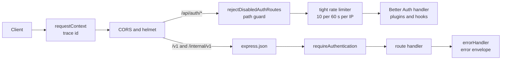
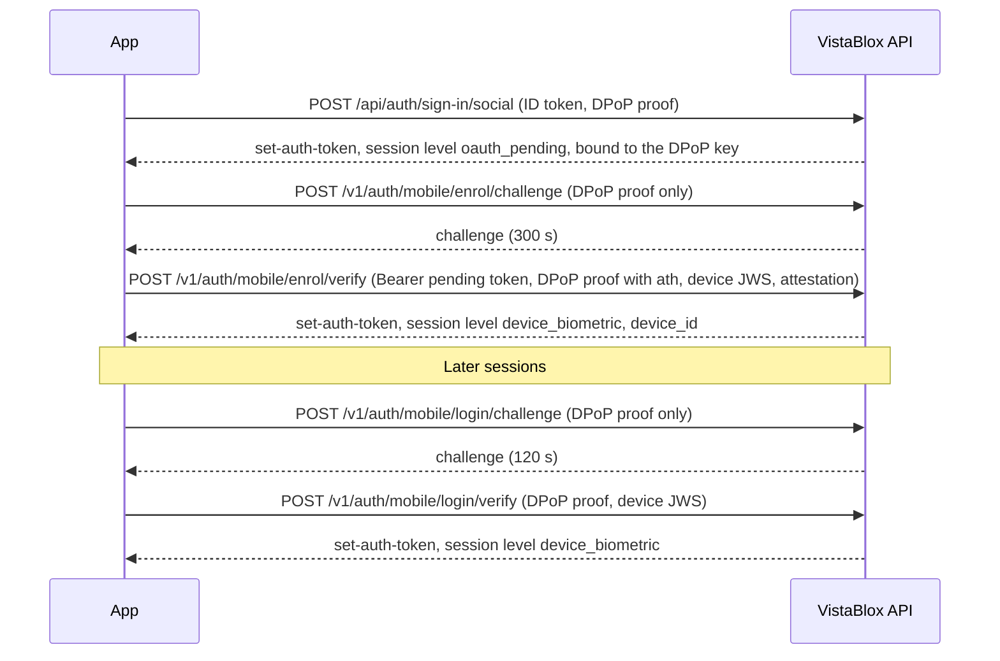

# Authentication

Valid for main at 48aa967 (2026-11-18).

This chapter describes how customers and their devices authenticate to the VistaBlox API as built: the Better Auth configuration, the device-bound login (enrolment and login ceremonies, DPoP proofs, device signatures, attestation), social sign-in, sessions, fresh authentication, account linking, the customer account lifecycle, recovery and device replacement, and signing requests. It is read by engineers who change the auth module, by the mobile team that calls it, and by whoever operates it. Staff and partner access is in [staff-access.md](staff-access.md); route-by-route request and response detail is in [api/auth-customer.md](api/auth-customer.md) (the `/v1` routes) and [api/better-auth.md](api/better-auth.md) (the `/api/auth/*` routes).

## At a glance

| Question | Answer as built |
| --- | --- |
| How does a customer sign in for the first time? | A native Google or Apple ID-token exchange at `POST /api/auth/sign-in/social` creates a Better Auth session at level `oauth_pending`. Only that session may enrol a device (`src/modules/auth/infrastructure/shared/better-auth.factory.ts:511`). |
| How does a customer use the product? | With a `device_biometric` session, created only by device enrolment (E2) or device login (L2) (`src/modules/auth/infrastructure/shared/better-auth.factory.ts:512`). Every `/v1` route behind `requireAuthentication` accepts only `staff_passkey` or `device_biometric` sessions (`src/modules/auth/infrastructure/shared/better-auth-session.resolver.ts:67`). |
| Which keys are involved? | Two per customer device: a DPoP key (proof of possession on every request) and a hardware biometric key (signs the enrolment, login and signing challenges). |
| Which platforms? | Android only. The platform policy in `server.ts` is `ANDROID_ONLY_MOBILE_PLATFORM_POLICY`; an iOS enrolment answers `MOBILE_PLATFORM_NOT_SUPPORTED` (`src/server.ts:279`, `src/modules/auth/domain/mobile-platform.policy.ts:9`). |
| Passwords, email codes, TOTP, recovery codes? | None for customers. Email and password is switched off and its routes are blocked; TOTP and recovery codes were removed at the device-bound cutover (`src/modules/auth/infrastructure/shared/better-auth.factory.ts:242`, `src/modules/auth/domain/disabled-auth-routes.ts:78`). |
| Passkeys? | Staff only. A customer passkey ceremony is refused with `PASSKEY_STAFF_ONLY` (`src/modules/auth/infrastructure/shared/better-auth.factory.ts:640`). |
| Session length for a customer | Idle 5 minutes, absolute 30 minutes from creation, no renewal (`src/modules/auth/domain/device-session-lifetime.ts:10`, `src/modules/auth/domain/device-session-lifetime.ts:11`). |
| Step-up | "Fresh" means a `device_biometric` session created within the last 5 minutes (`src/modules/auth/domain/fresh-authentication.ts:10`). |
| Is the device-bound design complete? | No. Enrolment, login, one device per account, email-code device replacement and a dormant signing-request subsystem are built. Pairing, re-enrolment after a biometric change, self-service recovery, the Safe wallet, iOS attestation and device listing are not (see [Plan versus built](#plan-versus-built)). |

## Surfaces

Authentication is spread over four URL families. Each has one owner file for its mount.

| Family | Served by | Audience | Reference |
| --- | --- | --- | --- |
| `/api/auth/*` | Better Auth, mounted through `toNodeHandler(auth)` (`src/server.ts:583`) behind a path guard and the tight rate limiter (`src/app.ts:570-573`) | Mobile app (sign-in, session reads, linking), staff browsers (passkeys) | [api/better-auth.md](api/better-auth.md) |
| `/v1/auth/*`, `/v1/app/config` | VistaBlox routers in `src/modules/auth/api/customer` | Mobile app | [api/auth-customer.md](api/auth-customer.md) |
| `/v1/auth/staff-invitations/accept` | `createPublicStaffInvitationRouter` (`src/app.ts:949`) | Invited staff | [api/auth-staff.md](api/auth-staff.md) |
| `/internal/v1/auth/*`, `/internal/v1/account-recovery-cases`, `/internal/v1/account-closure-requests` | Staff routers behind `requireAdminOperations` and `requireStaffWebAuthn`; the WebAuthn ceremony routes `/internal/v1/auth/webauthn/*` sit behind `requireStaffIdentity` and the tight limiter instead (`src/app.ts:1045-1053`) | Operations staff | [api/auth-staff.md](api/auth-staff.md), [staff-access.md](staff-access.md) |

## Request pipeline

`createApp` registers middleware in this order: request context (trace id), request logging, CORS (its allowed origins are the same list as Better Auth's trusted origins (`src/server.ts:582`)), `helmet`, the three `/.well-known` files, the Better Auth mount, the Coinbase webhook (raw body), `express.json({ limit: "1mb" })`, then the `/health` router and the `/v1` and `/internal/v1` routers (`src/app.ts:504-596`).

> Pending #237: `createApp` is split into per-module compose functions under `src/composition`; the order above does not change, but the `src/app.ts` line numbers cited in this chapter move.

The Better Auth mount sits before the JSON parser, so Better Auth reads its own body, and the `/api/auth/*` responses use Better Auth's `{ "code", "message" }` shape, not the VistaBlox error envelope. Everything else answers errors through `errorHandler`: an `AppError` keeps its own code and status, a `ZodError` becomes `422 validation.invalid_field`, anything else becomes `500 internal.unexpected` (`src/shared/http/error-handler.ts:46-73`).

> Pending #245: a response that fails its own schema becomes `500 internal.response_invalid` in every router; on main it becomes `422 validation.invalid_field`.

### `requireAuthentication`

Every authenticated `/v1` route starts with the middleware built by `createRequireAuthentication` (`src/modules/auth/api/shared/require-authentication.ts:39-129`). It runs these steps in this order:

1. Resolve the session from the request headers through `BetterAuthSessionResolver.resolve`, which calls `auth.api.getSession`. No accepted session answers `401 authentication.required` (`src/modules/auth/api/shared/require-authentication.ts:47-50`). A device session past its idle or absolute limit answers `401 REAUTH_REQUIRED` instead (`src/modules/auth/application/shared/session-resolver.ts:46`, `src/modules/auth/infrastructure/shared/better-auth-session.resolver.ts:54`).
2. Check the DPoP proof. A session bound to a key needs a fresh, matching, unreplayed proof on every request; an unbound session is never required to present one (`src/modules/auth/api/shared/require-authentication.ts:62-65`). Failures answer `401` with `DPOP_PROOF_MISSING`, `DPOP_PROOF_INVALID`, `DPOP_REPLAY` or `DPOP_KEY_MISMATCH` and a `WWW-Authenticate: DPoP error="invalid_dpop_proof"` header (`src/modules/auth/api/shared/require-authentication.ts:145`, `src/modules/auth/application/shared/dpop-proof-verifier.ts:64`).
3. Look up the local account by Better Auth user id. No account answers `500 account.mapping_missing`; an account whose status is not `active` answers `403 account.restricted` (`src/modules/auth/api/shared/require-authentication.ts:68-79`).
4. Set `response.locals.authContext` with `accountId`, `providerSessionId`, `population`, `sessionCreatedAt`, `authenticationLevel` and, for a bound session, `dpopJkt`. This is the only place the context is assigned (`src/modules/auth/api/shared/require-authentication.ts:86-95`).
5. Run the baseline rate limiter (300 requests per 60 seconds, key `rate_limit_hint:baseline:account:<account_id>`) when one was built (`src/shared/http/rate-limit.ts:17`, `src/modules/auth/api/shared/require-authentication.ts:114`). A limiter exists only when `RATE_LIMIT_CACHE_URL` connected at boot (`src/server.ts:202`), and it lets the request through when the store errors (`src/shared/http/rate-limit.ts:54-61`).
6. Record session activity, then call the handler. For a device session this moves the idle clock; a failed activity write does not fail the request (`src/modules/auth/api/shared/require-authentication.ts:102-113`).

The middleware does not check the population. A route that is for customers only says so in its own handler (`authorization.forbidden`); routes that read only `accountId` accept a staff session as well (`src/modules/auth/api/shared/auth-context.ts:4`).

## Better Auth configuration

Better Auth 1.7.2 (pinned in `package.json`) is the session store and the OAuth and passkey engine. VistaBlox configures it in one factory, `createBetterAuth` (`src/modules/auth/infrastructure/shared/better-auth.factory.ts:134`), and builds two instances in `server.ts`: the instance mounted over HTTP and given to every `/v1` service (`src/server.ts:309`), and a second one used only server-side to create staff identities, which has no DPoP, device-auth or audit plugin and accepts `population` as input (`src/server.ts:370-377`). The second instance is never passed to `toNodeHandler`, so it serves no HTTP route.

### Options

| Option | Value | Source |
| --- | --- | --- |
| `basePath`, `baseURL` | `/api/auth`, `BETTER_AUTH_URL` | (`src/modules/auth/infrastructure/shared/better-auth.factory.ts:157`) |
| `secret` | `BETTER_AUTH_SECRET` (at least 32 characters) | (`src/config/environment.ts:18`) |
| `trustedOrigins` | `AUTH_TRUSTED_ORIGINS`; outside production the Expo wildcards `exp://`, `exp://**` and `exp://192.168.*.*:*/**` are added; `https://appleid.apple.com` is added when Apple sign-in is enabled. The same list is the CORS allow-list | (`src/server.ts:224-230`) |
| Tables | `public.auth_user`, `auth_session`, `auth_account`, `auth_verification`, plus `passkey` from the passkey plugin | (`src/modules/auth/infrastructure/shared/better-auth.factory.ts:162`), (`prisma/migrations/20260831154500_better_auth_core/migration.sql:3`) |
| `user.additionalFields` | `population` (`customer` or `staff_partner`, default `customer`, input only when `allowPopulationInput`), `disabledAt`, `disabledReason`, `recoveryRequiredAt` (never input) | (`src/modules/auth/infrastructure/shared/better-auth.factory.ts:163-185`) |
| `session.expiresIn`, `updateAge` | 30 minutes, 5 minutes. A rolling expiry that applies to every session except `device_biometric` ones, which have fixed limits | (`src/modules/auth/infrastructure/shared/better-auth.factory.ts:194-195`) |
| `session.additionalFields` | `authenticationLevel` (one of four values, default `unassured`, never input) and `dpopJkt` (never input) | (`src/modules/auth/infrastructure/shared/better-auth.factory.ts:196-212`) |
| `account.encryptOAuthTokens` | `true` | (`src/modules/auth/infrastructure/shared/better-auth.factory.ts:217`) |
| `account.accountLinking` | enabled; `trustedProviders: ["google"]`; `requireLocalEmailVerified: false`; `allowDifferentEmails: false` | (`src/modules/auth/infrastructure/shared/better-auth.factory.ts:218-235`) |
| `account.identityStrategy` | `"provider-id"`. The string `identityStrategy` does not occur in the installed `better-auth` 1.7.2 or `@better-auth/core` 1.7.2 packages (searched in a sibling checkout's `node_modules`), so the library has nothing to read it with | (`src/modules/auth/infrastructure/shared/better-auth.factory.ts:216`) |
| `verification.storeIdentifier` | `hashed` | (`src/modules/auth/infrastructure/shared/better-auth.factory.ts:240`) |
| `emailAndPassword` | `{ enabled: false }` | (`src/modules/auth/infrastructure/shared/better-auth.factory.ts:242`) |
| `socialProviders` | `google` when `GOOGLE_OAUTH_ENABLED=true` with client id and secret; `apple` when `APPLE_OAUTH_ENABLED=true` with all four `APPLE_*` values (the client secret is a signed JWT created per use, valid 180 days) | (`src/server.ts:329-356`), (`src/modules/auth/infrastructure/customer/apple-client-secret.ts:4`) |
| `advanced.ipAddress.disableIpTracking` | `true`: sessions carry no IP address, and Better Auth's own rate limiter returns without limiting when it has no IP | (`src/modules/auth/infrastructure/shared/better-auth.factory.ts:455`) |
| `advanced.cookiePrefix`, cookie attributes | prefix `vb`; `session_token` cookie `httpOnly`, `sameSite: "lax"`, path `/`, `secure` when `NODE_ENV=production`. The cookie is not renamed, because the client recognises cookies by the substring `session_token` | (`src/modules/auth/infrastructure/shared/better-auth.factory.ts:456-481`) |
| Cross-subdomain cookie | enabled only when `BETTER_AUTH_URL` has three or more host labels; the domain is the host without its first label (for `api.vistablox.io`, `.vistablox.io`) | (`src/modules/auth/infrastructure/shared/better-auth.factory.ts:129`) |

Native clients do not use the cookie. They send the session as `Authorization: Bearer <value.signature>`, the exact value of the `set-auth-token` response header. `bearer({ requireSignature: true })` accepts only that signed form, so a bare session token is never turned into a session by Better Auth itself (`src/modules/auth/infrastructure/shared/better-auth.factory.ts:314`).

### Plugins

Plugins are registered in this order. The order matters: Better Auth runs every `before` hook with the original request and applies the bearer-derived cookie only afterwards, so the VistaBlox hooks resolve the bearer session themselves through `getSessionForHook` (`src/modules/auth/infrastructure/shared/better-auth-hook-session.ts:75`).

| # | Plugin id | Source | What it does |
| --- | --- | --- | --- |
| 1 | `vistablox-disabled-routes` | `better-auth-disabled-routes.plugin.ts` | On every request, answers an empty `404` for a path in the deny list (second layer behind the Express guard) (`src/modules/auth/infrastructure/shared/better-auth-disabled-routes.plugin.ts:25`) |
| 2 | `expo` (`@better-auth/expo`) | library | Copies an `expo-origin` header into `origin` when none is present; after a `/callback/*` or `/verify-email` redirect to a trusted non-HTTP URL, appends the session cookie to that URL as `cookie`; adds `/expo-authorization-proxy` (blocked). Derived from the library, not from this repository |
| 3 | `bearer` | library | Bearer-token authentication; sets the `set-auth-token` response header whenever the session cookie is set |
| 4 | `vistablox-device-session-lifetime` | `better-auth-device-session-lifetime.plugin.ts` | Enforces idle and absolute limits on `device_biometric` sessions on every session lookup and answers `REAUTH_REQUIRED` at `/get-session` (`src/modules/auth/infrastructure/customer/better-auth-device-session-lifetime.plugin.ts:80`) |
| 5 | `vistablox-dpop` | `better-auth-dpop.plugin.ts` | Enforces the DPoP proof for HTTP requests that carry a live session (`src/modules/auth/infrastructure/shared/better-auth-dpop.plugin.ts:37`) |
| 6 | `vistablox-device-auth` | `better-auth-device-auth.plugin.ts` | Adds `POST /device/enrol/verify` and `POST /device/login/verify` (`src/modules/auth/infrastructure/customer/better-auth-device-auth.plugin.ts:65`) |
| 7 | `vistablox-passkey-challenge-header` | `better-auth-passkey-challenge-header.plugin.ts` | Relays the passkey challenge cookie through the `set-passkey-challenge` response header and `x-passkey-challenge` request header for clients without a cookie jar (`src/modules/auth/infrastructure/shared/better-auth-passkey-challenge-header.plugin.ts:41`) |
| 8 | `passkey` (`@better-auth/passkey`) | factory | Passkey endpoints, restricted to staff (`src/modules/auth/infrastructure/shared/better-auth.factory.ts:349-424`) |
| 9 | `vistablox-staff-account-guard` | `better-auth-staff-account-guard.plugin.ts` | A `session.create.before` database hook that refuses session creation for disabled users, recovery-pending users, unverified OAuth email, staff outside the passkey path, and any session created outside an auth endpoint (`src/modules/auth/infrastructure/staff/better-auth-staff-account-guard.plugin.ts:3`) |
| 10 | `vistablox-fresh-authentication` | `better-auth-fresh-authentication.plugin.ts` | Requires fresh authentication on four `/api/auth` paths (`src/modules/auth/infrastructure/customer/better-auth-fresh-authentication.plugin.ts:12`) |
| 11 | `vistablox-registration-account-guard` | `better-auth-registration-account-guard.plugin.ts` | Refuses to unlink the account used to register (`src/modules/auth/infrastructure/customer/better-auth-registration-account-guard.plugin.ts:17`) |
| 12 | `vistablox-auth-audit` | `better-auth-audit.plugin.ts` | Writes audit rows and the session mirror (`src/modules/auth/infrastructure/shared/better-auth-audit.plugin.ts:47`). Present only when an audit sink is given, which `server.ts` does for the HTTP instance |

No magic-link, email-OTP, phone, two-factor, organization, admin or API-key plugin is registered (`src/modules/auth/infrastructure/shared/better-auth.factory.ts:298-452`).

### Which methods are on

| Method | Population | State | Why |
| --- | --- | --- | --- |
| Google sign-in (ID token or redirect) | customer | On when `GOOGLE_OAUTH_ENABLED=true` and `GOOGLE_CLIENT_ID` and `GOOGLE_CLIENT_SECRET` are set; otherwise Better Auth answers `404 PROVIDER_NOT_FOUND` | (`src/server.ts:329`) |
| Apple sign-in (ID token or redirect) | customer | On when `APPLE_OAUTH_ENABLED=true` and `APPLE_CLIENT_ID`, `APPLE_TEAM_ID`, `APPLE_KEY_ID`, `APPLE_PRIVATE_KEY` are set | (`src/server.ts:339`) |
| Device key (enrolment E2, login L2) | customer | Always on, Android only | (`src/server.ts:323-326`) |
| Passkey | staff | On; a customer is refused with `PASSKEY_STAFF_ONLY` | (`src/modules/auth/infrastructure/shared/better-auth.factory.ts:647`) |
| Email and password | none | Off: `emailAndPassword.enabled` is false and every path containing `password`, `sign-in/email` or `sign-up/email` is blocked | (`src/modules/auth/domain/disabled-auth-routes.ts:81`) |
| Email one-time codes (Better Auth `email-otp`) | none | Not installed, and the paths `/email-otp` and `/sign-in/email-otp` are blocked as well | (`src/modules/auth/domain/disabled-auth-routes.ts:38`) |
| Change email, delete user | none | Off: the library answers an error because `user.changeEmail.enabled` and `user.deleteUser.enabled` are not set | (`src/modules/auth/infrastructure/shared/better-auth.factory.ts:162-187`) |
| Email verification mail | none | No `emailVerification.sendVerificationEmail` is configured, so `POST /api/auth/send-verification-email` answers `400 VERIFICATION_EMAIL_NOT_ENABLED` | (`src/modules/auth/infrastructure/shared/better-auth.factory.ts:154-298`); the options object has no `emailVerification` key |
| TOTP, backup codes, recovery codes | none | Removed at the device-bound cutover: migration `20260912090000_drop_recovery_and_backup_codes` drops the backup-code and recovery-code tables, migration `20260912095000_drop_customer_totp` drops the TOTP secrets table | (`prisma/migrations/20260912090000_drop_recovery_and_backup_codes/migration.sql:15-16`), (`prisma/migrations/20260912095000_drop_customer_totp/migration.sql:12`) |

The `EMAIL_VERIFICATION_ENABLED` variable in `docker-compose.staging.yml` is read by no code (`docker-compose.staging.yml:192`).

## Authentication levels

`auth_session.authenticationLevel` is a closed set. The migration guard test and the database `CHECK` constraint use the same array (`src/modules/auth/infrastructure/shared/better-auth.factory.ts:25-30`). The level is assigned when the session row is created (`src/modules/auth/infrastructure/shared/better-auth.factory.ts:498-513`).

| Level | Created by | Accepted by `/v1` | Lifetime | Notes |
| --- | --- | --- | --- | --- |
| `unassured` | The default for a session created on any other path | No (`src/modules/auth/infrastructure/shared/better-auth-session.resolver.ts:71`) | Rolling, 30 minutes | No enabled customer flow creates one |
| `oauth_pending` | A completed Google or Apple sign-in: `POST /api/auth/sign-in/social` with an ID token, or `GET /api/auth/callback/google` and `/apple` | No. The resolver accepts it only when `allowPendingOAuth` is set, and `server.ts` never sets it (`src/modules/auth/infrastructure/shared/better-auth-session.resolver.ts:70`, `src/server.ts:476-481`) | Rolling, 30 minutes | The only session that can run E2 |
| `staff_passkey` | A staff passkey verification (`src/modules/auth/infrastructure/shared/better-auth.factory.ts:509`) | Yes | Rolling, 30 minutes | See [staff-access.md](staff-access.md) |
| `device_biometric` | E2 or L2 | Yes | Fixed: idle 5 minutes, absolute 30 minutes from creation | Always created bound to the request's DPoP key |

The level `oauth_passkey` no longer exists; migration `20260912150000_remove_oauth_passkey_level` removed it (`prisma/migrations/20260912150000_remove_oauth_passkey_level/migration.sql:39`).

## Device-bound login

A customer device holds two keys. The **DPoP key** is created per app install; its public half is embedded in every request proof, and its RFC 7638 thumbprint (`jkt`) identifies the install. The **biometric key** is a hardware key that the operating system unlocks only after a biometric check; its thumbprint (`bio_jkt`) is the `kid` of every device signature, and its public key is stored on the device row. The server never holds a private key of either kind.

### Enrolment and login

**Enrolment (E1, E2).** E1 issues a single-use `enrol-device` challenge bound to the request's DPoP key. E2 runs inside the Better Auth plugin `vistablox-device-auth`; the `/v1` route is a thin relay that calls `auth.api.enrolVerify` and passes the `set-auth-token` header on (`src/modules/auth/api/customer/device-auth.router.ts:178-207`). In order, E2:

1. Requires a live session at level `oauth_pending` that is already bound to a DPoP key; otherwise `400 DEVICE_JWS_INVALID` (`src/modules/auth/infrastructure/customer/better-auth-device-auth.plugin.ts:81-111`). An unbound pending session is refused so that a stolen pending token plus an attacker's own DPoP key cannot enrol a device.
2. Verifies this request's DPoP proof, including the `ath` claim over the pending token, records it as used, and requires its key to equal the pending session's key.
3. Loads the account (`500 device.account_mapping_missing` if none) and refuses an account whose status is not `active` with `403 ACCOUNT_RESTRICTED` (`src/modules/auth/infrastructure/customer/better-auth-device-auth.plugin.ts:113-121`).
4. Runs `EnrolDeviceService.execute` (`src/modules/auth/application/customer/device-enrolment.service.ts:61-137`): platform policy, then "no active device for the account" (before the challenge is spent), then atomic consumption of the challenge, the device JWS, "this DPoP key is not already an active device", Android key attestation, Play Integrity, and finally the insert of the `auth.devices` row together with the account's `device_key` login method in one transaction.
5. Creates the `device_biometric` session, deletes the pending session, and revokes any other live `device_biometric` session of the same DPoP key (`superseded`) (`src/modules/auth/infrastructure/customer/better-auth-device-auth.plugin.ts:159-179`).
6. If anything after the device insert fails, the new session is discarded and `EnrolDeviceService.rollback` deletes the device row and its login method, so a failed enrolment never leaves an active device that blocks every retry (`src/modules/auth/infrastructure/customer/better-auth-device-auth.plugin.ts:206-215`).

**Login (L1, L2).** L1 issues a `login` challenge. L2 requires a valid DPoP proof (the `Authorization` header is ignored, so a stale token never fails it), finds the active device that owns the proof's key, and fails with the same generic `401 DEVICE_LOGIN_FAILED` for "no device", "revoked device", "device_id does not match" and "bad signature" (`src/modules/auth/application/customer/device-login.service.ts:31-103`). It then consumes the challenge, verifies the JWS against the stored biometric key, refuses an account that is not `active` (`403 ACCOUNT_RESTRICTED`), creates a `device_biometric` session bound to the same DPoP key, and supersedes earlier device sessions of that key (`src/modules/auth/infrastructure/customer/better-auth-device-auth.plugin.ts:223-312`). Login does not re-attest: L1 always answers `attestation_required: false` (`src/modules/auth/api/customer/device-auth.router.ts:225`).

### DPoP proofs

A proof is a compact JWS in the `DPoP` request header. It is accepted when all of these hold (`src/modules/auth/application/shared/dpop-proof-verifier.ts:121-207`):

| Check | Rule |
| --- | --- |
| Header | `typ` is `dpop+jwt`, `alg` is `ES256`, `jwk` is a public EC P-256 key (`kty`, `crv`, `x`, `y`, and no `d`) |
| Signature | verifies against the embedded `jwk` |
| `htm` | equals the request method |
| `htu` | equals `BETTER_AUTH_URL`'s scheme and lower-cased host (default port omitted) plus the request path exactly as sent, with no query or fragment (`src/modules/auth/application/shared/dpop-proof-verifier.ts:102`). Never taken from request headers |
| `iat` | within 60 seconds of the server clock |
| `jti` | matches `^[A-Za-z0-9_-]{16,64}$` |
| `ath` | when a bearer token is part of the check: base64url SHA-256 of the exact characters after `Bearer ` |

Replay protection is the table `auth.dpop_replays`, keyed by `(jkt, jti)`. A proof is accepted only when its row is inserted (`INSERT ... ON CONFLICT DO NOTHING`); a row's `expires_at` is 120 seconds after the insert, and the hourly job `maintenance.dpop_replay_prune` deletes rows past it (`src/modules/auth/repository/shared/prisma-dpop-replay.repository.ts:15`, `src/worker.ts:549`, `src/worker.ts:786`). The insert never looks at `expires_at`, so a `(jkt, jti)` pair stays refused until the job has deleted its row; a proof older than the 60-second `iat` window fails the proof check before that matters. The replay window is not configurable: `server.ts` passes no `replayWindowSeconds`, so the default of 120 seconds applies (`src/modules/auth/api/shared/require-authentication.ts:242`).

Where a proof is checked:

| Place | Applies to | `ath` | Replay recorded |
| --- | --- | --- | --- |
| `requireAuthentication` | every `/v1` request with a session bound to a key | yes, over the bearer token | yes |
| `requireDpopOnly` | `GET /v1/app/config`, E1, L1 | no: the `Authorization` header is ignored | yes |
| `requireDpopOnlyForVerify` | E2 and L2 on `/v1`, as a first check | no | no: the ceremony records it |
| Better Auth plugin `vistablox-dpop` | `/api/auth/*` requests that carry a live session, except the four ceremony paths | yes | yes |
| Ceremony code in the plugin | E2: key must equal the pending session's key, with `ath`. L2: any valid proof, no `ath` | E2 yes, L2 no | yes |
| `tryBindDpopAtCreation` | every session creation over HTTP, for example `sign-in/social`: a valid proof binds the new session to its key | yes when `Authorization` is present | yes |

A session is **bound** when `auth_session.dpopJkt` holds a key. The rules in `decideDpopForSession` are (`src/modules/auth/application/shared/dpop-proof-verifier.ts:225-280`):

| Session | Proof | Result |
| --- | --- | --- |
| bound | missing, invalid or replayed | `401 DPOP_PROOF_MISSING`, `DPOP_PROOF_INVALID` or `DPOP_REPLAY` |
| bound | valid, other key | `401 DPOP_KEY_MISMATCH` |
| bound | valid, same key | accepted |
| unbound | absent or invalid | accepted (phase 1 never requires a proof of an unbound session) |
| unbound | valid, already used, session created before `DPOP_PHASE1_CUTOVER_AT` or the variable is unset | accepted; the session is not bound (`src/modules/auth/application/shared/dpop-proof-verifier.ts:276-277`) |
| unbound | valid and new, session created before `DPOP_PHASE1_CUTOVER_AT` or the variable is unset | the session is bound to the proof's key on first sight |
| unbound | valid (new or already used), session created at or after `DPOP_PHASE1_CUTOVER_AT` | `401 DPOP_KEY_MISMATCH`; the cutover check runs before the replay record (`src/modules/auth/application/shared/dpop-proof-verifier.ts:272-276`) |

`/v1` applies the same decision in `maybeBindUnboundSession` and `enforceBoundSessionProof` (`src/modules/auth/api/shared/require-authentication.ts:158-239`).

`DPOP_PHASE1_CUTOVER_AT` does not switch DPoP off when it is unset, whatever the comment in `src/config/environment.ts` says (`src/config/environment.ts:19`): `server.ts` always passes the DPoP options, and unset only means that every unbound session counts as older than the cutover (`src/modules/auth/application/shared/dpop-proof-verifier.ts:273`). Sessions created by E2 and L2 are always bound, because the ceremony requires and caches the proof before the session row is created (`src/modules/auth/infrastructure/shared/dpop-session-creation.ts:197`).

### Challenges

Device challenges are 32 random bytes, base64url, stored in `auth.device_challenges` (`src/modules/auth/application/customer/device-challenge-issuance.service.ts:7`).

| Purpose | Issued by | Lifetime | Bound to |
| --- | --- | --- | --- |
| `enrol-device` | E1 | 300 seconds (`src/modules/auth/api/customer/device-auth.router.ts:20`) | the DPoP key |
| `login` | L1 | 120 seconds (`src/modules/auth/api/customer/device-auth.router.ts:21`) | the DPoP key and, when the key owns a device, that device |
| `tx` | T2 (dormant) | 120 seconds (`src/modules/auth/api/customer/signing-requests.router.ts:39`) | the DPoP key and the device |

Every time below is the database clock, so API instances with skewed clocks cannot disagree (`src/modules/auth/domain/device-challenge-replay.ts:39-40`):

* `expires_at` is `now()` plus the lifetime when the row is inserted, and a challenge is consumed by one conditional `UPDATE` that also checks purpose, DPoP key and device (`src/modules/auth/repository/customer/prisma-device-challenge.repository.ts:36-55`).
* A challenge used less than 120 seconds ago answers `400 DEVICE_CHALLENGE_REPLAYED`; an unknown, unused-and-expired, or older used challenge answers `400 DEVICE_CHALLENGE_EXPIRED`. On E2, a replay older than the window answers `409 DEVICE_ALREADY_ENROLLED` when a device was registered for the key or the account in the meantime. The comment that states this invariant says the mobile app drops its pending biometric key only on `EXPIRED`, which is why the two are kept apart (`src/modules/auth/domain/device-challenge-replay.ts:5-8`); what the app does was not checked.
* A device row is inserted only while the challenge was consumed less than 60 seconds ago, inside a short transaction with statement, lock and idle timeouts (`src/modules/auth/repository/customer/prisma-device.repository.ts:62-80`).
* Rows are deleted by the hourly job `maintenance.device_challenge_prune` once they expired more than 120 seconds ago (`src/modules/auth/repository/customer/prisma-device-challenge.repository.ts:78-86`).

### Device signature (JWS)

The device signs a compact JWS with its biometric key: header `typ: vistablox-device-auth+jwt`, `alg: ES256`, `kid` equal to the thumbprint of the verifying key, and, for enrolment only, the public key in `jwk`. Claims: `purpose` (must equal the challenge's purpose), `challenge` (exact), `iat` (within 60 seconds), `device_id` (must match when expected; optional on login), and for enrolment `dpop_jkt` (must equal the request's proof key). Outside enrolment the verifying key is the one stored on the device row, never one the client supplies (`src/modules/auth/application/customer/device-auth-jws-verifier.ts:87-218`).

### Attestation

Enrolment attests the device; login does not.

**Android key attestation** is always enforced. `verifyAndroidKeyAttestation` accepts a certificate chain only when all of these hold (`src/modules/auth/application/customer/android-attestation-verifier.ts:157-290`):

* the chain is non-empty, every certificate is inside its validity period, issuer and subject names chain, each signature verifies, every signing certificate is a CA with `keyCertSign` and within its path length, and the top certificate is byte-for-byte one of the pinned roots in `ANDROID_ATTESTATION_ROOT_CERTIFICATES` (empty means every chain is refused);
* no certificate serial is on Google's revocation list, fetched from `https://android.googleapis.com/attestation/status` with a 5-second timeout and cached 24 hours; every certificate counts as revoked once the cache is older than 72 hours, and also while no fetch has ever succeeded, so the API container needs outbound access to that host before the first enrolment (`src/modules/auth/infrastructure/customer/http-android-attestation-revocation-list.ts:3-6`, `src/modules/auth/infrastructure/customer/http-android-attestation-revocation-list.ts:30-35`);
* the leaf certificate's key is exactly the biometric key whose thumbprint signed the JWS;
* attestation and KeyMint versions are at least 3 (`src/modules/auth/application/customer/android-attestation-verifier.ts:45`), both security levels are TrustedEnvironment or StrongBox, and the attested challenge equals the enrolment challenge (`ATTESTATION_CHALLENGE_MISMATCH` otherwise);
* the key needs authentication on every use (no `noAuthRequired`, `authTimeout` absent or 0, no `allowWhileOnBody`), accepts biometrics only (the fingerprint bit set, the device-credential bit clear), requires the device to be unlocked, was generated on the device, has purpose SIGN only, algorithm EC, curve P-256, digest SHA-256;
* the root of trust is present, the bootloader is locked, and verified boot is `Verified`;
* the attested package is `com.vistablox.app` and a signing-certificate digest is on the `ANDROID_ATTESTATION_CERT_DIGESTS` allowlist.

Every rejection answers `400 ATTESTATION_INVALID` with the fixed message "This device can't be used for VistaBlox."; the specific reason is only logged (`src/modules/auth/infrastructure/customer/better-auth-device-auth.plugin.ts:443-475`).

**Play Integrity** is controlled by `PLAY_INTEGRITY_POLICY` (`src/modules/auth/application/customer/android-attestation-verifier.ts:294`):

| Policy | Behaviour |
| --- | --- |
| `disabled` (default) | The Play Integrity token is not checked. Key attestation still is |
| `relaxed` | A token is required. The app verdict may be `PLAY_RECOGNIZED` or `UNRECOGNIZED_VERSION` |
| `strict` | A token is required. The app verdict must be `PLAY_RECOGNIZED` |

For `relaxed` and `strict` the device verdict must include `MEETS_DEVICE_INTEGRITY`, `requestHash` must equal `base64url(SHA-256(challenge + "." + bio_jkt))`, and a certificate digest must be on the same allowlist; the binding check is never relaxed (`src/modules/auth/application/customer/android-attestation-verifier.ts:313`). A decoder is required for any policy other than `disabled`: it needs `PLAY_INTEGRITY_SERVICE_ACCOUNT_JSON` and `PLAY_INTEGRITY_CLOUD_PROJECT_NUMBER` (`src/server.ts:262`). **In production the policy must be `strict`**: a build with `NODE_ENV=production` refuses to start with any other value unless `APP_ENV=staging` (`src/config/environment.ts:589`). Staging runs `NODE_ENV=production` with `APP_ENV=staging` (`docker-compose.staging.yml:154`), so it may use `disabled` or `relaxed`.

**Apple App Attest is not built.** The request schema accepts an iOS attestation (`app_attest_key_id`, optional `attestation_object` and `assertion`) (`src/modules/auth/application/customer/mobile-attestation.schemas.ts:9-14`), but no iOS verifier exists, and the platform policy in force is Android only, so E2 answers `400 MOBILE_PLATFORM_NOT_SUPPORTED` before it reads the attestation (`src/modules/auth/application/customer/device-enrolment.service.ts:68`). `GET /v1/app/config` advertises the same policy as `mobile_auth_platforms` (`src/modules/auth/domain/mobile-platform.policy.ts:29`).

### Devices

The device row (`auth.devices`) holds the account, the Better Auth user id, `dpop_jkt`, `bio_jkt`, the biometric public JWK, platform, optional model, OS and app version, the stored attestation chain, `status` (`active` or `revoked`), `revoked_at`, `revocation_reason` and `last_seen_at` (`prisma/schema/auth.prisma:228-261`). Two partial unique indexes over active rows keep the invariants: one active device per account (`devices_one_active_per_account`) and one active device per DPoP key (`devices_dpop_jkt_active_key`) (`prisma/migrations/20260911160000_device_one_active_per_account/migration.sql:12`, `prisma/migrations/20260912180000_device_revocation/migration.sql:16`). The model, OS and app version columns exist but E2 stores `undefined` for them (`src/modules/auth/infrastructure/customer/better-auth-device-auth.plugin.ts:141-143`).

A device becomes `revoked` in exactly two places: completing a device replacement (`revocation_reason` `device_replacement`) and completing a customer account-recovery case (`account_recovery`) (`src/modules/auth/repository/customer/prisma-device-replacement.repository.ts:12`, `src/modules/auth/repository/staff/prisma-account-recovery.repository.ts:15`). `POST /v1/auth/sessions/devices/:jkt/revoke` ends the caller's sessions bound to a key and cancels signing requests; it does not change the device row, so that device can run L1 and L2 again.

Each device is also one `device_key` row in `auth.login_methods`; `provider_subject` holds the device id (`src/modules/auth/repository/customer/prisma-device.repository.ts:22`). Investing requires a `device_key` method plus a linked `google` or `apple` method (`src/modules/offering/domain/reservation-eligibility.policy.ts:54`).

## Passkeys

Passkeys exist for staff only. The Better Auth passkey plugin is configured with the pinned relying-party id (`WEBAUTHN_RP_ID`, falling back to the host of `BETTER_AUTH_URL`), the name `VistaBlox`, every accepted origin (`WEBAUTHN_ORIGIN`, the native `PASSKEY_ANDROID_ORIGINS`), resident keys and required user verification (`src/modules/auth/infrastructure/shared/better-auth.factory.ts:349-355`, `src/config/environment.ts:699`). Every ceremony, from every origin, checks that the passkey's user is a `staff_partner`; a customer is refused with `403 PASSKEY_STAFF_ONLY`, and an unknown credential with `401 PASSKEY_NOT_RECOGNIZED` (`src/modules/auth/infrastructure/shared/better-auth.factory.ts:640-654`).

Registration needs a single-use bootstrap context (`context` query parameter on `GET /api/auth/passkey/generate-register-options`) stored as an `auth_verification` row for 15 minutes; a request with no live session and no valid context is answered `401 PASSKEY_BOOTSTRAP_INVALID` (`src/modules/auth/infrastructure/shared/passkey-bootstrap.ts:5`, `src/modules/auth/infrastructure/shared/better-auth.factory.ts:359-368`). When the request carries a live session, the library uses that session's user and does not call the bootstrap check (library `@better-auth/passkey` `resolveRegistrationUser`); the staff-only and "already enrolled" checks then run at `verify-registration` (`src/modules/auth/infrastructure/shared/better-auth.factory.ts:369-384`). `POST /api/auth/passkey/delete-passkey` is blocked: replacing a passkey is only possible through account recovery. When a request carries a session of the same user that is bound to a DPoP key, the passkey ceremony requires that key (`src/modules/auth/infrastructure/shared/better-auth.factory.ts:616`). The passkey flows themselves are described in [staff-access.md](staff-access.md).

Three public files support the passkey and native-app associations. They are served only when configured, and they carry no customer passkey function after the cutover:

| File | Served when | Content |
| --- | --- | --- |
| `GET /.well-known/apple-app-site-association` | `PASSKEY_APPLE_TEAM_ID` is set | `webcredentials.apps` with `<team id>.com.vistablox.app`; no `applinks` block |
| `GET /.well-known/assetlinks.json` | `PASSKEY_ANDROID_SHA256_CERT_FINGERPRINTS` is set | Digital Asset Links for the package `com.vistablox.app` |
| `GET /.well-known/webauthn` | `WEBAUTHN_ORIGIN` lists an origin whose host is neither the relying-party id nor a subdomain of it (`src/config/environment.ts:702-713`) | `{ "origins": [...] }` for WebAuthn related-origin requests, with `Access-Control-Allow-Origin: *` |

Sources: (`src/app.ts:522-567`).

## Social sign-in

Google and Apple are the only customer sign-in identities. The mobile app obtains an ID token from the provider on the device and exchanges it at `POST /api/auth/sign-in/social`. The redirect form of the same endpoint and the callback route also work, because Better Auth provides them, but the design record and the app use the token exchange.

What a client needs for the token exchange (the provider-verification rules are Better Auth's, read from the installed library, not from this repository):

| Need | Detail |
| --- | --- |
| A DPoP proof on the call | `htm` `POST`, `htu` `<BETTER_AUTH_URL>/api/auth/sign-in/social`. A valid proof binds the new session to its key. Without one the session is created unbound, and E2 then refuses it (`src/modules/auth/infrastructure/shared/dpop-session-creation.ts:109`, `src/modules/auth/infrastructure/customer/better-auth-device-auth.plugin.ts:108`) |
| Google ID token | Signed by Google, issuer `https://accounts.google.com` or `accounts.google.com`, audience equal to `GOOGLE_CLIENT_ID`, at most 1 hour old, the `nonce` claim matching when the request sends a nonce. No nonce is required ([Known limitations](#known-limitations), item 21) |
| Apple ID token | Issuer `https://appleid.apple.com`, audience equal to `APPLE_CLIENT_ID` (the factory sets no `audience` or `appBundleIdentifier`), at most 1 hour old, the nonce compared exactly or as its SHA-256, again only when the request sends one |
| An email address | A token without an email is refused. A new user is created only when the provider marks the email verified; otherwise `403 OAUTH_EMAIL_NOT_VERIFIED` (`src/modules/auth/infrastructure/shared/better-auth.factory.ts:253`). The staff-account guard checks the same on every OAuth session creation (`src/modules/auth/infrastructure/staff/better-auth-staff-account-guard.plugin.ts:45`) |
| The provider enabled | `GOOGLE_OAUTH_ENABLED` or `APPLE_OAUTH_ENABLED`; otherwise `404 PROVIDER_NOT_FOUND` |
| The response header | The session token comes back in `set-auth-token` as `value.signature` and must be sent unchanged as `Authorization: Bearer ...`. The `token` field in the body is the bare token and is not accepted as a credential |
| For redirect flows | The `callbackURL` must be an origin in `AUTH_TRUSTED_ORIGINS` (the app's custom scheme, `com.vistablox.app://`, is in `.env.example`) (`.env.example:63`) |
| Not a staff address | A staff user's Google or Apple sign-in is refused with `403 STAFF_PASSKEY_REQUIRED` (`src/modules/auth/infrastructure/staff/better-auth-staff-account-guard.plugin.ts:65`) |

After a successful exchange the app calls E1 and E2 on the same DPoP key (see [Device-bound login](#device-bound-login)). `GET /api/auth/get-session`, `link-social`, `list-accounts`, `list-sessions`, `sign-out` and the other `/api/auth/*` routes accept the pending session, because only the four fresh-authentication paths look at the session level.

Provisioning: when Better Auth creates the user, the hook `onUserCreated` creates the local account row `account.accounts` (id `acct_<ulid>`, status `active`) and stores the email as `protected_contact_email` when it was verified (`src/modules/account/application/account-provisioner.ts:8-13`, `src/modules/account/repository/prisma-account.repository.ts:72`). `auth.login_methods` gets a row for the provider at the first sign-in through it, with `provider_subject` set to the Better Auth user id and `linked_via_fresh_auth` always `true` (`src/modules/account/repository/prisma-account.repository.ts:100`, `src/modules/account/repository/prisma-account.repository.ts:124`, `src/modules/account/application/account-provisioner.ts:33`).

## One-time codes

A customer has one one-time code: the **device-replacement email code**. It is six decimal digits from a cryptographic generator; only its SHA-256 hash is stored; it lives `DEVICE_REPLACEMENT_CODE_TTL_MINUTES` (default 10); it is bound to the session that requested it; it is single use; a new request invalidates the previous code; wrong guesses are counted against `DEVICE_REPLACEMENT_MAX_ATTEMPTS` (default 5); and a completed replacement starts a cooldown of `DEVICE_REPLACEMENT_COOLDOWN_HOURS` (default 72) (`src/modules/auth/application/customer/device-replacement.service.ts:9`, `src/config/environment.ts:386-389`). At most `DEVICE_REPLACEMENT_RATE_LIMIT_PER_HOUR` (default 3) codes are issued per account per hour. The flow is in [Device replacement](#device-replacement).

Better Auth's own email-code plugin is not installed and its paths are blocked. The other single-use secrets are not codes a person types: device challenges (above), the passkey bootstrap context (15 minutes), and the staff invitation token ([api/auth-staff.md](api/auth-staff.md)).

## Sessions

| Property | Customer `device_biometric` session | `oauth_pending` and `staff_passkey` session |
| --- | --- | --- |
| Created by | E2 or L2 | Social sign-in; staff passkey |
| Expiry | Idle 5 minutes from the last accepted request (from creation before the first one), absolute 30 minutes from creation. Activity never extends the absolute limit | Better Auth's rolling expiry: 30 minutes, refreshed when older than 5 minutes |
| Stored | `auth_session` row with `expiresAt` set to creation plus 30 minutes and `updatedAt` as the last-activity time (`src/modules/auth/infrastructure/shared/better-auth.factory.ts:697`) | `auth_session` row |
| Bound to a DPoP key | Always | When a valid proof was presented at creation |
| Renewal | None. After a limit the app runs L1 and L2 again | Better Auth refresh |

**How the limits are enforced.** The device-session plugin wraps `internalAdapter.findSession` once per process, so that every route that reads a session sees a device session past either limit as expired. It also tells `get-session` to skip its refresh, so no write can extend the session, and a `session.update.before` hook refuses any write of `expiresAt` to a device session (`src/modules/auth/infrastructure/customer/better-auth-device-session-lifetime.plugin.ts:86-186`). On `/v1` the resolver calls `getSession`; an expired device session raises `REAUTH_REQUIRED`, and the wire contract tells the app to run device login and replay the request once (`docs/plans/device-bound-auth-backend.md:276`; what the app does was not checked) (`src/modules/auth/infrastructure/customer/better-auth-device-session-lifetime.plugin.ts:178`). Activity is recorded by `requireAuthentication` only after the DPoP, account and rate-limit checks pass, so a stolen bearer token without the DPoP key cannot keep a session alive (`src/modules/auth/infrastructure/shared/better-auth-session.resolver.ts:97-140`).

**One live session per device.** After E2 or L2 succeeds, every other live `device_biometric` session of the same user bound to the same DPoP key is revoked, keeping the newest. A failure to do so is logged and never fails the ceremony (`src/modules/auth/domain/device-session-supersede.ts:38`). Their tokens then answer `401`.

**Revocation.** Each way a session ends, and the reason the audit row and the session mirror record:

| Cause | Route or trigger | Reason recorded |
| --- | --- | --- |
| Sign out | `POST /api/auth/sign-out` | `sign_out` |
| Revoke one, all, or all others | `POST /api/auth/revoke-session`, `revoke-sessions`, `revoke-other-sessions` and the `/v1/auth/sessions/...` routes | `self_revoke_one`, `self_revoke_all`, `self_revoke_others` (`src/modules/auth/infrastructure/shared/better-auth-audit.plugin.ts:460-468`) |
| Pending session consumed by E2 | `POST /v1/auth/mobile/enrol/verify` | `rotated` |
| Earlier session of the same device | E2 or L2 | `superseded` |
| Failed ceremony | E2 or L2 error after the session row exists | `ceremony_failed` |
| Idle or absolute limit | the next `get-session` that finds the session | `expired` |
| Recovery case opened, account closure approved | Staff action; every session of the user is deleted and `recoveryRequiredAt` is set | `internal` (the delete runs outside an endpoint, so no path names a reason; read from `src/modules/auth/infrastructure/shared/better-auth-audit.plugin.ts:460-469`, not run) |
| Recovery case completed | Staff action; every remaining session is deleted | `internal`, as above |

Device replacement and the "remove this phone" route do not end every session: replacement revokes the device and its login method but ends no session (`src/modules/auth/repository/customer/prisma-device-replacement.repository.ts:94-192`), and `POST /v1/auth/sessions/devices/:jkt/revoke` ends only the caller's sessions bound to that key.

**Listing.** `GET /v1/auth/sessions` lists the caller's rows from the product-facing mirror `auth.sessions`, newest activity first, and drops rows that are still marked `active` but could no longer authenticate (the mirror is never told when a session merely times out); the current session is always kept (`src/modules/auth/application/customer/customer-session.service.ts:15-51`). `GET /api/auth/list-sessions` is Better Auth's own list and includes the session tokens of the caller's own sessions. Better Auth's `auth_session` row, not the mirror, decides whether a request authenticates (`src/modules/auth/domain/session-liveness.ts:38`).

A user whose `disabledAt` or `recoveryRequiredAt` is set resolves to no session at all (`src/modules/auth/infrastructure/shared/better-auth-session.resolver.ts:61-62`).

## Fresh authentication

A customer session is **fresh** when it is a `device_biometric` session created within the last 5 minutes, which is when the biometric key last signed a login. Nothing else counts for a customer: the DPoP key that signs every later request is not biometric-gated (`src/modules/auth/domain/fresh-authentication.ts:25`). A second source exists in the code, the mirror column `auth.sessions.last_fresh_auth_at`; only a staff passkey login writes it, so for a customer it never makes a session fresh (`src/modules/auth/infrastructure/shared/prisma-session-mirror.ts:39`). A failed check answers `403 authentication.fresh_auth_required` on `/v1` and `403 FRESH_AUTHENTICATION_REQUIRED` on `/api/auth`; the client runs device login (L1, L2) and repeats the action.

The exact list of sensitive paths:

| Door | Route | Rule | Source |
| --- | --- | --- | --- |
| `/v1` | `POST /v1/auth/sessions/revoke-all` | always fresh | (`src/modules/auth/api/customer/customer-session.router.ts:49`) |
| `/v1` | `POST /v1/auth/sessions/:session_id/revoke` | always fresh | (`src/modules/auth/api/customer/customer-session.router.ts:60`) |
| `/v1` | `POST /v1/auth/sessions/devices/:jkt/revoke` | always fresh | (`src/modules/auth/api/customer/customer-session.router.ts:73`) |
| `/v1` | `POST /v1/auth/login-methods/:method_type/unlink` | always fresh | (`src/modules/auth/api/customer/login-methods.router.ts:14`) |
| `/v1` | `POST /v1/offerings/:offering_id/reservations` | always fresh | (`src/modules/offering/api/offering.router.ts:61`) |
| `/v1` | `POST /v1/offerings/:offering_id/reservations/:reservation_id/reconfirm` | always fresh | (`src/modules/offering/api/offering.router.ts:91`) |
| `/v1` | `POST /v1/investor-profile/wallet` | fresh only when the request would replace the account's own pending wallet claim with a different address; the router asks a non-throwing probe and the repository decides under its row lock | (`src/modules/wallet/api/wallet.router.ts:43`) |
| `/api/auth` | `POST /api/auth/unlink-account` | fresh for customer sessions | (`src/modules/auth/infrastructure/customer/better-auth-fresh-authentication.plugin.ts:12-17`) |
| `/api/auth` | `POST /api/auth/revoke-session`, `revoke-sessions`, `revoke-other-sessions` | fresh for customer sessions | same |

> Pending #244: adds `POST /v1/offerings/:offering_id/reservations/:reservation_id/payment-session` behind the same fresh-authentication check as reservation creation.

The `/api/auth` hook skips staff sessions, and only checks requests that came over HTTP; the internal calls the `/v1` routes make to Better Auth have already passed the `/v1` middleware (`src/modules/auth/infrastructure/customer/better-auth-fresh-authentication.plugin.ts:63-71`). The reservation routes accept a missing middleware (the router mounts them without it when none is given); `server.ts` always passes it (`src/modules/offering/api/offering.router.ts:62`, `src/modules/offering/api/offering.router.ts:93`).

Not guarded by fresh authentication: `POST /api/auth/link-social` (adding a login method), `POST /api/auth/update-user`, `POST /api/auth/sign-out`, `POST /v1/auth/account-closure`, and `POST /v1/auth/mobile/replacement/request` and `/verify`.

## Account linking and unlinking

One customer account may hold both a Google and an Apple identity. Rules, in order:

1. **First sign-in** creates the Better Auth user and the `auth_account` row for that provider. The first `auth_account` row (earliest `createdAt`) is the **registration method** (`src/modules/auth/infrastructure/customer/better-auth-registration-account-guard.plugin.ts:45`).
2. **Sign-in with a second provider** whose email equals an existing user's email links to that user. In the library's rule, Google counts as trusted (`trustedProviders: ["google"]`); any other provider links when it reports the email as verified. Local email verification is not required (`requireLocalEmailVerified: false`) (`src/modules/auth/infrastructure/shared/better-auth.factory.ts:218-235`).
3. **Explicit linking** is `POST /api/auth/link-social` with a session. With an ID token it links at once; without one it returns a provider URL and the callback links. The email must equal the session user's email (`allowDifferentEmails: false`), so an Apple private-relay address cannot be linked to a Google-registered account. It needs only an ordinary session, not a fresh one.
4. **Unlinking** is `POST /v1/auth/login-methods/:method_type/unlink` (`google` or `apple`) or `POST /api/auth/unlink-account`, both fresh. Better Auth refuses to remove the last account (`allowUnlinkingAll` is not set), and the registration guard refuses to remove the registration method even when another is linked (the guard is a before-hook, so for a customer whose only account is the registration account it answers first, and the library's own last-account refusal is not reached): `403 REGISTRATION_LOGIN_METHOD_LOCKED` on `/api/auth`, `409 authentication.registration_login_method_locked` on `/v1` (`src/modules/auth/infrastructure/customer/better-auth-registration-account-guard.plugin.ts:32`, `src/modules/auth/application/customer/unlink-login-method.service.ts:23`). A customer can therefore only ever remove the method they added later.
5. Linking and unlinking write no audit row, and unlinking does not delete the `auth.login_methods` row (see [Known limitations](#known-limitations)).

The record puts "linking or removing login methods" among the sensitive actions that need fresh authentication (`04-Engineering/IDENTITY-AND-SECURITY/SESSION_LIFETIME_AND_REVOCATION.md`); linking is not guarded in the code (see [Known gaps against the design record](#known-gaps-against-the-design-record)).

## Customer account lifecycle

A customer account is created the first time a Google or Apple identity signs in (`src/modules/auth/infrastructure/shared/better-auth.factory.ts:258-259`). Its row in `account.accounts` carries a status, and the status gates every authenticated route.

| Status | Meaning | Set by |
| --- | --- | --- |
| `active` | Normal | Account creation; completion of a recovery case |
| `recovery_review` | A staff-reviewed full-lockout recovery case is open (or was rejected and left open) | Opening the case (`src/modules/auth/repository/staff/prisma-account-recovery.repository.ts:82`) |
| `suspended_restricted` | Closure approved, or a staff identity offboarded | Approving a closure request (`src/modules/auth/repository/shared/prisma-account-closure.repository.ts:116`) |

Any status other than `active` answers `403 account.restricted` on every route behind `requireAuthentication`, and `403 ACCOUNT_RESTRICTED` on E2 and L2 (`src/modules/account/repository/account.repository.ts:1`). Two further user-level flags live on the Better Auth user: `disabledAt` and `recoveryRequiredAt`. While either is set, the session resolver returns no session and the staff-account guard refuses to create one, with `403 STAFF_ACCOUNT_DISABLED` or `403 STAFF_ACCOUNT_RECOVERY_REQUIRED`. Despite their names, both codes apply to any user (`src/modules/auth/infrastructure/staff/better-auth-staff-account-guard.plugin.ts:51-59`).

**Closure.** A customer asks to close the account with `POST /v1/auth/account-closure` (`reason` optional, at most 1000 characters) and may withdraw the request with `POST /v1/auth/account-closure/cancel`. Only an `active` account with no pending request can ask. A staff member with the `admin_operations` role approves or rejects it. Approval first deletes every session of the user and sets `recoveryRequiredAt`, then writes the decision, moves the account to `suspended_restricted` and writes the audit row `authentication.customer_account_closed` in one transaction; rejection writes `authentication.customer_closure_request_rejected` (`src/modules/auth/application/shared/account-closure.service.ts:61-97`, `src/modules/auth/repository/shared/prisma-account-closure.repository.ts:92-138`). Request and cancel write no audit row.

## Identity verification gate

Authenticating does not require identity verification. A customer can sign in, enrol a device and list sessions with no KYC state. The KYC state is read where an action needs it, by services in other modules: wallet registration answers `403 identity.kyc_required` without current eligibility (`src/modules/wallet/application/register-wallet.service.ts:52-61`), property intake answers `403 identity.kyc_required` (`src/modules/intake/application/create-draft-intake.service.ts:84`), and a reservation is blocked unless the account is `active`, KYC is current, an enrolled device and a linked Google or Apple identity exist, and the other offering conditions hold (`src/modules/offering/domain/reservation-eligibility.policy.ts:57-63`). The Didit flow, its webhook and its states are in [didit-kyc.md](didit-kyc.md).

## Account recovery and device replacement

Two flows return a customer to a working device. They differ in who decides.

| | Account recovery (full lockout) | Device replacement |
| --- | --- | --- |
| Use | The customer lost the device and the login methods | The customer reinstalled the app or has a new phone and can still prove an email address |
| Who acts | Staff: two reviewers, a fresh Didit verification | The customer, with an email code |
| Entry | `POST /internal/v1/account-recovery-cases` (staff) | `POST /v1/auth/mobile/replacement/request` (customer) |
| Effect on the device | Completion revokes every active device (`account_recovery`) and removes the `device_key` login method | Verification revokes the active device (`device_replacement`) and removes the `device_key` login method |
| Effect on sessions | Opening the case deletes every session; completion deletes any that remain | None |
| Reference | [account-recovery.md](account-recovery.md), [api/auth-staff.md](api/auth-staff.md) | [Device replacement](#device-replacement), [api/auth-customer.md](api/auth-customer.md) |

### Account recovery as built

Staff open a case: this deletes every session of the customer, sets `recoveryRequiredAt`, and moves the account to `recovery_review` (`src/modules/auth/application/staff/account-recovery.service.ts:42`). A reviewer records a primary review (a Didit session must exist), a different reviewer approves or rejects, and staff complete an approved case. For a customer, completion revokes the active devices and removes their `device_key` method in one transaction, ends every remaining session, clears `recoveryRequiredAt`, sets the account back to `active` with a 72-hour cooldown that blocks new reservations, and sends the customer an email that carries no link: it tells them to sign in with Google or Apple and set the phone up again through E1 and E2, the same phone and DPoP key included (`src/modules/auth/application/staff/account-recovery.service.ts:389-446`, `src/modules/auth/application/staff/account-recovery.service.ts:15`). A rejected case leaves the account in `recovery_review` (`src/modules/auth/repository/staff/prisma-account-recovery.repository.ts:229`).

> Pending #238: removes `ACCOUNT_RECOVERY_SINGLE_REVIEWER_MODE`, the staging switch that lets one reviewer record both reviews.

The existing guide [account-recovery.md](account-recovery.md) still describes the customer completion step (step 6) as a password-reset-style link sent through Better Auth's `requestPasswordReset`. The code does not do that for a customer: it sends no link and calls no password reset (`src/modules/auth/application/staff/account-recovery.service.ts:230-260`). The staff-target branch of completion still sends a passkey bootstrap link (`src/modules/auth/application/staff/account-recovery.service.ts:250-251`). The record states the customer behaviour as AD-259 item 5.

### Device replacement

`POST /v1/auth/mobile/replacement/request` and `/verify` need an authenticated session (`requireAuthentication`) (`src/app.ts:815-816`). In order:

1. **Request.** The target must be a customer account (a staff role answers `409 authentication.device_replacement_target_is_staff`). If the account has no bound email address, nothing is sent and the call still answers `202`, with an audit row `authentication.device_replacement_unavailable`, so the answer never reveals whether an email exists. Otherwise the call is refused while a cooldown from the last completed replacement runs (`409 authentication.device_replacement_cooldown`) or when the hourly request cap is reached (`429 authentication.device_replacement_request_rate_limited`). It then invalidates any pending code, stores the hash of a new six-digit code bound to the calling session, writes `authentication.device_replacement_requested`, and sends the code by email. A delivery failure is swallowed: the code is stored and the customer can request again (`src/modules/auth/application/customer/device-replacement.service.ts:25-116`).
2. **Verify.** The code must belong to the calling session, hash-match in constant time, be unexpired, unused, and under the attempt cap. A wrong code increments the attempt counter and answers `400 authentication.device_replacement_code_invalid`. A right code is consumed atomically with the revocation: the account's active devices become `revoked` (`device_replacement`), its `device_key` login method is deleted, and audit rows `authentication.device_revoked`, `authentication.login_method_removed` and `authentication.device_replacement_completed` are written, all in one transaction (`src/modules/auth/repository/customer/prisma-device-replacement.repository.ts:94-192`). The customer then enrols the new device with E1 and E2.

The code limits are `DEVICE_REPLACEMENT_CODE_TTL_MINUTES` (default 10), `DEVICE_REPLACEMENT_MAX_ATTEMPTS` (5), `DEVICE_REPLACEMENT_COOLDOWN_HOURS` (72) and `DEVICE_REPLACEMENT_RATE_LIMIT_PER_HOUR` (3) (`src/server.ts:253-260`). On staging every email goes to the `maildev` catcher container (`docker-compose.staging.yml:242`). The design record describes this flow as decision AD-276 (`04-Engineering/IDENTITY-AND-SECURITY/DEVICE_RECOVERY_AND_REPLACEMENT.md`); the code comments cite it as AD-271, which in the ledger is the smart-account decision.

## Signing requests

Signing requests are the server side of per-action signing (plan routes T1 to T3, record decision AD-258): a request row the device must sign with its biometric key before an action may proceed. The subsystem is built and dormant. It cannot receive traffic on main, for two independent reasons:

1. **The routes are not mounted.** `createApp` mounts `/v1/auth/signing-requests` only when `appConfig.features.signing_requests === true` (`src/app.ts:796`) and `server.ts` fixes that flag to `false`, with no environment variable behind it (`src/server.ts:665`). The four routes answer `404`. See [api/auth-customer.md](api/auth-customer.md).
2. **Nothing creates a request.** The only creation path is `PrepareSigningRequestService`, which no code outside its own file and the tests uses (`src/modules/auth/application/customer/prepare-signing-request.service.ts:16`). `markExecuted` has no caller either, so no request leaves `signed`.

What exists: the table `auth.signing_requests` (`prisma/schema/auth.prisma:319-342`), T2 (a `tx` challenge, 120 seconds, bound to the device and the request), T3 (verify the device JWS with purpose `tx`, compare its claims to the stored row field by field, mark the row `signed` atomically), an hourly job `maintenance.signing_request_prune` that marks overdue rows `expired`, and one cancellation hook: `POST /v1/auth/sessions/devices/:jkt/revoke` cancels the `pending` and `signed` requests of the device that owns the key (`src/modules/auth/application/customer/authorize-signing-request.service.ts:46-167`, `src/worker.ts:797`). The status machine is `pending` to `signed` to `executed`, with `expired` and `cancelled` as stops; `submitted` and `included` are reserved for an on-chain path that does not exist (`src/modules/auth/domain/signing-request.policy.ts:148-171`).

Money-moving routes do not use it: reservation creation and reconfirmation still use the five-minute fresh-authentication window ([Fresh authentication](#fresh-authentication)). Whether signing requests replace that window, and the route path, are open founder decisions in register entry C-012 on the design record's `main`.

> Pending #234: the device-revoke route cancels only the caller's own signing requests; on main the cancellation is not scoped to the caller (see [Known limitations](#known-limitations)).

## What is deliberately blocked

| What | How it is blocked | Why |
| --- | --- | --- |
| `POST /api/auth/sign-in/email`, `sign-up/email`, and every `/api/auth` path containing `password` (`change-password`, `request-password-reset`, `reset-password`, `reset-password/:token`, `verify-password`) | Deny list: an Express guard answers `404 resource.not_found`; the Better Auth plugin `vistablox-disabled-routes` answers an empty `404` if the guard was bypassed | Email and password is not a customer login method (`src/modules/auth/domain/disabled-auth-routes.ts:37`) |
| `/api/auth/email-otp*` and `/api/auth/sign-in/email-otp*` | Deny list (prefix match) | The plugin is not installed; the prefix stays blocked in case it is added (`src/modules/auth/domain/disabled-auth-routes.ts:38`) |
| `GET /api/auth/expo-authorization-proxy` | Deny list | It needs no session and signs a caller-chosen value with the session secret in the cookie's format, which would turn a bare session token into a signed bearer and defeat `requireSignature` (`src/modules/auth/domain/disabled-auth-routes.ts:52`) |
| `POST /api/auth/passkey/delete-passkey` | Deny list | A second, unguarded path to a destructive action; passkeys are replaced only by account recovery (`src/modules/auth/domain/disabled-auth-routes.ts:46`) |
| Any non-canonical `/api/auth/...` path | The guard answers `404` unless the path is the lower-case base path plus unreserved characters with no dot segments, encoded dots or slashes, backslashes, `;` parameters or trailing slash | Better Auth routes on the URL-standard normalisation of the request target, so a raw path could name a different endpoint than the one reached (`src/modules/auth/domain/disabled-auth-routes.ts:63`) |
| Changing the email address, deleting the user | The library refuses: `user.changeEmail` and `user.deleteUser` are not enabled, and `update-user` rejects an `email` field | Customer identity changes go through staff |
| A second active device for an account, or for a DPoP key | `409 DEVICE_ALREADY_ENROLLED` | One device per account until pairing exists |
| Enrolment from a session that is not `oauth_pending` and DPoP-bound | `400 DEVICE_JWS_INVALID` | A stolen token must not enrol a device |
| Enrolment on iOS | `400 MOBILE_PLATFORM_NOT_SUPPORTED` | No iOS attestation verifier |
| Customer passkeys, staff sign-in by Google or Apple | `PASSKEY_STAFF_ONLY`, `STAFF_PASSKEY_REQUIRED` | Passkeys are staff-only; staff sign in with a passkey only |
| A session created outside an authentication endpoint | `403 SESSION_CONTEXT_REQUIRED` | No session may be created unchecked |
| Unlinking the registration login method, or the last one | `REGISTRATION_LOGIN_METHOD_LOCKED`, `FAILED_TO_UNLINK_LAST_ACCOUNT` | An account must keep the identity it was created with |
| Better Auth's own rate limiter | Does nothing: IP tracking is off, so it has no key | The VistaBlox limiter replaces it (`src/modules/auth/infrastructure/shared/better-auth.factory.ts:455`) |

## Unauthenticated routes

These routes do not run `requireAuthentication`. Each is public for a stated reason and has a substitute control. Routes that answer only an error today (a disabled feature) are marked.

| Route | Why it is public | Control instead |
| --- | --- | --- |
| `GET /health/live`, `GET /health/ready` | Liveness and readiness probes. Ready queries the database on every call (`src/modules/health/health.router.ts:18`) | None; no limiter |
| `GET /v1/offerings` | The public teaser list of offerings (`src/modules/offering/api/offering.router.ts:26`) | Baseline limiter keyed by IP, mounted on the prefix (`src/app.ts:592-594`) |
| `GET /.well-known/apple-app-site-association`, `/.well-known/assetlinks.json`, `/.well-known/webauthn` | Association files fetched by the operating system and by browsers; public data | Mounted only when configured |
| `POST /webhooks/didit` | Provider callback; the sender has no session | HMAC signature and timestamp window ([didit-kyc.md](didit-kyc.md)) (`src/modules/identity/api/kyc.router.ts:94`) |
| `POST /webhooks/coinbase-onramp` | Provider callback | HMAC signature and timestamp window; mounted only when the Coinbase client and `COINBASE_ONRAMP_WEBHOOK_SECRET` are configured ([coinbase-cdp-onramp.md](coinbase-cdp-onramp.md)) (`src/modules/offering/api/coinbase-onramp-webhook.router.ts:52`) |
| `GET /v1/app/config` | The app asks for feature flags before any session exists | A DPoP proof (`requireDpopOnly`); no rate limiter |
| `POST /v1/auth/mobile/enrol/challenge`, `POST /v1/auth/mobile/login/challenge` | The challenge is needed before a session exists | A DPoP proof; the challenge is bound to the proof's key; tight limiters by IP and by key |
| `POST /v1/auth/mobile/login/verify` | Login creates the session | DPoP proof, single-use challenge, device signature |
| `POST /v1/auth/mobile/enrol/verify` | Enrolment is authenticated by the pending session, not by `requireAuthentication` | Pending session bound to the key, DPoP proof with `ath`, challenge, device signature, attestation |
| `POST /v1/auth/staff-invitations/accept` | An invited person has no account yet | A single-use token of 32 to 512 characters; tight limiter (`src/modules/auth/api/staff/staff-invitation-accept.schemas.ts:4`) |
| `GET /api/auth/ok`, `GET /api/auth/error` | Better Auth liveness answer and error landing (in production, and so on staging, `error` answers a `302` to `/?error=...`) | Tight limiter |
| `GET` and `POST /api/auth/get-session` | Answers `null` without a session; `POST` answers `405` | Tight limiter; DPoP check when a session is presented |
| `POST /api/auth/sign-in/social`, `GET` and `POST /api/auth/callback/:id` | They create the session | Provider ID-token or OAuth state verification |
| `POST /api/auth/sign-out` | Ends the presented session; harmless without one | Tight limiter |
| `POST /api/auth/send-verification-email` (always `400` today), `GET /api/auth/verify-email`, `GET /api/auth/delete-user/callback` (always `404` today) | Token-based Better Auth routes of features that are not configured | Tight limiter |
| `GET /api/auth/passkey/generate-authenticate-options`, `POST /api/auth/passkey/verify-authentication` | Staff passkey sign-in | Passkey assertion; non-staff refused |
| `GET /api/auth/passkey/generate-register-options`, `POST /api/auth/passkey/verify-registration` | Staff passkey enrolment from an invitation or recovery link | A single-use bootstrap context |
| `POST /api/auth/device/login/verify`, `POST /api/auth/device/enrol/verify` | The same two ceremonies as the `/v1` routes, reachable at Better Auth's own mount | DPoP proof and device signature (login), pending session (enrolment). Not blocked by the deny list (`src/modules/auth/infrastructure/customer/better-auth-device-auth.plugin.ts:224`) |

The worker process also listens on `127.0.0.1:3001` for health and metrics inside its container; that is not part of this API (`src/shared/health/worker-heartbeat.ts:4`, `src/shared/health/worker-heartbeat.ts:45`, `src/shared/health/worker-heartbeat.ts:61`).

## Audit trail

Better Auth hooks and the auth services write rows to `audit.audit_log`; a row keyed by `event_key` is written once (`src/modules/auth/repository/shared/prisma-auth-audit-sink.ts:33`). The audit plugin records these events for every authentication path it sees; a failure to write is logged and never fails the request (`src/modules/auth/infrastructure/shared/better-auth-audit.plugin.ts:53-59`):

| Action | When | Notable fields |
| --- | --- | --- |
| `authentication.identity_created` | A Better Auth user is created | `population`, `authentication_method` |
| `authentication.session_created` | Any session is created | `authentication_method`, `source` (the endpoint path) |
| `authentication.oauth_verified` | A social sign-in completed (the session is `oauth_pending`) | `authentication_method` (`google` or `apple`) |
| `authentication.login_succeeded` | E2 or L2 completed, or a passkey verified | `device_id`, `purpose` (`enrol-device` or `login`) |
| `authentication.login_failed` | A login path answered an error | `failure_code`, `purpose`; for L2 attributed to the device that owns the verified DPoP key, never to the body's `device_id`; otherwise a keyed hash of the identifier |
| `authentication.session_revoked` | A session row was deleted | `reason` (see [Sessions](#sessions)) |

Other customer-facing rows are written by the services themselves; the staff rows (`authentication.staff_*`) and the recovery-case review rows (`authentication.account_recovery_primary_review_recorded`, `_didit_session_created`, `_case_approved`, `_case_rejected`, `_link_sent`) belong to the staff chapter ([api/auth-staff.md](api/auth-staff.md)). The rows listed here: `authentication.device_replacement_requested`, `_unavailable`, `_completed`; `authentication.device_revoked`; `authentication.login_method_removed`; `authentication.account_recovery_case_opened`, `_sessions_revoked`, `_restriction_cleared`, `_completed`, `_reenrolment_notice`; `authentication.customer_account_closed`, `authentication.customer_closure_request_rejected`. Linking a login method, unlinking one, and requesting or cancelling a closure write none.

## Background jobs

| Queue | Schedule | What it removes |
| --- | --- | --- |
| `maintenance.dpop_replay_prune` | hourly (`0 * * * *`, UTC) | DPoP replay rows past `expires_at` (`src/worker.ts:786`) |
| `maintenance.device_challenge_prune` | hourly | Device challenges expired more than 120 seconds ago |
| `maintenance.signing_request_prune` | hourly | Nothing is deleted: overdue `pending` and `signed` requests are marked `expired` |

All three are scheduled at `src/worker.ts:549-564` and handled at `src/worker.ts:784-804`. They are `tier_2`, owner `platform`, in the dead-letter registry (`src/shared/jobs/job-ownership.ts:47-49`); see [dead-letter-jobs.md](dead-letter-jobs.md).

## Configuration

The variables that change authentication behaviour. The full reference is in [configuration.md](configuration.md).

| Variable | Effect | Default | Source |
| --- | --- | --- | --- |
| `BETTER_AUTH_URL` | Base URL, DPoP `htu` base, cookie domain, passkey relying-party fallback | `http://localhost:3000` | (`src/config/environment.ts:17`) |
| `BETTER_AUTH_SECRET` | Signs session tokens, challenge cookies and audit identifier hashes; at least 32 characters | none | (`src/config/environment.ts:18`) |
| `AUTH_TRUSTED_ORIGINS` | Trusted and CORS origins, comma-separated | `http://localhost:3000` | (`src/config/environment.ts:135`) |
| `GOOGLE_OAUTH_ENABLED`, `GOOGLE_CLIENT_ID`, `GOOGLE_CLIENT_SECRET` | Google sign-in; id and secret only together, and required when enabled | `false` | (`src/config/environment.ts:139`) |
| `APPLE_OAUTH_ENABLED`, `APPLE_CLIENT_ID`, `APPLE_TEAM_ID`, `APPLE_KEY_ID`, `APPLE_PRIVATE_KEY` | Apple sign-in; all four values or none | `false` | (`src/config/environment.ts:151`) |
| `DPOP_PHASE1_CUTOVER_AT` | The line between sessions that may bind on first sight and sessions that may not | unset | (`src/config/environment.ts:25`) |
| `WEBAUTHN_RP_ID`, `WEBAUTHN_ORIGIN`, `WEBAUTHN_RP_NAME`, `PASSKEY_APPLE_TEAM_ID`, `PASSKEY_ANDROID_SHA256_CERT_FINGERPRINTS`, `PASSKEY_ANDROID_ORIGINS` | Staff passkeys and the association files | see file | (`src/config/environment.ts:29`) |
| `PLAY_INTEGRITY_POLICY`, `PLAY_INTEGRITY_CLOUD_PROJECT_NUMBER`, `PLAY_INTEGRITY_SERVICE_ACCOUNT_JSON` | Play Integrity check at enrolment; the policy must be `strict` in production | `disabled` | (`src/config/environment.ts:110`) |
| `ANDROID_ATTESTATION_CERT_DIGESTS`, `ANDROID_ATTESTATION_ROOT_CERTIFICATES` | App-signing certificate allowlist and pinned Google attestation roots; with the roots empty every Android enrolment is refused | unset | (`src/config/environment.ts:119`) |
| `DEVICE_REPLACEMENT_CODE_TTL_MINUTES`, `_MAX_ATTEMPTS`, `_COOLDOWN_HOURS`, `_RATE_LIMIT_PER_HOUR` | Device replacement limits | 10, 5, 72, 3 | (`src/config/environment.ts:386`) |
| `RATE_LIMIT_CACHE_URL`, `TRUST_PROXY` | Whether the baseline and tight limiters exist, and which proxy headers decide a caller's IP | unset | (`src/config/environment.ts:168`) |
| `SMTP_*` | Device replacement and recovery emails (staging forces the `maildev` catcher) | none | (`src/config/environment.ts:159`) |
| `APP_ENV` | `staging` or `production`; unset means production | unset | (`src/config/environment.ts:99`) |

On staging the `&app-environment` anchor in `docker-compose.staging.yml` passes `PLAY_INTEGRITY_*`, `ANDROID_ATTESTATION_*`, `PASSKEY_*`, `GOOGLE_*`, `WEBAUTHN_RP_ID`, `WEBAUTHN_ORIGIN`, `STAFF_*_URL`, `TRUST_PROXY` and `APP_ENV`; it does not list `APPLE_*`, `DPOP_PHASE1_CUTOVER_AT`, `AUTH_TRUSTED_ORIGINS`, `BETTER_AUTH_*`, `RATE_LIMIT_CACHE_URL` or `DEVICE_REPLACEMENT_*`, which can reach the API only through `.env.staging` (`docker-compose.staging.yml:133-192`). The `api` service loads `env_file: .env.staging` as well as the anchor (`docker-compose.staging.yml:131-132`), so a name the anchor does not list still reaches the container when the host file sets it; `AGENTS.md` says that a new variable reaches the containers only if the anchor passes it, which does not match the compose file. What `.env.staging` contains was not seen.

## Plan versus built

The device-bound design is written down in `docs/plans/device-bound-auth-backend.md`, whose section 3 ("Shared wire contract") must stay byte-identical with the mobile plan (`AGENTS.md`). This section lists every place where that plan says something the code on main does not do. The plan is not edited here.

**Which document governs.** `AGENTS.md` says that when code and the design record disagree, the record wins, and the conflict is flagged rather than resolved silently. The plan is not the record: the document-authority rules name the decision ledger plus the linked engineering documents as the authority for technical design, and treat implementation repositories as supporting material (`00-Governance/DOCUMENT_AUTHORITY.md`, "Authority by domain"). So for each row below, the authority is the ledger entry named in the last column, and where no entry exists the plan's text is a proposal that the code has not adopted. The plan's own status paragraph is out of date: it says nothing beyond C1, E1, E2, L1 and L2 is built (`docs/plans/device-bound-auth-backend.md:3`), while device replacement, the dormant T1 to T3 and the device-revoke route are on main.

| Plan item | Plan says | Main does | Authority |
| --- | --- | --- | --- |
| C1 `GET /v1/app/config` (`docs/plans/device-bound-auth-backend.md:189`) | Flags `device_auth`, `device_enrolment_required`, `signing_requests`, `recovery_v2`, `safe_account`; `min_app_version` operator-settable without a deploy (`platform.app_config`) | Built. The flags and `min_app_version` (`0.0.0`) are constants in `server.ts`; no table or variable exists. The answer adds an optional `deployment_identity` the plan does not list (`src/server.ts:661`) | Plan only |
| E1 `POST /v1/auth/mobile/enrol/challenge` (`docs/plans/device-bound-auth-backend.md:195`) | Needs a pending, recovery-pending, recovery-scoped or re-enrol session; answers `{ challenge, expires_at, first_device }` | Needs only a DPoP proof and no session; answers `{ challenge, expires_at }` (`src/modules/auth/api/customer/device-auth.router.ts:163`). The challenge is bound to the key, and E2 later requires a pending session bound to the same key | No register entry. Plan only |
| E1b `POST /v1/auth/mobile/enrol/account-op` | Returns the sponsored Safe deployment operation for a first device | Not built; the router's own comment says so (`src/modules/auth/api/customer/device-auth.router.ts:124`) | AD-281: Safe not adopted |
| E2 `POST /v1/auth/mobile/enrol/verify` | Answers `{ device_id, status: "active" \| "pending_approval", owner_address, safe_address, pairing?, session_expires_at?, authentication_level }`; for a first device with `safe_account` on, an owner assertion | Answers `{ device_id, status: "active", session_expires_at, authentication_level }` only; always the JWS path (`src/modules/auth/api/customer/device-auth.schemas.ts:52`). No `pending_approval`, no owner or Safe address | AD-281 for the Safe fields; plan only otherwise |
| L1, L2 | As built, plus `attestation?` on L2 and `hold_until?` in the answer | No re-attestation (`attestation_required` is always `false`) and no `hold_until` (`src/modules/auth/application/customer/device-login.service.ts:27`) | Plan only |
| W1, W2 (Safe address, email backup) | Extend the wallet read and add a guardian-email acceptance route | Not built | AD-281, C-009 |
| D1, D2, D4 (device list, `removeOwner` challenge, push token) | Routes under `/v1/auth/mobile/devices` | Not built | AD-281 for D2; plan only for D1, D4 |
| D3 revoke a device | `POST /v1/auth/mobile/devices/:device_id/revoke`, answer `202 pending_onchain`; ends the device's sessions and pending requests; marks the device revoked | `POST /v1/auth/sessions/devices/:jkt/revoke`, answer `200 { data: { revoked_count } }`; ends the caller's sessions bound to the key and cancels signing requests; the device row is not touched | C-012 (cancellation in one path only) |
| RE1, RE2 (re-enrolment after a biometric change) | Selfie through Didit, then a re-enrol session | Not built | Plan only |
| P1 to P5 (pairing a second phone) | Pairing routes, two devices per account | Not built; one active device per account (`src/modules/auth/application/customer/device-auth-errors.ts:42`) | Plan only |
| T1 to T3 signing requests | `/v1/signing-requests`, with `user_op` for on-chain types | `/v1/auth/signing-requests`, off-chain types only, never mounted; the answer is `signed`, which the plan's T3 row also lists (`docs/plans/device-bound-auth-backend.md:242`, `src/app.ts:801`) | C-012 (route, mechanism and cancellation are open founder questions) |
| RC1 to RC3 (self-service lost-phone recovery) | Email-started recovery with Didit | Not built. Staff-reviewed recovery is the only recovery; `recovery_v2` is `false` | AD-259 item 5 states the interim |
| ER1 to ER5, `/r/recover` page, `applinks` entry | Email recovery module; app-link fallback page | Not built | AD-281 for ER1 to ER5 |
| Error envelope | `application/problem+json` with `code` | `application/json` with `type`, `code`, `title`, `status`, `detail`, `trace_id`, optional `field_errors`; `/api/auth` uses `{ code, message }` (`src/shared/http/error-schema.ts:9`) | Plan only |
| Rate-limit code | `RATE_LIMITED` with `retry_after_s` | `429 rate_limit.exceeded` with a `Retry-After` header (`src/shared/http/rate-limit.ts:44`) | Plan only |
| Other 3.6 codes | `CONSENT_REQUIRED`, `OWNER_ASSERTION_INVALID`, `OP_HASH_MISMATCH`, `SPONSORSHIP_REFUSED`, `INSUFFICIENT_FEE_BALANCE`, `ATTESTATION_REQUIRED`, `STRONG_INTEGRITY_REQUIRED`, `DEVICE_KEY_NOT_HARDWARE_BACKED`, `DEVICE_LIMIT_REACHED`, `DEVICE_REVOKED`, `DEVICE_NOT_FOUND`, `DEVICE_HOLD_ACTIVE`, `LAST_OWNER`, `REENROL_*`, `KYC_NOT_APPROVED`, `LIMIT_EXCEEDED`, `PAIRING_*`, `RECOVERY_*`, `EMAIL_RECOVERY_*` | None of these strings occurs in `src/` (searched). Codes that exist and match the plan: `DPOP_*`, `REAUTH_REQUIRED`, `ACCOUNT_RESTRICTED`, `STAFF_PASSKEY_REQUIRED`, `MOBILE_PLATFORM_NOT_SUPPORTED`, `DEVICE_CHALLENGE_EXPIRED`, `DEVICE_CHALLENGE_REPLAYED`, `DEVICE_CHALLENGE_PURPOSE_MISMATCH`, `DEVICE_JWS_INVALID`, `ATTESTATION_INVALID`, `ATTESTATION_CHALLENGE_MISMATCH`, `DEVICE_ALREADY_ENROLLED`, `DEVICE_LOGIN_FAILED`, `FRESH_AUTHENTICATION_REQUIRED`, `TX_SIGNATURE_INVALID`, `TX_WRONG_DEVICE`, `TX_FIELD_MISMATCH`, `REQUEST_EXPIRED`, `REQUEST_CANCELLED`, `REQUEST_ALREADY_CONSUMED` | Plan only |
| Integrity levels | `MEETS_DEVICE_INTEGRITY` for login; `MEETS_STRONG_INTEGRITY` for money and pairing | Only `MEETS_DEVICE_INTEGRITY` is checked, at enrolment; the policy is `disabled`, `relaxed` or `strict` | Plan only |
| Apple App Attest, `APP_ATTEST_ENVIRONMENT` | Verified for iOS | Not built; the schema accepts the fields, the policy refuses iOS | Plan only |
| Active devices per account | 2 | 1 | AD-258 says 2; the code enforces 1 |
| Safe wallet tables (`auth.wallets`, `auth.wallet_owner_changes`, `auth.device_pairings`, `auth.email_recovery_requests`, `auth.recovery_cases`, `auth.reenrol_selfies`), `owner_address`, `owner_status`, `hold_until`, `push_token`, `identity` `document_identity_hmac` | New tables and columns | None exists in `prisma/schema` or the migrations. The `Device` model's own comment says the owner and push columns "land with the Safe/pairing/push work" (`prisma/schema/auth.prisma:223`) | AD-281 for the Safe rows |
| `auth.device_challenges` key | `(purpose, challenge_id)` | The key is `challenge` alone | Plan only |
| `auth.signing_requests` | Columns `on_chain`, `user_op`, `challenge_id`, `signed_user_op`, `user_op_hash` | None of them; the table adds `signed_jws` | C-012 |
| Boot-time check | API refuses `disabled` or `relaxed` Play Integrity when `NODE_ENV=production` | Built, with an `APP_ENV=staging` exception (`src/config/environment.ts:586-587`) | Plan only |
| Config names | `BUNDLER_URL`, `PAYMASTER_URL`, `EMAIL_RECOVERY_RELAYER_URL`, `FCM_*`, `APP_ATTEST_ENVIRONMENT`, `CHAIN_RPC_URLS`, `SAFE_*` | None is read by `src/config/environment.ts` (searched) | AD-281 |
| `revoke-all` | "also cancels pending signing requests" | It does not; only the device-revoke route does (`src/modules/auth/api/customer/customer-session.router.ts:49`) | C-012 |

AD-281 decided on 2026-11-14 that the plan's Safe direction is not adopted and that the rows `E1b`, `W1`, `W2`, `P2`, `P3`, `D2`, `D3`, `T1` to `T3` for on-chain types and `ER1` to `ER5` are to be marked "not in force" in both plans in one paired change. That change has not been made, so the plan still reads as if they were in force. This chapter follows the code and the ledger.

## Known gaps against the design record

Where the code and the design record disagree. Nothing here is resolved by this document; the register is in `00-Governance/MIGRATION/CONFLICT_REGISTER.md` of the design record's `main` branch (entries C-009 to C-024 and AD-281 are on `origin/main` of that repository, read at eadf224; a clone whose local `main` is older, such as 65d4ee9, stops at C-008 and AD-278).

| Subject | Record | Code | Entry |
| --- | --- | --- | --- |
| Fresh-authentication window | `15 minutes` (`SESSION_LIFETIME_AND_REVOCATION.md`, `AUTH_FLOW.md`, AD-109); `5 minutes` in `TRANSACTION_AUTHORIZATION_AND_SCA.md` | 5 minutes (`src/modules/auth/domain/fresh-authentication.ts:10`) | C-010, "The fresh-authentication window" paragraph; open |
| Per-action signing replaces the time window on money routes | Decided (AD-258) | Not true of the code: the five-minute window gates those routes and no route uses a signing request | C-012; open |
| Route of signing requests | none named | `/v1/auth/signing-requests` | C-012 question 1; open |
| Safe wallet, owner assertion, ZK Email recovery | Not adopted (AD-281) | Not built | C-009; partly answered |
| Automatic account merge by email | `AUTH_FLOW.md` and `IDENTITY_LINKING_POLICY.md`: matching email alone must not merge identities; linking is explicit and needs re-authentication | `accountLinking.enabled` with `trustedProviders: ["google"]`: a sign-in whose provider email matches an existing user's email links to that user without a separate step (`src/modules/auth/infrastructure/shared/better-auth.factory.ts:218`) | No register entry found (searched for "implicit", "linking", `trustedProviders`) |
| Linking needs fresh authentication | `SESSION_LIFETIME_AND_REVOCATION.md` lists "linking or removing login methods" | Unlinking is guarded; `POST /api/auth/link-social` is not in `SENSITIVE_PATHS` | No register entry found |
| Device-replacement entry | AD-276: after signing in with Google or email and password, call replacement | The routes need a `device_biometric` session; a pending session is refused (see [Known limitations](#known-limitations)). Email and password does not exist | No register entry found |
| Customer login methods | `IDENTITY_LINKING_POLICY.md` still lists email and password and passkeys as allowed phase-1 methods | Neither exists for customers; AD-259 states the cutover and says it wins on that point | AD-259 |
| Web session absolute lifetime | `SESSION_LIFETIME_AND_REVOCATION.md`: absolute 12 hours for web sessions | A staff or pending session rolls with activity; the mirror records a 12-hour `absolute_expires_at` that nothing enforces | No register entry found |
| Staging-only recovery relaxations | Two reviewers and a fresh Didit check, no environment excepted (AD-015, AD-209) | `ACCOUNT_RECOVERY_SINGLE_REVIEWER_MODE` and `ACCOUNT_RECOVERY_SKIP_DIDIT_IN_STAGING` exist, refused unless `APP_ENV=staging` | C-013; open |

> Pending #238: removes `ACCOUNT_RECOVERY_SINGLE_REVIEWER_MODE`; `ACCOUNT_RECOVERY_SKIP_DIDIT_IN_STAGING` stays.

The existing guide [account-recovery.md](account-recovery.md) disagrees with the code in the customer completion step (see [Account recovery as built](#account-recovery-as-built)); `docs/plans/device-bound-auth-backend.md` flags the same stale text as finding 5g.

## Known limitations

Defects and sharp edges found while reading the code. They are stated as found and are not fixed in this chapter.

| # | Finding | Evidence | Issue |
| --- | --- | --- | --- |
| 1 | **The replacement routes need a session that the customer they are for cannot have.** `requireAuthentication` accepts only `staff_passkey` and `device_biometric` sessions, and `server.ts` never sets `allowPendingOAuth`. A reinstalled app can obtain only an `oauth_pending` session; E2 refuses it while the old device is active; L2 needs the old DPoP key. So `POST /v1/auth/mobile/replacement/request` answers `401 authentication.required` to that customer. Read from the code; not run against a server | (`src/modules/auth/infrastructure/shared/better-auth-session.resolver.ts:67-71`), (`src/server.ts:476`), (`src/modules/auth/application/customer/device-enrolment.service.ts:79`) | none found |
| 2 | **Device revoke cancels signing requests without checking the caller owns the device.** The route discards the caller's account id, the hook looks the device up by key alone, and the `UPDATE` filters by device id only. The session revocation next to it is scoped to the caller. Needs the other device's key thumbprint, and no request exists today because nothing creates one | (`src/modules/auth/api/customer/customer-session.router.ts:78`), (`src/modules/auth/application/customer/cancel-signing-requests.service.ts:16`), (`src/modules/auth/repository/customer/prisma-signing-request.repository.ts:173-180`) | #213 (PR #234) |
| 3 | **The same route does not mark the device `revoked`.** The device keeps `status = 'active'` and can run L1 and L2 again; only replacement and recovery completion revoke a device row | (`src/modules/auth/application/customer/customer-session.service.ts:97-110`) | none found |
| 4 | **Device replacement ends no session.** Sessions of the revoked device live until their own limits (at most 30 minutes) | (`src/modules/auth/application/customer/device-replacement.service.ts:125-170`) | none found |
| 5 | **`auth.login_methods` is not kept in step with linking.** A link through `link-social` writes no row (rows are written when a session is created through the provider), and an unlink deletes no row, so `GET /v1/investor-profile` can list a method that is no longer linked. Eligibility is not affected, because the registration method cannot be unlinked | (`src/modules/auth/infrastructure/customer/better-auth-login-method-unlinker.ts:21-49`), (`src/modules/auth/infrastructure/shared/better-auth-audit.plugin.ts:196`) | none found |
| 6 | **One shared tight rate-limit bucket per IP.** All of `/api/auth/*` (including read calls such as `get-session`), the four `/v1/auth/mobile` routes, staff invitation accept and the staff WebAuthn routes count against `rate_limit_hint:tightened:ip:<ip>`, 10 per 60 seconds. Behind a proxy with `TRUST_PROXY` unset every caller shares the proxy's address. The limiter exists only when `RATE_LIMIT_CACHE_URL` is reachable at boot, the Redis client does not reconnect after a disconnect (`reconnectStrategy: false`, `src/server.ts:145-147`), and the limiter lets requests through when the store fails | (`src/app.ts:570-573`), (`src/shared/http/rate-limit.ts:35`) | #175 (founder decision) |
| 7 | **`GET /v1/app/config` has no rate limiter and writes a replay row per call**, and E1 and L1 write a challenge row per call; the limiters on E1 and L1 exist only with Redis | (`src/app.ts:777`) | none found |
| 8 | **The Play Integrity decoder has no timeout and hides its failure reason.** Both Google calls are plain `fetch`; a fresh access token is fetched on every decode; any failure becomes `ATTESTATION_INVALID` ("This device can't be used"), and the log line says only that the token could not be decoded, not why. Under `strict` in production a Google outage reads as a permanent device problem. The code comment says it was not tested against the real API | (`src/modules/auth/infrastructure/customer/google-play-integrity.decoder.ts:59`, `src/modules/auth/infrastructure/customer/google-play-integrity.decoder.ts:96`), (`src/modules/auth/application/customer/android-attestation-verifier.ts:330`) | none found |
| 9 | **The Better Auth `pg` pool has no `error` listener.** An idle-client error is then an unhandled `error` event on the pool, which ends the process. Read from the code; not reproduced | (`src/server.ts:101`) | none found |
| 10 | **`account.identityStrategy` is not a Better Auth 1.7.2 option** (see [Options](#options)) | (`src/modules/auth/infrastructure/shared/better-auth.factory.ts:216`) | none found |
| 11 | **Signing requests: the attestation is required by the schema and ignored by the handler;** the policy file's header says an off-chain request reaches `executed` while the service stops at `signed`; `schema.prisma` cites AD-097, which in the ledger is the minimum property value | (`src/modules/auth/api/customer/signing-requests.schemas.ts:73`), (`src/modules/auth/domain/signing-request.policy.ts:9-22`) | #220 (comments) |
| 12 | **The device ceremonies are reachable twice:** at `/v1/auth/mobile/*` and at `/api/auth/device/*`. The second door is not deny-listed, has no DPoP-key limiter and no VistaBlox envelope, and its `htu` is the `/api/auth` URL. The plugin does its own checks on both | (`src/modules/auth/infrastructure/customer/better-auth-device-auth.plugin.ts:72`) | none found |
| 13 | **E2 stores no model, OS version or app version** although the columns exist | (`src/modules/auth/infrastructure/customer/better-auth-device-auth.plugin.ts:141-143`) | none found |
| 14 | **`deployment_identity.environment` reports `NODE_ENV`,** which is `production` on staging as well | (`src/server.ts:672`) | none found |
| 15 | **Misleading error names:** `STAFF_ACCOUNT_DISABLED` and `STAFF_ACCOUNT_RECOVERY_REQUIRED` are also answered to customers | (`src/modules/auth/infrastructure/staff/better-auth-staff-account-guard.plugin.ts:53`) | none found |
| 16 | **A dead development file ships in the image:** `better-auth.cli.ts` reads `process.env` directly, falls back to a development secret and database URL, and no code imports it | (`src/modules/auth/infrastructure/shared/better-auth.cli.ts:13`) | none found |
| 17 | **`DPOP_PHASE1_CUTOVER_AT` has a wrong comment:** it says DPoP is off when the variable is unset; the code keeps DPoP on (see [DPoP proofs](#dpop-proofs)) | (`src/config/environment.ts:19`) | none found |
| 18 | **The trace id is trusted as sent:** any `x-trace-id` request header is copied into logs, the error envelope and audit `changes` | (`src/shared/http/request-context.ts:9`) | #217 |
| 19 | **A superseded device-replacement code counts as a completed replacement for the cooldown.** A new request marks every unconsumed code as consumed, and the cooldown reads the latest `consumed_at`. A customer who requests twice without finishing is refused the third request with `409 authentication.device_replacement_cooldown` for 72 hours although no device changed, and the hourly cap of 3 cannot be reached. Read from the code, not run | (`src/modules/auth/repository/customer/prisma-device-replacement.repository.ts:76-82`), (`src/modules/auth/repository/customer/prisma-device-replacement.repository.ts:196-199`); [api/auth-customer.md](api/auth-customer.md#known-limitations), item 2 | none found |
| 20 | **Device revoke can stop halfway with `500`.** It revokes the matching sessions one at a time with the caller's own credentials; once the current session is gone, a second matching session fails with 401, which the route turns into `500 internal.unexpected`, and the signing-request cancellation does not run. The library behaviour was reproduced on a minimal in-memory instance, not through the route | (`src/modules/auth/infrastructure/customer/better-auth-session-revoker.ts:43-52`); [api/auth-customer.md](api/auth-customer.md#known-limitations), item 4 | none found |
| 21 | **The ID-token exchange does not require a nonce.** The library checks the `nonce` claim only when the request sends one, so a captured Google or Apple ID token can be exchanged until it is an hour old. Derived from the installed library | [api/better-auth.md](api/better-auth.md#known-limitations), item 1 | none found |
| 22 | **`auth.login_methods.linked_via_fresh_auth` is always `true`,** whether or not the link was fresh, and `link-social`, which adds the identity, is not guarded by fresh authentication | (`src/modules/account/repository/prisma-account.repository.ts:124`) | none found |

## Not verified

* **Against a running server.** Nothing in this chapter was run against a live API or a database. Better Auth behaviour for endpoints that need no database (status codes and bodies of `/api/auth/*` without a session) was observed on an in-memory instance of the factory built from this tree with the installed `better-auth` 1.7.2; everything else is read from code.
* **Better Auth internals** (provider token verification, account-linking rules, the shape of Better Auth's own responses) come from the installed library, not from this repository. They are marked as derived where they appear.
* **Staging and production configuration.** `.env.staging` is not in the repository, and no production configuration was seen. Which of `APPLE_*`, `AUTH_TRUSTED_ORIGINS`, `RATE_LIMIT_CACHE_URL`, `TRUST_PROXY` and the Play Integrity values are set where is unknown.
* **Behaviour on PostgreSQL 18.** The local checks ran on 16.15.
* **Real Play Integrity, Google and Apple behaviour.** The decoder's own comment says it was never run against the real API; no real Google or Apple ID token was verified.
* **The dependency advisory.** An earlier audit reported open critical and high advisories for the pinned `better-auth` 1.7.2 and others (`npm audit`); the advisory text was not read and `npm audit` was not run, so whether the condition applies here is not known.
* **The mobile app.** The `vistablox-mobile` repository was not available; its copy of section 3 of the plan was not compared, and what the app actually sends was not checked.

## Related documents

* [api/auth-customer.md](api/auth-customer.md), [api/better-auth.md](api/better-auth.md), [api/auth-staff.md](api/auth-staff.md), [api/README.md](api/README.md)
* [staff-access.md](staff-access.md), [security.md](security.md), [data-model.md](data-model.md), [jobs-and-workers.md](jobs-and-workers.md), [configuration.md](configuration.md)
* [modules/auth.md](modules/auth.md), [modules/account.md](modules/account.md)
* [account-recovery.md](account-recovery.md), [didit-kyc.md](didit-kyc.md), [dead-letter-jobs.md](dead-letter-jobs.md)
* [plans/device-bound-auth-backend.md](plans/device-bound-auth-backend.md), [plans/devops-device-bound-auth.md](plans/devops-device-bound-auth.md)
