# Data model

Valid for main at 48aa967 (2026-11-18).

The whole database as built: the PostgreSQL schemas, every table with its columns, keys, constraints, triggers and writers, the enumerated values, how data is retained or expired, the transaction and locking patterns the code relies on, and the 75 migrations that produce the schema. The readers are engineers who change the schema or a repository, and operators who need to know what a table holds, what deletes from it and what a migration will do to a database.

Citations are `(path:line)` at 48aa967, with the function or identifier named next to the number because line numbers drift. In the tables of section 4 a value such as `20260831150000_initial_schema:747` in a Migration or Since column stands for `prisma/migrations/20260831150000_initial_schema/migration.sql:747`. A line that starts with `> Pending #N:` says what an open pull request changes in the statement above it; nothing under such a line is built on main. Paths that start with `00-Governance` or `04-Engineering` are in the design record repository (read only), not in this repository. A statement marked `Not verified` could not be checked from the repository; the list is in [section 11](#11-not-verified). Counts in this chapter were produced by scripts that read the Prisma files and replayed the migration SQL statement by statement without a database.

Contents: [1 Overview](#1-overview) · [2 Schemas](#2-schemas) · [3 Conventions](#3-conventions) · [4 Tables by domain](#4-tables-by-domain) · [5 Enumerated values](#5-enumerated-values) · [6 Data lifecycle and retention](#6-data-lifecycle-and-retention) · [7 Transactions and locking](#7-transactions-and-locking) · [8 Migrations](#8-migrations) · [9 Known gaps against the design record](#9-known-gaps-against-the-design-record) · [10 Known limitations](#10-known-limitations) · [11 Not verified](#11-not-verified) · [12 Related documents](#12-related-documents)

## 1. Overview

The database is one PostgreSQL database reached through three clients. The product code uses Prisma 7 with the `@prisma/adapter-pg` driver adapter (`src/infrastructure/database/prisma.ts:5-8`). Better Auth uses a `pg` pool on the same `DATABASE_URL` and its own adapter for the five `public` tables (`src/server.ts:101`, `src/modules/auth/infrastructure/shared/better-auth.factory.ts:160`). pg-boss, the job queue, uses a third connection from the same URL and keeps its tables in the `pgboss` schema (`src/worker.ts:89`, and `src/server.ts:102` in the API process; jobs are described in [jobs-and-workers.md](jobs-and-workers.md)).

| What | Where | Count |
| --- | --- | --- |
| Prisma models | `prisma/schema/schema.prisma` (43) and `prisma/schema/auth.prisma` (14) | 57 |
| Tables after all migrations | replayed from `prisma/migrations/*/migration.sql` | 62 (the 57 models plus 5 Better Auth tables in `public`) |
| Migrations | `prisma/migrations/` (plus `migration_lock.toml`) | 75 |
| Foreign keys | 64 cross-schema, 41 within a schema | 105 |
| CHECK constraints | 9 of them added `NOT VALID` | 85 |
| Triggers | all `BEFORE` triggers on append-only or guarded tables | 6 |
| Unique indexes / other indexes | 9 of the indexes are partial, 1 is on an expression | 45 / 100 |

The Prisma schema describes tables, columns, keys, defaults, ordinary indexes and foreign keys. It cannot express check constraints, triggers, partial indexes or an expression index, so those exist only in migration SQL (`README.md:258`). The schema and the migrations are therefore two sources that have to be read together, and section 4 shows the database as the migrations leave it. Schema-versus-migration drift cannot be checked with Prisma's own tool on main (section 8.5).

The datasource lists ten schemas (`prisma/schema/schema.prisma:8`): `account`, `identity`, `intake`, `offering`, `money`, `settlement`, `audit`, `platform`, `rental` and `auth`. The generated client is written to `src/generated/prisma`, which is deliberately excluded from Git (`README.md:258`) and is regenerated by `npm run db:generate` or `npm run build` (`prisma/schema/schema.prisma:1-4`, `package.json:12,24`).

Cross-schema foreign keys, by number of keys from the schema at the tail of the arrow to the schema at the head (counted from the replayed migrations):

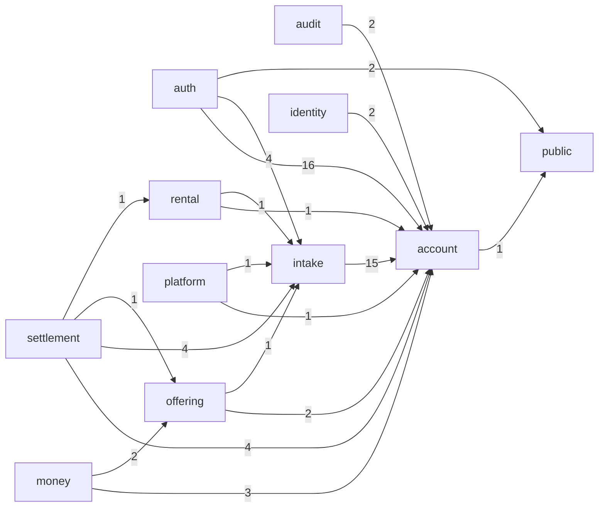

`account.accounts` is the hub: 46 of the 64 cross-schema keys point at it. Of all 105 keys, 67 are `ON DELETE RESTRICT`, 30 are `ON DELETE SET NULL` and 8 are `ON DELETE CASCADE`. Nothing in `src/` deletes an `account.accounts` row (section 6).

## 2. Schemas

| Schema | Tables | Holds | Written by |
| --- | --- | --- | --- |
| `account` | 2 | The account root and per-account preferences. Tables: `account.accounts`, `account.account_preferences`. | account module (accounts), profile module (preferences), auth module |
| `auth` | 14 | Authentication state the product owns (Better Auth's own tables are in `public`). Tables: sessions mirror, devices, login methods, signing requests, staff credentials and invitations, recovery and closure cases. | auth module |
| `audit` | 2 | The unified audit trail and the idempotency store. Tables: `audit.audit_log`, `audit.idempotency_keys`. | every module (audit rows); `src/infrastructure/idempotency` (keys) |
| `identity` | 2 | KYC eligibility state and its history. Tables: `identity.kyc_eligibility`, `identity.kyc_eligibility_history`. | identity module |
| `intake` | 17 | Everything about a property intake case. Tables: cases, revisions, events, properties, rooms, partners, information requests, threads, property vehicles (`intake.pivs`). | intake module; `intake.pivs` is also written by the offering repository |
| `money` | 5 | Investor funding evidence. Tables: `money.money_events`, webhook receipts, late evidence, treasury sweep batches, payouts. | offering module |
| `offering` | 5 | What investors can reserve and the disclosure that goes with it. Tables: offerings, reservations, disclosure packs and documents, materiality records. | offering module; intake writes offerings and reservations when it closes a case |
| `platform` | 2 | Cross-domain configuration rows and document metadata. Tables: `platform.settings`, `platform.stored_documents`. | intake, offering, settlement modules |
| `rental` | 1 | Rent reported for a property vehicle. Tables: `rental.rent_collections`. | rental module |
| `settlement` | 7 | Wallet claims and on-chain settlement bookkeeping. Tables: wallet registrations, positions, chain events, escrow mint intents and campaigns, operating distributions. | settlement, wallet, offering modules |
| `public` | 5 | Better Auth's `auth_user`, `auth_session`, `auth_account`, `auth_verification` and the plugin table `passkey`. Not in the Prisma datasource. | Better Auth, through its own PostgreSQL adapter |
| `pgboss` | not counted | pg-boss's own queue tables. Created and migrated by pg-boss at start, not by a Prisma migration. | pg-boss |
| `public._prisma_migrations` | not counted | Prisma's migration ledger. | Prisma |

The schema `origination` existed from the first migration to 20260917150000 and was renamed to `intake` (`prisma/migrations/20260917150000_rename_origination_to_intake/migration.sql:4-6`). Tables of the `auth` schema were created in `account` and moved by `ALTER TABLE ... SET SCHEMA` (`prisma/migrations/20260909110000_separate_auth_schema/migration.sql:10-22`). The schema `rental` was created by `20260903170000_add_operating_distributions` (`prisma/migrations/20260903170000_add_operating_distributions/migration.sql:2`).

## 3. Conventions

- **Enum-like columns are `text`.** Neither schema file declares a Prisma `enum`, and no migration creates a PostgreSQL enum type. Allowed values are enforced by `CHECK` constraints where the table was given one, and by application code elsewhere. Section 5 lists both. The design record chose this on purpose (`04-Engineering/DATA/CORE_TABLES.md:19`).
- **Identifiers are application-generated text.** No `*_id` column has a database default. Repositories build ids as a prefix and a ULID, for example `acct_<ULID>` (`src/modules/account/repository/prisma-account.repository.ts:80`), `money_event_<ULID>` (`src/modules/offering/repository/prisma-offering.repository.ts:758`), `audit_<ULID>`; a few use `randomUUID()` instead, for example `audit_<UUID>` in `src/modules/intake/application/upload-case-document.service.ts:28`. Better Auth generates its own ids.
- **Timestamps are `timestamptz`.** Most columns are `timestamptz(6)` with `CURRENT_TIMESTAMP` as the default for creation columns. `updated_at` columns default to the creation time and application code sets them when it changes a row (for example `src/modules/auth/repository/shared/prisma-account-closure.repository.ts:114-117`); only `account.account_preferences.updated_at` is a Prisma `@updatedAt` field (`prisma/schema/schema.prisma:77`).
- **Money is `numeric`.** Euro amounts are `numeric(15,2)`, EURC amounts `numeric(20,6)` (`numeric(15,6)` on distribution entries), unit counts `numeric(20,6)`, and chain amounts and token ids `numeric(78,0)`. The per-unit euro amount of a distribution (`settlement.operating_distributions.amount_per_unit_eur`) is `numeric(15,6)`. Floor areas are `numeric(6,2)` and the property coordinates are `double precision`.
- **JSON columns are `jsonb`.** `submission_data`, `metadata`, `changes`, `response_body`, `value`, `biometric_public_jwk`, `attestation_metadata`, `destination`, `created_by` and `signed_jws`.
- **Arrays.** `intake.intake_cases` has three nullable `text[]` columns without a default; `offering.offerings.gallery_image_urls` is `text[]` `NOT NULL DEFAULT ARRAY[]::TEXT[]` (`prisma/migrations/20261116140000_offering_media/migration.sql:1-3`).
- **Foreign keys.** 102 of the 105 keys are `ON UPDATE CASCADE`; the 3 inline keys of the Better Auth tables have no update rule. Delete rules: 67 `RESTRICT`, 30 `SET NULL` (optional references such as actor, reviewer and presentation links) and 8 `CASCADE` (the account keys of the three staff WebAuthn tables, the session keys of two of them, and the user keys of `auth_account`, `auth_session` and `passkey`). Nothing in `src/` deletes an `account.accounts` row, so the `RESTRICT` rules on the account keys never fire in normal operation.
- **Constraint names keep their history.** Renamed tables keep the old prefix in their constraint names: `intake.intake_cases` carries `origination_cases_stage_check` and `origination_cases_ipo_terms_check` (`prisma/migrations/20260831170000_origination_review_workflow/migration.sql:13,29`). Inline constraints of `public` tables carry PostgreSQL's default names (`<table>_<column>_key`, `<table>_pkey`, `<table>_<column>_fkey`), which are inferred, not written in the SQL.
- **Append-only is enforced by triggers where it matters.** `intake.submission_revisions`, `intake.intake_case_events`, `money.money_events`, `money.onramp_webhook_receipts` and, with one allowed change, `money.onramp_late_evidence` (section 4). `audit.audit_log` has no such trigger.
- **NOT VALID checks.** 9 checks were added `NOT VALID` so the migration could not fail on existing data. They are enforced for every insert and update from then on; existing rows are not examined until someone runs `VALIDATE CONSTRAINT` (`prisma/migrations/20261018131001_money_ledger_amount_and_status_checks/migration.sql:60-67`). No migration validates them.

## 4. Tables by domain

The tables are grouped by domain. Each group starts with an entity-relationship diagram of its tables, drawn from the foreign keys of the replayed migrations (an `o|` end is an optional parent, a `||` end a required one; one edge stands for all keys between the same two tables, labelled with the first column and a count of the others). `accounts` appears in most diagrams as the shared parent; it is described under Accounts.

Each table has the same parts:

- the Prisma model (file and line range) and the migration statement that created the table, or a note that it is not a Prisma model;
- what the table holds, with the code that writes it;
- a column table: the SQL type, nullability and default as the migrations leave them, notes (primary key, foreign key and its delete rule, single-column unique), and `Since`, the migration and line that created the column. A column added after the table was created therefore points at a later migration than the table's `Created` line;
- a constraint table: primary key, unique and ordinary indexes (partial ones are marked), foreign keys with `ON DELETE` and `ON UPDATE`, checks (`NOT VALID` marked) and triggers, each with the migration and line that defined its final form;
- the writers found by searching `src/` for Prisma delegate calls (`create`, `createMany`, `update`, `updateMany`, `upsert`, `delete`, `deleteMany`) and for `INSERT INTO`, `UPDATE` and `DELETE FROM` against the table. Reads are not listed. Writers that go through a generic helper or a Better Auth adapter may be missing.

### Identity and authentication

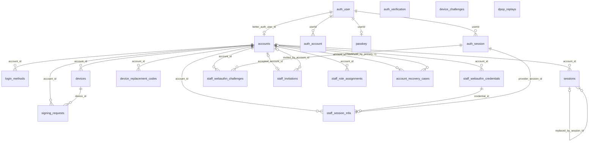

#### `public.auth_user`

Not a Prisma model. Created in `prisma/migrations/20260831154500_better_auth_core/migration.sql:3`.

Better Auth's user table. Every `account.accounts` row points at one row here (`better_auth_user_id`). `population` is `customer` or `staff_partner`; `disabledAt`, `disabledReason` and `recoveryRequiredAt` carry staff offboarding and recovery state. The table is not a Prisma model: Better Auth reaches it through its own PostgreSQL adapter under the model name `auth_user` (`src/modules/auth/infrastructure/shared/better-auth.factory.ts:160-162`), and the migration that created it says product-domain code must not query it (`prisma/migrations/20260831154500_better_auth_core/migration.sql:1-2`).

| Column | Type | Null | Default | Notes | Since |
| --- | --- | --- | --- | --- | --- |
| `id` | text | no |  | PK | `20260831154500_better_auth_core:4` |
| `name` | text | no |  |  | `20260831154500_better_auth_core:5` |
| `email` | text | no |  | unique | `20260831154500_better_auth_core:6` |
| `emailVerified` | boolean | no |  |  | `20260831154500_better_auth_core:7` |
| `image` | text | yes |  |  | `20260831154500_better_auth_core:8` |
| `createdAt` | timestamptz | no | `CURRENT_TIMESTAMP` |  | `20260831154500_better_auth_core:9` |
| `updatedAt` | timestamptz | no | `CURRENT_TIMESTAMP` |  | `20260831154500_better_auth_core:10` |
| `population` | text | no |  |  | `20260831154500_better_auth_core:11` |
| `disabledAt` | timestamptz | yes |  |  | `20260831190000_staff_account_lifecycle:2` |
| `disabledReason` | text | yes |  |  | `20260831190000_staff_account_lifecycle:3` |
| `recoveryRequiredAt` | timestamptz | yes |  |  | `20260831190000_staff_account_lifecycle:4` |

| Kind | Name | Definition | Migration |
| --- | --- | --- | --- |
| PK | `auth_user_pkey` | `(id)` | `20260831154500_better_auth_core:4` |
| UNIQUE | `auth_user_email_key` | `(email)` | `20260831154500_better_auth_core:6` |
| CHECK | `auth_user_disabled_state_check` | `("disabledAt" IS NULL AND "disabledReason" IS NULL) OR ( "disabledAt" IS NOT NULL AND "disabledReason" IN ( 'employment_ended', 'partner_firm_notice', 'security_action' ) )` | `20260831190000_staff_account_lifecycle:7` |
| CHECK | `auth_user_population_check` | `"population" IN ('customer', 'staff_partner')` | `20260831154500_better_auth_core:13` |
| CHECK | `auth_user_staff_lifecycle_population_check` | `"population" = 'staff_partner' OR ( "disabledAt" IS NULL AND "disabledReason" IS NULL )` | `20260912080000_customer_recovery_flag:12` |

Written through Better Auth's adapter, not by VistaBlox repositories. The lifecycle columns are set by VistaBlox code that calls the adapter's `updateUser`: `BetterAuthStaffAccountAdministrator.prepareRecovery` sets `recoveryRequiredAt` (`src/modules/auth/infrastructure/staff/better-auth-staff-account-administrator.ts:23`) and `.disableAndRevoke` sets `disabledAt` and `disabledReason` (`src/modules/auth/infrastructure/staff/better-auth-staff-account-administrator.ts:60`); `BetterAuthCustomerAccountAdministrator.revokeAllSessions` sets `recoveryRequiredAt` (`src/modules/auth/infrastructure/customer/better-auth-customer-account-administrator.ts:17`) and `.clearRecoveryRequired` clears it (`src/modules/auth/infrastructure/customer/better-auth-customer-account-administrator.ts:43`); the passkey hook clears it when a staff passkey is registered from a recovery link (`src/modules/auth/infrastructure/shared/better-auth.factory.ts:399`).

#### `public.auth_session`

Not a Prisma model. Created in `prisma/migrations/20260831154500_better_auth_core/migration.sql:17`.

Better Auth's session table. Besides the vendor columns it carries `authenticationLevel` (how the session was established) and `dpopJkt` (the thumbprint of the DPoP key a session is bound to, or null). Not a Prisma model; Better Auth maps it as `auth_session` (`src/modules/auth/infrastructure/shared/better-auth.factory.ts:188`). The product-side mirror of a session is `auth.sessions`.

| Column | Type | Null | Default | Notes | Since |
| --- | --- | --- | --- | --- | --- |
| `id` | text | no |  | PK | `20260831154500_better_auth_core:18` |
| `expiresAt` | timestamptz | no |  |  | `20260831154500_better_auth_core:19` |
| `token` | text | no |  | unique | `20260831154500_better_auth_core:20` |
| `createdAt` | timestamptz | no | `CURRENT_TIMESTAMP` |  | `20260831154500_better_auth_core:21` |
| `updatedAt` | timestamptz | no |  |  | `20260831154500_better_auth_core:22` |
| `ipAddress` | text | yes |  |  | `20260831154500_better_auth_core:23` |
| `userAgent` | text | yes |  |  | `20260831154500_better_auth_core:24` |
| `userId` | text | no |  | FK `public.auth_user(id)` CASCADE | `20260831154500_better_auth_core:25` |
| `authenticationLevel` | text | no | `'unassured'` |  | `20260906120000_oauth_passkey_authentication:5` |
| `dpopJkt` | text | yes |  |  | `20260910140000_dpop_device_binding:8` |

| Kind | Name | Definition | Migration |
| --- | --- | --- | --- |
| PK | `auth_session_pkey` | `(id)` | `20260831154500_better_auth_core:18` |
| UNIQUE | `auth_session_token_key` | `(token)` | `20260831154500_better_auth_core:20` |
| INDEX | `auth_session_userId_idx` | `(userId)` | `20260831154500_better_auth_core:54` |
| FK | `auth_session_userId_fkey` | `(userId) -> public.auth_user(id) ON DELETE CASCADE ON UPDATE NO ACTION` | `20260831154500_better_auth_core:25` |
| CHECK | `auth_session_authentication_level_check` | `"authenticationLevel" IN ('unassured', 'oauth_pending', 'staff_passkey', 'device_biometric')` | `20260912150000_remove_oauth_passkey_level:38` |

Rows are created, revoked and deleted through Better Auth's adapter (`deleteUserSessions`, section 6.1). VistaBlox code also writes this table directly through the `pg` pool, although the migration header says product-domain code must not query these tables: `BetterAuthSessionResolver.bindDpopKey` sets `dpopJkt` (`src/modules/auth/infrastructure/shared/better-auth-session.resolver.ts:85`) and `BetterAuthSessionResolver.recordActivity` moves `updatedAt` of a device session (`src/modules/auth/infrastructure/shared/better-auth-session.resolver.ts:113-122`). `PrismaCustomerSessionRepository` reads it with a `SELECT` (`src/modules/auth/repository/customer/prisma-customer-session.repository.ts:55`).

#### `public.auth_account`

Not a Prisma model. Created in `prisma/migrations/20260831154500_better_auth_core/migration.sql:28`.

Better Auth's table of linked sign-in providers (Google, Apple), one row per `(issuer, accountId)`. The check `auth_account_passwordless_check` forbids a `credential` provider and any stored password. Not a Prisma model; mapped as `auth_account` (`src/modules/auth/infrastructure/shared/better-auth.factory.ts:215`).

| Column | Type | Null | Default | Notes | Since |
| --- | --- | --- | --- | --- | --- |
| `id` | text | no |  | PK | `20260831154500_better_auth_core:29` |
| `issuer` | text | no |  |  | `20260831154500_better_auth_core:30` |
| `accountId` | text | no |  |  | `20260831154500_better_auth_core:31` |
| `providerId` | text | no |  |  | `20260831154500_better_auth_core:32` |
| `userId` | text | no |  | FK `public.auth_user(id)` CASCADE | `20260831154500_better_auth_core:33` |
| `accessToken` | text | yes |  |  | `20260831154500_better_auth_core:34` |
| `refreshToken` | text | yes |  |  | `20260831154500_better_auth_core:35` |
| `idToken` | text | yes |  |  | `20260831154500_better_auth_core:36` |
| `accessTokenExpiresAt` | timestamptz | yes |  |  | `20260831154500_better_auth_core:37` |
| `refreshTokenExpiresAt` | timestamptz | yes |  |  | `20260831154500_better_auth_core:38` |
| `scope` | text | yes |  |  | `20260831154500_better_auth_core:39` |
| `password` | text | yes |  |  | `20260831154500_better_auth_core:40` |
| `createdAt` | timestamptz | no | `CURRENT_TIMESTAMP` |  | `20260831154500_better_auth_core:41` |
| `updatedAt` | timestamptz | no |  |  | `20260831154500_better_auth_core:42` |

| Kind | Name | Definition | Migration |
| --- | --- | --- | --- |
| PK | `auth_account_pkey` | `(id)` | `20260831154500_better_auth_core:29` |
| UNIQUE | `auth_account_issuer_accountId_uidx` | `(issuer, accountId)` | `20260831154500_better_auth_core:57` |
| INDEX | `auth_account_userId_idx` | `(userId)` | `20260831154500_better_auth_core:55` |
| FK | `auth_account_userId_fkey` | `(userId) -> public.auth_user(id) ON DELETE CASCADE ON UPDATE NO ACTION` | `20260831154500_better_auth_core:33` |
| CHECK | `auth_account_passwordless_check` | `"providerId" <> 'credential' AND "password" IS NULL` | `20260905120000_passwordless_auth:10` |

Written through Better Auth's adapter, not by VistaBlox repositories.

#### `public.auth_verification`

Not a Prisma model. Created in `prisma/migrations/20260831154500_better_auth_core/migration.sql:45`.

Better Auth's own store of short-lived verification values (`identifier`, `value`, `expiresAt`). Not a Prisma model; mapped as `auth_verification` (`src/modules/auth/infrastructure/shared/better-auth.factory.ts:239`). No other file under `src/` names the table.

| Column | Type | Null | Default | Notes | Since |
| --- | --- | --- | --- | --- | --- |
| `id` | text | no |  | PK | `20260831154500_better_auth_core:46` |
| `identifier` | text | no |  |  | `20260831154500_better_auth_core:47` |
| `value` | text | no |  |  | `20260831154500_better_auth_core:48` |
| `expiresAt` | timestamptz | no |  |  | `20260831154500_better_auth_core:49` |
| `createdAt` | timestamptz | no | `CURRENT_TIMESTAMP` |  | `20260831154500_better_auth_core:50` |
| `updatedAt` | timestamptz | no | `CURRENT_TIMESTAMP` |  | `20260831154500_better_auth_core:51` |

| Kind | Name | Definition | Migration |
| --- | --- | --- | --- |
| PK | `auth_verification_pkey` | `(id)` | `20260831154500_better_auth_core:46` |
| INDEX | `auth_verification_identifier_idx` | `(identifier)` | `20260831154500_better_auth_core:56` |

Written through Better Auth's adapter, not by VistaBlox repositories.

#### `public.passkey`

Not a Prisma model. Created in `prisma/migrations/20260905120000_passwordless_auth/migration.sql:13`.

Table of the Better Auth passkey plugin (`model: "passkey"` at `src/modules/auth/infrastructure/shared/better-auth.factory.ts:374`). One row per user (unique `userId`) and per credential (unique `credentialID`). The plugin hook asserts the user is a staff user (`assertStaffPasskeyUser`, `src/modules/auth/infrastructure/shared/better-auth.factory.ts:362,370`). The migration that removed customer passkeys deleted every row of a user whose population is not `staff_partner` (`prisma/migrations/20260912150000_remove_oauth_passkey_level/migration.sql:25-26`). Not a Prisma model.

| Column | Type | Null | Default | Notes | Since |
| --- | --- | --- | --- | --- | --- |
| `id` | text | no |  | PK | `20260905120000_passwordless_auth:14` |
| `name` | text | yes |  |  | `20260905120000_passwordless_auth:15` |
| `publicKey` | text | no |  |  | `20260905120000_passwordless_auth:16` |
| `userId` | text | no |  | FK `public.auth_user(id)` CASCADE; unique | `20260905120000_passwordless_auth:17` |
| `credentialID` | text | no |  | unique | `20260905120000_passwordless_auth:18` |
| `counter` | integer | no |  |  | `20260905120000_passwordless_auth:19` |
| `deviceType` | text | no |  |  | `20260905120000_passwordless_auth:20` |
| `backedUp` | boolean | no |  |  | `20260905120000_passwordless_auth:21` |
| `transports` | text | yes |  |  | `20260905120000_passwordless_auth:22` |
| `createdAt` | timestamptz | no | `CURRENT_TIMESTAMP` |  | `20260905120000_passwordless_auth:23` |
| `aaguid` | text | yes |  |  | `20260905120000_passwordless_auth:24` |

| Kind | Name | Definition | Migration |
| --- | --- | --- | --- |
| PK | `passkey_pkey` | `(id)` | `20260905120000_passwordless_auth:14` |
| UNIQUE | `passkey_credentialID_uidx` | `(credentialID)` | `20260905120000_passwordless_auth:28` |
| UNIQUE | `passkey_userId_uidx` | `(userId)` | `20260905120000_passwordless_auth:27` |
| FK | `passkey_userId_fkey` | `(userId) -> public.auth_user(id) ON DELETE CASCADE ON UPDATE NO ACTION` | `20260905120000_passwordless_auth:17` |

Written through Better Auth's adapter, not by VistaBlox repositories.

#### `auth.login_methods`

Prisma model `LoginMethod` (`prisma/schema/auth.prisma:111-125`). Created in `prisma/migrations/20260831150000_initial_schema/migration.sql:51`; history: moved account.login_methods -> auth.login_methods (20260909110000_separate_auth_schema:18).

The sign-in methods linked to an account: one row per `(account_id, method_type)`, and one account per `(method_type, provider_subject)`. `method_type` is limited to `passkey`, `google`, `apple` and `device_key` by `login_methods_supported_method_check`. A `device_key` row has the device id as `provider_subject` (`prisma/migrations/20260912170000_device_key_login_method/migration.sql:1-4`).

| Column | Type | Null | Default | Notes | Since |
| --- | --- | --- | --- | --- | --- |
| `login_method_id` | text | no |  | PK | `20260831150000_initial_schema:52` |
| `account_id` | text | no |  | FK `account.accounts(account_id)` RESTRICT | `20260831150000_initial_schema:53` |
| `method_type` | text | no |  |  | `20260831150000_initial_schema:54` |
| `provider_subject` | text | no |  |  | `20260831150000_initial_schema:55` |
| `linked_at` | timestamptz(6) | no | `CURRENT_TIMESTAMP` |  | `20260831150000_initial_schema:56` |
| `linked_via_fresh_auth` | boolean | no | `true` |  | `20260831150000_initial_schema:57` |

| Kind | Name | Definition | Migration |
| --- | --- | --- | --- |
| PK | `login_methods_pkey` | `(login_method_id)` | `20260831150000_initial_schema:59` |
| UNIQUE | `login_methods_account_id_method_type_key` | `(account_id, method_type)` | `20260831150000_initial_schema:554` |
| UNIQUE | `login_methods_method_type_provider_subject_key` | `(method_type, provider_subject)` | `20260831150000_initial_schema:557` |
| FK | `login_methods_account_id_fkey` | `(account_id) -> account.accounts(account_id) ON DELETE RESTRICT ON UPDATE CASCADE` | `20260831150000_initial_schema:756` |
| CHECK | `login_methods_supported_method_check` | `"method_type" IN ('passkey', 'google', 'apple', 'device_key')` | `20260912170000_device_key_login_method:9` |

Written by `PrismaAccountRepository.recordLoginMethod` (`src/modules/account/repository/prisma-account.repository.ts:110`); `PrismaDeviceReplacementRepository.consumeAndReplace` (`src/modules/auth/repository/customer/prisma-device-replacement.repository.ts:137`); `PrismaDeviceRepository.create` (`src/modules/auth/repository/customer/prisma-device.repository.ts:102`), `PrismaDeviceRepository.delete` (`src/modules/auth/repository/customer/prisma-device.repository.ts:178`); `PrismaAccountRecoveryRepository.revokeDevicesForRecovery` (`src/modules/auth/repository/staff/prisma-account-recovery.repository.ts:335`).

#### `auth.sessions`

Prisma model `Session` (`prisma/schema/auth.prisma:127-159`). Created in `prisma/migrations/20260831150000_initial_schema/migration.sql:63`; history: moved account.sessions -> auth.sessions (20260909110000_separate_auth_schema:12).

The product-side mirror of Better Auth sessions: channel, status, expiry instants, a hashed user agent and a derived device label. It is a display and audit convenience, written on session creation and revocation, and `recordCreated` writes nothing when the account is not provisioned yet (`src/modules/auth/infrastructure/shared/prisma-session-mirror.ts:20-29`), and a mirror write that throws is reported to the `onError` callback and does not fail the login, the revocation or the request (`src/modules/auth/infrastructure/shared/better-auth-audit.plugin.ts:60-94,95-109`, `src/modules/auth/infrastructure/shared/better-auth-session.resolver.ts:99-109`). The mirror column `better_auth_session_id` has no foreign key.

| Column | Type | Null | Default | Notes | Since |
| --- | --- | --- | --- | --- | --- |
| `session_id` | text | no |  | PK | `20260831150000_initial_schema:64` |
| `account_id` | text | no |  | FK `account.accounts(account_id)` RESTRICT | `20260831150000_initial_schema:65` |
| `channel` | text | no |  |  | `20260831150000_initial_schema:66` |
| `status` | text | no | `'active'` | `active` or `revoked` are the values the mirror writes; no check. | `20260831150000_initial_schema:67` |
| `better_auth_user_id` | text | no |  |  | `20260831150000_initial_schema:68` |
| `better_auth_session_id` | text | yes |  | Mirror reference; no foreign key. | `20260831150000_initial_schema:69` |
| `auth_method_at_login` | text | no |  | Free text; code writes the method or `unknown`, and `staff_passkey` for staff. | `20260831150000_initial_schema:71` |
| `created_at` | timestamptz(6) | no | `CURRENT_TIMESTAMP` |  | `20260831150000_initial_schema:72` |
| `last_seen_at` | timestamptz(6) | no | `CURRENT_TIMESTAMP` |  | `20260831150000_initial_schema:73` |
| `idle_expires_at` | timestamptz(6) | no |  |  | `20260831150000_initial_schema:74` |
| `absolute_expires_at` | timestamptz(6) | no |  |  | `20260831150000_initial_schema:75` |
| `last_fresh_auth_at` | timestamptz(6) | yes |  |  | `20260831150000_initial_schema:76` |
| `risk_state` | text | no | `'normal'` |  | `20260831150000_initial_schema:77` |
| `device_label` | text | yes |  |  | `20260831150000_initial_schema:78` |
| `user_agent_hash` | text | yes |  |  | `20260831150000_initial_schema:79` |
| `initial_country_code` | text | yes |  |  | `20260831150000_initial_schema:80` |
| `last_country_code` | text | yes |  |  | `20260831150000_initial_schema:81` |
| `network_marker_hash` | text | yes |  |  | `20260831150000_initial_schema:82` |
| `csrf_secret_hash` | text | yes |  |  | `20260831150000_initial_schema:83` |
| `revoked_at` | timestamptz(6) | yes |  |  | `20260831150000_initial_schema:84` |
| `revocation_reason` | text | yes |  |  | `20260831150000_initial_schema:85` |
| `replaced_by_session_id` | text | yes |  | FK `auth.sessions(session_id)` SET NULL | `20260831150000_initial_schema:86` |

| Kind | Name | Definition | Migration |
| --- | --- | --- | --- |
| PK | `sessions_pkey` | `(session_id)` | `20260831150000_initial_schema:88` |
| INDEX | `idx_sessions_account_status` | `(account_id, status)` | `20260831150000_initial_schema:560` |
| INDEX | `idx_sessions_replaced_by` | `(replaced_by_session_id)` | `20260831150000_initial_schema:563` |
| FK | `sessions_account_id_fkey` | `(account_id) -> account.accounts(account_id) ON DELETE RESTRICT ON UPDATE CASCADE` | `20260831150000_initial_schema:759` |
| FK | `sessions_replaced_by_session_id_fkey` | `(replaced_by_session_id) -> auth.sessions(session_id) ON DELETE SET NULL ON UPDATE CASCADE` | `20260831150000_initial_schema:762` |

Written by `PrismaSessionMirror.recordCreated` (`src/modules/auth/infrastructure/shared/prisma-session-mirror.ts:31`), `PrismaSessionMirror.recordRevoked` (`src/modules/auth/infrastructure/shared/prisma-session-mirror.ts:51`), `PrismaSessionMirror.recordActivity` (`src/modules/auth/infrastructure/shared/prisma-session-mirror.ts:62`).

#### `auth.devices`

Prisma model `Device` (`prisma/schema/auth.prisma:228-261`). Created in `prisma/migrations/20260911100000_device_key_auth/migration.sql:5`.

One enrolled phone per row (device-bound authentication). `dpop_jkt` is the DPoP key thumbprint, `bio_jkt` the biometric key thumbprint, `biometric_public_jwk` the public key, `attestation_metadata` what the platform attestation proved. Two partial unique indexes bound the table: one active device per account, and a DPoP key is unique among active devices only, so a revoked device's key can enrol again (`prisma/migrations/20260911160000_device_one_active_per_account/migration.sql:1-14`, `prisma/migrations/20260912180000_device_revocation/migration.sql:1-18`). A revoked device keeps its row with `status = revoked`, `revoked_at` and `revocation_reason`.

| Column | Type | Null | Default | Notes | Since |
| --- | --- | --- | --- | --- | --- |
| `device_id` | text | no |  | PK | `20260911100000_device_key_auth:6` |
| `account_id` | text | no |  | FK `account.accounts(account_id)` RESTRICT | `20260911100000_device_key_auth:7` |
| `better_auth_user_id` | text | no |  |  | `20260911100000_device_key_auth:8` |
| `dpop_jkt` | text | no |  |  | `20260911100000_device_key_auth:9` |
| `bio_jkt` | text | no |  |  | `20260911100000_device_key_auth:10` |
| `biometric_public_jwk` | jsonb | no |  |  | `20260911100000_device_key_auth:11` |
| `platform` | text | no |  | `ios` or `android` at the API edge (`src/modules/auth/application/customer/mobile-attestation.schemas.ts:4,10`). | `20260911100000_device_key_auth:12` |
| `model` | text | yes |  |  | `20260911100000_device_key_auth:13` |
| `os_version` | text | yes |  |  | `20260911100000_device_key_auth:14` |
| `app_version` | text | yes |  |  | `20260911100000_device_key_auth:15` |
| `attestation_metadata` | jsonb | no |  |  | `20260911100000_device_key_auth:16` |
| `status` | text | no | `'active'` | `active` or `revoked`; no check. | `20260911100000_device_key_auth:17` |
| `created_at` | timestamptz | no | `CURRENT_TIMESTAMP` |  | `20260911100000_device_key_auth:18` |
| `last_seen_at` | timestamptz | no | `CURRENT_TIMESTAMP` |  | `20260911100000_device_key_auth:19` |
| `revoked_at` | timestamptz(6) | yes |  |  | `20260912180000_device_revocation:5` |
| `revocation_reason` | text | yes |  |  | `20260912180000_device_revocation:6` |

| Kind | Name | Definition | Migration |
| --- | --- | --- | --- |
| PK | `devices_pkey` | `(device_id)` | `20260911100000_device_key_auth:6` |
| UNIQUE (partial) | `devices_dpop_jkt_active_key` | `(dpop_jkt) WHERE "status" = 'active'` | `20260912180000_device_revocation:16` |
| UNIQUE (partial) | `devices_one_active_per_account` | `(account_id) WHERE "status" = 'active'` | `20260911160000_device_one_active_per_account:12` |
| INDEX | `idx_devices_account` | `(account_id)` | `20260911100000_device_key_auth:26` |
| FK | `devices_account_id_fkey` | `(account_id) -> account.accounts(account_id) ON DELETE RESTRICT ON UPDATE CASCADE` | `20260911100000_device_key_auth:21` |

Written by `PrismaDeviceReplacementRepository.consumeAndReplace` (`src/modules/auth/repository/customer/prisma-device-replacement.repository.ts:128`); `PrismaDeviceRepository.create` (`src/modules/auth/repository/customer/prisma-device.repository.ts:83`), `PrismaDeviceRepository.touchLastSeen` (`src/modules/auth/repository/customer/prisma-device.repository.ts:165`), `PrismaDeviceRepository.delete` (`src/modules/auth/repository/customer/prisma-device.repository.ts:181`); `PrismaAccountRecoveryRepository.revokeDevicesForRecovery` (`src/modules/auth/repository/staff/prisma-account-recovery.repository.ts:326`).

#### `auth.device_challenges`

Prisma model `DeviceChallenge` (`prisma/schema/auth.prisma:267-279`). Created in `prisma/migrations/20260911100000_device_key_auth/migration.sql:32`.

Single-use, server-issued challenges for the device ceremonies. A challenge is consumed by a conditional update that sets `consumed_at` once. Purposes written by code are `enrol-device` (`src/modules/auth/api/customer/device-auth.router.ts:166`), `login` (`src/modules/auth/application/customer/device-challenge-issuance.service.ts:56`) and `tx` (`src/modules/auth/api/customer/signing-requests.router.ts:114`); the database has no check on `purpose`. (`account_recovery` at `src/modules/auth/application/staff/account-recovery.service.ts:85` is the purpose of a Didit session, not of a device challenge.) Hourly pruning is in section 6.

| Column | Type | Null | Default | Notes | Since |
| --- | --- | --- | --- | --- | --- |
| `challenge` | text | no |  | PK | `20260911100000_device_key_auth:33` |
| `purpose` | text | no |  |  | `20260911100000_device_key_auth:34` |
| `dpop_jkt` | text | no |  |  | `20260911100000_device_key_auth:35` |
| `device_id` | text | yes |  |  | `20260911100000_device_key_auth:36` |
| `expires_at` | timestamptz | no |  |  | `20260911100000_device_key_auth:37` |
| `consumed_at` | timestamptz | yes |  |  | `20260911100000_device_key_auth:38` |
| `created_at` | timestamptz | no | `CURRENT_TIMESTAMP` |  | `20260911100000_device_key_auth:39` |

| Kind | Name | Definition | Migration |
| --- | --- | --- | --- |
| PK | `device_challenges_pkey` | `(challenge)` | `20260911100000_device_key_auth:33` |
| INDEX | `idx_device_challenges_expires_at` | `(expires_at)` | `20260911100000_device_key_auth:42` |

Written by `PrismaDeviceChallengeRepository.issue` (`src/modules/auth/repository/customer/prisma-device-challenge.repository.ts:18`), `PrismaDeviceChallengeRepository.consume` (`src/modules/auth/repository/customer/prisma-device-challenge.repository.ts:45`), `PrismaDeviceChallengeRepository.pruneExpired` (`src/modules/auth/repository/customer/prisma-device-challenge.repository.ts:83`).

#### `auth.dpop_replays`

Prisma model `DpopReplay` (`prisma/schema/auth.prisma:212-221`). Created in `prisma/migrations/20260910140000_dpop_device_binding/migration.sql:13`.

Replay protection for DPoP proofs: one row per `(jkt, jti)` pair seen. The insert is `INSERT ... ON CONFLICT (jkt, jti) DO NOTHING RETURNING jkt`, so the primary key is the replay test (`src/modules/auth/repository/shared/prisma-dpop-replay.repository.ts:11-19`).

| Column | Type | Null | Default | Notes | Since |
| --- | --- | --- | --- | --- | --- |
| `jkt` | text | no |  | part of PK | `20260910140000_dpop_device_binding:14` |
| `jti` | text | no |  | part of PK | `20260910140000_dpop_device_binding:15` |
| `expires_at` | timestamptz | no |  |  | `20260910140000_dpop_device_binding:16` |

| Kind | Name | Definition | Migration |
| --- | --- | --- | --- |
| PK | `dpop_replays_pkey` | `(jkt, jti)` | `20260910140000_dpop_device_binding:18` |
| INDEX | `idx_dpop_replays_expires_at` | `(expires_at)` | `20260910140000_dpop_device_binding:21` |

Written by `PrismaDpopReplayRepository.recordProof` (`src/modules/auth/repository/shared/prisma-dpop-replay.repository.ts:13`), `PrismaDpopReplayRepository.pruneExpired` (`src/modules/auth/repository/shared/prisma-dpop-replay.repository.ts:22`).

#### `auth.device_replacement_codes`

Prisma model `DeviceReplacementCode` (`prisma/schema/auth.prisma:287-307`). Created in `prisma/migrations/20260921100000_device_replacement_codes/migration.sql:9`.

Self-service device replacement: a short-lived, single-use email code, stored only as `code_hash`. `attempts_used` counts failed attempts. Only one pending code per account is kept, by code and not by an index: issuing a new code first sets `consumed_at` on every unconsumed code of the account (`src/modules/auth/repository/customer/prisma-device-replacement.repository.ts:196-201`; the migration header gives the reason, `prisma/migrations/20260921100000_device_replacement_codes/migration.sql:1-8`).

| Column | Type | Null | Default | Notes | Since |
| --- | --- | --- | --- | --- | --- |
| `device_replacement_code_id` | text | no |  | PK | `20260921100000_device_replacement_codes:10` |
| `account_id` | text | no |  | FK `account.accounts(account_id)` RESTRICT | `20260921100000_device_replacement_codes:11` |
| `session_id` | text | yes |  |  | `20260921100000_device_replacement_codes:12` |
| `code_hash` | text | no |  |  | `20260921100000_device_replacement_codes:13` |
| `expires_at` | timestamptz | no |  |  | `20260921100000_device_replacement_codes:14` |
| `attempts_used` | integer | no | `0` |  | `20260921100000_device_replacement_codes:15` |
| `consumed_at` | timestamptz | yes |  |  | `20260921100000_device_replacement_codes:16` |
| `created_at` | timestamptz | no | `CURRENT_TIMESTAMP` |  | `20260921100000_device_replacement_codes:17` |

| Kind | Name | Definition | Migration |
| --- | --- | --- | --- |
| PK | `device_replacement_codes_pkey` | `(device_replacement_code_id)` | `20260921100000_device_replacement_codes:10` |
| INDEX | `idx_device_replacement_codes_account` | `(account_id, consumed_at)` | `20260921100000_device_replacement_codes:23` |
| INDEX | `idx_device_replacement_codes_expiry` | `(expires_at)` | `20260921100000_device_replacement_codes:26` |
| FK | `device_replacement_codes_account_id_fkey` | `(account_id) -> account.accounts(account_id) ON DELETE RESTRICT ON UPDATE CASCADE` | `20260921100000_device_replacement_codes:18` |

Written by `PrismaDeviceReplacementRepository.create` (`src/modules/auth/repository/customer/prisma-device-replacement.repository.ts:38`), `PrismaDeviceReplacementRepository.incrementAttempts` (`src/modules/auth/repository/customer/prisma-device-replacement.repository.ts:86`), `PrismaDeviceReplacementRepository.consumeAndReplace` (`src/modules/auth/repository/customer/prisma-device-replacement.repository.ts:109`), `PrismaDeviceReplacementRepository.revokePendingForAccount` (`src/modules/auth/repository/customer/prisma-device-replacement.repository.ts:197`).

#### `auth.signing_requests`

Prisma model `SigningRequest` (`prisma/schema/auth.prisma:319-342`). Created in `prisma/migrations/20260922120000_signing_requests/migration.sql:12`.

One pending action awaiting a device signature (per-action signing). `request_type` is an opaque label; `amount_minor` is a decimal string; `destination` and `created_by` are JSON; `signed_jws` holds the compact JWS the device returned. Stored statuses in the code's status list are `pending`, `signed`, `executed`, `submitted`, `included`, `expired` and `cancelled` (`src/modules/auth/domain/signing-request.policy.ts:24-40`); the database has no check on `status`. The off-chain path uses `pending` to `signed` to `executed`, and an expiry sweep and the device-revoke hook set `expired` and `cancelled` (section 6).

> Pending #234: a device revoke cancels only the signing requests of the caller's own devices; on main `cancelPendingAndSignedForDevice` takes a device id and nothing about the caller (`src/modules/auth/repository/customer/prisma-signing-request.repository.ts:173-180`).

| Column | Type | Null | Default | Notes | Since |
| --- | --- | --- | --- | --- | --- |
| `signing_request_id` | text | no |  | PK | `20260922120000_signing_requests:13` |
| `account_id` | text | no |  | FK `account.accounts(account_id)` RESTRICT | `20260922120000_signing_requests:14` |
| `device_id` | text | no |  | FK `auth.devices(device_id)` RESTRICT | `20260922120000_signing_requests:15` |
| `request_type` | text | no |  |  | `20260922120000_signing_requests:16` |
| `amount_minor` | text | yes |  | Decimal string, not a number. | `20260922120000_signing_requests:17` |
| `currency` | text | yes |  |  | `20260922120000_signing_requests:18` |
| `destination` | jsonb | yes |  |  | `20260922120000_signing_requests:19` |
| `created_by` | jsonb | no |  |  | `20260922120000_signing_requests:20` |
| `status` | text | no | `'pending'` | See the purpose text; no check. | `20260922120000_signing_requests:21` |
| `signed_jws` | jsonb | yes |  |  | `20260922120000_signing_requests:22` |
| `signed_at` | timestamptz(6) | yes |  |  | `20260922120000_signing_requests:23` |
| `expires_at` | timestamptz(6) | no |  |  | `20260922120000_signing_requests:24` |
| `created_at` | timestamptz(6) | no | `CURRENT_TIMESTAMP` |  | `20260922120000_signing_requests:25` |

| Kind | Name | Definition | Migration |
| --- | --- | --- | --- |
| PK | `signing_requests_pkey` | `(signing_request_id)` | `20260922120000_signing_requests:13` |
| INDEX | `idx_signing_requests_account_status_created` | `(account_id, status, created_at)` | `20260922120000_signing_requests:34` |
| INDEX | `idx_signing_requests_device_status` | `(device_id, status)` | `20260922120000_signing_requests:38` |
| INDEX | `idx_signing_requests_expires_at` | `(expires_at)` | `20260922120000_signing_requests:36` |
| FK | `signing_requests_account_id_fkey` | `(account_id) -> account.accounts(account_id) ON DELETE RESTRICT ON UPDATE CASCADE` | `20260922120000_signing_requests:26` |
| FK | `signing_requests_device_id_fkey` | `(device_id) -> auth.devices(device_id) ON DELETE RESTRICT ON UPDATE CASCADE` | `20260922120000_signing_requests:29` |

Written by `PrismaSigningRequestRepository.create` (`src/modules/auth/repository/customer/prisma-signing-request.repository.ts:99`), `PrismaSigningRequestRepository.markSigned` (`src/modules/auth/repository/customer/prisma-signing-request.repository.ts:147`), `PrismaSigningRequestRepository.markExecuted` (`src/modules/auth/repository/customer/prisma-signing-request.repository.ts:163`), `PrismaSigningRequestRepository.cancelPendingAndSignedForDevice` (`src/modules/auth/repository/customer/prisma-signing-request.repository.ts:175`), `PrismaSigningRequestRepository.markExpired` (`src/modules/auth/repository/customer/prisma-signing-request.repository.ts:188`).

#### `auth.staff_webauthn_credentials`

Prisma model `StaffWebAuthnCredential` (`prisma/schema/auth.prisma:1-19`). Created in `prisma/migrations/20260831173000_staff_webauthn_mfa/migration.sql:1`; history: moved account.staff_webauthn_credentials -> auth.staff_webauthn_credentials (20260909110000_separate_auth_schema:15).

WebAuthn credentials of staff and partner accounts (public key, signature counter, transports, label). Deleted with their owner on offboarding or staff recovery (`src/modules/auth/repository/staff/prisma-staff-account-lifecycle.repository.ts:58-64,113-119`). Foreign key to the account is `ON DELETE CASCADE`.

| Column | Type | Null | Default | Notes | Since |
| --- | --- | --- | --- | --- | --- |
| `credential_id` | text | no |  | PK | `20260831173000_staff_webauthn_mfa:2` |
| `account_id` | text | no |  | FK `account.accounts(account_id)` CASCADE | `20260831173000_staff_webauthn_mfa:3` |
| `public_key` | bytea | no |  |  | `20260831173000_staff_webauthn_mfa:4` |
| `counter` | bigint | no | `0` |  | `20260831173000_staff_webauthn_mfa:5` |
| `device_type` | text | no |  |  | `20260831173000_staff_webauthn_mfa:6` |
| `backed_up` | boolean | no | `false` |  | `20260831173000_staff_webauthn_mfa:7` |
| `transports` | text[] | no |  |  | `20260831173000_staff_webauthn_mfa:8` |
| `label` | text | yes |  |  | `20260831173000_staff_webauthn_mfa:9` |
| `created_at` | timestamptz | no | `CURRENT_TIMESTAMP` |  | `20260831173000_staff_webauthn_mfa:10` |
| `last_used_at` | timestamptz | yes |  |  | `20260831173000_staff_webauthn_mfa:11` |

| Kind | Name | Definition | Migration |
| --- | --- | --- | --- |
| PK | `staff_webauthn_credentials_pkey` | `(credential_id)` | `20260831173000_staff_webauthn_mfa:13` |
| INDEX | `idx_staff_webauthn_credentials_account` | `(account_id)` | `20260831173000_staff_webauthn_mfa:46` |
| FK | `staff_webauthn_credentials_account_id_fkey` | `(account_id) -> account.accounts(account_id) ON DELETE CASCADE ON UPDATE CASCADE` | `20260831173000_staff_webauthn_mfa:60` |
| CHECK | `staff_webauthn_credentials_counter_check` | `"counter" >= 0` | `20260831173000_staff_webauthn_mfa:14` |
| CHECK | `staff_webauthn_credentials_device_type_check` | `"device_type" IN ('singleDevice', 'multiDevice')` | `20260831173000_staff_webauthn_mfa:15` |

Written by `PrismaStaffAccountLifecycleRepository.prepareRecovery` (`src/modules/auth/repository/staff/prisma-staff-account-lifecycle.repository.ts:64`), `PrismaStaffAccountLifecycleRepository.completeOffboarding` (`src/modules/auth/repository/staff/prisma-staff-account-lifecycle.repository.ts:119`); `PrismaStaffWebAuthnRepository.completeRegistration` (`src/modules/auth/repository/staff/prisma-staff-webauthn.repository.ts:183`), `PrismaStaffWebAuthnRepository.completeAuthentication` (`src/modules/auth/repository/staff/prisma-staff-webauthn.repository.ts:255`).

#### `auth.staff_webauthn_challenges`

Prisma model `StaffWebAuthnChallenge` (`prisma/schema/auth.prisma:21-38`). Created in `prisma/migrations/20260831173000_staff_webauthn_mfa/migration.sql:19`; history: moved account.staff_webauthn_challenges -> auth.staff_webauthn_challenges (20260909110000_separate_auth_schema:16).

Single-use WebAuthn challenges (`purpose` is `registration` or `authentication`) tied to an account and a Better Auth session. `staff_webauthn_challenges_expiry_check` requires `expires_at > created_at`. `provider_session_id` references `public.auth_session(id)` with `ON DELETE CASCADE`; that foreign key crosses schemas and is not in the Prisma model.

| Column | Type | Null | Default | Notes | Since |
| --- | --- | --- | --- | --- | --- |
| `challenge_id` | text | no |  | PK | `20260831173000_staff_webauthn_mfa:20` |
| `account_id` | text | no |  | FK `account.accounts(account_id)` CASCADE | `20260831173000_staff_webauthn_mfa:21` |
| `provider_session_id` | text | no |  | FK `public.auth_session(id)` CASCADE | `20260831173000_staff_webauthn_mfa:22` |
| `purpose` | text | no |  |  | `20260831173000_staff_webauthn_mfa:23` |
| `challenge` | text | no |  | unique | `20260831173000_staff_webauthn_mfa:24` |
| `credential_label` | text | yes |  |  | `20260831173000_staff_webauthn_mfa:25` |
| `expires_at` | timestamptz | no |  |  | `20260831173000_staff_webauthn_mfa:26` |
| `used_at` | timestamptz | yes |  |  | `20260831173000_staff_webauthn_mfa:27` |
| `created_at` | timestamptz | no | `CURRENT_TIMESTAMP` |  | `20260831173000_staff_webauthn_mfa:28` |

| Kind | Name | Definition | Migration |
| --- | --- | --- | --- |
| PK | `staff_webauthn_challenges_pkey` | `(challenge_id)` | `20260831173000_staff_webauthn_mfa:30` |
| INDEX | `idx_staff_webauthn_challenges_expiry` | `(expires_at)` | `20260831173000_staff_webauthn_mfa:52` |
| INDEX | `idx_staff_webauthn_challenges_session` | `(account_id, provider_session_id, purpose)` | `20260831173000_staff_webauthn_mfa:50` |
| UNIQUE | `staff_webauthn_challenges_challenge_key` | `(challenge)` | `20260831173000_staff_webauthn_mfa:48` |
| FK | `staff_webauthn_challenges_account_id_fkey` | `(account_id) -> account.accounts(account_id) ON DELETE CASCADE ON UPDATE CASCADE` | `20260831173000_staff_webauthn_mfa:65` |
| FK | `staff_webauthn_challenges_provider_session_id_fkey` | `(provider_session_id) -> public.auth_session(id) ON DELETE CASCADE ON UPDATE CASCADE` | `20260831173000_staff_webauthn_mfa:70` |
| CHECK | `staff_webauthn_challenges_expiry_check` | `"expires_at" > "created_at"` | `20260831173000_staff_webauthn_mfa:33` |
| CHECK | `staff_webauthn_challenges_purpose_check` | `"purpose" IN ('registration', 'authentication')` | `20260831173000_staff_webauthn_mfa:31` |

Written by `PrismaStaffAccountLifecycleRepository.prepareRecovery` (`src/modules/auth/repository/staff/prisma-staff-account-lifecycle.repository.ts:61`), `PrismaStaffAccountLifecycleRepository.completeOffboarding` (`src/modules/auth/repository/staff/prisma-staff-account-lifecycle.repository.ts:116`); `PrismaStaffWebAuthnRepository.replaceChallenge` (`src/modules/auth/repository/staff/prisma-staff-webauthn.repository.ts:66`), `PrismaStaffWebAuthnRepository.failChallenge` (`src/modules/auth/repository/staff/prisma-staff-webauthn.repository.ts:121`), `PrismaStaffWebAuthnRepository.completeRegistration` (`src/modules/auth/repository/staff/prisma-staff-webauthn.repository.ts:166`), `PrismaStaffWebAuthnRepository.completeAuthentication` (`src/modules/auth/repository/staff/prisma-staff-webauthn.repository.ts:242`).

#### `auth.staff_session_mfa`

Prisma model `StaffSessionMfa` (`prisma/schema/auth.prisma:40-53`). Created in `prisma/migrations/20260831173000_staff_webauthn_mfa/migration.sql:37`; history: moved account.staff_session_mfa -> auth.staff_session_mfa (20260909110000_separate_auth_schema:17).

Which WebAuthn credential verified which Better Auth session and when (`verified_at`): the per-session step-up record of staff. Primary key is `provider_session_id`, which references `public.auth_session(id)` with `ON DELETE CASCADE` (a cross-schema foreign key that is not in the Prisma model).

| Column | Type | Null | Default | Notes | Since |
| --- | --- | --- | --- | --- | --- |
| `provider_session_id` | text | no |  | PK; FK `public.auth_session(id)` CASCADE | `20260831173000_staff_webauthn_mfa:38` |
| `account_id` | text | no |  | FK `account.accounts(account_id)` CASCADE | `20260831173000_staff_webauthn_mfa:39` |
| `credential_id` | text | no |  | FK `auth.staff_webauthn_credentials(credential_id)` RESTRICT | `20260831173000_staff_webauthn_mfa:40` |
| `verified_at` | timestamptz | no |  |  | `20260831173000_staff_webauthn_mfa:41` |

| Kind | Name | Definition | Migration |
| --- | --- | --- | --- |
| PK | `staff_session_mfa_pkey` | `(provider_session_id)` | `20260831173000_staff_webauthn_mfa:43` |
| INDEX | `idx_staff_session_mfa_account` | `(account_id)` | `20260831173000_staff_webauthn_mfa:54` |
| INDEX | `idx_staff_session_mfa_credential` | `(credential_id)` | `20260831173000_staff_webauthn_mfa:56` |
| FK | `staff_session_mfa_account_id_fkey` | `(account_id) -> account.accounts(account_id) ON DELETE CASCADE ON UPDATE CASCADE` | `20260831173000_staff_webauthn_mfa:75` |
| FK | `staff_session_mfa_credential_id_fkey` | `(credential_id) -> auth.staff_webauthn_credentials(credential_id) ON DELETE RESTRICT ON UPDATE CASCADE` | `20260831173000_staff_webauthn_mfa:80` |
| FK | `staff_session_mfa_provider_session_id_fkey` | `(provider_session_id) -> public.auth_session(id) ON DELETE CASCADE ON UPDATE CASCADE` | `20260831173000_staff_webauthn_mfa:85` |

Written by `PrismaStaffAccountLifecycleRepository.prepareRecovery` (`src/modules/auth/repository/staff/prisma-staff-account-lifecycle.repository.ts:58`), `PrismaStaffAccountLifecycleRepository.completeOffboarding` (`src/modules/auth/repository/staff/prisma-staff-account-lifecycle.repository.ts:113`); `PrismaStaffWebAuthnRepository.completeRegistration` (`src/modules/auth/repository/staff/prisma-staff-webauthn.repository.ts:195`), `PrismaStaffWebAuthnRepository.completeAuthentication` (`src/modules/auth/repository/staff/prisma-staff-webauthn.repository.ts:271`).

#### `auth.staff_invitations`

Prisma model `StaffInvitation` (`prisma/schema/auth.prisma:55-89`). Created in `prisma/migrations/20260831180000_staff_invitations/migration.sql:1`; history: moved account.staff_invitations -> auth.staff_invitations (20260909110000_separate_auth_schema:13).

Single-use email invitations that create staff and partner accounts. Only `token_hash` is stored, never the token. `issued_via` is `staff` (issued by a signed-in admin) or `cli_bootstrap` (the first administrator, issued by a command); `staff_invitations_issued_via_check` allows a null issuer only for a bootstrap invitation of role `admin_operations`. `claim_id` and `claimed_at` mark an acceptance in progress (`src/modules/auth/repository/staff/prisma-staff-invitation.repository.ts:96-127`). Two partial unique indexes allow one pending invitation per email and one live bootstrap invitation; `token_hash` and `accepted_account_id` are unique outright.

| Column | Type | Null | Default | Notes | Since |
| --- | --- | --- | --- | --- | --- |
| `invitation_id` | text | no |  | PK | `20260831180000_staff_invitations:2` |
| `email` | text | no |  |  | `20260831180000_staff_invitations:3` |
| `display_name` | text | no |  |  | `20260831180000_staff_invitations:4` |
| `role` | text | no |  |  | `20260831180000_staff_invitations:5` |
| `legal_practice_id` | text | yes |  | FK `intake.legal_practices(legal_practice_id)` RESTRICT | `20260831180000_staff_invitations:6` |
| `appraisal_firm_id` | text | yes |  | FK `intake.appraisal_firms(appraisal_firm_id)` RESTRICT | `20260831180000_staff_invitations:7` |
| `token_hash` | text | no |  | unique | `20260831180000_staff_invitations:8` |
| `invited_by_account_id` | text | yes |  | FK `account.accounts(account_id)` RESTRICT | `20260831180000_staff_invitations:9` |
| `accepted_account_id` | text | yes |  | FK `account.accounts(account_id)` RESTRICT; unique | `20260831180000_staff_invitations:10` |
| `claim_id` | text | yes |  |  | `20260831180000_staff_invitations:11` |
| `claimed_at` | timestamptz | yes |  |  | `20260831180000_staff_invitations:12` |
| `expires_at` | timestamptz | no |  |  | `20260831180000_staff_invitations:13` |
| `accepted_at` | timestamptz | yes |  |  | `20260831180000_staff_invitations:14` |
| `revoked_at` | timestamptz | yes |  |  | `20260831180000_staff_invitations:15` |
| `created_at` | timestamptz | no | `CURRENT_TIMESTAMP` |  | `20260831180000_staff_invitations:16` |
| `issued_via` | text | no | `'staff'` | `staff` or `cli_bootstrap` (check). | `20260912100000_staff_invitation_cli_bootstrap:13` |

| Kind | Name | Definition | Migration |
| --- | --- | --- | --- |
| PK | `staff_invitations_pkey` | `(invitation_id)` | `20260831180000_staff_invitations:18` |
| INDEX | `idx_staff_invitations_email` | `(email)` | `20260831180000_staff_invitations:39` |
| INDEX | `idx_staff_invitations_expiry` | `(expires_at)` | `20260831180000_staff_invitations:41` |
| INDEX | `idx_staff_invitations_invited_by` | `(invited_by_account_id)` | `20260831180000_staff_invitations:43` |
| UNIQUE | `staff_invitations_accepted_account_id_key` | `(accepted_account_id)` | `20260831180000_staff_invitations:34` |
| UNIQUE (partial) | `staff_invitations_one_pending_bootstrap_key` | `(issued_via) WHERE "issued_via" = 'cli_bootstrap' AND "accepted_at" IS NULL AND "revoked_at" IS NULL` | `20260912100000_staff_invitation_cli_bootstrap:27` |
| UNIQUE (partial) | `staff_invitations_one_pending_email_key` | `(email) WHERE "accepted_at" IS NULL AND "revoked_at" IS NULL` | `20260831180000_staff_invitations:36` |
| UNIQUE | `staff_invitations_token_hash_key` | `(token_hash)` | `20260831180000_staff_invitations:32` |
| FK | `staff_invitations_accepted_account_id_fkey` | `(accepted_account_id) -> account.accounts(account_id) ON DELETE RESTRICT ON UPDATE CASCADE` | `20260831180000_staff_invitations:52` |
| FK | `staff_invitations_appraisal_firm_id_fkey` | `(appraisal_firm_id) -> intake.appraisal_firms(appraisal_firm_id) ON DELETE RESTRICT ON UPDATE CASCADE` | `20260831180000_staff_invitations:62` |
| FK | `staff_invitations_invited_by_account_id_fkey` | `(invited_by_account_id) -> account.accounts(account_id) ON DELETE RESTRICT ON UPDATE CASCADE` | `20260831180000_staff_invitations:47` |
| FK | `staff_invitations_legal_practice_id_fkey` | `(legal_practice_id) -> intake.legal_practices(legal_practice_id) ON DELETE RESTRICT ON UPDATE CASCADE` | `20260831180000_staff_invitations:57` |
| CHECK | `staff_invitations_acceptance_check` | `("accepted_at" IS NULL AND "accepted_account_id" IS NULL) OR ("accepted_at" IS NOT NULL AND "accepted_account_id" IS NOT NULL)` | `20260831180000_staff_invitations:21` |
| CHECK | `staff_invitations_email_normalized_check` | `"email" = lower("email")` | `20260831180000_staff_invitations:19` |
| CHECK | `staff_invitations_expiry_check` | `"expires_at" > "created_at"` | `20260831180000_staff_invitations:20` |
| CHECK | `staff_invitations_issued_via_check` | `("issued_via" = 'staff' AND "invited_by_account_id" IS NOT NULL) OR ("issued_via" = 'cli_bootstrap' AND "invited_by_account_id" IS NULL AND "role" = 'admin_operations')` | `20260912100000_staff_invitation_cli_bootstrap:19` |
| CHECK | `staff_invitations_role_scope_check` | `("role" = 'legal_partner' AND "legal_practice_id" IS NOT NULL AND "appraisal_firm_id" IS NULL) OR ("role" = 'appraisal_partner' AND "appraisal_firm_id" IS NOT NULL AND "legal_practice_id" IS NULL) OR ("role" = 'admin_operations' AND "legal_practice_id" IS NULL AND "appraisal_firm_id" IS NULL)` | `20260831180000_staff_invitations:25` |

Written by `PrismaStaffBootstrapRepository.issueBootstrapInvitation` (`src/modules/auth/repository/staff/prisma-staff-bootstrap.repository.ts:86`); `PrismaStaffInvitationRepository.createInvitation` (`src/modules/auth/repository/staff/prisma-staff-invitation.repository.ts:26`), `PrismaStaffInvitationRepository.revokeInvitation` (`src/modules/auth/repository/staff/prisma-staff-invitation.repository.ts:76`), `PrismaStaffInvitationRepository.claimInvitation` (`src/modules/auth/repository/staff/prisma-staff-invitation.repository.ts:101`), `PrismaStaffInvitationRepository.releaseClaim` (`src/modules/auth/repository/staff/prisma-staff-invitation.repository.ts:120`), `PrismaStaffInvitationRepository.completeAcceptance` (`src/modules/auth/repository/staff/prisma-staff-invitation.repository.ts:167`).

#### `auth.staff_role_assignments`

Prisma model `StaffRoleAssignment` (`prisma/schema/auth.prisma:91-109`). Created in `prisma/migrations/20260831150000_initial_schema/migration.sql:38`; history: moved account.staff_role_assignments -> auth.staff_role_assignments (20260909110000_separate_auth_schema:14).

The roles of staff and partner accounts: `admin_operations`, `legal_partner` or `appraisal_partner`, with the practice or firm a partner belongs to. `staff_role_assignment_scope` ties the role to exactly the right scope column. A revoked role keeps its row with `revoked_at` set; lookups filter on `revoked_at IS NULL` (`src/modules/account/repository/prisma-account.repository.ts:60-70`).

| Column | Type | Null | Default | Notes | Since |
| --- | --- | --- | --- | --- | --- |
| `assignment_id` | text | no |  | PK | `20260831150000_initial_schema:39` |
| `account_id` | text | no |  | FK `account.accounts(account_id)` RESTRICT | `20260831150000_initial_schema:40` |
| `role` | text | no |  |  | `20260831150000_initial_schema:41` |
| `legal_practice_id` | text | yes |  | FK `intake.legal_practices(legal_practice_id)` SET NULL | `20260831150000_initial_schema:42` |
| `appraisal_firm_id` | text | yes |  | FK `intake.appraisal_firms(appraisal_firm_id)` SET NULL | `20260831150000_initial_schema:43` |
| `granted_at` | timestamptz(6) | no | `CURRENT_TIMESTAMP` |  | `20260831150000_initial_schema:44` |
| `revoked_at` | timestamptz(6) | yes |  |  | `20260831150000_initial_schema:45` |

| Kind | Name | Definition | Migration |
| --- | --- | --- | --- |
| PK | `staff_role_assignments_pkey` | `(assignment_id)` | `20260831150000_initial_schema:47` |
| INDEX | `idx_staff_role_assignments_account` | `(account_id)` | `20260831150000_initial_schema:545` |
| INDEX | `idx_staff_role_assignments_appraisal_firm` | `(appraisal_firm_id)` | `20260831150000_initial_schema:551` |
| INDEX | `idx_staff_role_assignments_legal_practice` | `(legal_practice_id)` | `20260831150000_initial_schema:548` |
| FK | `staff_role_assignments_account_id_fkey` | `(account_id) -> account.accounts(account_id) ON DELETE RESTRICT ON UPDATE CASCADE` | `20260831150000_initial_schema:747` |
| FK | `staff_role_assignments_appraisal_firm_id_fkey` | `(appraisal_firm_id) -> intake.appraisal_firms(appraisal_firm_id) ON DELETE SET NULL ON UPDATE CASCADE` | `20260831150000_initial_schema:753` |
| FK | `staff_role_assignments_legal_practice_id_fkey` | `(legal_practice_id) -> intake.legal_practices(legal_practice_id) ON DELETE SET NULL ON UPDATE CASCADE` | `20260831150000_initial_schema:750` |
| CHECK | `staff_role_assignment_scope` | `("role" = 'legal_partner' AND "legal_practice_id" IS NOT NULL AND "appraisal_firm_id" IS NULL) OR ("role" = 'appraisal_partner' AND "appraisal_firm_id" IS NOT NULL AND "legal_practice_id" IS NULL) OR ("role" = 'admin_operations' AND "legal_practice_id" IS NULL AND "appraisal_firm_id" IS NULL)` | `20260831150000_initial_schema:932` |

Written by `PrismaStaffAccountLifecycleRepository.completeOffboarding` (`src/modules/auth/repository/staff/prisma-staff-account-lifecycle.repository.ts:122`), `PrismaStaffAccountLifecycleRepository.grantRole` (`src/modules/auth/repository/staff/prisma-staff-account-lifecycle.repository.ts:197`), `PrismaStaffAccountLifecycleRepository.revokeRole` (`src/modules/auth/repository/staff/prisma-staff-account-lifecycle.repository.ts:244`); `PrismaStaffInvitationRepository.completeAcceptance` (`src/modules/auth/repository/staff/prisma-staff-invitation.repository.ts:157`).

#### `auth.account_recovery_cases`

Prisma model `AccountRecoveryCase` (`prisma/schema/auth.prisma:161-182`). Created in `prisma/migrations/20260831150000_initial_schema/migration.sql:92`; history: moved account.account_recovery_cases -> auth.account_recovery_cases (20260909110000_separate_auth_schema:21).

Customer full-lockout recovery cases (flow in [account-recovery.md](account-recovery.md)). `status` in code is `open`, `approved`, `rejected` or `completed` (`src/modules/auth/repository/staff/account-recovery.repository.ts:1`); the database has no check on it. `account_recovery_distinct_reviewers` stops the same account from filling both reviewer columns. `cooldown_ends_at` is written when a case completes.

> Pending #238: `ACCOUNT_RECOVERY_SINGLE_REVIEWER_MODE` and the staging single-reviewer behaviour are removed.

| Column | Type | Null | Default | Notes | Since |
| --- | --- | --- | --- | --- | --- |
| `recovery_case_id` | text | no |  | PK | `20260831150000_initial_schema:93` |
| `account_id` | text | no |  | FK `account.accounts(account_id)` RESTRICT | `20260831150000_initial_schema:94` |
| `trigger` | text | no |  |  | `20260831150000_initial_schema:95` |
| `status` | text | no | `'open'` |  | `20260831150000_initial_schema:96` |
| `fresh_didit_verification_ref` | text | yes |  |  | `20260831150000_initial_schema:97` |
| `reviewed_by_primary` | text | yes |  | FK `account.accounts(account_id)` SET NULL | `20260831150000_initial_schema:98` |
| `reviewed_by_secondary` | text | yes |  | FK `account.accounts(account_id)` SET NULL | `20260831150000_initial_schema:99` |
| `cooldown_ends_at` | timestamptz(6) | yes |  |  | `20260831150000_initial_schema:100` |
| `created_at` | timestamptz(6) | no | `CURRENT_TIMESTAMP` |  | `20260831150000_initial_schema:101` |
| `resolved_at` | timestamptz(6) | yes |  |  | `20260831150000_initial_schema:102` |

| Kind | Name | Definition | Migration |
| --- | --- | --- | --- |
| PK | `account_recovery_cases_pkey` | `(recovery_case_id)` | `20260831150000_initial_schema:104` |
| INDEX | `idx_recovery_cases_account` | `(account_id)` | `20260831150000_initial_schema:566` |
| INDEX | `idx_recovery_cases_reviewed_primary` | `(reviewed_by_primary)` | `20260831150000_initial_schema:569` |
| INDEX | `idx_recovery_cases_reviewed_secondary` | `(reviewed_by_secondary)` | `20260831150000_initial_schema:572` |
| FK | `account_recovery_cases_account_id_fkey` | `(account_id) -> account.accounts(account_id) ON DELETE RESTRICT ON UPDATE CASCADE` | `20260831150000_initial_schema:765` |
| FK | `account_recovery_cases_reviewed_by_primary_fkey` | `(reviewed_by_primary) -> account.accounts(account_id) ON DELETE SET NULL ON UPDATE CASCADE` | `20260831150000_initial_schema:768` |
| FK | `account_recovery_cases_reviewed_by_secondary_fkey` | `(reviewed_by_secondary) -> account.accounts(account_id) ON DELETE SET NULL ON UPDATE CASCADE` | `20260831150000_initial_schema:771` |
| CHECK | `account_recovery_distinct_reviewers` | `"reviewed_by_primary" IS NULL OR "reviewed_by_secondary" IS NULL OR "reviewed_by_primary" <> "reviewed_by_secondary"` | `20260831150000_initial_schema:940` |

Written by `PrismaAccountRecoveryRepository.openCase` (`src/modules/auth/repository/staff/prisma-account-recovery.repository.ts:71`), `PrismaAccountRecoveryRepository.recordDiditSession` (`src/modules/auth/repository/staff/prisma-account-recovery.repository.ts:107`), `PrismaAccountRecoveryRepository.recordPrimaryReview` (`src/modules/auth/repository/staff/prisma-account-recovery.repository.ts:177`), `PrismaAccountRecoveryRepository.decideCase` (`src/modules/auth/repository/staff/prisma-account-recovery.repository.ts:232`), `PrismaAccountRecoveryRepository.completeCase` (`src/modules/auth/repository/staff/prisma-account-recovery.repository.ts:280`).

### Accounts

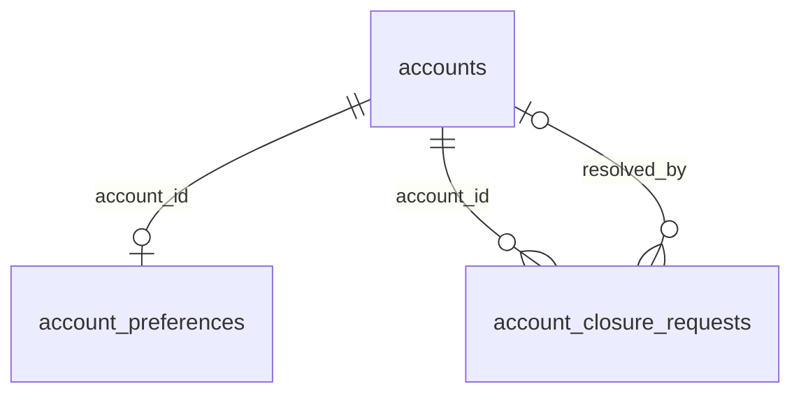

#### `account.accounts`

Prisma model `Account` (`prisma/schema/schema.prisma:11-68`). Created in `prisma/migrations/20260831150000_initial_schema/migration.sql:26`.

The root of the product data. One row per person, created idempotently by `provision` (`src/modules/account/repository/prisma-account.repository.ts:72-86`) when Better Auth reports a new user (`src/server.ts:141,357`); ids look like `acct_<ULID>`. `status` is `active`, `recovery_review` or `suspended_restricted` (`src/modules/account/repository/account.repository.ts:1`); the database has no check on it. Nothing in `src/` deletes an account row; approving an account closure request sets `status = suspended_restricted` (`src/modules/auth/repository/shared/prisma-account-closure.repository.ts:114-117`), and so does completing a staff offboarding (`src/modules/auth/repository/staff/prisma-staff-account-lifecycle.repository.ts:126-129`).

| Column | Type | Null | Default | Notes | Since |
| --- | --- | --- | --- | --- | --- |
| `account_id` | text | no |  | PK | `20260831150000_initial_schema:27` |
| `better_auth_user_id` | text | no |  | FK `public.auth_user(id)` RESTRICT; unique; the foreign key is not in the Prisma model. | `20260831150000_initial_schema:28` |
| `protected_contact_email` | text | yes |  | Synced from the verified primary email. | `20260831150000_initial_schema:29` |
| `status` | text | no | `'active'` | `active`, `recovery_review`, `suspended_restricted` in code; no check. | `20260831150000_initial_schema:30` |
| `created_at` | timestamptz(6) | no | `CURRENT_TIMESTAMP` |  | `20260831150000_initial_schema:31` |
| `updated_at` | timestamptz(6) | no | `CURRENT_TIMESTAMP` |  | `20260831150000_initial_schema:32` |

| Kind | Name | Definition | Migration |
| --- | --- | --- | --- |
| PK | `accounts_pkey` | `(account_id)` | `20260831150000_initial_schema:34` |
| UNIQUE | `accounts_better_auth_user_id_key` | `(better_auth_user_id)` | `20260831150000_initial_schema:542` |
| FK | `accounts_better_auth_user_id_fkey` | `(better_auth_user_id) -> public.auth_user(id) ON DELETE RESTRICT ON UPDATE CASCADE` | `20260831154500_better_auth_core:61` |

Written by `PrismaAccountRepository.provision` (`src/modules/account/repository/prisma-account.repository.ts:76`), `PrismaAccountRepository.syncVerifiedContactEmail` (`src/modules/account/repository/prisma-account.repository.ts:94`); `PrismaAccountClosureRepository.decide` (`src/modules/auth/repository/shared/prisma-account-closure.repository.ts:114`); `PrismaAccountRecoveryRepository.openCase` (`src/modules/auth/repository/staff/prisma-account-recovery.repository.ts:80`), `PrismaAccountRecoveryRepository.completeCase` (`src/modules/auth/repository/staff/prisma-account-recovery.repository.ts:289`); `PrismaStaffAccountLifecycleRepository.completeOffboarding` (`src/modules/auth/repository/staff/prisma-staff-account-lifecycle.repository.ts:126`).

#### `account.account_preferences`

Prisma model `AccountPreferences` (`prisma/schema/schema.prisma:70-83`). Created in `prisma/migrations/20260910120000_add_account_preferences/migration.sql:1`.

Per-account notification and display preferences: three email switches (`deal_alerts_email`, `statements_email`, `marketing_email`), `locale` and `timezone`. One row per account, written by an upsert (`src/modules/profile/repository/prisma-account-preferences.repository.ts:15`).

| Column | Type | Null | Default | Notes | Since |
| --- | --- | --- | --- | --- | --- |
| `account_id` | text | no |  | PK; FK `account.accounts(account_id)` RESTRICT | `20260910120000_add_account_preferences:2` |
| `deal_alerts_email` | boolean | no | `true` |  | `20260910120000_add_account_preferences:3` |
| `statements_email` | boolean | no | `true` |  | `20260910120000_add_account_preferences:4` |
| `marketing_email` | boolean | no | `false` |  | `20260910120000_add_account_preferences:5` |
| `locale` | text | no | `'en-US'` |  | `20260910120000_add_account_preferences:6` |
| `timezone` | text | no | `'UTC'` |  | `20260910120000_add_account_preferences:7` |
| `updated_at` | timestamptz | no | `CURRENT_TIMESTAMP` |  | `20260910120000_add_account_preferences:8` |

| Kind | Name | Definition | Migration |
| --- | --- | --- | --- |
| PK | `account_preferences_pkey` | `(account_id)` | `20260910120000_add_account_preferences:2` |
| FK | `account_preferences_account_id_fkey` | `(account_id) -> account.accounts(account_id) ON DELETE RESTRICT ON UPDATE CASCADE` | `20260910120000_add_account_preferences:9` |

Written by `PrismaAccountPreferencesRepository.update` (`src/modules/profile/repository/prisma-account-preferences.repository.ts:15`).

#### `auth.account_closure_requests`

Prisma model `AccountClosureRequest` (`prisma/schema/auth.prisma:189-205`). Created in `prisma/migrations/20260910130000_add_account_closure_requests/migration.sql:1`.

Customer-initiated requests to close an account, reviewed by one staff member (deliberately not dual review, per the schema comment `prisma/schema/auth.prisma:184-188`). `status` in code is `pending`, `approved`, `rejected` or `cancelled` (`src/modules/auth/repository/shared/account-closure.repository.ts:1`); the table lives in the `auth` schema although its foreign keys point at `account.accounts`.

| Column | Type | Null | Default | Notes | Since |
| --- | --- | --- | --- | --- | --- |
| `closure_request_id` | text | no |  | PK | `20260910130000_add_account_closure_requests:2` |
| `account_id` | text | no |  | FK `account.accounts(account_id)` RESTRICT | `20260910130000_add_account_closure_requests:3` |
| `status` | text | no | `'pending'` |  | `20260910130000_add_account_closure_requests:4` |
| `reason` | text | yes |  |  | `20260910130000_add_account_closure_requests:5` |
| `requested_at` | timestamptz | no | `CURRENT_TIMESTAMP` |  | `20260910130000_add_account_closure_requests:6` |
| `resolved_at` | timestamptz | yes |  |  | `20260910130000_add_account_closure_requests:7` |
| `resolved_by` | text | yes |  | FK `account.accounts(account_id)` RESTRICT | `20260910130000_add_account_closure_requests:8` |
| `resolution_note` | text | yes |  |  | `20260910130000_add_account_closure_requests:9` |

| Kind | Name | Definition | Migration |
| --- | --- | --- | --- |
| PK | `account_closure_requests_pkey` | `(closure_request_id)` | `20260910130000_add_account_closure_requests:2` |
| INDEX | `idx_closure_requests_account` | `(account_id)` | `20260910130000_add_account_closure_requests:18` |
| FK | `account_closure_requests_account_id_fkey` | `(account_id) -> account.accounts(account_id) ON DELETE RESTRICT ON UPDATE CASCADE` | `20260910130000_add_account_closure_requests:10` |
| FK | `account_closure_requests_resolved_by_fkey` | `(resolved_by) -> account.accounts(account_id) ON DELETE RESTRICT ON UPDATE CASCADE` | `20260910130000_add_account_closure_requests:13` |

Written by `PrismaAccountClosureRepository.create` (`src/modules/auth/repository/shared/prisma-account-closure.repository.ts:60`), `PrismaAccountClosureRepository.cancel` (`src/modules/auth/repository/shared/prisma-account-closure.repository.ts:76`), `PrismaAccountClosureRepository.decide` (`src/modules/auth/repository/shared/prisma-account-closure.repository.ts:100`).

### KYC

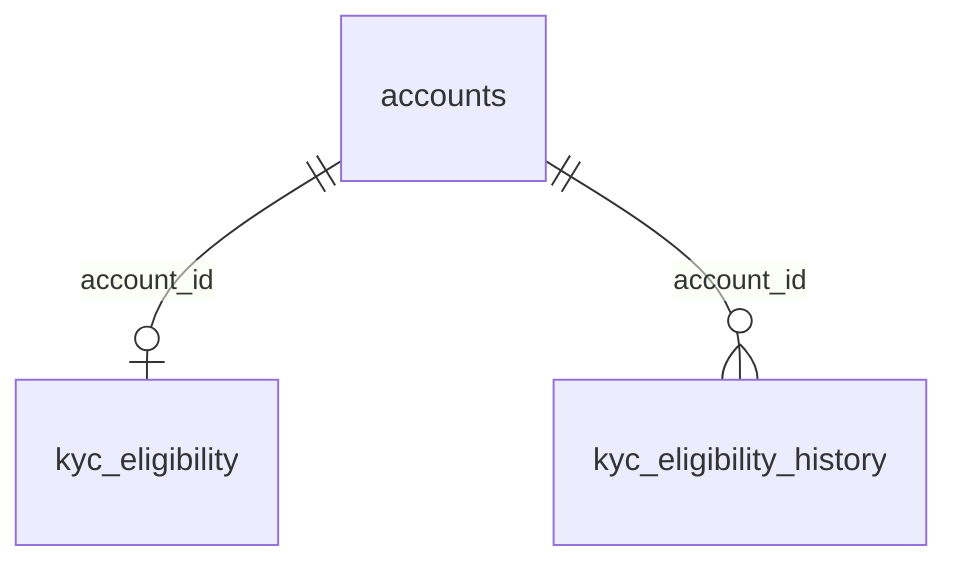

#### `identity.kyc_eligibility`

Prisma model `KycEligibility` (`prisma/schema/schema.prisma:124-149`). Created in `prisma/migrations/20260831150000_initial_schema/migration.sql:108`.

The KYC state of an account, one row per account. It holds provider references and statuses, VistaBlox's operational sub-status, the proof-of-address state, the residence countries, and the renewal due date. Personal data from the provider (document numbers, date of birth, address, biometrics) is not stored here (design record, `04-Engineering/DATA/CORE_TABLES.md:140-141`). The row is created on the first session start by an upsert (`src/modules/identity/repository/prisma-kyc.repository.ts:160-180`). `ever_required_manual_review` is set once and never reset (`prisma/migrations/20260901160000_kyc_renewal_risk_tier/migration.sql:1-9`).

| Column | Type | Null | Default | Notes | Since |
| --- | --- | --- | --- | --- | --- |
| `account_id` | text | no |  | PK; FK `account.accounts(account_id)` RESTRICT | `20260831150000_initial_schema:109` |
| `didit_reference` | text | yes |  | unique | `20260831150000_initial_schema:110` |
| `eligibility_state` | text | no | `'not_started'` | Check `kyc_eligibility_state_check`. | `20260831150000_initial_schema:111` |
| `residence_country_code` | text | yes |  |  | `20260831150000_initial_schema:112` |
| `tax_residence_country_code` | text | yes |  |  | `20260831150000_initial_schema:113` |
| `proof_of_address_current_until` | timestamptz(6) | yes |  |  | `20260831150000_initial_schema:114` |
| `last_verified_at` | timestamptz(6) | yes |  |  | `20260831150000_initial_schema:115` |
| `renewal_due_at` | timestamptz(6) | yes |  |  | `20260831150000_initial_schema:116` |
| `updated_at` | timestamptz(6) | no | `CURRENT_TIMESTAMP` |  | `20260831150000_initial_schema:117` |
| `provider_status` | text | yes |  |  | `20260901090000_didit_kyc:2` |
| `operational_substatus` | text | no | `'kyc_not_started'` | Check `kyc_operational_substatus_check`. | `20260901090000_didit_kyc:3` |
| `provider_updated_at` | timestamptz | yes |  |  | `20260901090000_didit_kyc:4` |
| `session_start_id` | text | yes |  | unique; Unique; the idempotency token of a session start. | `20260901090000_didit_kyc:5` |
| `proof_of_address_didit_reference` | text | yes |  | unique | `20260901100000_didit_proof_of_address:2` |
| `proof_of_address_provider_status` | text | yes |  |  | `20260901100000_didit_proof_of_address:3` |
| `proof_of_address_provider_updated_at` | timestamptz | yes |  |  | `20260901100000_didit_proof_of_address:4` |
| `proof_of_address_session_start_id` | text | yes |  | unique | `20260901100000_didit_proof_of_address:5` |
| `proof_of_address_status` | text | no | `'not_started'` |  | `20260901100000_didit_proof_of_address:6` |
| `ever_required_manual_review` | boolean | no | `false` |  | `20260901160000_kyc_renewal_risk_tier:9` |

| Kind | Name | Definition | Migration |
| --- | --- | --- | --- |
| PK | `kyc_eligibility_pkey` | `(account_id)` | `20260831150000_initial_schema:119` |
| UNIQUE | `kyc_eligibility_didit_reference_key` | `(didit_reference)` | `20260901090000_didit_kyc:19` |
| UNIQUE | `kyc_eligibility_poa_didit_reference_key` | `(proof_of_address_didit_reference)` | `20260901100000_didit_proof_of_address:15` |
| UNIQUE | `kyc_eligibility_poa_session_start_id_key` | `(proof_of_address_session_start_id)` | `20260901100000_didit_proof_of_address:18` |
| UNIQUE | `kyc_eligibility_session_start_id_key` | `(session_start_id)` | `20260901090000_didit_kyc:22` |
| FK | `kyc_eligibility_account_id_fkey` | `(account_id) -> account.accounts(account_id) ON DELETE RESTRICT ON UPDATE CASCADE` | `20260831150000_initial_schema:774` |
| CHECK | `kyc_eligibility_state_check` | `"eligibility_state" IN ( 'not_started', 'in_progress', 'pending_manual_review', 'eligible', 'unsupported_jurisdiction', 'not_eligible', 'requires_renewal', 'suspended_restricted' )` | `20260901090000_didit_kyc:26` |
| CHECK | `kyc_operational_substatus_check` | `"operational_substatus" IN ( 'kyc_not_started', 'kyc_session_creating', 'kyc_session_creation_failed', 'kyc_session_open', 'kyc_pending', 'kyc_resubmission_pending', 'kyc_manual_review', 'kyc_verified_pending_policy_eval', 'kyc_verified', 'kyc_verified_owner_poa_missing', 'kyc_jurisdiction_blocked', 'kyc_failed', 'kyc_restart_required', 'kyc_reverification_required', 'kyc_restricted', 'kyc_integration_anomaly' )` | `20260901090000_didit_kyc:39` |
| CHECK | `kyc_proof_of_address_current_until_check` | `"proof_of_address_status" <> 'current' OR "proof_of_address_current_until" IS NOT NULL` | `20260901100000_didit_proof_of_address:53` |
| CHECK | `kyc_proof_of_address_provider_status_check` | `"proof_of_address_provider_status" IS NULL OR "proof_of_address_provider_status" IN ( 'Not Started', 'In Progress', 'In Review', 'Approved', 'Declined', 'Resubmitted', 'Expired', 'Abandoned', 'Kyc Expired', 'Awaiting User' )` | `20260901100000_didit_proof_of_address:22` |
| CHECK | `kyc_proof_of_address_status_check` | `"proof_of_address_status" IN ( 'not_started', 'creating', 'creation_failed', 'in_progress', 'pending_manual_review', 'current', 'insufficient', 'expired', 'restart_required', 'integration_anomaly' )` | `20260901100000_didit_proof_of_address:38` |
| CHECK | `kyc_provider_status_check` | `"provider_status" IS NULL OR "provider_status" IN ( 'Not Started', 'In Progress', 'In Review', 'Approved', 'Declined', 'Resubmitted', 'Expired', 'Abandoned', 'Kyc Expired', 'Awaiting User' )` | `20260901090000_didit_kyc:70` |
| CHECK | `kyc_residence_country_code_check` | `"residence_country_code" IS NULL OR "residence_country_code" ~ '^[A-Z]{2}$'` | `20260901090000_didit_kyc:60` |
| CHECK | `kyc_tax_residence_country_code_check` | `"tax_residence_country_code" IS NULL OR "tax_residence_country_code" ~ '^[A-Z]{2}$'` | `20260901090000_didit_kyc:65` |

Written by `PrismaKycRepository.reserveSessionStart` (`src/modules/identity/repository/prisma-kyc.repository.ts:166`), `PrismaKycRepository.completeSessionStart` (`src/modules/identity/repository/prisma-kyc.repository.ts:198`), `PrismaKycRepository.failSessionStart` (`src/modules/identity/repository/prisma-kyc.repository.ts:252`), `PrismaKycRepository.reserveProofOfAddressSessionStart` (`src/modules/identity/repository/prisma-kyc.repository.ts:307`), `PrismaKycRepository.completeProofOfAddressSessionStart` (`src/modules/identity/repository/prisma-kyc.repository.ts:328`), `PrismaKycRepository.failProofOfAddressSessionStart` (`src/modules/identity/repository/prisma-kyc.repository.ts:381`), `PrismaKycRepository.applyProviderOutcome` (`src/modules/identity/repository/prisma-kyc.repository.ts:474`), `PrismaKycRepository.applyProofOfAddressOutcome` (`src/modules/identity/repository/prisma-kyc.repository.ts:584`), `PrismaKycRepository.transitionToRequiresRenewal` (`src/modules/identity/repository/prisma-kyc.repository.ts:678`).

#### `identity.kyc_eligibility_history`

Prisma model `KycEligibilityHistory` (`prisma/schema/schema.prisma:151-164`). Created in `prisma/migrations/20260831150000_initial_schema/migration.sql:123`.

One row per change of `kyc_eligibility.eligibility_state`: previous state, new state, an internal reason code and the time. Written by `PrismaKycRepository` in the same transactions that change the state (`src/modules/identity/repository/prisma-kyc.repository.ts:214,343,494,598,695`).

| Column | Type | Null | Default | Notes | Since |
| --- | --- | --- | --- | --- | --- |
| `history_id` | text | no |  | PK | `20260831150000_initial_schema:124` |
| `account_id` | text | no |  | FK `account.accounts(account_id)` RESTRICT | `20260831150000_initial_schema:125` |
| `previous_state` | text | no |  |  | `20260831150000_initial_schema:126` |
| `new_state` | text | no |  |  | `20260831150000_initial_schema:127` |
| `reason_code` | text | no |  |  | `20260831150000_initial_schema:128` |
| `changed_at` | timestamptz(6) | no | `CURRENT_TIMESTAMP` |  | `20260831150000_initial_schema:129` |

| Kind | Name | Definition | Migration |
| --- | --- | --- | --- |
| PK | `kyc_eligibility_history_pkey` | `(history_id)` | `20260831150000_initial_schema:131` |
| INDEX | `idx_kyc_history_account` | `(account_id)` | `20260831150000_initial_schema:575` |
| FK | `kyc_eligibility_history_account_id_fkey` | `(account_id) -> account.accounts(account_id) ON DELETE RESTRICT ON UPDATE CASCADE` | `20260831150000_initial_schema:777` |

Written by `PrismaKycRepository.completeSessionStart` (`src/modules/identity/repository/prisma-kyc.repository.ts:214`), `PrismaKycRepository.completeProofOfAddressSessionStart` (`src/modules/identity/repository/prisma-kyc.repository.ts:343`), `PrismaKycRepository.applyProviderOutcome` (`src/modules/identity/repository/prisma-kyc.repository.ts:494`), `PrismaKycRepository.applyProofOfAddressOutcome` (`src/modules/identity/repository/prisma-kyc.repository.ts:598`), `PrismaKycRepository.transitionToRequiresRenewal` (`src/modules/identity/repository/prisma-kyc.repository.ts:695`).

### Intake and documents

```mermaid
erDiagram
  properties ||--o{ property_rooms : "property_id"
  accounts ||--o{ intake_cases : "applicant_account_id"
  appraisal_firms o|--o{ intake_cases : "appraisal_firm_id"
  submission_revisions o|--o{ intake_cases : "current_submission_revision_id"
  legal_practices o|--o{ intake_cases : "legal_practice_id"
  properties ||--o{ intake_cases : "property_id"
  accounts o|--o{ intake_cases : "reviewed_by_account_id"
  accounts o|--o{ intake_case_events : "actor_account_id"
  intake_cases ||--o{ intake_case_events : "case_id"
  intake_case_events o|--o| intake_case_events : "reversal_of_event_id"
  accounts o|--o{ intake_case_reversal_operations : "approved_by_account_id"
  intake_cases ||--o{ intake_case_reversal_operations : "case_id"
  accounts ||--o{ intake_case_reversal_operations : "requested_by_account_id"
  intake_case_events o|--o{ intake_case_reversal_operations : "reversal_of_event_id"
  intake_cases ||--o{ submission_revisions : "case_id"
  accounts ||--o{ submission_revisions : "submitted_by_account_id"
  intake_cases ||--o{ documentary_screening_evidence : "case_id"
  accounts o|--o{ documentary_screening_evidence : "reviewed_by_account_id"
  submission_revisions ||--o{ documentary_screening_evidence : "submission_revision_id"
  accounts o|--o{ workstream_assignment_events : "actor_account_id +1"
  intake_cases ||--o{ workstream_assignment_events : "case_id"
  appraisal_firms o|--o{ workstream_assignment_events : "target_appraisal_firm_id"
  legal_practices o|--o{ workstream_assignment_events : "target_legal_practice_id"
  intake_cases ||--o{ case_integrity_flags : "case_id"
  accounts o|--o{ case_integrity_flags : "raised_by_account_id +1"
  intake_cases ||--o{ information_requests : "case_id"
  accounts ||--o{ information_requests : "proposed_by_account_id"
  accounts o|--o{ information_requests : "published_by_account_id"
  submission_revisions o|--o{ information_requests : "resolving_revision_id"
  intake_cases ||--o{ case_threads : "case_id"
  accounts o|--o{ case_messages : "author_account_id"
  case_threads ||--o{ case_messages : "thread_id"
  intake_cases ||--o{ legal_execution_events : "case_id"
  accounts ||--o{ legal_execution_events : "requested_by_account_id"
  intake_cases ||--o{ pivs : "case_id"
  corridor_clearances o|--o{ pivs : "corridor_clearance_id"
  properties ||--o| pivs : "property_id"
  property_rooms o|--o{ stored_documents : "room_id"
  stored_documents o|--o{ stored_documents : "source_document_id"
```

#### `intake.properties`

Prisma model `Property` (`prisma/schema/schema.prisma:166-194`). Created in `prisma/migrations/20260831150000_initial_schema/migration.sql:135`.

A property offered through an intake case. `property_type` is locked to `residential` by `properties_residential_only`; structured residential details are optional, and the energy rating follows the EU scale. The database does not check `owner_declared_value_eur`; the floor is the platform setting `intake.minimum_property_value_eur`, read by `getMinimumPropertyValueEur` for the application-layer check (`src/modules/intake/repository/prisma-intake.repository.ts:286-296`). Rooms are created with the property (`src/modules/intake/repository/prisma-intake.repository.ts:329-336`).

| Column | Type | Null | Default | Notes | Since |
| --- | --- | --- | --- | --- | --- |
| `property_id` | text | no |  | PK | `20260831150000_initial_schema:136` |
| `property_type` | text | no | `'residential'` |  | `20260831150000_initial_schema:137` |
| `country_code` | text | no |  |  | `20260831150000_initial_schema:138` |
| `city` | text | yes |  |  | `20260831150000_initial_schema:139` |
| `address_line` | text | yes |  |  | `20260831150000_initial_schema:140` |
| `land_registry_reference` | text | yes |  |  | `20260831150000_initial_schema:141` |
| `latitude` | double precision | yes |  |  | `20260831150000_initial_schema:142` |
| `longitude` | double precision | yes |  |  | `20260831150000_initial_schema:143` |
| `owner_declared_value_eur` | numeric(15,2) | no |  |  | `20260831150000_initial_schema:144` |
| `has_existing_encumbrance` | boolean | no | `false` |  | `20260831150000_initial_schema:145` |
| `created_at` | timestamptz(6) | no | `CURRENT_TIMESTAMP` |  | `20260831150000_initial_schema:146` |
| `residential_subtype` | text | yes |  |  | `20260913220000_property_structured_fields:6` |
| `living_area_sq_m` | numeric(6,2) | yes |  |  | `20260913220000_property_structured_fields:7` |
| `bedrooms` | integer | yes |  |  | `20260913220000_property_structured_fields:8` |
| `bathrooms` | integer | yes |  |  | `20260913220000_property_structured_fields:9` |
| `floor` | integer | yes |  |  | `20260913220000_property_structured_fields:10` |
| `total_floors` | integer | yes |  |  | `20260913220000_property_structured_fields:11` |
| `year_built` | integer | yes |  |  | `20260913220000_property_structured_fields:12` |
| `condition` | text | yes |  |  | `20260913220000_property_structured_fields:13` |
| `energy_rating` | text | yes |  |  | `20260913220000_property_structured_fields:14` |

| Kind | Name | Definition | Migration |
| --- | --- | --- | --- |
| PK | `properties_pkey` | `(property_id)` | `20260831150000_initial_schema:148` |
| CHECK | `properties_condition_check` | `"condition" IS NULL OR "condition" IN ('new', 'renovated', 'good', 'fair', 'needs_renovation')` | `20260913220000_property_structured_fields:24` |
| CHECK | `properties_energy_rating_check` | `"energy_rating" IS NULL OR "energy_rating" IN ('A+', 'A', 'B', 'C', 'D', 'E', 'F', 'G')` | `20260913220000_property_structured_fields:32` |
| CHECK | `properties_residential_only` | `"property_type" = 'residential'` | `20260831150000_initial_schema:928` |
| CHECK | `properties_residential_subtype_check` | `"residential_subtype" IS NULL OR "residential_subtype" IN ('apartment', 'house', 'townhouse', 'multi_family', 'studio', 'other')` | `20260913220000_property_structured_fields:17` |

Written by `PrismaIntakeRepository.createDraftIntake` (`src/modules/intake/repository/prisma-intake.repository.ts:306`), `PrismaIntakeRepository.createStaffCase` (`src/modules/intake/repository/prisma-intake.repository.ts:392`).

#### `intake.property_rooms`

Prisma model `PropertyRoom` (`prisma/schema/schema.prisma:196-210`). Created in `prisma/migrations/20260913230000_property_rooms/migration.sql:7`.

Per-room breakdown of a property, created with the property. `preferred_photo_id` names the representative photo; it has no foreign key and is set by the staff photo-selection path (`src/modules/intake/application/upload-case-document.service.ts:27`). Deleting a room soft-deletes its photos and detaches them (`src/modules/intake/application/upload-case-document.service.ts:55-75`).

| Column | Type | Null | Default | Notes | Since |
| --- | --- | --- | --- | --- | --- |
| `room_id` | text | no |  | PK | `20260913230000_property_rooms:8` |
| `property_id` | text | no |  | FK `intake.properties(property_id)` RESTRICT | `20260913230000_property_rooms:9` |
| `room_type` | text | no |  |  | `20260913230000_property_rooms:10` |
| `size_sq_m` | numeric(6,2) | no |  |  | `20260913230000_property_rooms:11` |
| `created_at` | timestamptz(6) | no | `CURRENT_TIMESTAMP` |  | `20260913230000_property_rooms:12` |
| `preferred_photo_id` | text | yes |  |  | `20260918100000_room_photo_associations:5` |

| Kind | Name | Definition | Migration |
| --- | --- | --- | --- |
| PK | `property_rooms_pkey` | `(room_id)` | `20260913230000_property_rooms:14` |
| INDEX | `idx_property_rooms_property` | `(property_id)` | `20260913230000_property_rooms:17` |
| FK | `property_rooms_property_id_fkey` | `(property_id) -> intake.properties(property_id) ON DELETE RESTRICT ON UPDATE CASCADE` | `20260913230000_property_rooms:20` |
| CHECK | `property_rooms_room_type_check` | `"room_type" IN ('bedroom', 'bathroom', 'kitchen', 'living_room', 'dining_room', 'office', 'storage', 'other')` | `20260913230000_property_rooms:25` |

Written by `UploadCaseDocumentService.setRepresentative` (`src/modules/intake/application/upload-case-document.service.ts:27`), `UploadCaseDocumentService.deletePhoto` (`src/modules/intake/application/upload-case-document.service.ts:40`), `UploadCaseDocumentService.deleteRoom` (`src/modules/intake/application/upload-case-document.service.ts:71`); `PrismaIntakeRepository.createDraftIntake` (`src/modules/intake/repository/prisma-intake.repository.ts:330`), `PrismaIntakeRepository.createStaffCase` (`src/modules/intake/repository/prisma-intake.repository.ts:416`).

#### `intake.legal_practices`

Prisma model `LegalPractice` (`prisma/schema/schema.prisma:212-225`). Created in `prisma/migrations/20260831150000_initial_schema/migration.sql:152`.

Legal partner firms (`status` is `active` or `suspended`, `src/modules/intake/repository/partner-organization.repository.ts:1`). Referenced by staff roles, invitations and cases.

| Column | Type | Null | Default | Notes | Since |
| --- | --- | --- | --- | --- | --- |
| `legal_practice_id` | text | no |  | PK | `20260831150000_initial_schema:153` |
| `name` | text | no |  |  | `20260831150000_initial_schema:154` |
| `country_code` | text | no |  |  | `20260831150000_initial_schema:155` |
| `status` | text | no | `'active'` |  | `20260831150000_initial_schema:156` |

| Kind | Name | Definition | Migration |
| --- | --- | --- | --- |
| PK | `legal_practices_pkey` | `(legal_practice_id)` | `20260831150000_initial_schema:158` |

Written by `PrismaPartnerOrganizationRepository.createLegalPractice` (`src/modules/intake/repository/prisma-partner-organization.repository.ts:22`), `PrismaPartnerOrganizationRepository.updateLegalPracticeStatus` (`src/modules/intake/repository/prisma-partner-organization.repository.ts:71`).

#### `intake.appraisal_firms`

Prisma model `AppraisalFirm` (`prisma/schema/schema.prisma:227-240`). Created in `prisma/migrations/20260831150000_initial_schema/migration.sql:162`.

Appraisal partner firms, same shape and `status` values as `intake.legal_practices`.

| Column | Type | Null | Default | Notes | Since |
| --- | --- | --- | --- | --- | --- |
| `appraisal_firm_id` | text | no |  | PK | `20260831150000_initial_schema:163` |
| `name` | text | no |  |  | `20260831150000_initial_schema:164` |
| `country_code` | text | no |  |  | `20260831150000_initial_schema:165` |
| `status` | text | no | `'active'` |  | `20260831150000_initial_schema:166` |

| Kind | Name | Definition | Migration |
| --- | --- | --- | --- |
| PK | `appraisal_firms_pkey` | `(appraisal_firm_id)` | `20260831150000_initial_schema:168` |

Written by `PrismaPartnerOrganizationRepository.createAppraisalFirm` (`src/modules/intake/repository/prisma-partner-organization.repository.ts:102`), `PrismaPartnerOrganizationRepository.updateAppraisalFirmStatus` (`src/modules/intake/repository/prisma-partner-organization.repository.ts:151`).

#### `intake.corridor_clearances`

Prisma model `CorridorClearance` (`prisma/schema/schema.prisma:242-257`). Created in `prisma/migrations/20260831150000_initial_schema/migration.sql:172`.

Reusable country-level clearance of a structure pattern and distribution posture, unique on `(country_code, structure_pattern, distribution_posture)`. Nothing under `src/` reads or writes this table, and `intake.pivs.corridor_clearance_id` is never set by code (searched `src` for the table and model names).

| Column | Type | Null | Default | Notes | Since |
| --- | --- | --- | --- | --- | --- |
| `corridor_clearance_id` | text | no |  | PK | `20260831150000_initial_schema:173` |
| `country_code` | text | no |  |  | `20260831150000_initial_schema:174` |
| `structure_pattern` | text | no |  |  | `20260831150000_initial_schema:175` |
| `distribution_posture` | text | no |  |  | `20260831150000_initial_schema:176` |
| `gate_status` | text | no | `'not_yet_cleared'` |  | `20260831150000_initial_schema:177` |
| `counsel_memo_ref` | text | yes |  |  | `20260831150000_initial_schema:178` |
| `cleared_at` | timestamptz(6) | yes |  |  | `20260831150000_initial_schema:179` |
| `updated_at` | timestamptz(6) | no | `CURRENT_TIMESTAMP` |  | `20260831150000_initial_schema:180` |

| Kind | Name | Definition | Migration |
| --- | --- | --- | --- |
| PK | `corridor_clearances_pkey` | `(corridor_clearance_id)` | `20260831150000_initial_schema:182` |
| UNIQUE | `corridor_clearances_country_code_structure_pattern_distribu_key` | `(country_code, structure_pattern, distribution_posture)` | `20260831150000_initial_schema:578` |

No code under `src/` writes this table.

#### `intake.intake_cases`

Prisma model `IntakeCase` (`prisma/schema/schema.prisma:259-317`). Created in `prisma/migrations/20260831150000_initial_schema/migration.sql:186`; history: renamed intake.origination_cases -> intake.intake_cases (20260917150000_rename_origination_to_intake:6).

The property intake case: its stage, the founder's review record, the IPO terms set at approval, and the post-IPO structuring fields. `origination_cases_stage_check` limits `stage` to nine values (the constraint keeps the old table prefix after the rename). `workflow_event_sequence` is the per-case counter that numbers `intake.intake_case_events`; it is incremented in the same transaction as each event insert (`src/modules/intake/repository/intake-case-event.repository.ts:70-76`). The three `*_refs` array columns are nullable with no default. The case-changing methods of `PrismaIntakeRepository` listed in section 7.1 take `SELECT ... FOR UPDATE` on this row first; `reviewEvidence`, `postCaseMessage` and the document upload service do not, and where they append a case event the `UPDATE` of `workflow_event_sequence` locks the row from that statement until the transaction ends.

| Column | Type | Null | Default | Notes | Since |
| --- | --- | --- | --- | --- | --- |
| `case_id` | text | no |  | PK | `20260831150000_initial_schema:187` |
| `property_id` | text | no |  | FK `intake.properties(property_id)` RESTRICT | `20260831150000_initial_schema:188` |
| `applicant_account_id` | text | no |  | FK `account.accounts(account_id)` RESTRICT | `20260831150000_initial_schema:189` |
| `stage` | text | no | `'draft'` | Check `origination_cases_stage_check`. | `20260831150000_initial_schema:190` |
| `can_reopen` | boolean | no | `false` |  | `20260831150000_initial_schema:191` |
| `current_submission_revision_id` | text | yes |  | FK `intake.submission_revisions(revision_id)` SET NULL | `20260831150000_initial_schema:192` |
| `rejected_at` | timestamptz(6) | yes |  |  | `20260831150000_initial_schema:193` |
| `withdrawn_at` | timestamptz(6) | yes |  |  | `20260831150000_initial_schema:194` |
| `expired_at` | timestamptz(6) | yes |  |  | `20260831150000_initial_schema:195` |
| `approved_for_final_offering_at` | timestamptz(6) | yes |  |  | `20260831150000_initial_schema:196` |
| `rejection_reason_code` | text | yes |  |  | `20260831150000_initial_schema:197` |
| `rejection_notes` | text | yes |  |  | `20260831150000_initial_schema:198` |
| `founder_review_notes` | text | yes |  |  | `20260831150000_initial_schema:199` |
| `reviewed_by_account_id` | text | yes |  | FK `account.accounts(account_id)` SET NULL | `20260831150000_initial_schema:200` |
| `approved_at` | timestamptz(6) | yes |  |  | `20260831150000_initial_schema:201` |
| `legal_execution_event_refs` | text[] | yes |  | `text[]`, nullable, no default. | `20260831150000_initial_schema:202` |
| `ipo_period_days` | integer | yes |  |  | `20260831150000_initial_schema:203` |
| `ipo_end_at` | timestamptz(6) | yes |  |  | `20260831150000_initial_schema:204` |
| `ipo_value_eur` | numeric(15,2) | yes |  |  | `20260831150000_initial_schema:205` |
| `legal_practice_id` | text | yes |  | FK `intake.legal_practices(legal_practice_id)` SET NULL | `20260831150000_initial_schema:206` |
| `legal_document_refs` | text[] | yes |  |  | `20260831150000_initial_schema:207` |
| `legal_structuring_completed_at` | timestamptz(6) | yes |  |  | `20260831150000_initial_schema:208` |
| `appraisal_firm_id` | text | yes |  | FK `intake.appraisal_firms(appraisal_firm_id)` SET NULL | `20260831150000_initial_schema:209` |
| `appraisal_value_opinion_eur` | numeric(15,2) | yes |  |  | `20260831150000_initial_schema:210` |
| `appraisal_document_refs` | text[] | yes |  |  | `20260831150000_initial_schema:211` |
| `appraisal_completed_at` | timestamptz(6) | yes |  |  | `20260831150000_initial_schema:212` |
| `post_ipo_structuring_completed_at` | timestamptz(6) | yes |  |  | `20260831150000_initial_schema:213` |
| `exclusivity_commenced_at` | timestamptz(6) | yes |  |  | `20260831150000_initial_schema:214` |
| `created_at` | timestamptz(6) | no | `CURRENT_TIMESTAMP` |  | `20260831150000_initial_schema:215` |
| `updated_at` | timestamptz(6) | no | `CURRENT_TIMESTAMP` |  | `20260831150000_initial_schema:216` |
| `workflow_event_sequence` | integer | no | `0` |  | `20260918120000_intake_case_event_ledger:2` |

| Kind | Name | Definition | Migration |
| --- | --- | --- | --- |
| PK | `origination_cases_pkey` | `(case_id)` | `20260831150000_initial_schema:218` |
| INDEX | `idx_cases_applicant` | `(applicant_account_id)` | `20260831150000_initial_schema:584` |
| INDEX | `idx_cases_appraisal_firm` | `(appraisal_firm_id)` | `20260831150000_initial_schema:593` |
| INDEX | `idx_cases_current_revision` | `(current_submission_revision_id)` | `20260831150000_initial_schema:587` |
| INDEX | `idx_cases_legal_practice` | `(legal_practice_id)` | `20260831150000_initial_schema:590` |
| INDEX | `idx_cases_property` | `(property_id)` | `20260831150000_initial_schema:581` |
| INDEX | `idx_cases_stage` | `(stage)` | `20260831150000_initial_schema:596` |
| FK | `origination_cases_applicant_account_id_fkey` | `(applicant_account_id) -> account.accounts(account_id) ON DELETE RESTRICT ON UPDATE CASCADE` | `20260831150000_initial_schema:783` |
| FK | `origination_cases_appraisal_firm_id_fkey` | `(appraisal_firm_id) -> intake.appraisal_firms(appraisal_firm_id) ON DELETE SET NULL ON UPDATE CASCADE` | `20260831150000_initial_schema:792` |
| FK | `origination_cases_current_submission_revision_id_fkey` | `(current_submission_revision_id) -> intake.submission_revisions(revision_id) ON DELETE SET NULL ON UPDATE CASCADE` | `20260831150000_initial_schema:795` |
| FK | `origination_cases_legal_practice_id_fkey` | `(legal_practice_id) -> intake.legal_practices(legal_practice_id) ON DELETE SET NULL ON UPDATE CASCADE` | `20260831150000_initial_schema:789` |
| FK | `origination_cases_property_id_fkey` | `(property_id) -> intake.properties(property_id) ON DELETE RESTRICT ON UPDATE CASCADE` | `20260831150000_initial_schema:780` |
| FK | `origination_cases_reviewed_by_account_id_fkey` | `(reviewed_by_account_id) -> account.accounts(account_id) ON DELETE SET NULL ON UPDATE CASCADE` | `20260831150000_initial_schema:786` |
| CHECK | `origination_cases_ipo_terms_check` | `("ipo_period_days" IS NULL OR "ipo_period_days" > 0) AND ("ipo_value_eur" IS NULL OR "ipo_value_eur" > 0)` | `20260831170000_origination_review_workflow:29` |
| CHECK | `origination_cases_stage_check` | `"stage" IN ( 'draft', 'submitted', 'waiting_on_applicant', 'pre_offering_open', 'post_ipo_structuring', 'approved_for_final_offering', 'rejected', 'withdrawn', 'expired' )` | `20260831170000_origination_review_workflow:13` |

Written by `appendWithWorkflow` (`src/modules/intake/repository/intake-case-event.repository.ts:70`); `PrismaIntakeRepository.runReversalExecution` (`src/modules/intake/repository/prisma-intake.repository.ts:254`), `PrismaIntakeRepository.createDraftIntake` (`src/modules/intake/repository/prisma-intake.repository.ts:339`), `PrismaIntakeRepository.createStaffCase` (`src/modules/intake/repository/prisma-intake.repository.ts:425`), `PrismaIntakeRepository.submitInitialCase` (`src/modules/intake/repository/prisma-intake.repository.ts:605`), `PrismaIntakeRepository.assignPartnerOrganization` (`src/modules/intake/repository/prisma-intake.repository.ts:1108`), `PrismaIntakeRepository.transitionToPostIpoStructuring` (`src/modules/intake/repository/prisma-intake.repository.ts:1197`), `PrismaIntakeRepository.recordLegalStructuring` (`src/modules/intake/repository/prisma-intake.repository.ts:1331`), `PrismaIntakeRepository.recordAppraisal` (`src/modules/intake/repository/prisma-intake.repository.ts:1419`), `PrismaIntakeRepository.publishInformationRequest` (`src/modules/intake/repository/prisma-intake.repository.ts:1559`), `PrismaIntakeRepository.expireInformationRequest` (`src/modules/intake/repository/prisma-intake.repository.ts:1713`), `PrismaIntakeRepository.withdrawInformationRequest` (`src/modules/intake/repository/prisma-intake.repository.ts:1815`), `PrismaIntakeRepository.resubmitAfterInformationRequest` (`src/modules/intake/repository/prisma-intake.repository.ts:1965`), `PrismaIntakeRepository.recordFounderDecision` (`src/modules/intake/repository/prisma-intake.repository.ts:2046`), `PrismaIntakeRepository.closeCase` (`src/modules/intake/repository/prisma-intake.repository.ts:2310`).

#### `intake.intake_case_events`

Prisma model `IntakeCaseEvent` (`prisma/schema/schema.prisma:319-352`). Created in `prisma/migrations/20260918120000_intake_case_event_ledger/migration.sql:4`.

The append-only lifecycle ledger of a case: one row per event, numbered by `event_sequence` per case, with a unique `event_key` that makes a repeated write a no-op. A trigger rejects every UPDATE and DELETE, and a second trigger validates reversal events (a reversal cannot reverse a reversal and needs a stage change). `event_source` is `live` or `legacy_audit`; `source_audit_log_id` links a row written by the backfill command to its audit row and is unique (`src/cli/backfill-intake-case-events.ts:93`).

| Column | Type | Null | Default | Notes | Since |
| --- | --- | --- | --- | --- | --- |
| `event_id` | text | no |  | PK | `20260918120000_intake_case_event_ledger:5` |
| `case_id` | text | no |  | FK `intake.intake_cases(case_id)` RESTRICT | `20260918120000_intake_case_event_ledger:6` |
| `event_sequence` | integer | no |  |  | `20260918120000_intake_case_event_ledger:7` |
| `event_key` | text | no |  | unique | `20260918120000_intake_case_event_ledger:8` |
| `event_type` | text | no |  |  | `20260918120000_intake_case_event_ledger:9` |
| `workflow_type` | text | no |  |  | `20260918120000_intake_case_event_ledger:10` |
| `workflow_version` | integer | no |  |  | `20260918120000_intake_case_event_ledger:11` |
| `from_stage` | text | yes |  |  | `20260918120000_intake_case_event_ledger:12` |
| `to_stage` | text | yes |  |  | `20260918120000_intake_case_event_ledger:13` |
| `actor_type` | text | no |  |  | `20260918120000_intake_case_event_ledger:14` |
| `actor_account_id` | text | yes |  | FK `account.accounts(account_id)` RESTRICT | `20260918120000_intake_case_event_ledger:15` |
| `trace_id` | text | yes |  |  | `20260918120000_intake_case_event_ledger:16` |
| `causation_event_id` | text | yes |  |  | `20260918120000_intake_case_event_ledger:17` |
| `related_resource_type` | text | yes |  |  | `20260918120000_intake_case_event_ledger:18` |
| `related_resource_id` | text | yes |  |  | `20260918120000_intake_case_event_ledger:19` |
| `metadata` | jsonb | no | `'{}'` |  | `20260918120000_intake_case_event_ledger:20` |
| `occurred_at` | timestamptz(6) | no |  |  | `20260918120000_intake_case_event_ledger:21` |
| `recorded_at` | timestamptz(6) | no | `CURRENT_TIMESTAMP` |  | `20260918120000_intake_case_event_ledger:22` |
| `event_source` | text | no | `'live'` |  | `20260918120000_intake_case_event_ledger:23` |
| `source_audit_log_id` | text | yes |  | unique | `20260918120000_intake_case_event_ledger:24` |
| `source_job_id` | text | yes |  |  | `20260918120000_intake_case_event_ledger:25` |
| `reversal_of_event_id` | text | yes |  | FK `intake.intake_case_events(event_id)` RESTRICT; unique | `20260918140000_intake_case_reversal_operations:2` |

| Kind | Name | Definition | Migration |
| --- | --- | --- | --- |
| PK | `intake_case_events_pkey` | `(event_id)` | `20260918120000_intake_case_event_ledger:26` |
| INDEX | `intake_case_events_case_id_event_sequence_idx` | `(case_id, event_sequence DESC)` | `20260918120000_intake_case_event_ledger:44` |
| UNIQUE | `intake_case_events_case_id_event_sequence_key` | `(case_id, event_sequence)` | `20260918120000_intake_case_event_ledger:43` |
| INDEX | `intake_case_events_case_id_occurred_at_event_id_idx` | `(case_id, occurred_at DESC, event_id DESC)` | `20260918120000_intake_case_event_ledger:45` |
| UNIQUE | `intake_case_events_event_key_key` | `(event_key)` | `20260918120000_intake_case_event_ledger:41` |
| INDEX | `intake_case_events_event_type_occurred_at_idx` | `(event_type, occurred_at DESC)` | `20260918120000_intake_case_event_ledger:46` |
| INDEX | `intake_case_events_related_resource_idx` | `(related_resource_type, related_resource_id, occurred_at DESC)` | `20260918120000_intake_case_event_ledger:47` |
| UNIQUE | `intake_case_events_reversal_of_event_id_key` | `(reversal_of_event_id)` | `20260918140000_intake_case_reversal_operations:4` |
| UNIQUE | `intake_case_events_source_audit_log_id_key` | `(source_audit_log_id)` | `20260918120000_intake_case_event_ledger:42` |
| FK | `intake_case_events_actor_account_id_fkey` | `(actor_account_id) -> account.accounts(account_id) ON DELETE RESTRICT ON UPDATE CASCADE` | `20260918120000_intake_case_event_ledger:38` |
| FK | `intake_case_events_case_id_fkey` | `(case_id) -> intake.intake_cases(case_id) ON DELETE RESTRICT ON UPDATE CASCADE` | `20260918120000_intake_case_event_ledger:37` |
| FK | `intake_case_events_reversal_of_event_id_fkey` | `(reversal_of_event_id) -> intake.intake_case_events(event_id) ON DELETE RESTRICT ON UPDATE CASCADE` | `20260918140000_intake_case_reversal_operations:8` |
| CHECK | `intake_case_events_actor_type_check` | `"actor_type" IN ('staff', 'applicant', 'partner', 'system')` | `20260918120000_intake_case_event_ledger:33` |
| CHECK | `intake_case_events_event_sequence_check` | `"event_sequence" > 0` | `20260918120000_intake_case_event_ledger:27` |
| CHECK | `intake_case_events_event_source_check` | `"event_source" IN ('live', 'legacy_audit')` | `20260918120000_intake_case_event_ledger:35` |
| CHECK | `intake_case_events_stage_check` | `("from_stage" IS NULL OR "from_stage" IN ('draft', 'submitted', 'waiting_on_applicant', 'pre_offering_open', 'post_ipo_structuring', 'approved_for_final_offering', 'rejected', 'withdrawn', 'expired')) AND ("to_stage" IS NULL OR "to_stage" IN ('draft', 'submitted', 'waiting_on_applicant', 'pre_offering_open', 'post_ipo_structuring', 'approved_for_final_offering', 'rejected', 'withdrawn', 'expired'))` | `20260918120000_intake_case_event_ledger:29` |
| CHECK | `intake_case_events_system_actor_check` | `"actor_type" <> 'system' OR "actor_account_id" IS NULL` | `20260918120000_intake_case_event_ledger:34` |
| CHECK | `intake_case_events_transition_check` | `("from_stage" IS NULL AND "to_stage" IS NULL) OR ("from_stage" IS NOT NULL AND "to_stage" IS NOT NULL AND "from_stage" <> "to_stage")` | `20260918120000_intake_case_event_ledger:36` |
| CHECK | `intake_case_events_workflow_version_check` | `"workflow_version" >= 0` | `20260918120000_intake_case_event_ledger:28` |
| TRIGGER | `intake_case_events_append_only` | `BEFORE UPDATE OR DELETE FOR EACH ROW EXECUTE FUNCTION intake.reject_intake_case_event_mutation()` | `20260918120000_intake_case_event_ledger:56` |
| TRIGGER | `intake_case_events_reversal_validation` | `BEFORE INSERT FOR EACH ROW EXECUTE FUNCTION intake.validate_intake_case_reversal_event()` | `20260918140000_intake_case_reversal_operations:27` |

Written by `appendWithWorkflow` (`src/modules/intake/repository/intake-case-event.repository.ts:76`).

#### `intake.intake_case_reversal_operations`

Prisma model `IntakeCaseReversalOperation` (`prisma/schema/schema.prisma:354-388`). Created in `prisma/migrations/20260918140000_intake_case_reversal_operations/migration.sql:31`.

The record of a staff-requested reversal of a case's stage: command, from and to stage, status (`requested`, `pending_approval`, `approved`, `executing`, `completed`, `failed`, `cancelled`), requester, approver, the expected stage and expected event sequence it was requested against, and a client idempotency key unique per case. The reason is limited to 1-500 characters.

| Column | Type | Null | Default | Notes | Since |
| --- | --- | --- | --- | --- | --- |
| `operation_id` | text | no |  | PK | `20260918140000_intake_case_reversal_operations:32` |
| `case_id` | text | no |  | FK `intake.intake_cases(case_id)` RESTRICT | `20260918140000_intake_case_reversal_operations:33` |
| `command` | text | no |  |  | `20260918140000_intake_case_reversal_operations:34` |
| `from_stage` | text | no |  |  | `20260918140000_intake_case_reversal_operations:35` |
| `to_stage` | text | no |  |  | `20260918140000_intake_case_reversal_operations:36` |
| `status` | text | no |  |  | `20260918140000_intake_case_reversal_operations:37` |
| `reason_code` | text | no |  |  | `20260918140000_intake_case_reversal_operations:38` |
| `reason` | text | no |  |  | `20260918140000_intake_case_reversal_operations:39` |
| `requested_by_account_id` | text | no |  | FK `account.accounts(account_id)` RESTRICT | `20260918140000_intake_case_reversal_operations:40` |
| `approved_by_account_id` | text | yes |  | FK `account.accounts(account_id)` RESTRICT | `20260918140000_intake_case_reversal_operations:41` |
| `expected_stage` | text | no |  |  | `20260918140000_intake_case_reversal_operations:42` |
| `expected_workflow_event_sequence` | integer | no |  |  | `20260918140000_intake_case_reversal_operations:43` |
| `reversal_of_event_id` | text | yes |  | FK `intake.intake_case_events(event_id)` RESTRICT | `20260918140000_intake_case_reversal_operations:44` |
| `idempotency_key` | text | no |  |  | `20260918140000_intake_case_reversal_operations:45` |
| `trace_id` | text | no |  |  | `20260918140000_intake_case_reversal_operations:46` |
| `metadata` | jsonb | no | `'{}'` |  | `20260918140000_intake_case_reversal_operations:47` |
| `failure_code` | text | yes |  |  | `20260918140000_intake_case_reversal_operations:48` |
| `failure_detail` | text | yes |  |  | `20260918140000_intake_case_reversal_operations:49` |
| `created_at` | timestamptz(6) | no | `CURRENT_TIMESTAMP` |  | `20260918140000_intake_case_reversal_operations:50` |
| `approved_at` | timestamptz(6) | yes |  |  | `20260918140000_intake_case_reversal_operations:51` |
| `started_at` | timestamptz(6) | yes |  |  | `20260918140000_intake_case_reversal_operations:52` |
| `completed_at` | timestamptz(6) | yes |  |  | `20260918140000_intake_case_reversal_operations:53` |
| `failed_at` | timestamptz(6) | yes |  |  | `20260918140000_intake_case_reversal_operations:54` |

| Kind | Name | Definition | Migration |
| --- | --- | --- | --- |
| PK | `intake_case_reversal_operations_pkey` | `(operation_id)` | `20260918140000_intake_case_reversal_operations:55` |
| INDEX | `intake_case_reversal_operations_case_id_created_at_idx` | `(case_id, created_at DESC)` | `20260918140000_intake_case_reversal_operations:70` |
| UNIQUE | `intake_case_reversal_operations_case_id_idempotency_key_key` | `(case_id, idempotency_key)` | `20260918140000_intake_case_reversal_operations:68` |
| INDEX | `intake_case_reversal_operations_status_created_at_idx` | `(status, created_at DESC)` | `20260918140000_intake_case_reversal_operations:72` |
| FK | `intake_case_reversal_operations_approved_by_fkey` | `(approved_by_account_id) -> account.accounts(account_id) ON DELETE RESTRICT ON UPDATE CASCADE` | `20260918140000_intake_case_reversal_operations:64` |
| FK | `intake_case_reversal_operations_case_id_fkey` | `(case_id) -> intake.intake_cases(case_id) ON DELETE RESTRICT ON UPDATE CASCADE` | `20260918140000_intake_case_reversal_operations:62` |
| FK | `intake_case_reversal_operations_requested_by_fkey` | `(requested_by_account_id) -> account.accounts(account_id) ON DELETE RESTRICT ON UPDATE CASCADE` | `20260918140000_intake_case_reversal_operations:63` |
| FK | `intake_case_reversal_operations_reversal_event_fkey` | `(reversal_of_event_id) -> intake.intake_case_events(event_id) ON DELETE RESTRICT ON UPDATE CASCADE` | `20260918140000_intake_case_reversal_operations:65` |
| CHECK | `intake_case_reversal_operations_reason_check` | `char_length("reason") BETWEEN 1 AND 500` | `20260918140000_intake_case_reversal_operations:56` |
| CHECK | `intake_case_reversal_operations_stage_check` | `"from_stage" IN ('draft', 'submitted', 'waiting_on_applicant', 'pre_offering_open', 'post_ipo_structuring', 'approved_for_final_offering', 'rejected', 'withdrawn', 'expired') AND "to_stage" IN ('draft', 'submitted', 'waiting_on_applicant', 'pre_offering_open', 'post_ipo_structuring', 'approved_for_final_offering', 'rejected', 'withdrawn', 'expired')` | `20260918140000_intake_case_reversal_operations:58` |
| CHECK | `intake_case_reversal_operations_status_check` | `"status" IN ('requested', 'pending_approval', 'approved', 'executing', 'completed', 'failed', 'cancelled')` | `20260918140000_intake_case_reversal_operations:57` |

Written by `PrismaIntakeRepository.createReversalOperation` (`src/modules/intake/repository/prisma-intake.repository.ts:163`), `PrismaIntakeRepository.approveReversalOperation` (`src/modules/intake/repository/prisma-intake.repository.ts:186`), `PrismaIntakeRepository.cancelReversalOperation` (`src/modules/intake/repository/prisma-intake.repository.ts:207`), `PrismaIntakeRepository.runReversalExecution` (`src/modules/intake/repository/prisma-intake.repository.ts:253`), `failReversalOperation` (`src/modules/intake/repository/prisma-intake.repository.ts:2457`).

#### `intake.submission_revisions`

Prisma model `SubmissionRevision` (`prisma/schema/schema.prisma:390-409`). Created in `prisma/migrations/20260831150000_initial_schema/migration.sql:222`.

Immutable snapshots of a case's submission (`submission_data` JSON), numbered per case. `reason` is `initial`, `resubmission_after_rfi` or `initial_staff_created`. A trigger rejects every UPDATE and DELETE (AD-186; `prisma/migrations/20260831163000_immutable_submission_revisions/migration.sql:1-16`).

| Column | Type | Null | Default | Notes | Since |
| --- | --- | --- | --- | --- | --- |
| `revision_id` | text | no |  | PK | `20260831150000_initial_schema:223` |
| `case_id` | text | no |  | FK `intake.intake_cases(case_id)` RESTRICT | `20260831150000_initial_schema:224` |
| `revision_number` | integer | no |  |  | `20260831150000_initial_schema:225` |
| `submitted_at` | timestamptz(6) | no | `CURRENT_TIMESTAMP` |  | `20260831150000_initial_schema:226` |
| `submitted_by_account_id` | text | no |  | FK `account.accounts(account_id)` RESTRICT | `20260831150000_initial_schema:227` |
| `submission_data` | jsonb | no |  |  | `20260831150000_initial_schema:228` |
| `reason` | text | no |  |  | `20260831150000_initial_schema:229` |

| Kind | Name | Definition | Migration |
| --- | --- | --- | --- |
| PK | `submission_revisions_pkey` | `(revision_id)` | `20260831150000_initial_schema:231` |
| INDEX | `idx_revisions_submitted_by` | `(submitted_by_account_id)` | `20260831150000_initial_schema:599` |
| UNIQUE | `submission_revisions_case_id_revision_number_key` | `(case_id, revision_number)` | `20260831150000_initial_schema:602` |
| FK | `submission_revisions_case_id_fkey` | `(case_id) -> intake.intake_cases(case_id) ON DELETE RESTRICT ON UPDATE CASCADE` | `20260831150000_initial_schema:798` |
| FK | `submission_revisions_submitted_by_account_id_fkey` | `(submitted_by_account_id) -> account.accounts(account_id) ON DELETE RESTRICT ON UPDATE CASCADE` | `20260831150000_initial_schema:801` |
| CHECK | `submission_revisions_number_check` | `"revision_number" > 0` | `20260831170000_origination_review_workflow:36` |
| CHECK | `submission_revisions_reason_check` | `"reason" IN ('initial', 'resubmission_after_rfi', 'initial_staff_created')` | `20260913200000_staff_created_case_reason:9` |
| TRIGGER | `submission_revisions_append_only` | `BEFORE UPDATE OR DELETE FOR EACH ROW EXECUTE FUNCTION intake.prevent_submission_revision_mutation()` | `20260831163000_immutable_submission_revisions:13` |

Written by `PrismaIntakeRepository.createStaffCase` (`src/modules/intake/repository/prisma-intake.repository.ts:435`), `PrismaIntakeRepository.submitInitialCase` (`src/modules/intake/repository/prisma-intake.repository.ts:583`), `PrismaIntakeRepository.resubmitAfterInformationRequest` (`src/modules/intake/repository/prisma-intake.repository.ts:1934`).

#### `intake.documentary_screening_evidence`

Prisma model `DocumentaryScreeningEvidence` (`prisma/schema/schema.prisma:411-432`). Created in `prisma/migrations/20260831150000_initial_schema/migration.sql:235`.

Documents submitted as evidence for one revision of a case, with a staff review decision. `documentary_screening_evidence_review_consistency_check` keeps `status` and the reviewer fields consistent: `pending` has no reviewer, every other status has one. The status is advisory; the migration header says no gating logic reads it (`prisma/migrations/20260913233000_documentary_evidence_review/migration.sql:1-4`).

| Column | Type | Null | Default | Notes | Since |
| --- | --- | --- | --- | --- | --- |
| `evidence_id` | text | no |  | PK | `20260831150000_initial_schema:236` |
| `case_id` | text | no |  | FK `intake.intake_cases(case_id)` RESTRICT | `20260831150000_initial_schema:237` |
| `submission_revision_id` | text | no |  | FK `intake.submission_revisions(revision_id)` RESTRICT | `20260831150000_initial_schema:238` |
| `document_type` | text | no |  |  | `20260831150000_initial_schema:239` |
| `status` | text | no | `'pending'` |  | `20260831150000_initial_schema:240` |
| `document_ref` | text | no |  |  | `20260831150000_initial_schema:241` |
| `extract_dated` | timestamptz(6) | yes |  |  | `20260831150000_initial_schema:242` |
| `uploaded_at` | timestamptz(6) | no | `CURRENT_TIMESTAMP` |  | `20260831150000_initial_schema:243` |
| `reviewed_by_account_id` | text | yes |  | FK `account.accounts(account_id)` SET NULL | `20260913233000_documentary_evidence_review:7` |
| `reviewed_at` | timestamptz(6) | yes |  |  | `20260913233000_documentary_evidence_review:8` |
| `review_notes` | text | yes |  |  | `20260913233000_documentary_evidence_review:9` |

| Kind | Name | Definition | Migration |
| --- | --- | --- | --- |
| PK | `documentary_screening_evidence_pkey` | `(evidence_id)` | `20260831150000_initial_schema:245` |
| INDEX | `idx_evidence_case` | `(case_id)` | `20260831150000_initial_schema:605` |
| INDEX | `idx_evidence_revision` | `(submission_revision_id)` | `20260831150000_initial_schema:608` |
| FK | `documentary_screening_evidence_case_id_fkey` | `(case_id) -> intake.intake_cases(case_id) ON DELETE RESTRICT ON UPDATE CASCADE` | `20260831150000_initial_schema:804` |
| FK | `documentary_screening_evidence_reviewed_by_account_id_fkey` | `(reviewed_by_account_id) -> account.accounts(account_id) ON DELETE SET NULL ON UPDATE CASCADE` | `20260913233000_documentary_evidence_review:12` |
| FK | `documentary_screening_evidence_submission_revision_id_fkey` | `(submission_revision_id) -> intake.submission_revisions(revision_id) ON DELETE RESTRICT ON UPDATE CASCADE` | `20260831150000_initial_schema:807` |
| CHECK | `documentary_screening_evidence_review_consistency_check` | `("status" = 'pending' AND "reviewed_by_account_id" IS NULL AND "reviewed_at" IS NULL) OR ("status" IN ('mandatory_missing', 'accepted', 'rejected') AND "reviewed_by_account_id" IS NOT NULL AND "reviewed_at" IS NOT NULL)` | `20260913233000_documentary_evidence_review:17` |
| CHECK | `documentary_screening_evidence_status_check` | `"status" IN ('pending', 'mandatory_missing', 'accepted', 'rejected')` | `20260831170000_origination_review_workflow:44` |

Written by `PrismaIntakeRepository.createStaffCase` (`src/modules/intake/repository/prisma-intake.repository.ts:446`), `PrismaIntakeRepository.submitInitialCase` (`src/modules/intake/repository/prisma-intake.repository.ts:594`), `PrismaIntakeRepository.resubmitAfterInformationRequest` (`src/modules/intake/repository/prisma-intake.repository.ts:1945`), `PrismaIntakeRepository.reviewEvidence` (`src/modules/intake/repository/prisma-intake.repository.ts:2172`).

#### `intake.workstream_assignment_events`

Prisma model `WorkstreamAssignmentEvent` (`prisma/schema/schema.prisma:434-458`). Created in `prisma/migrations/20260831150000_initial_schema/migration.sql:249`.

History table for the partner-workstream assignments of a case. Nothing under `src/` reads or writes it (searched `src` for the table and model names); it is schema-only.

| Column | Type | Null | Default | Notes | Since |
| --- | --- | --- | --- | --- | --- |
| `event_id` | text | no |  | PK | `20260831150000_initial_schema:250` |
| `case_id` | text | no |  | FK `intake.intake_cases(case_id)` RESTRICT | `20260831150000_initial_schema:251` |
| `workstream` | text | no |  |  | `20260831150000_initial_schema:252` |
| `event_type` | text | no |  |  | `20260831150000_initial_schema:253` |
| `actor_account_id` | text | yes |  | FK `account.accounts(account_id)` SET NULL | `20260831150000_initial_schema:254` |
| `target_legal_practice_id` | text | yes |  | FK `intake.legal_practices(legal_practice_id)` SET NULL | `20260831150000_initial_schema:255` |
| `target_appraisal_firm_id` | text | yes |  | FK `intake.appraisal_firms(appraisal_firm_id)` SET NULL | `20260831150000_initial_schema:256` |
| `target_reviewer_account_id` | text | yes |  | FK `account.accounts(account_id)` SET NULL | `20260831150000_initial_schema:257` |
| `occurred_at` | timestamptz(6) | no | `CURRENT_TIMESTAMP` |  | `20260831150000_initial_schema:258` |

| Kind | Name | Definition | Migration |
| --- | --- | --- | --- |
| PK | `workstream_assignment_events_pkey` | `(event_id)` | `20260831150000_initial_schema:260` |
| INDEX | `idx_workstream_events_actor` | `(actor_account_id)` | `20260831150000_initial_schema:611` |
| INDEX | `idx_workstream_events_case_stream` | `(case_id, workstream, occurred_at DESC)` | `20260831150000_initial_schema:623` |
| INDEX | `idx_workstream_events_target_firm` | `(target_appraisal_firm_id)` | `20260831150000_initial_schema:617` |
| INDEX | `idx_workstream_events_target_practice` | `(target_legal_practice_id)` | `20260831150000_initial_schema:614` |
| INDEX | `idx_workstream_events_target_reviewer` | `(target_reviewer_account_id)` | `20260831150000_initial_schema:620` |
| FK | `workstream_assignment_events_actor_account_id_fkey` | `(actor_account_id) -> account.accounts(account_id) ON DELETE SET NULL ON UPDATE CASCADE` | `20260831150000_initial_schema:813` |
| FK | `workstream_assignment_events_case_id_fkey` | `(case_id) -> intake.intake_cases(case_id) ON DELETE RESTRICT ON UPDATE CASCADE` | `20260831150000_initial_schema:810` |
| FK | `workstream_assignment_events_target_appraisal_firm_id_fkey` | `(target_appraisal_firm_id) -> intake.appraisal_firms(appraisal_firm_id) ON DELETE SET NULL ON UPDATE CASCADE` | `20260831150000_initial_schema:819` |
| FK | `workstream_assignment_events_target_legal_practice_id_fkey` | `(target_legal_practice_id) -> intake.legal_practices(legal_practice_id) ON DELETE SET NULL ON UPDATE CASCADE` | `20260831150000_initial_schema:816` |
| FK | `workstream_assignment_events_target_reviewer_account_id_fkey` | `(target_reviewer_account_id) -> account.accounts(account_id) ON DELETE SET NULL ON UPDATE CASCADE` | `20260831150000_initial_schema:822` |

No code under `src/` writes this table.

#### `intake.case_integrity_flags`

Prisma model `CaseIntegrityFlag` (`prisma/schema/schema.prisma:460-480`). Created in `prisma/migrations/20260831150000_initial_schema/migration.sql:264`.

Table for open integrity concerns on a case (`flag_type`, `status`, raiser, resolver). Nothing under `src/` reads or writes it (searched `src` for the table and model names); it is schema-only.

| Column | Type | Null | Default | Notes | Since |
| --- | --- | --- | --- | --- | --- |
| `flag_id` | text | no |  | PK | `20260831150000_initial_schema:265` |
| `case_id` | text | no |  | FK `intake.intake_cases(case_id)` RESTRICT | `20260831150000_initial_schema:266` |
| `flag_type` | text | no |  |  | `20260831150000_initial_schema:267` |
| `status` | text | no | `'open'` |  | `20260831150000_initial_schema:268` |
| `raised_by_account_id` | text | yes |  | FK `account.accounts(account_id)` SET NULL | `20260831150000_initial_schema:269` |
| `raised_at` | timestamptz(6) | no | `CURRENT_TIMESTAMP` |  | `20260831150000_initial_schema:270` |
| `resolved_by_account_id` | text | yes |  | FK `account.accounts(account_id)` SET NULL | `20260831150000_initial_schema:271` |
| `resolved_at` | timestamptz(6) | yes |  |  | `20260831150000_initial_schema:272` |
| `resolution_note` | text | yes |  |  | `20260831150000_initial_schema:273` |

| Kind | Name | Definition | Migration |
| --- | --- | --- | --- |
| PK | `case_integrity_flags_pkey` | `(flag_id)` | `20260831150000_initial_schema:275` |
| INDEX | `idx_integrity_flags_case_status` | `(case_id, status)` | `20260831150000_initial_schema:626` |
| INDEX | `idx_integrity_flags_raised_by` | `(raised_by_account_id)` | `20260831150000_initial_schema:629` |
| INDEX | `idx_integrity_flags_resolved_by` | `(resolved_by_account_id)` | `20260831150000_initial_schema:632` |
| FK | `case_integrity_flags_case_id_fkey` | `(case_id) -> intake.intake_cases(case_id) ON DELETE RESTRICT ON UPDATE CASCADE` | `20260831150000_initial_schema:825` |
| FK | `case_integrity_flags_raised_by_account_id_fkey` | `(raised_by_account_id) -> account.accounts(account_id) ON DELETE SET NULL ON UPDATE CASCADE` | `20260831150000_initial_schema:828` |
| FK | `case_integrity_flags_resolved_by_account_id_fkey` | `(resolved_by_account_id) -> account.accounts(account_id) ON DELETE SET NULL ON UPDATE CASCADE` | `20260831150000_initial_schema:831` |

No code under `src/` writes this table.

#### `intake.information_requests`

Prisma model `InformationRequest` (`prisma/schema/schema.prisma:482-509`). Created in `prisma/migrations/20260831150000_initial_schema/migration.sql:279`.

Requests for information to an applicant. Four checks tie the columns together: `information_requests_status_check`, `information_requests_workstream_check` (`legal`, `appraisal`, `origination`, `intake`), `information_requests_publication_check` (anything past `proposed` needs publisher, publication time and due date) and `information_requests_resolution_check` (each terminal status has the matching resolution type and time). The overdue sweep is in section 6.

| Column | Type | Null | Default | Notes | Since |
| --- | --- | --- | --- | --- | --- |
| `request_id` | text | no |  | PK | `20260831150000_initial_schema:280` |
| `case_id` | text | no |  | FK `intake.intake_cases(case_id)` RESTRICT | `20260831150000_initial_schema:281` |
| `requesting_workstream` | text | no |  |  | `20260831150000_initial_schema:282` |
| `proposed_by_account_id` | text | no |  | FK `account.accounts(account_id)` RESTRICT | `20260831150000_initial_schema:283` |
| `proposed_at` | timestamptz(6) | no | `CURRENT_TIMESTAMP` |  | `20260831150000_initial_schema:284` |
| `status` | text | no | `'proposed'` |  | `20260831150000_initial_schema:285` |
| `published_by_account_id` | text | yes |  | FK `account.accounts(account_id)` SET NULL | `20260831150000_initial_schema:286` |
| `published_at` | timestamptz(6) | yes |  |  | `20260831150000_initial_schema:287` |
| `due_at` | timestamptz(6) | yes |  |  | `20260831150000_initial_schema:288` |
| `request_body` | text | no |  |  | `20260831150000_initial_schema:289` |
| `resolved_at` | timestamptz(6) | yes |  |  | `20260831150000_initial_schema:290` |
| `resolution_type` | text | yes |  |  | `20260831150000_initial_schema:291` |
| `resolving_revision_id` | text | yes |  | FK `intake.submission_revisions(revision_id)` SET NULL | `20260831150000_initial_schema:292` |

| Kind | Name | Definition | Migration |
| --- | --- | --- | --- |
| PK | `information_requests_pkey` | `(request_id)` | `20260831150000_initial_schema:294` |
| INDEX | `idx_info_requests_case_status` | `(case_id, status)` | `20260831150000_initial_schema:635` |
| INDEX | `idx_info_requests_proposed_by` | `(proposed_by_account_id)` | `20260831150000_initial_schema:641` |
| INDEX | `idx_info_requests_published_by` | `(published_by_account_id)` | `20260831150000_initial_schema:644` |
| INDEX | `idx_info_requests_resolving_revision` | `(resolving_revision_id)` | `20260831150000_initial_schema:647` |
| INDEX | `idx_info_requests_status_due` | `(status, due_at)` | `20260831150000_initial_schema:638` |
| FK | `information_requests_case_id_fkey` | `(case_id) -> intake.intake_cases(case_id) ON DELETE RESTRICT ON UPDATE CASCADE` | `20260831150000_initial_schema:834` |
| FK | `information_requests_proposed_by_account_id_fkey` | `(proposed_by_account_id) -> account.accounts(account_id) ON DELETE RESTRICT ON UPDATE CASCADE` | `20260831150000_initial_schema:837` |
| FK | `information_requests_published_by_account_id_fkey` | `(published_by_account_id) -> account.accounts(account_id) ON DELETE SET NULL ON UPDATE CASCADE` | `20260831150000_initial_schema:840` |
| FK | `information_requests_resolving_revision_id_fkey` | `(resolving_revision_id) -> intake.submission_revisions(revision_id) ON DELETE SET NULL ON UPDATE CASCADE` | `20260831150000_initial_schema:843` |
| CHECK | `information_requests_publication_check` | `"status" = 'proposed' OR ("published_by_account_id" IS NOT NULL AND "published_at" IS NOT NULL AND "due_at" IS NOT NULL)` | `20260831170000_origination_review_workflow:82` |
| CHECK | `information_requests_resolution_check` | `( "status" IN ('proposed', 'published') AND "resolution_type" IS NULL AND "resolved_at" IS NULL AND "resolving_revision_id" IS NULL ) OR ( "status" = 'answered' AND "resolution_type" = 'resubmitted' AND "resolved_at" IS NOT NULL AND "resolving_revision_id" IS NOT NULL ) OR ( "status" = 'withdrawn' AND "resolution_type" = 'withdrawn' AND "resolved_at" IS NOT NULL AND "resolving_revision_id" IS NULL ) OR ( "status" = 'expired' AND "resolution_type" = 'expired' AND "resolved_at" IS NOT NULL AND "resolving_revision_id" IS NULL )` | `20260831170000_origination_review_workflow:56` |
| CHECK | `information_requests_status_check` | `"status" IN ('proposed', 'published', 'answered', 'withdrawn', 'expired')` | `20260831170000_origination_review_workflow:52` |
| CHECK | `information_requests_workstream_check` | `"requesting_workstream" IN ('legal', 'appraisal', 'origination', 'intake')` | `20260921120000_information_request_workstream_intake:5` |

Written by `PrismaIntakeRepository.publishInformationRequest` (`src/modules/intake/repository/prisma-intake.repository.ts:1544`), `PrismaIntakeRepository.expireInformationRequest` (`src/modules/intake/repository/prisma-intake.repository.ts:1705`), `PrismaIntakeRepository.withdrawInformationRequest` (`src/modules/intake/repository/prisma-intake.repository.ts:1807`), `PrismaIntakeRepository.resubmitAfterInformationRequest` (`src/modules/intake/repository/prisma-intake.repository.ts:1956`).

#### `intake.case_threads`

Prisma model `CaseThread` (`prisma/schema/schema.prisma:511-523`). Created in `prisma/migrations/20260831150000_initial_schema/migration.sql:298`.

One discussion thread per case and lane, unique on `(case_id, lane)`. Created lazily on the first message (`src/modules/intake/repository/prisma-intake.repository.ts:2403`). The code's lanes are `internal_case` and `applicant` (`src/modules/intake/repository/intake.repository.ts:478`); the database has no check on `lane`.

| Column | Type | Null | Default | Notes | Since |
| --- | --- | --- | --- | --- | --- |
| `thread_id` | text | no |  | PK | `20260831150000_initial_schema:299` |
| `case_id` | text | no |  | FK `intake.intake_cases(case_id)` RESTRICT | `20260831150000_initial_schema:300` |
| `lane` | text | no |  |  | `20260831150000_initial_schema:301` |

| Kind | Name | Definition | Migration |
| --- | --- | --- | --- |
| PK | `case_threads_pkey` | `(thread_id)` | `20260831150000_initial_schema:303` |
| UNIQUE | `case_threads_case_id_lane_key` | `(case_id, lane)` | `20260901180000_case_threads_lane_unique:6` |
| INDEX | `idx_case_threads_case` | `(case_id)` | `20260831150000_initial_schema:650` |
| FK | `case_threads_case_id_fkey` | `(case_id) -> intake.intake_cases(case_id) ON DELETE RESTRICT ON UPDATE CASCADE` | `20260831150000_initial_schema:846` |

Written by `PrismaIntakeRepository.postCaseMessage` (`src/modules/intake/repository/prisma-intake.repository.ts:2403`).

#### `intake.case_messages`

Prisma model `CaseMessage` (`prisma/schema/schema.prisma:525-539`). Created in `prisma/migrations/20260831150000_initial_schema/migration.sql:307`.

Messages in a case thread. `author_account_id` is nullable with `ON DELETE SET NULL`. Written by `PrismaIntakeRepository` (`src/modules/intake/repository/prisma-intake.repository.ts:2412`).

| Column | Type | Null | Default | Notes | Since |
| --- | --- | --- | --- | --- | --- |
| `message_id` | text | no |  | PK | `20260831150000_initial_schema:308` |
| `thread_id` | text | no |  | FK `intake.case_threads(thread_id)` RESTRICT | `20260831150000_initial_schema:309` |
| `author_account_id` | text | yes |  | FK `account.accounts(account_id)` SET NULL | `20260831150000_initial_schema:310` |
| `body` | text | no |  |  | `20260831150000_initial_schema:311` |
| `created_at` | timestamptz(6) | no | `CURRENT_TIMESTAMP` |  | `20260831150000_initial_schema:312` |

| Kind | Name | Definition | Migration |
| --- | --- | --- | --- |
| PK | `case_messages_pkey` | `(message_id)` | `20260831150000_initial_schema:314` |
| INDEX | `idx_case_messages_author` | `(author_account_id)` | `20260831150000_initial_schema:656` |
| INDEX | `idx_case_messages_thread_created` | `(thread_id, created_at)` | `20260831150000_initial_schema:653` |
| FK | `case_messages_author_account_id_fkey` | `(author_account_id) -> account.accounts(account_id) ON DELETE SET NULL ON UPDATE CASCADE` | `20260831150000_initial_schema:852` |
| FK | `case_messages_thread_id_fkey` | `(thread_id) -> intake.case_threads(thread_id) ON DELETE RESTRICT ON UPDATE CASCADE` | `20260831150000_initial_schema:849` |

Written by `PrismaIntakeRepository.postCaseMessage` (`src/modules/intake/repository/prisma-intake.repository.ts:2412`).

#### `intake.legal_execution_events`

Prisma model `LegalExecutionEvent` (`prisma/schema/schema.prisma:541-558`). Created in `prisma/migrations/20260831150000_initial_schema/migration.sql:318`.

Table for power-of-attorney and similar legal execution events of a case. Nothing under `src/` reads or writes it (searched `src` for the table and model names); it is schema-only. The case's `legal_execution_event_refs` array column is read for a readiness flag (`src/modules/intake/repository/prisma-intake.repository.ts:148`).

| Column | Type | Null | Default | Notes | Since |
| --- | --- | --- | --- | --- | --- |
| `execution_event_id` | text | no |  | PK | `20260831150000_initial_schema:319` |
| `case_id` | text | no |  | FK `intake.intake_cases(case_id)` RESTRICT | `20260831150000_initial_schema:320` |
| `event_type` | text | no | `'power_of_attorney'` |  | `20260831150000_initial_schema:321` |
| `requested_by_account_id` | text | no |  | FK `account.accounts(account_id)` RESTRICT | `20260831150000_initial_schema:322` |
| `owner_confirmed_at` | timestamptz(6) | yes |  |  | `20260831150000_initial_schema:323` |
| `outcome` | text | yes |  |  | `20260831150000_initial_schema:324` |
| `outcome_document_ref` | text | yes |  |  | `20260831150000_initial_schema:325` |
| `logged_at` | timestamptz(6) | yes |  |  | `20260831150000_initial_schema:326` |

| Kind | Name | Definition | Migration |
| --- | --- | --- | --- |
| PK | `legal_execution_events_pkey` | `(execution_event_id)` | `20260831150000_initial_schema:328` |
| INDEX | `idx_execution_events_case` | `(case_id)` | `20260831150000_initial_schema:659` |
| INDEX | `idx_execution_events_requested_by` | `(requested_by_account_id)` | `20260831150000_initial_schema:662` |
| FK | `legal_execution_events_case_id_fkey` | `(case_id) -> intake.intake_cases(case_id) ON DELETE RESTRICT ON UPDATE CASCADE` | `20260831150000_initial_schema:855` |
| FK | `legal_execution_events_requested_by_account_id_fkey` | `(requested_by_account_id) -> account.accounts(account_id) ON DELETE RESTRICT ON UPDATE CASCADE` | `20260831150000_initial_schema:858` |

No code under `src/` writes this table.

#### `intake.pivs`

Prisma model `Piv` (`prisma/schema/schema.prisma:560-590`). Created in `prisma/migrations/20260831150000_initial_schema/migration.sql:332`.

The property investment vehicle record: one per property (`property_id` unique) and one token id per vehicle (`token_id` unique, `numeric(78,0)`). The row is created by `openOfferingForApprovedCase` in the offering repository when an approved case opens its offering (`src/modules/offering/repository/prisma-offering.repository.ts:153-215`). `token_id` is taken from the sequence `intake.piv_token_id_seq` with `nextval` in the same method (`src/modules/offering/repository/prisma-offering.repository.ts:201-203`; sequence created at `prisma/migrations/20260904090000_add_piv_token_id_sequence/migration.sql:7-12`).

| Column | Type | Null | Default | Notes | Since |
| --- | --- | --- | --- | --- | --- |
| `piv_id` | text | no |  | PK | `20260831150000_initial_schema:333` |
| `property_id` | text | no |  | FK `intake.properties(property_id)` RESTRICT; unique | `20260831150000_initial_schema:334` |
| `case_id` | text | no |  | FK `intake.intake_cases(case_id)` RESTRICT | `20260831150000_initial_schema:335` |
| `legal_name` | text | yes |  |  | `20260831150000_initial_schema:336` |
| `jurisdiction` | text | yes |  |  | `20260831150000_initial_schema:337` |
| `registration_no` | text | yes |  |  | `20260831150000_initial_schema:338` |
| `structure_pattern` | text | no | `'default_aligned'` |  | `20260831150000_initial_schema:339` |
| `corridor_clearance_id` | text | yes |  | FK `intake.corridor_clearances(corridor_clearance_id)` SET NULL | `20260831150000_initial_schema:340` |
| `aif_gate_status` | text | no | `'not_yet_cleared'` |  | `20260831150000_initial_schema:341` |
| `aif_counsel_memo_ref` | text | yes |  |  | `20260831150000_initial_schema:342` |
| `incorporated_at` | timestamptz(6) | yes |  |  | `20260831150000_initial_schema:343` |
| `deed_transfer_status` | text | yes |  |  | `20260831150000_initial_schema:344` |
| `token_id` | numeric(78,0) | yes |  | unique | `20260831150000_initial_schema:345` |

| Kind | Name | Definition | Migration |
| --- | --- | --- | --- |
| PK | `pivs_pkey` | `(piv_id)` | `20260831150000_initial_schema:347` |
| INDEX | `idx_pivs_case` | `(case_id)` | `20260831150000_initial_schema:678` |
| INDEX | `idx_pivs_corridor_clearance` | `(corridor_clearance_id)` | `20260831150000_initial_schema:675` |
| INDEX | `idx_pivs_token_id` | `(token_id)` | `20260831150000_initial_schema:672` |
| UNIQUE | `pivs_property_id_key` | `(property_id)` | `20260831150000_initial_schema:665` |
| UNIQUE | `pivs_token_id_key` | `(token_id)` | `20260831150000_initial_schema:668` |
| FK | `pivs_case_id_fkey` | `(case_id) -> intake.intake_cases(case_id) ON DELETE RESTRICT ON UPDATE CASCADE` | `20260831150000_initial_schema:864` |
| FK | `pivs_corridor_clearance_id_fkey` | `(corridor_clearance_id) -> intake.corridor_clearances(corridor_clearance_id) ON DELETE SET NULL ON UPDATE CASCADE` | `20260831150000_initial_schema:867` |
| FK | `pivs_property_id_fkey` | `(property_id) -> intake.properties(property_id) ON DELETE RESTRICT ON UPDATE CASCADE` | `20260831150000_initial_schema:861` |

Written by `PrismaOfferingRepository.openOfferingForApprovedCase` (`src/modules/offering/repository/prisma-offering.repository.ts:207`).

#### `platform.stored_documents`

Prisma model `StoredDocument` (`prisma/schema/schema.prisma:87-122`). Created in `prisma/migrations/20260917130000_document_storage_metadata/migration.sql:1`.

Canonical metadata for every object stored in the object store. Authorization comes from this row and domain state, never from a bucket listing (schema comment, `prisma/schema/schema.prisma:85-86`). Thumbnails are rows of their own, linked to the source row by `source_document_id` and `variant_type`, unique per pair. Deleting a photo is a soft delete: `deleted_at`, `deleted_by_account_id`, `deletion_reason` and a `retention_until` 30 days later (`src/modules/intake/application/upload-case-document.service.ts:13,36-41`). The column default for `upload_status` is `quarantined`, but every insert in `src/` writes `accepted` (`src/modules/intake/application/upload-case-document.service.ts:127`, `src/modules/offering/repository/prisma-offering-document.repository.ts:43`).

| Column | Type | Null | Default | Notes | Since |
| --- | --- | --- | --- | --- | --- |
| `document_id` | text | no |  | PK | `20260917130000_document_storage_metadata:2` |
| `bucket` | text | no |  |  | `20260917130000_document_storage_metadata:3` |
| `object_key` | text | no |  |  | `20260917130000_document_storage_metadata:4` |
| `version_id` | text | yes |  |  | `20260917130000_document_storage_metadata:5` |
| `document_type` | text | no |  |  | `20260917130000_document_storage_metadata:6` |
| `case_id` | text | yes |  |  | `20260917130000_document_storage_metadata:7` |
| `account_id` | text | yes |  |  | `20260917130000_document_storage_metadata:8` |
| `offering_id` | text | yes |  |  | `20260917130000_document_storage_metadata:9` |
| `content_type` | text | no |  |  | `20260917130000_document_storage_metadata:10` |
| `size_bytes` | bigint | no |  |  | `20260917130000_document_storage_metadata:11` |
| `sha256_checksum` | text | no |  |  | `20260917130000_document_storage_metadata:12` |
| `upload_status` | text | no | `'quarantined'` |  | `20260917130000_document_storage_metadata:13` |
| `classification` | text | no | `'private'` |  | `20260917130000_document_storage_metadata:14` |
| `retention_until` | timestamptz(6) | yes |  |  | `20260917130000_document_storage_metadata:15` |
| `created_at` | timestamptz(6) | no | `CURRENT_TIMESTAMP` |  | `20260917130000_document_storage_metadata:16` |
| `room_id` | text | yes |  | FK `intake.property_rooms(room_id)` SET NULL | `20260918100000_room_photo_associations:2` |
| `deleted_at` | timestamptz(6) | yes |  |  | `20260918110000_room_photo_lifecycle:2` |
| `deleted_by_account_id` | text | yes |  |  | `20260918110000_room_photo_lifecycle:3` |
| `deletion_reason` | text | yes |  |  | `20260918110000_room_photo_lifecycle:4` |
| `source_document_id` | text | yes |  | FK `platform.stored_documents(document_id)` SET NULL | `20260918110000_room_photo_lifecycle:5` |
| `variant_type` | text | yes |  |  | `20260918110000_room_photo_lifecycle:6` |
| `original_filename` | text | yes |  |  | `20261113120000_stored_documents_original_filename:7` |

| Kind | Name | Definition | Migration |
| --- | --- | --- | --- |
| PK | `stored_documents_pkey` | `(document_id)` | `20260917130000_document_storage_metadata:17` |
| INDEX | `idx_stored_documents_account` | `(account_id)` | `20260917130000_document_storage_metadata:22` |
| INDEX | `idx_stored_documents_case` | `(case_id)` | `20260917130000_document_storage_metadata:21` |
| INDEX | `idx_stored_documents_offering` | `(offering_id)` | `20260917130000_document_storage_metadata:23` |
| INDEX | `idx_stored_documents_room_status_created` | `(room_id, upload_status, deleted_at, created_at)` | `20260918110000_room_photo_lifecycle:17` |
| UNIQUE | `stored_documents_bucket_object_key_version_id_key` | `(bucket, object_key, version_id)` | `20260917130000_document_storage_metadata:19` |
| UNIQUE | `stored_documents_source_variant_key` | `(source_document_id, variant_type)` | `20260918110000_room_photo_lifecycle:13` |
| FK | `stored_documents_room_id_fkey` | `(room_id) -> intake.property_rooms(room_id) ON DELETE SET NULL ON UPDATE CASCADE` | `20260918100000_room_photo_associations:8` |
| FK | `stored_documents_source_document_id_fkey` | `(source_document_id) -> platform.stored_documents(document_id) ON DELETE SET NULL ON UPDATE CASCADE` | `20260918110000_room_photo_lifecycle:9` |

Written by `UploadCaseDocumentService.deletePhoto` (`src/modules/intake/application/upload-case-document.service.ts:39`), `UploadCaseDocumentService.deleteRoom` (`src/modules/intake/application/upload-case-document.service.ts:66`), `UploadCaseDocumentService.execute` (`src/modules/intake/application/upload-case-document.service.ts:127`); `PrismaOfferingDocumentRepository.createOfferingDocument` (`src/modules/offering/repository/prisma-offering-document.repository.ts:33`).

### Offerings, reservations and disclosure packs

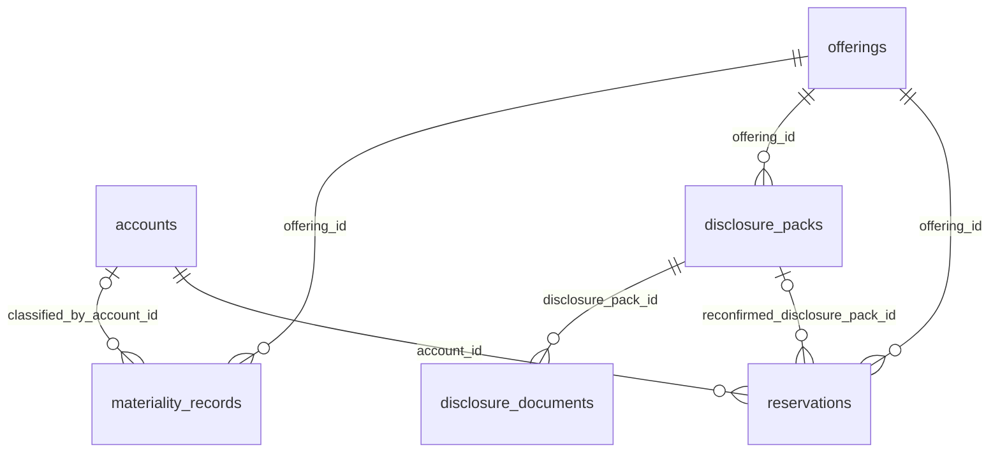

#### `offering.offerings`

Prisma model `Offering` (`prisma/schema/schema.prisma:592-614`). Created in `prisma/migrations/20260831150000_initial_schema/migration.sql:351`.

One offering per property investment vehicle (the schema allows several: `piv_id` is only indexed). `status` is `pre_offering`, `final_offering` or `closed` (NOT VALID check). `final_offering_published_at` is set when final terms are published; the offering stays `pre_offering` through the reconfirmation window (`src/modules/offering/repository/prisma-offering.repository.ts:615-653`, comment at lines 638-645). `minimum_raise_eur` and `target_raise_eur` are both positive (NOT VALID checks) with no ordering enforced. `featured`, `hero_image_url` and `gallery_image_urls` carry presentation data.

> Pending #243: a stored malformed media URL is dropped from offering list, detail and featured responses; main answers 422 for the whole response.

| Column | Type | Null | Default | Notes | Since |
| --- | --- | --- | --- | --- | --- |
| `offering_id` | text | no |  | PK | `20260831150000_initial_schema:352` |
| `piv_id` | text | no |  | FK `intake.pivs(piv_id)` RESTRICT | `20260831150000_initial_schema:353` |
| `minimum_raise_eur` | numeric(15,2) | no |  |  | `20260831150000_initial_schema:354` |
| `target_raise_eur` | numeric(15,2) | no |  |  | `20260831150000_initial_schema:355` |
| `status` | text | no | `'pre_offering'` | NOT VALID check `offerings_status_check`. | `20260831150000_initial_schema:356` |
| `final_offering_published_at` | timestamptz(6) | yes |  |  | `20260831150000_initial_schema:357` |
| `platform_rights_end_at` | timestamptz(6) | yes |  |  | `20260831150000_initial_schema:358` |
| `effective_rights_end_at` | timestamptz(6) | yes |  |  | `20260831150000_initial_schema:359` |
| `created_at` | timestamptz(6) | no | `CURRENT_TIMESTAMP` |  | `20260831150000_initial_schema:360` |
| `featured` | boolean | no | `false` |  | `20261115120000_offering_featured:2` |
| `hero_image_url` | text | yes |  |  | `20261116140000_offering_media:2` |
| `gallery_image_urls` | text[] | no | `ARRAY[]::TEXT[]` |  | `20261116140000_offering_media:3` |

| Kind | Name | Definition | Migration |
| --- | --- | --- | --- |
| PK | `offerings_pkey` | `(offering_id)` | `20260831150000_initial_schema:362` |
| INDEX | `idx_offerings_piv` | `(piv_id)` | `20260831150000_initial_schema:681` |
| FK | `offerings_piv_id_fkey` | `(piv_id) -> intake.pivs(piv_id) ON DELETE RESTRICT ON UPDATE CASCADE` | `20260831150000_initial_schema:870` |
| CHECK (NOT VALID) | `offerings_minimum_raise_eur_positive_check` | `"minimum_raise_eur" > 0 AND "minimum_raise_eur" <> 'NaN'` | `20261018131001_money_ledger_amount_and_status_checks:106` |
| CHECK (NOT VALID) | `offerings_status_check` | `"status" IN ('pre_offering', 'final_offering', 'closed')` | `20261018131001_money_ledger_amount_and_status_checks:102` |
| CHECK (NOT VALID) | `offerings_target_raise_eur_positive_check` | `"target_raise_eur" > 0 AND "target_raise_eur" <> 'NaN'` | `20261018131001_money_ledger_amount_and_status_checks:110` |

Written by `PrismaIntakeRepository.runReversalExecution` (`src/modules/intake/repository/prisma-intake.repository.ts:256`), `PrismaIntakeRepository.closeCase` (`src/modules/intake/repository/prisma-intake.repository.ts:2269`); `PrismaOfferingPresentationRepository.updatePresentation` (`src/modules/offering/repository/prisma-offering-presentation.repository.ts:37`); `PrismaOfferingRepository.openOfferingForApprovedCase` (`src/modules/offering/repository/prisma-offering.repository.ts:173`), `PrismaOfferingRepository.publishFinalOfferingTerms` (`src/modules/offering/repository/prisma-offering.repository.ts:1199`), `PrismaOfferingRepository.commitOfferingFinalization` (`src/modules/offering/repository/prisma-offering.repository.ts:1512`), `PrismaOfferingRepository.classifyMateriality` (`src/modules/offering/repository/prisma-offering.repository.ts:1606`).

#### `offering.reservations`

Prisma model `Reservation` (`prisma/schema/schema.prisma:616-641`). Created in `prisma/migrations/20260831150000_initial_schema/migration.sql:366`.

An investor's capacity hold on an offering. `reservation_stage` is not constrained by the database; the code writes `initiated`, `awaiting_reconfirmation`, `reconfirmed`, `finalized`, `cancelled` and `lapsed` (section 6). `client_idempotency_key` is a caller-supplied key, unique with the account and offering (`uq_reservations_account_offering_client_key`); several NULLs are allowed. `amount_eur` is positive (NOT VALID check). The state of the money lives in `money.money_events`, not here.

| Column | Type | Null | Default | Notes | Since |
| --- | --- | --- | --- | --- | --- |
| `reservation_id` | text | no |  | PK | `20260831150000_initial_schema:367` |
| `offering_id` | text | no |  | FK `offering.offerings(offering_id)` RESTRICT | `20260831150000_initial_schema:368` |
| `account_id` | text | no |  | FK `account.accounts(account_id)` RESTRICT | `20260831150000_initial_schema:369` |
| `amount_eur` | numeric(15,2) | no |  |  | `20260831150000_initial_schema:370` |
| `reservation_stage` | text | no | `'initiated'` | No check; see section 6. | `20260831150000_initial_schema:371` |
| `disclosure_pack_version_at_reservation` | text | yes |  |  | `20260831150000_initial_schema:372` |
| `reconfirmed_at` | timestamptz(6) | yes |  |  | `20260831150000_initial_schema:373` |
| `reservation_finalized_at` | timestamptz(6) | yes |  |  | `20260831150000_initial_schema:374` |
| `created_at` | timestamptz(6) | no | `CURRENT_TIMESTAMP` |  | `20260831150000_initial_schema:375` |
| `client_idempotency_key` | text | yes |  | Nullable; unique with `account_id` and `offering_id`. | `20260918100000_reservation_client_idempotency:6` |
| `reconfirmed_disclosure_pack_id` | text | yes |  | FK `offering.disclosure_packs(disclosure_pack_id)` RESTRICT | `20261116120000_reconfirmation_disclosure_pack_version:26` |

| Kind | Name | Definition | Migration |
| --- | --- | --- | --- |
| PK | `reservations_pkey` | `(reservation_id)` | `20260831150000_initial_schema:377` |
| INDEX | `idx_reservations_account` | `(account_id)` | `20260831150000_initial_schema:687` |
| INDEX | `idx_reservations_offering_stage` | `(offering_id, reservation_stage)` | `20260831150000_initial_schema:684` |
| UNIQUE | `uq_reservations_account_offering_client_key` | `(account_id, offering_id, client_idempotency_key)` | `20260918100000_reservation_client_idempotency:8` |
| FK | `reservations_account_id_fkey` | `(account_id) -> account.accounts(account_id) ON DELETE RESTRICT ON UPDATE CASCADE` | `20260831150000_initial_schema:876` |
| FK | `reservations_offering_id_fkey` | `(offering_id) -> offering.offerings(offering_id) ON DELETE RESTRICT ON UPDATE CASCADE` | `20260831150000_initial_schema:873` |
| FK | `reservations_reconfirmed_disclosure_pack_id_fkey` | `(reconfirmed_disclosure_pack_id) -> offering.disclosure_packs(disclosure_pack_id) ON DELETE RESTRICT ON UPDATE CASCADE` | `20261116120000_reconfirmation_disclosure_pack_version:29` |
| CHECK (NOT VALID) | `reservations_amount_eur_positive_check` | `"amount_eur" > 0 AND "amount_eur" <> 'NaN'` | `20261018131001_money_ledger_amount_and_status_checks:98` |

Written by `PrismaIntakeRepository.closeCase` (`src/modules/intake/repository/prisma-intake.repository.ts:2284`); `PrismaOfferingRepository.createReservation` (`src/modules/offering/repository/prisma-offering.repository.ts:744`), `PrismaOfferingRepository.expireReservation` (`src/modules/offering/repository/prisma-offering.repository.ts:1017`), `PrismaOfferingRepository.publishFinalOfferingTerms` (`src/modules/offering/repository/prisma-offering.repository.ts:1156`), `PrismaOfferingRepository.reconfirmReservation` (`src/modules/offering/repository/prisma-offering.repository.ts:1361`), `PrismaOfferingRepository.commitOfferingFinalization` (`src/modules/offering/repository/prisma-offering.repository.ts:1485`), `PrismaOfferingRepository.classifyMateriality` (`src/modules/offering/repository/prisma-offering.repository.ts:1593`).

#### `offering.disclosure_packs`

Prisma model `DisclosurePack` (`prisma/schema/schema.prisma:643-658`). Created in `prisma/migrations/20260831150000_initial_schema/migration.sql:381`.

Versioned sets of disclosure documents per offering, unique on `(offering_id, version)`. Publishing a pack supersedes the current one in the same transaction under the offering row lock (`src/modules/offering/repository/prisma-offering.repository.ts:1666-1720`).

| Column | Type | Null | Default | Notes | Since |
| --- | --- | --- | --- | --- | --- |
| `disclosure_pack_id` | text | no |  | PK | `20260831150000_initial_schema:382` |
| `offering_id` | text | no |  | FK `offering.offerings(offering_id)` RESTRICT | `20260831150000_initial_schema:383` |
| `version` | integer | no |  |  | `20260831150000_initial_schema:384` |
| `published_at` | timestamptz(6) | no |  |  | `20260831150000_initial_schema:385` |
| `superseded_at` | timestamptz(6) | yes |  |  | `20260831150000_initial_schema:386` |
| `is_current` | boolean | no | `true` |  | `20260831150000_initial_schema:387` |

| Kind | Name | Definition | Migration |
| --- | --- | --- | --- |
| PK | `disclosure_packs_pkey` | `(disclosure_pack_id)` | `20260831150000_initial_schema:389` |
| UNIQUE | `disclosure_packs_offering_id_version_key` | `(offering_id, version)` | `20260831150000_initial_schema:690` |
| FK | `disclosure_packs_offering_id_fkey` | `(offering_id) -> offering.offerings(offering_id) ON DELETE RESTRICT ON UPDATE CASCADE` | `20260831150000_initial_schema:879` |

Written by `PrismaOfferingRepository.publishDisclosurePack` (`src/modules/offering/repository/prisma-offering.repository.ts:1713`).

#### `offering.disclosure_documents`

Prisma model `DisclosureDocument` (`prisma/schema/schema.prisma:660-672`). Created in `prisma/migrations/20260831150000_initial_schema/migration.sql:393`.

The documents of a pack: `document_type`, `document_ref` (an object key of an accepted `platform.stored_documents` row of the same offering) and `is_core_reading`. Rows are written only as the nested `create` of `PrismaOfferingRepository.publishDisclosurePack` (`src/modules/offering/repository/prisma-offering.repository.ts:1721-1737`).

| Column | Type | Null | Default | Notes | Since |
| --- | --- | --- | --- | --- | --- |
| `document_id` | text | no |  | PK | `20260831150000_initial_schema:394` |
| `disclosure_pack_id` | text | no |  | FK `offering.disclosure_packs(disclosure_pack_id)` RESTRICT | `20260831150000_initial_schema:395` |
| `document_type` | text | no |  |  | `20260831150000_initial_schema:396` |
| `document_ref` | text | no |  |  | `20260831150000_initial_schema:397` |
| `is_core_reading` | boolean | no | `true` |  | `20260831150000_initial_schema:398` |

| Kind | Name | Definition | Migration |
| --- | --- | --- | --- |
| PK | `disclosure_documents_pkey` | `(document_id)` | `20260831150000_initial_schema:400` |
| INDEX | `idx_disclosure_documents_pack` | `(disclosure_pack_id)` | `20260831150000_initial_schema:693` |
| FK | `disclosure_documents_disclosure_pack_id_fkey` | `(disclosure_pack_id) -> offering.disclosure_packs(disclosure_pack_id) ON DELETE RESTRICT ON UPDATE CASCADE` | `20260831150000_initial_schema:882` |

No repository method writes this table on its own; see the nested create above.

#### `offering.materiality_records`

Prisma model `MaterialityRecord` (`prisma/schema/schema.prisma:674-694`). Created in `prisma/migrations/20260831150000_initial_schema/migration.sql:404`.

Classification of a change after publication (`classification`, optional `threshold_type`, `reset_triggered`). `materiality_records_required_pack_version_check` requires `required_disclosure_pack_version` exactly when `reset_triggered` is true: reconfirmation waits for a complete pack of at least that version (`prisma/schema/schema.prisma:681-683`).

| Column | Type | Null | Default | Notes | Since |
| --- | --- | --- | --- | --- | --- |
| `materiality_record_id` | text | no |  | PK | `20260831150000_initial_schema:405` |
| `offering_id` | text | no |  | FK `offering.offerings(offering_id)` RESTRICT | `20260831150000_initial_schema:406` |
| `change_description` | text | no |  |  | `20260831150000_initial_schema:407` |
| `classification` | text | no |  |  | `20260831150000_initial_schema:408` |
| `threshold_type` | text | yes |  |  | `20260831150000_initial_schema:409` |
| `reset_triggered` | boolean | no | `false` |  | `20260831150000_initial_schema:410` |
| `classified_by_account_id` | text | yes |  | FK `account.accounts(account_id)` SET NULL | `20260831150000_initial_schema:411` |
| `classified_at` | timestamptz(6) | no | `CURRENT_TIMESTAMP` |  | `20260831150000_initial_schema:412` |
| `required_disclosure_pack_version` | integer | yes |  |  | `20261116120000_reconfirmation_disclosure_pack_version:5` |

| Kind | Name | Definition | Migration |
| --- | --- | --- | --- |
| PK | `materiality_records_pkey` | `(materiality_record_id)` | `20260831150000_initial_schema:414` |
| INDEX | `idx_materiality_classified_by` | `(classified_by_account_id)` | `20260831150000_initial_schema:699` |
| INDEX | `idx_materiality_offering` | `(offering_id)` | `20260831150000_initial_schema:696` |
| FK | `materiality_records_classified_by_account_id_fkey` | `(classified_by_account_id) -> account.accounts(account_id) ON DELETE SET NULL ON UPDATE CASCADE` | `20260831150000_initial_schema:888` |
| FK | `materiality_records_offering_id_fkey` | `(offering_id) -> offering.offerings(offering_id) ON DELETE RESTRICT ON UPDATE CASCADE` | `20260831150000_initial_schema:885` |
| CHECK | `materiality_records_required_pack_version_check` | `("reset_triggered" AND "required_disclosure_pack_version" IS NOT NULL) OR (NOT "reset_triggered" AND "required_disclosure_pack_version" IS NULL)` | `20261116120000_reconfirmation_disclosure_pack_version:19` |

Written by `PrismaOfferingRepository.classifyMateriality` (`src/modules/offering/repository/prisma-offering.repository.ts:1616`).

### Money and funding evidence

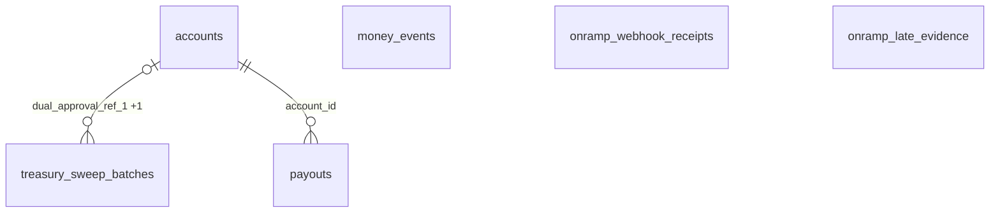

#### `money.money_events`

Prisma model `MoneyEvent` (`prisma/schema/schema.prisma:696-712`). Created in `prisma/migrations/20260831150000_initial_schema/migration.sql:418`.

The append-only evidence log of an investor's funding: one row per fact, never edited. `reservation_id` is `NOT NULL` with `ON DELETE RESTRICT`. A trigger rejects every UPDATE and DELETE (`prisma/migrations/20261018131000_money_events_append_only/migration.sql:36-49`); `TRUNCATE` is not guarded. `capital_state` and `provider` are not constrained; the code writes the values listed in section 5. Writes are serialized on the reservation row lock (section 7).

| Column | Type | Null | Default | Notes | Since |
| --- | --- | --- | --- | --- | --- |
| `money_event_id` | text | no |  | PK | `20260831150000_initial_schema:419` |
| `reservation_id` | text | no |  | FK `offering.reservations(reservation_id)` RESTRICT | `20260831150000_initial_schema:420` |
| `provider` | text | no |  | No check; the code writes `coinbase_cdp` and `internal`. | `20260831150000_initial_schema:421` |
| `provider_reference` | text | yes |  |  | `20260831150000_initial_schema:422` |
| `capital_state` | text | no |  | No check; see section 5. | `20260831150000_initial_schema:423` |
| `amount_eur` | numeric(15,2) | no |  |  | `20260831150000_initial_schema:424` |
| `amount_eurc` | numeric(20,6) | yes |  | Nullable; positive when set (NOT VALID check). | `20260831150000_initial_schema:425` |
| `recorded_at` | timestamptz(6) | no | `CURRENT_TIMESTAMP` |  | `20260831150000_initial_schema:426` |
| `reconciled_at` | timestamptz(6) | yes |  |  | `20260831150000_initial_schema:427` |

| Kind | Name | Definition | Migration |
| --- | --- | --- | --- |
| PK | `money_events_pkey` | `(money_event_id)` | `20260831150000_initial_schema:429` |
| INDEX | `idx_money_events_reservation_recorded` | `(reservation_id, recorded_at DESC)` | `20260831150000_initial_schema:702` |
| FK | `money_events_reservation_id_fkey` | `(reservation_id) -> offering.reservations(reservation_id) ON DELETE RESTRICT ON UPDATE CASCADE` | `20260831150000_initial_schema:891` |
| CHECK (NOT VALID) | `money_events_amount_eur_positive_check` | `"amount_eur" > 0 AND "amount_eur" <> 'NaN'` | `20261018131001_money_ledger_amount_and_status_checks:90` |
| CHECK (NOT VALID) | `money_events_amount_eurc_positive_check` | `"amount_eurc" IS NULL OR ("amount_eurc" > 0 AND "amount_eurc" <> 'NaN')` | `20261018131001_money_ledger_amount_and_status_checks:94` |
| TRIGGER | `money_events_append_only` | `BEFORE UPDATE OR DELETE FOR EACH ROW EXECUTE FUNCTION money.reject_money_event_mutation()` | `20261018131000_money_events_append_only:47` |

Written by `PrismaOfferingRepository.createReservation` (`src/modules/offering/repository/prisma-offering.repository.ts:756`), `PrismaOfferingRepository.recordMoneyEvent` (`src/modules/offering/repository/prisma-offering.repository.ts:800`), `PrismaOfferingRepository.recordOnrampOutcome` (`src/modules/offering/repository/prisma-offering.repository.ts:939`), `PrismaOfferingRepository.publishFinalOfferingTerms` (`src/modules/offering/repository/prisma-offering.repository.ts:1160`), `PrismaOfferingRepository.commitOfferingFinalization` (`src/modules/offering/repository/prisma-offering.repository.ts:1489`).

#### `money.onramp_webhook_receipts`

Prisma model `OnrampWebhookReceipt` (`prisma/schema/schema.prisma:721-733`). Created in `prisma/migrations/20261117203000_onramp_webhook_receipts/migration.sql:35`.

One verified Coinbase onramp webhook delivery, reduced to ids (event id, event type, transaction id, transaction hash, `partner_user_ref`); never the body, the signature or a secret. Unique on `event_id`; a redelivery is a no-op. `partner_user_ref` has no foreign key on purpose. Append-only by trigger. The receipt and its job are written in one transaction (`src/modules/offering/repository/prisma-offering.repository.ts:960-995`).

| Column | Type | Null | Default | Notes | Since |
| --- | --- | --- | --- | --- | --- |
| `onramp_webhook_receipt_id` | text | no |  | PK | `20261117203000_onramp_webhook_receipts:36` |
| `event_id` | text | no |  | unique | `20261117203000_onramp_webhook_receipts:37` |
| `event_type` | text | no |  |  | `20261117203000_onramp_webhook_receipts:38` |
| `transaction_id` | text | yes |  |  | `20261117203000_onramp_webhook_receipts:39` |
| `tx_hash` | text | yes |  |  | `20261117203000_onramp_webhook_receipts:40` |
| `partner_user_ref` | text | no |  |  | `20261117203000_onramp_webhook_receipts:41` |
| `received_at` | timestamptz(6) | no | `CURRENT_TIMESTAMP` |  | `20261117203000_onramp_webhook_receipts:42` |

| Kind | Name | Definition | Migration |
| --- | --- | --- | --- |
| PK | `onramp_webhook_receipts_pkey` | `(onramp_webhook_receipt_id)` | `20261117203000_onramp_webhook_receipts:44` |
| INDEX | `idx_onramp_webhook_receipts_partner_user_ref` | `(partner_user_ref, received_at DESC)` | `20261117203000_onramp_webhook_receipts:56` |
| UNIQUE | `uq_onramp_webhook_receipts_event_id` | `(event_id)` | `20261117203000_onramp_webhook_receipts:53` |
| CHECK | `onramp_webhook_receipts_event_id_length_check` | `char_length("event_id") BETWEEN 1 AND 200` | `20261117203000_onramp_webhook_receipts:45` |
| CHECK | `onramp_webhook_receipts_event_type_length_check` | `char_length("event_type") BETWEEN 1 AND 100` | `20261117203000_onramp_webhook_receipts:46` |
| CHECK | `onramp_webhook_receipts_partner_user_ref_length_check` | `char_length("partner_user_ref") BETWEEN 1 AND 200` | `20261117203000_onramp_webhook_receipts:49` |
| CHECK | `onramp_webhook_receipts_transaction_id_length_check` | `"transaction_id" IS NULL OR char_length("transaction_id") BETWEEN 1 AND 200` | `20261117203000_onramp_webhook_receipts:47` |
| CHECK | `onramp_webhook_receipts_tx_hash_length_check` | `"tx_hash" IS NULL OR char_length("tx_hash") BETWEEN 1 AND 200` | `20261117203000_onramp_webhook_receipts:48` |
| TRIGGER | `onramp_webhook_receipts_append_only` | `BEFORE UPDATE OR DELETE FOR EACH ROW EXECUTE FUNCTION money.reject_onramp_webhook_receipt_mutation()` | `20261117203000_onramp_webhook_receipts:70` |

Written by `PrismaOfferingRepository.receiveOnrampWebhook` (`src/modules/offering/repository/prisma-offering.repository.ts:971`).

#### `money.onramp_late_evidence`

Prisma model `OnrampLateEvidence` (`prisma/schema/schema.prisma:749-770`). Created in `prisma/migrations/20261117203500_onramp_late_evidence/migration.sql:46`.

Late funding evidence: a Coinbase success for a reservation that has already left `initiated`. It is an ops-visibility list, never a money event and never funding (schema comment, `prisma/schema/schema.prisma:735-748`). One row per provider transaction id. A trigger lets exactly one change through: `reviewed_at` from NULL to a value with every other column unchanged.

| Column | Type | Null | Default | Notes | Since |
| --- | --- | --- | --- | --- | --- |
| `onramp_late_evidence_id` | text | no |  | PK | `20261117203500_onramp_late_evidence:47` |
| `provider_transaction_id` | text | no |  | unique | `20261117203500_onramp_late_evidence:48` |
| `tx_hash` | text | yes |  |  | `20261117203500_onramp_late_evidence:49` |
| `destination_wallet` | text | no |  |  | `20261117203500_onramp_late_evidence:50` |
| `reservation_id` | text | no |  | FK `offering.reservations(reservation_id)` RESTRICT | `20261117203500_onramp_late_evidence:51` |
| `reservation_stage` | text | no |  |  | `20261117203500_onramp_late_evidence:52` |
| `amount` | numeric(20,6) | no |  |  | `20261117203500_onramp_late_evidence:53` |
| `asset` | text | no |  |  | `20261117203500_onramp_late_evidence:54` |
| `state` | text | no |  |  | `20261117203500_onramp_late_evidence:55` |
| `observed_at` | timestamptz(6) | no |  |  | `20261117203500_onramp_late_evidence:56` |
| `reviewed_at` | timestamptz(6) | yes |  |  | `20261117203500_onramp_late_evidence:57` |

| Kind | Name | Definition | Migration |
| --- | --- | --- | --- |
| PK | `onramp_late_evidence_pkey` | `(onramp_late_evidence_id)` | `20261117203500_onramp_late_evidence:59` |
| INDEX | `idx_onramp_late_evidence_reservation` | `(reservation_id)` | `20261117203500_onramp_late_evidence:76` |
| INDEX | `idx_onramp_late_evidence_review_observed` | `(reviewed_at, observed_at)` | `20261117203500_onramp_late_evidence:73` |
| UNIQUE | `uq_onramp_late_evidence_provider_transaction_id` | `(provider_transaction_id)` | `20261117203500_onramp_late_evidence:70` |
| FK | `onramp_late_evidence_reservation_id_fkey` | `(reservation_id) -> offering.reservations(reservation_id) ON DELETE RESTRICT ON UPDATE CASCADE` | `20261117203500_onramp_late_evidence:79` |
| CHECK | `onramp_late_evidence_amount_check` | `"amount" >= 0 AND "amount" <> 'NaN'` | `20261117203500_onramp_late_evidence:65` |
| CHECK | `onramp_late_evidence_asset_length_check` | `char_length("asset") BETWEEN 1 AND 32` | `20261117203500_onramp_late_evidence:63` |
| CHECK | `onramp_late_evidence_destination_wallet_length_check` | `char_length("destination_wallet") BETWEEN 1 AND 200` | `20261117203500_onramp_late_evidence:62` |
| CHECK | `onramp_late_evidence_provider_transaction_id_length_check` | `char_length("provider_transaction_id") BETWEEN 1 AND 200` | `20261117203500_onramp_late_evidence:60` |
| CHECK | `onramp_late_evidence_reservation_stage_check` | `"reservation_stage" <> 'initiated'` | `20261117203500_onramp_late_evidence:64` |
| CHECK | `onramp_late_evidence_state_check` | `"state" IN ('eurc_reserved', 'purchase_failed')` | `20261117203500_onramp_late_evidence:66` |
| CHECK | `onramp_late_evidence_tx_hash_length_check` | `"tx_hash" IS NULL OR char_length("tx_hash") BETWEEN 1 AND 200` | `20261117203500_onramp_late_evidence:61` |
| TRIGGER | `onramp_late_evidence_guard` | `BEFORE UPDATE OR DELETE FOR EACH ROW EXECUTE FUNCTION money.guard_onramp_late_evidence_change()` | `20261117203500_onramp_late_evidence:106` |

Written by `PrismaOnrampLateEvidenceRepository.recordLateEvidence` (`src/modules/offering/repository/prisma-onramp-late-evidence.repository.ts:64`), `PrismaOnrampLateEvidenceRepository.markLateEvidenceReviewed` (`src/modules/offering/repository/prisma-onramp-late-evidence.repository.ts:148`).

#### `money.treasury_sweep_batches`

Prisma model `TreasurySweepBatch` (`prisma/schema/schema.prisma:772-788`). Created in `prisma/migrations/20260831150000_initial_schema/migration.sql:433`.

Dormant batch-sweep table kept from the original design. `dual_approval_distinct_operators` requires the two approvers to differ. Nothing under `src/` reads or writes it (searched `src` for the table and model names).

| Column | Type | Null | Default | Notes | Since |
| --- | --- | --- | --- | --- | --- |
| `sweep_batch_id` | text | no |  | PK | `20260831150000_initial_schema:434` |
| `sweep_date` | date | no |  |  | `20260831150000_initial_schema:435` |
| `net_sweepable_eur` | numeric(15,2) | no |  |  | `20260831150000_initial_schema:436` |
| `dual_approval_ref_1` | text | yes |  | FK `account.accounts(account_id)` SET NULL | `20260831150000_initial_schema:437` |
| `dual_approval_ref_2` | text | yes |  | FK `account.accounts(account_id)` SET NULL | `20260831150000_initial_schema:438` |
| `eligibility_confirmed_at` | timestamptz(6) | yes |  |  | `20260831150000_initial_schema:439` |
| `executed_at` | timestamptz(6) | yes |  |  | `20260831150000_initial_schema:440` |

| Kind | Name | Definition | Migration |
| --- | --- | --- | --- |
| PK | `treasury_sweep_batches_pkey` | `(sweep_batch_id)` | `20260831150000_initial_schema:442` |
| INDEX | `idx_sweep_batches_approval_ref_1` | `(dual_approval_ref_1)` | `20260831150000_initial_schema:705` |
| INDEX | `idx_sweep_batches_approval_ref_2` | `(dual_approval_ref_2)` | `20260831150000_initial_schema:708` |
| FK | `treasury_sweep_batches_dual_approval_ref_1_fkey` | `(dual_approval_ref_1) -> account.accounts(account_id) ON DELETE SET NULL ON UPDATE CASCADE` | `20260831150000_initial_schema:894` |
| FK | `treasury_sweep_batches_dual_approval_ref_2_fkey` | `(dual_approval_ref_2) -> account.accounts(account_id) ON DELETE SET NULL ON UPDATE CASCADE` | `20260831150000_initial_schema:897` |
| CHECK | `dual_approval_distinct_operators` | `"dual_approval_ref_1" IS NULL OR "dual_approval_ref_2" IS NULL OR "dual_approval_ref_1" <> "dual_approval_ref_2"` | `20260831150000_initial_schema:948` |

No code under `src/` writes this table.

#### `money.payouts`

Prisma model `Payout` (`prisma/schema/schema.prisma:790-806`). Created in `prisma/migrations/20260831150000_initial_schema/migration.sql:446`.

Payout table of the original design (EURC to the investor's wallet). Nothing under `src/` reads or writes it (searched `src` for the table and model names).

| Column | Type | Null | Default | Notes | Since |
| --- | --- | --- | --- | --- | --- |
| `payout_id` | text | no |  | PK | `20260831150000_initial_schema:447` |
| `account_id` | text | no |  | FK `account.accounts(account_id)` RESTRICT | `20260831150000_initial_schema:448` |
| `amount_eur` | numeric(15,2) | no |  |  | `20260831150000_initial_schema:449` |
| `amount_eurc` | numeric(20,6) | no |  |  | `20260831150000_initial_schema:450` |
| `destination_wallet_address` | text | no |  |  | `20260831150000_initial_schema:451` |
| `chain_tx_hash` | text | yes |  |  | `20260831150000_initial_schema:452` |
| `status` | text | no | `'pending'` |  | `20260831150000_initial_schema:453` |
| `requested_at` | timestamptz(6) | no | `CURRENT_TIMESTAMP` |  | `20260831150000_initial_schema:454` |
| `executed_at` | timestamptz(6) | yes |  |  | `20260831150000_initial_schema:455` |

| Kind | Name | Definition | Migration |
| --- | --- | --- | --- |
| PK | `payouts_pkey` | `(payout_id)` | `20260831150000_initial_schema:457` |
| INDEX | `idx_payouts_account` | `(account_id)` | `20260831150000_initial_schema:711` |
| FK | `payouts_account_id_fkey` | `(account_id) -> account.accounts(account_id) ON DELETE RESTRICT ON UPDATE CASCADE` | `20260831150000_initial_schema:900` |

No code under `src/` writes this table.

### Wallet, settlement, escrow and rental

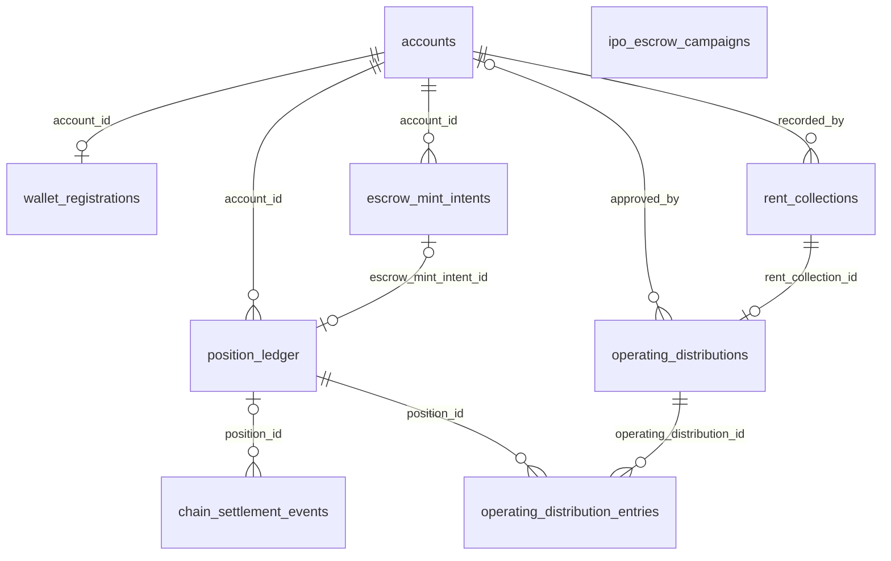

#### `settlement.wallet_registrations`

Prisma model `WalletRegistration` (`prisma/schema/schema.prisma:816-849`). Created in `prisma/migrations/20260831150000_initial_schema/migration.sql:461`.

The wallet claim of an account, one row per account (`account_id` is the primary key). `registered_at IS NULL AND expired_at IS NULL` is a pending claim; confirmed means `registered_at` is set. The address is stored in one lowercase spelling (`wallet_registrations_wallet_address_lowercase_check`), and exclusivity applies only among confirmed rows (partial unique index on `lower(wallet_address)`), so pending claims of different accounts may overlap. Chain evidence columns record the confirming event; `(registration_tx_hash, registration_log_index)` is unique where both are set. `expired_at` is set by the expiry job and cleared by the account's next registration or a staff reconcile (`prisma/schema/schema.prisma:808-846`). The row is never deleted.

| Column | Type | Null | Default | Notes | Since |
| --- | --- | --- | --- | --- | --- |
| `account_id` | text | no |  | PK; FK `account.accounts(account_id)` RESTRICT | `20260831150000_initial_schema:462` |
| `wallet_address` | text | no |  | Lowercase only (check); no plain unique index. | `20260831150000_initial_schema:463` |
| `registration_commitment` | text | no |  | One-time opaque commitment matched against the on-chain event. | `20260831150000_initial_schema:464` |
| `requested_at` | timestamptz(6) | no | `CURRENT_TIMESTAMP` |  | `20260831150000_initial_schema:465` |
| `registered_at` | timestamptz(6) | yes |  |  | `20260831150000_initial_schema:466` |
| `registration_tx_hash` | text | yes |  |  | `20260916110000_wallet_registration_reconciliation:2` |
| `registration_block_number` | bigint | yes |  |  | `20260916110000_wallet_registration_reconciliation:3` |
| `registration_block_hash` | text | yes |  |  | `20261113150300_wallet_registration_chain_evidence:92` |
| `registration_log_index` | integer | yes |  |  | `20261113150300_wallet_registration_chain_evidence:93` |
| `registration_evidence_verified_at` | timestamptz(6) | yes |  |  | `20261113150300_wallet_registration_chain_evidence:94` |
| `registration_evidence_flagged_at` | timestamptz(6) | yes |  |  | `20261113150300_wallet_registration_chain_evidence:95` |
| `registration_evidence_flag` | text | yes |  |  | `20261113150300_wallet_registration_chain_evidence:96` |
| `expired_at` | timestamptz(6) | yes |  |  | `20261117204000_wallet_registration_expiry:22` |

| Kind | Name | Definition | Migration |
| --- | --- | --- | --- |
| PK | `wallet_registrations_pkey` | `(account_id)` | `20260831150000_initial_schema:468` |
| INDEX (partial) | `idx_wallet_registrations_evidence_recheck` | `(registration_block_number) WHERE "registration_block_hash" IS NOT NULL AND "registration_evidence_verified_at" IS NULL AND "registration_evidence_flagged_at" IS NULL` | `20261113150300_wallet_registration_chain_evidence:143` |
| INDEX (partial) | `idx_wallet_registrations_pending_requested_at` | `(requested_at) WHERE registered_at IS NULL AND expired_at IS NULL` | `20261117204000_wallet_registration_expiry:39` |
| INDEX (partial) | `idx_wallet_registrations_tx_hash` | `(registration_tx_hash) WHERE "registration_tx_hash" IS NOT NULL` | `20261113150300_wallet_registration_chain_evidence:137` |
| UNIQUE (partial) | `uq_wallet_registrations_chain_event` | `(registration_tx_hash, registration_log_index) WHERE "registration_tx_hash" IS NOT NULL AND "registration_log_index" IS NOT NULL` | `20261113150300_wallet_registration_chain_evidence:133` |
| UNIQUE (partial) | `wallet_registrations_confirmed_address_key` | `(lower(wallet_address)) WHERE "registered_at" IS NOT NULL` | `20261113150200_wallet_claims_confirmed_address_uniqueness:62` |
| FK | `wallet_registrations_account_id_fkey` | `(account_id) -> account.accounts(account_id) ON DELETE RESTRICT ON UPDATE CASCADE` | `20260831150000_initial_schema:903` |
| CHECK | `wallet_registrations_registration_evidence_format_check` | `("registration_tx_hash" IS NULL OR "registration_tx_hash" ~ '^0x[0-9a-f]{64}$') AND ("registration_block_hash" IS NULL OR "registration_block_hash" ~ '^0x[0-9a-f]{64}$') AND ("registration_block_number" IS NULL OR "registration_block_number" >= 0) AND ("registration_log_index" IS NULL OR "registration_log_index" >= 0)` | `20261113150300_wallet_registration_chain_evidence:116` |
| CHECK | `wallet_registrations_registration_evidence_shape_check` | `(("registration_tx_hash" IS NULL) = ("registration_block_number" IS NULL)) AND (("registration_block_hash" IS NULL) = ("registration_log_index" IS NULL)) AND ("registration_block_hash" IS NULL OR "registration_tx_hash" IS NOT NULL) AND ("registration_tx_hash" IS NULL OR "registered_at" IS NOT NULL)` | `20261113150300_wallet_registration_chain_evidence:107` |
| CHECK | `wallet_registrations_registration_evidence_state_check` | `(("registration_evidence_flagged_at" IS NULL) = ("registration_evidence_flag" IS NULL)) AND ("registration_evidence_flag" IS NULL OR "registration_evidence_flag" IN ('transaction_missing', 'transaction_reverted', 'event_missing')) AND ("registration_evidence_verified_at" IS NULL OR "registration_block_hash" IS NOT NULL) AND ("registration_evidence_flagged_at" IS NULL OR "registration_block_hash" IS NOT NULL)` | `20261113150300_wallet_registration_chain_evidence:125` |
| CHECK | `wallet_registrations_wallet_address_lowercase_check` | `"wallet_address" = lower("wallet_address")` | `20261113150100_wallet_address_canonical_form:131` |

Written by `PrismaSettlementRepository.confirmWalletRegistration` (`src/modules/settlement/repository/prisma-settlement.repository.ts:537`), `PrismaSettlementRepository.replaceWalletRegistrationEvidence` (`src/modules/settlement/repository/prisma-settlement.repository.ts:639`), `PrismaSettlementRepository.markWalletRegistrationEvidenceVerified` (`src/modules/settlement/repository/prisma-settlement.repository.ts:690`), `PrismaSettlementRepository.flagWalletRegistrationEvidence` (`src/modules/settlement/repository/prisma-settlement.repository.ts:724`); `PrismaWalletRepository.registerWallet` (`src/modules/wallet/repository/prisma-wallet.repository.ts:188`), `PrismaWalletRepository.expirePendingWalletRegistrations` (`src/modules/wallet/repository/prisma-wallet.repository.ts:336`), `PrismaWalletRepository.reconcileWalletRegistration` (`src/modules/wallet/repository/prisma-wallet.repository.ts:446`).

#### `settlement.position_ledger`

Prisma model `PositionLedger` (`prisma/schema/schema.prisma:851-886`). Created in `prisma/migrations/20260831150000_initial_schema/migration.sql:472`.

The canonical record of a holding. `reservation_id` is nullable (a position minted from an escrow contribution has no reservation); `escrow_mint_intent_id` is unique, so one mint yields one position. `position_status` is `pending_internal_settlement`, `active` or `redeemed` (NOT VALID check); `unit_count` and `cost_basis_eur` are non-negative (NOT VALID checks). Written by the window-close commit (`src/modules/offering/repository/prisma-offering.repository.ts:1474`) and by the escrow mint recording (`src/modules/settlement/repository/prisma-settlement.repository.ts:472`).

| Column | Type | Null | Default | Notes | Since |
| --- | --- | --- | --- | --- | --- |
| `position_id` | text | no |  | PK | `20260831150000_initial_schema:473` |
| `reservation_id` | text | yes |  | FK `offering.reservations(reservation_id)` RESTRICT; Nullable since `20260904110000_position_ledger_nullable_reservation`. | `20260831150000_initial_schema:474` |
| `piv_id` | text | no |  | FK `intake.pivs(piv_id)` RESTRICT | `20260831150000_initial_schema:475` |
| `account_id` | text | no |  | FK `account.accounts(account_id)` RESTRICT | `20260831150000_initial_schema:476` |
| `unit_count` | numeric(20,6) | no |  |  | `20260831150000_initial_schema:477` |
| `cost_basis_eur` | numeric(15,2) | no |  |  | `20260831150000_initial_schema:478` |
| `position_status` | text | no | `'pending_internal_settlement'` |  | `20260831150000_initial_schema:479` |
| `holder_wallet_address` | text | yes |  |  | `20260831150000_initial_schema:480` |
| `activated_at` | timestamptz(6) | yes |  |  | `20260831150000_initial_schema:481` |
| `redeemed_at` | timestamptz(6) | yes |  |  | `20260831150000_initial_schema:482` |
| `redemption_proceeds_eur` | numeric(15,2) | yes |  |  | `20260831150000_initial_schema:483` |
| `escrow_mint_intent_id` | text | yes |  | FK `settlement.escrow_mint_intents(escrow_mint_intent_id)` RESTRICT; unique | `20261018132000_escrow_mint_intents:57` |

| Kind | Name | Definition | Migration |
| --- | --- | --- | --- |
| PK | `position_ledger_pkey` | `(position_id)` | `20260831150000_initial_schema:485` |
| INDEX | `idx_position_ledger_account` | `(account_id)` | `20260831150000_initial_schema:723` |
| INDEX | `idx_position_ledger_piv` | `(piv_id)` | `20260831150000_initial_schema:720` |
| INDEX | `idx_position_ledger_reservation` | `(reservation_id)` | `20260831150000_initial_schema:717` |
| UNIQUE | `uq_position_ledger_escrow_mint_intent` | `(escrow_mint_intent_id)` | `20261018132000_escrow_mint_intents:60` |
| FK | `position_ledger_account_id_fkey` | `(account_id) -> account.accounts(account_id) ON DELETE RESTRICT ON UPDATE CASCADE` | `20260831150000_initial_schema:912` |
| FK | `position_ledger_escrow_mint_intent_id_fkey` | `(escrow_mint_intent_id) -> settlement.escrow_mint_intents(escrow_mint_intent_id) ON DELETE RESTRICT ON UPDATE CASCADE` | `20261018132000_escrow_mint_intents:69` |
| FK | `position_ledger_piv_id_fkey` | `(piv_id) -> intake.pivs(piv_id) ON DELETE RESTRICT ON UPDATE CASCADE` | `20260831150000_initial_schema:909` |
| FK | `position_ledger_reservation_id_fkey` | `(reservation_id) -> offering.reservations(reservation_id) ON DELETE RESTRICT ON UPDATE CASCADE` | `20260831150000_initial_schema:906` |
| CHECK (NOT VALID) | `position_ledger_cost_basis_eur_non_negative_check` | `"cost_basis_eur" >= 0 AND "cost_basis_eur" <> 'NaN'` | `20261018131001_money_ledger_amount_and_status_checks:123` |
| CHECK (NOT VALID) | `position_ledger_position_status_check` | `"position_status" IN ('pending_internal_settlement', 'active', 'redeemed')` | `20261018131001_money_ledger_amount_and_status_checks:114` |
| CHECK (NOT VALID) | `position_ledger_unit_count_non_negative_check` | `"unit_count" >= 0 AND "unit_count" <> 'NaN'` | `20261018131001_money_ledger_amount_and_status_checks:119` |

Written by `PrismaOfferingRepository.commitOfferingFinalization` (`src/modules/offering/repository/prisma-offering.repository.ts:1474`); `PrismaSettlementRepository.recordEscrowMintedPosition` (`src/modules/settlement/repository/prisma-settlement.repository.ts:472`).

#### `settlement.chain_settlement_events`

Prisma model `ChainSettlementEvent` (`prisma/schema/schema.prisma:970-985`). Created in `prisma/migrations/20260831150000_initial_schema/migration.sql:489`.

Chain events attached to a position (`event_type`, contract address, token id, transaction hash, `reconciled_at`). Written when an escrow mint is recorded together with its position (`src/modules/settlement/repository/prisma-settlement.repository.ts:489`); no code writes `reconciled_at`.

| Column | Type | Null | Default | Notes | Since |
| --- | --- | --- | --- | --- | --- |
| `chain_event_id` | text | no |  | PK | `20260831150000_initial_schema:490` |
| `position_id` | text | yes |  | FK `settlement.position_ledger(position_id)` SET NULL | `20260831150000_initial_schema:491` |
| `event_type` | text | no |  |  | `20260831150000_initial_schema:492` |
| `token_contract_address` | text | no |  |  | `20260831150000_initial_schema:493` |
| `token_id` | numeric(78,0) | no |  |  | `20260831150000_initial_schema:494` |
| `chain_tx_hash` | text | no |  |  | `20260831150000_initial_schema:495` |
| `reconciled_at` | timestamptz(6) | yes |  |  | `20260831150000_initial_schema:496` |

| Kind | Name | Definition | Migration |
| --- | --- | --- | --- |
| PK | `chain_settlement_events_pkey` | `(chain_event_id)` | `20260831150000_initial_schema:498` |
| INDEX | `idx_chain_events_contract_token` | `(token_contract_address, token_id)` | `20260831150000_initial_schema:729` |
| INDEX | `idx_chain_events_position` | `(position_id)` | `20260831150000_initial_schema:726` |
| FK | `chain_settlement_events_position_id_fkey` | `(position_id) -> settlement.position_ledger(position_id) ON DELETE SET NULL ON UPDATE CASCADE` | `20260831150000_initial_schema:915` |

Written by `PrismaSettlementRepository.recordEscrowMintedPosition` (`src/modules/settlement/repository/prisma-settlement.repository.ts:489`).

#### `settlement.escrow_mint_intents`

Prisma model `EscrowMintIntent` (`prisma/schema/schema.prisma:896-934`). Created in `prisma/migrations/20261018132000_escrow_mint_intents/migration.sql:24`.

The durable record of one escrow mint, written before the mint transaction is sent (schema comment, `prisma/schema/schema.prisma:888-895`). Status moves `sending` to `mint_sent` to `recorded` (CHECK); `attempt` is the compare-and-set counter; `mint_nonce` pins the operator account nonce the attempt is sent with; unique on `(piv_id, account_id)`. Section 7 describes the compare-and-set transitions.

| Column | Type | Null | Default | Notes | Since |
| --- | --- | --- | --- | --- | --- |
| `escrow_mint_intent_id` | text | no |  | PK | `20261018132000_escrow_mint_intents:25` |
| `piv_id` | text | no |  | FK `intake.pivs(piv_id)` RESTRICT | `20261018132000_escrow_mint_intents:26` |
| `account_id` | text | no |  | FK `account.accounts(account_id)` RESTRICT | `20261018132000_escrow_mint_intents:27` |
| `holder_wallet_address` | text | no |  |  | `20261018132000_escrow_mint_intents:28` |
| `token_contract_address` | text | no |  |  | `20261018132000_escrow_mint_intents:29` |
| `token_id` | numeric(78,0) | no |  |  | `20261018132000_escrow_mint_intents:30` |
| `mint_amount` | numeric(78,0) | no |  |  | `20261018132000_escrow_mint_intents:31` |
| `status` | text | no | `'sending'` |  | `20261018132000_escrow_mint_intents:32` |
| `mint_tx_hash` | text | yes |  |  | `20261018132000_escrow_mint_intents:33` |
| `attempt` | integer | no | `1` |  | `20261018132000_escrow_mint_intents:34` |
| `attempted_at` | timestamptz(6) | no |  |  | `20261018132000_escrow_mint_intents:35` |
| `search_from_block` | bigint | yes |  |  | `20261018132000_escrow_mint_intents:36` |
| `created_at` | timestamptz(6) | no | `CURRENT_TIMESTAMP` |  | `20261018132000_escrow_mint_intents:37` |
| `recorded_at` | timestamptz(6) | yes |  |  | `20261018132000_escrow_mint_intents:38` |
| `mint_nonce` | bigint | yes |  | Nullable `bigint`; null for attempts that predate nonce pinning. | `20261121090000_escrow_mint_intent_nonce:14` |

| Kind | Name | Definition | Migration |
| --- | --- | --- | --- |
| PK | `escrow_mint_intents_pkey` | `(escrow_mint_intent_id)` | `20261018132000_escrow_mint_intents:40` |
| UNIQUE | `uq_escrow_mint_intents_piv_account` | `(piv_id, account_id)` | `20261018132000_escrow_mint_intents:53` |
| FK | `escrow_mint_intents_account_id_fkey` | `(account_id) -> account.accounts(account_id) ON DELETE RESTRICT ON UPDATE CASCADE` | `20261018132000_escrow_mint_intents:48` |
| FK | `escrow_mint_intents_piv_id_fkey` | `(piv_id) -> intake.pivs(piv_id) ON DELETE RESTRICT ON UPDATE CASCADE` | `20261018132000_escrow_mint_intents:47` |
| CHECK | `escrow_mint_intents_attempt_check` | `"attempt" > 0` | `20261018132000_escrow_mint_intents:46` |
| CHECK | `escrow_mint_intents_hash_check` | `"status" = 'sending' OR "mint_tx_hash" IS NOT NULL` | `20261018132000_escrow_mint_intents:43` |
| CHECK | `escrow_mint_intents_mint_amount_check` | `"mint_amount" > 0` | `20261018132000_escrow_mint_intents:45` |
| CHECK | `escrow_mint_intents_mint_nonce_check` | `"mint_nonce" IS NULL OR "mint_nonce" >= 0` | `20261121090000_escrow_mint_intent_nonce:22` |
| CHECK | `escrow_mint_intents_recorded_check` | `("status" = 'recorded') = ("recorded_at" IS NOT NULL)` | `20261018132000_escrow_mint_intents:44` |
| CHECK | `escrow_mint_intents_status_check` | `"status" IN ('sending', 'mint_sent', 'recorded')` | `20261018132000_escrow_mint_intents:41` |

Written by `PrismaSettlementRepository.createEscrowMintIntent` (`src/modules/settlement/repository/prisma-settlement.repository.ts:363`), `PrismaSettlementRepository.restartEscrowMintAttempt` (`src/modules/settlement/repository/prisma-settlement.repository.ts:394`), `PrismaSettlementRepository.recordEscrowMintSent` (`src/modules/settlement/repository/prisma-settlement.repository.ts:412`), `PrismaSettlementRepository.adoptEscrowMintTransaction` (`src/modules/settlement/repository/prisma-settlement.repository.ts:436`), `PrismaSettlementRepository.recordEscrowMintedPosition` (`src/modules/settlement/repository/prisma-settlement.repository.ts:456`).

#### `settlement.ipo_escrow_campaigns`

Prisma model `IpoEscrowCampaign` (`prisma/schema/schema.prisma:946-968`). Created in `prisma/migrations/20261117204500_ipo_escrow_campaigns/migration.sql:25`.

The last observation of a property vehicle's IPO escrow campaign, one row per vehicle: the state `campaignOf` reported (`not_opened`, `open`, `successful`, `failed`) and the parameters it reported (`prisma/schema/schema.prisma:936-967`). Where the settlement bundle is configured, reservations are refused unless this row is `open` with its deadline ahead; the check reads the row `FOR SHARE` under the offering lock (`src/modules/offering/repository/prisma-offering.repository.ts:660-690`).

| Column | Type | Null | Default | Notes | Since |
| --- | --- | --- | --- | --- | --- |
| `piv_id` | text | no |  | PK; FK `intake.pivs(piv_id)` RESTRICT | `20261117204500_ipo_escrow_campaigns:26` |
| `token_id` | numeric(78,0) | no |  | unique | `20261117204500_ipo_escrow_campaigns:27` |
| `escrow_contract_address` | text | no |  |  | `20261117204500_ipo_escrow_campaigns:28` |
| `target_amount` | numeric(78,0) | no |  |  | `20261117204500_ipo_escrow_campaigns:29` |
| `deadline_at` | timestamptz(6) | no |  |  | `20261117204500_ipo_escrow_campaigns:30` |
| `treasury_address` | text | no |  |  | `20261117204500_ipo_escrow_campaigns:31` |
| `open_tx_hash` | text | yes |  |  | `20261117204500_ipo_escrow_campaigns:32` |
| `observed_state` | text | no |  |  | `20261117204500_ipo_escrow_campaigns:33` |
| `observed_at` | timestamptz(6) | no |  |  | `20261117204500_ipo_escrow_campaigns:34` |
| `recorded_at` | timestamptz(6) | no | `CURRENT_TIMESTAMP` |  | `20261117204500_ipo_escrow_campaigns:35` |

| Kind | Name | Definition | Migration |
| --- | --- | --- | --- |
| PK | `ipo_escrow_campaigns_pkey` | `(piv_id)` | `20261117204500_ipo_escrow_campaigns:37` |
| UNIQUE | `ipo_escrow_campaigns_token_id_key` | `(token_id)` | `20261117204500_ipo_escrow_campaigns:43` |
| FK | `ipo_escrow_campaigns_piv_id_fkey` | `(piv_id) -> intake.pivs(piv_id) ON DELETE RESTRICT ON UPDATE CASCADE` | `20261117204500_ipo_escrow_campaigns:40` |
| CHECK | `ipo_escrow_campaigns_observed_state_check` | `"observed_state" IN ('not_opened', 'open', 'successful', 'failed')` | `20261117204500_ipo_escrow_campaigns:39` |
| CHECK | `ipo_escrow_campaigns_target_amount_check` | `"target_amount" > 0` | `20261117204500_ipo_escrow_campaigns:38` |

Written by `PrismaSettlementRepository.recordIpoEscrowCampaignObservation` (`src/modules/settlement/repository/prisma-settlement.repository.ts:265`), `PrismaSettlementRepository.refreshIpoEscrowCampaignState` (`src/modules/settlement/repository/prisma-settlement.repository.ts:294`).

#### `settlement.operating_distributions`

Prisma model `OperatingDistribution` (`prisma/schema/schema.prisma:1014-1043`). Created in `prisma/migrations/20260903170000_add_operating_distributions/migration.sql:19`.

A calculated distribution of one rent collection (gross rent, deductions, net, units at the record date, amount per unit, `status` defaulting to `calculated`, `approved_at` and `approved_by` as the governance checkpoint). Created only by the worker's monthly sweep, which is dormant unless `OPERATING_DISTRIBUTION_ENABLED` is true (`src/worker.ts:212-221`). The database has no check on `status`.

| Column | Type | Null | Default | Notes | Since |
| --- | --- | --- | --- | --- | --- |
| `operating_distribution_id` | text | no |  | PK | `20260903170000_add_operating_distributions:20` |
| `piv_id` | text | no |  | FK `intake.pivs(piv_id)` RESTRICT | `20260903170000_add_operating_distributions:21` |
| `rent_collection_id` | text | no |  | FK `rental.rent_collections(rent_collection_id)` RESTRICT; unique | `20260903170000_add_operating_distributions:22` |
| `period_start` | date | no |  |  | `20260903170000_add_operating_distributions:23` |
| `period_end` | date | no |  |  | `20260903170000_add_operating_distributions:24` |
| `record_date` | date | no |  |  | `20260903170000_add_operating_distributions:25` |
| `gross_rent_eur` | numeric(15,2) | no |  |  | `20260903170000_add_operating_distributions:26` |
| `management_fee_eur` | numeric(15,2) | no | `0` |  | `20260903170000_add_operating_distributions:27` |
| `other_expenses_eur` | numeric(15,2) | no | `0` |  | `20260903170000_add_operating_distributions:28` |
| `reserve_holdback_eur` | numeric(15,2) | no | `0` |  | `20260903170000_add_operating_distributions:29` |
| `distributable_net_eur` | numeric(15,2) | no |  |  | `20260903170000_add_operating_distributions:30` |
| `total_units_at_record_date` | numeric(20,6) | no |  |  | `20260903170000_add_operating_distributions:31` |
| `amount_per_unit_eur` | numeric(15,6) | no |  |  | `20260903170000_add_operating_distributions:32` |
| `status` | text | no | `'calculated'` |  | `20260903170000_add_operating_distributions:33` |
| `calculated_at` | timestamptz(6) | no | `CURRENT_TIMESTAMP` |  | `20260903170000_add_operating_distributions:34` |
| `approved_at` | timestamptz(6) | yes |  |  | `20260903170000_add_operating_distributions:35` |
| `approved_by` | text | yes |  | FK `account.accounts(account_id)` SET NULL | `20260903170000_add_operating_distributions:36` |
| `completed_at` | timestamptz(6) | yes |  |  | `20260903170000_add_operating_distributions:37` |

| Kind | Name | Definition | Migration |
| --- | --- | --- | --- |
| PK | `operating_distributions_pkey` | `(operating_distribution_id)` | `20260903170000_add_operating_distributions:39` |
| INDEX | `idx_operating_distributions_piv` | `(piv_id)` | `20260903170000_add_operating_distributions:66` |
| UNIQUE | `operating_distributions_rent_collection_id_key` | `(rent_collection_id)` | `20260903170000_add_operating_distributions:63` |
| UNIQUE | `uq_operating_distributions_piv_period` | `(piv_id, period_start, period_end)` | `20260903170000_add_operating_distributions:69` |
| FK | `operating_distributions_approved_by_fkey` | `(approved_by) -> account.accounts(account_id) ON DELETE SET NULL ON UPDATE CASCADE` | `20260903170000_add_operating_distributions:93` |
| FK | `operating_distributions_piv_id_fkey` | `(piv_id) -> intake.pivs(piv_id) ON DELETE RESTRICT ON UPDATE CASCADE` | `20260903170000_add_operating_distributions:87` |
| FK | `operating_distributions_rent_collection_id_fkey` | `(rent_collection_id) -> rental.rent_collections(rent_collection_id) ON DELETE RESTRICT ON UPDATE CASCADE` | `20260903170000_add_operating_distributions:90` |

Written by `PrismaOperatingDistributionRepository.createOperatingDistribution` (`src/modules/rental/repository/prisma-operating-distribution.repository.ts:106`).

#### `settlement.operating_distribution_entries`

Prisma model `OperatingDistributionEntry` (`prisma/schema/schema.prisma:1045-1063`). Created in `prisma/migrations/20260903170000_add_operating_distributions/migration.sql:43`.

One payable line per position of a distribution (`unit_count_at_record_date`, `amount_eurc`, `destination_wallet_address`, `chain_tx_hash`, `paid_at`), unique on `(operating_distribution_id, position_id)`.

| Column | Type | Null | Default | Notes | Since |
| --- | --- | --- | --- | --- | --- |
| `operating_distribution_entry_id` | text | no |  | PK | `20260903170000_add_operating_distributions:44` |
| `operating_distribution_id` | text | no |  | FK `settlement.operating_distributions(operating_distribution_id)` RESTRICT | `20260903170000_add_operating_distributions:45` |
| `position_id` | text | no |  | FK `settlement.position_ledger(position_id)` RESTRICT | `20260903170000_add_operating_distributions:46` |
| `unit_count_at_record_date` | numeric(20,6) | no |  |  | `20260903170000_add_operating_distributions:47` |
| `amount_eurc` | numeric(15,6) | no |  |  | `20260903170000_add_operating_distributions:48` |
| `destination_wallet_address` | text | no |  |  | `20260903170000_add_operating_distributions:49` |
| `chain_tx_hash` | text | yes |  |  | `20260903170000_add_operating_distributions:50` |
| `paid_at` | timestamptz(6) | yes |  |  | `20260903170000_add_operating_distributions:51` |

| Kind | Name | Definition | Migration |
| --- | --- | --- | --- |
| PK | `operating_distribution_entries_pkey` | `(operating_distribution_entry_id)` | `20260903170000_add_operating_distributions:53` |
| INDEX | `idx_distribution_entries_distribution` | `(operating_distribution_id)` | `20260903170000_add_operating_distributions:72` |
| INDEX | `idx_distribution_entries_position` | `(position_id)` | `20260903170000_add_operating_distributions:75` |
| UNIQUE | `uq_distribution_entries_dist_position` | `(operating_distribution_id, position_id)` | `20260903170000_add_operating_distributions:78` |
| FK | `operating_distribution_entries_operating_distribution_id_fkey` | `(operating_distribution_id) -> settlement.operating_distributions(operating_distribution_id) ON DELETE RESTRICT ON UPDATE CASCADE` | `20260903170000_add_operating_distributions:96` |
| FK | `operating_distribution_entries_position_id_fkey` | `(position_id) -> settlement.position_ledger(position_id) ON DELETE RESTRICT ON UPDATE CASCADE` | `20260903170000_add_operating_distributions:99` |

Written by `PrismaOperatingDistributionRepository.createOperatingDistribution` (`src/modules/rental/repository/prisma-operating-distribution.repository.ts:124`).

#### `rental.rent_collections`

Prisma model `RentCollection` (`prisma/schema/schema.prisma:990-1008`). Created in `prisma/migrations/20260903170000_add_operating_distributions/migration.sql:5`.

Rent reported for a property vehicle and period, unique on `(piv_id, period_start, period_end)`. The only code that inserts a row is `CalculateOperatingDistributionService`, and the worker sweep calls it only for collections that already exist (`src/modules/rental/application/calculate-operating-distribution.service.ts:69-83`, `src/modules/rental/application/run-operating-distribution-sweep.service.ts:1-12`); no route or job in `src/` records a new collection, so rows are entered outside the application.

| Column | Type | Null | Default | Notes | Since |
| --- | --- | --- | --- | --- | --- |
| `rent_collection_id` | text | no |  | PK | `20260903170000_add_operating_distributions:6` |
| `piv_id` | text | no |  | FK `intake.pivs(piv_id)` RESTRICT | `20260903170000_add_operating_distributions:7` |
| `period_start` | date | no |  |  | `20260903170000_add_operating_distributions:8` |
| `period_end` | date | no |  |  | `20260903170000_add_operating_distributions:9` |
| `gross_rent_collected_eur` | numeric(15,2) | no |  |  | `20260903170000_add_operating_distributions:10` |
| `recorded_by` | text | no |  | FK `account.accounts(account_id)` RESTRICT | `20260903170000_add_operating_distributions:11` |
| `recorded_at` | timestamptz(6) | no | `CURRENT_TIMESTAMP` |  | `20260903170000_add_operating_distributions:12` |
| `notes` | text | yes |  |  | `20260903170000_add_operating_distributions:13` |

| Kind | Name | Definition | Migration |
| --- | --- | --- | --- |
| PK | `rent_collections_pkey` | `(rent_collection_id)` | `20260903170000_add_operating_distributions:15` |
| INDEX | `idx_rent_collections_piv` | `(piv_id)` | `20260903170000_add_operating_distributions:57` |
| UNIQUE | `uq_rent_collections_piv_period` | `(piv_id, period_start, period_end)` | `20260903170000_add_operating_distributions:60` |
| FK | `rent_collections_piv_id_fkey` | `(piv_id) -> intake.pivs(piv_id) ON DELETE RESTRICT ON UPDATE CASCADE` | `20260903170000_add_operating_distributions:81` |
| FK | `rent_collections_recorded_by_fkey` | `(recorded_by) -> account.accounts(account_id) ON DELETE RESTRICT ON UPDATE CASCADE` | `20260903170000_add_operating_distributions:84` |

Written by `PrismaOperatingDistributionRepository.recordRentCollection` (`src/modules/rental/repository/prisma-operating-distribution.repository.ts:46`).

### Jobs and idempotency

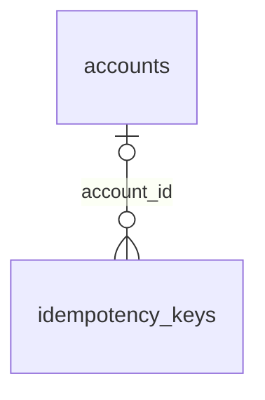

#### `audit.idempotency_keys`

Prisma model `IdempotencyKey` (`prisma/schema/schema.prisma:1085-1102`). Created in `prisma/migrations/20260831150000_initial_schema/migration.sql:517`.

Stored responses for `Idempotency-Key` writes, keyed by `(idempotency_key, endpoint)`. The store looks a row up by that pair only (`src/infrastructure/idempotency/prisma-idempotency-store.ts:8-15`); a response with status 500 or above is not stored (`src/shared/http/idempotency.ts:58-64`) and a stored key whose request-body hash differs is answered `409 idempotency.body_mismatch` (`src/shared/http/idempotency.ts:82-89`); the middleware writes `expires_at` as creation time plus 48 hours (`src/shared/http/idempotency.ts:11,75`) but the lookup does not compare it and no code deletes a row (section 6). `account_id` is stored and not part of the key.

> Pending #244: idempotency keys are scoped to the account plus the path ids.

| Column | Type | Null | Default | Notes | Since |
| --- | --- | --- | --- | --- | --- |
| `idempotency_key` | text | no |  | part of PK | `20260831150000_initial_schema:518` |
| `endpoint` | text | no |  | part of PK | `20260831150000_initial_schema:519` |
| `request_body_hash` | text | no |  |  | `20260831150000_initial_schema:520` |
| `response_status` | integer | no |  |  | `20260831150000_initial_schema:521` |
| `response_body` | jsonb | no |  |  | `20260831150000_initial_schema:522` |
| `account_id` | text | yes |  | FK `account.accounts(account_id)` SET NULL | `20260831150000_initial_schema:523` |
| `created_at` | timestamptz(6) | no | `CURRENT_TIMESTAMP` |  | `20260831150000_initial_schema:524` |
| `expires_at` | timestamptz(6) | no |  |  | `20260831150000_initial_schema:525` |

| Kind | Name | Definition | Migration |
| --- | --- | --- | --- |
| PK | `idempotency_keys_pkey` | `(idempotency_key, endpoint)` | `20260831150000_initial_schema:527` |
| INDEX | `idx_idempotency_keys_account` | `(account_id)` | `20260831150000_initial_schema:738` |
| INDEX | `idx_idempotency_keys_expires` | `(expires_at)` | `20260831150000_initial_schema:741` |
| FK | `idempotency_keys_account_id_fkey` | `(account_id) -> account.accounts(account_id) ON DELETE SET NULL ON UPDATE CASCADE` | `20260831150000_initial_schema:921` |

Written by `PrismaIdempotencyStore.save` (`src/infrastructure/idempotency/prisma-idempotency-store.ts:29`).

### Audit and platform settings

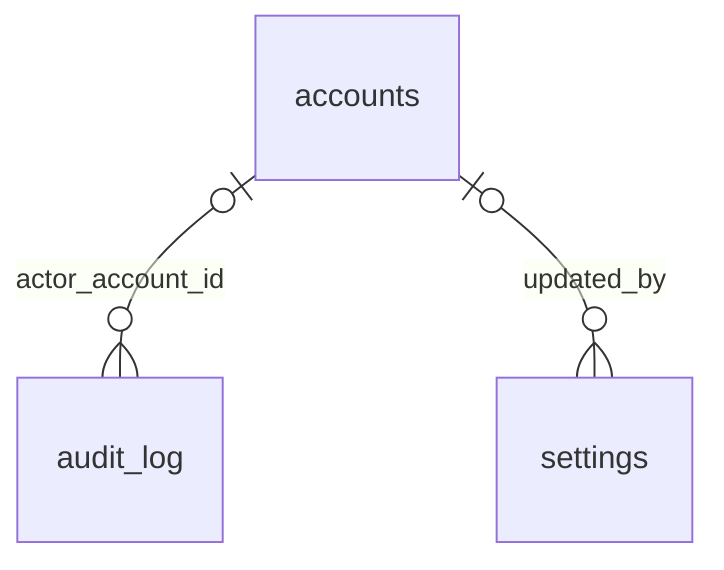

#### `audit.audit_log`

Prisma model `AuditLog` (`prisma/schema/schema.prisma:1065-1083`). Created in `prisma/migrations/20260831150000_initial_schema/migration.sql:502`.

The unified audit trail. Rows are appended by repositories in the same transaction as the change they describe, and by the auth audit sink; `event_key` is a unique idempotency key for writers that can see the same event twice (`src/modules/auth/repository/shared/prisma-auth-audit-sink.ts:15-34`). `actor_account_id` is null for system actions and `ON DELETE SET NULL`. `changes` is JSON, `ip_address_hash` and `user_agent_hash` hold hashes only. No code under `src/` updates or deletes a row, and the database has no append-only trigger on this table.

> Pending #233: a dead-letter replay writes an audit row; on main it writes none.

| Column | Type | Null | Default | Notes | Since |
| --- | --- | --- | --- | --- | --- |
| `audit_log_id` | text | no |  | PK | `20260831150000_initial_schema:503` |
| `actor_account_id` | text | yes |  | FK `account.accounts(account_id)` SET NULL | `20260831150000_initial_schema:504` |
| `action` | text | no |  |  | `20260831150000_initial_schema:505` |
| `resource_type` | text | no |  |  | `20260831150000_initial_schema:506` |
| `resource_id` | text | no |  |  | `20260831150000_initial_schema:507` |
| `changes` | jsonb | yes |  |  | `20260831150000_initial_schema:508` |
| `ip_address_hash` | text | yes |  |  | `20260831150000_initial_schema:509` |
| `user_agent_hash` | text | yes |  |  | `20260831150000_initial_schema:510` |
| `created_at` | timestamptz(6) | no | `CURRENT_TIMESTAMP` |  | `20260831150000_initial_schema:511` |
| `event_key` | text | yes |  | unique; Unique, nullable; a claim key for conflict-do-nothing inserts. | `20260831183000_auth_audit_event_keys:2` |

| Kind | Name | Definition | Migration |
| --- | --- | --- | --- |
| PK | `audit_log_pkey` | `(audit_log_id)` | `20260831150000_initial_schema:513` |
| UNIQUE | `audit_log_event_key_key` | `(event_key)` | `20260831183000_auth_audit_event_keys:4` |
| INDEX | `idx_audit_log_actor` | `(actor_account_id)` | `20260831150000_initial_schema:732` |
| INDEX | `idx_audit_log_resource` | `(resource_type, resource_id, created_at DESC)` | `20260831150000_initial_schema:735` |
| FK | `audit_log_actor_account_id_fkey` | `(actor_account_id) -> account.accounts(account_id) ON DELETE SET NULL ON UPDATE CASCADE` | `20260831150000_initial_schema:918` |

Written in 18 files: `src/modules/auth/repository/customer/prisma-device-replacement.repository.ts` (4 sites, first at line 142); `src/modules/auth/repository/shared/prisma-account-closure.repository.ts` (1 site, first at line 119); `src/modules/auth/repository/shared/prisma-auth-audit-sink.ts` (1 site, first at line 20); `src/modules/auth/repository/staff/prisma-account-recovery.repository.ts` (8 sites, first at line 84); `src/modules/auth/repository/staff/prisma-staff-account-lifecycle.repository.ts` (5 sites, first at line 67); `src/modules/auth/repository/staff/prisma-staff-bootstrap.repository.ts` (2 sites, first at line 90); `src/modules/auth/repository/staff/prisma-staff-invitation.repository.ts` (3 sites, first at line 48); `src/modules/auth/repository/staff/prisma-staff-webauthn.repository.ts` (3 sites, first at line 134); `src/modules/identity/repository/prisma-kyc.repository.ts` (9 sites, first at line 224); `src/modules/intake/application/upload-case-document.service.ts` (3 sites, first at line 28); `src/modules/intake/repository/prisma-intake.repository.ts` (21 sites, first at line 165); `src/modules/intake/repository/prisma-partner-organization.repository.ts` (4 sites, first at line 29); `src/modules/offering/repository/prisma-offering-document.repository.ts` (1 site, first at line 49); `src/modules/offering/repository/prisma-offering-presentation.repository.ts` (1 site, first at line 45); `src/modules/offering/repository/prisma-offering.repository.ts` (10 sites, first at line 226); `src/modules/offering/repository/prisma-onramp-late-evidence.repository.ts` (2 sites, first at line 91); `src/modules/settlement/repository/prisma-settlement.repository.ts` (5 sites, first at line 566); `src/modules/wallet/repository/prisma-wallet.repository.ts` (6 sites, first at line 195).

#### `platform.settings`

Prisma model `PlatformSetting` (`prisma/schema/schema.prisma:1104-1116`). Created in `prisma/migrations/20260831150000_initial_schema/migration.sql:531`.

Database-backed configuration: `setting_key`, JSON `value`, `description`, `updated_by`. Five rows are seeded by migrations (section 8); the wallet-registry watcher stores its cursor and heartbeat here as well (`src/modules/settlement/repository/wallet-registry-setting-keys.ts:5-10`).

| Column | Type | Null | Default | Notes | Since |
| --- | --- | --- | --- | --- | --- |
| `setting_key` | text | no |  | PK | `20260831150000_initial_schema:532` |
| `value` | jsonb | no |  |  | `20260831150000_initial_schema:533` |
| `description` | text | no |  |  | `20260831150000_initial_schema:534` |
| `updated_at` | timestamptz(6) | no | `CURRENT_TIMESTAMP` |  | `20260831150000_initial_schema:535` |
| `updated_by` | text | yes |  | FK `account.accounts(account_id)` SET NULL | `20260831150000_initial_schema:536` |

| Kind | Name | Definition | Migration |
| --- | --- | --- | --- |
| PK | `settings_pkey` | `(setting_key)` | `20260831150000_initial_schema:538` |
| INDEX | `idx_settings_updated_by` | `(updated_by)` | `20260831150000_initial_schema:744` |
| FK | `settings_updated_by_fkey` | `(updated_by) -> account.accounts(account_id) ON DELETE SET NULL ON UPDATE CASCADE` | `20260831150000_initial_schema:924` |

Written by `PrismaSettlementRepository.setLastProcessedWalletRegistryBlock` (`src/modules/settlement/repository/prisma-settlement.repository.ts:809`); `PrismaWalletRegistryHealthRepository.recordWatcherHeartbeat` (`src/modules/settlement/repository/prisma-wallet-registry-health.repository.ts:73`).

## 5. Enumerated values

Two kinds of enum-like column exist: columns a `CHECK` constraint limits, and columns the database leaves free where only application code decides the values. The first table is generated from the final state of the constraints; the second is read from the code.

### 5.1 Values enforced by a CHECK constraint

| Table | Column | Allowed values | Constraint | Migration |
| --- | --- | --- | --- | --- |
| `auth.login_methods` | `method_type` | `passkey`, `google`, `apple`, `device_key` | `login_methods_supported_method_check` | `20260912170000_device_key_login_method:9` |
| `auth.staff_webauthn_challenges` | `purpose` | `registration`, `authentication` | `staff_webauthn_challenges_purpose_check` | `20260831173000_staff_webauthn_mfa:31` |
| `auth.staff_webauthn_credentials` | `device_type` | `singleDevice`, `multiDevice` | `staff_webauthn_credentials_device_type_check` | `20260831173000_staff_webauthn_mfa:15` |
| `identity.kyc_eligibility` | `eligibility_state` | `not_started`, `in_progress`, `pending_manual_review`, `eligible`, `unsupported_jurisdiction`, `not_eligible`, `requires_renewal`, `suspended_restricted` | `kyc_eligibility_state_check` | `20260901090000_didit_kyc:26` |
| `identity.kyc_eligibility` | `operational_substatus` | `kyc_not_started`, `kyc_session_creating`, `kyc_session_creation_failed`, `kyc_session_open`, `kyc_pending`, `kyc_resubmission_pending`, `kyc_manual_review`, `kyc_verified_pending_policy_eval`, `kyc_verified`, `kyc_verified_owner_poa_missing`, `kyc_jurisdiction_blocked`, `kyc_failed`, `kyc_restart_required`, `kyc_reverification_required`, `kyc_restricted`, `kyc_integration_anomaly` | `kyc_operational_substatus_check` | `20260901090000_didit_kyc:39` |
| `identity.kyc_eligibility` | `proof_of_address_provider_status` | `Not Started`, `In Progress`, `In Review`, `Approved`, `Declined`, `Resubmitted`, `Expired`, `Abandoned`, `Kyc Expired`, `Awaiting User`; NULL also allowed | `kyc_proof_of_address_provider_status_check` | `20260901100000_didit_proof_of_address:22` |
| `identity.kyc_eligibility` | `proof_of_address_status` | `not_started`, `creating`, `creation_failed`, `in_progress`, `pending_manual_review`, `current`, `insufficient`, `expired`, `restart_required`, `integration_anomaly` | `kyc_proof_of_address_status_check` | `20260901100000_didit_proof_of_address:38` |
| `identity.kyc_eligibility` | `provider_status` | `Not Started`, `In Progress`, `In Review`, `Approved`, `Declined`, `Resubmitted`, `Expired`, `Abandoned`, `Kyc Expired`, `Awaiting User`; NULL also allowed | `kyc_provider_status_check` | `20260901090000_didit_kyc:70` |
| `intake.documentary_screening_evidence` | `status` | `pending`, `mandatory_missing`, `accepted`, `rejected` | `documentary_screening_evidence_status_check` | `20260831170000_origination_review_workflow:44` |
| `intake.information_requests` | `status` | `proposed`, `published`, `answered`, `withdrawn`, `expired` | `information_requests_status_check` | `20260831170000_origination_review_workflow:52` |
| `intake.information_requests` | `requesting_workstream` | `legal`, `appraisal`, `origination`, `intake` | `information_requests_workstream_check` | `20260921120000_information_request_workstream_intake:5` |
| `intake.intake_case_events` | `actor_type` | `staff`, `applicant`, `partner`, `system` | `intake_case_events_actor_type_check` | `20260918120000_intake_case_event_ledger:33` |
| `intake.intake_case_events` | `event_source` | `live`, `legacy_audit` | `intake_case_events_event_source_check` | `20260918120000_intake_case_event_ledger:35` |
| `intake.intake_case_reversal_operations` | `status` | `requested`, `pending_approval`, `approved`, `executing`, `completed`, `failed`, `cancelled` | `intake_case_reversal_operations_status_check` | `20260918140000_intake_case_reversal_operations:57` |
| `intake.intake_cases` | `stage` | `draft`, `submitted`, `waiting_on_applicant`, `pre_offering_open`, `post_ipo_structuring`, `approved_for_final_offering`, `rejected`, `withdrawn`, `expired` | `origination_cases_stage_check` | `20260831170000_origination_review_workflow:13` |
| `intake.properties` | `condition` | `new`, `renovated`, `good`, `fair`, `needs_renovation`; NULL also allowed | `properties_condition_check` | `20260913220000_property_structured_fields:24` |
| `intake.properties` | `energy_rating` | `A+`, `A`, `B`, `C`, `D`, `E`, `F`, `G`; NULL also allowed | `properties_energy_rating_check` | `20260913220000_property_structured_fields:32` |
| `intake.properties` | `residential_subtype` | `apartment`, `house`, `townhouse`, `multi_family`, `studio`, `other`; NULL also allowed | `properties_residential_subtype_check` | `20260913220000_property_structured_fields:17` |
| `intake.property_rooms` | `room_type` | `bedroom`, `bathroom`, `kitchen`, `living_room`, `dining_room`, `office`, `storage`, `other` | `property_rooms_room_type_check` | `20260913230000_property_rooms:25` |
| `intake.submission_revisions` | `reason` | `initial`, `resubmission_after_rfi`, `initial_staff_created` | `submission_revisions_reason_check` | `20260913200000_staff_created_case_reason:9` |
| `money.onramp_late_evidence` | `state` | `eurc_reserved`, `purchase_failed` | `onramp_late_evidence_state_check` | `20261117203500_onramp_late_evidence:66` |
| `offering.offerings` | `status` | `pre_offering`, `final_offering`, `closed` | `offerings_status_check` (NOT VALID) | `20261018131001_money_ledger_amount_and_status_checks:102` |
| `public.auth_session` | `authenticationLevel` | `unassured`, `oauth_pending`, `staff_passkey`, `device_biometric` | `auth_session_authentication_level_check` | `20260912150000_remove_oauth_passkey_level:38` |
| `public.auth_user` | `population` | `customer`, `staff_partner` | `auth_user_population_check` | `20260831154500_better_auth_core:13` |
| `settlement.escrow_mint_intents` | `status` | `sending`, `mint_sent`, `recorded` | `escrow_mint_intents_status_check` | `20261018132000_escrow_mint_intents:41` |
| `settlement.ipo_escrow_campaigns` | `observed_state` | `not_opened`, `open`, `successful`, `failed` | `ipo_escrow_campaigns_observed_state_check` | `20261117204500_ipo_escrow_campaigns:39` |
| `settlement.position_ledger` | `position_status` | `pending_internal_settlement`, `active`, `redeemed` | `position_ledger_position_status_check` (NOT VALID) | `20261018131001_money_ledger_amount_and_status_checks:114` |

Checks that limit a column through a longer expression, listed in the table sections: `staff_invitations_role_scope_check` on `auth.staff_invitations`, `staff_role_assignment_scope` on `auth.staff_role_assignments`, `information_requests_resolution_check` on `intake.information_requests`, `intake_case_events_stage_check` on `intake.intake_case_events`, `intake_case_reversal_operations_stage_check` on `intake.intake_case_reversal_operations`, `onramp_late_evidence_reservation_stage_check` on `money.onramp_late_evidence`.

The nine values of `intake.intake_cases.stage` are the same set `intake.intake_case_events.from_stage` and `to_stage` and `intake.intake_case_reversal_operations.from_stage` and `to_stage` accept (`prisma/migrations/20260918120000_intake_case_event_ledger/migration.sql:29-32`, `prisma/migrations/20260918140000_intake_case_reversal_operations/migration.sql:34-37`). The roles `admin_operations`, `legal_partner` and `appraisal_partner` are fixed by `staff_role_assignment_scope` and `staff_invitations_role_scope_check`, each of which also ties the role to the right scope column.

### 5.2 Values decided by application code

The database has no check on these columns. The values are those the code defines or writes at 48aa967; a row written outside the application could hold anything.

| Table.column | Values in code | Source |
| --- | --- | --- |
| `account.accounts.status` | `active`, `recovery_review`, `suspended_restricted` | `src/modules/account/repository/account.repository.ts:1` (`AccountStatus`) |
| `auth.sessions.status` | `active` (column default), `revoked` | `src/modules/auth/infrastructure/shared/prisma-session-mirror.ts:51-59` (`recordRevoked`) |
| `auth.devices.status` | `active` (column default), `revoked` | `src/modules/auth/repository/staff/prisma-account-recovery.repository.ts:320-329` |
| `auth.device_challenges.purpose` | `enrol-device`, `login`, `tx` | `src/modules/auth/api/customer/device-auth.router.ts:166`, `src/modules/auth/application/customer/device-challenge-issuance.service.ts:56`, `src/modules/auth/api/customer/signing-requests.router.ts:114` |
| `auth.signing_requests.status` | `pending`, `signed`, `executed`, `submitted`, `included`, `expired`, `cancelled` (`submitted` and `included` are for on-chain request types that are not built) | `src/modules/auth/domain/signing-request.policy.ts:24-40` (`SIGNING_REQUEST_STATUSES`) |
| `auth.account_recovery_cases.status` | `open`, `approved`, `rejected`, `completed` | `src/modules/auth/repository/staff/account-recovery.repository.ts:1` |
| `auth.account_closure_requests.status` | `pending`, `approved`, `rejected`, `cancelled` | `src/modules/auth/repository/shared/account-closure.repository.ts:1` |
| `intake.legal_practices.status`, `intake.appraisal_firms.status` | `active` (default), `suspended` | `src/modules/intake/repository/partner-organization.repository.ts:1` |
| `intake.case_threads.lane` | `internal_case`, `applicant` | `src/modules/intake/repository/intake.repository.ts:478` (`ThreadLane`) |
| `intake.intake_case_reversal_operations.command` | `return_to_draft`, `withdraw_information_request`, `reopen_pre_offering`, `reopen_structuring`, `reopen_final_offering_review` | `src/modules/intake/domain/intake-reversal.policy.ts:15-21` (`reversalCommandSchema`) |
| `intake.intake_case_reversal_operations.reason_code` | `operator_input_error`, `wrong_case_selected`, `duplicate_case`, `missing_evidence_correction`, `partner_assignment_correction`, `founder_decision_correction`, `offering_setup_correction`, `compliance_directed_correction`, `system_recovery` | `src/modules/intake/domain/intake-reversal.policy.ts:3-13` (`reversalReasonCodeSchema`) |
| `offering.reservations.reservation_stage` | `initiated` (default), `awaiting_reconfirmation`, `reconfirmed`, `finalized`, `cancelled`, `lapsed` | writes at `src/modules/offering/repository/prisma-offering.repository.ts:751,1019,1158,1183,1364,1487,1506,1595` and `src/modules/intake/repository/prisma-intake.repository.ts:2286` |
| `money.money_events.capital_state` | `initiated`, `eurc_purchase_pending`, `purchase_failed`, `eurc_reserved`, `reconfirmation_pending`, `eurc_finalized` | writes at `src/modules/offering/repository/prisma-offering.repository.ts:761,1165,1494`, `src/modules/offering/application/create-reservation.service.ts:185,202`, `src/modules/offering/application/poll-onramp-transactions.service.ts:48` |
| `money.money_events.provider` | `coinbase_cdp`, `internal` | `src/modules/offering/repository/prisma-offering.repository.ts:760,1164,1493` |
| `money.onramp_late_evidence.state` | `eurc_reserved`, `purchase_failed` (this one is a CHECK, listed in 5.1) | `prisma/migrations/20261117203500_onramp_late_evidence/migration.sql` |
| `offering.disclosure_documents.document_type` | `ecsp_kiis`, `priips_kid`, `final_offer_summary`, `final_terms_sheet`, `issuer_offeror_structure_sheet`, `investor_rights_payout_waterfall_summary`, `risk_factors_summary`, `property_appraisal_summary`, `fees_costs_tax_liquidity_summary`, `withdrawal_cancellation_supplement_rights_notice`, `full_prospectus` | `src/modules/offering/domain/disclosure-pack.policy.ts:9-21` (`disclosureDocumentTypes`) |
| `offering.materiality_records.classification` | `per_se_material`, `reviewed_material`, `non_material` | `src/modules/offering/domain/materiality.policy.ts:1` |
| `offering.materiality_records.threshold_type` | `valuation`, `cashflow`, `gross_rent`, `closing_delay` | `src/modules/offering/domain/materiality.policy.ts:4` |
| `platform.stored_documents.upload_status` | `accepted` is the only value written; the column default is `quarantined` | `src/modules/intake/application/upload-case-document.service.ts:127`, `src/modules/offering/repository/prisma-offering-document.repository.ts:43` |
| `platform.stored_documents.document_type`, `variant_type` | Case uploads: `ownership_declaration`, `property_facts_sheet`, `encumbrance_declaration`, `photo_set`, `registry_extract`, `title_instrument`, `cadastral_map`, `power_of_attorney`, `name_change_evidence`, `occupancy_evidence`, `succession_evidence` and `room_photo`; thumbnail rows use `document_type` `room_photo_thumbnail` with `variant_type` `thumbnail`; disclosure uploads use the disclosure types above | `src/modules/intake/domain/case-submission.policy.ts:1-20`, `src/modules/intake/application/upload-case-document.service.ts:15-16,133` |
| `platform.stored_documents.classification` | `private` (column default; the value the intake upload writes) and `disclosure` (the value the disclosure-document upload writes) | `src/modules/intake/application/upload-case-document.service.ts:127`, `src/modules/offering/repository/prisma-offering-document.repository.ts:17,44` |
| `settlement.operating_distributions.status` | `calculated` is the column default; no code in `src/` writes the column afterwards, although the schema comment names a `paying` state | `prisma/schema/schema.prisma:1010-1013,1028` |
| `settlement.wallet_registrations` claim state (derived) | `pending` (`registered_at` and `expired_at` null), `expired` (`expired_at` set), confirmed (`registered_at` set); the repository's read model is `pending`, `expired`, `none` | `prisma/migrations/20261117204000_wallet_registration_expiry/migration.sql:1-17`, `src/modules/settlement/repository/settlement.repository.ts:7` (`WalletClaimState`) |

The design record lists other values for four of these columns (`reservation_stage`, `capital_state`, `provider`, `account_recovery_cases.status`); the differences are in section 9.

## 6. Data lifecycle and retention

No document in the design record or setting in the code states a retention period for most of these tables. What follows is what the code does: which job or code path changes or deletes each kind of row, and which rows nothing ever removes. Job schedules are described in [jobs-and-workers.md](jobs-and-workers.md); this section names only the ones that touch a table.

### 6.1 Every hard delete in the code

The non-generated code under `src/` deletes database rows in these places and no others (searched for `.delete(`, `deleteMany`, `DELETE FROM` and `TRUNCATE`; the Redis cache deletes and the object-store deletes are not database rows).

| Rows | Code | When |
| --- | --- | --- |
| `auth.dpop_replays` | `PrismaDpopReplayRepository.pruneExpired` (`src/modules/auth/repository/shared/prisma-dpop-replay.repository.ts:19-24`) | Hourly job `maintenance.dpop_replay_prune` (`src/worker.ts:549,784-789`): rows with `expires_at` in the past. |
| `auth.device_challenges` | `PrismaDeviceChallengeRepository.pruneExpired` (`src/modules/auth/repository/customer/prisma-device-challenge.repository.ts:78-86`) | Hourly job `maintenance.device_challenge_prune` (`src/worker.ts:553,790-795`): rows expired more than `CHALLENGE_REPLAY_WINDOW_MS` (120 000 ms, `src/modules/auth/domain/device-challenge-replay.ts:39`) ago, on the database clock. |
| `auth.devices` and its `auth.login_methods` row | `PrismaDeviceRepository.delete` (`src/modules/auth/repository/customer/prisma-device.repository.ts:171-183`) | Compensation after a failed enrolment (called from `src/modules/auth/application/customer/device-enrolment.service.ts:157`). A device that was enrolled and later revoked is never deleted; it keeps its row with `status = revoked`. |
| `auth.login_methods` of type `device_key` | `consumeAndReplace` (`src/modules/auth/repository/customer/prisma-device-replacement.repository.ts:137-139`) and `revokeDevicesForRecovery` (`src/modules/auth/repository/staff/prisma-account-recovery.repository.ts:335-337`) | Self-service device replacement and customer account recovery; the device row is kept and marked revoked in the same transaction. |
| `auth.staff_session_mfa`, `auth.staff_webauthn_challenges`, `auth.staff_webauthn_credentials` of one account | `prepareRecovery` (`src/modules/auth/repository/staff/prisma-staff-account-lifecycle.repository.ts:58-64`) and `completeOffboarding` (`src/modules/auth/repository/staff/prisma-staff-account-lifecycle.repository.ts:113-119`) | Staff recovery start and staff offboarding. |
| `intake.property_rooms` | `UploadCaseDocumentService.deleteRoom` (`src/modules/intake/application/upload-case-document.service.ts:71`) | Staff deletes a room. Its photo rows are soft-deleted and detached (`room_id` set to null) first. |
| `public.passkey` rows of one user | the passkey plugin hook `ctx.context.adapter.deleteMany` (`src/modules/auth/infrastructure/shared/better-auth.factory.ts:386-391`) | A staff passkey bootstrap with `replaceCredentials` set replaces the user's credentials. |
| Better Auth rows (`public.auth_*`) | Better Auth's own adapter (session revocation through `deleteUserSessions` at `src/modules/auth/infrastructure/customer/better-auth-customer-account-administrator.ts:20,35` and `src/modules/auth/infrastructure/staff/better-auth-staff-account-administrator.ts:26,65`, and the library's own cleanup) | Whether Better Auth removes expired `auth_session` or `auth_verification` rows by itself is Not verified. |

pg-boss deletes its own job rows according to its retention settings; the dead-letter queue keeps a payload for 30 days (`src/shared/jobs/job-queues.ts:14-21`). The rest of pg-boss retention is in [jobs-and-workers.md](jobs-and-workers.md).

### 6.2 What changes a row without deleting it

| Rows | What happens | By what |
| --- | --- | --- |
| `offering.reservations` in `initiated` | An unfunded reservation lapses 15 minutes after creation: `reservation_stage` becomes `lapsed` and an `offering.reservation_lapsed` audit row is written. A reservation whose latest money event is a funded state is never lapsed, and the check is repeated under the row lock. | Job `case_timers.reservation_unfunded_expiry` every minute (`src/worker.ts:479`), `ExpireUnfundedReservationsService` (`src/modules/offering/application/expire-reservations.service.ts:15-45`, 15 minutes at line 18), `PrismaOfferingRepository.expireReservation` (`src/modules/offering/repository/prisma-offering.repository.ts:1000-1038`). |
| `offering.reservations` after final terms | Funded reservations move to `awaiting_reconfirmation` and unfunded ones to `cancelled` when final terms are published (a code comment says the `cancelled` branch cannot be reached while the full-funding rule of AD-245 holds, `src/modules/offering/repository/prisma-offering.repository.ts:1173-1180`); the hourly window-close job turns each `reconfirmed` reservation into `finalized` with a position, and each remaining `awaiting_reconfirmation` one into `lapsed`, then sets the offering to `final_offering`. | `publishFinalOfferingTerms` (`src/modules/offering/repository/prisma-offering.repository.ts:1040-1190`), job `case_timers.offering_reconfirmation_window_close` (`src/worker.ts:486`), `commitOfferingFinalization` (`src/modules/offering/repository/prisma-offering.repository.ts:1402-1536`). |
| `offering.reservations` and `offering.offerings` when a case closes | `closeCase` sets every `pre_offering` offering of the case to `closed` and cancels its open reservations (`initiated`, `awaiting_reconfirmation`, `reconfirmed`). Money events are not touched. | `PrismaIntakeRepository.closeCase` (`src/modules/intake/repository/prisma-intake.repository.ts:2232-2300`). |
| `intake.information_requests` and `intake.intake_cases` | A published request past `due_at` becomes `expired` and the case in `waiting_on_applicant` becomes `expired`, in one transaction with an audit row and a case event. | Job `case_timers.response_window_expiry` hourly (`src/worker.ts:470`), `ExpireOverdueInformationRequestsService` (`src/modules/intake/application/case-timer.service.ts:47-60`), `expireInformationRequest` (`src/modules/intake/repository/prisma-intake.repository.ts:1682-1740`). |
| `settlement.wallet_registrations` pending claims | A claim still pending `WALLET_REGISTRY_PENDING_EXPIRE_AFTER_HOURS` (default 24) after `requested_at` gets `expired_at` set, at most `WALLET_REGISTRY_PENDING_EXPIRE_BATCH_SIZE` (default 500) per run, with an audit row `settlement.wallet_registration_expired`. The row is never deleted. The job does nothing while the registry watcher is stale or lagging. | Job `maintenance.wallet_registration_expiry` (`src/worker.ts:586`), `expirePendingWalletRegistrations` (`src/modules/wallet/repository/prisma-wallet.repository.ts:296-360`), defaults at `src/config/environment.ts:346,362`. |
| `identity.kyc_eligibility` | A session start stuck in `kyc_session_creating` for 15 minutes is failed; an open session older than 60 minutes is re-queried from the provider; an eligible account whose `renewal_due_at` has passed moves to `requires_renewal` with sub-status `kyc_reverification_required`. Every state change writes a history row. | Jobs `maintenance.kyc_stuck_session_expiry`, `maintenance.kyc_stuck_session_reconciliation` and `maintenance.kyc_renewal` (`src/worker.ts:565-579`), thresholds at `src/modules/identity/application/kyc-stuck-session.service.ts:18,79`, `src/modules/identity/application/kyc-renewal.service.ts:6-25`. |
| `auth.device_replacement_codes` | Issuing a code first marks every unconsumed code of the account consumed. Expired codes stay. | `revokePendingForAccount` (`src/modules/auth/repository/customer/prisma-device-replacement.repository.ts:196-201`). |
| `platform.stored_documents` | A deleted room photo or room gets `deleted_at`, `deleted_by_account_id`, `deletion_reason` and `retention_until` 30 days ahead; thumbnails follow their source. The object is deleted from the store best effort. | `deletePhoto` and `deleteRoom` (`src/modules/intake/application/upload-case-document.service.ts:13,33-50,52-75`). |
| `account.accounts` | Approving a closure request sets `status = suspended_restricted` and keeps the row. | `PrismaAccountClosureRepository.decide` (`src/modules/auth/repository/shared/prisma-account-closure.repository.ts:92-121`). |

`auth.signing_requests` rows are never deleted. A `pending` or `signed` request whose `expires_at` has passed becomes `expired`, with no grace period, in the hourly job `maintenance.signing_request_prune` (`src/worker.ts:561,797-803`, `markExpired` at `src/modules/auth/repository/customer/prisma-signing-request.repository.ts:182-191`). A device revoke sets every `pending` or `signed` request of that device to `cancelled` (`cancelPendingAndSignedForDevice`, `src/modules/auth/repository/customer/prisma-signing-request.repository.ts:173-180`); the method takes a device id and nothing about the caller.

> Pending #234: a device revoke cancels only the signing requests of the caller's own device.

### 6.3 What nothing removes

- **Append-only evidence.** `intake.submission_revisions`, `intake.intake_case_events`, `money.money_events`, `money.onramp_webhook_receipts` and `money.onramp_late_evidence` reject UPDATE and DELETE through triggers (the last allows one `reviewed_at` update). `TRUNCATE` is not guarded, and the triggers are not a privilege boundary: the table owner or a superuser can disable them, and `session_replication_role = replica` skips them (`prisma/migrations/20261018131000_money_events_append_only/migration.sql:1-34`). Retention of the two money tables is described as an open question in their migrations (`prisma/migrations/20261117203000_onramp_webhook_receipts/migration.sql:20-24`, `prisma/migrations/20261117203500_onramp_late_evidence/migration.sql:32-35`).
- **Audit trail.** No code updates or deletes a row of `audit.audit_log`, and the table has no trigger. Rows written in the same transaction as the change are committed or rolled back with it; the auth audit sink inserts with `createMany` and `skipDuplicates`, so a repeated `event_key` is dropped (`src/modules/auth/repository/shared/prisma-auth-audit-sink.ts:20-34`). A dead-letter replay writes no audit row on main.

  > Pending #233: a dead-letter replay writes an audit row.

- **Idempotency responses.** `audit.idempotency_keys.expires_at` is set to creation time plus 48 hours (`src/shared/http/idempotency.ts:11,75`). The store reads a row by `(idempotency_key, endpoint)` without comparing `expires_at` (`src/infrastructure/idempotency/prisma-idempotency-store.ts:9-15`) and no code deletes a row, so a stored response is replayed for as long as the row exists (limitation in section 10).

  > Pending #244: idempotency keys are scoped to the account plus the path ids; on main the stored key is `(idempotency_key, endpoint)` and `account_id` is stored but not part of the lookup.

- **Accounts, cases, offerings, positions, wallet claims, KYC rows.** No delete path exists for them. Positions have a `redeemed` status and `redeemed_at` column, but no code writes either (searched `src/` for `redeemed`: only comments mention it).
- **Staff invitations, WebAuthn challenges, device replacement codes, session mirror rows, document metadata rows.** Expired rows are not purged by any job; expiry is enforced when a row is used (`claimInvitation` requires `expires_at > claimed_at`, `src/modules/auth/repository/staff/prisma-staff-invitation.repository.ts:104-107`).
- **Document objects and metadata past `retention_until`.** The code that sets `retention_until` says object deletion "can be retried by the purge job" (`src/modules/intake/application/upload-case-document.service.ts:46`), but no job of that kind exists: the worker source has 25 `ensureJobQueue` calls (counted; six of them sit inside configuration conditions) and none reads `platform.stored_documents.retention_until` (`src/worker.ts:414-464`; `retention_until` is written at `src/modules/intake/application/upload-case-document.service.ts:39,68` and read nowhere).

### 6.4 State machines of the main rows

Reservation stage. Every transition below is a write in `src/`; the database does not constrain `reservation_stage`, so the diagram is the code's behaviour, not a database guarantee. The design record lists eight stages (section 9).

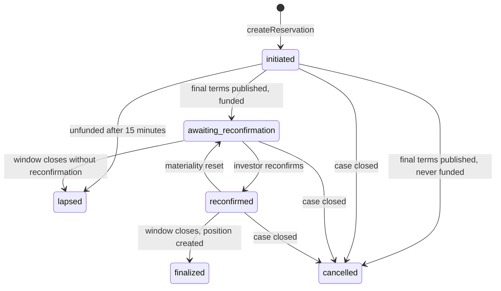

The writes are `createReservation` (`src/modules/offering/repository/prisma-offering.repository.ts:744-751`), `expireReservation` (`src/modules/offering/repository/prisma-offering.repository.ts:1017-1019`), `publishFinalOfferingTerms` (`src/modules/offering/repository/prisma-offering.repository.ts:1156-1158`, `src/modules/offering/repository/prisma-offering.repository.ts:1181-1183`), `reconfirmReservation` (`src/modules/offering/repository/prisma-offering.repository.ts:1361-1364`), `classifyMateriality` (`src/modules/offering/repository/prisma-offering.repository.ts:1593-1595`), `commitOfferingFinalization` (`src/modules/offering/repository/prisma-offering.repository.ts:1485-1487`, `src/modules/offering/repository/prisma-offering.repository.ts:1504-1506`) and `closeCase` (`src/modules/intake/repository/prisma-intake.repository.ts:2284-2286`).

Escrow mint intent. The check constraint allows three states; the code adds a restart edge. Each transition is a compare-and-set on `attempt` and `status`.

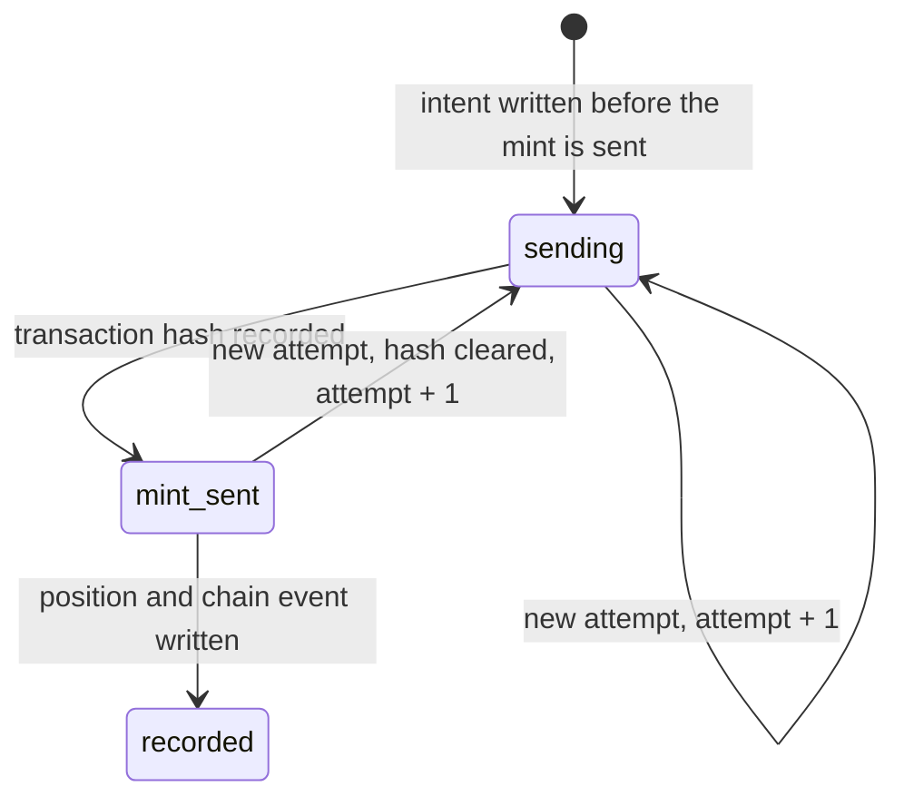

The restart (`restartEscrowMintAttempt`) is `UPDATE ... WHERE attempt = expected AND status IN (sending, mint_sent)` that sets `status = sending`, clears `mint_tx_hash`, increments `attempt` and stores the pinned nonce (`src/modules/settlement/repository/prisma-settlement.repository.ts:393-405`); `recordEscrowMintSent` moves `sending` to `mint_sent` for the same attempt (`src/modules/settlement/repository/prisma-settlement.repository.ts:407-428`); `recordEscrowMintedPosition` flips to `recorded` in the same transaction as the position (`src/modules/settlement/repository/prisma-settlement.repository.ts:451-470`). The migration comment "once a transaction hash is known it is never lost" (`prisma/migrations/20261018132000_escrow_mint_intents/migration.sql:21`) holds for the check constraint, but a restarted attempt clears the hash.

Wallet claim.

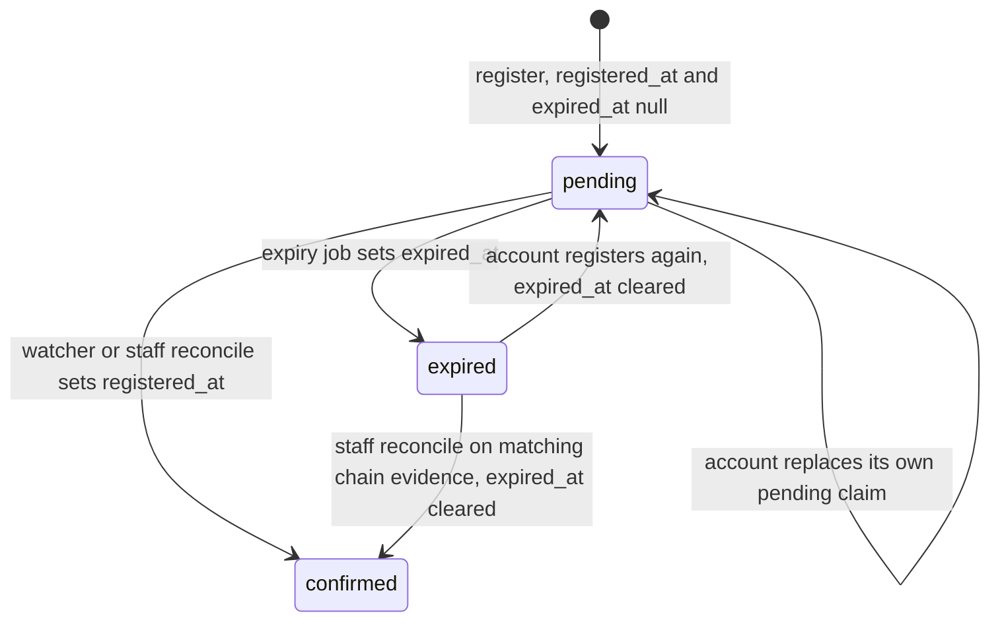

`wallet_registrations_expired_only_pending_check` forbids a row that is both confirmed and expired (`prisma/migrations/20261117204000_wallet_registration_expiry/migration.sql:30-38`); the transitions are described in the schema comment (`prisma/schema/schema.prisma:808-846`).

Signing request. `pending` to `signed` to `executed`, with `expired` and `cancelled` reachable from `pending` and `signed` (`src/modules/auth/domain/signing-request.policy.ts:1-14`, `src/modules/auth/repository/customer/prisma-signing-request.repository.ts:160-191`).

## 7. Transactions and locking

Every multi-row change is one Prisma interactive transaction, and every state machine that two actors can advance takes a row lock before it reads. The default isolation level is PostgreSQL's `READ COMMITTED`; the code sets no other level (searched `src/` for `isolationLevel` and `SERIALIZABLE`: none). Two places rely on a documented consequence of that level: a locked read that waited sees only the locked row's fresh version, so `lockReservationWithLatestMoney` locks the reservation first and reads the latest money event in a second statement (`src/modules/offering/repository/prisma-offering.repository.ts:1950-1990`).

### 7.1 Row locks

| Lock | Where | What it serializes |
| --- | --- | --- |
| `SELECT ... FROM offering.offerings ... FOR UPDATE OF o` | `createReservation` (`src/modules/offering/repository/prisma-offering.repository.ts:615-640`) | Every reservation attempt for one offering, so capacity, the IPO deadline and the client idempotency key are checked against a stable state. The client-key lookup happens only after the lock is held (`src/modules/offering/repository/prisma-offering.repository.ts:698-710`). |
| `SELECT ... FROM settlement.ipo_escrow_campaigns ... FOR SHARE OF e` | `createReservation` (`src/modules/offering/repository/prisma-offering.repository.ts:660-690`) | A campaign update that marks the campaign resolved cannot commit between the readiness check and the reservation commit. Read only where the settlement bundle is configured. |
| `offering.offerings ... FOR UPDATE` | `publishFinalOfferingTerms` (`src/modules/offering/repository/prisma-offering.repository.ts:1040-1062`), `commitOfferingFinalization` (`src/modules/offering/repository/prisma-offering.repository.ts:1402-1417`), `classifyMateriality` (`src/modules/offering/repository/prisma-offering.repository.ts:1539-1552`), `publishDisclosurePack` (`src/modules/offering/repository/prisma-offering.repository.ts:1666-1672`), `PrismaOfferingPresentationRepository` (`src/modules/offering/repository/prisma-offering-presentation.repository.ts:23`), `runReversalExecution` (`src/modules/intake/repository/prisma-intake.repository.ts:249`, the offering of the case's vehicle, locked after the case row) | The offering's publication state against every other change to it. |
| `offering.offerings ... FOR SHARE`, then `offering.reservations ... FOR UPDATE` | `reconfirmReservation` (`src/modules/offering/repository/prisma-offering.repository.ts:1285-1305`) | A reconfirmation against a concurrent materiality reset or pack republish; the order offering then reservations is the same everywhere. |
| `offering.reservations ... FOR UPDATE OF reservation` | `publishFinalOfferingTerms` (`src/modules/offering/repository/prisma-offering.repository.ts:1128-1145`), `commitOfferingFinalization` (`src/modules/offering/repository/prisma-offering.repository.ts:1450-1462`), `classifyMateriality` (`src/modules/offering/repository/prisma-offering.repository.ts:1580-1590`) | All reservations of an offering while their stages change. |
| Reservation `FOR UPDATE` through `lockReservationWithLatestMoney` | `recordMoneyEvent` (`src/modules/offering/repository/prisma-offering.repository.ts:790`), `recordOnrampOutcome` (`src/modules/offering/repository/prisma-offering.repository.ts:898`), `expireReservation` (`src/modules/offering/repository/prisma-offering.repository.ts:1000`) | The onramp poll, the webhook job and the expiry sweep on one reservation; a funded state cannot be overwritten by an unfunded one and a funded reservation cannot lapse. |
| `intake.intake_cases ... FOR UPDATE` | the case-changing methods of `PrismaIntakeRepository`: `createReversalOperation` (`src/modules/intake/repository/prisma-intake.repository.ts:159`), `cancelReversalOperation` (`src/modules/intake/repository/prisma-intake.repository.ts:199`), `runReversalExecution`, which `executeReversalOperation` calls (`src/modules/intake/repository/prisma-intake.repository.ts:238`), `submitInitialCase` (`src/modules/intake/repository/prisma-intake.repository.ts:564`), `assignPartnerOrganization` (`src/modules/intake/repository/prisma-intake.repository.ts:1086`), `transitionToPostIpoStructuring` (`src/modules/intake/repository/prisma-intake.repository.ts:1162`), `recordLegalStructuring` (`src/modules/intake/repository/prisma-intake.repository.ts:1286`), `recordAppraisal` (`src/modules/intake/repository/prisma-intake.repository.ts:1394`), `publishInformationRequest` (`src/modules/intake/repository/prisma-intake.repository.ts:1517`), `expireInformationRequest` (`src/modules/intake/repository/prisma-intake.repository.ts:1682`), `withdrawInformationRequest` (`src/modules/intake/repository/prisma-intake.repository.ts:1781`), `resubmitAfterInformationRequest` (`src/modules/intake/repository/prisma-intake.repository.ts:1906`), `recordFounderDecision` (`src/modules/intake/repository/prisma-intake.repository.ts:2022`), `closeCase` (`src/modules/intake/repository/prisma-intake.repository.ts:2232`) | One lock holder per case at a time. `reviewEvidence` and the document upload service do not take this lock; where they append a case event, the `UPDATE` of `workflow_event_sequence` locks the row from that statement until commit. The event number comes from `intake_cases.workflow_event_sequence`, incremented by an `UPDATE` in the same transaction as the event insert (`src/modules/intake/repository/intake-case-event.repository.ts:70-76`); `(case_id, event_sequence)` is unique as a backstop. |
| `intake.intake_cases ... FOR UPDATE` before the offering is opened | `openOfferingForApprovedCase` (`src/modules/offering/repository/prisma-offering.repository.ts:158-161`) | `closeCase` takes the same lock first, so a case closed after approval and before the job ran produces an offering that is created already closed. |
| `offering.offerings` and `offering.reservations ... FOR UPDATE` inside `closeCase` | `src/modules/intake/repository/prisma-intake.repository.ts:2265,2280` | The offering and its open reservations while they are closed. |
| `intake.documentary_screening_evidence ... FOR UPDATE` | `reviewEvidence` (`src/modules/intake/repository/prisma-intake.repository.ts:2164`) | Two reviewers of one evidence row. |
| `intake.property_rooms ... FOR UPDATE` | `src/modules/intake/application/upload-case-document.service.ts:123` | The five-photo limit per room against concurrent uploads. |
| `money.onramp_late_evidence ... FOR UPDATE OF evidence` | `markLateEvidenceReviewed` (`src/modules/offering/repository/prisma-onramp-late-evidence.repository.ts:131-136`) | Two staff members marking one entry reviewed at once leave one review time and one audit row; the second sees what the first committed. |
| `settlement.wallet_registrations ... FOR UPDATE` | `registerWallet` two-pass loop (`src/modules/wallet/repository/prisma-wallet.repository.ts:121-130`), staff reconcile (`src/modules/wallet/repository/prisma-wallet.repository.ts:385-398`), `lockWalletRegistration` (`src/modules/settlement/repository/prisma-settlement.repository.ts:128-140`) | Register, replace, confirm and reconcile of one account's claim. The insert is `ON CONFLICT (account_id) DO NOTHING`; when it loses the race the second pass locks and decides against the committed row (`src/modules/wallet/repository/prisma-wallet.repository.ts:185-195`). |
| `... FOR UPDATE SKIP LOCKED` | the wallet claim expiry batch (`src/modules/wallet/repository/prisma-wallet.repository.ts:318-330`) | A row being confirmed, replaced or expired by someone else is left to that transaction. The batch is selected and locked in one statement and updated in a second, because the planner may run a sub-select inside the `UPDATE` more than once (comment at `src/modules/wallet/repository/prisma-wallet.repository.ts:311-322`). |
| `account.accounts ... FOR UPDATE` | `reserveSessionStart` (`src/modules/identity/repository/prisma-kyc.repository.ts:152-157`) and `reserveProofOfAddressSessionStart` (`src/modules/identity/repository/prisma-kyc.repository.ts:285-290`) | One KYC state change per account. |
| `identity.kyc_eligibility ... FOR UPDATE` by provider reference | `applyProviderOutcome` (`src/modules/identity/repository/prisma-kyc.repository.ts:434-439`) and `applyProofOfAddressOutcome` (`src/modules/identity/repository/prisma-kyc.repository.ts:544-549`) | A webhook and a reconcile for the same provider session. |
| `auth.device_challenges ... FOR SHARE` with `lock_timeout = '2s'`, `statement_timeout = '5s'`, `idle_in_transaction_session_timeout = '5s'` | device enrolment (`src/modules/auth/repository/customer/prisma-device.repository.ts:55-80`) | The challenge row cannot be pruned between the insert-deadline check and the commit of the device row. |
| `auth.staff_invitations ... FOR UPDATE` | bootstrap issue (`src/modules/auth/repository/staff/prisma-staff-bootstrap.repository.ts:70-75`) | A mid-commit acceptance and a re-issue of the bootstrap invitation. |
| `settlement.escrow_mint_intents` compare-and-set | `restartEscrowMintAttempt`, `recordEscrowMintSent`, `adoptEscrowMintTransaction`, `recordEscrowMintedPosition` (`src/modules/settlement/repository/prisma-settlement.repository.ts:393-470`) | Two overlapping finalizer runs cannot both start or finish one mint attempt: each update names the expected `attempt` and `status` and checks the row count. |

### 7.2 Advisory locks

| Key | Held by | Purpose |
| --- | --- | --- |
| `7_311_040_001` | `pg_advisory_xact_lock` in `PrismaStaffBootstrapRepository` (`src/modules/auth/repository/staff/prisma-staff-bootstrap.repository.ts:11-16,55-60`) | One first-administrator bootstrap at a time. `lock_timeout` is set first. |
| `7_311_040_002` | `pg_advisory_xact_lock` in `PostgresOperatorKeyLock` (`src/infrastructure/blockchain/operator-key-lock.ts:3-16,95-98`) | Every chain write made with the platform operator key: the worker's settlement jobs and the operator command that opens escrow campaigns. Advisory locks are per database, and one database serves one environment with one operator key. Transaction scoped: a crashed writer cannot leave it held. |

### 7.3 Unique indexes and primary keys used as locks

| Index | Table | What it makes impossible |
| --- | --- | --- |
| `devices_one_active_per_account` (partial) | `auth.devices` | Two active devices for one account; closes the race in the check-then-insert of enrolment (`prisma/migrations/20260911160000_device_one_active_per_account/migration.sql:1-14`). |
| `devices_dpop_jkt_active_key` (partial) | `auth.devices` | One DPoP key on two active devices; a revoked device's key can enrol again. |
| `(jkt, jti)` primary key | `auth.dpop_replays` | A replayed DPoP proof: `INSERT ... ON CONFLICT DO NOTHING RETURNING` reports whether the row was new (`src/modules/auth/repository/shared/prisma-dpop-replay.repository.ts:11-19`). |
| `staff_invitations_one_pending_email_key`, `staff_invitations_one_pending_bootstrap_key` (partial) | `auth.staff_invitations` | Two pending invitations for one email, or two live bootstrap invitations; the bootstrap lock is the first line and the index the database-level backstop (`prisma/migrations/20260912100000_staff_invitation_cli_bootstrap/migration.sql:22-29`). |
| `uq_reservations_account_offering_client_key` | `offering.reservations` | A second capacity hold for one client operation key. NULL keys do not collide. |
| `uq_escrow_mint_intents_piv_account`, `uq_position_ledger_escrow_mint_intent` | `settlement.escrow_mint_intents`, `settlement.position_ledger` | A second mint intent for one contributor and vehicle; a second position for one mint. |
| `uq_onramp_webhook_receipts_event_id` | `money.onramp_webhook_receipts` | Processing a redelivered Coinbase event twice: `createMany` with `skipDuplicates` writes the receipt and, only when it was new, enqueues the job in the same transaction (`src/modules/offering/repository/prisma-offering.repository.ts:966-995`). |
| `uq_onramp_late_evidence_provider_transaction_id` | `money.onramp_late_evidence` | Two rows for one provider transaction; the insert is `createMany` with `skipDuplicates`, so whichever of the poll and the webhook job sees the transaction first writes the row (`src/modules/offering/repository/prisma-onramp-late-evidence.repository.ts:61-79`). |
| `audit_log_event_key_key` | `audit.audit_log` | A second audit row for one `event_key`; used as a claim by conflict-do-nothing inserts (`src/modules/settlement/repository/prisma-settlement.repository.ts:827-830`, `src/modules/auth/repository/shared/prisma-auth-audit-sink.ts:20-34`). |
| `wallet_registrations_confirmed_address_key` (partial, on `lower(wallet_address)`) | `settlement.wallet_registrations` | One confirmed address bound to two accounts; pending claims may overlap. |
| `uq_wallet_registrations_chain_event` (partial) | `settlement.wallet_registrations` | One chain event confirming two claims. |
| `(case_id, event_sequence)`, `event_key`, `reversal_of_event_id` | `intake.intake_case_events` | A repeated event, two events with one number, two reversals of one event. |
| `(case_id, idempotency_key)` | `intake.intake_case_reversal_operations` | A repeated reversal request. |
| `(idempotency_key, endpoint)` primary key | `audit.idempotency_keys` | Two stored responses for one key; the store re-reads the winner when the insert loses (`src/infrastructure/idempotency/prisma-idempotency-store.ts:44-50`). |
| `kyc_eligibility_session_start_id_key`, `kyc_eligibility_poa_session_start_id_key` | `identity.kyc_eligibility` | Two rows holding one session start id. |

### 7.4 Jobs inside the caller's transaction

Cross-domain state changes go through pg-boss jobs sent inside the caller's own Prisma transaction (`enqueueTransactionalJob`, `src/shared/jobs/enqueue-job.ts:43-62`): the job row and the state change commit together or not at all. The jobs table is in the `pgboss` schema of the same database, so this is one local transaction, not a distributed one. Five call sites use it: the onramp webhook receipt (`src/modules/offering/repository/prisma-offering.repository.ts:985`), the escrow campaign opening (`src/modules/offering/repository/prisma-offering.repository.ts:267`), the reconfirmation-window-opened notification and the post-IPO structuring handoff (`src/modules/offering/repository/prisma-offering.repository.ts:1235,1252`), and the case-approval handoff (`src/modules/intake/repository/prisma-intake.repository.ts:2079`).

## 8. Migrations

### 8.1 Naming and stamping

A migration is a directory `prisma/migrations/<14-digit stamp>_<snake_case_name>/` holding one file, `migration.sql` (75 directories at 48aa967; `prisma/migrations/migration_lock.toml` records the provider `postgresql`). Prisma applies pending directories in the order of their names, which is the order of their stamps; the stamp is `YYYYMMDDHHMMSS` and is chosen by whoever writes the migration, not read from a clock at apply time. The 14 digits read as a date and time, and this chapter reads them as UTC; that reading is not stated anywhere in the repository.

A migration that was applied once is never edited: the rename migration says "Historical migration files retain their original names and SQL so Prisma checksums remain valid; this forward migration updates existing databases" (`prisma/migrations/20260917150000_rename_origination_to_intake/migration.sql:1-3`). That is why constraint names and comments still say `origination`, and why the settings keys were renamed by a second migration (`prisma/migrations/20261018120000_rename_origination_platform_settings_to_intake/migration.sql:1-17`).

Prisma writes no down migrations. Migration headers give rollback statements where one exists (for example `prisma/migrations/20261113150100_wallet_address_canonical_form/migration.sql:70-75`).

### 8.2 How migrations are applied

| Where | Command | Source |
| --- | --- | --- |
| Local development database | `npm run db:migrate:dev` (`prisma migrate dev`); local databases only | `package.json:26`; `AGENTS.md` (commands) |
| Any database, from the repository | `npm run db:migrate:deploy` (`prisma migrate deploy`) | `package.json:27` |
| Docker Compose, local | one-shot service `migrate`, built from the Dockerfile target `migrate`; `api` and `worker` start only after it exits successfully | `docker-compose.yml:87-95,125,164`, `Dockerfile:24-28` |
| Docker Compose, staging | the same one-shot service against the staging database container `vistablox-db-server` (image `postgres:18-alpine`); `restart: "no"`, `api` and `worker` wait for it | `docker-compose.staging.yml:2-3,96-111,251,282` |
| CI | `npx prisma generate` then `npx prisma migrate deploy` against a throwaway `postgres:18-alpine` service container, before typecheck, architecture and tests | `.github/workflows/ci.yml:28-29,63-67` |

Prisma reads its connection from `prisma.config.ts`, which takes `DIRECT_DATABASE_URL` and falls back to a local development URL (`prisma.config.ts:4-17`). The runtime reads `DATABASE_URL` (`src/config/environment.ts:14`) and passes it to `createPrismaClient` (`src/infrastructure/database/prisma.ts:5-8`, `src/server.ts:100`, `src/worker.ts:74`). In the Compose files the `migrate` service sets only `DIRECT_DATABASE_URL` (`docker-compose.yml:92`, `docker-compose.staging.yml:108`). The Dockerfile `migrate` target reuses the build stage because the Prisma CLI is a development dependency; the `api` and `worker` images carry neither the CLI nor the migrations directory (`Dockerfile:24-28`, `README.md:132`).

Policy in the repository's contributor notes: `db:migrate:dev` is for local databases only, and `db:migrate:deploy` is not to be run against anything but a local database; Neon is production-only (`AGENTS.md`, "Commands"; AD-257 in `00-Governance/DECISIONS/ARCHITECTURE_DECISIONS.md`). The design record describes production migration as a deliberate, reviewed manual step against the direct connection, with a recent point-in-time backup confirmed first (`04-Engineering/DATA/MIGRATION_STRATEGY.md`, section "3. Production"). Not verified: how migrations are applied to the production database today, and whether staging has `20261121090000_escrow_mint_intent_nonce` applied; no deployed environment was inspected.

### 8.3 Ordering: the future stamp, the duplicate stamp, a back-dated stamp

**Future-dated stamp.** `20261121090000_escrow_mint_intent_nonce` is stamped 2026-11-21 09:00:00, three days after the commit date of main (2026-11-18). It was committed on 2026-11-16 (commit 50f1480, from the repository history). It is purely additive: a nullable `mint_nonce` column and a check that NULL satisfies (`prisma/migrations/20261121090000_escrow_mint_intent_nonce/migration.sql:1-25`). The consequence is about every migration written afterwards with an earlier stamp. Directories are applied in name order, so on a new database a migration stamped between `20261117204500` and `20261121090000` runs before the nonce migration, while on a database that already has it, such a migration is pending and runs after it. Not verified: whether `prisma migrate deploy` applies such an out-of-order migration to a database that already has the newer one; the check needs a database and none was run. A migration that depends on `mint_nonce` and carries an earlier stamp fails on a new database, where it sorts before the nonce migration; on an existing database the outcome rests on that open question.

**Duplicate stamp.** Two directories share `20260918100000`: `20260918100000_reservation_client_idempotency` and `20260918100000_room_photo_associations`. They touch unrelated objects (`offering.reservations`; `platform.stored_documents` and `intake.property_rooms`), so the order does not matter. Order is decided by the rest of the name, so `reservation_client_idempotency` runs first; the audit's deploy applied them in that order. Nothing prevents a third directory with the same stamp.

**Back-dated stamp.** `20260918100000_reservation_client_idempotency` was committed on 2026-09-25 (commit 85baef8, from the repository history), seven days after its stamp. Migrations `20260918110000` to `20260922120000` already existed, so on databases that had applied them it was applied out of order. It only adds a nullable column and a unique index on `offering.reservations`.

**A stamp named in a header that does not exist.** The header of `20261117204500_ipo_escrow_campaigns` says the migration is later than `20261117202500 wallet claim expiry` (`prisma/migrations/20261117204500_ipo_escrow_campaigns/migration.sql:21-23`). No directory has that stamp; the wallet claim expiry migration is `20261117204000_wallet_registration_expiry`.

### 8.4 The migrations

| # | Migration | Date stamp | What it does | Lines |
| --- | --- | --- | --- | --- |
| 1 | `20260831150000_initial_schema` | 2026-08-31 15:00:00 | Creates the eight first schemas (`account`, `audit`, `identity`, `money`, `offering`, `origination`, `platform`, `settlement`), 35 tables, their indexes and foreign keys, and four checks (`properties_residential_only`, `staff_role_assignment_scope`, `account_recovery_distinct_reviewers`, `dual_approval_distinct_operators`). | 953 |
| 2 | `20260831154500_better_auth_core` | 2026-08-31 15:45:00 | Better Auth's `auth_user`, `auth_session`, `auth_account`, `auth_verification` in `public`, and the foreign key from `account.accounts`. | 63 |
| 3 | `20260831160000_platform_defaults` | 2026-08-31 16:00:00 | Seeds the property value floor setting (`origination.minimum_property_value_eur`, 150000.00 EUR). | 10 |
| 4 | `20260831163000_immutable_submission_revisions` | 2026-08-31 16:30:00 | Append-only trigger on `submission_revisions`. | 16 |
| 5 | `20260831170000_origination_review_workflow` | 2026-08-31 17:00:00 | Seeds the applicant response window setting; checks on case stage, IPO terms, revision number and reason, evidence status, information request status, workstream, resolution and publication. | 86 |
| 6 | `20260831173000_staff_webauthn_mfa` | 2026-08-31 17:30:00 | Staff WebAuthn credentials, challenges and per-session MFA records (created in `account`, moved to `auth` later). | 87 |
| 7 | `20260831180000_staff_invitations` | 2026-08-31 18:00:00 | Staff invitations with role-scope, expiry, acceptance and email checks, unique indexes on the token hash and the accepted account, and a partial unique index on pending emails (the bootstrap partial index arrives in migration 39). | 64 |
| 8 | `20260831183000_auth_audit_event_keys` | 2026-08-31 18:30:00 | Adds `audit.audit_log.event_key` with a unique index. | 5 |
| 9 | `20260831190000_staff_account_lifecycle` | 2026-08-31 19:00:00 | Adds `disabledAt`, `disabledReason`, `recoveryRequiredAt` to `auth_user` with two checks. | 29 |
| 10 | `20260901090000_didit_kyc` | 2026-09-01 09:00:00 | Provider columns, sub-status (with a backfill `UPDATE`), session start id and five checks on `identity.kyc_eligibility`. | 85 |
| 11 | `20260901100000_didit_proof_of_address` | 2026-09-01 10:00:00 | Proof-of-address columns and checks on `identity.kyc_eligibility` (with a backfill `UPDATE`). | 57 |
| 12 | `20260901110000_case_timer_settings` | 2026-09-01 11:00:00 | Seeds the information request reminder days and the KYC renewal reminder lead days settings. | 14 |
| 13 | `20260901120000_customer_totp_mfa` | 2026-09-01 12:00:00 | Creates `mfa_totp_factors` and `mfa_backup_codes` (both dropped later). | 38 |
| 14 | `20260901130000_session_mirror_token` | 2026-09-01 13:00:00 | Adds `sessions.better_auth_session_token` with a unique index (dropped later). | 6 |
| 15 | `20260901140000_oidc_provider_store` | 2026-09-01 14:00:00 | Creates `oidc_model_instances` in `public` (dropped later). | 42 |
| 16 | `20260901160000_kyc_renewal_risk_tier` | 2026-09-01 16:00:00 | Adds `kyc_eligibility.ever_required_manual_review`. | 9 |
| 17 | `20260901180000_case_threads_lane_unique` | 2026-09-01 18:00:00 | Unique `(case_id, lane)` on `case_threads`. | 6 |
| 18 | `20260902130000_reconfirmation_reminder_settings` | 2026-09-02 13:00:00 | Seeds `offering.reconfirmation_reminder_interval_hours` (48). | 10 |
| 19 | `20260903170000_add_operating_distributions` | 2026-09-03 17:00:00 | Creates schema `rental` and `rent_collections`, `operating_distributions`, `operating_distribution_entries`. | 99 |
| 20 | `20260904090000_add_piv_token_id_sequence` | 2026-09-04 09:00:00 | Creates sequence `piv_token_id_seq`. | 12 |
| 21 | `20260904110000_position_ledger_nullable_reservation` | 2026-09-04 11:00:00 | `position_ledger.reservation_id` becomes nullable. | 7 |
| 22 | `20260905120000_passwordless_auth` | 2026-09-05 12:00:00 | deletes `credential` accounts and `email_password` login methods, nulls stored passwords; adds `auth_account_passwordless_check`; creates `passkey`. **Data loss: deletes rows.** | 28 |
| 23 | `20260905123000_account_recovery_codes` | 2026-09-05 12:30:00 | Creates `account_recovery_codes` (dropped later). | 9 |
| 24 | `20260906120000_oauth_passkey_authentication` | 2026-09-06 12:00:00 | Adds `auth_session.authenticationLevel` with a check; deletes `email_otp` login methods; adds `login_methods_supported_method_check`. **Data loss: deletes rows.** | 16 |
| 25 | `20260908120000_drop_oidc_provider_store` | 2026-09-08 12:00:00 | Drops `oidc_model_instances`. **Data loss: drops tables.** | 6 |
| 26 | `20260909100000_kyc_eligibility_projections` | 2026-09-09 10:00:00 | Creates three KYC projection tables (dropped by migration 28). | 45 |
| 27 | `20260909110000_separate_auth_schema` | 2026-09-09 11:00:00 | Creates schema `auth` and moves eleven tables into it with `SET SCHEMA`. | 22 |
| 28 | `20260909120000_drop_kyc_eligibility_projections` | 2026-09-09 12:00:00 | Drops the three projection tables. **Data loss: drops tables.** | 9 |
| 29 | `20260910120000_add_account_preferences` | 2026-09-10 12:00:00 | Creates `account.account_preferences`. | 12 |
| 30 | `20260910130000_add_account_closure_requests` | 2026-09-10 13:00:00 | Creates `auth.account_closure_requests`. | 18 |
| 31 | `20260910140000_dpop_device_binding` | 2026-09-10 14:00:00 | Adds `auth_session.dpopJkt`; creates `auth.dpop_replays`. | 21 |
| 32 | `20260911100000_device_key_auth` | 2026-09-11 10:00:00 | Creates `auth.devices` and `auth.device_challenges`. | 42 |
| 33 | `20260911160000_device_one_active_per_account` | 2026-09-11 16:00:00 | Partial unique index: one active device per account. | 14 |
| 34 | `20260911170000_device_biometric_session_level` | 2026-09-11 17:00:00 | Widens the session level check to allow `device_biometric`; deletes every row of `auth.devices`. **Data loss: deletes rows.** | 28 |
| 35 | `20260911190000_drop_account_session_provider_grant_ref` | 2026-09-11 19:00:00 | Drops `auth.sessions.provider_grant_ref`. | 5 |
| 36 | `20260912080000_customer_recovery_flag` | 2026-09-12 08:00:00 | Lets `recoveryRequiredAt` be set for customers (replaces `auth_user_staff_lifecycle_population_check`). | 20 |
| 37 | `20260912090000_drop_recovery_and_backup_codes` | 2026-09-12 09:00:00 | drops `auth.mfa_backup_codes` and `auth.account_recovery_codes`. **Data loss: drops tables.** | 16 |
| 38 | `20260912095000_drop_customer_totp` | 2026-09-12 09:50:00 | drops `auth.mfa_totp_factors`. **Data loss: drops tables.** | 12 |
| 39 | `20260912100000_staff_invitation_cli_bootstrap` | 2026-09-12 10:00:00 | Adds `staff_invitations.issued_via`, makes the issuer nullable for bootstrap invitations, adds a check and a partial unique index. | 29 |
| 40 | `20260912150000_remove_oauth_passkey_level` | 2026-09-12 15:00:00 | deletes sessions at level `oauth_passkey`, marks their mirror rows revoked, deletes customer passkeys and customer `passkey` login methods; narrows the level check. **Data loss: deletes rows.** | 39 |
| 41 | `20260912170000_device_key_login_method` | 2026-09-12 17:00:00 | Allows `device_key` as a login method and backfills one row per active device. | 27 |
| 42 | `20260912180000_device_revocation` | 2026-09-12 18:00:00 | Adds `devices.revoked_at`, `revocation_reason`; replaces the unique DPoP key with a partial unique index on active devices. | 18 |
| 43 | `20260912190000_drop_session_mirror_token` | 2026-09-12 19:00:00 | Drops `sessions.better_auth_session_token` and its index. | 7 |
| 44 | `20260913200000_staff_created_case_reason` | 2026-09-13 20:00:00 | Adds `initial_staff_created` to the revision reason check. | 10 |
| 45 | `20260913220000_property_structured_fields` | 2026-09-13 22:00:00 | Structured residential columns and three checks on `properties`. | 36 |
| 46 | `20260913230000_property_rooms` | 2026-09-13 23:00:00 | Creates `property_rooms` with a room type check. | 26 |
| 47 | `20260913233000_documentary_evidence_review` | 2026-09-13 23:30:00 | Review columns on evidence and a consistency check. | 22 |
| 48 | `20260916110000_wallet_registration_reconciliation` | 2026-09-16 11:00:00 | Adds `registration_tx_hash`, `registration_block_number` and a partial unique index on the hash (replaced later). | 7 |
| 49 | `20260917130000_document_storage_metadata` | 2026-09-17 13:00:00 | Creates `platform.stored_documents`. | 23 |
| 50 | `20260917150000_rename_origination_to_intake` | 2026-09-17 15:00:00 | Renames schema `origination` to `intake` and `origination_cases` to `intake_cases`. | 6 |
| 51 | `20260918100000_reservation_client_idempotency` | 2026-09-18 10:00:00 | Adds `reservations.client_idempotency_key` and its unique index. Duplicate stamp with the next row; committed 2026-09-25 although stamped 2026-09-18 (section 8.3). | 9 |
| 52 | `20260918100000_room_photo_associations` | 2026-09-18 10:00:00 | Adds `stored_documents.room_id`, `property_rooms.preferred_photo_id` and a room status index. Duplicate stamp with the previous row. | 13 |
| 53 | `20260918110000_room_photo_lifecycle` | 2026-09-18 11:00:00 | Soft-delete and variant columns on `stored_documents`; unique `(source_document_id, variant_type)`; re-creates the room index. | 18 |
| 54 | `20260918120000_intake_case_event_ledger` | 2026-09-18 12:00:00 | Creates `intake_case_events`, adds `intake_cases.workflow_event_sequence`, an append-only trigger and seven checks. | 58 |
| 55 | `20260918140000_intake_case_reversal_operations` | 2026-09-18 14:00:00 | Adds `reversal_of_event_id`, a reversal validation trigger and `intake_case_reversal_operations`. | 73 |
| 56 | `20260921100000_device_replacement_codes` | 2026-09-21 10:00:00 | Creates `auth.device_replacement_codes`. | 27 |
| 57 | `20260921120000_information_request_workstream_intake` | 2026-09-21 12:00:00 | Adds `intake` to the workstream check. | 5 |
| 58 | `20260922120000_signing_requests` | 2026-09-22 12:00:00 | Creates `auth.signing_requests`. | 39 |
| 59 | `20261018120000_rename_origination_platform_settings_to_intake` | 2026-10-18 12:00:00 | Renames the three `origination.*` settings keys to `intake.*`, keeping values and provenance; deletes the old rows. **Data loss: deletes rows.** | 38 |
| 60 | `20261018131000_money_events_append_only` | 2026-10-18 13:10:00 | Append-only trigger on `money.money_events` (not retroactive; `TRUNCATE` not guarded). | 49 |
| 61 | `20261018131001_money_ledger_amount_and_status_checks` | 2026-10-18 13:10:01 | Nine checks on money, offering and settlement tables, all `NOT VALID` and never validated by a migration (stamp differs from the previous row by one second). | 123 |
| 62 | `20261018132000_escrow_mint_intents` | 2026-10-18 13:20:00 | Creates `settlement.escrow_mint_intents` and `position_ledger.escrow_mint_intent_id`. | 74 |
| 63 | `20261018143000_kyc_renewal_substatus_backfill` | 2026-10-18 14:30:00 | Backfills `kyc_reverification_required` for accounts already moved to `requires_renewal`. | 11 |
| 64 | `20261113120000_stored_documents_original_filename` | 2026-11-13 12:00:00 | Adds `stored_documents.original_filename`. | 7 |
| 65 | `20261113150100_wallet_address_canonical_form` | 2026-11-13 15:01:00 | Lower-cases wallet addresses and adds a lowercase check. REFUSES to run when two accounts hold one address in different letter case (section 8.6). | 132 |
| 66 | `20261113150200_wallet_claims_confirmed_address_uniqueness` | 2026-11-13 15:02:00 | Replaces the plain unique address index with a partial unique index on confirmed rows. REFUSES to run when two confirmed rows hold one address (section 8.6). | 64 |
| 67 | `20261113150300_wallet_registration_chain_evidence` | 2026-11-13 15:03:00 | Chain evidence columns, three checks (added `NOT VALID`, then validated where the data allows), the unique chain event index and a re-check index; lower-cases transaction hashes. | 167 |
| 68 | `20261115120000_offering_featured` | 2026-11-15 12:00:00 | Adds `offerings.featured`. | 3 |
| 69 | `20261116120000_reconfirmation_disclosure_pack_version` | 2026-11-16 12:00:00 | Adds `materiality_records.required_disclosure_pack_version` (backfilled), a check, and `reservations.reconfirmed_disclosure_pack_id` with a foreign key. | 32 |
| 70 | `20261116140000_offering_media` | 2026-11-16 14:00:00 | Adds `offerings.hero_image_url` and `gallery_image_urls`. | 3 |
| 71 | `20261117203000_onramp_webhook_receipts` | 2026-11-17 20:30:00 | Creates `money.onramp_webhook_receipts` with length checks and an append-only trigger. | 72 |
| 72 | `20261117203500_onramp_late_evidence` | 2026-11-17 20:35:00 | Creates `money.onramp_late_evidence` with checks and a guard trigger. | 108 |
| 73 | `20261117204000_wallet_registration_expiry` | 2026-11-17 20:40:00 | Adds `wallet_registrations.expired_at`, its check and the pending-claims index. | 41 |
| 74 | `20261117204500_ipo_escrow_campaigns` | 2026-11-17 20:45:00 | Creates `settlement.ipo_escrow_campaigns`. | 43 |
| 75 | `20261121090000_escrow_mint_intent_nonce` | 2026-11-21 09:00:00 | Adds `escrow_mint_intents.mint_nonce` and its check. Stamped in the future (section 8.3). | 25 |

Transactions: Prisma runs each `migration.sql` as one transaction on PostgreSQL, which is why `20261113150100_wallet_address_canonical_form` can say that a refusal "changes nothing" (`prisma/migrations/20261113150100_wallet_address_canonical_form/migration.sql:21-29`). The migrations whose SQL drops a table or deletes rows are marked **Data loss** in the table (found by scanning the SQL, not by hand). The migrations that delete data were written when, in their words, staging held only test data and there was no production database (for example `prisma/migrations/20260912090000_drop_recovery_and_backup_codes/migration.sql:1-6`); none of them is safe to assume harmless on a database with real data.

### 8.5 Schema drift checks

Prisma's own comparison may not run against this repository. Not verified: whether `prisma migrate diff` runs on this schema; it needs a database and none was run. A reader can check with `npx prisma migrate diff --from-config-datasource --to-schema prisma/schema` against a migrated local database (`DIRECT_DATABASE_URL`, `prisma.config.ts:4-6`). What the files show: the constraint `accounts_better_auth_user_id_fkey`, from `account.accounts` to `public.auth_user`, is created by `prisma/migrations/20260831154500_better_auth_core/migration.sql:61-62`, `public` is not in `schemas` (`prisma/schema/schema.prisma:8`), and the four Better Auth tables plus `passkey` are deliberately not modelled (`README.md:258`). CI runs no drift check: its database steps are `prisma generate` and `prisma migrate deploy` only (`.github/workflows/ci.yml:63-67`). `npm run db:validate` (`package.json:25`) validates the schema file, not the database.

This chapter therefore compared the two sources statically, with scripts that parse the Prisma files and replay the migration SQL without a database. Result for the 57 models:

- Same tables, same columns, same nullability, same PostgreSQL types, same primary keys, same unique constraints and same non-partial indexes: no difference found.
- Indexes in the migrations that the Prisma schema cannot express: 9 partial indexes (two on `auth.devices`, two on `auth.staff_invitations`, five on `settlement.wallet_registrations`), one of them on an expression (`lower(wallet_address)`).
- Foreign keys in the migrations that are not in the Prisma schema: 6 (`account.accounts.better_auth_user_id`, `intake.intake_case_events.actor_account_id`, `intake.intake_case_events.reversal_of_event_id`, `intake.intake_case_reversal_operations.reversal_of_event_id`, `auth.staff_session_mfa.provider_session_id`, `auth.staff_webauthn_challenges.provider_session_id`).
- Foreign keys whose `ON DELETE` rule in the migrations differs from the one Prisma would assume for the relation (`SET NULL` for an optional relation and `RESTRICT` for a required one, Prisma's documented defaults, not run here): 11. They are `auth.account_closure_requests.resolved_by`, `intake.intake_case_reversal_operations.approved_by_account_id`, `settlement.position_ledger.reservation_id` and `.escrow_mint_intent_id`, `auth.staff_invitations` (`invited_by_account_id`, `accepted_account_id`, `legal_practice_id`, `appraisal_firm_id`), all `RESTRICT` in SQL; and `account_id` of `auth.staff_session_mfa`, `auth.staff_webauthn_challenges` and `auth.staff_webauthn_credentials`, `CASCADE` in SQL. The database is what the migrations say; the Prisma schema does not state these rules.
- Checks and triggers exist only in the migrations (85 checks, 6 triggers).

Not verified: that a real database after `migrate deploy` matches the replay (no database command was run for this chapter).

### 8.6 Migrations that need a look before they are deployed

| Migration | Risk | What to do first |
| --- | --- | --- |
| `20261113150100_wallet_address_canonical_form` | Fails (and changes nothing) when two accounts hold one wallet address in different letter case. Holds `ACCESS EXCLUSIVE` on `settlement.wallet_registrations` for the transaction with `lock_timeout = 15s`. | Run the read-only find query in the header (`prisma/migrations/20261113150100_wallet_address_canonical_form/migration.sql:30-45`). After a failure, resolve each group by hand, then `prisma migrate resolve --rolled-back 20261113150100_wallet_address_canonical_form` and deploy again; until then deploy answers P3009 for every later migration (`prisma/migrations/20261113150100_wallet_address_canonical_form/migration.sql:47-62`). |
| `20261113150200_wallet_claims_confirmed_address_uniqueness` | Fails when two confirmed registrations hold one address (case-insensitive). | Run the find-violators query in the header (`prisma/migrations/20261113150200_wallet_claims_confirmed_address_uniqueness/migration.sql:14-31`), then resolve as above. |
| `20261113150300_wallet_registration_chain_evidence` | Drops the old unique index on the transaction hash and lower-cases stored hashes; adds three checks `NOT VALID` and validates each in a `DO` block; a check that existing rows violate stays `NOT VALID` with a NOTICE. | The find queries are in the header (`prisma/migrations/20261113150300_wallet_registration_chain_evidence/migration.sql:46-68`). |
| `20261018131001_money_ledger_amount_and_status_checks` | Nine checks added `NOT VALID`; an `UPDATE` of an existing violating row fails until the row is corrected. A violating `money_events` row cannot be repaired by `UPDATE` because of the append-only trigger. | Run the nine find queries in the header (`prisma/migrations/20261018131001_money_ledger_amount_and_status_checks/migration.sql:68-86`) before validating any constraint. |
| `20261018131000_money_events_append_only` | Rejects every `UPDATE` and `DELETE`, including an `UPDATE` that writes the same value. | Not retroactive. A later job that wants to write `reconciled_at` needs a new migration (`prisma/migrations/20261018131000_money_events_append_only/migration.sql:13-21`). |
| The 9 migrations marked **Data loss** in the table | Their SQL contains `DROP TABLE` or `DELETE FROM`. | Do not run against a database with real data without a backup. |

## 9. Known gaps against the design record

The record wins: where the code and the record disagree, the disagreement is listed here, not resolved, and the record is not edited from this repository. The record was read at the `main` of its repository, commit `eadf224` (2026-11-18); every line number of a record file below is a line of that commit. The sources are `04-Engineering/DATA/CORE_TABLES.md` (valid as of 2026-11-17, last updated 2026-11-17), `04-Engineering/DATA/MIGRATION_STRATEGY.md`, `04-Engineering/PLATFORM-OPERATIONS/DATABASE_MIGRATIONS.md` and `04-Engineering/PLATFORM-OPERATIONS/DATABASE_MAINTENANCE.md` (all three 2026-08-29), and the register `00-Governance/MIGRATION/CONFLICT_REGISTER.md`, whose code-versus-record entries run from C-006 to C-024 (C-017 is a legal question). A record checkout older than that commit has no entries after C-008 and does not define the three tables added to `CORE_TABLES.md` on 2026-11-17. The comparison of `CORE_TABLES.md` with the migrations was done by script: the record has 39 `CREATE TABLE` blocks, and every one of them exists in the code (`origination.origination_cases` as `intake.intake_cases`); the differences are below.

| # | Difference | Record | Code | Register or decision |
| --- | --- | --- | --- | --- |
| G1 | Schema of the case tables | 15 tables, including `origination_cases`, are in schema `origination` (`04-Engineering/DATA/CORE_TABLES.md:155-452`). | They are in schema `intake`; the case table is `intake.intake_cases` (`prisma/migrations/20260917150000_rename_origination_to_intake/migration.sql:4-6`). `04-Engineering/DATA/MIGRATION_STRATEGY.md:16,32` already lists `intake`, so the record disagrees with itself. | C-018 (open; names both schemas and says the record disagrees with itself). |
| G2 | Schema of the auth tables | `staff_role_assignments`, `login_methods`, `sessions` and `account_recovery_cases` are in `account` (`04-Engineering/DATA/CORE_TABLES.md:41,57,73,104`); the record lists 8 schemas (`04-Engineering/DATA/MIGRATION_STRATEGY.md:16`). | The four tables are in `auth` (`prisma/migrations/20260909110000_separate_auth_schema/migration.sql:12-22`); the datasource lists 10 schemas (`prisma/schema/schema.prisma:8`), and `public` and `pgboss` hold more tables. `README.md:73` says "eight documented PostgreSQL schemas". | No register entry (C-006 to C-024 searched). `04-Engineering/IDENTITY-AND-SECURITY/SESSION_MODEL.md:124-126` already names `auth.devices`, `auth.device_challenges` and `auth.dpop_replays` and still names `account.sessions`. |
| G3 | Tables the record does not define | `CORE_TABLES.md` defines 39 tables; the three added on 2026-11-17 are `money.onramp_webhook_receipts`, `money.onramp_late_evidence` and `settlement.ipo_escrow_campaigns`. | 23 tables are not in it: `account.account_preferences`, `auth.account_closure_requests`, `auth.device_challenges`, `auth.device_replacement_codes`, `auth.devices`, `auth.dpop_replays`, `auth.signing_requests`, `auth.staff_invitations`, `auth.staff_session_mfa`, `auth.staff_webauthn_challenges`, `auth.staff_webauthn_credentials`, `intake.intake_case_events`, `intake.intake_case_reversal_operations`, `platform.stored_documents`, `rental.rent_collections`, `settlement.escrow_mint_intents`, `settlement.operating_distribution_entries`, `settlement.operating_distributions`, and the 5 `public` Better Auth tables. Searching every non-archive Markdown file of the record: `device_challenges` and `dpop_replays` are named in `04-Engineering/IDENTITY-AND-SECURITY/SESSION_MODEL.md:125-126`, `device_replacement_codes` in `06-Roadmap-and-Delivery/DEVICE_RECOVERY_IMPLEMENTATION_PLAN.md`, `signing_requests` in the register (C-012), the decision ledger and `04-Engineering/IDENTITY-AND-SECURITY/TRANSACTION_AUTHORIZATION_AND_SCA.md`, `stored_documents` (C-014) and `escrow_mint_intents` (C-007) in the register only; the other tables are not named anywhere, and neither are the names `auth_user`, `auth_session`, `auth_account` and `auth_verification` (the record speaks of Better Auth's own user and session tables, `04-Engineering/DATA/CORE_TABLES.md:30,79`). | C-012, C-014 and C-007 cover parts of the signing, storage and escrow tables only. |
| G4 | Ongoing distributions | "Ongoing investor distributions ... have no schema here — deliberately"; AD-205 removed an earlier pair of tables (`04-Engineering/DATA/CORE_TABLES.md:521`). | `settlement.operating_distributions`, `settlement.operating_distribution_entries` and `rental.rent_collections` exist (`prisma/schema/schema.prisma:987-1063`), written by a dormant monthly sweep (`src/worker.ts:212-221`). | No register entry (C-006 to C-024 searched). |
| G5 | Columns the record has and the code lacks | `offerings.max_external_economic_pct` (`04-Engineering/DATA/CORE_TABLES.md:462`); `reservations.expires_at` and `escrow_contributed_at` (`04-Engineering/DATA/CORE_TABLES.md:479-480`). | Absent (`prisma/schema/schema.prisma:592-641`). | C-007 items 3 and 10. |
| G6 | Columns the code has and the record lacks | 23 columns on 9 tables: `identity.kyc_eligibility`: provider_status, operational_substatus, provider_updated_at, session_start_id, proof_of_address_didit_reference, proof_of_address_provider_status, proof_of_address_provider_updated_at, proof_of_address_session_start_id, proof_of_address_status, ever_required_manual_review; `intake.property_rooms`: preferred_photo_id; `intake.intake_cases`: workflow_event_sequence; `intake.documentary_screening_evidence`: reviewed_by_account_id, reviewed_at, review_notes; `offering.offerings`: featured, hero_image_url, gallery_image_urls; `offering.reservations`: client_idempotency_key, reconfirmed_disclosure_pack_id; `offering.materiality_records`: required_disclosure_pack_version; `settlement.position_ledger`: escrow_mint_intent_id; `audit.audit_log`: event_key. | Present (section 4). The eight chain-evidence and expiry columns of `settlement.wallet_registrations` are in the record since 2026-11-17 (`04-Engineering/DATA/CORE_TABLES.md:648-655`) and are no longer a gap. | C-006 names `reservations.client_idempotency_key`; C-023 names `offerings.featured` and the image columns; the rest are not registered. |
| G7 | Nullability of `money_events.reservation_id` | Nullable (`04-Engineering/DATA/CORE_TABLES.md:528`). | `NOT NULL` (`prisma/migrations/20260831150000_initial_schema/migration.sql:420`). | C-007 items 6 and 9. |
| G8 | `reservation_stage` values | Eight: `initiated`, `escrow_contribution_pending`, `pending_intent_expired`, `awaiting_reconfirmation`, `reconfirmed`, `finalized`, `cancelled`, `lapsed` (`04-Engineering/DATA/CORE_TABLES.md:475-478`). | Six are written (section 5.2); the two escrow states are never written; no check. | C-007 items 1 and 10. |
| G9 | `capital_state` and `provider` values | `capital_state` lists `eurc_escrowed` and `escrow_contribution_pending` and not `eurc_reserved` (`04-Engineering/DATA/CORE_TABLES.md:531-534`); `provider` is `coinbase_onramp` (`04-Engineering/DATA/CORE_TABLES.md:529`). | The code writes `eurc_reserved` and never `eurc_escrowed`; `provider` is `coinbase_cdp` or `internal` (section 5.2). | C-007 items 1, 2 and 10 (AD-253, AD-260). |
| G10 | `login_methods.method_type` and `sessions.auth_method_at_login` | `google | email_password` (`04-Engineering/DATA/CORE_TABLES.md:60,80`). | Check allows `passkey`, `google`, `apple`, `device_key`; email and password were removed (`prisma/migrations/20260905120000_passwordless_auth/migration.sql:7`). AD-258 moves customers to device keys. | No register entry. |
| G11 | `sessions.status` | `active | step_up_required | blocked | revoked` (`04-Engineering/DATA/CORE_TABLES.md:77`). | The mirror writes `active` and `revoked` (section 5.2). | No register entry. |
| G12 | `account_recovery_cases.status` | `open | approved | denied` (`04-Engineering/DATA/CORE_TABLES.md:108`). | `open`, `approved`, `rejected`, `completed` (`src/modules/auth/repository/staff/account-recovery.repository.ts:1`). | No register entry. |
| G13 | `submission_revisions.reason`, `information_requests.requesting_workstream` | `initial | resubmission_after_rfi` (`04-Engineering/DATA/CORE_TABLES.md:313`); `legal | appraisal | origination` (`04-Engineering/DATA/CORE_TABLES.md:384`). | Checks add `initial_staff_created` and `intake` (section 5.1). | No register entry. |
| G14 | Wallet address uniqueness | Closed in the record: `wallet_address TEXT NOT NULL`, no column-level `UNIQUE`; unique among confirmed registrations only, compared case-insensitively (`04-Engineering/DATA/CORE_TABLES.md:644`, AD-279). | Lowercase check plus a partial unique index on `lower(wallet_address)` where confirmed (`prisma/migrations/20261113150200_wallet_claims_confirmed_address_uniqueness/migration.sql:59-64`). | No difference left. C-010 (partly answered) records how the record changed; AD-287 decided pending-claim expiry. |
| G15 | Idempotency retention | A scheduled job deletes `audit.idempotency_keys` rows past `expires_at` (`04-Engineering/PLATFORM-OPERATIONS/DATABASE_MAINTENANCE.md:24`). | No such job; the lookup ignores `expires_at` (section 6.3). | C-006 (key scope and cleanup); AD-147. |
| G16 | What CI migrates | A pull-request check migrates a disposable Neon branch seeded from a sanitised production-shaped dataset (`04-Engineering/PLATFORM-OPERATIONS/DATABASE_MIGRATIONS.md:19-24`, AD-134). | CI migrates an empty throwaway `postgres:18-alpine` database (`.github/workflows/ci.yml:23-67`); AD-257 retired the Neon-branch mechanism. | AD-257 (supersedes AD-198); `DATABASE_MIGRATIONS.md` is not updated. |
| G17 | Append-only audit and money tables | `money_events` is append-only by design (`04-Engineering/DATA/CORE_TABLES.md:542-544`), and the reconciliation text expects `reconciled_at` to be set. | Enforced by trigger since `20261018131000`; `reconciled_at` cannot be set on an existing row, because setting it is an `UPDATE` (`prisma/migrations/20261018131000_money_events_append_only/migration.sql:13-21`), and no code writes it at all. | C-016 point 3 records that nothing writes `reconciled_at`; it does not mention the trigger. The migration header says the record has to choose between a narrow carve-out and recording reconciliation elsewhere. |

## 10. Known limitations

Defects and sharp edges in the schema and the data code, in neutral wording. They are not fixed by this chapter. An issue number is given where the issue map names the problem; "none" means the issue map does not.

**L1.** Drift between `schema.prisma` and the migrations is checked by no CI step, and Prisma's comparison may not run on this schema: a foreign key from `account.accounts` points at `public.auth_user` and `public` is not in the datasource's `schemas` list (not run; it needs a database). Where: `prisma/migrations/20260831154500_better_auth_core/migration.sql:61-62`, `prisma/schema/schema.prisma:8`, `.github/workflows/ci.yml:63-67`. Issue: none.

**L2.** The migration `20261121090000_escrow_mint_intent_nonce` is stamped in the future, so a migration written with an earlier stamp sorts before it on new databases and runs after it on existing ones. Where: `prisma/migrations/20261121090000_escrow_mint_intent_nonce`. Issue: none. Register: C-024 (point 6).

**L3.** Two directories share the stamp `20260918100000`; their order is decided by the rest of the name, and nothing stops a third. Where: `prisma/migrations/20260918100000_reservation_client_idempotency`, `prisma/migrations/20260918100000_room_photo_associations`. Issue: none.

**L4.** A migration header names a stamp (`20261117202500`) that no directory has. Where: `prisma/migrations/20261117204500_ipo_escrow_campaigns/migration.sql:21-23`. Issue: none.

**L5.** Nine checks are `NOT VALID` and no migration validates them, so existing rows are unchecked on any database where nobody ran `VALIDATE CONSTRAINT`. Whether a deployed database has validated them is Not verified. Where: `prisma/migrations/20261018131001_money_ledger_amount_and_status_checks/migration.sql:60-66`. Issue: none.

**L6.** `audit.idempotency_keys` is never purged and its `expires_at` is never compared: a stored response (written with a 48-hour `expires_at`) is replayed for as long as the row exists. Where: `src/infrastructure/idempotency/prisma-idempotency-store.ts:9-15`, `src/shared/http/idempotency.ts:11,75`. Issue: none. Register: C-006.

**L7.** The idempotency key is `(idempotency_key, endpoint)`; `account_id` is stored but not part of the lookup, so the same key and endpoint from another account with an equal request body finds the first stored response (a different body is answered `409 idempotency.body_mismatch`, `src/shared/http/idempotency.ts:82-89`). Where: `prisma/schema/schema.prisma:1085-1102`, `src/infrastructure/idempotency/prisma-idempotency-store.ts:9-15`. Issue: #122 (closed by #202, not done). Register: C-006.

> Pending #244: idempotency keys are scoped to the account plus the path ids.

**L8.** `money.money_events` has no unique constraint on `(provider, provider_reference)`; duplicates are prevented by an application check under the reservation row lock, which counts events with the same `reservation_id`, `provider`, `provider_reference` and `capital_state`. Where: `prisma/schema/schema.prisma:696-712`, `src/modules/offering/repository/prisma-offering.repository.ts:898-930`. Issue: #122 (W5).

**L9.** No job deletes or purges `platform.stored_documents` rows or their objects after `retention_until`; a comment says a purge job retries object deletion, and none exists. Where: `src/modules/intake/application/upload-case-document.service.ts:46`, `src/worker.ts:414-464`. Issue: none.

**L10.** Expired rows of `auth.staff_invitations`, `auth.staff_webauthn_challenges`, `auth.device_replacement_codes` and `auth.sessions` are never purged (section 6.3). Issue: none.

**L11.** With the staging-only single-reviewer mode on, the recovery decision update can write the same account into both reviewer columns, which `account_recovery_distinct_reviewers` rejects (inferred from reading the code and the constraint; not executed). Where: `src/modules/auth/repository/staff/prisma-account-recovery.repository.ts:223-250`, `prisma/migrations/20260831150000_initial_schema/migration.sql:939-945`. Issue: none. Register: C-013.

> Pending #238: `ACCOUNT_RECOVERY_SINGLE_REVIEWER_MODE` and the staging single-reviewer behaviour are removed.

**L12.** Offering media URLs are stored after only a URL and HTTPS check, and one stored malformed value fails the whole public offering list on main. Where: `src/modules/offering/api/offering.schemas.ts:5-7`, `prisma/schema/schema.prisma:599-600`. Issue: #218 (validator), #211 (read path). The record's entry C-023 covers the image links themselves (no allowlist, any host), not this failure.

> Pending #243: a stored malformed media URL is dropped from offering list, detail and featured responses; main answers 422 for the whole response.

**L13.** A schema comment cites AD-097 for the signing request id, and the policy comment says the terminal off-chain status is `executed`, which the record's table does not list. Where: `prisma/schema/auth.prisma:309-318`, `src/modules/auth/domain/signing-request.policy.ts:9-22`. Issue: #220. Register: C-012.

**L14.** The append-only triggers do not guard `TRUNCATE` and are not a privilege boundary; nothing in the repository removes `UPDATE`, `DELETE` or `TRUNCATE` from the application's database role. Where: `prisma/migrations/20261018131000_money_events_append_only/migration.sql:13-34`. Issue: none.

**L15.** Retention of the two money evidence tables and of expired wallet claims is not decided. Where: `prisma/migrations/20261117203000_onramp_webhook_receipts/migration.sql:20-24`, `prisma/migrations/20261117203500_onramp_late_evidence/migration.sql:32-35`, `prisma/migrations/20261117204000_wallet_registration_expiry/migration.sql:11-14`. Issue: none.

**L16.** Schema-only tables: `intake.case_integrity_flags`, `intake.corridor_clearances`, `intake.legal_execution_events`, `intake.workstream_assignment_events`, `money.payouts` and `money.treasury_sweep_batches` have no writer in `src/`, and `intake.pivs.corridor_clearance_id` is never set. The record marks most of them dormant. A position's `redeemed` status and `redeemed_at` are never written either. Where: `prisma/schema/schema.prisma:166-1063`. Issue: none.

**L17.** The column default of `platform.stored_documents.upload_status` is `quarantined`, while every insert writes `accepted`; a row inserted without the column would be `quarantined`, and nothing reads that state. Where: `prisma/migrations/20260917130000_document_storage_metadata/migration.sql:13`, `src/modules/intake/application/upload-case-document.service.ts:127`. Issue: none.

**L18.** Foreign key delete rules differ between the migrations and what Prisma would assume, and six foreign keys are invisible to the Prisma schema (section 8.5). Issue: none.

## 11. Not verified

- **No database was used.** Every statement about the schema comes from reading the Prisma files and from a static, statement-by-statement replay of the 75 migrations. A deployed database was not inspected. PostgreSQL 18 behaviour was not checked.
- **Prisma's schema comparison.** Whether `prisma migrate diff` runs on this repository (section 8.5) was not checked, because it needs a database. The referential actions Prisma would assume for relations without `onDelete` are Prisma's documented defaults, not observed.
- **Inline constraint names** of the `public` Better Auth tables (`<table>_<column>_key`, `<table>_pkey`, `<table>_<column>_fkey`) are PostgreSQL's default names and are inferred; the SQL does not name them.
- **Staging and production.** The contents of `.env.staging`, any production configuration, whether staging has the newest migration applied, whether the nine `NOT VALID` checks were validated by hand anywhere, and how migrations reach the production database.
- **Better Auth cleanup.** Whether Better Auth deletes expired `auth_session`, `auth_verification` or `passkey` rows by itself.
- **pg-boss.** The default schema name `pgboss` was read from `node_modules/pg-boss/dist/cli.js:29` in an installed copy of the version `package.json` locks (12.29.0, `package.json:52`); that copy is outside this repository's tree. Retention of pg-boss job rows is described in [jobs-and-workers.md](jobs-and-workers.md) and was not re-read here.
- **Writers.** The writer lists in section 4 come from a text search. A write through a helper that builds table names at runtime, or through Better Auth's adapter, would not be found.
- **Real providers.** Coinbase onramp and ClamAV behaviour, which decide whether `money.money_events` and `money.onramp_*` rows are ever written in practice, were not exercised.
- **Design record version.** Section 9 compares the code with the record's `main` at commit `eadf224` (2026-11-18). Whether the record has changed since is not known, and the statements about where the record names a table or has a register entry come from a text search of its non-archive Markdown files.

## 12. Related documents

- [architecture.md](architecture.md): processes, layers and how a request reaches a repository.
- [jobs-and-workers.md](jobs-and-workers.md): every queue, schedule and retry profile; [dead-letter-jobs.md](dead-letter-jobs.md) for the replay runbook.
- [security.md](security.md), [authentication.md](authentication.md), [staff-access.md](staff-access.md): the controls and flows that use the `auth` tables.
- [configuration.md](configuration.md): `DATABASE_URL`, `DIRECT_DATABASE_URL`, `TEST_DATABASE_URL` and the expiry settings named above. [operations.md](operations.md): running migrations and the worker. [testing.md](testing.md): the database-backed tests.
- Per module: [modules/account.md](modules/account.md), [modules/auth.md](modules/auth.md), [modules/identity.md](modules/identity.md), [modules/intake.md](modules/intake.md), [modules/investor-activity.md](modules/investor-activity.md), [modules/offering.md](modules/offering.md), [modules/profile.md](modules/profile.md), [modules/rental.md](modules/rental.md), [modules/settlement.md](modules/settlement.md), [modules/wallet.md](modules/wallet.md), [modules/health.md](modules/health.md).
- Existing guides: [account-recovery.md](account-recovery.md), [coinbase-cdp-onramp.md](coinbase-cdp-onramp.md), [didit-kyc.md](didit-kyc.md), [document-storage.md](document-storage.md), [escrow-mint-reconciliation.md](escrow-mint-reconciliation.md), [investor-offering.md](investor-offering.md), [investor-profile.md](investor-profile.md), [wallet-registration-operations.md](wallet-registration-operations.md), [plans/device-bound-auth-backend.md](plans/device-bound-auth-backend.md).
- Design record, read only: `04-Engineering/DATA/CORE_TABLES.md`, `04-Engineering/DATA/MIGRATION_STRATEGY.md`, `04-Engineering/PLATFORM-OPERATIONS/DATABASE_MIGRATIONS.md`, `00-Governance/MIGRATION/CONFLICT_REGISTER.md`, `00-Governance/DECISIONS/ARCHITECTURE_DECISIONS.md` (AD-147, AD-256, AD-257, AD-258, AD-260).
