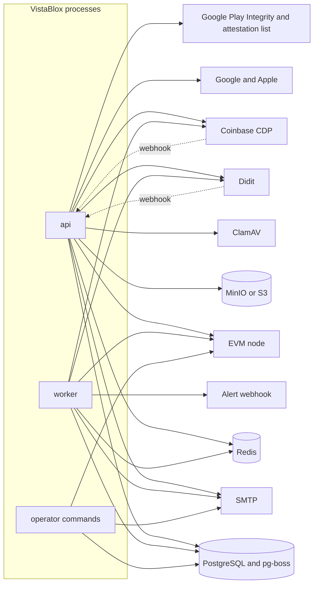

# External systems and integrations

Valid for main at 48aa967 (2026-11-18).

Every external system the api, the worker and the operator commands talk to: what each is used for, which file owns the client, the exact calls it makes, how the call is authenticated, its timeouts and retries (or the plain statement that there are none), what happens when the system fails and what the caller sees, the configuration variables, the sandbox and live distinction, what the tests replace with a fake, and the defects found while reading. The readers are the engineer who changes a client, the operator who answers an outage or rotates a credential, and the reviewer who has to know what a failing dependency does to a customer.

Citations are `(path:line)` at 48aa967; the identifier is named next to the number because line numbers drift. A path that starts with `node_modules/` is library code read from an installed copy at the version `package-lock.json` locks; it is outside the repository and was read from a separate install, not from this checkout. A line that starts with `> Pending #N:` says what an open pull request changes in the statement above it; nothing under such a line is built on main. A statement marked `Not verified` could not be checked; the list is in [Not verified](#21-not-verified). The worker's queues, schedules and dead-letter handling are in [jobs-and-workers.md](jobs-and-workers.md); the variables as a whole are in [configuration.md](configuration.md); the deployment and the runbooks are in [operations.md](operations.md).

Contents: [1 Overview](#1-overview) · [2 PostgreSQL and Neon](#2-postgresql-and-neon) · [3 pg-boss](#3-pg-boss) · [4 Better Auth](#4-better-auth-as-a-library) · [5 Redis](#5-redis) · [6 MinIO and S3-compatible storage](#6-minio-and-s3-compatible-storage) · [7 ClamAV](#7-clamav) · [8 SMTP, Mailpit and maildev](#8-smtp-mailpit-and-maildev) · [9 Didit](#9-didit) · [10 Coinbase CDP onramp](#10-coinbase-cdp-onramp) · [11 Google and Apple sign-in](#11-google-and-apple-sign-in) · [12 Google Play Integrity and the Android revocation list](#12-google-play-integrity-and-the-android-revocation-list) · [13 Apple App Attest](#13-apple-app-attest) · [14 The EVM chain through viem](#14-the-evm-chain-through-viem) · [15 The dead-letter alert webhook](#15-the-dead-letter-alert-webhook) · [16 Timeouts and retries at a glance](#16-timeouts-and-retries-at-a-glance) · [17 What the tests replace](#17-what-the-tests-replace) · [18 Known limitations](#18-known-limitations) · [19 Known gaps against the design record](#19-known-gaps-against-the-design-record) · [20 Related documents](#20-related-documents) · [21 Not verified](#21-not-verified)

## 1. Overview

Three processes talk to the outside: the api (`src/server.ts`), the worker (`src/worker.ts`) and the operator commands in `src/cli`. Each reads the same environment schema (`loadEnvironment`, `src/config/environment.ts:650-652`), so a variable that one process does not use is still validated there. The api builds every client at module level, before it listens (`src/server.ts:98-752`); the worker does the same before it starts pg-boss (`src/worker.ts:72-402`).

> Pending #237: `createApp` is split into per-module compose functions under `src/composition` and `src/app.ts` shrinks, so the mount lines of `src/app.ts` cited below move with no change in behaviour.

| # | System | Used by | Required | Client code | Section |
| --- | --- | --- | --- | --- | --- |
| 1 | PostgreSQL (Neon in production) | api, worker, operator commands, the `migrate` image | Yes: `DATABASE_URL` (`src/config/environment.ts:14-16`) | `src/infrastructure/database/prisma.ts`, a `pg` pool in `src/server.ts:101` | [2](#2-postgresql-and-neon) |
| 2 | pg-boss (inside the same database) | api (sends), worker (sends, consumes, schedules), `jobs:replay-dead-letter` | Yes | `src/shared/jobs/`, `src/server.ts:102-117`, `src/worker.ts:89-92` | [3](#3-pg-boss) |
| 3 | Better Auth (library, not a service) | api, `staff:bootstrap-first-admin` | Yes: `BETTER_AUTH_URL`, `BETTER_AUTH_SECRET` | `src/modules/auth/infrastructure/shared/better-auth.factory.ts` | [4](#4-better-auth-as-a-library) |
| 4 | Redis or Valkey | api (two clients), worker (one client) | No: `RATE_LIMIT_CACHE_URL`, `PROFILE_CACHE_URL` | `src/infrastructure/rate-limit/`, `src/infrastructure/cache/` | [5](#5-redis) |
| 5 | MinIO or any S3-compatible store | api, the one-shot `storage-init` service | No: the `MINIO_*` group | `src/infrastructure/storage/`, the intake document services | [6](#6-minio-and-s3-compatible-storage) |
| 6 | ClamAV (`clamd` over TCP) | api | The scanner object is always built; the two staff upload routes call it | `src/infrastructure/antivirus/clamav-scanner.ts` | [7](#7-clamav) |
| 7 | SMTP | api, worker, `staff:bootstrap-first-admin` | Yes: `SMTP_HOST`, `SMTP_USER`, `SMTP_PASSWORD`, `SMTP_FROM` | `src/infrastructure/email/smtp-email-sender.ts` | [8](#8-smtp-mailpit-and-maildev) |
| 8 | Didit (identity verification) | api, worker | Yes: the `DIDIT_*` group | `src/modules/identity/infrastructure/didit.client.ts` | [9](#9-didit) |
| 9 | Coinbase CDP onramp | api, worker | No: three variables together | `src/modules/offering/infrastructure/http-coinbase-cdp.client.ts` | [10](#10-coinbase-cdp-onramp) |
| 10 | Google and Apple sign-in | api, through Better Auth | No: one flag each | `better-auth.factory.ts`, `apple-client-secret.ts` | [11](#11-google-and-apple-sign-in) |
| 11 | Google Play Integrity | api | Only when `PLAY_INTEGRITY_POLICY` is not `disabled` | `src/modules/auth/infrastructure/customer/google-play-integrity.decoder.ts` | [12](#12-google-play-integrity-and-the-android-revocation-list) |
| 12 | Google's Android attestation revocation list | api | Every device enrolment | `http-android-attestation-revocation-list.ts` | [12](#12-google-play-integrity-and-the-android-revocation-list) |
| 13 | Apple App Attest | none | Not integrated | request schema only | [13](#13-apple-app-attest) |
| 14 | An EVM node (Base or Base Sepolia) through viem | api (reads), worker (reads and writes), operator command | No: the `CHAIN_*` group | `src/infrastructure/blockchain/` | [14](#14-the-evm-chain-through-viem) |
| 15 | A chat or relay webhook for dead-lettered jobs | worker | No: `DEAD_LETTER_ALERT_WEBHOOK_URL` | `src/shared/jobs/dead-letter-alert-webhook.ts` | [15](#15-the-dead-letter-alert-webhook) |

The inbound side is two provider webhooks and no other callback: `POST /webhooks/didit` (section 9) and `POST /webhooks/coinbase-onramp` (section 10). Both are unauthenticated at the HTTP layer and verified by an HMAC over the body (`src/app.ts:576-587`, `src/app.ts:931-934`).



Two things hold for every client below unless its section says otherwise. First, the repository wraps no outbound call in a circuit breaker, a bulkhead or a retry loop of its own; where a call is retried, the retry is the library's or pg-boss's (section 16). Second, a provider error object is not copied into an HTTP response: the error envelope carries the code, the title and the detail string written where the `AppError` is built, the provider's own error is kept only as `cause`, which the handler logs for a `5xx` and never sends, and a thrown `Error` that is not an `AppError` becomes `500 internal.unexpected` (`src/shared/http/error-handler.ts:15-25`, `:39-41`, `:46-73`).

> Pending #244: the detail of every `5xx` becomes one of two fixed sentences and the real message goes to the log only.

## 2. PostgreSQL and Neon

**What it is for.** Every durable fact: the application schemas, the Better Auth tables, the pg-boss queue tables, the idempotency keys and the audit log. The schema is [data-model.md](data-model.md); the migrations are applied by `prisma migrate deploy`.

**Clients.** Three drivers share `DATABASE_URL` in the api and two in the worker. Each opens its own pool, so the connection count is the sum of their pool sizes.

| Client | Process | Constructed at | Pool |
| --- | --- | --- | --- |
| Prisma 7.10.0 with `@prisma/adapter-pg` | api, worker, every operator command | `createPrismaClient` (`src/infrastructure/database/prisma.ts:5-8`), called at `src/server.ts:100`, `src/worker.ts:74` | `new PrismaPg({ connectionString })` creates a default `pg` pool (`node_modules/@prisma/adapter-pg/dist/index.js:812`) |
| A `pg` `Pool` for Better Auth | api, `staff:bootstrap-first-admin` | `src/server.ts:101`, `src/cli/bootstrap-first-admin.ts:65` | default pool, handed to `createBetterAuth` as `database` (`src/server.ts:310`) and to `BetterAuthSessionResolver` (`src/server.ts:482-486`) |
| pg-boss 12.29.0 | api, worker, `jobs:replay-dead-letter` | `src/server.ts:102`, `src/worker.ts:89` | its own pool from its own copy of `pg` 8.23.0 (`package-lock.json`, `node_modules/pg-boss/node_modules/pg`) |

A default `pg` pool holds at most 10 clients and closes an idle client after 10 s (`node_modules/pg-pool/index.js:89`, `:98-99`). No pool in the repository sets `connectionTimeoutMillis`, so a plain query on an exhausted Prisma pool and any query on an exhausted Better Auth pool waits for a connection without a time limit (`node_modules/pg-pool/index.js:206-209`); the pg-boss pool is the exception, with a 10 s connection timeout set by pg-boss itself (`node_modules/pg-boss/dist/db.js:19`). Prisma's interactive transactions have their own limits: the client is built without `transactionOptions`, so `maxWait` (time to obtain a connection) is 2 s and `timeout` (length of the transaction) is 5 s (`node_modules/@prisma/client/runtime/client.js:94`, the start timer at `:11`); 3 of the 85 `$transaction(` call sites in `src/` pass their own options (`src/infrastructure/blockchain/operator-key-lock.ts:102`, `src/modules/auth/repository/customer/prisma-device.repository.ts:124`, `src/modules/auth/repository/staff/prisma-staff-bootstrap.repository.ts:150`). At the default size the api can hold 30 connections and the worker 20.

**Calls the application makes beyond ordinary queries.**

| Feature | Where | Purpose |
| --- | --- | --- |
| `SELECT 1` | `PrismaDatabaseProbe.check` (`src/infrastructure/database/database-probe.ts:10-12`) | the only check behind `GET /health/ready`, which answers `503 infrastructure.database_unavailable` when it throws (`src/modules/health/health.router.ts:18-31`) |
| `pg_advisory_xact_lock(7311040002)` with `SET LOCAL lock_timeout` | `PostgresOperatorKeyLock.run` (`src/infrastructure/blockchain/operator-key-lock.ts:16`, `:90-114`) | serialises every chain write made with the operator key; section 14 |
| `pg_advisory_xact_lock` with a second key | `src/modules/auth/repository/staff/prisma-staff-bootstrap.repository.ts:59` | serialises the first-admin bootstrap |
| `SET LOCAL statement_timeout = '5s'`, `lock_timeout = '2s'`, `idle_in_transaction_session_timeout = '5s'` | device enrolment insert (`src/modules/auth/repository/customer/prisma-device.repository.ts:62-64`) | the only place a statement or idle timeout is set |
| `FOR UPDATE` and `FOR SHARE` row locks | 54 matching lines in 13 files under `src/` (counted by script), for example the room-photo limit at `src/modules/intake/application/upload-case-document.service.ts:123` | row-level exclusion inside a transaction |
| Interactive transactions that enqueue jobs | `enqueueTransactionalJob` (`src/shared/jobs/enqueue-job.ts:43-61`) | the job is committed with the state change (AD-145) |

**Schemas.** The Prisma datasource lists ten schemas: `account`, `identity`, `intake`, `offering`, `money`, `settlement`, `audit`, `platform`, `rental`, `auth` (`prisma/schema/schema.prisma:6-9`). Two further sets of tables live outside that list. The Better Auth tables `auth_user`, `auth_session`, `auth_account` and `auth_verification` are created without a schema prefix, so they are in the default schema (`prisma/migrations/20260831154500_better_auth_core/migration.sql:3-61`), and so is `passkey` (`prisma/migrations/20260905120000_passwordless_auth/migration.sql:13`). pg-boss creates and migrates its own `pgboss` schema when `start()` runs (`node_modules/pg-boss/dist/plans.js:8`).

**Migrations.** `prisma.config.ts` points Prisma at `DIRECT_DATABASE_URL`, with the local role `prisma/prisma` on `localhost:5432/vistablox` as the fallback (`prisma.config.ts:4-16`). The `migrate` Docker target runs `npm run db:migrate:deploy` (`Dockerfile:27-28`). `prisma/migrations` holds 75 migration directories, counted by script; one timestamp prefix, `20260918100000`, is used by two directories, and the last directory is stamped `20261121090000`, committed on 2026-11-16 (`git log` of `prisma/migrations/20261121090000_escrow_mint_intent_nonce`). Locally the two variables name the same instance; in production `README.md:112` says they name Neon's pooled and direct connections.

**Failure handling.**

| Situation | What happens |
| --- | --- |
| Unreachable at api boot | `await jobQueue.start()` (`src/server.ts:106`) is the first database access, a top-level `await`; a rejection ends the process with an uncaught error. The api does not listen. |
| Unreachable while serving | A query rejects; the handler's error becomes `500 internal.unexpected`, logged at `error` (`src/shared/http/error-handler.ts:39-41`, `:66-72`). `GET /health/ready` answers 503. `GET /health/live` answers 200 without a database call (`src/modules/health/health.router.ts:14-16`). |
| Idle client error on the Better Auth pool | Nothing in the repository listens for `error` on that pool: the only `.on("error")` registrations in `src/` on a database pool, a queue or a cache client are pg-boss at `src/server.ts:103`, `src/worker.ts:90`, `src/cli/replay-dead-letter-job.ts:57` and the Redis clients (`src/server.ts:149`, `:172`, `src/worker.ts:128`); the other two are the socket in `src/infrastructure/antivirus/clamav-scanner.ts:26` and the one-shot `once("error")` on the worker's health listener (`src/shared/health/worker-heartbeat.ts:60`). `pg-pool` emits `error` on the pool when an idle client fails (`node_modules/pg-pool/index.js:51-62`), and an `error` event with no listener is thrown, which ends a Node process. Neither Better Auth's adapter nor Kysely's PostgreSQL dialect attaches a listener (searched `node_modules/@better-auth/kysely-adapter/dist` and `node_modules/kysely/dist/dialect/postgres`: no match). |
| Idle client error on the Prisma pool | `@prisma/adapter-pg` attaches a listener that writes a debug message and calls `onPoolError` if set (`node_modules/@prisma/adapter-pg/dist/index.js:813-817`); `createPrismaClient` does not set it, so the error does not reach the application log. |
| Exhausted pool | A plain query waits for a connection; `/health/ready` waits with it, because the probe is a plain query on the same Prisma pool and has no time limit of its own, while an interactive transaction fails after its 2 s `maxWait` as a Prisma error, which the error handler answers as `500 internal.unexpected`. The staging health check gives up after 5 s (`docker-compose.staging.yml:258-269`, `timeout: 5s` at `:267`). |

**Neon and PostgreSQL 18.** No code path is specific to Neon. `AGENTS.md` states that Neon is production-only and that `db:migrate:deploy` runs only against a local database (`AGENTS.md:11`), and `README.md` states that production points `DATABASE_URL` at Neon's pooled connection and `DIRECT_DATABASE_URL` at its direct connection (`README.md:112`, `.env.example` comment above `DATABASE_URL`). Local development, the CI job and the staging stack run `postgres:18-alpine` (`docker-compose.yml:3`, `docker-compose.staging.yml:3`, `.github/workflows/ci.yml:29`). AD-257 records the local-instance decision.

**Sandbox and live.** There is no switch: the connection string is the environment. The tests use a separate local database named by `TEST_DATABASE_URL` ([testing.md](testing.md)).

**Tests.** Unit tests replace the repository interface with `vi.fn()` objects; 54 of the 55 files named `*.integration.test.ts` use a real database when `TEST_DATABASE_URL` is set (the other one needs MinIO; counted by script in [testing.md](testing.md#2-the-test-suite)).

**Known limitations.**

- No `error` listener on the Better Auth pool: see [section 18](#18-known-limitations), item 1.
- No acquisition timeout for plain queries on the pools and no `statement_timeout` outside device enrolment: item 5.
- The worker's own `/health/ready` does not check the database ([jobs-and-workers.md](jobs-and-workers.md)).

Not verified: PostgreSQL 18 behaviour. An earlier read-only audit ran its checks on a local PostgreSQL 16.15; the CI job and the staging container run 18, and no CI result was reproduced here. Not verified: how the three `DATABASE_URL` clients (a `pg` pool, Prisma and pg-boss, which uses advisory locks) behave through Neon's pooled endpoint; no production configuration was read.

## 3. pg-boss

**What it is for.** The job queue: every cross-domain state change is a job enqueued in the caller's transaction (AD-145, AD-152), and the worker runs the jobs and the cron schedules. The queue catalogue, retry profiles and the dead-letter flow are in [jobs-and-workers.md](jobs-and-workers.md) and [dead-letter-jobs.md](dead-letter-jobs.md); this section is only the integration surface.

**Client.** `new PgBoss(environment.DATABASE_URL)` with no options in both processes (`src/server.ts:102`, `src/worker.ts:89`), so every pg-boss default applies: schema `pgboss`, a 10 s connection timeout, a maintenance and supervision loop of its own. `stop()` is graceful with a 30 s timeout (`node_modules/pg-boss/dist/index.js:182`). The version is pinned exactly (`package.json`: `"pg-boss": "12.29.0"`).

| Operation | Where | Note |
| --- | --- | --- |
| `start()` | api `src/server.ts:106`, worker `src/worker.ts:404` | the api starts pg-boss to send, and registers no consumer: `src/server.ts` contains no `.work(` call |
| `createQueue` and `updateQueue` | `ensureDeadLetterQueue`, `ensureJobQueue` (`src/shared/jobs/job-queues.ts:42-61`) | the api creates five event queues (`src/server.ts:112-117`) so a `send` never meets a missing queue; the worker creates the rest |
| `send` inside the caller's transaction | `enqueueTransactionalJob` (`src/shared/jobs/enqueue-job.ts:43-61`) | binds pg-boss's `db.executeSql` to the Prisma transaction client and adds `trace_id` to the payload (`:52`) |
| `schedule` | `src/worker.ts:466-594`, all with `tz: "UTC"` | cron entries |
| `work` | `src/worker.ts`, one call per consumed queue; the dead-letter consumer at `:891-897` | |
| `retry`, `send` into a queue by name | `src/cli/replay-dead-letter-job.ts`, `src/shared/jobs/dead-letter-replay.ts` | [cli.md](cli.md) |

**Authentication.** The database credentials in `DATABASE_URL`. pg-boss has no other credential.

**Timeouts and retries.** Event jobs retry 16 times with a 30 s base delay, doubling, capped at 900 s; scheduled jobs retry 5 times with backoff and no base delay (`src/shared/jobs/enqueue-job.ts:21-32`). A job that fails its last retry goes to the queue `maintenance.dead_letter` (`src/shared/jobs/job-queues.ts:10`, `:31-36`). Handler time limits are pg-boss's defaults; the worker sets none ([jobs-and-workers.md](jobs-and-workers.md)).

**Failure handling.** pg-boss reports connection errors through its `error` event; both processes log them at `error` as `pg-boss error` (`src/server.ts:103-105`, `src/worker.ts:90-92`). If the database is down at boot, `start()` rejects and the process ends (above). A `send` to a queue that does not exist throws, which is why the api creates its five queues itself (`src/server.ts:107-111`).

**Sandbox and live.** None. The queue lives in the environment's database.

**Tests.** `tests/job-queues.test.ts` and `tests/dead-letter-consumer.test.ts` use a fake object cast to `PgBoss`; 20 test files import `PgBoss`, and the suites that need real queue behaviour (`tests/job-dead-letter.integration.test.ts`, `tests/dead-letter-replay.integration.test.ts`) run a real pg-boss against the test database. Integration suites leave unconsumed jobs behind in that database ([testing.md](testing.md#8-known-limitations)).

**Known limitations.** Shutdown has no force-exit timer and neither Compose file sets `stop_grace_period`; this is item 4 in [section 18](#18-known-limitations). Two PostgreSQL drivers (8.16.3 and 8.23.0) are loaded into each process (`package-lock.json`).

## 4. Better Auth as a library

**What it is for.** Sessions, social sign-in, the staff passkey ceremony, the device-key session plugin and the account-linking rules. Better Auth 1.7.2 runs inside the api process; it is not a network service. The behaviour of the login flows is in [authentication.md](authentication.md) and the HTTP surface under `/api/auth` is in [api/better-auth.md](api/better-auth.md); this section is what the library does to the outside.

**Owner.** `createBetterAuth` (`src/modules/auth/infrastructure/shared/better-auth.factory.ts:134`), called twice in `src/server.ts`: once for the public instance `auth` (`:309-369`) and once for `staffProvisioningAuth` (`:370-380`), which allows the `population` field as input so a staff user can be created. Both share the one `authDatabase` pool. `src/modules/auth/infrastructure/shared/better-auth.cli.ts` builds a third instance at import time from `process.env` with a development fallback secret; nothing imports it (searched `src/`).

| Setting | Value | Where |
| --- | --- | --- |
| Base path | `/api/auth` | `src/modules/auth/infrastructure/shared/better-auth.factory.ts:157` |
| Database | the `pg` pool; model names `auth_user`, `auth_session`, `auth_account`, `auth_verification` | `src/modules/auth/infrastructure/shared/better-auth.factory.ts:161-163`, `src/modules/auth/infrastructure/shared/better-auth.factory.ts:188`, `src/modules/auth/infrastructure/shared/better-auth.factory.ts:215`, `src/modules/auth/infrastructure/shared/better-auth.factory.ts:239` |
| Email and password | disabled | `src/modules/auth/infrastructure/shared/better-auth.factory.ts:242` |
| Social providers | Google and Apple, each only when configured (section 11) | `src/modules/auth/infrastructure/shared/better-auth.factory.ts:140-150`, `src/server.ts:329-356` |
| Account linking | enabled; trusted provider `google` only; `requireLocalEmailVerified: false`; `allowDifferentEmails: false` | `src/modules/auth/infrastructure/shared/better-auth.factory.ts:218-236` |
| Stored OAuth tokens | encrypted (`encryptOAuthTokens: true`); verification identifiers stored hashed | `src/modules/auth/infrastructure/shared/better-auth.factory.ts:217`, `src/modules/auth/infrastructure/shared/better-auth.factory.ts:240` |
| Session lifetime | `expiresIn` 30 minutes, `updateAge` 5 minutes; device sessions have their own limits | `src/modules/auth/infrastructure/shared/better-auth.factory.ts:194-195`, `src/modules/auth/infrastructure/shared/better-auth.factory.ts:151-153` |
| Client IP tracking | disabled (`disableIpTracking: true`) | `src/modules/auth/infrastructure/shared/better-auth.factory.ts:455` |
| Cookies | prefix `vb`, `httpOnly`, `sameSite: lax`, `secure` when `NODE_ENV` is `production` (`secureCookies`, `src/server.ts:313`); cross-subdomain cookies when the host has three or more labels | `src/modules/auth/infrastructure/shared/better-auth.factory.ts:456-484`, `src/modules/auth/infrastructure/shared/better-auth.factory.ts:129-132` |
| Plugins, in order | disabled-routes, `expo()`, `bearer({ requireSignature: true })`, device session lifetime, DPoP (when configured), device-key auth (when configured), passkey challenge header, `passkey()`, staff account guard, fresh authentication, registration account guard, audit (when a sink is given) | `src/modules/auth/infrastructure/shared/better-auth.factory.ts:298-452` |

The library is mounted at `app.all("/api/auth/*splat", ...)` behind `rejectDisabledAuthRoutes` and the tightened rate limiter (`src/app.ts:568-575`); `toNodeHandler(auth)` is the handler (`src/server.ts:583`).

**Outbound calls the library makes.** Only the social sign-in calls in section 11. Email and password is disabled, so Better Auth sends no mail; every email in section 8 is sent by repository code. The factory passes neither a `telemetry` nor a `rateLimit` option (searched `src/`: no match). Better Auth's telemetry is off unless `telemetry.enabled` is set or the environment variable `BETTER_AUTH_TELEMETRY` is true (`node_modules/@better-auth/telemetry/dist/index.mjs:360-361`); that variable is named nowhere in `.env.example`, `Dockerfile` or either Compose file. Better Auth's own rate limiter is not configured here and its default is not described in this document.

**Authentication.** `BETTER_AUTH_SECRET`, at least 32 characters (`src/config/environment.ts:18`), signs cookies and bearer values and keys the audit identifier hash (`src/modules/auth/infrastructure/shared/better-auth.factory.ts:437`).

**Timeouts and retries.** None are configured in the repository.

**Failure handling.** A failing database is section 2. A context that fails to build fails every request (`src/modules/auth/infrastructure/shared/better-auth.factory.ts:487-495`). Errors raised by the plugins are mapped to the documented envelope in the device-key router (`src/modules/auth/api/customer/device-auth.router.ts`) and in [api/better-auth.md](api/better-auth.md).

**Sandbox and live.** None. `secureCookies` follows `NODE_ENV === "production"` (`src/server.ts:313`).

**Tests.** 21 test files have `better-auth` in their name, one of them an integration file, and 25 test files import the factory, 13 of them integration files (counted by script). The suite that exercises social sign-in builds unsigned ID tokens (`tests/better-auth-bearer-dpop.integration.test.ts:341-345`) and stubs the provider's signature check (`:139-141`). The only Google or Apple URLs in `tests/` are issuer strings in forged tokens and fixtures (searched `tests/`), not endpoints.

**Known limitations.** An `error` event on the pool Better Auth uses ends the process (section 2). An earlier `npm audit` run reported advisories against `better-auth` 1.7.2, which `package.json` pins exactly (`package.json:42`); the advisory text was not read ([section 21](#21-not-verified)).

## 5. Redis

**What it is for.** Two optional uses, both degrading when Redis is absent: the fixed-window counters behind the `/v1` rate limiters, and a 24-hour cache of a customer's Didit-verified display name. Locally the server is Valkey 8 (`docker-compose.yml:22`); staging's Compose file defines no Redis service. The rate-limit policy, the tiers and the routes they guard are in [security.md](security.md).

**Clients.** The `redis` package 6.2.1 (`package.json`). Each client is created the same way and is the only Redis configuration in the repository:

```ts
createClient({ url, socket: { connectTimeout: 3_000, reconnectStrategy: false } })
```

| Client | Process | Created at | Variable |
| --- | --- | --- | --- |
| `rateLimitCacheClient` | api | `src/server.ts:142-148` | `RATE_LIMIT_CACHE_URL` |
| `profileCacheClient` | api | `src/server.ts:165-171` | `PROFILE_CACHE_URL` |
| `profileCacheClient` | worker | `src/worker.ts:121-127` | `PROFILE_CACHE_URL` |

Both variables must start with `redis://` or `rediss://` and are optional (`src/config/environment.ts:168-177`, `:204-212`). The two variables may name one server (`.env.example:111-121`); the api then holds two connections to it.

**Authentication.** Whatever the URL carries (user, password, TLS through `rediss://`). The repository adds nothing.

**Calls.**

| Use | Commands | Key | Time to live | Code |
| --- | --- | --- | --- | --- |
| Rate limit | `INCR`, then `EXPIRE` when the result is 1 | `rate_limit_hint:<tier>:<subject>`, where the subject is `account:<id>`, `ip:<address or /64>` or `dpop_jkt:<thumbprint>` | the tier's window: baseline 300 requests per 60 s, tightened 10 per 60 s | `src/infrastructure/rate-limit/redis-rate-limit-store.ts:12-19`, `src/shared/http/rate-limit.ts:17-27`, `:35`, `:68-73`, `:129-133` |
| Display-profile cache | `GET`, `SETEX`, `DEL` | `kyc_display:<account_id>` | 24 h on write; a cached entry younger than 6 h is served without calling Didit | `src/infrastructure/cache/redis-protected-profile-cache.ts:23-78`, `src/modules/identity/application/kyc-display-profile.service.ts:46-51` |

The cached value is a customer's given name, family name, full display name, ID-document country and the time of the last sync (`src/infrastructure/cache/redis-protected-profile-cache.ts:12-18`); it is personal data. `.env.example` asks that the cache be configured without routine backups (`.env.example:111-116`). A malformed or schema-invalid cached value is deleted and treated as a miss (`src/infrastructure/cache/redis-protected-profile-cache.ts:27-38`). `INCR` and `EXPIRE` are two separate commands, not one atomic one; section 18, item 8.

**Timeouts and retries.** A 3 s connect timeout. `reconnectStrategy: false` makes the client never reconnect after the first disconnect (`node_modules/@redis/client/dist/lib/client/socket.js:51-54`). No command timeout is set.

**Failure handling.**

| Situation | What happens |
| --- | --- |
| `RATE_LIMIT_CACHE_URL` unset | No client; `rateLimitStore` is undefined and no limiter is mounted (`src/server.ts:142-144`, `src/app.ts:467-474`). |
| `PROFILE_CACHE_URL` unset | No cache; `GET /v1/investor-profile` returns no names and makes no Didit call (`src/modules/identity/application/kyc-display-profile.service.ts:42`). |
| Down at boot | `connect()` fails, the api logs `rate limit cache unavailable; rate limiting is disabled` or `protected profile cache unavailable; display-name reads/invalidation will be skipped` at `warn`, and goes on (`src/server.ts:152-158`, `:175-184`). The store is built only if the client is ready at that moment (`:185-188`, `:202-205`), so a limiter stays unmounted until the process restarts. |
| Lost while running | The client does not reconnect. `RedisRateLimitStore.increment` throws `Rate limit store unavailable` when the client is not ready (`src/infrastructure/rate-limit/redis-rate-limit-store.ts:13`); the limiter catches it, logs `rate limit store unavailable; allowing request` at `warn` for every request, and lets the request through (`src/shared/http/rate-limit.ts:54-62`). Cache reads and writes are caught and logged at `warn` as `profile_cache_read` or `profile_cache_write`; a failed read is answered without names, a failed write returns the older cached name if there is one and no name otherwise (`src/modules/identity/application/kyc-display-profile.service.ts:44-45`, `:77-78`, `:81-105`; the log message is `display profile lookup failed`, `src/server.ts:436-438`); invalidations are caught and logged (`src/server.ts:189-201`, `src/worker.ts:145-157`). |
| Reconnect | Only a restart of the process. |

The rate limiter fails open by design and the policy is an open founder decision (issue #175, label `needs-founder-decision`). The `TRUST_PROXY` setting decides which address the IP limits see (`src/config/environment.ts:183-200`); the api logs a warning at start-up when the limiter is on, `NODE_ENV=production` and the variable is unset (`src/server.ts:208-212`).

**Sandbox and live.** None: the URL is the environment. The staging anchor of `docker-compose.staging.yml` names neither `RATE_LIMIT_CACHE_URL` nor `PROFILE_CACHE_URL`, and the file defines no Redis service, so staging has them only if `.env.staging` sets them (section 21).

**Tests.** `tests/redis-rate-limit-store.test.ts`, `tests/protected-profile-cache.test.ts` and `tests/rate-limit-middleware.test.ts` pass fake client objects; no test connects to a Redis server (searched `tests/` for `createClient`: no match).

## 6. MinIO and S3-compatible storage

**What it is for.** Private storage of staff-uploaded documents: intake case documents and room photos (and their JPEG thumbnails), and offering disclosure documents. The API proxies every download; it creates no presigned URL (`docs/document-storage.md`). The bucket and retention rules are in [document-storage.md](document-storage.md).

**Clients.** `@aws-sdk/client-s3` 3.1123.0, pointed at a MinIO server by endpoint. Three `S3Client` instances exist in the api, all built with the same four options and nothing else: `endpoint`, `region: "us-east-1"`, `forcePathStyle: true` and static `credentials` (`src/server.ts:531-536`, `:543`; `src/infrastructure/storage/minio-disclosure-document.store.ts:35-43`). The endpoint is `http` or `https` according to `MINIO_USE_SSL`, then `MINIO_ENDPOINT` and `MINIO_PORT` (`src/server.ts:532`).

| Consumer | Calls | Bucket | Mounted when |
| --- | --- | --- | --- |
| `UploadCaseDocumentService` | `PutObject` (the document, then a thumbnail for room photos), `DeleteObject` (room photo and room deletion, and clean-up of a failed upload) | `MINIO_PRIVATE_BUCKET` | all of `MINIO_ENDPOINT`, `MINIO_ACCESS_KEY`, `MINIO_SECRET_KEY` and `MINIO_PRIVATE_BUCKET` are set (`src/server.ts:524-540`) |
| `GetCaseDocumentService` | `GetObject` | `MINIO_PRIVATE_BUCKET` | same condition (`src/server.ts:541-544`) |
| `MinioDisclosureDocumentStore` | `GetObject`, `PutObject`, `DeleteObject` | `MINIO_DISCLOSURES_BUCKET` | `MINIO_ENDPOINT`, `MINIO_ACCESS_KEY`, `MINIO_SECRET_KEY` and `MINIO_DISCLOSURES_BUCKET` are set; otherwise `UnavailableDisclosureDocumentStore` answers `503 infrastructure.document_storage_unavailable` (`src/server.ts:498-511`, `src/infrastructure/storage/minio-disclosure-document.store.ts:99-120`) |
| `ensure-minio-bucket.ts` (one-shot, `storage-init`) | `HeadBucket`, `CreateBucket`, `PutBucketVersioning`, `PutObjectLockConfiguration`, `PutBucketLifecycleConfiguration` | all five | run by the `storage-init` service (`docker-compose.yml:67`, `docker-compose.staging.yml:71`) |

The four routes that use the document services are `POST` and `GET /internal/v1/intake-cases/:case_id/documents` and `POST` and `GET /internal/v1/offerings/:offering_id/documents`, plus the customer download `GET /v1/offerings/:offering_id/documents/:document_id/download`; the room-photo `PATCH` and `DELETE` routes use the upload service as well. The intake routes exist only when the services are built (`src/modules/intake/api/intake-operations.router.ts:226`, `:260`); the staff offering routes only when the store is the real one (`src/app.ts:696-713`). The customer download route is mounted either way and answers `503 infrastructure.document_storage_unavailable` with the unavailable store (`src/server.ts:697-700`). The contract is in [api/intake-staff.md](api/intake-staff.md) and [api/offering.md](api/offering.md).

Object keys are `<area>/<subject id>/[revisions/<n>/]<document id>`, at most 512 characters, built by `objectKey` (`src/infrastructure/storage/storage-buckets.ts:13-25`); the disclosure store also refuses a reference with `..` or more than 1,024 characters (`src/infrastructure/storage/minio-disclosure-document.store.ts:122-137`).

**Authentication.** A static access key and secret, `MINIO_ACCESS_KEY` and `MINIO_SECRET_KEY` (the secret must have at least 8 characters, the key has no length rule, `src/config/environment.ts:219-223`), signed by the SDK. In both Compose files the application's key and secret are the same values as the MinIO root user and password (`docker-compose.yml:43-44` and `:76-77`; `docker-compose.staging.yml:43-44` and `:82-83`, `:235-236`). The repository contains no policy or service-account provisioning.

**Configuration.** `MINIO_ENDPOINT`, `MINIO_PORT` (default 9000), `MINIO_USE_SSL` (default false), `MINIO_ACCESS_KEY`, `MINIO_SECRET_KEY`, and the five bucket names (`src/config/environment.ts:213-228`). `MINIO_ENDPOINT`, `MINIO_ACCESS_KEY`, `MINIO_SECRET_KEY` and `MINIO_DISCLOSURES_BUCKET` must be set together or all left unset (`:391-408`); `MINIO_PRIVATE_BUCKET` is not in that rule, so setting the four without it leaves the intake document routes unmounted. The api reads only the endpoint, port, SSL flag, credentials, `MINIO_PRIVATE_BUCKET` and `MINIO_DISCLOSURES_BUCKET`; `MINIO_QUARANTINE_BUCKET`, `MINIO_KYC_BUCKET` and `MINIO_AUDIT_BUCKET` are read only by the initialiser (searched `src/` for each name). No application code writes to the quarantine, KYC or audit bucket: uploads are scanned, then written straight to the private or disclosures bucket (`src/modules/intake/application/upload-case-document.service.ts:109-113`).

What the initialiser does to each bucket (`src/infrastructure/storage/ensure-minio-bucket.ts:25-49`):

| Bucket (default name) | Versioning | Object lock | Lifecycle |
| --- | --- | --- | --- |
| quarantine (`vistablox-quarantine`) | no | no | expire after 30 days; abort incomplete multipart uploads after 2 days |
| private (`vistablox-private`) | enabled | no | none |
| kyc (`vistablox-kyc`) | enabled | no | none |
| disclosures (`vistablox-disclosures`) | enabled | enabled | none |
| audit (`vistablox-audit`) | enabled | enabled | none |

The object-lock configuration call tolerates a `400` or `501` answer, which a server without object lock gives (`src/infrastructure/storage/ensure-minio-bucket.ts:39-44`). The initialiser parses its own environment with a separate Zod schema, reading `process.env` directly (`:8-18`).

**Local and staging servers.** Both Compose files build MinIO from source at release `RELEASE.2025-10-15T17-29-55Z`, pinned to a commit (`infrastructure/minio/Dockerfile:3-7`). Staging publishes only the console, on `127.0.0.1:9001` (`docker-compose.staging.yml:45-46`). Production storage is not described by the repository; `docs/document-storage.md` names TLS, KMS, replication and backups as requirements for production, none of which this repository configures.

**Timeouts and retries.** None are set by the repository. The SDK's Node HTTP handler has `DEFAULT_REQUEST_TIMEOUT = 0`, meaning no request timeout (`node_modules/@smithy/node-http-handler/dist-cjs/index.js:211`), and the standard retry strategy allows 3 attempts (`node_modules/@smithy/core/dist-cjs/submodules/retry/index.js:432`). No connection timeout is passed; whether the SDK's defaults mode adds one was not checked.

**Failure handling.**

| Situation | What the caller sees |
| --- | --- |
| Disclosure store: a `GetObject`, `PutObject` or `DeleteObject` fails for a reason other than a missing key | `503 infrastructure.document_storage_unavailable`, with the error as `cause` (`src/infrastructure/storage/minio-disclosure-document.store.ts:61-65`, `:81-84`, `:91-95`, `:156-164`). A missing key on read is `null`, on delete a no-op (`:139-145`). |
| Disclosure store: the body is not a stream or has no length | `503 infrastructure.document_storage_invalid_response` (`src/infrastructure/storage/minio-disclosure-document.store.ts:51-54`, `src/infrastructure/storage/minio-disclosure-document.store.ts:147-154`). |
| Intake upload or download: the SDK throws | The error is not wrapped: it reaches the error handler and becomes `500 internal.unexpected` (`src/modules/intake/application/upload-case-document.service.ts:113`, `src/modules/intake/application/get-case-document.service.ts:20`; `src/shared/http/error-handler.ts:66-72`). A response with no body is `503 intake.document_unavailable` (`src/modules/intake/application/get-case-document.service.ts:21`). |
| An object delete fails | Swallowed with `.catch(() => undefined)` and not logged, after the database row is already marked deleted; see section 18, item 3. |

A database failure after the object was written triggers a best-effort delete of the new object (`src/modules/intake/application/upload-case-document.service.ts:136-139`, `src/modules/offering/application/upload-offering-document.service.ts:154-158`); the failed delete leaves an orphan.

**Sandbox and live.** None: the endpoint and credentials are the environment.

**Tests.** `tests/minio-disclosure-document-store.test.ts` injects an `S3Client` with a fake `send`. `tests/minio-disclosure-document-store.integration.test.ts` runs against a real MinIO only when `TEST_MINIO_ENDPOINT`, `TEST_MINIO_ACCESS_KEY` and `TEST_MINIO_SECRET_KEY` are set (`tests/minio-disclosure-document-store.integration.test.ts:14-20`); the CI job sets none of them, so the file skips there and is the one file the CI skip guard allows to skip ([testing.md](testing.md#5-ci)). No test covers `ensure-minio-bucket.ts` or the intake upload service against a real object store.

## 7. ClamAV

**What it is for.** Malware scanning of every staff upload before the bytes are stored. The scan runs inside the upload request; a document is never stored unscanned (`src/modules/intake/application/upload-case-document.service.ts:109-113`, `src/modules/offering/application/upload-offering-document.service.ts:104-117`).

**Client.** `ClamAvScanner(host, port, timeoutMs = 120_000)` (`src/infrastructure/antivirus/clamav-scanner.ts:7-29`), built once at `src/server.ts:497` as `new ClamAvScanner(environment.CLAMAV_HOST ?? "127.0.0.1", environment.CLAMAV_PORT)` and shared by both upload services. The worker does not scan.

**Calls.** One TCP connection per scan to `clamd` (`net.createConnection`, `src/infrastructure/antivirus/clamav-scanner.ts:12`). The intended protocol is `zINSTREAM` followed by 64 KiB chunks, each preceded by a 4-byte big-endian length, then a zero-length chunk (`src/infrastructure/antivirus/clamav-scanner.ts:16-22`); the whole upload (up to 100 MB, held in memory) is sent. The reply is read until the socket ends; a reply containing `FOUND` is `infected`, one containing `OK` is `clean`, anything else rejects with `Unexpected ClamAV response` (`src/infrastructure/antivirus/clamav-scanner.ts:24-25`).

**Authentication.** None. `clamd` listens on TCP 3310 on all interfaces of its container with no authentication (`infrastructure/clamav/clamd.conf:3-4`, `TCPSocket 3310` and `TCPAddr 0.0.0.0`); the Compose network is the boundary.

**The command bytes are wrong on main.** The source line is `socket.write(Buffer.from("zINSTREAM\\0"))` (`src/infrastructure/antivirus/clamav-scanner.ts:16`). In a TypeScript string `\\0` is a backslash followed by the digit `0`, so the bytes written are `7a494e53545245414d5c30`, not `zINSTREAM` plus a NUL byte (`7a494e53545245414d00`); this was checked by running the literal through `node`. `clamd` ends a `z` command at the first NUL byte, so it receives a command it does not know. The reply recorded for this case (`UNKNOWN COMMAND`) comes from the draft pull request's own run against `clamd` 1.4.6, not from this review. On main, a reachable `clamd` therefore makes every upload fail as below, and an unreachable one fails the same way. This is issue #205.

> Pending #225: a draft pull request writes a real NUL byte, adds a unit suite against a fake `clamd` on a socket and an opt-in `npm run clamav:smoke` command, and #229 is a duplicate that edits the same line.

**Configuration.** `CLAMAV_HOST` (optional, no default in the schema) and `CLAMAV_PORT` (default 3310) (`src/config/environment.ts:229-230`). The api falls back to `127.0.0.1` when `CLAMAV_HOST` is unset, without a log line (`src/server.ts:497`). `docker-compose.yml` passes `CLAMAV_HOST: clamav` and `CLAMAV_PORT: "3310"` to the api (`docker-compose.yml:118-119`). `docker-compose.staging.yml` passes them only to the `storage-init` service, which never reads them (`docker-compose.staging.yml:89-90`); the api and worker services get `.env.staging` through `env_file` (`docker-compose.staging.yml:131-132`, `:275-276`), so whether the staging api reaches `clamd` depends on that file, which was not read. This is issue #208.

> Pending #236: `CLAMAV_HOST` and `CLAMAV_PORT` move into the staging `&app-environment` anchor with the defaults `clamav` and `3310` and are removed from `storage-init`, which changes only `docker-compose.staging.yml` and adds a test.

`clamd` runs from `clamav/clamav:1.4.6` with a 2 GiB memory limit and one CPU in both Compose files (`docker-compose.yml:54-59`, `docker-compose.staging.yml:56-61`). Its limits are `StreamMaxLength 100M`, `MaxFileSize 100M`, `MaxScanSize 150M`, `MaxRecursion 10`, `MaxFiles 10000`, `MaxThreads 2`, `MaxQueue 8` and `ReadTimeout` and `CommandReadTimeout` of 120 s (`infrastructure/clamav/clamd.conf:9-18`). The file sets no `AlertExceedsMax`; issue #246 reports that an over-limit file is then not flagged, which depends on `clamd` behaviour that was not checked.

**Timeouts and retries.** 120 s for the whole scan (`src/infrastructure/antivirus/clamav-scanner.ts:8`, `:14`), after which the socket is destroyed and the promise rejects. No retry.

**Failure handling.** Both upload services catch every scanner error, throw a fixed `503` without the cause and without a log line, and store nothing:

| Route | Code |
| --- | --- |
| `POST /internal/v1/intake-cases/:case_id/documents` | `503 intake.document_scanner_unavailable` (`src/modules/intake/application/upload-case-document.service.ts:109-111`) |
| `POST /internal/v1/offerings/:offering_id/documents` | `503 offering.document_scanner_unavailable` (`src/modules/offering/application/upload-offering-document.service.ts:105-115`) |

An infected result is `422 intake.document_malware_detected` or `422 offering.document_malware_detected`. Because the cause is dropped, an unknown command, a refused connection, a timeout and an oversize reply are indistinguishable in the logs (issue #247).

**Sandbox and live.** None.

**Tests.** No test constructs `ClamAvScanner` (searched `tests/` for the class name: no match). The upload tests inject a stub that implements the `MalwareScanner` interface (`tests/upload-offering-document-service.test.ts`, `tests/offering-document-upload.integration.test.ts`). The byte error above therefore had no test to catch it. Not verified: behaviour against a real `clamd` 1.4.6.

## 8. SMTP, Mailpit and maildev

**What it is for.** Transactional email: staff invitations, reminders, account-recovery notices and links, and device-replacement codes. All are plain text plus an HTML alternative built from fixed templates with `escapeHtml` on interpolated values (`src/infrastructure/email/smtp-email-sender.ts:96-226`).

**Client.** `SmtpEmailSender` (`src/infrastructure/email/smtp-email-sender.ts:84-218`), built with `nodemailer.createTransport({ host, port, secure, auth: { user, pass } })` (`src/infrastructure/email/smtp-email-sender.ts:88-93`) in the api (`src/server.ts:213-220`), the worker (`src/worker.ts:81-88`) and the first-admin command (`src/cli/bootstrap-first-admin.ts:79`). nodemailer 9.1.0 builds a pooled transport only when the `pool` option is set (`node_modules/nodemailer/lib/nodemailer.js:39`); it is not, so each `sendMail` opens its own SMTP connection.

**Messages.** The `EmailSender` interface has 11 methods (`src/infrastructure/email/smtp-email-sender.ts:61-73`):

| Method | Sent by | On failure |
| --- | --- | --- |
| `sendStaffInvitationEmail` | `IssueStaffInvitationService` (`src/modules/auth/application/staff/staff-invitation.service.ts`), `staff:bootstrap-first-admin` | the invitation is revoked and the route answers `503 authentication.staff_invitation_delivery_failed` |
| `sendApplicantResponseReminderEmail` | `case_timers.applicant_reminders` (`src/modules/intake/application/case-timer.service.ts:32`), the staff manual reminder (`src/modules/intake/application/operations-case.service.ts:680`) | the job or the request fails |
| `sendKycRenewalReminderEmail` | `maintenance.kyc_renewal` (`src/modules/identity/application/kyc-renewal.service.ts:41`) | the job fails |
| `sendReconfirmationReminderEmail` | `case_timers.offering_reconfirmation_reminders` (`src/modules/offering/application/send-reconfirmation-reminders.service.ts:39`) | the job fails |
| `sendReconfirmationWindowOpenedEmail` | `case_timers.offering_reconfirmation_window_opened` (`src/modules/offering/application/notify-reconfirmation-window-opened.service.ts:45`) | the job fails |
| `sendAccountRecoveryCaseOpenedEmail` | opening a recovery case (`src/modules/auth/application/staff/account-recovery.service.ts:52`) | caught and dropped without a log |
| `sendAccountRecoveryApprovedEmail`, `sendAccountRecoveryRejectedEmail` | the second reviewer's decision (`src/modules/auth/application/staff/account-recovery.service.ts:189-191`) | caught and dropped without a log |
| `sendAccountRecoveryCompletedEmail` | completing a case (`src/modules/auth/application/staff/account-recovery.service.ts:366`, `src/modules/auth/application/staff/account-recovery.service.ts:457`) | caught and dropped; the second site records `sent`, `failed` or `no_contact_email` in the audit entry |
| `sendPasskeyRecoveryEmail` | staff and customer recovery links (`src/modules/auth/infrastructure/staff/better-auth-staff-account-administrator.ts:44`, `src/modules/auth/infrastructure/customer/better-auth-customer-account-administrator.ts:62`) | the route answers `503 authentication.staff_recovery_delivery_failed` for staff recovery (`src/modules/auth/application/staff/staff-account-lifecycle.service.ts:49-66`) and `503 authentication.account_recovery_completion_delivery_failed` for case completion (`src/modules/auth/application/staff/account-recovery.service.ts:323-347`, [account-recovery.md](account-recovery.md)) |
| `sendDeviceReplacementCodeEmail` | `POST /v1/auth/mobile/replacement/request` (`src/modules/auth/application/customer/device-replacement.service.ts:104`) | caught and dropped without a log; the code is stored and the customer requests again |

**Authentication.** `SMTP_USER` and `SMTP_PASSWORD` as the SMTP `AUTH` credentials. `SMTP_SECURE` selects implicit TLS (port 465 style); with `false`, nodemailer upgrades with STARTTLS where the server offers it, and the repository sets neither `requireTLS` nor `ignoreTLS` (`src/infrastructure/email/smtp-email-sender.ts:88-93`; the options are documented at `node_modules/nodemailer/lib/smtp-connection/index.js:49-51`).

**Configuration.** `SMTP_HOST`, `SMTP_USER`, `SMTP_PASSWORD` and `SMTP_FROM` are required, `SMTP_PORT` defaults to 587 and `SMTP_SECURE` to false (`src/config/environment.ts:159-167`). `.env.example` ships `SMTP_HOST=smtp.example.com` (`.env.example:104`); a comment in the Better Auth factory records that this placeholder is still the production value and that verification email "has never been deliverable" (`src/modules/auth/infrastructure/shared/better-auth.factory.ts:225-233`). The staging anchor also names `EMAIL_VERIFICATION_ENABLED` (`docker-compose.staging.yml:192`); nothing in `src/` or the environment schema reads it.

**Local and staging servers.**

| Environment | Catcher | Compose | Web interface |
| --- | --- | --- | --- |
| Local | Mailpit (`axllent/mailpit:latest`), SMTP host `mailpit`, port 1025 | `docker-compose.yml:33-36`, `:111-116`, `:153` | `http://localhost:8025`, published on port 8025 (`docker-compose.yml:35-36`) |
| Staging | maildev v2.2.1 built from a pinned commit, SMTP host `maildev`, port 1025 | `docker-compose.staging.yml:22-29`, `:242-247`; `infrastructure/maildev/Dockerfile:3-7` | published on port 1080 on every interface of the host (`docker-compose.staging.yml:28-29`) |

Staging never sends to a real inbox: the `SMTP_*` values in the anchor are fixed to the catcher (`docker-compose.staging.yml:242-247`).

**Timeouts and retries.** None are set by the repository. nodemailer's own defaults apply: 30 s for the greeting, 2 minutes to connect, 10 minutes of socket inactivity and 30 s for DNS (`node_modules/nodemailer/lib/smtp-connection/index.js:14-17`, used at `:268`, `:415`, `:847`, `:855`). A send inside a request therefore holds the request for as long as the SMTP server takes, up to those limits. No retry: a failed send is retried only where the caller is a pg-boss job.

**Failure handling.** In the table above. Where the failure is swallowed, nothing is logged and nobody is alerted (section 18, item 6).

**Sandbox and live.** The distinction is which server `SMTP_HOST` names. The anchor fixes staging to maildev; production configuration was not read.

**Tests.** Only two methods have tests, both with `vi.mock("nodemailer")`: `sendDeviceReplacementCodeEmail` (`tests/smtp-email-sender-device-replacement-code.test.ts`) and `sendAccountRecoveryCompletedEmail` (`tests/smtp-email-sender-recovery-completed.test.ts`). Every other test replaces the whole `EmailSender` interface with a fake. No test sends through a real or local SMTP server.

> Not verified: delivery through any real SMTP provider. No production configuration, and no `.env.staging`, was read.

## 9. Didit

**What it is for.** Hosted identity verification. VistaBlox creates a Didit session for a customer (baseline KYC), for a property owner's proof of address (an optional second workflow), and for the fresh verification inside an account-recovery case; Didit shows the verification UI and reports the outcome by webhook; VistaBlox then reads the decision. The reviewed workflow, the data boundary and the states are in [didit-kyc.md](didit-kyc.md); the recovery use is in [account-recovery.md](account-recovery.md).

**Client.** `HttpDiditClient` (`src/modules/identity/infrastructure/didit.client.ts:69-182`), built once in each process with `baseUrl: DIDIT_API_BASE_URL`, `apiKey: DIDIT_API_KEY` and `timeoutMs: 4_000` (`src/server.ts:385-389`, `src/worker.ts:98-102`). In the api one instance serves `/v1/kyc`, account recovery and the display-profile read. There is no "Didit disabled" mode: the `DIDIT_*` group is required (`src/config/environment.ts:241-251`).

**Calls.**

| Call | Request | Made by |
| --- | --- | --- |
| Create a session | `POST {DIDIT_API_BASE_URL}/v3/session/`, JSON body `workflow_id`, `vendor_data` (the VistaBlox account id), `callback` (`DIDIT_CALLBACK_URL`), `metadata.vistablox_session_start_id`, `metadata.vistablox_verification_purpose` (`baseline_kyc`, `owner_proof_of_address` or `account_recovery`) and an optional `language` (`src/modules/identity/infrastructure/didit.client.ts:79-112`) | `POST /v1/kyc/sessions` (`src/modules/identity/application/kyc.service.ts:44`), `POST /v1/kyc/proof-of-address/sessions` (`:264`), `POST /internal/v1/account-recovery-cases/:case_id/didit-sessions` (`src/modules/auth/application/staff/account-recovery.service.ts:80`) |
| Read a decision | `GET {DIDIT_API_BASE_URL}/v3/session/{session_id}/decision/` (`src/modules/identity/infrastructure/didit.client.ts:114-157`) | the resume lookup of `GET /v1/kyc` (`src/modules/identity/application/kyc.service.ts:155`), the display-profile read (`src/modules/identity/application/kyc-display-profile.service.ts:56`), the recovery case read (`src/modules/auth/application/staff/account-recovery.service.ts:118`), the webhook job (`src/modules/identity/application/kyc.service.ts:458`, worker) and the hourly stuck-session reconciliation (`src/modules/identity/application/kyc-stuck-session.service.ts:125`, worker) |

The client validates each response with a Zod schema and keeps only what the policy needs: feature statuses and warnings, the ID document's country and date of birth, AML hit counts, proof-of-address fields, and the first approved identity with a first and last name as the verified display profile (`src/modules/identity/infrastructure/didit.client.ts:13-67`, `:221-242`). On session creation a session of kind `business` and an unknown status are rejected (`:102-104`); on a decision read an unknown status becomes `null` and a business session is not rejected by the client (`:119-126`), so the display-profile read and the webhook job check the kind themselves (`src/modules/identity/application/kyc-display-profile.service.ts:63`, `src/modules/identity/application/kyc.service.ts:406`, `:463`).

**Authentication.** The header `x-api-key: <DIDIT_API_KEY>` with `accept` and `content-type` set to JSON on every request (`src/modules/identity/infrastructure/didit.client.ts:165-169`).

**Timeouts and retries.** `AbortSignal.timeout(4000)` per request in both processes (`src/modules/identity/infrastructure/didit.client.ts:170`; the client's own default is 5 s). The client does not retry. An api caller fails its request; a worker caller fails its job and pg-boss retries it ([jobs-and-workers.md](jobs-and-workers.md)).

**Failure handling.**

| Situation | Result |
| --- | --- |
| Network error, timeout or a non-2xx answer | `503 identity.kyc_provider_unavailable`, the error kept as `cause` (`src/modules/identity/infrastructure/didit.client.ts:159-181`, `:262-270`) |
| A body that is not JSON, fails the schema, is a business session, or has an unknown status on create | `502 identity.kyc_provider_response_invalid` (`src/modules/identity/infrastructure/didit.client.ts:100-104`, `src/modules/identity/infrastructure/didit.client.ts:254-260`, `src/modules/identity/infrastructure/didit.client.ts:272-280`) |
| The resume lookup inside `GET /v1/kyc` fails | Swallowed: `.catch(() => null)` reports "no active session" and logs nothing (`src/modules/identity/application/kyc.service.ts:155`), so the app can be offered a fresh verification while one is open |
| The display-profile read fails | Logged at `warn` as `display profile lookup failed` with operation `didit_profile_fetch`; the cached name or no name is returned (`src/modules/identity/application/kyc-display-profile.service.ts:56-60`, `src/server.ts:436-438`) |
| The webhook job cannot fetch the decision | The job throws and takes the event retry profile, then dead-letters ([jobs-and-workers.md](jobs-and-workers.md#84-didit)) |

**The inbound webhook.** `POST /webhooks/didit` is mounted with the KYC routes and carries no session authentication (`src/app.ts:931-934`). Its body is parsed by `express.json` with a 1 MB limit (`src/app.ts:588`).

| Step | What happens | Code |
| --- | --- | --- |
| Verify | The headers `x-signature-v2` (64 hexadecimal characters) and `x-timestamp` (ten digits) are required; the timestamp must be within 300 s of the server clock and equal the body's `timestamp` field; the signature is HMAC-SHA256 with `DIDIT_WEBHOOK_SECRET`, in hexadecimal, over `JSON.stringify` of the body with every object's keys sorted, compared in constant time. A failure is `401 identity.didit_webhook_invalid`. | `src/modules/identity/infrastructure/didit-webhook-verifier.ts:11-72`, `src/modules/identity/api/kyc.router.ts:99-105` |
| Validate | A body with `event_id`, `application_id` and `session_id` as UUIDs, `webhook_type`, `timestamp`, `created_at`, `environment`, `status`, and optional `session_kind`, `workflow_id` and `vendor_data`; other keys pass through | `src/modules/identity/api/kyc.schemas.ts:127-141` |
| Receive | `ReceiveDiditWebhookService` sends `provider_events.didit_webhook` with the event retry profile and answers `{ "received": true }`. The send is a plain `pgBoss.send`, not bound to a Prisma transaction: the job row is the durable receipt. | `src/modules/identity/application/kyc.service.ts:327-349`, `src/modules/identity/repository/prisma-kyc.repository.ts:69-96` |
| Process | In the worker, `ProcessDiditWebhookService` skips an event key it has seen, picks the purpose from `workflow_id` (`DIDIT_WORKFLOW_ID` or `DIDIT_POA_WORKFLOW_ID`), and records the event as unmatched with reason `configuration_mismatch` when `application_id` is not `DIDIT_APPLICATION_ID`, `environment` is not `DIDIT_ENVIRONMENT`, the workflow is unknown, the session is a business session, or the type is not `status.updated` or `data.updated`; it records `session_not_found` or `correlation_mismatch` when the session or the `vendor_data` account does not match, then fetches the decision where the status needs one and applies the outcome | `src/modules/identity/application/kyc.service.ts:388-522` |

The signature covers the parsed and re-serialised JSON, not the received bytes, unlike the Coinbase webhook (section 10).

**Configuration.**

| Variable | Rule | Line |
| --- | --- | --- |
| `DIDIT_API_BASE_URL` | URL, default `https://verification.didit.me` | `src/config/environment.ts:241` |
| `DIDIT_API_KEY` | required | `src/config/environment.ts:242` |
| `DIDIT_WORKFLOW_ID` | required UUID | `src/config/environment.ts:243` |
| `DIDIT_POA_WORKFLOW_ID` | optional UUID; must differ from `DIDIT_WORKFLOW_ID`; unset leaves the service unbuilt, so `POST /v1/kyc/proof-of-address/sessions` answers `404 identity.proof_of_address_not_configured` (`src/server.ts:423-429`, `src/modules/identity/api/kyc.router.ts:68-69`, `:85-91`) | `src/config/environment.ts:251`, `:454-462` |
| `DIDIT_CALLBACK_URL` | required URL | `src/config/environment.ts:244` |
| `DIDIT_WEBHOOK_SECRET` | required, at least 16 characters | `src/config/environment.ts:245` |
| `DIDIT_APPLICATION_ID` | required UUID | `src/config/environment.ts:246` |
| `DIDIT_ENVIRONMENT` | required: `sandbox` or `live` | `src/config/environment.ts:247` |
| `KYC_CREATING_ALERT_AFTER_MINUTES`, `KYC_OPEN_ALERT_AFTER_MINUTES`, `ACCOUNT_RECOVERY_ALERT_AFTER_HOURS` | worker thresholds | `src/config/environment.ts:373-375` |
| `ACCOUNT_RECOVERY_SKIP_DIDIT_IN_STAGING` | `true` only when `APP_ENV=staging`, otherwise the process does not start | `src/config/environment.ts:106-109`, `src/config/environment.ts:562-570` |

A missing or invalid required variable makes `loadEnvironment` throw a `ZodError` at module level, which ends the process before anything listens (`src/config/environment.ts:650-652`).

**Sandbox and live.** The code has no URL switch. `DIDIT_ENVIRONMENT` states which environment this deployment expects and is compared with the `environment` field of every webhook (`src/modules/identity/application/kyc.service.ts:403-404`); a webhook from the other one is recorded as unmatched and ignored. Whether the calls reach a sandbox or a live application is decided by the application the `DIDIT_API_KEY` and `DIDIT_APPLICATION_ID` belong to.

**Tests.** `tests/didit-client.test.ts` passes a fake `fetch` in the client's options; `tests/didit-webhook-verifier.test.ts` and `tests/didit-environment.test.ts` cover the verifier and the variables; the API suites (`tests/kyc-api.test.ts`, `tests/app.test.ts`) pass a stub `DiditClient`; `tests/kyc-repository.integration.test.ts` uses the database. No test calls Didit.

**Known limitations.** The swallowed resume lookup above. The webhook receipt is not bound to a transaction; if `pgBoss.send` fails, the receiver answers `500` and the redelivery policy is Didit's (not verified).

## 10. Coinbase CDP onramp

**What it is for.** Funding a reservation: the customer buys EURC through Coinbase's hosted onramp, and VistaBlox learns the outcome by polling Coinbase and, where configured, by a signed webhook. The flow, the data boundary and the operator alerts are in [coinbase-cdp-onramp.md](coinbase-cdp-onramp.md); the rail's state machine and the pre-launch checklist are in [investor-offering.md](investor-offering.md). Two independent switches gate the rail: the client exists only when three variables are set, and `RESERVATION_FUNDING_RAIL_ENABLED` must also be `true` (`src/server.ts:474-475`).

**Client.** `HttpCoinbaseCdpClient` (`src/modules/offering/infrastructure/http-coinbase-cdp.client.ts:90-254`), built in the api (`src/server.ts:445-457`) and the worker (`src/worker.ts:184-194`) with `timeoutMs: 8_000` and the logger. The api builds it only when `COINBASE_CDP_API_KEY_ID`, `COINBASE_CDP_API_KEY_SECRET` and `COINBASE_ONRAMP_REDIRECT_URL` are all set; the worker checks the first two; the schema forces all three together (`src/config/environment.ts:463-479`), so the two agree.

**Calls.**

| Call | Request | Made by |
| --- | --- | --- |
| Create a session token | `POST {COINBASE_CDP_API_BASE_URL}/onramp/v1/token`, body `{ addresses: [{ address, blockchains: [COINBASE_ONRAMP_BLOCKCHAIN] }] }` with the wallet address in EIP-55 form; answer `token` and `channel_id` (`src/modules/offering/infrastructure/http-coinbase-cdp.client.ts:104-115`) | `POST /v1/offerings/:offering_id/reservations` (`src/modules/offering/application/create-reservation.service.ts:176`) |
| Build the hosted URL (no request) | `COINBASE_CDP_PAY_HOSTED_URL` with `sessionToken`, `partnerUserRef` (the reservation id) and `redirectUrl` (`COINBASE_ONRAMP_REDIRECT_URL` with `?reservation_id=`) as query parameters (`src/modules/offering/infrastructure/http-coinbase-cdp.client.ts:117-127`, `src/server.ts:708-709`) | the same route (`src/modules/offering/application/create-reservation.service.ts:209`) |
| List a customer's buy transactions | `GET {COINBASE_CDP_API_BASE_URL}/onramp/v1/buy/user/{partnerUserRef}/transactions`, with `?page_key=` for the next page; at most 10 pages per reservation (`src/modules/offering/infrastructure/http-coinbase-cdp.client.ts:129-142`, `src/modules/offering/application/poll-onramp-transactions.service.ts:21`, `:328`) | the worker poll `case_timers.reservation_onramp_poll`, every minute (`src/worker.ts:499`), and the webhook job `provider_events.coinbase_onramp_webhook`, which runs the same re-fetch |

> Pending #244: a new route `POST /v1/offerings/:offering_id/reservations/:reservation_id/payment-session` asks Coinbase for a new session token and onramp URL for an existing hold, and reservation creation still asks for one for its own answer.

**Authentication.** A new JWT bearer token on every request. The algorithm follows the shape of `COINBASE_CDP_API_KEY_SECRET`: a PEM EC private key signs with ES256, a base64 Ed25519 key of 64 bytes signs with EdDSA. The header is `{ alg, kid: <key id>, typ: "JWT", nonce }`; the claims are `sub` (the key id), `iss: "cdp"`, `aud: ["cdp_service"]`, `uris: ["<METHOD> <host><path>"]`, `iat`, `nbf` and an `exp` 120 s out (`src/modules/offering/infrastructure/http-coinbase-cdp.client.ts:208-253`). A secret of neither shape throws `500 offering.coinbase_provider_key_invalid` and logs the event `coinbase_cdp.key_invalid` (`:243-252`).

**Timeouts and retries.** 8 s per request in both processes (`src/server.ts:455`, `src/worker.ts:192`; the client's own default is 5 s, `src/modules/offering/infrastructure/http-coinbase-cdp.client.ts:169`). The client does not retry. The poll is its own retry: it runs every minute, and a failed lookup for one reservation does not stop the others ([jobs-and-workers.md](jobs-and-workers.md#85-coinbase)).

**Failure handling.** The client reads no response body and classifies by status (`src/modules/offering/infrastructure/http-coinbase-cdp.client.ts:41-46`, `src/modules/offering/infrastructure/http-coinbase-cdp.client.ts:174-204`, `src/modules/offering/infrastructure/http-coinbase-cdp.client.ts:315-353`):

| Coinbase answer | Error | HTTP | Operator event |
| --- | --- | --- | --- |
| network failure, timeout, `5xx`, `408`, `429` | `offering.coinbase_provider_unavailable` | 503 | none |
| `401`, `403` | `offering.coinbase_provider_auth_rejected` | 500 | `coinbase_cdp.auth_rejected`, error |
| any other `4xx` | `offering.coinbase_provider_request_rejected` | 422 | `coinbase_cdp.request_rejected`, warn |
| a body that fails the schema or an unknown transaction status | `offering.coinbase_provider_response_invalid` | 502 | none |
| an unusable secret (no request is sent) | `offering.coinbase_provider_key_invalid` | 500 | `coinbase_cdp.key_invalid`, error |

> Pending #244: a Coinbase `4xx` other than `401` and `403` becomes `502 offering.coinbase_provider_request_rejected` instead of `422`, and #244 and #245 also answer `500 internal.response_invalid` instead of `422 validation.invalid_field` when a response fails its own schema and give every `5xx` one of two fixed detail sentences.

When the token request fails on a first call for a reservation, the service writes a `purchase_failed` money event before rethrowing; a replay of an existing reservation does not (`src/modules/offering/application/create-reservation.service.ts:176-193`).

**The inbound webhook.** `POST /webhooks/coinbase-onramp` exists only when the client and `COINBASE_ONRAMP_WEBHOOK_SECRET` are both configured; otherwise it answers `404` (`src/server.ts:461-467`, `src/app.ts:576-587`). It is mounted ahead of the JSON parser with `express.raw({ limit: "256kb" })` so the HMAC covers the exact bytes. `CoinbaseOnrampWebhookVerifier` reads the header `X-Webhook-Signature` (or the deprecated `X-Hook0-Signature`) of the form `t=<unix>,v0=<hex>,...`, rejects a `t` more than 300 s from the clock in either direction, and requires `v0 = HMAC-SHA256(secret, "<t>.<raw body>")` in constant time; a failure is `401 offering.coinbase_webhook_invalid` (`src/modules/offering/infrastructure/coinbase-onramp-webhook-verifier.ts:34-81`, `src/modules/offering/api/coinbase-onramp-webhook.router.ts:47-69`). After verification every delivery is acknowledged with `200 { "received": true }`; only the event type and the ids are read from the body, and a receipt plus the job `provider_events.coinbase_onramp_webhook` are written (the receipt table and the idempotency rule are in [coinbase-cdp-onramp.md](coinbase-cdp-onramp.md#webhook)). The verifier's own header comment records that no real signed delivery has been checked (`src/modules/offering/infrastructure/coinbase-onramp-webhook-verifier.ts:25-26`).

**Configuration.**

| Variable | Rule | Line |
| --- | --- | --- |
| `COINBASE_CDP_API_BASE_URL` | URL, default `https://api.developer.coinbase.com` | `src/config/environment.ts:252` |
| `COINBASE_CDP_PAY_HOSTED_URL` | URL, default `https://pay.coinbase.com/buy/select-asset` | `src/config/environment.ts:253` |
| `COINBASE_CDP_API_KEY_ID` | optional UUID; with the next two, all or none | `src/config/environment.ts:254`, `src/config/environment.ts:463-479` |
| `COINBASE_CDP_API_KEY_SECRET` | optional; PEM EC key or base64 Ed25519 key | `src/config/environment.ts:255` |
| `COINBASE_ONRAMP_REDIRECT_URL` | optional URL | `src/config/environment.ts:257-260` |
| `COINBASE_ONRAMP_BLOCKCHAIN` | default `base` | `src/config/environment.ts:256` |
| `COINBASE_ONRAMP_WEBHOOK_SECRET` | optional, at least 16 characters; needs the three above | `src/config/environment.ts:263-266`, `src/config/environment.ts:480-489` |
| `RESERVATION_FUNDING_RAIL_ENABLED` | `true` or `false`, default `false` | `src/config/environment.ts:272-275` |

The staging `&app-environment` anchor names `RESERVATION_FUNDING_RAIL_ENABLED` and none of the `COINBASE_*` variables (computed by comparing the anchor's keys with the schema's); both staging containers also read `.env.staging` through `env_file` (`docker-compose.staging.yml:131-132`, `:275-276`), which was not read. `.env.example` states that the webhook secret "has to be passed through" the anchor on staging (`.env.example`, comment above `COINBASE_ONRAMP_WEBHOOK_SECRET`).

**Sandbox and live.** The code has no switch and no check against `NODE_ENV` or `APP_ENV`. The defaults of the two URLs are Coinbase's production hosts. `docs/investor-offering.md:174` tells the operator to use sandbox credentials for anything but production "since nothing in this codebase enforces that separation".

**Tests.** `tests/http-coinbase-cdp-client.test.ts` passes a fake `fetch` and verifies the signed JWT with a throwaway Ed25519 key; `tests/coinbase-onramp-webhook-verifier.test.ts`, `tests/coinbase-onramp-webhook-api.test.ts` and `tests/coinbase-onramp-webhook-wiring.test.ts` (which reads `src/worker.ts` and `src/server.ts` as text) cover the webhook. No test calls Coinbase.

**Known gaps.** Whether Coinbase supports EUR on Base for this account is not checked by the code (issue #7, `tracking`). The funding model, the 90 percent tolerance and late payments are open decisions: see [section 19](#19-known-gaps-against-the-design-record), C-007, and issues #172 and #168.

## 11. Google and Apple sign-in

**What it is for.** Customers sign in with a Google or an Apple identity and then enrol a device key; staff use passkeys. The social providers belong to Better Auth: the repository supplies credentials and rules and makes no Google or Apple call of its own (except the Apple client secret, below). The flow is in [authentication.md](authentication.md).

**Configuration.**

| Provider | Variables | Rule | Wired at |
| --- | --- | --- | --- |
| Google | `GOOGLE_OAUTH_ENABLED`, `GOOGLE_CLIENT_ID`, `GOOGLE_CLIENT_SECRET` | the flag needs both credentials; the two credentials come together (`src/config/environment.ts:139-150`, `:409-418`, `:445-453`) | `src/server.ts:329-338` |
| Apple | `APPLE_OAUTH_ENABLED`, `APPLE_CLIENT_ID`, `APPLE_TEAM_ID`, `APPLE_KEY_ID`, `APPLE_PRIVATE_KEY` | the four credentials come together, and the flag needs `APPLE_CLIENT_ID` (`src/config/environment.ts:151-158`, `src/config/environment.ts:419-444`) | `src/server.ts:339-356` |

A provider is registered only when its flag is `true` and its credentials are set (`src/server.ts:329-356`). When Apple is enabled, `https://appleid.apple.com` is added to the trusted origins (`src/server.ts:228-230`). The staging `&app-environment` anchor names the `GOOGLE_*` variables (`docker-compose.staging.yml:178-180`) and none of the `APPLE_*` variables, which reach staging only through `.env.staging`.

**Apple client secret.** Apple wants a signed JWT where Google wants a static secret. `createAppleClientSecret` imports the `.p8` key (`APPLE_PRIVATE_KEY`, with literal `\n` sequences accepted) and signs an ES256 JWT with `kid` = `APPLE_KEY_ID`, `iss` = `APPLE_TEAM_ID`, `sub` = `APPLE_CLIENT_ID`, `aud` = `https://appleid.apple.com`, valid for 180 days (`src/modules/auth/infrastructure/customer/apple-client-secret.ts:3-23`). The provider is registered as an async factory, which Better Auth calls once, when it builds its context at start-up (`node_modules/better-auth/dist/context/create-context.mjs:97-98`, `node_modules/better-auth/dist/auth/base.mjs:8`); the secret is therefore signed once per process start and a process that runs longer than its 180-day lifetime keeps using the expired one (`src/modules/auth/infrastructure/shared/better-auth.factory.ts:142-149`).

**Calls made by Better Auth.** These are in library code, outside the repository, read at version 1.7.2:

| Provider | Endpoint | Purpose | Library line |
| --- | --- | --- | --- |
| Google | `https://accounts.google.com/o/oauth2/v2/auth` | authorisation URL for the browser flow | `node_modules/@better-auth/core/dist/social-providers/google.mjs:74` |
| Google | `https://oauth2.googleapis.com/token` | code exchange and refresh | `node_modules/@better-auth/core/dist/social-providers/google.mjs:96`, `node_modules/@better-auth/core/dist/social-providers/google.mjs:107` |
| Google | `https://www.googleapis.com/oauth2/v3/certs` | signing keys to verify an ID token | `node_modules/@better-auth/core/dist/social-providers/google.mjs:146` |
| Apple | `https://appleid.apple.com/auth/authorize` | authorisation URL | `node_modules/@better-auth/core/dist/social-providers/apple.mjs:28` |
| Apple | `https://appleid.apple.com/auth/token` | code exchange | `node_modules/@better-auth/core/dist/social-providers/apple.mjs:11` |
| Apple | `https://appleid.apple.com/auth/keys` | signing keys to verify an ID token | `node_modules/@better-auth/core/dist/social-providers/apple.mjs:89` |

The mobile client exchanges a native ID token at `POST /api/auth/sign-in/social`; the library verifies the token's signature before a user or session is created, and the factory treats a user created on that path, on `/callback/google` or on `/callback/apple` as an OAuth sign-in (`src/modules/auth/infrastructure/shared/better-auth.factory.ts:665-681`).

**Rules the repository adds.** A user created through an OAuth path whose provider did not verify the email is refused with `403 OAUTH_EMAIL_NOT_VERIFIED` (`src/modules/auth/infrastructure/shared/better-auth.factory.ts:247-257`). Account linking is enabled with `google` as the only trusted provider, `requireLocalEmailVerified: false` and `allowDifferentEmails: false` (`src/modules/auth/infrastructure/shared/better-auth.factory.ts:218-236`), so Apple accounts are not linked automatically. The session created on an OAuth path starts at authentication level `oauth_pending` (`src/modules/auth/infrastructure/shared/better-auth.factory.ts:511`).

**Timeouts and retries.** None are set by the repository. Whether Better Auth's HTTP client applies a timeout or retries was not checked. **Failure handling:** the library's own error is returned by the `/api/auth` handler; the repository adds nothing. **Sandbox and live:** none in the code; the credentials decide. **Tests:** `tests/apple-client-secret.test.ts` signs a secret with a test key and `tests/oauth-environment.test.ts` covers the variable rules; the sign-in suite stubs the provider's signature check (section 4). Not verified: any real Google or Apple exchange.

## 12. Google Play Integrity and the Android revocation list

**What they are for.** Device enrolment (`POST /v1/auth/mobile/enrol/verify`) proves that the new device key lives in genuine, unmodified Android hardware and that the app is the real one. Two Google services feed that decision. The chain-of-trust, security-level, biometric, boot-state and package checks of Android key attestation are local code and are described in [authentication.md](authentication.md); only the two outbound calls are described here. Enrolment is the only caller: `verifyAndroidKeyAttestation` and `verifyPlayIntegrityToken` are called from one place (`src/modules/auth/application/customer/device-enrolment.service.ts:111`, `:197`). Device login does not re-attest (`src/modules/auth/application/customer/device-login.service.ts:27-30`).

### 12.1 The revocation list

`HttpAndroidAttestationRevocationList` (`src/modules/auth/infrastructure/customer/http-android-attestation-revocation-list.ts:19-68`) is built unconditionally at `src/server.ts:261`.

| Aspect | Behaviour | Code |
| --- | --- | --- |
| Call | `GET https://android.googleapis.com/attestation/status`; no credential | `src/modules/auth/infrastructure/customer/http-android-attestation-revocation-list.ts:3`, `src/modules/auth/infrastructure/customer/http-android-attestation-revocation-list.ts:55` |
| Timeout | 5 s, by `AbortSignal.timeout` | `src/modules/auth/infrastructure/customer/http-android-attestation-revocation-list.ts:6`, `src/modules/auth/infrastructure/customer/http-android-attestation-revocation-list.ts:56` |
| Cache | in process memory, 24 hours; concurrent callers share one refresh | `src/modules/auth/infrastructure/customer/http-android-attestation-revocation-list.ts:4`, `src/modules/auth/infrastructure/customer/http-android-attestation-revocation-list.ts:39-51` |
| Failure of a refresh | a non-2xx answer or an exception leaves the previous cache in place and is not logged; the next call tries again | `src/modules/auth/infrastructure/customer/http-android-attestation-revocation-list.ts:58`, `src/modules/auth/infrastructure/customer/http-android-attestation-revocation-list.ts:62-66` |
| Fail closed | with no cache at all, or a cache older than 72 hours, every certificate is treated as revoked | `src/modules/auth/infrastructure/customer/http-android-attestation-revocation-list.ts:5`, `src/modules/auth/infrastructure/customer/http-android-attestation-revocation-list.ts:30-35` |
| What the customer sees | enrolment is refused as `ATTESTATION_INVALID`, "This device can't be used for VistaBlox.", status 400; the reason is logged server-side only | `src/modules/auth/application/customer/android-attestation-verifier.ts:481-490`, `src/modules/auth/infrastructure/customer/better-auth-device-auth.plugin.ts:426-435`, `:454-461` |

### 12.2 Play Integrity

`GooglePlayIntegrityDecoder` (`src/modules/auth/infrastructure/customer/google-play-integrity.decoder.ts:40-107`) is built at `src/server.ts:262-269` only when `PLAY_INTEGRITY_SERVICE_ACCOUNT_JSON` and `PLAY_INTEGRITY_CLOUD_PROJECT_NUMBER` are both set. Its constructor decodes the base64 service-account JSON and parses it without a guard, so an invalid value ends the api at start-up (`src/modules/auth/infrastructure/customer/google-play-integrity.decoder.ts:47-49`).

| Step | Request | Code |
| --- | --- | --- |
| Get an access token | `POST https://oauth2.googleapis.com/token`, form body `grant_type=urn:ietf:params:oauth:grant-type:jwt-bearer` and `assertion`, an RS256 JWT signed with the service account's private key for the scope `https://www.googleapis.com/auth/playintegrity`, valid 1 hour | `src/modules/auth/infrastructure/customer/google-play-integrity.decoder.ts:85-106` |
| Decode the verdict | `POST https://playintegrity.googleapis.com/v1/<PLAY_INTEGRITY_CLOUD_PROJECT_NUMBER>:decodeIntegrityToken` with `Authorization: Bearer <access token>` and body `{ "integrity_token": <token> }`; the answer's `requestDetails.requestHash`, `appIntegrity.appRecognitionVerdict`, `appIntegrity.certificateSha256Digest` (base64, converted to hex) and `deviceIntegrity.deviceRecognitionVerdict` are read | `src/modules/auth/infrastructure/customer/google-play-integrity.decoder.ts:52-83` |

The policy decides what happens with the verdict (`src/modules/auth/application/customer/android-attestation-verifier.ts:294-360`): `disabled` skips the whole check, `relaxed` accepts `PLAY_RECOGNIZED` and `UNRECOGNIZED_VERSION`, `strict` accepts `PLAY_RECOGNIZED`; the request hash, a `MEETS_DEVICE_INTEGRITY` device verdict and an allow-listed certificate digest are required in both active modes. With a policy other than `disabled` and no decoder, every enrolment fails with a fixed reason (`src/modules/auth/application/customer/device-enrolment.service.ts:192-195`).

**Authentication.** The Google service account (decode-only role, per the comment at `src/modules/auth/infrastructure/customer/google-play-integrity.decoder.ts:32-39`).

**Timeouts and retries.** None. Both `fetch` calls have no `AbortSignal` (`src/modules/auth/infrastructure/customer/google-play-integrity.decoder.ts:59`, `src/modules/auth/infrastructure/customer/google-play-integrity.decoder.ts:96`), so the runtime's default network limits apply, and the access token is not cached: every decode imports the key, signs an assertion and exchanges it, which is two outbound calls per Android enrolment (`src/modules/auth/infrastructure/customer/google-play-integrity.decoder.ts:52-58`, `src/modules/auth/infrastructure/customer/google-play-integrity.decoder.ts:85-106`).

**Failure handling.** `verifyPlayIntegrityToken` wraps the decoder in a bare `catch` and throws `AndroidAttestationInvalidError("Play Integrity token could not be decoded")` (`src/modules/auth/application/customer/android-attestation-verifier.ts:326-331`); the decoder's own message, which carries the HTTP status and Google's response body, is dropped. The customer sees `400` "This device can't be used for VistaBlox."; the log line carries only the fixed reason (`src/modules/auth/infrastructure/customer/better-auth-device-auth.plugin.ts:426-435`). A Google outage, a revoked service account and a wrong project number are therefore indistinguishable from a device that fails the check (section 18, item 2).

**Configuration.**

| Variable | Rule | Line |
| --- | --- | --- |
| `PLAY_INTEGRITY_POLICY` | `disabled` (default), `relaxed` or `strict`; in production only `strict` unless `APP_ENV=staging` | `src/config/environment.ts:110`, `:581-592` |
| `PLAY_INTEGRITY_CLOUD_PROJECT_NUMBER` | optional | `src/config/environment.ts:111` |
| `PLAY_INTEGRITY_SERVICE_ACCOUNT_JSON` | optional, base64 of the service-account JSON | `src/config/environment.ts:114` |
| `ANDROID_ATTESTATION_CERT_DIGESTS` | comma-separated SHA-256 digests; each must be 64 hex digits once colons are removed | `src/config/environment.ts:119-122`, `src/config/environment.ts:593-610` |
| `ANDROID_ATTESTATION_ROOT_CERTIFICATES` | comma-separated base64 DER roots; with none, enrolment refuses every chain | `src/config/environment.ts:131-134`, `src/modules/auth/application/customer/android-attestation-verifier.ts:161-163` |

**Sandbox and live.** The policy is the distinction: `disabled` and `relaxed` exist for staging and are refused in production (`src/config/environment.ts:581-592`). The decoder's own comment says it was never run against the real API (`src/modules/auth/infrastructure/customer/google-play-integrity.decoder.ts:35-38`).

**Tests.** `tests/http-android-attestation-revocation-list.test.ts` stubs the global `fetch`; `tests/android-attestation-verifier.test.ts` and `tests/device-enrolment-service.test.ts` build certificate chains in the test and pass a stub decoder; `tests/google-play-integrity-decoder.test.ts` covers only the digest conversion `base64DigestToHex`; nothing constructs `GooglePlayIntegrityDecoder` (searched `tests/`). Not verified: any real Google call, and the decoder against the real API.

## 13. Apple App Attest

Apple App Attest is not integrated. The request schema accepts an `ios` variant with `app_attest_key_id` and optional `attestation_object` and `assertion` (`src/modules/auth/application/customer/mobile-attestation.schemas.ts:9-14`), used by the device-key request schemas and the signing-request schema (`src/modules/auth/api/customer/device-auth.schemas.ts:49`, `src/modules/auth/api/customer/signing-requests.schemas.ts:73`, `src/modules/auth/infrastructure/customer/better-auth-device-auth.plugin.ts:43`). Nothing parses an attestation object or calls an Apple service. The platform policy is Android only (`src/modules/auth/domain/mobile-platform.policy.ts:9-11`, selected at `src/server.ts:279`), and enrolment refuses any other platform with `MobilePlatformUnsupportedError` before it consumes the challenge, answered as `400` "This mobile platform is not supported yet." (`src/modules/auth/application/customer/device-enrolment.service.ts:62-71`, `src/modules/auth/infrastructure/customer/better-auth-device-auth.plugin.ts:469-473`). The enrolment service's own comment says that enabling another platform also needs its own attestation verifier there (`src/modules/auth/application/customer/device-enrolment.service.ts:62-65`). Sign in with Apple is a different mechanism and is covered in section 11.

## 14. The EVM chain through viem

**What it is for.** Three jobs on Base (mainnet) or Base Sepolia (testnet), all through one JSON-RPC URL and the `viem` library (2.56.3):

1. Reading an investor's EURC and property-token balances and preparing a transfer for the investor to sign (api, read-only).
2. Watching the wallet registry contract so a customer's wallet claim is confirmed by its on-chain `WalletRegistered` event, and checking one transaction for the staff reconcile (worker, api).
3. Opening, finalising and sweeping IPO escrow campaigns, and minting property tokens, with the platform's own operator key (worker, operator command).

Wallets are self-custodied (AD-240): the api never holds or uses a key and returns unsigned call data for the investor's device to sign (`src/infrastructure/blockchain/chain-client.ts:128-136`, `:174-189`). The operator key is the platform's own wallet, a separate thing from any investor's. The behaviour of the wallet routes is in [api/wallet.md](api/wallet.md) and [investor-profile.md](investor-profile.md); the watcher's runbook is [wallet-registration-operations.md](wallet-registration-operations.md); the mint reconciliation is [escrow-mint-reconciliation.md](escrow-mint-reconciliation.md); the campaign command is in [cli.md](cli.md).

**Clients.** None of the constructors makes a network call.

| Class | File | Used by | What it can do |
| --- | --- | --- | --- |
| `ChainReader` | `src/infrastructure/blockchain/chain-client.ts:137-207` | api, through `createChainReader` and `ViemWalletChainReader` (`src/server.ts:552-568`, `src/infrastructure/blockchain/chain-wallet-reader.ts:8-29`) | A public client only: `eth_call` reads, calldata encoding, the pinned transfer snapshot. It has no account, so it cannot sign or broadcast. `ccipRead` is `false` so a contract's `OffchainLookup` revert is not followed to a URL the contract chose (`src/infrastructure/blockchain/chain-client.ts:146-155`). |
| `ChainClients` | `src/infrastructure/blockchain/chain-client.ts:55-115` | worker (`src/worker.ts:228-258`) and `settlement:open-ipo-escrow-campaigns` (`src/cli/open-ipo-escrow-campaigns.ts`) | A public client and a wallet client built from `privateKeyToAccount(CHAIN_OPERATOR_PRIVATE_KEY)` (`src/infrastructure/blockchain/chain-client.ts:63-71`), and contract handles for `property`, `ipoEscrow` and `walletRegistry` that throw when their address is unset (`src/infrastructure/blockchain/chain-client.ts:77-114`). |
| `ViemWalletRegistrationVerifier` | `src/infrastructure/blockchain/wallet-registration-verifier.ts:24-67` | api staff reconcile, `POST /internal/v1/wallet-accounts/:account_id/reconcile` (`src/server.ts:689-691`) | Reads a receipt and the block number; accepts a registration only when its block is at least 3 blocks deep. |
| `WalletRegistryChainReader` | `src/infrastructure/blockchain/wallet-registry-chain-reader.ts:56-123` | the worker's watcher re-check and the verifier | Reads one block hash and one receipt; decodes `WalletRegistered` logs. |

`ChainClients` and `ViemWalletRegistrationVerifier` do not set `ccipRead` (`src/infrastructure/blockchain/chain-client.ts:66-70`, `src/infrastructure/blockchain/wallet-registration-verifier.ts:34`); only `ChainReader` disables it.

**Calls.**

| Process | Operation | JSON-RPC and contract calls | Code |
| --- | --- | --- | --- |
| api | `GET /v1/investor-profile/wallet/balance` | `balanceOf` on the EURC token, `balanceOfBatch` on the property contract | `src/infrastructure/blockchain/chain-wallet-reader.ts:11-19` |
| api | `POST /v1/investor-profile/wallet/transfers` | `eth_getBlockByNumber` (latest), then at that block's hash with `requireCanonical`: one Multicall3 `eth_call` (`balanceOf`, `isHolderAuthorized`, `isTokenPaused`) and one `eth_call` that simulates `safeTransferFrom` | `src/infrastructure/blockchain/transfer-snapshot.ts:89-149`, `:227-241` |
| api | staff reconcile | `eth_getTransactionReceipt`, `eth_blockNumber` | `src/infrastructure/blockchain/wallet-registration-verifier.ts:38-56`, `src/infrastructure/blockchain/wallet-registry-chain-reader.ts:79-122` |
| worker | `settlement.confirm_wallet_registrations`, every minute | `eth_blockNumber`, `eth_getLogs` for `WalletRegistered` over at most 2,000 blocks per run, a 3-block confirmation depth and a 32-block rescan overlap, then block-hash and receipt re-checks of recorded evidence | `src/modules/settlement/application/confirm-wallet-registrations.service.ts:33`, `:39`, `:44`, `:233`, `:293-296`; `src/infrastructure/blockchain/wallet-registry-chain-reader.ts:63-71`, `:84-92` |
| worker, command | `settlement.open_ipo_escrow_campaign` and `settlement:open-ipo-escrow-campaigns` | `campaignOf` (read), `openCampaign` (write), `waitForTransactionReceipt` | `src/modules/settlement/application/open-ipo-escrow-campaign.service.ts:210-218`, `:258` |
| worker | `settlement.finalize_ipo_escrow_campaigns`, hourly | `campaignOf`, `finalize` (write), `contributorsOf`, `contributionOf`, property `balanceOf`, `isHolderAuthorized`, `authorizeHolder` (write), `mint` (write, nonce pinned from `getTransactionCount` at `pending`), `withdrawRaised` (write), receipts, a log search over a block range | `src/modules/settlement/application/finalize-ipo-escrow-campaigns.service.ts:211-212`, `:232`, `:256-257`, `:286`, `:345`, `:397`, `:503`, `:649`, `:698-736`, `:757-774` |

All writes made with the operator key run inside one Postgres advisory lock, key `7311040002`, so two writers cannot take the same nonce: a section waits up to 60 s for the lock and may hold it for 120 s, and the receipt wait is outside the lock (`src/infrastructure/blockchain/operator-key-lock.ts:16`, `:57-58`, `:90-114`). A timeout throws `OperatorKeyLockTimeoutError` (`:60-62`).

**The contracts.** The Solidity sources, tests and deploy script are a separate Hardhat 3 package, `contracts/`, with its own dependency tree and lockfile (`contracts/package.json`). It compiles with solc 0.8.24, optimiser 200 runs, EVM `cancun` (`contracts/hardhat.config.js:10-18`) against OpenZeppelin `^5.6.1`.

| Contract | Role | Notes |
| --- | --- | --- |
| `VistaBloxProperty` (`contracts/contracts/VistaBloxProperty.sol`) | One shared ERC-1155 for every property, one token id per PIV (AD-163) | roles `MINTER_ROLE`, `BURNER_ROLE`, `PAUSER_ROLE`, `TRANSFER_AGENT_ROLE`, `DOCUMENT_ROLE`; per-token pause and per-holder authorisation; `safeTransferFrom` and `safeBatchTransferFrom` always revert `TransferLaneClosed` (`contracts/contracts/VistaBloxProperty.sol:159-170`), so tokens move only by mint, burn and `forceTransfer`; the wallet transfer preflight maps that revert to `transfer_lane_closed` (`src/modules/wallet/domain/transfer-preflight-policy.ts:49`) |
| `VistaBloxIpoEscrow` | Non-custodial per-property IPO escrow (AD-256) | `CAMPAIGN_MANAGER_ROLE` opens and extends campaigns; `contribute`, `finalize`, `withdrawRaised` and `withdraw` are permissionless; the treasury address is fixed at `openCampaign` and no function changes it (`contracts/contracts/VistaBloxIpoEscrow.sol:104-128`); a platform-wide pause exists |
| `VistaBloxWalletRegistry` | Proof of control of a wallet (AD-241) | no state, no roles; `register(bytes32 commitment)` emits `WalletRegistered(wallet, commitment, timestamp)` (`contracts/contracts/VistaBloxWalletRegistry.sol:27-38`) |
| `MockEURC`, `MockSmartAccountCaller` (`contracts/contracts/mocks/`) | test doubles | used by the contract tests and by `deploy.js` on simulated networks only |

`contracts/scripts/deploy.js` deploys the three contracts, grants every operational role to the deployer ("dev/testnet convenience", `:35-38`), deploys `MockEURC` only on a simulated network and refuses a real network without `EURC_TOKEN_ADDRESS` (`:5-20`). No workflow runs it. The Hardhat networks are `hardhat`, `localhost`, `base-sepolia` and `base`, read from `BASE_SEPOLIA_RPC_URL`, `BASE_MAINNET_RPC_URL` and `DEPLOYER_PRIVATE_KEY` (`contracts/hardhat.config.js:19-37`). The api and the worker call only already-deployed contracts.

**The ABI export.** `npm run contracts:export-abi` runs `scripts/export-contract-abis.mjs`, which copies only the ABI (never bytecode) of the three contracts from the Hardhat build output into `src/infrastructure/blockchain/abis/*.abi.json` (`scripts/export-contract-abis.mjs:15-24`). The files are committed because the Docker build copies `src` and not `contracts/` (`Dockerfile:14-16`). The `contracts` CI job recompiles, re-exports and fails if `git status` shows a difference in that directory ([testing.md](testing.md#5-ci)).

**Authentication.** Reads carry none: the RPC URL is the credential, because a provider's key sits in its path or query string. `CHAIN_RPC_URL` is validated as a URL only (`src/config/environment.ts:293`). Writes are signed in-process with `CHAIN_OPERATOR_PRIVATE_KEY`, a `0x` key of 32 bytes (`:294-300`); the key is not sent to the node. On chain the operator account needs the roles named in the comment at `src/infrastructure/blockchain/chain-client.ts:45-54`. Where the key lives is a configuration fact, not a code one: the environment schema requires `CHAIN_OPERATOR_PRIVATE_KEY` whenever `CHAIN_NETWORK` or `CHAIN_RPC_URL` is set (`src/config/environment.ts:490-507`), every process validates that schema, and the staging anchor passes the key to both services (`docker-compose.staging.yml:203-205`), so an api process that reads balances has the key in its environment although no api code uses it (record: C-008, item 4).

**Timeouts and retries.** The repository passes `http(rpcUrl)` to viem with no options (`src/infrastructure/blockchain/chain-client.ts:66`, `:152-153`, `src/infrastructure/blockchain/wallet-registration-verifier.ts:34`), so viem 2.56.3's defaults apply:

| Setting | Default | Library line |
| --- | --- | --- |
| Time limit of one HTTP request | 10 s | `node_modules/viem/clients/transports/http.ts:125` |
| Retries | 3, with exponential back-off from 150 ms (`1 << count` times the delay), or the `Retry-After` header | `node_modules/viem/utils/buildRequest.ts:134-135`, `:268-280` |
| What is retried | everything except an abort; for an HTTP answer only `403`, `408`, `413`, `429`, `500`, `502`, `503`, `504`; for a JSON-RPC error only the codes -1, limit exceeded, internal error and 429 | `node_modules/viem/utils/buildRequest.ts:291-322` |
| `waitForTransactionReceipt` | 180 s timeout | `node_modules/viem/actions/public/waitForTransactionReceipt.ts:153` |

Two code-level limits sit on top. The transfer snapshot has a 10 s budget for everything and takes at most two attempts, the second only when the node says the pinned block is unknown (`src/infrastructure/blockchain/transfer-snapshot.ts:31-35`, `:163-195`). The worker's jobs retry according to their queue profile ([jobs-and-workers.md](jobs-and-workers.md)).

**Failure handling.** Neither the api nor the worker checks the chain id or the contract code at start-up (searched `src/` for `getChainId`, `getBytecode` and `getCode`: no match), so a wrong RPC URL or address is found only when a request or a job runs.

> Pending #240: a boot-time check of the chain id and the contract code is added, and an unreachable RPC ends the process at start-up.

| Where | Failure | What the caller sees |
| --- | --- | --- |
| api, balance read | any viem error | no catch, so `500 internal.unexpected` (`src/modules/wallet/application/get-wallet-balance.service.ts:33-41`) |
| api, transfer preparation | `ChainStateUnavailableError`, thrown for any RPC, HTTP, timeout or malformed answer | `503 wallet.chain_unavailable`; the cause names the viem error class, its short message, the JSON-RPC code and the HTTP status, and no URL (`src/modules/wallet/application/request-wallet-transfer.service.ts:140-158`, `src/infrastructure/blockchain/transfer-snapshot.ts:286-304`) |
| api, transfer preparation | the simulated `eth_call` reverts | an answer, not an outage: the revert is classified and mapped to a refusal reason (`src/infrastructure/blockchain/transfer-snapshot.ts:227-284`) |
| api, staff reconcile | an RPC error | `503 wallet.chain_unavailable` with the raw error as `cause` (`src/infrastructure/blockchain/wallet-registration-verifier.ts:59-66`, `src/modules/wallet/application/reconcile-wallet-registration.service.ts:233-239`) |
| api, routes | chain variables not set | the balance and transfer routes are not wired (`src/server.ts:552-568`, `:692`); the reconcile route needs `CHAIN_NETWORK`, `CHAIN_RPC_URL` and the registry address (`:689-691`) |
| worker | each queue | [jobs-and-workers.md](jobs-and-workers.md#83-chain-rpc-chain_rpc_url) |

> Pending #239: a balance read failure becomes `503 wallet.chain_unavailable` with a URL-free cause, and the read gets a 10 s budget; main answers `500`.

> Pending #235: the escrow finalizer job fails, and so dead-letters, when a campaign errors; on main each campaign is attempted in its own `try`, the error is added to the run summary and the job still completes.

**Sandbox and live.** `CHAIN_NETWORK` is `base-sepolia` (testnet) or `base` (mainnet) (`src/config/environment.ts:289-292`); the chain id reported to the app is derived from it (`src/server.ts:673`). Nothing in the code relates the chain to `APP_ENV` or `NODE_ENV`; `CHAIN_NETWORK=base` is accepted in any environment (record: C-008, item 2). The settlement bundle (campaign opening and finalisation) exists only when `CHAIN_NETWORK`, `CHAIN_RPC_URL`, `CHAIN_OPERATOR_PRIVATE_KEY` and the four contract and treasury addresses are all set (`src/infrastructure/blockchain/settlement-bundle.ts:24-34`); that absence is how AD-234 dormancy is realised. `settlement:open-ipo-escrow-campaigns` additionally refuses a chain that is not a testnet ([cli.md](cli.md)). `PIV_TREASURY_ADDRESS` is a single placeholder destination for every campaign (`src/config/environment.ts:308-313`).

**Configuration.**

| Variable | Rule | Line |
| --- | --- | --- |
| `CHAIN_NETWORK` | `base` or `base-sepolia` | `src/config/environment.ts:289-292` |
| `CHAIN_RPC_URL` | URL | `src/config/environment.ts:293` |
| `CHAIN_OPERATOR_PRIVATE_KEY` | `0x` plus 64 hex digits; the three above come together | `src/config/environment.ts:294-300`, `src/config/environment.ts:490-507` |
| `VISTABLOX_PROPERTY_CONTRACT_ADDRESS`, `VISTABLOX_IPO_ESCROW_CONTRACT_ADDRESS`, `EURC_TOKEN_ADDRESS`, `PIV_TREASURY_ADDRESS` | `0x` plus 40 hex digits; all four or none, and only with the three above | `src/config/environment.ts:305-313`, `src/config/environment.ts:508-534` |
| `VISTABLOX_WALLET_REGISTRY_CONTRACT_ADDRESS` | independent of the group above | `src/config/environment.ts:323` |
| `WALLET_REGISTRY_*`, `ESCROW_MINT_NONCE_BLOCK_TAG` | watcher and finalizer thresholds | `src/config/environment.ts:324-372`, [configuration.md](configuration.md) |

**Tests.** `tests/chain-client.test.ts` runs `ChainClients` and `ChainReader` against a stub JSON-RPC node served by `node:http` (`tests/support/transfer-chain-world.ts:217-244`), whose state depends on the block an `eth_call` is pinned to; `tests/transfer-snapshot.test.ts` and the wallet suites use the same world. The settlement services use fake chain objects (`tests/support/escrow-mint-fakes.ts`, `tests/support/wallet-registration-fakes.ts`), and the operator-key lock has both an in-process fake and a real PostgreSQL test (`tests/operator-key-lock.integration.test.ts`). The contract tests are 4 Mocha files run by Hardhat in the `contracts` CI job. No test uses a real or forked node. `ChainClients` and `createChainClients` are built in tests with `https://sepolia.base.org` as a name in a config object; the tests that send requests point at the local stub. Nothing constructs `createChainReader` directly (searched `tests/`).

**Known gaps.** The comments on `PIV_TREASURY_ADDRESS` in `src/config/environment.ts:308-312` and `.env.example:219-220` point at `VistaBloxIpoEscrow.updateTreasury`, which the contract does not have; its own test asserts that it is absent (`contracts/test/VistaBloxIpoEscrow.test.js:139`). The operator key is held by the backend; the record and the code differ on who may sign (C-008). See [section 19](#19-known-gaps-against-the-design-record).

## 15. The dead-letter alert webhook

**What it is for.** One outbound notification for every job that fails after its last retry. It is the only alert transport in the repository. Everything else that is called an alert, the `coinbase_cdp.*`, `wallet_registry.*`, `job.dead_lettered` and `offering.onramp_late_evidence_unreviewed` events, is a structured log line that a rule on the log stream has to pick up; nothing sends those to a person (`docs/wallet-registration-operations.md:9`). Logs leave the process only as lines on standard output written by `pino`, which both processes create without a destination (`src/infrastructure/logging/logger.ts:27`, `src/server.ts:99`, `src/worker.ts:73`); `package.json` has no Sentry, OpenTelemetry, Datadog, StatsD or Prometheus dependency (searched), so no error-tracking or metrics service receives anything. The runbook, ownership and tiers are in [dead-letter-jobs.md](dead-letter-jobs.md).

**Client.** `createDeadLetterAlertWebhook({ url, logger })` (`src/shared/jobs/dead-letter-alert-webhook.ts:65-110`), created only when `DEAD_LETTER_ALERT_WEBHOOK_URL` is set and handed to `registerDeadLetterConsumer` (`src/worker.ts:891-897`). The consumer writes the error-level line `job.dead_lettered` first, then calls the sender (`src/shared/jobs/dead-letter-consumer.ts:84-106`).

**The request.** `POST <DEAD_LETTER_ALERT_WEBHOOK_URL>` with `content-type: application/json` and a body `{ "text": "<Slack-formatted message>", "dead_letter": { job, job_id, dead_letter_job_id, trace_id, owner, tier, replayable, attempts, last_error } }`, which a Slack incoming webhook displays as it is and other receivers can read as fields. The job payload is never sent. `last_error` is cut to 500 characters, scheme-prefixed URLs are replaced by `[url]`, long hexadecimal values are masked and email addresses replaced by `[email]` (`src/shared/jobs/dead-letter-alert-webhook.ts:13-52`, `src/shared/jobs/dead-letter-consumer.ts:47-50`).

**Authentication.** None beyond the URL, which is itself the credential (a Slack webhook URL is a bearer token) and is never logged (`src/shared/jobs/dead-letter-alert-webhook.ts:60-63`). In production the URL must start with `https://` (`src/config/environment.ts:571-580`).

**Timeouts and retries.** 5 s (`DEAD_LETTER_ALERT_TIMEOUT_MS`, `src/shared/jobs/dead-letter-alert-webhook.ts:6`, `:79`), redirects refused (`redirect: "error"`, `:80`), the response body cancelled unread (`:82-83`). There is no retry: the dead-letter entry is completed whatever happens to the alert.

**Failure handling.** The sender never throws. A non-2xx answer is logged at `warn` as `job.dead_letter_alert_delivery_failed` with the HTTP status (`src/shared/jobs/dead-letter-alert-webhook.ts:84-95`); a network error or timeout is logged with the error name and a URL-stripped message of at most 200 characters (`src/shared/jobs/dead-letter-alert-webhook.ts:96-107`); the consumer also guards a sender that throws (`src/shared/jobs/dead-letter-consumer.ts:93-105`). A failed alert is therefore lost, and the error-level `job.dead_lettered` line is the only record. There is one destination: no routing by tier or owner, and no per-queue throttle on main (issue #210), so a failing scheduled queue sends one alert for every dead-lettered tick.

> Pending #241: a per-queue throttle is added with the variable `DEAD_LETTER_ALERT_WINDOW_MINUTES`, and the next alert after a window carries an "N more" line.

**Sandbox and live.** None; the URL decides. **Tests.** `tests/dead-letter-alert-webhook.test.ts` injects a fake `fetch` and checks the timeout signal, the refusal of redirects and the redaction; `tests/dead-letter-consumer.test.ts` covers the consumer; `tests/job-dead-letter.integration.test.ts` runs a real pg-boss. No test posts to a real receiver.

## 16. Timeouts and retries at a glance

"Set" means the repository passes the value; "library default" is what applies when it does not. A dash means none exists.

| System | Set by the repository | Library default that applies | Retry |
| --- | --- | --- | --- |
| PostgreSQL, Prisma and Better Auth pools | `statement_timeout` 5 s, `lock_timeout` 2 s, idle-in-transaction 5 s in device enrolment only (`src/modules/auth/repository/customer/prisma-device.repository.ts:62-64`) | pool of 10, idle client closed after 10 s, a plain query waits for a connection without a limit (`node_modules/pg-pool/index.js:89`, `:99`, `:206-209`); a Prisma interactive transaction has a 2 s `maxWait` and a 5 s `timeout` unless its call site passes options (`node_modules/@prisma/client/runtime/client.js:94`) | none |
| pg-boss | none | 10 s connection timeout (`node_modules/pg-boss/dist/db.js:19`); `stop()` waits up to 30 s (`node_modules/pg-boss/dist/index.js:182`) | event jobs 16 retries, scheduled jobs 5 (`src/shared/jobs/enqueue-job.ts:21-32`) |
| Redis | connect 3 s (`src/server.ts:147`, `:170`, `src/worker.ts:126`) | no command timeout | none; the client never reconnects |
| MinIO or S3 | none | request timeout 0, meaning none (`node_modules/@smithy/node-http-handler/dist-cjs/index.js:211`) | 3 attempts (`node_modules/@smithy/core/dist-cjs/submodules/retry/index.js:432`) |
| ClamAV | 120 s for the whole scan (`src/infrastructure/antivirus/clamav-scanner.ts:8`) | none | none |
| SMTP | none | greeting 30 s, connect 2 min, socket 10 min, DNS 30 s (`node_modules/nodemailer/lib/smtp-connection/index.js:14-17`) | none |
| Didit | 4 s per request (`src/server.ts:388`, `src/worker.ts:101`) | the client's own 5 s is not reached | none in the client; pg-boss retries worker jobs |
| Coinbase CDP | 8 s per request (`src/server.ts:455`, `src/worker.ts:192`) | the client's own 5 s is not reached | none in the client; the poll runs every minute |
| Google and Apple sign-in | none | not checked (library code) | not checked |
| Play Integrity decoder | none (`src/modules/auth/infrastructure/customer/google-play-integrity.decoder.ts:59`, `:96`) | the runtime's `fetch` defaults | none |
| Android revocation list | 5 s (`src/modules/auth/infrastructure/customer/http-android-attestation-revocation-list.ts:6`, `:56`) | | none; a 24 h cache, fail closed after 72 h |
| EVM node | none (`http(rpcUrl)`); transfer snapshot budget 10 s (`src/infrastructure/blockchain/transfer-snapshot.ts:31`); operator-key lock wait 60 s and hold 120 s | request 10 s; 3 retries with back-off from 150 ms; receipt wait 180 s (viem, section 14) | viem's, and the queue profile of the job |
| Dead-letter alert webhook | 5 s (`src/shared/jobs/dead-letter-alert-webhook.ts:6`) | | none |

Every `await` on an external system inside a request holds that request for the time above. Express and Node impose their own socket limits on top; none is configured in the repository.

## 17. What the tests replace

No automated test reaches a real external system except PostgreSQL (and pg-boss, which lives in it), and MinIO when `TEST_MINIO_*` is set, which the CI job does not do. The counts are of test files, made by script (see [testing.md](testing.md#2-the-test-suite) for the method).

| System | What the tests use | Where |
| --- | --- | --- |
| PostgreSQL | repository fakes made of `vi.fn()` in unit tests; a real database in 54 of the 55 `*.integration.test.ts` files when `TEST_DATABASE_URL` is set | [testing.md](testing.md) |
| pg-boss | an object cast to `PgBoss` with `vi.fn()` methods (`tests/job-queues.test.ts:21`, `tests/dead-letter-consumer.test.ts:214`, `tests/onramp-outcome-recording.integration.test.ts:698`); a real pg-boss in `tests/job-dead-letter.integration.test.ts` and `tests/dead-letter-replay.integration.test.ts` | |
| Better Auth | fake contexts in unit tests; the real factory in 13 integration files; the provider's signature check stubbed (`tests/better-auth-bearer-dpop.integration.test.ts:141`) | |
| Redis | fake client objects (`tests/redis-rate-limit-store.test.ts`, `tests/protected-profile-cache.test.ts`, `tests/rate-limit-middleware.test.ts`) | |
| MinIO or S3 | a fake `S3Client` with a `send` mock (`tests/minio-disclosure-document-store.test.ts`); a real server only when `TEST_MINIO_*` is set (`tests/minio-disclosure-document-store.integration.test.ts`); nothing covers `ensure-minio-bucket.ts`; nothing constructs `UploadCaseDocumentService` except a stub cast to its type in `tests/request-logging-api.test.ts:65-67` | |
| ClamAV | a stub implementing `MalwareScanner`; `ClamAvScanner` is never constructed | `tests/upload-offering-document-service.test.ts` |
| SMTP | `vi.mock("nodemailer")` in two files; a fake `EmailSender` everywhere else | `tests/smtp-email-sender-*.test.ts` |
| Didit | a fake `fetch` in the client's options; a stub `DiditClient`; webhook bodies signed in the test with the real verifier | `tests/didit-client.test.ts`, `tests/app.test.ts` |
| Coinbase CDP | a fake `fetch`; webhook headers built in the test from the documented format | `tests/http-coinbase-cdp-client.test.ts`, `tests/coinbase-onramp-webhook-*.test.ts` |
| Google and Apple sign-in | forged unsigned ID tokens with the signature check stubbed; the Apple secret signed with a test key | `tests/better-auth-bearer-dpop.integration.test.ts`, `tests/apple-client-secret.test.ts` |
| Play Integrity | a stub decoder; only `base64DigestToHex` of the real class | `tests/google-play-integrity-decoder.test.ts` |
| Android revocation list | `vi.stubGlobal("fetch", ...)` | `tests/http-android-attestation-revocation-list.test.ts` |
| EVM node | a stub JSON-RPC node on `node:http` for viem clients; fake chain objects for the settlement services; a Hardhat in-process network for the contracts | `tests/support/transfer-chain-world.ts`, `tests/support/escrow-mint-fakes.ts`, `contracts/test/` |
| Alert webhook | a fake `fetch` | `tests/dead-letter-alert-webhook.test.ts` |

## 18. Known limitations

Each item is stated as the code stands on main. None is fixed by this documentation. Where the issue map has a number, it is given.

1. **No `error` listener on the Better Auth `pg` pool.** `authDatabase` is `new Pool({ connectionString })` (`src/server.ts:101`); no code attaches `pool.on("error")` to it, and `pg-pool` emits `error` on the pool when an idle client fails, which an unhandled `EventEmitter` turns into an uncaught exception (section 2). A PostgreSQL restart, a failover or a dropped idle connection can end the api process, in-flight requests included. The staging Compose file restarts it (`docker-compose.staging.yml:257`). Reasoned from the code and the installed libraries; not reproduced. No issue number.
2. **The Play Integrity decoder has no timeout, no token cache and no usable error.** `src/modules/auth/infrastructure/customer/google-play-integrity.decoder.ts:59-70` and `:96-103` call `fetch` without an `AbortSignal`; every decode re-imports the key and fetches a new access token (`:52-58`, `:85-106`); the only caller discards the decoder's message, which holds Google's status and body (`src/modules/auth/application/customer/android-attestation-verifier.ts:326-331`), and the customer sees "This device can't be used for VistaBlox." (`src/modules/auth/infrastructure/customer/better-auth-device-auth.plugin.ts:454-461`). Production forces `PLAY_INTEGRITY_POLICY=strict` (`src/config/environment.ts:581-592`), so this path is live there, and the decoder's own comment says it was never run against the real API (`src/modules/auth/infrastructure/customer/google-play-integrity.decoder.ts:35-38`). A Google outage or a bad service-account credential looks like a device problem and leaves no diagnosable log. No issue number.
3. **Object deletes swallow their errors, and nothing retries them.** Intake and offering code deletes the object with `.catch(() => undefined)` after the database row is marked deleted (`src/modules/intake/application/upload-case-document.service.ts:47-48`, `:78-80`, `:137-138`; `src/modules/offering/application/upload-offering-document.service.ts:157`). The comment at `src/modules/intake/application/upload-case-document.service.ts:46` says a purge job retries the delete; the only match for "purge" in `src/` is that comment, so no such job exists. The failure is not logged. The private, disclosures and audit buckets are created with versioning (`src/infrastructure/storage/ensure-minio-bucket.ts:26-30`, `:38`), and only the quarantine bucket has a lifecycle rule (`:45-48`); so a successful delete on those buckets leaves earlier versions in storage (the S3 versioning rule, not checked against this MinIO build), and the 30-day `retention_until` the code writes (`src/modules/intake/application/upload-case-document.service.ts:13`, `:38`, `:65`) is a database column that nothing enforces on the object. No issue number.
4. **Shutdown has no force-exit timer and one rejection ends it badly.** The api calls `server.close(async callback)` and the callback awaits `Promise.all` of `database.$disconnect()`, `authDatabase.end()`, `jobQueue.stop()` and the Redis closes (`src/server.ts:761-781`); `Promise.all` rejects on the first failure, and a rejection inside that callback is unhandled. `server.close` waits for in-flight requests, including a 120 s scan. The worker stops its heartbeat before pg-boss, unguarded, then closes the cache and the database unguarded (`src/worker.ts:902-914`). Neither Compose file sets `stop_grace_period` (searched both), so Compose's default stop timeout applies (10 s according to the Compose documentation; not checked here), shorter than pg-boss's 30 s graceful stop, and a job in flight can be killed; jobs retry up to 16 times. There is no `unhandledRejection` or `uncaughtException` handler (searched `src` and `scripts` for `process.on`). No issue number.
5. **No acquisition timeout for plain queries and no `statement_timeout`.** `createPrismaClient` passes only the connection string (`src/infrastructure/database/prisma.ts:6`) and the Better Auth pool only its URL, so a slow query, a stuck transaction or a burst can exhaust a pool of 10 and every plain query, `/health/ready` included, waits without a limit, while an interactive transaction on the Prisma pool gives up after Prisma's default 2 s `maxWait` and is cut off after its default 5 s `timeout` unless the call site passes options (section 2). `PostgresOperatorKeyLock.run` keeps one connection in an interactive transaction while it sends a chain write over RPC, up to 180 s (`src/infrastructure/blockchain/operator-key-lock.ts:90-114`). No issue number.
6. **SMTP has no timeouts, and several failures vanish.** Section 8. The sends in `src/modules/auth/application/staff/account-recovery.service.ts:51-57`, `:187-195`, `:364-373` and `src/modules/auth/application/customer/device-replacement.service.ts:103-112` are awaited inside the request and their failures dropped with no log line, so an unreachable SMTP server can hold those requests for up to nodemailer's connect and greeting limits, and a customer who never receives a device code or a recovery notice leaves no trace. The placeholder `SMTP_HOST=smtp.example.com` in `.env.example:104` is recorded in a code comment as the production value (`src/modules/auth/infrastructure/shared/better-auth.factory.ts:225-233`). No issue number.
7. **The ClamAV scanner is broken on main, unobservable and unconfigured on staging.** The command bytes are wrong (section 7, issue #205); `CLAMAV_HOST` and `CLAMAV_PORT` are not given to the staging api by the Compose file (issue #208); the scanner failure is turned into a fixed `503` without its cause (issue #247); over-limit files may pass as clean (issue #246, which depends on `clamd` behaviour not checked here); the reply is classified by substring (`src/infrastructure/antivirus/clamav-scanner.ts:25`). Nothing tests the real scanner. Issues #205 and #208 have open pull requests (#225 and #229 for the first, #236 for the second).
8. **Redis never reconnects, fails open, and its counter is not atomic.** `reconnectStrategy: false` (`src/server.ts:147`, `:170`, `src/worker.ts:126`) leaves a limiter or cache dead until restart; the limiter lets requests through when its store errors (`src/shared/http/rate-limit.ts:54-62`); and `INCR` is followed by a separate `EXPIRE` only when the count is 1 (`src/infrastructure/rate-limit/redis-rate-limit-store.ts:14-17`), so if the `EXPIRE` fails after the `INCR` succeeded the key has no expiry, its count only grows, and once it passes the limit that account or address is refused with `429` until the key is removed. The last point is reasoned from the code and not reproduced. The policy for an unavailable Redis is open as issue #175 (label `needs-founder-decision`).
9. **An RPC URL can reach the api log.** The balance read and the staff reconcile pass raw viem errors on, and the error handler logs a `5xx` with its `cause` (`src/shared/http/error-handler.ts:39-41`). A viem HTTP error names the request URL in its message (`node_modules/viem/errors/request.ts:33-35`), and the repository's own helper states that a provider URL carries its API key in the path or query (`src/shared/logging/log-redaction.ts:16-21`). URL stripping is applied only in worker code, through `toSanitizedError` (`src/shared/logging/log-redaction.ts:68`, called at `src/worker.ts:655`, `:724`, `src/modules/settlement/application/finalize-ipo-escrow-campaigns.service.ts:178`, `src/modules/settlement/application/wallet-registry-alert-reporter.ts:173`, `:243`, `:280` and `src/modules/wallet/application/expire-pending-wallet-registrations.service.ts:80`), and in alerts (`src/shared/jobs/dead-letter-alert-webhook.ts:34`, `src/shared/jobs/dead-letter-consumer.ts:49`); no api request path calls it (searched `src/`), and the transfer path builds a URL-free message (`src/infrastructure/blockchain/transfer-snapshot.ts:286-304`). Reasoned from the code; no failing request was run. Pending #239 changes the balance path (section 14).
10. **The resume lookup in `GET /v1/kyc` swallows a Didit failure** (`src/modules/identity/application/kyc.service.ts:155`), reports no active session and logs nothing, so an outage can offer a customer a second verification while the first is open.
11. **The staging mail catcher's web interface is published on every interface of the host** (`docker-compose.staging.yml:28-29`). It shows every message the staging stack sends, which includes staff and customer recovery links and device-replacement codes. Not verified: whether a host firewall limits port 1080.
12. **Uploads and downloads are buffered whole in memory.** Both upload services collect every chunk and `Buffer.concat` them, up to 100 MB, then pass the buffer to the scanner and to S3 (`src/modules/intake/application/upload-case-document.service.ts:101-104`, `src/modules/offering/application/upload-offering-document.service.ts:77-100`); the intake download reads the object with `transformToByteArray()` (`src/modules/intake/api/intake-operations.router.ts:284`). No concurrency cap was found in `src/`, and neither Compose file limits the memory of the api container (`mem_limit` appears only for `clamav`). The routes are staff-only.
13. **The application uses the MinIO root credentials in the local and staging stacks** (section 6). `docs/document-storage.md` says application credentials are least-privilege and the root account is reserved for provisioning; the Compose files configure no other account.
14. **`better-auth.cli.ts` ships in `dist` with a default secret.** `src/modules/auth/infrastructure/shared/better-auth.cli.ts:5-16` reads `process.env` directly and falls back to a development database URL and a fixed development-only secret string written in the file; `tsconfig.build.json` includes `src/**`, and nothing imports the file (searched `src/`).
15. **Stale comments name a contract function that does not exist** (`updateTreasury`; section 14).

## 19. Known gaps against the design record

Where the code and the record disagree, the record and `03-Database/CORE_TABLES.md` win (`AGENTS.md`), and a conflict is recorded rather than resolved. The register is `00-Governance/MIGRATION/CONFLICT_REGISTER.md` in the design-record repository; none of these is resolved here and nothing in the record was edited.

| Subject | Record | Code | Where it is recorded |
| --- | --- | --- | --- |
| The operator key and "dormant" settlement | AD-234 says token settlement is "feature-flagged off" at launch; AD-247 says VistaBlox holds no signing key | Dormancy is the absence of configuration (`src/infrastructure/blockchain/settlement-bundle.ts:24-34`); the worker signs with `CHAIN_OPERATOR_PRIVATE_KEY` (`src/infrastructure/blockchain/chain-client.ts:63-71`); nothing ties the chain to `APP_ENV`; the placeholder treasury comments point at a removed function | register C-008 (`00-Governance/MIGRATION/CONFLICT_REGISTER.md:141`) |
| Funding model | AD-260 and AD-261 commit money at an on-chain escrow contribution | A successful Coinbase purchase is counted as funding, and a second escrow path exists beside it | register C-007 (`00-Governance/MIGRATION/CONFLICT_REGISTER.md:81`) |
| Alerting | AD-089 chooses Slack or email webhooks as the phase-1 alert channel | The only sender is the dead-letter webhook (section 15); every other alert is a log line, and `package.json` has no Sentry client although AD-089 names Sentry thresholds among the alert sources | `docs/wallet-registration-operations.md:9`; no register entry |
| CI | AD-257 states that no CI workflow exists in the repository (`00-Governance/DECISIONS/ARCHITECTURE_DECISIONS.md:2171`, `:2177`) | `.github/workflows/ci.yml` exists on main and provisions its own PostgreSQL 18 as AD-257 suggests ([testing.md](testing.md#5-ci)) | no register entry |
| Design-record paths | The record flattened `Backend/` into numbered sections; its `AGENTS.md` says the API repository's paths are stale | `AGENTS.md:5` and `README.md:3` name `../Docs/Backend`; `docs/document-storage.md` cites `Docs/Backend/08-Integrations/MINIO_STORAGE.md` | the design record's `AGENTS.md`, "Related instructions in other repos" |

> Pending #203: `AGENTS.md`, `README.md`, `docs/document-storage.md` and `docs/investor-offering.md` are changed to point at the flattened design record.

## 20. Related documents

- [jobs-and-workers.md](jobs-and-workers.md): queues, schedules, retry profiles and per-queue failure behaviour.
- [dead-letter-jobs.md](dead-letter-jobs.md): the runbook behind the alert webhook.
- [configuration.md](configuration.md) and [operations.md](operations.md): every variable, the staging stack and the runbooks.
- [security.md](security.md): rate limiting, secrets, log redaction and the threat view of these integrations.
- [didit-kyc.md](didit-kyc.md), [coinbase-cdp-onramp.md](coinbase-cdp-onramp.md), [document-storage.md](document-storage.md), [escrow-mint-reconciliation.md](escrow-mint-reconciliation.md), [wallet-registration-operations.md](wallet-registration-operations.md), [account-recovery.md](account-recovery.md): the per-integration guides this chapter points to rather than repeats.
- [modules/identity.md](modules/identity.md), [modules/offering.md](modules/offering.md), [modules/settlement.md](modules/settlement.md), [modules/wallet.md](modules/wallet.md), [modules/intake.md](modules/intake.md), [modules/auth.md](modules/auth.md): the modules that own these clients.
- [testing.md](testing.md): the test suite and CI.

## 21. Not verified

- **Real services.** No call was made to Didit, Coinbase, Google, Apple, SMTP, ClamAV (real `clamd` 1.4.6), MinIO, an RPC node or a webhook receiver. Everything above about their behaviour follows from this repository's code, the installed library code and the tests.
- **Library code.** Library behaviour is cited from copies of the dependencies installed at the versions `package-lock.json` locks, in a directory outside this checkout (which has no `node_modules`); the versions were compared with the lockfile for `pg-boss`, `pg`, `pg-pool`, `redis`, `@redis/client`, `nodemailer`, `@aws-sdk/client-s3`, `@smithy/node-http-handler`, `@smithy/core`, `viem`, `better-auth`, `@better-auth/core`, `@better-auth/telemetry`, `@prisma/adapter-pg`, `pino-std-serializers` and `kysely`. Whether Better Auth's own HTTP calls to Google and Apple apply a timeout, whether the S3 SDK's defaults mode adds a connection timeout, and Better Auth's default rate limiter were not checked.
- **Configuration that is not in the repository.** `.env.staging`, every production setting, the Neon project, the host firewall, branch protection and the secrets of the CI jobs. Statements about "staging" describe `docker-compose.staging.yml` and `scripts/deploy/staging.sh` only.
- **PostgreSQL 18.** An earlier read-only audit ran the checks on a local PostgreSQL 16.15. Nothing here was observed on 18, the version CI and staging use.
- **Behaviour under failure.** None of the failure tables was produced by starting a process against a failing dependency; they follow from reading the code. Items 1, 8 and 9 of section 18 are reasoned from the code and not reproduced.
- **Dependency advisories.** An earlier `npm audit` run reported advisories against `better-auth` 1.7.2 (the exact version `package.json:42` pins). It was not re-run here, the advisory text was not read, and whether any advisory applies to the plugins and options this repository enables was not checked.
- **Earlier findings.** The results of an earlier read-only audit were used as leads only; every statement above was checked again against the code at 48aa967, and where they disagreed the code is described.
