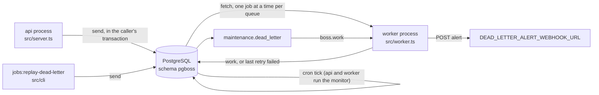
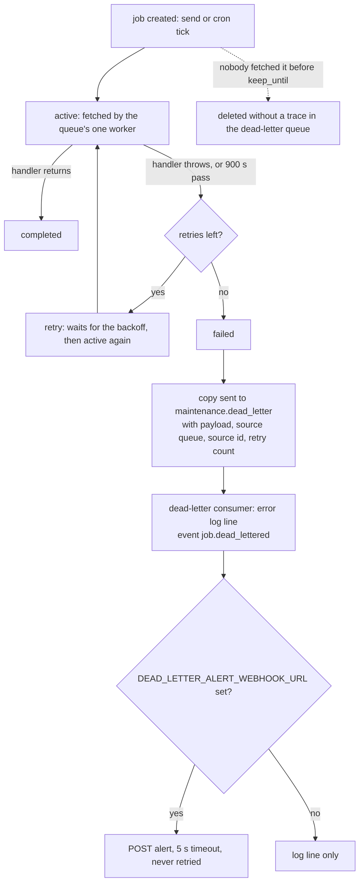

# Jobs and workers

Valid for main at 48aa967 (2026-11-18).

The background-job half of the VistaBlox API: the worker process, how pg-boss is configured, every queue with its producer, consumer, schedule and failure behaviour, the dead-letter path, the worker's probe and metrics, the variables the worker reads, and what happens when a dependency is down. The readers are engineers who add or change a job, and operators who answer for the worker. The operator commands are in [cli.md](cli.md); the runbook for dead-lettered jobs is [dead-letter-jobs.md](dead-letter-jobs.md) and is not repeated here.

Citations are `(path:line)` at 48aa967; the identifier is named next to the number because line numbers drift. A path that starts with `node_modules/` is library code read from an installed copy of the version `package-lock.json` locks (pg-boss 12.29.0, viem 2.56.3); it is outside the repository and was read, not run. A statement marked `Not verified` could not be checked from the repository or from the checks listed in [Not verified](#12-not-verified). A line that starts with `> Pending #N:` says what an open pull request changes in the statement above it; nothing under such a line is built on main.

Contents: [1 Overview](#1-overview) · [2 The worker process](#2-the-worker-process) · [3 pg-boss configuration](#3-pg-boss-configuration) · [4 Queue catalogue](#4-queue-catalogue) · [5 Schedules](#5-schedules) · [6 Dead-letter consumer and alert webhook](#6-dead-letter-consumer-and-alert-webhook) · [7 Variables the worker reads](#7-variables-the-worker-reads) · [8 Failure modes](#8-failure-modes) · [9 Known gaps against the design record](#9-known-gaps-against-the-design-record) · [10 Known limitations](#10-known-limitations) · [11 Related documents](#11-related-documents) · [12 Not verified](#12-not-verified)

## 1. Overview

Background work runs on pg-boss, a job queue that keeps its state in the application's own PostgreSQL database (`package.json:52`; schema `pgboss`, section 3). Three kinds of code touch it:

| Process | Entry point | What it does with jobs |
| --- | --- | --- |
| api | `src/server.ts` | Starts its own pg-boss instance, creates the five event queues it can send into, and sends jobs (`src/server.ts:102-117`). It registers no consumer. |
| worker | `src/worker.ts` | Starts a pg-boss instance, creates every queue (25 plus the dead-letter queue), registers the 19 cron schedules and one consumer per queue, and consumes the dead-letter queue (`src/worker.ts:404-897`). |
| operator command | `src/cli/replay-dead-letter-job.ts` | Starts a pg-boss instance with maintenance, cron, migration and schema creation switched off, and sends one job (`src/cli/replay-dead-letter-job.ts:50-59`). |

The 25 queues are 19 scheduled queues and 6 event queues. The count is taken from the ownership registry (`src/shared/jobs/job-ownership.ts:23-50`) and matches the `ensureJobQueue` calls in the worker (`src/worker.ts:414-464`); both were counted with a script, and the kind of every queue is the same in the registry and in the call.

Two kinds of queue exist, and they differ in who creates the job and how long it is retried (section 3.3):

| Kind | Created by | Retry profile | Count |
| --- | --- | --- | --- |
| `event` | Application code, once per occurrence: a repository inside the caller's transaction, a webhook receiver, or the replay command | 16 retries, backoff from 30 s capped at 900 s | 6 |
| `scheduled` | pg-boss cron, from `boss.schedule` calls in the worker | 5 retries, backoff from 1 s | 19 |

(`src/shared/jobs/job-queues.ts:24-36`, `src/shared/jobs/enqueue-job.ts:21-32`.)

## 2. The worker process

### 2.1 Boot sequence

`src/worker.ts` is a module with top-level `await`. It runs the steps below in this order; the table names the line where each step is in the file.

| Step | What happens | Where |
| --- | --- | --- |
| 1 | `import "dotenv/config"` loads a `.env` file from the working directory if one exists; `loadEnvironment()` parses the whole environment schema. | `src/worker.ts:1`, `src/worker.ts:72` |
| 2 | The logger, the Prisma client and the metrics registry are created. | `src/worker.ts:73-75` |
| 3 | The health listener starts on `127.0.0.1:3001`. From here `/health/live` answers 200; `/health/ready` answers 503 until step 12. | `src/worker.ts:76-77`, `src/shared/health/worker-heartbeat.ts:34-65` |
| 4 | The SMTP sender, the pg-boss instance (with an `error` listener that logs `pg-boss error`) and the Didit client (4 s timeout) are created. | `src/worker.ts:81-92`, `src/worker.ts:98-102` |
| 5 | The protected-profile cache client connects to `PROFILE_CACHE_URL` (3 s connect timeout, no reconnect). A failure is logged at `warn` and the worker goes on without the cache. | `src/worker.ts:121-157` |
| 6 | The repositories and services are built. A service whose dependency is not configured is `undefined`, and its queue is neither created, scheduled nor consumed (section 4.3): the Coinbase client needs both CDP credentials, the chain clients need the three base `CHAIN_*` settings, the settlement bundle needs the four addresses on top, the wallet registry watcher needs the registry address and the chain clients. | `src/worker.ts:94-120`, `src/worker.ts:158-391` |
| 7 | `boss.start()`. pg-boss creates or migrates its own schema here (library defaults). | `src/worker.ts:404`, `node_modules/pg-boss/dist/attorney.js:374-379` |
| 8 | `ensureDeadLetterQueue`, then `ensureJobQueue` for each queue that exists in this worker. | `src/worker.ts:413-464` |
| 9 | One `boss.schedule` per scheduled queue that exists, all with `tz: "UTC"` and the 5-retry profile. | `src/worker.ts:466-596` |
| 10 | One `boss.work` per queue that exists. | `src/worker.ts:598-884` |
| 11 | The dead-letter consumer is registered, with the alert webhook sender when `DEAD_LETTER_ALERT_WEBHOOK_URL` is set. | `src/worker.ts:891-897` |
| 12 | `VistaBlox worker started` is logged and `heartbeat.markReady()` makes `/health/ready` answer 200. | `src/worker.ts:899-900` |
| 13 | `SIGINT` and `SIGTERM` handlers are installed with `process.once`. | `src/worker.ts:916-917` |

The health listener starts before the work that can fail. Any rejection in steps 7 to 11 (a database that cannot be reached, a schedule that pg-boss refuses) is an uncaught rejection of a top-level `await`, which ends a Node 22 process with exit code 1. That was checked with a three-line script on Node 22.23.4 with a listener open, not by starting the worker. The staging compose file restarts the worker (`restart: unless-stopped`, `docker-compose.staging.yml:284`), so a worker that cannot start loops through boot and exit until the cause is gone.

> Pending #240: a boot-time check of the chain id and contract code is added to the worker, and an unreachable RPC ends the process at boot.

A queue is created before it is scheduled or consumed because pg-boss 12 refuses `schedule` and `work` for a queue that does not exist (`src/worker.ts:406-412`, `node_modules/pg-boss/dist/timekeeper.js:229-248`). `ensureJobQueue` runs `createQueue`, which does nothing for a queue that exists, and `updateQueue`, which brings a queue created by an earlier release up to the current dead-letter and retry settings; a job already waiting keeps the settings it was sent with (`src/shared/jobs/job-queues.ts:47-61`).

### 2.2 Shutdown

`SIGINT` and `SIGTERM` each run `shutdown`; both handlers are installed with `process.once`, so each signal is handled the first time it arrives (`src/worker.ts:902-917`):

1. `heartbeat.stop()` sets readiness to false, stops the timer and closes the listener.
2. `boss.stop()` inside a `try`; a failure is logged as `pg-boss shutdown failed`.
3. The profile cache client is closed if it is open.
4. `database.$disconnect()`.

There is no `process.exit`; the process ends when nothing keeps the event loop alive. `heartbeat.stop()`, the cache close and `$disconnect()` are not inside a `try`, so a rejection in step 1 skips `boss.stop()` and one in step 3 skips `$disconnect()` (`src/worker.ts:904-913`).

`boss.stop()` is graceful by default with a 30 s timeout: it stops fetching, waits for running handlers until the timeout, then marks the jobs still running as failed with the message `pg-boss shut down while active`, which sends them into their retry profile (`node_modules/pg-boss/dist/index.js:170-216`, `node_modules/pg-boss/dist/manager.js:523-531`). Neither compose file sets `stop_grace_period` (searched in `docker-compose.yml` and `docker-compose.staging.yml`; no match), so Docker's default stop timeout applies. Not verified: the value of that default, and so whether it is shorter than the 30 s that pg-boss waits; Docker was not run and no Docker documentation was read for this chapter. A container killed before pg-boss finishes leaves its running job in state `active`; pg-boss's supervisor fails it once the job's expiration passes, 900 s unless a queue sets another value, and the job then follows its retry profile (`node_modules/pg-boss/dist/plans.js:48`, `node_modules/pg-boss/dist/plans.js:1673-1678`). A handler that waits for a chain receipt can run for up to 180 s (viem's default receipt timeout, `node_modules/viem/_esm/actions/public/waitForTransactionReceipt.js:53`), which is longer than the 30 s that pg-boss waits, so a handler that is still waiting for a receipt when those 30 s end is failed with `pg-boss shut down while active` even when the container is not killed first (`node_modules/pg-boss/dist/index.js:170-216`, `node_modules/pg-boss/dist/manager.js:523-531`).

### 2.3 Health listener and metrics

`WorkerHeartbeat` is an `http` server on `127.0.0.1`, port `WORKER_HEALTH_PORT = 3001`, a constant, not a variable (`src/shared/health/worker-heartbeat.ts:4`, `:61`). It is not published by either compose file; the staging healthcheck calls it from inside the container (`docker-compose.staging.yml:289-300`).

| Path | Answer | Condition |
| --- | --- | --- |
| `/health/live` | 200 `{"status":"ok"}` | Always, once the listener is up (`src/shared/health/worker-heartbeat.ts:35-38`). |
| `/health/ready` | 200 `{"status":"ok"}`, otherwise 503 | `markReady()` was called and the heartbeat timestamp is less than 30 s old (`src/shared/health/worker-heartbeat.ts:40-43`, `:95-97`). |
| `/metrics` | 200, Prometheus text format | Always; the body is the `WorkerMetrics` registry (`src/shared/health/worker-heartbeat.ts:45-54`). |
| any other path, or a path with a query string | 503 `{"status":"unavailable"}` | The match is on the exact `request.url` (`src/shared/health/worker-heartbeat.ts:56`). |

The heartbeat is a `setInterval` that updates a timestamp every 10 s on the same event loop; the timer is `unref`'d (`src/shared/health/worker-heartbeat.ts:6-7`, `:67-70`). Readiness therefore proves that boot finished and that the event loop is turning. It does not look at the database, pg-boss or the last job run (`src/shared/health/worker-heartbeat.ts:95-97`). The staging healthcheck runs every 15 s with 3 retries and a 30 s start period (`docker-compose.staging.yml:289-300`); the development compose worker has no healthcheck (`docker-compose.yml:144-165`).

`WorkerMetrics` keeps numbers in memory. They are label-free, process-local and reset when the worker restarts; `render()` writes one `name value` line per metric, sorted by name, with no `# TYPE` or `# HELP` lines (`src/shared/health/worker-metrics.ts:1-22`). Twenty names exist:

| Metric | Kind | Set by | Meaning |
| --- | --- | --- | --- |
| `vistablox_worker_kyc_creating_overdue` | gauge | `maintenance.kyc_stuck_session_expiry` (`src/worker.ts:810`) | Sessions found stuck in creation in the last run. |
| `vistablox_worker_kyc_open_overdue` | gauge | `maintenance.kyc_stuck_session_reconciliation` (`src/worker.ts:816`) | Open sessions older than the reconciliation threshold in the last run. |
| `vistablox_worker_account_recovery_overdue` | gauge | `maintenance.account_recovery_alert` (`src/worker.ts:824`) | Open recovery cases older than the threshold. |
| `vistablox_worker_onramp_late_evidence_unreviewed` | gauge | `maintenance.onramp_late_evidence_alert` (`src/worker.ts:834`) | Late onramp evidence entries nobody has reviewed. |
| `vistablox_worker_wallet_registration_runs_total` | counter | watcher run start (`src/modules/settlement/application/wallet-registry-alert-reporter.ts:80-84`) | Started watcher runs, failed ones included. |
| `vistablox_worker_wallet_registration_failures_total` | counter | watcher failure (`wallet-registry-alert-reporter.ts:171-173`) | Failed watcher runs. |
| `vistablox_worker_wallet_registration_confirmed_total` | counter | watcher run end | Registrations confirmed. |
| `vistablox_worker_wallet_registration_unmatched_events_total` | counter | watcher run end | Events that match no live claim. |
| `vistablox_worker_wallet_registration_new_unmatched_events_total` | counter | watcher run end | The part of those that is news. |
| `vistablox_worker_wallet_registration_address_mismatches_total` | counter | `announceAddressMismatch` | First-seen address mismatches; registered at 0 at the first run. |
| `vistablox_worker_wallet_registration_address_mismatch_duplicates_total` | counter | watcher run end | Mismatches seen again. |
| `vistablox_worker_wallet_registration_heartbeat_write_failures_total` | counter | heartbeat write | Failed heartbeat writes. |
| `vistablox_worker_wallet_registration_health_check_failures_total` | counter | health check failure | Failed health checks. |
| `vistablox_worker_wallet_registration_pending_overdue` | gauge | watcher run end and health check | Pending claims older than `WALLET_REGISTRY_PENDING_WARN_AFTER_MINUTES`. |
| `vistablox_worker_wallet_registration_pending_total` | gauge | health check | Pending claims. |
| `vistablox_worker_wallet_registration_watcher_heartbeat_age_seconds` | gauge | health check | Age of the watcher's last completed run; `-1` when none was recorded. |
| `vistablox_worker_wallet_registration_cursor_lag_blocks` | gauge | health check | Blocks between the saved cursor and the safe head. |
| `vistablox_worker_wallet_registration_address_mismatch_unresolved` | gauge | health check | Unresolved recorded mismatches. |
| `vistablox_worker_wallet_registration_evidence_flagged` | gauge | health check | Confirmed registrations whose chain evidence is flagged. |
| `vistablox_worker_wallet_registration_health_alerts_active` | gauge | health check | Alerts raised by the last check. |

(`src/modules/settlement/application/wallet-registry-alert-reporter.ts:24-42`, `:135-238`; the four `vistablox_worker_*` gauges are set at the `src/worker.ts` lines in the table.) A gauge exists only after the job that sets it has run once. Nothing in the repository scrapes `/metrics`; see [Not verified](#12-not-verified).

### 2.4 Logs and run summaries

The worker writes JSON log lines to standard output (`src/infrastructure/logging/logger.ts:3-27`). A scheduled job that fits a plain count reports a `JobRunSummary`, `{ checked, acted }` (`src/shared/jobs/job-run-summary.ts:1-4`): `checked` is how many candidates the run looked at, `acted` how many it changed or notified. Which log line a job writes depends on how `src/worker.ts` wires it:

| Wiring | Success line | Failure line | Used by |
| --- | --- | --- | --- |
| `runJob`: a fresh trace id `req_<ULID>`, the summary spread into the line | `case timer job completed` at `info` with `trace_id`, `job` and the summary | `case timer job failed` at `error` with `err`, then the error is rethrown so pg-boss retries | `case_timers.applicant_reminders`, `response_window_expiry`, `reservation_unfunded_expiry`, `reservation_onramp_poll`, `offering_reconfirmation_window_close`, `offering_reconfirmation_reminders`, `rental.operating_distribution_sweep`, `maintenance.dpop_replay_prune`, `device_challenge_prune`, `signing_request_prune`, `kyc_renewal`, `wallet_registration_expiry`, `onramp_late_evidence_alert` |
| Event handler: the trace id is read from the payload (`trace_id`, or `traceId` for the Didit job), `unknown` when absent | `case timer job completed` for `case_timers.*` and `settlement.open_ipo_escrow_campaign`; `webhook job completed` for `provider_events.*` | `case timer job failed` or `webhook job failed` at `error`, then rethrown | the six event queues |
| Maintenance KYC and recovery handlers, no `try` | `maintenance job completed` at `info` with the summary | none from the worker; pg-boss stores the error on the job and the first line the worker writes is the dead-letter line after the last retry | `maintenance.kyc_stuck_session_expiry`, `maintenance.kyc_stuck_session_reconciliation`, `maintenance.account_recovery_alert` |
| Finalizer handler | `case timer job completed`, or `case timer job completed with campaign errors` at `error` when `summary.errors` is not empty | `case timer job failed` with the error sanitised (URLs and long hex masked) | `settlement.finalize_ipo_escrow_campaigns` |
| Wallet registry reporter | The watcher's reporter logs `case timer job completed` with the watcher's own summary; the health check logs `wallet_registry.health_checked` at `info`; alerts are `wallet_registry.*` events | The watcher logs `wallet_registry.watcher_failed` at `warn`, the health check `wallet_registry.health_check_failed` at `error`, and each rethrows a sanitised copy | `settlement.confirm_wallet_registrations`, `settlement.check_wallet_registry_health` |

(`src/worker.ts:393-402`, `:635-679`, `:684-858`, `:808-827`; `src/modules/settlement/application/wallet-registry-alert-reporter.ts:135-257`.) Three summaries carry more than the pair: the Coinbase poll adds `failed` (`src/modules/offering/application/poll-onramp-transactions.service.ts:27-29`), the late-evidence alert adds `unreviewed` (`src/modules/offering/application/check-onramp-late-evidence.service.ts:10-13`), and the two KYC stuck-session services return an `overdue` count as a non-enumerable property, so it reaches the gauge and the `warn` line but not the `maintenance job completed` line (`src/modules/identity/application/kyc-stuck-session.service.ts:64-69`, `:167-172`).

A trace id minted by the worker (`req_<ULID>`) ties the lines of one run. A job sent by an HTTP request carries that request's trace id in its payload, so the worker lines of the job can be joined to the request that caused it (`src/shared/jobs/enqueue-job.ts:50-53`).

## 3. pg-boss configuration

### 3.1 The instance

`new PgBoss(environment.DATABASE_URL)` in the worker and the same call in the api take the connection string and nothing else (`src/worker.ts:89`, `src/server.ts:102`). The library then applies its defaults: schema `pgboss`, cron scheduling on, the supervisor (expiry, retention and deletion of old jobs) on, schema migration and creation on, LISTEN/NOTIFY off, polling every 2 s, and a cron monitor that wakes every 30 s (`node_modules/pg-boss/dist/attorney.js:374-393`, `:535`, `:556`, `:597`). Consequences:

- Both the api and the worker run the supervisor and the cron monitor. The monitor takes one lock per interval, so one instance sends the due ticks (`node_modules/pg-boss/dist/timekeeper.js:144-160`). The api never consumes a scheduled queue, so ticks sent while only the api is running wait in the queue for the worker.
- The `pgboss` schema is created and migrated by pg-boss at `start()`, not by a Prisma migration; no file under `prisma/` mentions it (searched). The database role in `DATABASE_URL` needs the rights to do that.
- pg-boss opens its own `pg` pool next to the Prisma pool, with a 10 s connection timeout; an error on an idle pooled client is emitted as the pg-boss `error` event, which the worker logs (`node_modules/pg-boss/dist/db.js:19`, `:29-30`; `src/worker.ts:90-92`).
- The replay command builds its instance with `supervise: false`, `schedule: false`, `migrate: false` and `createSchema: false`, so it neither runs maintenance nor touches the schema (`src/cli/replay-dead-letter-job.ts:50-59`).

No call in `src` passes `batchSize`, `localConcurrency`, `pollingIntervalSeconds`, `expireInSeconds` or `heartbeatSeconds` (searched). Every consumer therefore takes one job at a time, one worker per queue, polling every 2 s, with the library's expiration of 900 s (`node_modules/pg-boss/dist/manager.js:537`, `node_modules/pg-boss/dist/plans.js:48`). The only option passed to `boss.work` is `{ includeMetadata: true }` for the dead-letter queue (`src/shared/jobs/dead-letter-consumer.ts:123`).

### 3.2 Handler time limit and retention

pg-boss races a handler against its job's expiration, 900 s here. When the handler is slower, pg-boss fails the job with `handler execution exceeded 900s` and aborts the job's signal; the handler's own promise is not cancelled and keeps running (`node_modules/pg-boss/dist/manager.js:426`, `node_modules/pg-boss/dist/tools.js:39-49`). No handler in this repository reads the signal. See [Known limitations](#10-known-limitations).

Library defaults that apply to every queue except where the repository overrides them:

| Setting | Value | Source |
| --- | --- | --- |
| Time a waiting job is kept before pg-boss removes it (`retentionSeconds`) | 14 days | `node_modules/pg-boss/dist/plans.js:49` |
| Time a finished job is kept (`deleteAfterSeconds`) | 7 days | `node_modules/pg-boss/dist/plans.js:50` |
| Dead-letter queue: retention and `deleteAfterSeconds` | 30 days each | `src/shared/jobs/job-queues.ts:12-22` |
| A replayed job: `deleteAfterSeconds` | 30 days, so the once-only guard lasts as long as the dead-letter entry | `src/shared/jobs/dead-letter-replay.ts:122` |

### 3.3 Retry profiles

Two constants define every retry setting (`src/shared/jobs/enqueue-job.ts:21-32`):

| Profile | Options | Attempts | Used by |
| --- | --- | --- | --- |
| Event, `JOB_RETRY_OPTIONS` | `retryLimit: 16`, `retryDelay: 30`, `retryBackoff: true`, `retryDelayMax: 900` | 17 (the first run and 16 retries) | The six event queues: queue options through `ensureJobQueue`, and again on each `send` by `enqueueTransactionalJob`, the Didit receiver and the replay command (`src/shared/jobs/job-queues.ts:31-36`, `src/shared/jobs/enqueue-job.ts:54`, `src/modules/identity/repository/prisma-kyc.repository.ts:97`, `src/shared/jobs/dead-letter-replay.ts:119-123`) |
| Scheduled, `SCHEDULED_JOB_RETRY_OPTIONS` | `retryLimit: 5`, `retryBackoff: true`, no delay | 6 | The 19 scheduled queues: queue options, and spread into every `boss.schedule` call as `RETRY_OPTIONS` (`src/worker.ts:307`, `:466-596`) |

pg-boss computes the wait before retry number n, counted from 0, as `LEAST(retry_delay_max, GREATEST(retry_delay, 1) * (2^n + 2^n * random()))` seconds (`node_modules/pg-boss/dist/plans.js:1772-1781`, where `2^n` is written `2 ^ LEAST(16, retry_count + 1) / 2`). With the numbers above:

| Retry | Event profile (30 s base, 900 s cap) | Scheduled profile (1 s base) |
| --- | --- | --- |
| 1 | 30 to 60 s | 1 to 2 s |
| 2 | 60 to 120 s | 2 to 4 s |
| 3 | 120 to 240 s | 4 to 8 s |
| 4 | 240 to 480 s | 8 to 16 s |
| 5 | 480 to 900 s | 16 to 32 s |
| 6 to 16 | exactly 900 s each | none |
| Total | 10,830 to 11,700 s (3.0 to 3.25 h) | 31 to 62 s |

(The totals match the comment at `src/shared/jobs/enqueue-job.ts:5-20`; both were recomputed from the formula.) A scheduled job that fails all its retries is dead-lettered, and the next cron tick is a fresh job; a failing every-minute job therefore writes a dead-letter line about once a minute after the first minute of failure (`README.md` states the same).

A handler signals failure only by throwing. The code does not tell a transient error from one retrying cannot fix: a payload that fails its Zod schema, a missing platform setting and an impossible state all take the whole profile, 3 hours for an event job, before the entry reaches the dead-letter queue (`src/modules/offering/application/open-offering-for-approved-case.service.ts:35`, `src/modules/intake/repository/prisma-intake.repository.ts:1184-1195`).

### 3.4 Cron

`boss.schedule(name, cron, null, { tz: "UTC", ...RETRY_OPTIONS })` stores a row in pg-boss's schedule table, keyed by queue name; calling it again on the next start updates the row (`node_modules/pg-boss/dist/timekeeper.js:229-248`). The cron monitor evaluates every row each 30 s and, for a row whose previous firing time is less than 60 s ago, sends one job under a singleton key of that queue with a 60 s window, so two evaluations in one minute send one job (`node_modules/pg-boss/dist/timekeeper.js:144-204`). Three things follow from reading that code, and none was observed at runtime:

- A job starts up to about half a minute after its nominal time, because of the 30 s monitor and the 2 s to 5 s polling.
- A tick that falls while no pg-boss instance with the monitor is running is not made up later. Ticks that fall while the api runs and the worker does not are sent and wait in their queue, and the worker runs them in sequence when it returns.
- `src/worker.ts` never calls `unschedule` or `deleteQueue` (searched `src` for `unschedule`, `deleteQueue`, `deleteSchedule`, `offWork`: no match), so a schedule created while a feature gate was open stays after the gate is closed, and keeps sending jobs into a queue that no consumer reads. See section 4.3.

### 3.5 The dead-letter queue

`maintenance.dead_letter` is created first, in both processes, with retention and deletion of 30 days (`src/shared/jobs/job-queues.ts:10-22`, `:42-45`; `src/worker.ts:413`, `src/server.ts:112`). Every queue created with `ensureJobQueue` names it as its `deadLetter`, so a job whose last retry fails is copied into it with its payload, its source queue, its source id and its retry count (`src/shared/jobs/job-queues.ts:31-36`). Only the worker consumes it (section 6). The queue is not in the ownership registry, and the registry reports any queue it does not list as owner `platform`, tier `tier_1` (`src/shared/jobs/job-ownership.ts:56-60`).

## 4. Queue catalogue

### 4.1 Summary

Every queue has an entry in `JOB_QUEUE_OWNERSHIP` with a kind, an owner and a tier; the owner is an area of the code, not a person, and the mapping is a proposal the founder has not confirmed (`src/shared/jobs/job-ownership.ts:1-9`, `docs/dead-letter-jobs.md`, "Ownership"). A test fails when a queue created in `src/worker.ts` or `src/server.ts` has no entry (`tests/dead-letter-operations.test.ts:33-54`). Times are UTC.

| Queue | Kind | Owner | Tier | Handler module | Trigger | Exists in the worker when |
| --- | --- | --- | --- | --- | --- | --- |
| `case_timers.applicant_reminders` | scheduled | intake | tier_2 | intake | `0 8 * * *` | always |
| `case_timers.response_window_expiry` | scheduled | intake | tier_2 | intake | `0 * * * *` | always |
| `case_timers.pre_offering_open_handoff` | event | offering | tier_2 | offering | founder approves an intake case | always (also created by the api) |
| `case_timers.post_ipo_structuring_handoff` | event | intake | tier_2 | intake | final offering terms published | always (also created by the api) |
| `case_timers.reservation_unfunded_expiry` | scheduled | payments | tier_1 | offering | `* * * * *` | always |
| `case_timers.reservation_onramp_poll` | scheduled | payments | tier_1 | offering | `* * * * *` | both Coinbase CDP credentials set |
| `case_timers.offering_reconfirmation_window_close` | scheduled | offering | tier_1 | offering | `0 * * * *` | always |
| `case_timers.offering_reconfirmation_reminders` | scheduled | offering | tier_2 | offering | `0 * * * *` | always |
| `case_timers.offering_reconfirmation_window_opened` | event | offering | tier_1 | offering | final offering terms published with at least one reservation to reconfirm | always (also created by the api) |
| `rental.operating_distribution_sweep` | scheduled | settlement | tier_1 | rental | `0 6 1 * *` | `OPERATING_DISTRIBUTION_ENABLED=true` |
| `settlement.open_ipo_escrow_campaign` | event | settlement | tier_1 | settlement | `case_timers.pre_offering_open_handoff` ran, bundle configured | settlement bundle configured |
| `settlement.finalize_ipo_escrow_campaigns` | scheduled | settlement | tier_1 | settlement | `0 * * * *` | settlement bundle configured |
| `settlement.confirm_wallet_registrations` | scheduled | settlement | tier_1 | settlement | `* * * * *` | registry address and the three base `CHAIN_*` settings set |
| `settlement.check_wallet_registry_health` | scheduled | settlement | tier_1 | settlement | `*/5 * * * *` | registry address set |
| `provider_events.coinbase_onramp_webhook` | event | payments | tier_1 | offering | signed Coinbase webhook received | queue always (also created by the api); consumer only with both CDP credentials |
| `provider_events.didit_webhook` | event | identity | tier_1 | identity | Didit webhook received | always (also created by the api) |
| `maintenance.dpop_replay_prune` | scheduled | platform | tier_2 | auth | `0 * * * *` | always |
| `maintenance.device_challenge_prune` | scheduled | platform | tier_2 | auth | `0 * * * *` | always |
| `maintenance.signing_request_prune` | scheduled | platform | tier_2 | auth | `0 * * * *` | always |
| `maintenance.kyc_renewal` | scheduled | identity | tier_2 | identity | `0 9 * * *` | always |
| `maintenance.kyc_stuck_session_expiry` | scheduled | identity | tier_2 | identity | `0 * * * *` | always |
| `maintenance.kyc_stuck_session_reconciliation` | scheduled | identity | tier_2 | identity | `0 * * * *` | always |
| `maintenance.account_recovery_alert` | scheduled | identity | tier_1 | auth | `*/15 * * * *` | always |
| `maintenance.wallet_registration_expiry` | scheduled | settlement | tier_1 | wallet | `*/15 * * * *` by default | always |
| `maintenance.onramp_late_evidence_alert` | scheduled | payments | tier_1 | offering | `0 * * * *` | always |

Sources: owner, tier and kind `src/shared/jobs/job-ownership.ts:23-50`; creation `src/worker.ts:414-464` and `src/server.ts:113-117`; schedules `src/worker.ts:466-596`; consumers `src/worker.ts:598-884`. Of the 25, 19 are scheduled and 6 are event queues. "Handler module" is the module that holds the service the handler calls; `maintenance.account_recovery_alert` and the three prune handlers are written inline in `src/worker.ts` and call a repository of the `auth` module (`src/worker.ts:784-804`, `:820-827`).

`maintenance.wallet_registration_expiry` has its owner `settlement` and tier `tier_1` in the registry and writes `settlement.wallet_registrations` (`src/shared/jobs/job-ownership.ts:44-45`). `docs/dead-letter-jobs.md`, "Ownership", lists the same 25 queues with the same owners and tiers; the comparison was done with a script.

### 4.2 The queues

Each table has the same rows. "On failure" says what a thrown error does beyond the profile of the queue's kind (section 3.3) and the dead-letter step every queue has.

#### `case_timers.applicant_reminders`

| | |
| --- | --- |
| Purpose | Emails an applicant a reminder while an information request the founder published is unanswered. |
| Trigger | pg-boss cron `0 8 * * *`, 08:00 every day (`src/worker.ts:466-469`). |
| Consumer | `SendApplicantResponseRemindersService.execute`, wrapped in `runJob` (`src/modules/intake/application/case-timer.service.ts:9-40`, `src/worker.ts:598-600`). |
| What a run does | Reads every information request in status `published` with the applicant's protected contact email (`PrismaIntakeRepository.listPublishedInformationRequestsForTimers`, `src/modules/intake/repository/prisma-intake.repository.ts:1602`) and the platform setting `intake.information_request_reminder_business_days` (`:1491-1503`). A request is due when today's UTC date is its publication date plus one of the configured business days (`isApplicantReminderDue`, `src/modules/intake/domain/case-review.policy.ts:97-105`). A due request whose applicant has no contact email is skipped. `checked` is the requests read, `acted` the emails sent. |
| Idempotency | None is stored. The rule sends each milestone once only because the job runs once a day (`src/modules/intake/domain/case-review.policy.ts:93-96`). |
| On failure | An SMTP error or a missing setting fails the run and it is retried up to 5 times within about a minute. Emails sent earlier in the failed attempt are sent again. A day on which the job did not complete is not made up, because the milestone date has passed. |

#### `case_timers.response_window_expiry`

| | |
| --- | --- |
| Purpose | Expires a case whose applicant did not answer an information request in time. |
| Trigger | pg-boss cron `0 * * * *`, every hour (`src/worker.ts:470-473`). |
| Consumer | `ExpireOverdueInformationRequestsService.execute(traceId)` (`src/modules/intake/application/case-timer.service.ts:42-65`, `src/worker.ts:601-605`). |
| What a run does | For each `published` request whose `due_at` is before now (`src/modules/intake/domain/case-review.policy.ts:89-91`) it calls `expireInformationRequest`: one transaction that locks the intake case, requires stage `waiting_on_applicant` and the request still `published`, sets the request and the case to `expired`, and writes the audit row `intake.information_request_expired` and the case event `case_expired` (`src/modules/intake/repository/prisma-intake.repository.ts:1670-1754`). |
| Idempotency | The stage and status are re-checked under the lock, so a second run finds nothing to do and returns false. |
| On failure | The run is retried; the next hourly tick selects the same requests. |

#### `case_timers.pre_offering_open_handoff`

| | |
| --- | --- |
| Purpose | Opens the `Piv` and `Offering` rows of a property whose intake case the founder approved, so the property can be listed. |
| Producer | `PrismaIntakeRepository.recordFounderDecision`, approve branch, through `enqueueTransactionalJob` in the decision's own transaction, so the job exists if and only if the approval committed. The same transaction writes the case event `handoff_queued` with the job id (`src/modules/intake/repository/prisma-intake.repository.ts:2014`, `:2079-2089`, `:2127-2137`). |
| Payload | `case_id`, `property_id`, `ipo_value_eur`, `trace_id`, parsed by `openOfferingForApprovedCaseJobSchema` (`src/modules/offering/application/open-offering-for-approved-case.service.ts:9-14`). |
| Consumer | `OpenOfferingForApprovedCaseService.execute`, then `PrismaOfferingRepository.openOfferingForApprovedCase` (`src/modules/offering/application/open-offering-for-approved-case.service.ts:27-45`, `src/modules/offering/repository/prisma-offering.repository.ts:153`, `src/worker.ts:684-704`). |
| What a run does | One transaction. It locks the intake case and reads its stage: `rejected`, `withdrawn` and `expired` make the new offering `closed` instead of `pre_offering` (`prisma-offering.repository.ts:94`, `:160-163`). A `Piv` that already exists for the property is reused (with an offering it returns both ids; without one it creates the offering). Otherwise it takes the next token id from the sequence `intake.piv_token_id_seq`, creates the `Piv` and the `Offering` with both raise targets set to `ipo_value_eur`, and writes the audit row `offering.opened_for_approved_case` (`:164-243`). Where the settlement bundle is configured and the case is not closed it also sends `settlement.open_ipo_escrow_campaign` in the same transaction; a case without `ipo_end_at` then throws (`:193`, `:266-282`). |
| Idempotency | One `Piv` per property: a replay returns the existing ids and does not send the escrow job again (`prisma-offering.repository.ts:164-184`). |
| On failure | An unknown case or a case without `ipo_end_at` (when the escrow job is to be sent) throws and takes the whole event profile. |

#### `case_timers.post_ipo_structuring_handoff`

| | |
| --- | --- |
| Purpose | Moves an intake case to `post_ipo_structuring` once its offering's final terms are published. |
| Producer | `PrismaOfferingRepository.publishFinalOfferingTerms`, in its transaction, on every successful publish, whether or not any reservation moved (`src/modules/offering/repository/prisma-offering.repository.ts:1252-1259`). |
| Payload | `case_id`, `trace_id` (`src/modules/intake/application/post-ipo-structuring-handoff.service.ts:8-11`). |
| Consumer | `TransitionCaseToPostIpoStructuringService.execute`, then `PrismaIntakeRepository.transitionToPostIpoStructuring` (`src/modules/intake/application/post-ipo-structuring-handoff.service.ts:13-27`, `src/modules/intake/repository/prisma-intake.repository.ts:1154`, `src/worker.ts:763-783`). |
| What a run does | Locks the case. A stage of `post_ipo_structuring` or `approved_for_final_offering` returns without writing. Any stage other than `pre_offering_open` throws. Otherwise it sets the stage, writes the audit row `intake.case_post_ipo_structuring_started` and a case event (`prisma-intake.repository.ts:1154-1231`). |
| Idempotency | Yes, by the stage check. |
| On failure | A case in an unexpected stage fails for good: the job takes the whole event profile and dead-letters, and a replay fails the same way until the case is corrected (`docs/dead-letter-jobs.md`, "What makes it safe"). |

#### `case_timers.reservation_unfunded_expiry`

| | |
| --- | --- |
| Purpose | Releases the capacity held by a reservation that was never funded. |
| Trigger | pg-boss cron `* * * * *`, every minute (`src/worker.ts:479-482`). |
| Consumer | `ExpireUnfundedReservationsService.execute(traceId)`; the expiry age is a constant, 15 minutes (`src/modules/offering/application/expire-reservations.service.ts:14-44`, `:18`, `src/worker.ts:606-610`). |
| What a run does | Lists reservations in stage `initiated` with their latest money event (`PrismaOfferingRepository.listInitiatedReservationsForTimers`, `src/modules/offering/repository/prisma-offering.repository.ts:816-849`). It skips those younger than 15 minutes and those whose latest capital state is funded. For the rest `expireReservation` locks the reservation, re-reads its stage and latest capital state, sets `lapsed` and writes the audit row `offering.reservation_lapsed` (`:1000-1036`). Capacity has no separate release step; it is computed from reservations that are neither cancelled nor lapsed. |
| Idempotency | The stage and the capital state are re-checked under the lock, so money that arrived between the listing and the lock is not swept away. |
| On failure | The run is retried; the next minute selects the same reservations. |

#### `case_timers.reservation_onramp_poll`

| | |
| --- | --- |
| Purpose | Advances `capital_state` for reservations waiting for a Coinbase purchase; the backstop for the signed webhook. |
| Exists when | Both `COINBASE_CDP_API_KEY_ID` and `COINBASE_CDP_API_KEY_SECRET` are set; the queue, the schedule and the consumer are all conditional (`src/worker.ts:184-209`, `:426-428`, `:498-503`, `:621-625`). |
| Trigger | pg-boss cron `* * * * *` (`src/worker.ts:499-503`). |
| Consumer | `PollOnrampTransactionsService.execute(traceId)` (`src/modules/offering/application/poll-onramp-transactions.service.ts:88-125`). |
| What a run does | Lists reservations in stage `initiated` whose latest capital state is `eurc_purchase_pending` or `purchase_failed` (`src/modules/offering/repository/prisma-offering.repository.ts:851-868`). For each it calls `reconcileReservation`: it reads that reservation's Coinbase transactions, following the page cursor up to 10 pages, and records the outcome through `recordOnrampOutcome`, or hands a success that arrived after the reservation left `initiated` to the late-evidence recorder (`poll-onramp-transactions.service.ts:21`, `:129-255`). The coverage tolerance and the recording rules are in [coinbase-cdp-onramp.md](coinbase-cdp-onramp.md). |
| Idempotency | The recording method writes one row per provider transaction and state: it counts the existing money events of the reservation with the same provider, provider reference and capital state before it writes (`src/modules/offering/repository/reservation.repository.ts:103-119`, `PrismaOfferingRepository.recordOnrampOutcome`, `src/modules/offering/repository/prisma-offering.repository.ts:898-958`). |
| On failure | A failed lookup for one reservation is logged (`onramp poll failed for reservation; continuing with the rest`), counted in `failed`, and the loop goes on. After every reservation was tried, any failure throws `OnrampPollIncompleteError` and the run is retried (`poll-onramp-transactions.service.ts:99-122`). |

#### `case_timers.offering_reconfirmation_window_close`

| | |
| --- | --- |
| Purpose | Ends an offering's reconfirmation window: positions for reconfirmed reservations, lapse for the rest. |
| Trigger | pg-boss cron `0 * * * *` (`src/worker.ts:486-489`). |
| Consumer | `CommitOfferingFinalizationService.execute(traceId)` (`src/modules/offering/application/commit-offering-finalization.service.ts:12-36`, `src/worker.ts:611-615`). |
| What a run does | Lists offerings that are `pre_offering` with final terms published (`src/modules/offering/repository/prisma-offering.repository.ts:1392-1400`). For each whose `effective_rights_end_at` has passed it calls `commitOfferingFinalization`: one transaction that locks the offering and its reservations in `awaiting_reconfirmation` or `reconfirmed`. A `reconfirmed` reservation gets a `settlement.position_ledger` row (units from the committed amount, holder address from a confirmed wallet registration or null), becomes `finalized` and gets a money event `eurc_finalized` from provider `internal`; an `awaiting_reconfirmation` one becomes `lapsed`. The offering becomes `final_offering` and the audit row `offering.finalized` is written (`:1402-1537`, rows at `:1474`, `:1494`, `:1506`, `:1514`, `:1520`). `acted` counts commits without a conflict. |
| Idempotency | The offering's status and window are re-checked under the lock; an offering no longer `pre_offering` or whose window is open returns a conflict value and writes nothing (`:1421-1432`). |
| On failure | The run is retried; the next tick selects the same offerings. The flow is described in [investor-offering.md](investor-offering.md). |

#### `case_timers.offering_reconfirmation_reminders`

| | |
| --- | --- |
| Purpose | Repeats a reminder email to every investor who still has to reconfirm. |
| Trigger | pg-boss cron `0 * * * *` (`src/worker.ts:494-497`). |
| Consumer | `SendReconfirmationRemindersService.execute(traceId)` (`src/modules/offering/application/send-reconfirmation-reminders.service.ts:14-48`, `src/worker.ts:616-620`). |
| What a run does | Lists reservations in `awaiting_reconfirmation` (`prisma-offering.repository.ts:1793`) and reads the platform setting `offering.reconfirmation_reminder_interval_hours`, seeded to 48 by `prisma/migrations/20260902130000_reconfirmation_reminder_settings/migration.sql` (`prisma-offering.repository.ts:1784-1790`). A reminder is due when the window is still open and the interval has passed since the last reminder, or since the final terms were published when none was sent (`src/modules/offering/domain/reconfirmation-reminder.policy.ts:13-25`). The last reminder is read from the audit row `offering.reconfirmation_reminder_sent`. It sends the email, then records that audit row (`recordReconfirmationReminderSent`, `:1842-1853`). |
| Idempotency | The audit row is written after the email; a failure between the two repeats the email on the retry. |
| On failure | Retried; an overdue reminder stays due until it is sent. |

#### `case_timers.offering_reconfirmation_window_opened`

| | |
| --- | --- |
| Purpose | One notification to each investor when the reconfirmation window opens. |
| Producer | `publishFinalOfferingTerms`, in its transaction, only when at least one reservation moved to `awaiting_reconfirmation` (`src/modules/offering/repository/prisma-offering.repository.ts:1234-1246`). |
| Payload | `offering_id`, `reservation_ids` (at least one) and `trace_id` (`src/modules/offering/application/notify-reconfirmation-window-opened.service.ts:12-16`). |
| Consumer | `NotifyReconfirmationWindowOpenedService.execute` (`src/modules/offering/application/notify-reconfirmation-window-opened.service.ts:27-58`, `src/worker.ts:738-758`). |
| What a run does | Re-reads each reservation's contact email, window end and whether a notification was already sent, from the audit row `offering.reconfirmation_window_opened_notification_sent`; the payload is not trusted for any of them. For each reservation not yet notified, and with a contact email, it sends the email and writes the audit row (`prisma-offering.repository.ts:1856-1909`, `src/modules/offering/application/notify-reconfirmation-window-opened.service.ts:42-55`). The lookup selects by reservation id only and does not read the reservation's stage (`prisma-offering.repository.ts:1887`), so a reservation that left `awaiting_reconfirmation` between the publish and the run is still notified. |
| Idempotency | A retry after the audit row exists sends nothing. The email goes before the audit row, so a retry after a failed audit write sends it again (the service's own comment says delivery is at least once, `:18-26`). |
| On failure | Takes the whole event profile. The hazard is listed in `docs/dead-letter-jobs.md`. |

#### `rental.operating_distribution_sweep`

| | |
| --- | --- |
| Purpose | Turns recorded rent collections into calculated distributions. |
| Exists when | `OPERATING_DISTRIBUTION_ENABLED=true` (`src/worker.ts:217-219`, `:429-431`, `:536-545`, `:626-629`). |
| Trigger | pg-boss cron `0 6 1 * *`, 06:00 on the first of each month (`src/worker.ts:541-544`). |
| Consumer | `RunOperatingDistributionSweepService.execute` (`src/modules/rental/application/run-operating-distribution-sweep.service.ts:17-51`). |
| What a run does | For each rent collection awaiting distribution it calls `CalculateOperatingDistributionService.execute` with management fee, other expenses and reserve holdback fixed to the string `0.00`, so every distribution equals the gross rent (`:18`, `:26-46`). `acted` counts distributions that were not already calculated (`:47`). |
| Idempotency | `alreadyCalculated` in the calculation result. |
| On failure | Retried. The fixed zeros are a placeholder named as such in the file's comment (`:10-16`); see [Known limitations](#10-known-limitations). |

#### `settlement.open_ipo_escrow_campaign`

| | |
| --- | --- |
| Purpose | Opens an offering's IPO escrow campaign on the escrow contract and records what the chain shows. |
| Exists when | The settlement bundle is configured: the three base `CHAIN_*` settings and the four addresses (`isSettlementBundleConfigured`, `src/infrastructure/blockchain/settlement-bundle.ts:24-34`; `src/worker.ts:263-273`, `:432-434`, `:710-733`). |
| Producer | `openOfferingForApprovedCase`, in the same transaction that creates the `Piv` and the `Offering`, only when the worker that runs the handoff has the bundle (`openEscrowCampaign: openIpoEscrowCampaign !== undefined`, `src/worker.ts:285-287`; `src/modules/offering/repository/prisma-offering.repository.ts:266-282`). While the bundle is unconfigured no job is sent, because the queue does not exist (`:253-265`). |
| Payload | `piv_id`, `token_id`, `target_amount_eurc` (EURC base units as a decimal string), `deadline_unix`, `trace_id` (`src/modules/settlement/application/open-ipo-escrow-campaign.service.ts:18-24`). |
| Consumer | `OpenIpoEscrowCampaignService.execute` (`open-ipo-escrow-campaign.service.ts:135-156`). The operator command calls the same service ([cli.md](cli.md)). |
| What a run does | Reads `campaignOf` on the escrow contract and the stored observation, then does one of four things: opens the campaign (sends `openCampaign` under the operator-key lock, waits for the receipt, re-reads the campaign and records the observation); records a campaign already open with the offering's target, deadline, treasury and escrow contract; refuses a campaign that exists with other parameters; or notes that the campaign is already `Successful` or `Failed` (`:175-262`). The refusal logs `settlement.ipo_escrow_campaign_mismatch` at `error` and throws `IpoEscrowCampaignMismatchError` (`:32`, `:153`, `:289`). |
| Idempotency | A campaign already open with the offering's parameters is recorded, not opened again. The transaction hash is not kept between attempts: when the receipt wait (180 s by default in viem) gives up while the first transaction is still pending, the next attempt reads `NOT_OPENED` and can send another `openCampaign`, which the contract rejects once the first is mined (`README.md`, "Retry hazards"). |
| On failure | Takes the whole event profile, then dead-letters. A mismatch cannot be fixed by retrying and takes the same 3 hours. Before a replay, check on the chain whether the campaign is open (`docs/dead-letter-jobs.md`). The job is not limited to a testnet (`README.md` records that whether it is to be testnet-gated is open for the founder). |

#### `settlement.finalize_ipo_escrow_campaigns`

| | |
| --- | --- |
| Purpose | Finalizes IPO escrow campaigns whose deadline passed, mints positions for the contributors of a successful one, and sweeps the raised funds to the treasury. |
| Exists when | The settlement bundle is configured (`src/worker.ts:288-294`, `:435-437`, `:504-513`, `:631-663`). |
| Trigger | pg-boss cron `0 * * * *` (`src/worker.ts:509-512`). |
| Consumer | `FinalizeIpoEscrowCampaignsService.execute(traceId)` (`src/modules/settlement/application/finalize-ipo-escrow-campaigns.service.ts:143-185`). |
| What a run does | For each PIV that has a token id and whose case's `ipo_end_at` has passed (`PrismaSettlementRepository.findPivsWithPassedIpoDeadline`, `src/modules/settlement/repository/prisma-settlement.repository.ts:201-210`; the query has no condition on the campaign's state, so a swept campaign is read from the chain again on every tick and then skipped): reads the campaign from the chain, records the observed state, calls `finalize` if the campaign is still open, stops for a `Failed` campaign (each contributor withdraws their own funds), and for a `Successful` one mints each contributor's position and then calls `withdrawRaised` once every contributor has a position (`finalize-ipo-escrow-campaigns.service.ts:190-261`). Chain writes take the operator-key lock. A mint attempt pins the operator nonce and writes an `escrow_mint_intents` row before sending, and a rerun reconciles against the chain before sending again: [escrow-mint-reconciliation.md](escrow-mint-reconciliation.md). |
| Idempotency | A contributor who already has a position is not touched; a swept campaign is skipped (`:199-208`). |
| On failure | Each campaign runs in its own `try`: an error is sanitised, appended to `summary.errors` and logged at `error` as `escrow campaign finalization failed`, and the loop goes on. The run itself returns normally, so pg-boss does not retry it and it does not dead-letter; the worker logs `case timer job completed with campaign errors` at `error`. The next hourly tick tries the campaign again. A contributor without a confirmed wallet registration is added to `errors`, counted in `campaignsUnresolved`, and holds back the sweep (`:160-185`, `:241`; `src/worker.ts:635-662`). |

> Pending #235: the job fails, and so retries and dead-letters, when any campaign errored.

#### `settlement.confirm_wallet_registrations`

| | |
| --- | --- |
| Purpose | Watches the wallet registry contract and confirms the wallet claims that match an on-chain registration. |
| Exists when | `VISTABLOX_WALLET_REGISTRY_CONTRACT_ADDRESS` and the three base `CHAIN_*` settings are set (`src/worker.ts:295-305`, `:438-440`, `:514-525`, `:664-674`). |
| Trigger | pg-boss cron `* * * * *`, every minute (`src/worker.ts:521-524`). The watcher is not on the 5-minute cadence; only its health check is. |
| Consumer | `RunWalletRegistryWatcherService.execute`, which calls `ConfirmWalletRegistrationsService.execute` and reports through `WalletRegistryAlertReporter` (`src/modules/settlement/application/run-wallet-registry-watcher.service.ts:27-59`, `src/modules/settlement/application/confirm-wallet-registrations.service.ts:232`). |
| What a run does | Reads the registry's `WalletRegistered` events from 31 blocks before the saved cursor to 3 blocks behind the chain head; the end of the range is at most 2000 blocks past its start (`MAX_BLOCK_RANGE_PER_RUN`, `confirm-wallet-registrations.service.ts:33-44`, `:232-260`, `:284-296`), matches each to a live claim, confirms registrations, re-checks the evidence of confirmed ones and records first-seen address mismatches. It saves the cursor in the `platform.settings` row `wallet_registry.last_processed_block`; the reporter writes the row `wallet_registry.watcher_heartbeat` after every completed run (`src/modules/settlement/repository/wallet-registry-setting-keys.ts:6`, `:10`; `wallet-registry-alert-reporter.ts:266-293`). With no cursor yet it starts at the safe head, not at block 0 (`confirm-wallet-registrations.service.ts:240-244`). The event catalogue and the reconciliation procedure are in [wallet-registration-operations.md](wallet-registration-operations.md). |
| Idempotency | The overlap re-reads 32 blocks every run, so confirming a claim twice must be harmless; a claim is confirmed once. |
| On failure | The reporter counts the failure, logs `wallet_registry.watcher_failed` at `warn` and rethrows a copy with URLs stripped; pg-boss retries within about a minute. A watcher that keeps failing shows up as `wallet_registry.watcher_stalled` from the health check, after `WALLET_REGISTRY_WATCHER_STALE_AFTER_MINUTES` (default 10). |

#### `settlement.check_wallet_registry_health`

| | |
| --- | --- |
| Purpose | Reports whether the wallet registry watcher is healthy. |
| Exists when | `VISTABLOX_WALLET_REGISTRY_CONTRACT_ADDRESS` is set, with or without the `CHAIN_*` settings; it exists so that a registry address without a runnable watcher is reported (`src/worker.ts:314-361`, `:441-445`, `:526-535`, `:675-679`). |
| Trigger | pg-boss cron `*/5 * * * *` (`src/worker.ts:531-534`). |
| Consumer | `CheckWalletRegistryHealthService.execute` (`src/modules/settlement/application/check-wallet-registry-health.service.ts:26-62`). |
| What a run does | Reads the watcher heartbeat, the pending claims and the open address mismatches from the database only, applies the pure alert policy, logs `wallet_registry.health_checked` at `info` every run and one line per alert, and sets the gauges (`:38-61`; `wallet-registry-alert-reporter.ts:194-238`). It makes no RPC call. |
| Idempotency | Read-only. |
| On failure | `wallet_registry.health_check_failed` at `error`, then the sanitised error is rethrown. |

#### `provider_events.coinbase_onramp_webhook`

| | |
| --- | --- |
| Purpose | Re-checks one reservation's Coinbase transactions after a signed webhook arrived. The webhook body is a trigger only. |
| Producer | `PrismaOfferingRepository.receiveOnrampWebhook`, which writes the receipt row in `money.onramp_webhook_receipts` and sends the job in one transaction; a redelivery of the same event id writes nothing and sends nothing (`src/modules/offering/repository/prisma-offering.repository.ts:966-995`, `skipDuplicates` at `:982`). |
| Payload | `reservationId`, `eventId`, `eventType`, `trace_id` (`src/modules/offering/application/coinbase-onramp-webhook.service.ts:97-102`). |
| Consumer | `ReconcileOnrampWebhookService.execute`, registered only when the Coinbase client exists (`coinbase-onramp-webhook.service.ts:146-179`, `src/worker.ts:206-209`, `:860-884`). |
| What a run does | Finds the reservation in any stage and calls the same `reconcileReservation` the poll uses. The result is `ignored` (unknown reservation), `unresolved` or `resolved`. When the event is `onramp.transaction.success` or `onramp.transaction.failed`, the reservation has already left `initiated` and Coinbase's list does not show the outcome yet, it throws `OnrampOutcomeNotVisibleError` so pg-boss retries; the poll does not watch such a reservation (`coinbase-onramp-webhook.service.ts:123-134`, `:152-178`). |
| Idempotency | The recording rules of the poll. A webhook racing the poll, or a duplicate, writes nothing. |
| On failure | Takes the whole event profile. If the api accepts webhooks but the worker has no CDP credentials, jobs are sent and never consumed (section 4.3). |

#### `provider_events.didit_webhook`

| | |
| --- | --- |
| Purpose | Applies a Didit verification status change to the customer's KYC record. |
| Producer | `PrismaKycRepository.enqueueDiditWebhookProcessing`, called by the receiver of `POST /webhooks/didit` after the signature and shape checks. It is a plain `boss.send` with `JOB_RETRY_OPTIONS`: no transaction, and no receipt table; pg-boss's job row holds the verified fields (`src/modules/identity/repository/prisma-kyc.repository.ts:62-98`). |
| Payload | camelCase fields (`eventId`, `webhookType`, `applicationId`, `environment`, `sessionId`, `sessionKind`, `workflowId`, `vendorData`, `status`, `createdAt`) and `traceId`, parsed by `processDiditWebhookJobSchema` (`src/modules/identity/application/kyc.service.ts:360-372`). |
| Consumer | `ProcessDiditWebhookService.execute` (`src/modules/identity/application/kyc.service.ts:374-523`, `src/worker.ts:838-858`). |
| What a run does | Skips an event whose key `didit:webhook:<eventId>` is already recorded. Records an event as unmatched, with a reason, and returns `ignored` when the application, environment or workflow do not match the configuration (`configuration_mismatch`), the session is unknown (`session_not_found`) or the account correlation fails (`correlation_mismatch`). For the statuses `Approved`, `Declined`, `In Review` and `Abandoned` it fetches the decision from Didit and checks that it agrees with the event, then evaluates the outcome and applies it through `applyProviderOutcome` or, for the proof-of-address workflow, `applyProofOfAddressOutcome`; the result can be `duplicate`, `stale` or `ignored`. For a baseline session it first invalidates the cached display profile, ignoring any error (`:384-523`, `shouldFetchDecision` at `:541`). |
| Idempotency | The event key, and the outcome writers' own duplicate and stale detection. |
| On failure | A Didit error from `getDecision` (4 s timeout) throws and takes the whole event profile. The runbook lists this job as harmless to replay (`docs/dead-letter-jobs.md`). |

#### `maintenance.dpop_replay_prune`

| | |
| --- | --- |
| Purpose | Deletes expired DPoP replay records so `auth.dpop_replays` does not grow. |
| Trigger | pg-boss cron `0 * * * *` (`src/worker.ts:549-552`). |
| Consumer | Inline handler calling `PrismaDpopReplayRepository.pruneExpired(new Date())` (`src/worker.ts:784-789`, `src/modules/auth/repository/shared/prisma-dpop-replay.repository.ts:21-26`). |
| What a run does | `deleteMany` of rows whose `expires_at` is before the worker's clock. `checked` and `acted` are both the number deleted. |
| Idempotency | A second run deletes nothing. |
| On failure | Retried; the next hour deletes the same rows. |

#### `maintenance.device_challenge_prune`

| | |
| --- | --- |
| Purpose | Deletes expired device-auth challenges. |
| Trigger | pg-boss cron `0 * * * *` (`src/worker.ts:553-556`). |
| Consumer | Inline handler calling `PrismaDeviceChallengeRepository.pruneExpired()` (`src/worker.ts:790-796`, `src/modules/auth/repository/customer/prisma-device-challenge.repository.ts:78-86`). |
| What a run does | `DELETE FROM auth.device_challenges WHERE expires_at < now() - <replay window>`, on the database clock, so a worker with a skewed clock cannot remove a row the replay decision still needs. |
| Idempotency | A second run deletes nothing. |
| On failure | Retried. |

#### `maintenance.signing_request_prune`

| | |
| --- | --- |
| Purpose | Marks signing requests that passed their expiry as `expired`. Despite the name it deletes nothing. |
| Trigger | pg-boss cron `0 * * * *` (`src/worker.ts:561-564`). |
| Consumer | Inline handler calling `PrismaSigningRequestRepository.markExpired()` (`src/worker.ts:797-804`, `src/modules/auth/repository/customer/prisma-signing-request.repository.ts:182-193`). |
| What a run does | `UPDATE auth.signing_requests SET status = 'expired' WHERE status IN ('pending', 'signed') AND expires_at < now()`. The status only needs to read `expired` before the client's next refresh; the signing steps themselves reject a past-expiry request from the stored data (`src/worker.ts:557-560`). |
| Idempotency | A second run updates nothing. |
| On failure | Retried. |

#### `maintenance.kyc_renewal`

| | |
| --- | --- |
| Purpose | Reminds customers whose baseline KYC is about to expire and moves the overdue ones to `requires_renewal`. |
| Trigger | pg-boss cron `0 9 * * *`, 09:00 every day (`src/worker.ts:565-568`). |
| Consumer | `RunKycRenewalTimerService.execute(traceId)` (`src/modules/identity/application/kyc-renewal.service.ts:9-49`, `src/worker.ts:805-807`). |
| What a run does | Reads every account in state `eligible` with a `renewal_due_at` (`src/modules/identity/repository/prisma-kyc.repository.ts:654-670`) and the setting `identity.kyc_renewal_reminder_lead_days` (`:101-109`). An account whose date has passed is moved to `requires_renewal` with substatus `kyc_reverification_required` in one transaction that also writes a history row (`:672-723`). Otherwise, when today's UTC date equals the due date minus the lead days, it emails the customer (`src/modules/identity/domain/kyc-policy.ts:295-317`). |
| Idempotency | The transition matches only `eligible` accounts, so it is a no-op the second time. The reminder has no sent marker: it matches one calendar day and relies on the job running once a day, so a retry repeats the emails already sent and a missed day is not made up. |
| On failure | Retried up to 5 times. |

#### `maintenance.kyc_stuck_session_expiry`

| | |
| --- | --- |
| Purpose | Fails a KYC session start that never completed, so the customer can try again. |
| Trigger | pg-boss cron `0 * * * *` (`src/worker.ts:572-575`). |
| Consumer | `ExpireStuckSessionCreationsService.execute(traceId)`, constructed with `KYC_CREATING_ALERT_AFTER_MINUTES` as its timeout (`src/modules/identity/application/kyc-stuck-session.service.ts:32-71`, `src/worker.ts:104-108`, `:808-813`). |
| What a run does | Lists baseline rows at substatus `kyc_session_creating` and proof-of-address rows at `creating` (`src/modules/identity/repository/prisma-kyc.repository.ts:725-750`). A row not updated for longer than the timeout (default 15 minutes) is failed through `failSessionStart` or `failProofOfAddressSessionStart`, which lands on a state the customer can retry from. The run sets the gauge `vistablox_worker_kyc_creating_overdue` and, when it is above 0, logs `KYC session creations stuck beyond threshold` at `warn`. |
| Idempotency | A failed row is no longer listed. |
| On failure | The handler has no `try`; a failure leaves no worker log line until the dead-letter line. |

#### `maintenance.kyc_stuck_session_reconciliation`

| | |
| --- | --- |
| Purpose | Asks Didit what happened to a session that stayed open, for the case where its webhook was lost. |
| Trigger | pg-boss cron `0 * * * *` (`src/worker.ts:576-579`). Registered unconditionally: Didit configuration has no disabled mode (`src/worker.ts:97-102`, `:454`). |
| Consumer | `ReconcileStuckOpenSessionsService.execute(traceId)`, constructed with `KYC_OPEN_ALERT_AFTER_MINUTES` as its timeout (`src/modules/identity/application/kyc-stuck-session.service.ts:104-174`, `src/worker.ts:109-114`, `:814-819`). |
| What a run does | Lists baseline rows at substatus `kyc_session_open` and proof-of-address rows at status `in_progress` (`prisma-kyc.repository.ts:752-805`). A session not updated for longer than the timeout (default 60 minutes) is re-queried with `getDecision`. A decision without a status, or with the status `Not Started`, `In Progress` or `Awaiting User`, is left alone (`kyc-stuck-session.service.ts:86`, `:125-126`). Any other status goes through the same `evaluateDiditOutcome` or `evaluateProofOfAddressOutcome` and `applyProviderOutcome` or `applyProofOfAddressOutcome` the webhook uses, with an event key `didit:reconciliation:<uuid>` and webhook type `reconciliation_poll` (`kyc-stuck-session.service.ts:79-86`, `:117-165`). It sets `vistablox_worker_kyc_open_overdue` and logs `KYC sessions awaiting provider resolution beyond threshold` at `warn` when above 0. |
| Idempotency | A session that was applied no longer matches the listing. |
| On failure | A Didit error from `getDecision` throws, ends the loop and fails the run; the sessions after it are not examined in that attempt. The handler has no `try`. |

#### `maintenance.account_recovery_alert`

| | |
| --- | --- |
| Purpose | Warns while a customer account-recovery case has been open longer than a threshold. |
| Trigger | pg-boss cron `*/15 * * * *` (`src/worker.ts:580-583`). |
| Consumer | Inline handler calling `PrismaAccountRecoveryRepository.countOpenCasesBefore` (`src/worker.ts:820-827`, `src/modules/auth/repository/staff/prisma-account-recovery.repository.ts:58-62`). |
| What a run does | Counts cases with status `open` created before now minus `ACCOUNT_RECOVERY_ALERT_AFTER_HOURS` (default 24). It sets `vistablox_worker_account_recovery_overdue`, logs `account recovery cases open beyond review threshold` at `warn` with `overdue_cases` and `threshold_hours` when above 0, and logs `maintenance job completed` with `checked` equal to the count and `acted` 0. The warn line carries no `event` field. |
| Idempotency | Read-only; the warning repeats every 15 minutes while the condition holds. |
| On failure | The handler has no `try`. |

#### `maintenance.wallet_registration_expiry`

| | |
| --- | --- |
| Purpose | Expires wallet claims that stayed pending too long ([wallet-registration-operations.md](wallet-registration-operations.md)). |
| Trigger | pg-boss cron from `walletClaimExpiryCron(WALLET_REGISTRY_PENDING_EXPIRE_SWEEP_MINUTES)`: `*/15 * * * *` by default, `* * * * *` for 1, `0 * * * *` for 60; only divisors of 60 are accepted (`src/modules/wallet/domain/wallet-claim-expiry-schedule.ts:9-20`, `src/worker.ts:586-589`). |
| Consumer | `ExpirePendingWalletRegistrationsService.execute(traceId)` (`src/modules/wallet/application/expire-pending-wallet-registrations.service.ts:39-72`, `src/worker.ts:828-830`). |
| What a run does | First asks `WalletRegistryExpiryGate` whether the watcher can be trusted to have read every claim's event. If not, or if the health snapshot cannot be read, it logs `wallet_registration_expiry.skipped` (with `reasons`) and returns `checked: 0, acted: 0`. Otherwise `PrismaWalletRepository.expirePendingWalletRegistrations` selects up to `WALLET_REGISTRY_PENDING_EXPIRE_BATCH_SIZE` (default 500) claims requested at least `WALLET_REGISTRY_PENDING_EXPIRE_AFTER_HOURS` (default 24) ago, oldest first, `FOR UPDATE SKIP LOCKED`, sets `expired_at` and writes one audit row `settlement.wallet_registration_expired` per claim (`expire-pending-wallet-registrations.service.ts:54-100`, `src/modules/wallet/repository/prisma-wallet.repository.ts:296-360`, `src/modules/settlement/application/wallet-registry-expiry-gate.ts:70-106`). |
| Idempotency | Only unconfirmed, unexpired rows qualify; the predicate is re-checked on the locked row. |
| On failure | Retried. A skipped run is not a failure. |

#### `maintenance.onramp_late_evidence_alert`

| | |
| --- | --- |
| Purpose | Keeps warning while late Coinbase onramp evidence is waiting for staff review. |
| Trigger | pg-boss cron `0 * * * *` (`src/worker.ts:593-596`). |
| Consumer | `CheckOnrampLateEvidenceService.execute(traceId)`, wrapped in `runJob` (`src/modules/offering/application/check-onramp-late-evidence.service.ts:26-44`, `src/worker.ts:831-837`). It reads the database only, so it runs whether or not Coinbase is configured. |
| What a run does | Reads the unreviewed entries of `money.onramp_late_evidence` and, while there is at least one, logs `offering.onramp_late_evidence_unreviewed` at `warn` with counts and ids only, and sets `vistablox_worker_onramp_late_evidence_unreviewed` (`src/modules/offering/domain/onramp-late-evidence-alert.policy.ts:17`, `:48`). The warning repeats every hour until the last entry is marked reviewed. |
| Idempotency | Read-only. |
| On failure | Retried. |

### 4.3 Queues that exist only under a condition

Six queues are created, scheduled and consumed only when their dependency is configured; one more is created always and consumed under a condition.

| Condition | Queues | Consequence of a mismatch |
| --- | --- | --- |
| Both `COINBASE_CDP_API_KEY_ID` and `COINBASE_CDP_API_KEY_SECRET` | `case_timers.reservation_onramp_poll` (queue, schedule, consumer); `provider_events.coinbase_onramp_webhook` (consumer only) | The api mounts `POST /webhooks/coinbase-onramp` only when its own environment has the CDP client and `COINBASE_ONRAMP_WEBHOOK_SECRET` (`src/server.ts:458-468`). A worker without the CDP credentials still has the queue, because the queue is created always, but no consumer: jobs wait there until pg-boss deletes them after their retention. The api and the worker must be given the same `COINBASE_*` values. |
| `OPERATING_DISTRIBUTION_ENABLED=true` | `rental.operating_distribution_sweep` | Switching it off again leaves the schedule row, and the cron keeps sending jobs into a queue with no consumer (section 3.4). |
| The settlement bundle (three base `CHAIN_*` settings and four addresses) | `settlement.open_ipo_escrow_campaign`, `settlement.finalize_ipo_escrow_campaigns` | The handoff sends the escrow job only where its own worker has the bundle (`src/worker.ts:285-287`). |
| `VISTABLOX_WALLET_REGISTRY_CONTRACT_ADDRESS` and the three base `CHAIN_*` settings | `settlement.confirm_wallet_registrations` | With the address but without the `CHAIN_*` settings the watcher does not run; the health check reports it as `wallet_registry.watcher_not_configured`. |
| `VISTABLOX_WALLET_REGISTRY_CONTRACT_ADDRESS` | `settlement.check_wallet_registry_health` | None. |

(`src/worker.ts:184-209`, `:263-305`, `:426-445`, `:498-545`.) The staging compose anchor passes the `CHAIN_*` settings, the four addresses and the registry address, and does not pass the Coinbase credentials or `OPERATING_DISTRIBUTION_ENABLED`; whether the staging worker has them depends on `.env.staging`, which is not in the repository (`docker-compose.staging.yml:133-247`; see [Not verified](#12-not-verified)).

## 5. Schedules

### 5.1 The nineteen cron schedules

Every schedule is registered in `src/worker.ts` with `boss.schedule(name, cron, null, { tz: "UTC", ...RETRY_OPTIONS })`: a null payload, the time zone UTC and the scheduled retry profile (`src/worker.ts:466-596`). The table is in the order of the file.

| Queue | Cron (UTC) | Reads as | Registered when | Line in `src/worker.ts` |
| --- | --- | --- | --- | --- |
| `case_timers.applicant_reminders` | `0 8 * * *` | every day at 08:00 | always | `:466-469` |
| `case_timers.response_window_expiry` | `0 * * * *` | every hour, at minute 0 | always | `:470-473` |
| `case_timers.reservation_unfunded_expiry` | `* * * * *` | every minute | always | `:479-482` |
| `case_timers.offering_reconfirmation_window_close` | `0 * * * *` | every hour | always | `:486-489` |
| `case_timers.offering_reconfirmation_reminders` | `0 * * * *` | every hour | always | `:494-497` |
| `case_timers.reservation_onramp_poll` | `* * * * *` | every minute | both Coinbase CDP credentials set | `:498-503` |
| `settlement.finalize_ipo_escrow_campaigns` | `0 * * * *` | every hour | settlement bundle configured | `:504-513` |
| `settlement.confirm_wallet_registrations` | `* * * * *` | every minute | registry address and the three base `CHAIN_*` settings set | `:514-525` |
| `settlement.check_wallet_registry_health` | `*/5 * * * *` | every 5 minutes | registry address set | `:526-535` |
| `rental.operating_distribution_sweep` | `0 6 1 * *` | 06:00 on the first day of each month | `OPERATING_DISTRIBUTION_ENABLED=true` | `:536-545` |
| `maintenance.dpop_replay_prune` | `0 * * * *` | every hour | always | `:549-552` |
| `maintenance.device_challenge_prune` | `0 * * * *` | every hour | always | `:553-556` |
| `maintenance.signing_request_prune` | `0 * * * *` | every hour | always | `:561-564` |
| `maintenance.kyc_renewal` | `0 9 * * *` | every day at 09:00 | always | `:565-568` |
| `maintenance.kyc_stuck_session_expiry` | `0 * * * *` | every hour | always | `:572-575` |
| `maintenance.kyc_stuck_session_reconciliation` | `0 * * * *` | every hour | always | `:576-579` |
| `maintenance.account_recovery_alert` | `*/15 * * * *` | every 15 minutes | always | `:580-583` |
| `maintenance.wallet_registration_expiry` | `walletClaimExpiryCron(WALLET_REGISTRY_PENDING_EXPIRE_SWEEP_MINUTES)`: `*/15 * * * *` by default | every 15 minutes by default; `* * * * *` for 1, `0 * * * *` for 60 | always | `:584-589` |
| `maintenance.onramp_late_evidence_alert` | `0 * * * *` | every hour | always | `:593-596` |

(`src/modules/wallet/domain/wallet-claim-expiry-schedule.ts:9-20` for the expiry cron; the registration conditions are the ones of section 4.3.) The six event queues have no schedule; they are filled by the producers named in section 4.2.

The comments in the file give the reasons for the cadences that are not hourly: the unfunded-reservation sweep runs every minute so that a stale capacity hold is released within about 15 minutes (`src/worker.ts:474-478`); the wallet registry watcher runs every minute because an investor waits on a pending wallet screen (`:515-520`); the health check runs every 5 minutes because it reads only the database and its stale threshold, 10 minutes by default, is a multiple of it (`:527-530`); the monthly sweep follows the top-of-period convention (`:537-540`).

### 5.2 The wallet registry watcher runs every minute

The watcher runs every minute, not every five: `settlement.confirm_wallet_registrations` is scheduled with `* * * * *` (`src/worker.ts:521-524`) and only `settlement.check_wallet_registry_health` is scheduled with `*/5 * * * *` (`src/worker.ts:531-534`). `README.md:41` puts both queues under "every 5 minutes, database only", which is true of the health check alone; `docs/wallet-registration-operations.md:27` describes the 5-minute cadence for the health check correctly. A code comment in `src/modules/settlement/application/confirm-wallet-registrations.service.ts:28-33` also calls the watcher's schedule hourly. Both statements are listed in section 9.2.

### 5.3 How a schedule behaves

- A schedule row is keyed by queue name, so a second `boss.schedule` for the same name replaces the earlier row; the worker calls it on every start (section 3.4).
- A `*/N` minute expression fires at fixed minutes of each hour, not `N` minutes after the previous run, so the schema accepts only divisors of 60 for the expiry sweep: an interval of 7 would fire at :00, :07 and so on to :56 and then again at :00 (`src/config/environment.ts:347-358`, `src/modules/wallet/domain/wallet-claim-expiry-schedule.ts:11-20`).
- The cron monitor runs every 30 s in each pg-boss instance, and the api's instance runs it as well. Which process sends a tick is therefore not fixed; which process consumes it is: only the worker registers consumers for the scheduled queues (section 3.1).
- A schedule is never removed by the worker. After a feature gate is closed, the row stays and ticks keep going into a queue without a consumer, where they wait until their retention ends (section 3.4, section 4.3).
- No schedule carries a payload. A handler that needs a trace id mints one (`runJob`, section 2.4).

## 6. Dead-letter consumer and alert webhook

The runbook for whoever receives an alert, the triage steps and the replay procedure are in [dead-letter-jobs.md](dead-letter-jobs.md) and are not repeated here. This section describes the mechanism: what moves a job into the dead-letter queue, what the consumer does with it, and what the webhook sends.

### 6.1 From a failed job to an alert

(`node_modules/pg-boss/dist/plans.js:2146-2158` for the deletion of a job that is still `created` or `retry` after `keep_until`, 14 days by default; `src/shared/jobs/job-queues.ts:31-36` for the dead-letter destination; `src/shared/jobs/dead-letter-consumer.ts:62-109` for the consumer.)

A job that nobody consumes is not dead-lettered. It is deleted when its retention ends, silently, so the consumer's log line covers only jobs that ran and failed. A queue whose consumer is absent for a configuration reason is the case of section 4.3.

### 6.2 The consumer

`registerDeadLetterConsumer` calls `boss.work("maintenance.dead_letter", { includeMetadata: true }, handler)` once per worker start, after every other consumer (`src/shared/jobs/dead-letter-consumer.ts:118-124`, `src/worker.ts:891-897`). The queue itself is created with the library defaults for retries (2, no backoff) and no dead-letter queue of its own (`src/shared/jobs/job-queues.ts:42-45`, `node_modules/pg-boss/dist/plans.js:47-56`): a handler that throws is retried twice and then the entry stays in state `failed`. The handler does not throw for a delivery failure (`dead-letter-consumer.ts:93-105`).

For each entry the handler writes one `error` line, always, with the message `job dead-lettered after exhausting retries` (`src/shared/jobs/dead-letter-consumer.ts:73-87`):

| Field | Value |
| --- | --- |
| `event` | `job.dead_lettered` |
| `severity` | `error` |
| `job` | the source queue (`sourceName`), `unknown` when absent |
| `job_id` | the source job's id (`sourceId`) |
| `dead_letter_job_id` | the id of the dead-letter entry; the value `jobs:replay-dead-letter` takes |
| `trace_id` | `trace_id` from the payload, else `traceId` (the Didit job), else `unknown`; not validated or bounded |
| `owner`, `tier` | from the ownership registry; `platform` and `tier_1` for a queue that is not in it |
| `retry_count` | retries the source job used (`sourceRetryCount`), `null` when absent |
| `attempts` | `retry_count + 1`, `null` when `retry_count` is `null` |
| `last_error` | the failed job's output message, URLs replaced by `[url]`, cut to 500 characters |

The payload is never logged. The message of the failure is read from the job's output: an `Error`'s own `message`, a string wrapped as `{ value }`, or the `{ value: { message } }` that pg-boss writes for its own timeouts (`dead-letter-consumer.ts:22-50`). pg-boss completes an entry only after the handler returns, so an entry is logged at least once: a crash between the line and the completion logs it again (`dead-letter-consumer.ts:111-117`).

A scheduled job that keeps failing is dead-lettered once per tick after its 6 attempts, so a failing every-minute job writes about one such line a minute (section 3.3).

### 6.3 The alert webhook

When `DEAD_LETTER_ALERT_WEBHOOK_URL` is set, the same facts are handed to `createDeadLetterAlertWebhook` (`src/worker.ts:894-896`, `src/shared/jobs/dead-letter-alert-webhook.ts:65-110`). The sender, in order:

1. Builds the body: `{ "text": "<4 lines>", "dead_letter": { ... } }`. The text starts with `:rotating_light: [<tier>] Job dead-lettered: <job> (owner: <owner>)`, then the ids, attempts and trace id, then `last_error`, then either the replay command or `Not replayable (scheduled or unknown queue)` (`dead-letter-alert-webhook.ts:37-52`).
2. Redacts `last_error` for the channel: URLs stripped, long hex values masked and email addresses replaced by `[email]` (`dead-letter-alert-webhook.ts:27-35`).
3. POSTs it as `application/json` with `redirect: "error"` and a 5 s timeout (`DEAD_LETTER_ALERT_TIMEOUT_MS`, `dead-letter-alert-webhook.ts:6`, `:75-81`). The response body is cancelled, not read (`:83`).
4. Logs a `warn` line with `event` `job.dead_letter_alert_delivery_failed` for a non-2xx answer (with `http_status`) or for a network error (with the error name and its message stripped of URLs, cut to 200 characters); it never throws and never retries (`:84-108`). The URL is a credential and is not in any log line.

The JSON under `dead_letter` has the fields `job`, `job_id`, `dead_letter_job_id`, `trace_id`, `owner`, `tier`, `replayable`, `attempts` and `last_error` (`dead-letter-alert-webhook.ts:13-23`); `retry_count` is dropped from it (`dead-letter-consumer.ts:89`). `replayable` is true only for a queue that is in the registry with kind `event` (`dead-letter-consumer.ts:94`). The environment schema requires an `https://` URL when `NODE_ENV=production`, which the api and worker images set (`src/config/environment.ts:571-578`, `Dockerfile:33`, `Dockerfile:44`).

There is one URL for every alert. The code has no routing by owner, no deduplication and no throttle: each dead-letter entry is one POST. The trace id is printed in the message line as it was received (`dead-letter-alert-webhook.ts:45`), which issue #217 lists as unbounded.

> Pending #241: alerts are throttled per queue by the new variable `DEAD_LETTER_ALERT_WINDOW_MINUTES`; dead letters inside a window are counted and not sent, and the next alert carries an "N more" line.

### 6.4 Ownership and replay

The ownership registry `JOB_QUEUE_OWNERSHIP` gives each of the 25 queues a kind, an owner area and a tier, and a test fails when a queue created in `src/worker.ts` or `src/server.ts` is missing from it (section 4.1). `docs/dead-letter-jobs.md` lists the mapping and says it is pending the founder's confirmation; the tiers follow AD-090 and there is no on-call rotation (AD-089).

`planDeadLetterReplay` refuses an entry for one of five reasons, and the command prints it as `Refused (<reason>)` (`src/shared/jobs/dead-letter-replay.ts:23-27`, `:50-102`):

| Reason | Condition |
| --- | --- |
| `not_found` | no entry with that id in `maintenance.dead_letter` (entries are kept 30 days) |
| `no_source` | the entry has no source queue |
| `unknown_queue` | the source queue is not in the ownership registry |
| `scheduled_queue` | the source queue is a scheduled one: its next tick is the retry |
| `already_replayed` | a job with the replay's derived id already exists in the source queue |

The replay id is derived from the entry's id by hashing and shaped as a version 8 UUID, so two replays of one entry send the same id and pg-boss's insert drops the second (`dead-letter-replay.ts:16-21`). `replayDeadLetterJob` sends the unchanged payload to the source queue with the event retry profile, the dead-letter queue as `deadLetter` and a `deleteAfterSeconds` of 30 days, so the once-only guard lasts as long as the entry (`dead-letter-replay.ts:115-126`). The command and its flags are in [cli.md](cli.md).

> Pending #233: a replay writes an audit row inside the same transaction as the send, and `--operator` becomes mandatory together with `--confirm`.

## 7. Variables the worker reads

### 7.1 Variables read in `src/worker.ts`

The worker parses the whole environment schema once at the top of the file (`loadEnvironment()`, `src/worker.ts:72`, `src/config/environment.ts:650-652`) and then reads the 41 variables below through `environment.<NAME>`. The list was extracted from the file by script and each name was found in the schema. The reference for every other variable of the API is [configuration.md](configuration.md).

The column "Staging anchor" says what the `&app-environment` block of `docker-compose.staging.yml` (`:133-247`) does with the name: `pass` is a pass-through such as `${NAME:-}` with the default shown, `fixed` is a value written in the file, and `no` means the anchor does not name it. All 41 are present as live lines in `.env.example`; the line numbers are in the last column. The development compose file sets `DATABASE_URL`, `PROFILE_CACHE_URL` and the `SMTP_*` values for its worker and takes the rest from `.env` through `env_file` (`docker-compose.yml:148-158`).

| Variable | Type, default and bounds (`src/config/environment.ts`) | What the worker does with it (`src/worker.ts`) | Staging anchor | `.env.example` |
| --- | --- | --- | --- | --- |
| `DATABASE_URL` | required URL that starts with `postgresql://` (`:14`) | Prisma client and the pg-boss connection string (`:74`, `:89`) | fixed, the compose database | `:280` |
| `LOG_LEVEL` | `fatal`, `error`, `warn`, `info`, `debug`, `trace` or `silent`; default `info` (`:11-13`) | level of the JSON logger (`:73`) | pass, `info` | `:17` |
| `SMTP_HOST` | required string (`:159`) | SMTP transport for reminders and notifications (`:82`) | fixed, `maildev` | `:104` |
| `SMTP_PORT` | integer 1 to 65535; default 587 (`:160`) | same (`:83`) | fixed, `1025` | `:105` |
| `SMTP_SECURE` | `true` or `false`; default `false` (`:161-164`) | same (`:84`) | fixed, `false` | `:106` |
| `SMTP_USER`, `SMTP_PASSWORD` | required strings (`:165`, `:166`) | same (`:85`, `:86`) | fixed, `vistablox` | `:107`, `:108` |
| `SMTP_FROM` | required string (`:167`) | sender address (`:87`) | fixed, `VistaBlox <no-reply@vistablox.local>` | `:109` |
| `PROFILE_CACHE_URL` | optional `redis://` or `rediss://` URL (`:204-212`) | the worker connects once at boot to invalidate the cached display profile on a KYC change; unset or unreachable means no invalidation (`:121-157`) | no | `:116` |
| `DIDIT_API_BASE_URL` | URL; default `https://verification.didit.me` (`:241`) | base URL of the Didit client, 4 s timeout (`:98-102`) | no | `:160` |
| `DIDIT_API_KEY` | required string (`:242`) | Didit credential (`:100`) | pass, no default | `:161` |
| `DIDIT_WORKFLOW_ID` | required UUID (`:243`) | the baseline workflow the webhook job accepts (`:162`) | pass, no default | `:162` |
| `DIDIT_APPLICATION_ID` | required UUID (`:246`) | the application the webhook job accepts (`:163`) | pass, no default | `:168` |
| `DIDIT_ENVIRONMENT` | `sandbox` or `live`, required (`:247`) | the environment the webhook job accepts (`:164`) | pass, no default | `:169` |
| `DIDIT_POA_WORKFLOW_ID` | optional UUID that must differ from `DIDIT_WORKFLOW_ID` (`:251`, `:454-462`) | the proof-of-address workflow the webhook job accepts (`:165-167`) | pass, empty | `:166` |
| `COINBASE_CDP_API_BASE_URL` | URL; default `https://api.developer.coinbase.com` (`:252`) | Coinbase client base URL (`:188`) | no | `:176` |
| `COINBASE_CDP_PAY_HOSTED_URL` | URL; default `https://pay.coinbase.com/buy/select-asset` (`:253`) | Coinbase client (`:189`) | no | `:177` |
| `COINBASE_CDP_API_KEY_ID` | optional UUID (`:254`) | with the secret, decides whether the Coinbase client, the poll and the webhook consumer exist (`:184-209`) | no | `:178` |
| `COINBASE_CDP_API_KEY_SECRET` | optional string (`:255`) | same (`:185`, `:191`) | no | `:179` |
| `OPERATING_DISTRIBUTION_ENABLED` | `true` or `false`; default `false` (`:280-283`) | builds the monthly sweep, or not (`:217-219`) | no | `:200` |
| `CHAIN_NETWORK` | `base` or `base-sepolia`, optional (`:289`) | chain clients exist only when this and the next two are set (`:228-258`) | pass, empty | `:213` |
| `CHAIN_RPC_URL` | optional URL (`:293`) | same | pass, empty | `:214` |
| `CHAIN_OPERATOR_PRIVATE_KEY` | optional `0x` and 64 hex digits (`:294-300`) | the platform's own operator wallet key, which is not a user's key (AD-240, `AGENTS.md`) | pass, empty | `:215` |
| `VISTABLOX_PROPERTY_CONTRACT_ADDRESS` | optional `0x` address (`:305`) | part of the settlement bundle (`:240-242`, `:263`) | pass, empty | `:216` |
| `VISTABLOX_IPO_ESCROW_CONTRACT_ADDRESS` | optional address (`:306`) | same (`:243-245`) | pass, empty | `:217` |
| `EURC_TOKEN_ADDRESS` | optional address (`:307`) | same (`:246-248`) | pass, empty | `:218` |
| `PIV_TREASURY_ADDRESS` | optional address (`:313`) | same; the single treasury of every campaign (`:249-251`) | pass, empty | `:221` |
| `VISTABLOX_WALLET_REGISTRY_CONTRACT_ADDRESS` | optional address (`:323`) | decides whether the watcher and the health check exist (`:252-257`, `:298`, `:326`, `:377`) | pass, empty | `:229` |
| `WALLET_REGISTRY_PENDING_WARN_AFTER_MINUTES` | integer 1 to 1440; default 5 (`:324`) | age at which a pending claim counts as overdue (`:304`, `:358`, `:379`) | pass, `5` | `:230` |
| `WALLET_REGISTRY_WATCHER_STALE_AFTER_MINUTES` | integer 2 to 1440; default 10; blank is the default (`:331`) | watcher heartbeat age that raises `wallet_registry.watcher_stalled` (`:319`) | pass, `10` | `:238` |
| `WALLET_REGISTRY_CURSOR_LAG_ALERT_BLOCKS` | integer 1 to 1,000,000; default 900 (`:334`) | cursor lag that raises an alert (`:320`) | pass, `900` | `:239` |
| `WALLET_REGISTRY_PENDING_OVERDUE_ALERT_COUNT` | integer 1 to 10,000; default 1 (`:337`) | overdue claims that raise an alert (`:322`) | pass, `1` | `:240` |
| `WALLET_REGISTRY_UNMATCHED_EVENTS_ALERT_COUNT` | integer 1 to 10,000; default 5 (`:340`) | unmatched events in one run that raise an alert (`:323`) | pass, `5` | `:241` |
| `WALLET_REGISTRY_PENDING_EXPIRE_AFTER_HOURS` | integer 1 to 720; default 24 (`:346`) | age at which a pending claim is expired (`:388`) | pass, `24` | `:246` |
| `WALLET_REGISTRY_PENDING_EXPIRE_SWEEP_MINUTES` | integer 1 to 60 that divides 60; default 15 (`:350-358`) | cadence of the expiry sweep (`:586`) | pass, `15` | `:252` |
| `WALLET_REGISTRY_PENDING_EXPIRE_BATCH_SIZE` | integer 1 to 5000; default 500 (`:362`) | claims one sweep expires (`:389`) | pass, `500` | `:253` |
| `ESCROW_MINT_NONCE_BLOCK_TAG` | `finalized`, `safe` or `latest`; default `finalized` (`:369-372`) | block tag at which the finalizer reads the operator nonce when it reconciles an interrupted mint (`:293`) | pass, `finalized` | `:257` |
| `KYC_CREATING_ALERT_AFTER_MINUTES` | integer 1 to 1440; default 15 (`:373`) | timeout of `maintenance.kyc_stuck_session_expiry` and its warn threshold (`:107`, `:811`) | no | `:258` |
| `KYC_OPEN_ALERT_AFTER_MINUTES` | integer 1 to 10080; default 60 (`:374`) | timeout of `maintenance.kyc_stuck_session_reconciliation` and its warn threshold (`:113`, `:817`) | no | `:259` |
| `ACCOUNT_RECOVERY_ALERT_AFTER_HOURS` | integer 1 to 720; default 24 (`:375`) | age at which an open recovery case is counted as overdue (`:822`, `:825`) | no | `:260` |
| `DEAD_LETTER_ALERT_WEBHOOK_URL` | optional URL; `https://` when `NODE_ENV=production` (`:381`, `:571-578`) | destination of the dead-letter alert (`:894-896`) | pass, empty | `:265` |

> Pending #241: a new variable `DEAD_LETTER_ALERT_WINDOW_MINUTES` sets the throttle window of the dead-letter alerts and is added to `.env.example` and the staging anchor.

### 7.2 Constraints between the variables

These refinements run when the worker parses the environment, so a violation stops the worker at boot (`src/config/environment.ts:454-534`, `:571-578`):

| Group | Rule |
| --- | --- |
| Coinbase | `COINBASE_CDP_API_KEY_ID`, `COINBASE_CDP_API_KEY_SECRET` and `COINBASE_ONRAMP_REDIRECT_URL` are set together or not at all (`:463-479`); `COINBASE_ONRAMP_WEBHOOK_SECRET` needs them (`:480-489`) |
| Base chain | `CHAIN_NETWORK`, `CHAIN_RPC_URL` and `CHAIN_OPERATOR_PRIVATE_KEY` are set together or not at all (`:490-507`) |
| Settlement bundle | the four addresses `VISTABLOX_PROPERTY_CONTRACT_ADDRESS`, `VISTABLOX_IPO_ESCROW_CONTRACT_ADDRESS`, `EURC_TOKEN_ADDRESS` and `PIV_TREASURY_ADDRESS` are set together or not at all, and only with `CHAIN_NETWORK` (`:508-534`) |
| Didit | `DIDIT_POA_WORKFLOW_ID` differs from `DIDIT_WORKFLOW_ID` (`:454-462`) |
| Dead-letter alert | an `https://` URL when `NODE_ENV=production` (`:571-578`) |

`VISTABLOX_WALLET_REGISTRY_CONTRACT_ADDRESS` is independent of the chain group by design, so a registry address without the `CHAIN_*` settings is a valid environment in which the watcher cannot run (section 4.3). The remaining refinements (MinIO, OAuth, WebAuthn, staging-only switches, Play Integrity) belong to the API and are listed in [configuration.md](configuration.md); they also apply to the worker's parse.

### 7.3 Variables the worker does not read but needs at boot

Because the worker parses the whole schema, these required variables must be valid in its environment although no worker code reads them: `BETTER_AUTH_SECRET`, at least 32 characters (`:18`); `DIDIT_CALLBACK_URL`, a URL (`:244`); and `DIDIT_WEBHOOK_SECRET`, at least 16 characters (`:245`). The staging anchor names the two Didit values; `BETTER_AUTH_SECRET` reaches the container through `env_file: .env.staging` (`docker-compose.staging.yml:275-276`). A parse failure throws at `src/worker.ts:72`, before the health listener at `:77`, so a worker with an invalid environment never answers its probe and exits with code 1; the staging compose restarts it (`docker-compose.staging.yml:284`).

`NODE_ENV` defaults to `development` in the schema and is set to `production` by both images (`src/config/environment.ts:8`, `Dockerfile:33`, `Dockerfile:44`). The worker's listener port is not configurable: `WORKER_HEALTH_PORT` is the constant 3001 (`src/shared/health/worker-heartbeat.ts:4`). `import "dotenv/config"` is the first line of the worker, so a `.env` file in the working directory is read when one exists; the images copy none (`Dockerfile:42-48`).

Both staging services declare `env_file: .env.staging` next to the anchor (`docker-compose.staging.yml:131-133`, `:275-278`), while the comment in the anchor and `AGENTS.md` say that a variable reaches the containers only through the anchor. How Compose merges the two was not run (section 12); the names in the table above that the anchor does not name (`COINBASE_*`, `OPERATING_DISTRIBUTION_ENABLED`, `KYC_*`, `ACCOUNT_RECOVERY_ALERT_AFTER_HOURS`, `PROFILE_CACHE_URL`) are therefore unknown for the staging worker, because the contents of `.env.staging` are not in the repository.

## 8. Failure modes

Each row says what the code does when one dependency is unavailable. None of it was observed by starting the worker against a failing dependency; it follows from the code and from the installed library copies named in each row (section 12). Recovery for a dead-lettered job is in [dead-letter-jobs.md](dead-letter-jobs.md).

### 8.1 PostgreSQL

| Situation | What happens |
| --- | --- |
| Unreachable at boot | The first database access is `boss.start()` (`src/worker.ts:404`); the health listener is already up (`:77`). pg-boss opens its pool with a 10 s connection timeout (`node_modules/pg-boss/dist/db.js:19`), `start()` rejects, the rejection of the top-level `await` ends the process with exit code 1 (section 2.1), and the staging compose restarts it (`docker-compose.staging.yml:284`). Until then `/health/live` answers 200 and `/health/ready` answers 503. |
| Lost while running | A failed fetch is caught in each queue's poll loop and reported through the pg-boss `error` event, which the worker logs as `pg-boss error`; the loop keeps polling (`node_modules/pg-boss/dist/worker.js:45-82`, `src/worker.ts:90-92`). A handler that needs the database throws, and pg-boss can record the failure only when the database is back. A job whose handler ran when the database vanished stays `active` until its 900 s expiration passes and then follows its retry profile (`node_modules/pg-boss/dist/plans.js:1673-1678`). The worker's `/health/ready` stays 200 throughout, because it looks at the event loop only (section 2.3). |
| Idle connection error | pg-boss forwards an error on an idle pooled client as its `error` event (`node_modules/pg-boss/dist/db.js:29-30`). The Prisma pool is created by `@prisma/adapter-pg`, which attaches an idle-client `error` listener that writes a debug message and calls an optional `onPoolError`; the repository does not set that option, so such an error does not reach the worker's logger (`node_modules/@prisma/adapter-pg/dist/index.js:812-817`, `src/infrastructure/database/prisma.ts:5-8`). |
| Exhausted pool | `createPrismaClient` passes only the connection string to the adapter (`src/infrastructure/database/prisma.ts:6`), and a `pg` pool without `connectionTimeoutMillis` keeps a request for a connection waiting without a time limit (`node_modules/pg-pool/index.js:206-209`), so a handler can wait until the 900 s expiration fails the job. |

### 8.2 Redis (`PROFILE_CACHE_URL`)

The worker's only use of Redis is the invalidation of a customer's cached display profile when a Didit webhook for a baseline session has passed the correlation checks (`src/worker.ts:145-157`, `src/modules/identity/application/kyc.service.ts:452-454`). The client is created with a 3 s connect timeout and `reconnectStrategy: false` (`src/worker.ts:121-127`). A client `error` event is logged at `warn` as `protected profile cache connection error` (`src/worker.ts:128-130`).

| Situation | What happens |
| --- | --- |
| Unset | No client; no invalidation. |
| Down at boot | `connect()` fails, the worker logs `protected profile cache unavailable; display-name invalidation on KYC events will be skipped` at `warn` and goes on without the cache; `protectedProfileCache` stays `undefined` for the life of the process (`:131-144`). |
| Lost later | The client does not reconnect. Each invalidation fails, is caught, and logs `protected display profile cache invalidation failed` at `warn`; the webhook job still completes (`:145-157`). The cached name stays until its time-to-live ends. A restart of the worker restores the connection. |

There is no Redis dependency for rate limiting in the worker.

### 8.3 Chain RPC (`CHAIN_RPC_URL`)

Constructing the chain clients makes no network call (`src/infrastructure/blockchain/chain-client.ts:63-71`), and the worker checks neither the chain id nor the contract code at boot, so a wrong or dead RPC is found only when a job runs.

> Pending #240: a boot-time check of the chain id and the contract code is added, and an unreachable RPC ends the process at boot.

| Queue | What happens when the RPC call fails |
| --- | --- |
| `settlement.open_ipo_escrow_campaign` | The handler throws the error with URLs and long hex values stripped (`src/worker.ts:723-730`); the job takes the whole event profile and then dead-letters, tier_1. A receipt wait that gives up while the transaction is pending is the retry hazard in section 4.2. |
| `settlement.finalize_ipo_escrow_campaigns` | Each campaign is attempted in its own `try`; a failure is added to `summary.errors` and the run still returns, so pg-boss does not retry it and it does not dead-letter. The next hourly tick tries again (section 4.2). |
| `settlement.confirm_wallet_registrations` | `getBlockNumber` or the log read throws; the reporter counts a failure, logs `wallet_registry.watcher_failed` at `warn` and rethrows a copy without URLs; the scheduled profile retries within about a minute and the next tick follows. After `WALLET_REGISTRY_WATCHER_STALE_AFTER_MINUTES` (default 10) without a completed run the health check logs `wallet_registry.watcher_stalled`. |
| `settlement.check_wallet_registry_health` | None. It reads the database only. |
| `maintenance.wallet_registration_expiry` | It does not call the chain. While the watcher is stale or lagging, or when the health snapshot cannot be read, it logs `wallet_registration_expiry.skipped` and expires nothing (section 4.2). |

Chain writes take a Postgres advisory lock (key 7,311,040,002) so that the finalizer, the campaign opener and the operator command do not take one nonce; a section waits 60 s for the lock and may hold it 120 s, and a timeout throws `OperatorKeyLockTimeoutError` (`src/infrastructure/blockchain/operator-key-lock.ts:16`, `:57-62`).

### 8.4 Didit

The Didit client has a 4 s timeout per call (`src/worker.ts:98-102`, `src/modules/identity/infrastructure/didit.client.ts:170`).

| Queue | What happens when Didit is down |
| --- | --- |
| `provider_events.didit_webhook` | `getDecision` throws for a status that needs the decision; the job takes the whole event profile, about 3 hours, and then dead-letters, tier_1. The runbook rates a replay harmless. |
| `maintenance.kyc_stuck_session_reconciliation` | The first Didit error ends the loop and fails the run; the sessions after it are not examined in that attempt; the scheduled profile retries within about a minute and the next hourly tick follows (section 4.2). |
| `maintenance.kyc_stuck_session_expiry`, `maintenance.kyc_renewal` | Neither calls Didit. |

The API's `POST /webhooks/didit` receiver only verifies and enqueues, so a Didit outage does not stop it from accepting events (`src/modules/identity/repository/prisma-kyc.repository.ts:62-98`).

### 8.5 Coinbase

The Coinbase client has an 8 s timeout per call (`src/worker.ts:192`, `src/modules/offering/infrastructure/http-coinbase-cdp.client.ts:169`).

| Queue | What happens when Coinbase is down |
| --- | --- |
| `case_timers.reservation_onramp_poll` | A failed lookup for one reservation is logged and counted, the loop goes on, and after every reservation was tried the run throws `OnrampPollIncompleteError`; the scheduled profile retries about 5 times within a minute and the next minute's tick starts again (`src/modules/offering/application/poll-onramp-transactions.service.ts:99-122`). A long outage therefore dead-letters the queue about once a minute (section 6.2), tier_1. |
| `provider_events.coinbase_onramp_webhook` | The re-fetch throws; the job takes the whole event profile; a webhook for a reservation whose outcome Coinbase's list does not show yet throws `OnrampOutcomeNotVisibleError` and retries. |
| `maintenance.onramp_late_evidence_alert` | Reads the database only. |

> Pending #241: the repeated dead-letter alerts of one failing scheduled queue are throttled per queue.

### 8.6 SMTP

The transport is built with host, port, secure flag and credentials and no timeout option (`src/infrastructure/email/smtp-email-sender.ts:88-93`). The queues that send mail are `case_timers.applicant_reminders`, `case_timers.offering_reconfirmation_reminders`, `case_timers.offering_reconfirmation_window_opened` and `maintenance.kyc_renewal`. A send error fails the run. The reminders have no stored "sent" marker or write it after the send, so a retry can repeat emails that were already delivered in the failed attempt (section 4.2); a day on which a daily job did not complete is not made up.

### 8.7 The worker or the api is not running

| Situation | What happens |
| --- | --- |
| Worker stopped, api running | Event jobs sent by the api wait in their queue; cron ticks sent by the api's own cron monitor wait as well and run in sequence when a worker returns (section 3.4). A waiting job is deleted once its `keep_until` passes, 14 days after it was sent unless the queue overrides it, with no dead-letter entry (`node_modules/pg-boss/dist/plans.js:2146-2158`). |
| Worker and api both stopped | Nothing sends cron ticks; a tick that falls in the gap is not made up (section 3.4). |
| Api stopped, worker running | The worker runs its own cron monitor and consumers; only the producers of event jobs are absent. |
| Worker started on an environment without a dependency | The affected queues are not created, scheduled or consumed (section 4.3). |
| Two workers at once | Each registers a consumer per queue, so a queue is consumed by up to two jobs at a time and the one-job-at-a-time assumption of section 3.1 no longer holds; the cron monitor takes one lock per interval, so ticks are still sent once. The code has no singleton key on any send (searched `src` for `singletonKey`: no match). Nothing in the compose files starts a second worker. |

## 9. Known gaps against the design record

Where the code and the design record disagree, the record and `04-Engineering/DATA/CORE_TABLES.md` win (`AGENTS.md`). This section states the differences found while writing the chapter; none is resolved here and the record was not edited. The record was read in `/home/user/vistablox-design-docs` on the branch that is checked out there, at commit 65d4ee9. Its file `04-Engineering/PLATFORM-OPERATIONS/ASYNC_JOBS.md` is cited as `ASYNC_JOBS.md`. The conflict register rows C-001 to C-008 were read (`00-Governance/MIGRATION/CONFLICT_REGISTER.md:20-32`). C-006 (no cleanup job for `audit.idempotency_keys`, row 12 below), C-007 (the hourly finalizer and a second escrow-based path) and C-008 (the worker's operator key, row 10) touch the worker; no register entry covers rows 1 to 9 and 11.

### 9.1 Record and code

| # | The record says | The code does | Register entry or AD |
| --- | --- | --- | --- |
| 1 | The default retry baseline is up to 5 attempts, with exponential backoff and jitter (`ASYNC_JOBS.md:107-111`) | Event queues allow 17 attempts over 3.0 to 3.25 hours; scheduled queues allow 6 attempts over 31 to 62 seconds (section 3.3, `src/shared/jobs/enqueue-job.ts:21-32`) | none; no AD in the ledger describes the 16-retry profile (searched `ARCHITECTURE_DECISIONS.md` for "retry") |
| 2 | A schema mismatch, an invalid provider payload, a policy failure and an impossible state transition stop automatic retries and go to manual review; only repeated exhaustion dead-letters (`ASYNC_JOBS.md:99-105`) | No handler distinguishes a permanent failure from a transient one. Every thrown error takes the whole profile and then dead-letters (section 3.3) | none |
| 3 | Jobs are serialized by key: `offering_id`, `piv_id`, `treasury_batch_id`, `case_id` (`ASYNC_JOBS.md:84-93`) | No send passes a singleton key (searched `src` for `singletonKey`: no match). The only serialization is the one-job-at-a-time default of each queue's consumer in the one worker process (section 3.1), and the operator-key lock for chain writes (section 8.3) | none |
| 4 | The logical queue set is `provider_events`, `case_timers`, `money_ops`, `settlement` and `maintenance` (`ASYNC_JOBS.md:42-48`) | There is no `money_ops` queue; one queue, `rental.operating_distribution_sweep`, has a prefix the record does not list (`src/shared/jobs/job-ownership.ts:23-50`) | none |
| 5 | Operations track queue depth, oldest pending job age, retry count distribution, dead-letter count, processing latency and stuck serialized-key work (`ASYNC_JOBS.md:144-151`); `AD-089` names dead-letter count, stuck serialized-key work and oldest pending job age as alert sources for `money_ops` and `settlement` | None of the six is measured. The worker exposes 20 process-local gauges and counters (section 2.3); the dead-letter line and webhook alert exist for every queue (section 6) | none |
| 6 | Replay of failed jobs goes through audited internal operations (`ASYNC_JOBS.md:153`) | `jobs:replay-dead-letter` writes no audit row; it logs `job.dead_letter_replayed` at `warn` to the command's own stderr, not to the worker's log (`src/cli/replay-dead-letter-job.ts:47`, `:83-95`) | none; issue #209 |
| 7 | Typical scheduled jobs include partner-assignment SLA checks, treasury sweep-eligibility batch preparation, payout follow-up and suspense cleanup, and privacy retention checks (`ASYNC_JOBS.md:118-127`) | No queue in `JOB_QUEUE_OWNERSHIP` does any of these | none |
| 8 | `AD-183`: a case that dead-letters at the approval handoff, or whose `Offering` record does not appear within a defined window, triggers an explicit alert | The general dead-letter alert covers the first half, and the queue `case_timers.pre_offering_open_handoff` is `tier_2` (`src/shared/jobs/job-ownership.ts:26`). No check watches for a missing offering within a window | none; whether `AD-244`, which made the approval founder-direct, narrows `AD-183` is not stated in the ledger heading |
| 9 | `AD-149`: thresholds such as retry counts live in a database-backed settings table, not in constants or environment variables | The job retry profiles (`src/shared/jobs/enqueue-job.ts:21-32`), the 15-minute reservation expiry (`src/modules/offering/application/expire-reservations.service.ts:18`), the client timeouts (`src/worker.ts:101`, `:192`) are constants, and the alert thresholds are environment variables (section 7). Three timer thresholds do come from `platform.settings`: the applicant reminder business days, the reconfirmation reminder interval and the KYC renewal lead days (section 4.2) | none |
| 10 | `AD-234` and `AD-247`: the settlement layer is dormant, and VistaBlox holds no signing key | The worker signs chain writes with `CHAIN_OPERATOR_PRIVATE_KEY` when the settlement bundle is configured (section 4.2, `src/worker.ts:228-273`) | `C-008` (open) |
| 11 | `AD-286`, `AD-287`, `AD-288` and `AD-289` | `src/worker.ts:195`, `:276`, `:363` and `:591` cite `AD-288`, `AD-286`, `AD-287` and `AD-288`, and `src/modules/offering/application/poll-onramp-transactions.service.ts:68` cites `AD-289`. Their headings exist only on unmerged branches of the record (`docs/built-state-onramp-escrow-claims`, `docs/correct-ad-285-289-after-review`, `docs/decisions-funding-escrow-claims-onramp`, `docs/impact-dead-letter-media-mint-nonce`), not on the branch read; `python3 scripts/check_docs.py --next-ad` there prints AD-290 | none |
| 12 | A scheduled `pg-boss` job "Deletes `audit.idempotency_keys` rows past `expires_at`" (`04-Engineering/PLATFORM-OPERATIONS/DATABASE_MAINTENANCE.md:24`) | No queue in `JOB_QUEUE_OWNERSHIP` does this, and no code under `src` deletes from `audit.idempotency_keys` (searched `src` for `idempotency_keys` and `deleteMany`; the only job-driven deletes are the DPoP replay and device-challenge prunes, section 4.2) | `C-006` (`CONFLICT_REGISTER.md:30`, detail at `:71`) |

> Pending #233: replay writes an audit row in `audit.audit_log`, which closes row 6 for the replay command.

### 9.2 Repository documents that disagree with the code

| Document | Statement | The code |
| --- | --- | --- |
| `README.md:41` | the wallet registry watcher and its health check run "every 5 minutes, database only" | the watcher runs every minute and reads the chain; only the health check runs every 5 minutes and reads the database only (section 5.2) |
| `README.md:93` | `maintenance.kyc_stuck_session_reconciliation` is "registered only when Didit is configured" | the queue, its schedule and its consumer are registered unconditionally, because the Didit settings are required (`src/worker.ts:454`, `:576-579`, `:814-819`, `src/config/environment.ts:242-247`); `docs/didit-kyc.md:33` says so |
| `README.md:66`, `docs/dead-letter-jobs.md:111` | `case_timers.pre_offering_open_handoff` "does not re-check the case stage", so a replay "opens the offering anyway" | the handler locks the intake case and creates the offering already `closed` for a case in `rejected`, `withdrawn` or `expired`, and sends no escrow job for it (`src/modules/offering/repository/prisma-offering.repository.ts:94`, `:160-163`, `:266-282`); issue #221 |
| `src/modules/settlement/application/confirm-wallet-registrations.service.ts:28-33` | the watcher runs "on the hourly schedule" | every minute (`src/worker.ts:521-524`) |
| `docs/didit-kyc.md:37` | alerting is "deliberately not built" for the stuck-session reconciliation | a dead-lettered job of any queue alerts through `DEAD_LETTER_ALERT_WEBHOOK_URL` and the run sets `vistablox_worker_kyc_open_overdue` (section 4.2, section 6); issue #222 |
| `AGENTS.md` and the comment at `docker-compose.staging.yml:213-215` | a variable reaches the containers only through the `&app-environment` anchor | the same services declare `env_file: .env.staging` (section 7.3); not run, see section 12 |

## 10. Known limitations

These are defects and gaps in what is built on main, stated without a fix. The GitHub issue number is given where the issue map has one. Rows about a single queue repeat the detail of section 4.2 in one line.

### 10.1 Execution and retries

| # | Limitation | Where | Issue |
| --- | --- | --- | --- |
| 1 | A handler that runs past its 900 s expiration is failed by pg-boss, but its promise is not cancelled and keeps running; no handler reads the abort signal. The retry can run next to the original attempt. | `node_modules/pg-boss/dist/manager.js:426`, `node_modules/pg-boss/dist/tools.js:39-49`; every `boss.work` call in `src/worker.ts:598-884` | none |
| 2 | Every thrown error takes the whole retry profile: about 3 hours for an event job, 31 to 62 seconds for a scheduled one. A payload that fails its schema, a missing setting or a case in an impossible stage cannot be fixed by retrying and is retried anyway. | section 3.3; `src/modules/offering/application/open-offering-for-approved-case.service.ts:35`; `src/modules/intake/repository/prisma-intake.repository.ts:1184-1195` | none |
| 3 | `settlement.finalize_ipo_escrow_campaigns` returns normally when a campaign errors, so the job is neither retried nor dead-lettered; the only trace is an `error` log line and the next hourly tick. | `src/worker.ts:635-662`, `src/modules/settlement/application/finalize-ipo-escrow-campaigns.service.ts:160-185` | #206 |
| 4 | `settlement.open_ipo_escrow_campaign` keeps no transaction hash between attempts, so a retry after a receipt timeout can broadcast `openCampaign` again, which the contract rejects once the first is mined. | `README.md:63-64`; `src/modules/settlement/application/open-ipo-escrow-campaign.service.ts:201-241` | none |
| 5 | The finalizer's search for a mint log reads from block 0 when no block is pinned and sets no upper bound. | `src/modules/settlement/application/finalize-ipo-escrow-campaigns.service.ts:795` | #219 |
| 6 | `case_timers.offering_reconfirmation_window_opened` and `case_timers.offering_reconfirmation_reminders` send the email before they record that it was sent, so a failure between the two repeats the email; the window-opened lookup does not read the reservation's stage. | `src/modules/offering/application/notify-reconfirmation-window-opened.service.ts:42-55`, `src/modules/offering/application/send-reconfirmation-reminders.service.ts:39-47`, `src/modules/offering/repository/prisma-offering.repository.ts:1887` | none |
| 7 | `maintenance.kyc_renewal` and `case_timers.applicant_reminders` match one calendar day and keep no sent marker, so a retry repeats the emails of the failed attempt and a day on which the job did not complete is not made up. | `src/modules/identity/domain/kyc-policy.ts:295-317`, `src/modules/intake/domain/case-review.policy.ts:93-105` | none |
| 8 | `rental.operating_distribution_sweep` fixes the management fee, other expenses and reserve holdback to `0.00`, so every distribution it calculates equals the gross rent. The queue exists only when `OPERATING_DISTRIBUTION_ENABLED=true`. | `src/modules/rental/application/run-operating-distribution-sweep.service.ts:10-18`, `:35-37` | none |
| 9 | A schedule row is never removed. After `OPERATING_DISTRIBUTION_ENABLED` is switched off, or a chain setting removed, the cron keeps sending jobs into a queue that nothing consumes; they are deleted silently after their retention. | `src/worker.ts:466-596` (no `unschedule` in `src`) | none |
| 10 | A queue whose consumer exists only under a condition has no consumer when the worker lacks it. The api can still send into `provider_events.coinbase_onramp_webhook` when the worker has no Coinbase credentials; those jobs wait and are deleted after 14 days without a dead-letter entry. | `src/worker.ts:206-209`, `:860-884`, `:462-464`; `node_modules/pg-boss/dist/plans.js:2146-2158` | none |
| 11 | A comment in the document upload service says object deletion "can be retried by the purge job". The ownership registry has no such queue, and no worker code purges the objects. | `src/modules/intake/application/upload-case-document.service.ts:46`, `src/shared/jobs/job-ownership.ts:23-50` | none |

> Pending #235: the finalizer job fails, and so retries and dead-letters, when any campaign errored (row 3).

### 10.2 Shutdown, health and process

| # | Limitation | Where | Issue |
| --- | --- | --- | --- |
| 12 | Neither compose file sets `stop_grace_period`, so Docker's default stop timeout applies (its value, and whether it is shorter than the 30 s pg-boss waits for running handlers, is not verified; section 2.2). A job killed mid-run stays `active` until its expiration (900 s by default) and is then retried. A handler that waits for a chain receipt (up to 180 s) is failed by pg-boss's own 30 s stop even when the container is not killed. | `docker-compose.yml`, `docker-compose.staging.yml` (searched: no match); `node_modules/pg-boss/dist/index.js:170-216` | none |
| 13 | `heartbeat.stop()`, the cache close and `$disconnect()` are outside the `try`; a rejection in the first skips `boss.stop()`. No `unhandledRejection` or `uncaughtException` handler exists in `src` or `scripts`. | `src/worker.ts:902-913` | none |
| 14 | `/health/ready` proves boot and a turning event loop. It does not look at the database, pg-boss or the last job run, so a worker that lost its database connection or stopped polling still reports ready. | `src/shared/health/worker-heartbeat.ts:95-97` | none |
| 15 | The Redis client of the worker has `reconnectStrategy: false`; after the first disconnect it never reconnects until the worker restarts. | `src/worker.ts:121-127` | none |
| 16 | The SMTP transport has no timeout option and the Prisma pool no acquire timeout, so a hung dependency is cut off only by the 900 s expiration of the job. | `src/infrastructure/email/smtp-email-sender.ts:88-93`, `src/infrastructure/database/prisma.ts:5-8` | none |
| 17 | The worker parses the whole environment schema, so variables it never reads (`BETTER_AUTH_SECRET`, `DIDIT_CALLBACK_URL`, `DIDIT_WEBHOOK_SECRET`) must be valid for it to start. | `src/config/environment.ts:18`, `:244-245`, `:650-652` | none |
| 18 | The worker does not verify the chain id or the contract code at boot; a wrong `CHAIN_RPC_URL` is found only when a job runs. | `src/worker.ts:228-258` | #152 |

> Pending #240: a boot-time check of the chain id and contract code is added to the worker, and an unreachable RPC ends the process at boot (row 18).

### 10.3 Alerting and observability

| # | Limitation | Where | Issue |
| --- | --- | --- | --- |
| 19 | Every dead-letter entry is one webhook POST. A scheduled queue that fails on every tick sends one alert per tick; there is no per-queue throttle. | `src/shared/jobs/dead-letter-consumer.ts:88-106`, `src/shared/jobs/dead-letter-alert-webhook.ts:65-110` | #210 |
| 20 | The trace id in a dead-letter alert is the inbound request's value, unvalidated and unbounded, printed in the message line. | `src/shared/jobs/dead-letter-consumer.ts:14-20`, `src/shared/jobs/dead-letter-alert-webhook.ts:45` | #217 |
| 21 | `jobs:replay-dead-letter` leaves no audit row. | `src/shared/jobs/dead-letter-replay.ts:115-126` | #209 |
| 22 | `maintenance.kyc_stuck_session_expiry`, `maintenance.kyc_stuck_session_reconciliation` and `maintenance.account_recovery_alert` have no `try`, so a failed run leaves no worker log line until the dead-letter line; their `warn` lines carry no `event` or `severity` field, so an alert rule can match them only by message text, unlike the wallet registry and late-evidence alerts. | `src/worker.ts:808-827`, `src/modules/offering/application/check-onramp-late-evidence.service.ts:15-22` | none |
| 23 | `/metrics` has no `# TYPE` or `# HELP` lines, and a metric exists only after the job that sets it has run once. Nothing in the repository scrapes it. | `src/shared/health/worker-metrics.ts:17-22` | none |
| 24 | A queue's name can mislead: `maintenance.signing_request_prune` marks requests `expired` and deletes nothing. | `src/worker.ts:797-804` | none |
| 25 | A failing every-minute job dead-letters once a minute after the first minute of failure: `case_timers.reservation_onramp_poll` while Coinbase is down, and `settlement.confirm_wallet_registrations` while the RPC is down. | section 3.3, section 8 | none |

> Pending #241: dead-letter alerts are throttled per queue, with an "N more" line in the alert (row 19).

> Pending #233: a replay writes an audit row, and `--operator` becomes mandatory with `--confirm` (row 21).

## 11. Related documents

| Topic | Document |
| --- | --- |
| Operator commands, including the replay command, `settlement:open-ipo-escrow-campaigns` and the build, test and database scripts | [cli.md](cli.md) |
| The processes, the layers and the request lifecycle | [architecture.md](architecture.md) |
| The full environment schema | [configuration.md](configuration.md) |
| Running, deploying and watching the api and the worker | [operations.md](operations.md) |
| Didit, Coinbase, the chain, SMTP, Redis and the object store as seen from the code | [integrations.md](integrations.md) |
| The tables that jobs read and write | [data-model.md](data-model.md) |
| Triage and replay of a dead-lettered job | [dead-letter-jobs.md](dead-letter-jobs.md) |
| The wallet registry watcher, its events and its reconciliation | [wallet-registration-operations.md](wallet-registration-operations.md) |
| Escrow mint intents and their reconciliation | [escrow-mint-reconciliation.md](escrow-mint-reconciliation.md) |
| The offering, reservation and reconfirmation flow that the `case_timers.*` queues drive | [investor-offering.md](investor-offering.md) |
| The Coinbase onramp, its poll and its webhook | [coinbase-cdp-onramp.md](coinbase-cdp-onramp.md) |
| Didit sessions, the webhook job and the KYC maintenance jobs | [didit-kyc.md](didit-kyc.md) |
| Account recovery and its alert job | [account-recovery.md](account-recovery.md) |
| Module chapters for the queues' owners | [modules/intake.md](modules/intake.md), [modules/offering.md](modules/offering.md), [modules/identity.md](modules/identity.md), [modules/settlement.md](modules/settlement.md), [modules/wallet.md](modules/wallet.md), [modules/rental.md](modules/rental.md), [modules/auth.md](modules/auth.md) |
| The test suites that pin the job wiring | [testing.md](testing.md) |
| What is built and what is open | [status.md](status.md) |

## 12. Not verified

- **Nothing in this chapter was observed at runtime.** The worker was not started, no queue was created, and no job was sent. Every statement about pg-boss, viem, `@prisma/adapter-pg` and `pg-pool` comes from reading an installed copy at the version `package-lock.json` locks (pg-boss 12.29.0, viem 2.56.3, `@prisma/adapter-pg` 7.10.0, `pg-pool` 3.14.0); those copies are outside the repository, so a `node_modules/` citation cannot be followed in a checkout until `npm ci` has run. The one thing that was run is the three-line script behind section 2.1: on Node 22.23.4 a rejected top-level `await` with a listener open ends the process with exit code 1.
- **PostgreSQL 18.** The schema pg-boss creates, the advisory locks and the queries named here were read, not run, on any PostgreSQL version.
- **`.env.staging` and production configuration.** The file is not in the repository. Whether the staging worker has the Coinbase credentials, `OPERATING_DISTRIBUTION_ENABLED`, `PROFILE_CACHE_URL`, the `KYC_*` thresholds or `ACCOUNT_RECOVERY_ALERT_AFTER_HOURS` is unknown (section 7.3). No production configuration was read.
- **Docker Compose.** How Compose merges `env_file` with an `environment` block, and Docker's default stop timeout, were not run or checked here (sections 2.2 and 7.3).
- **Real providers.** The behaviour of real Coinbase, real Didit, a real RPC provider and a real SMTP server, including nodemailer's default timeouts, was not exercised. Sections 8.3 to 8.6 follow from the code's own error handling.
- **Timing.** The delay of up to about half a minute between a cron tick's nominal time and the start of the job (section 3.4), the behaviour of a job left `active` after a killed container (section 2.2) and the effect of two workers (section 8.7) follow from the library code; none was measured.
- **Monitoring.** Whether anything scrapes `/metrics` or reads the dead-letter log line, and whether `DEAD_LETTER_ALERT_WEBHOOK_URL` is set in staging, is not in the repository. The owner and tier mapping of section 4.1 is a proposal that the founder has not confirmed (`docs/dead-letter-jobs.md`, "Ownership").
- **Open pull requests.** The `Pending` lines restate open pull requests: their diffs against main were read at the pull request heads #233 (1c865a4), #235 (199281c), #240 (52c8f90) and #241 (cd5fb6f); none was merged, built or run here, and a head can move. A trial merge of each head into 48aa967 (`git merge-tree --write-tree`, nothing checked out) conflicts for #233, in `src/shared/jobs/dead-letter-replay.ts` and `tests/dead-letter-replay.integration.test.ts`, and for none of #235, #240 and #241.
