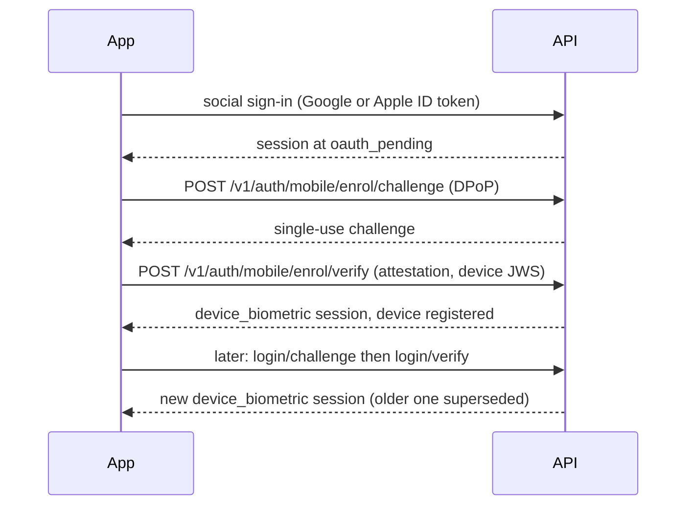
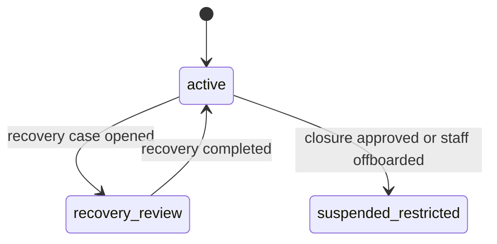
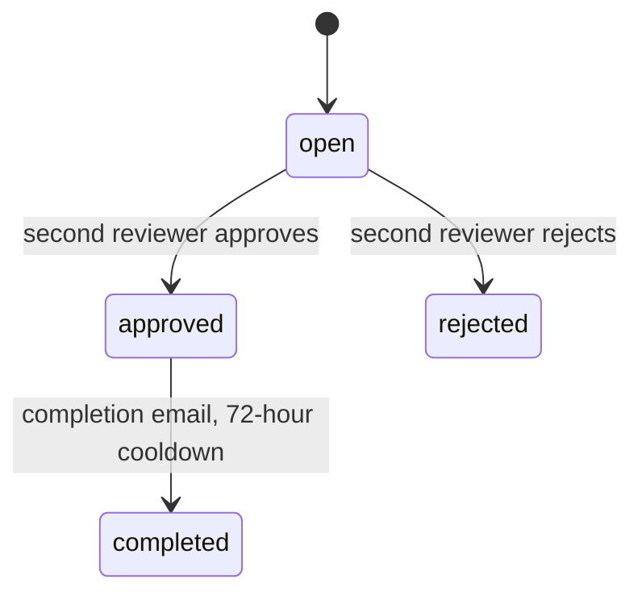
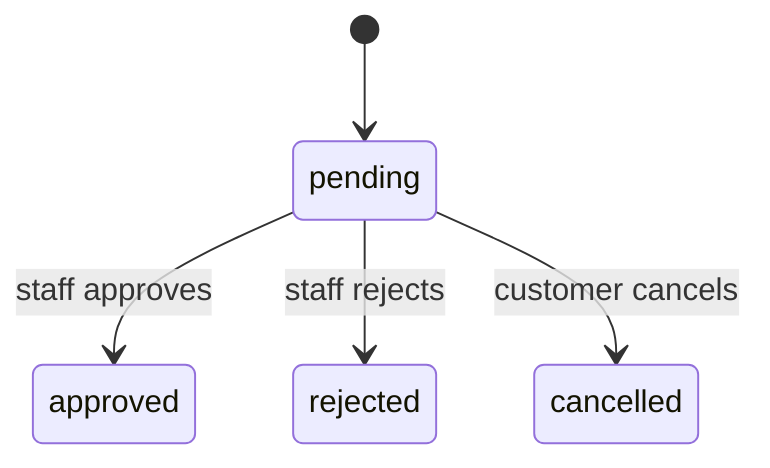

# Module: auth

Valid for main at 48aa967 (2026-11-18).

The `auth` module owns how people prove who they are to the API and what a session may do: customer sign-in with a device-bound key, staff sign-in with WebAuthn, sessions and their limits, DPoP proofs, fresh authentication, the staff roster and invitations, customer account recovery and closure, and the Better Auth configuration that backs all of it. It is the largest module (122 files, 14,604 lines). Read this page to find where an authentication change belongs; the behaviour of each flow is in [../authentication.md](../authentication.md) (customers) and [../staff-access.md](../staff-access.md) (staff).

## 1. Purpose and bounded context

| Question | Answer |
| --- | --- |
| What does the module own? | 37 routes of its own (18 customer, 19 staff, section 3.1), the Better Auth instances mounted at `/api/auth/*` (see [../api/better-auth.md](../api/better-auth.md)), four `maintenance` queues, and the tables of the `auth` database schema (section 4). |
| What is the rule for authentication code? | Authentication, session and login-method mechanics live only here, under `/v1/auth/*` and `/internal/v1/auth/*`. `response.locals.authContext` is set only in `src/modules/auth/api/shared/require-authentication.ts:86-95`; other routers receive the middleware by injection and only read the context (`AGENTS.md`). |
| Two populations | `customer` and `staff_partner`. The population is a field of the Better Auth user (`src/modules/auth/api/shared/auth-context.ts:1-13`). |
| Authentication levels | `unassured`, `oauth_pending`, `staff_passkey`, `device_biometric` (`src/modules/auth/infrastructure/shared/better-auth.factory.ts:25-30`). A customer reaches `/v1` only with `device_biometric`; staff only with `staff_passkey` (see [../authentication.md](../authentication.md)). |
| What does it not own? | The account row and its status values (`account`, see [account.md](account.md)); KYC (`identity`); the use of fresh authentication by other routes (the wallet, offering and session routes consume `requireFreshAuthentication`); sending mail (`src/infrastructure/email`). |
| What does it write outside its schema? | `account.accounts.status` (recovery, closure and offboarding, section 5.5) and `audit.audit_log`. It writes no `platform.settings` row. Better Auth owns four tables outside the Prisma models, `auth_user`, `auth_session`, `auth_account` and `auth_verification`; product code must not query them (`prisma/migrations/20260831154500_better_auth_core/migration.sql:1-3`, `src/modules/auth/infrastructure/shared/better-auth.factory.ts:162`, `:188`, `:215`, `:239`). |

## 2. File map

The tables are generated from the files; line counts were taken with `wc -l`. The module has four layers plus `infrastructure/`, which holds the Better Auth plugins and adapters (this module's own infrastructure, unlike `src/infrastructure`).

#### api

| File (under `src/modules/auth/`) | Lines | Responsibility |
| --- | --- | --- |
| `api/customer/account-closure.router.ts` | 73 | `createAccountClosureRouter`: `POST /` request and `POST /cancel`. |
| `api/customer/customer-session.router.ts` | 103 | `createCustomerSessionRouter`: list, revoke one, revoke all, revoke by device key. |
| `api/customer/customer-session.schemas.ts` | 29 | Session list and revoke schemas. |
| `api/customer/device-auth.router.ts` | 308 | `createAppConfigRouter` (`GET /config`) and `createDeviceAuthRouter` (enrolment and login challenge and verify). |
| `api/customer/device-auth.schemas.ts` | 73 | Schemas of the app config and the four ceremony routes. |
| `api/customer/device-replacement.router.ts` | 68 | `createDeviceReplacementRouter`: `POST /request`, `POST /verify`. |
| `api/customer/device-replacement.schemas.ts` | 7 | Replacement body schemas. |
| `api/customer/login-methods.router.ts` | 36 | `createLoginMethodsRouter`: `POST /:method_type/unlink`. |
| `api/customer/login-methods.schemas.ts` | 5 | Unlink params schema. |
| `api/customer/require-dpop-only.ts` | 96 | `createRequireDpopOnly`: DPoP proof without a session, for the challenge and config routes. |
| `api/customer/require-fresh-authentication.ts` | 49 | `createRequireFreshAuthentication` and `createFreshAuthenticationProbe`. |
| `api/customer/signing-requests.router.ts` | 329 | `createSigningRequestsRouter`: inbox, one request, challenge, sign. |
| `api/customer/signing-requests.schemas.ts` | 81 | Signing request schemas. |
| `api/shared/account-closure.schemas.ts` | 33 | Closure request and decision schemas. |
| `api/shared/auth-context.ts` | 13 | The `AuthContext` type placed in `response.locals`. |
| `api/shared/reject-disabled-auth.ts` | 47 | `rejectDisabledAuthRoutes`: the Express guard in front of `/api/auth/*`. |
| `api/shared/require-authentication.ts` | 248 | `createRequireAuthentication`: session, DPoP, account lookup, restriction check, rate limit, activity; sets `response.locals.authContext`. |
| `api/staff/account-closure-operations.router.ts` | 71 | `createAccountClosureOperationsRouter`: staff list and decision. |
| `api/staff/account-recovery.router.ts` | 172 | `createAccountRecoveryRouter`: the six recovery-case routes. |
| `api/staff/account-recovery.schemas.ts` | 64 | Recovery schemas. |
| `api/staff/require-staff-role.ts` | 134 | `createRequireAdminOperations`, `createRequireLegalPartner`, `createRequireAppraisalPartner`, `createRequireStaffIdentity`, `createRequireStaffWebAuthn`. |
| `api/staff/staff-account-lifecycle.router.ts` | 117 | `createStaffAccountLifecycleRouter`: roster, grant and revoke role, recovery, offboard. |
| `api/staff/staff-account-lifecycle.schemas.ts` | 77 | Lifecycle schemas. |
| `api/staff/staff-invitation-accept.router.ts` | 21 | `createPublicStaffInvitationRouter`: `POST /accept`. |
| `api/staff/staff-invitation-accept.schemas.ts` | 13 | Accept schema. |
| `api/staff/staff-invitation-issue.router.ts` | 47 | `createInternalStaffInvitationRouter`: `POST /`. |
| `api/staff/staff-invitation-issue.schemas.ts` | 33 | Issue schema. |
| `api/staff/staff-webauthn.router.ts` | 80 | `createStaffWebAuthnRouter`: registration and authentication options and verify. |
| `api/staff/staff-webauthn.schemas.ts` | 68 | WebAuthn schemas. |

#### application

| File (under `src/modules/auth/`) | Lines | Responsibility |
| --- | --- | --- |
| `application/customer/android-attestation-verifier.ts` | 705 | Verifies an Android key attestation chain or a Play Integrity verdict against the challenge binding. |
| `application/customer/authorize-signing-request.service.ts` | 168 | `AuthorizeSigningRequestService`: verifies the device signature over a signing request (T3). |
| `application/customer/cancel-signing-requests.service.ts` | 20 | `CancelPendingSigningRequestsForDeviceService`. |
| `application/customer/customer-session.service.ts` | 110 | `ListOwnSessionsService`, `RevokeOwnSessionService`, `RevokeAllOwnSessionsService`, `RevokeDeviceSessionsService`. |
| `application/customer/device-auth-errors.ts` | 67 | Device ceremony error classes. |
| `application/customer/device-auth-jws-verifier.ts` | 220 | `verifyDeviceAuthJws`: checks the device-signed JWS (purpose, DPoP binding, device id). |
| `application/customer/device-challenge-issuance.service.ts` | 62 | `IssueDeviceChallengeService`. |
| `application/customer/device-enrolment.service.ts` | 208 | `EnrolDeviceService` (E2). |
| `application/customer/device-login.service.ts` | 105 | `LoginDeviceService` (L2). |
| `application/customer/device-replacement.service.ts` | 233 | `RequestDeviceReplacementService`, `VerifyDeviceReplacementService`: emailed code that retires the old device. |
| `application/customer/login-method-unlinker.ts` | 19 | The port `LoginMethodUnlinker` and its errors. |
| `application/customer/mobile-attestation.schemas.ts` | 21 | `mobileAttestationSchema`. |
| `application/customer/prepare-signing-request.service.ts` | 33 | `PrepareSigningRequestService`: creates a signing request (called only by tests on main). |
| `application/customer/session-revoker.ts` | 16 | The port `SessionRevoker`. |
| `application/customer/signing-request-errors.ts` | 83 | Signing request error classes. |
| `application/customer/unlink-login-method.service.ts` | 41 | `UnlinkLoginMethodService`. |
| `application/shared/account-closure.service.ts` | 142 | `RequestAccountClosureService`, `CancelAccountClosureService`, `ListPendingAccountClosureRequestsService`, `DecideAccountClosureRequestService`. |
| `application/shared/auth-audit-sink.ts` | 18 | The port `AuthAuditSink` and the event type. |
| `application/shared/customer-account-administrator.ts` | 22 | The port `CustomerAccountAdministrator`. |
| `application/shared/dpop-proof-verifier.ts` | 281 | `verifyDpopProof`, `jktFingerprint`, `buildHtu`, DPoP errors. |
| `application/shared/session-mirror.ts` | 38 | The port `SessionMirror`. |
| `application/shared/session-resolver.ts` | 53 | The port `SessionResolver` and `AuthenticatedIdentity`. |
| `application/staff/account-recovery.service.ts` | 573 | `OpenAccountRecoveryCaseService`, `CreateRecoveryDiditSessionService`, `GetAccountRecoveryCaseService`, `RecordPrimaryRecoveryReviewService`, `DecideAccountRecoveryCaseService`, `CompleteAccountRecoveryService`. |
| `application/staff/staff-account-administrator.ts` | 21 | The port `StaffAccountAdministrator`. |
| `application/staff/staff-account-lifecycle.service.ts` | 234 | `RecoverStaffAccountService`, `OffboardStaffAccountService`, `ListStaffAccountsService`, `GrantStaffRoleService`, `RevokeStaffRoleService`. |
| `application/staff/staff-bootstrap.service.ts` | 126 | `BootstrapFirstAdminService`: the first-admin command. |
| `application/staff/staff-identity-provider.ts` | 7 | The port `StaffIdentityProvider`. |
| `application/staff/staff-invitation.service.ts` | 156 | `IssueStaffInvitationService`, `AcceptStaffInvitationService`, token generation and hashing. |
| `application/staff/staff-mfa-session-verifier.ts` | 3 | The port `StaffMfaSessionVerifier`. |
| `application/staff/staff-webauthn.ceremony.ts` | 42 | The port `StaffWebAuthnCeremony`. |
| `application/staff/staff-webauthn.service.ts` | 253 | `StaffWebAuthnService`. |

#### domain

| File (under `src/modules/auth/`) | Lines | Responsibility |
| --- | --- | --- |
| `domain/device-binding.ts` | 14 | `computeDeviceBinding`: SHA-256 of challenge and key thumbprint. |
| `domain/device-challenge-replay.ts` | 40 | Replay and enrolment insert windows (120 s, 60 s). |
| `domain/device-label.ts` | 31 | `deriveDeviceLabel`. |
| `domain/device-session-lifetime.ts` | 56 | Idle 5 min, absolute 30 min; `evaluateDeviceSessionLifetime`. |
| `domain/device-session-supersede.ts` | 71 | `sessionsToSupersede`: one live session per device key. |
| `domain/disabled-auth-routes.ts` | 96 | `isCanonicalAuthPath`, `isDisabledAuthPath`: which `/api/auth/*` paths stay off the wire. |
| `domain/fresh-authentication.ts` | 32 | `isFreshDeviceSession`, `FRESH_AUTH_WINDOW_MS` (5 min). |
| `domain/mobile-platform.policy.ts` | 34 | Platform policy; `ANDROID_ONLY_MOBILE_PLATFORM_POLICY`. |
| `domain/session-liveness.ts` | 60 | `canSessionStillAuthenticate`. |
| `domain/signing-request.policy.ts` | 251 | Status machine and `tx` claim comparison of a signing request. |

#### infrastructure

| File (under `src/modules/auth/`) | Lines | Responsibility |
| --- | --- | --- |
| `infrastructure/customer/apple-client-secret.ts` | 23 | `createAppleClientSecret`. |
| `infrastructure/customer/better-auth-customer-account-administrator.ts` | 114 | `BetterAuthCustomerAccountAdministrator`. |
| `infrastructure/customer/better-auth-device-auth.plugin.ts` | 476 | The Better Auth plugin that runs the enrolment and login ceremonies. |
| `infrastructure/customer/better-auth-device-session-lifetime.plugin.ts` | 240 | Applies the device session limits and `REAUTH_REQUIRED`. |
| `infrastructure/customer/better-auth-fresh-authentication.plugin.ts` | 98 | Before-hook: fresh authentication for `/api/auth` unlink and revoke endpoints. |
| `infrastructure/customer/better-auth-login-method-unlinker.ts` | 58 | `BetterAuthLoginMethodUnlinker`. |
| `infrastructure/customer/better-auth-registration-account-guard.plugin.ts` | 64 | Before-hook on `/unlink-account`: refuses to unlink the earliest-linked sign-in account, the one used to register (`REGISTRATION_LOGIN_METHOD_LOCKED`). |
| `infrastructure/customer/better-auth-session-revoker.ts` | 54 | `BetterAuthSessionRevoker`. |
| `infrastructure/customer/device-ceremony-session.ts` | 37 | Marks discarded and superseded ceremony sessions. |
| `infrastructure/customer/device-login-audit-context.ts` | 14 | Carries the verified DPoP key to the audit hook. |
| `infrastructure/customer/google-play-integrity.decoder.ts` | 107 | `GooglePlayIntegrityDecoder`: Play Integrity token decode over HTTP. |
| `infrastructure/customer/http-android-attestation-revocation-list.ts` | 68 | `HttpAndroidAttestationRevocationList`. |
| `infrastructure/shared/better-auth-audit.plugin.ts` | 492 | Audit hooks for login, session and password events; feeds `AccountProvisioner.onLoginMethodUsed`. |
| `infrastructure/shared/better-auth-disabled-routes.plugin.ts` | 31 | Blocks disabled routes inside Better Auth. |
| `infrastructure/shared/better-auth-dpop.plugin.ts` | 112 | DPoP binding at session creation. |
| `infrastructure/shared/better-auth-hook-session.ts` | 102 | Resolves the session (cookie or signed bearer) inside a hook. |
| `infrastructure/shared/better-auth-passkey-challenge-header.plugin.ts` | 144 | Cookie-free passkey challenge relay for staff. |
| `infrastructure/shared/better-auth-session.resolver.ts` | 141 | `BetterAuthSessionResolver`: implements `SessionResolver`. |
| `infrastructure/shared/better-auth.cli.ts` | 16 | A Better Auth instance for the Better Auth CLI; imported by nothing. |
| `infrastructure/shared/better-auth.factory.ts` | 715 | `createBetterAuth`: the Better Auth configuration and plugin order; `AUTHENTICATION_LEVELS`. |
| `infrastructure/shared/dpop-session-creation.ts` | 325 | DPoP rules at session creation. |
| `infrastructure/shared/passkey-bootstrap.ts` | 38 | Staff passkey bootstrap context. |
| `infrastructure/shared/prisma-session-mirror.ts` | 74 | `PrismaSessionMirror`: the `auth.sessions` mirror. |
| `infrastructure/staff/better-auth-staff-account-administrator.ts` | 109 | `BetterAuthStaffAccountAdministrator`. |
| `infrastructure/staff/better-auth-staff-account-guard.plugin.ts` | 140 | Before-create hook on every session (`:36-68`): refuses one made outside an authentication endpoint (`SESSION_CONTEXT_REQUIRED`), an OAuth sign-in with an unverified provider email (`OAUTH_EMAIL_NOT_VERIFIED`, also checked on user creation at `better-auth.factory.ts:248-256`), a disabled staff user (`STAFF_ACCOUNT_DISABLED`), a staff user awaiting recovery except through passkey registration (`STAFF_ACCOUNT_RECOVERY_REQUIRED`) and a staff session made by anything but a passkey ceremony (`STAFF_PASSKEY_REQUIRED`). |
| `infrastructure/staff/better-auth-staff-identity.provider.ts` | 105 | `BetterAuthStaffIdentityProvider`: creates the invited user. |
| `infrastructure/staff/simple-webauthn.ceremony.ts` | 115 | `SimpleWebAuthnCeremony` over SimpleWebAuthn. |

#### repository

| File (under `src/modules/auth/`) | Lines | Responsibility |
| --- | --- | --- |
| `repository/customer/customer-session.repository.ts` | 30 | `CustomerSessionRepository` interface. |
| `repository/customer/device-challenge.repository.ts` | 61 | `DeviceChallengeRepository` interface. |
| `repository/customer/device-replacement.repository.ts` | 82 | `DeviceReplacementRepository` interface. |
| `repository/customer/device.repository.ts` | 59 | `DeviceRepository` interface. |
| `repository/customer/prisma-customer-session.repository.ts` | 95 | `PrismaCustomerSessionRepository`. |
| `repository/customer/prisma-device-challenge.repository.ts` | 87 | `PrismaDeviceChallengeRepository`. |
| `repository/customer/prisma-device-replacement.repository.ts` | 243 | `PrismaDeviceReplacementRepository`. |
| `repository/customer/prisma-device.repository.ts` | 231 | `PrismaDeviceRepository`. |
| `repository/customer/prisma-signing-request.repository.ts` | 213 | `PrismaSigningRequestRepository`. |
| `repository/customer/signing-request.repository.ts` | 68 | `SigningRequestRepository` interface. |
| `repository/shared/account-closure.repository.ts` | 62 | `AccountClosureRepository`, `PendingClosureRequestReader`. |
| `repository/shared/dpop-replay.repository.ts` | 6 | `DpopReplayRepository` interface. |
| `repository/shared/prisma-account-closure.repository.ts` | 173 | `PrismaAccountClosureRepository`. |
| `repository/shared/prisma-auth-audit-sink.ts` | 49 | `PrismaAuthAuditSink`. |
| `repository/shared/prisma-dpop-replay.repository.ts` | 27 | `PrismaDpopReplayRepository`. |
| `repository/staff/account-recovery.repository.ts` | 113 | `AccountRecoveryRepository` interface. |
| `repository/staff/prisma-account-recovery.repository.ts` | 456 | `PrismaAccountRecoveryRepository`. |
| `repository/staff/prisma-staff-account-lifecycle.repository.ts` | 297 | `PrismaStaffAccountLifecycleRepository`. |
| `repository/staff/prisma-staff-bootstrap.repository.ts` | 161 | `PrismaStaffBootstrapRepository`. |
| `repository/staff/prisma-staff-invitation.repository.ts` | 231 | `PrismaStaffInvitationRepository`. |
| `repository/staff/prisma-staff-webauthn.repository.ts` | 353 | `PrismaStaffWebAuthnRepository`. |
| `repository/staff/staff-account-lifecycle.repository.ts` | 66 | `StaffAccountLifecycleRepository` interface. |
| `repository/staff/staff-bootstrap.repository.ts` | 39 | `StaffBootstrapRepository` interface. |
| `repository/staff/staff-invitation.repository.ts` | 49 | `StaffInvitationRepository` interface. |
| `repository/staff/staff-webauthn.repository.ts` | 81 | `StaffWebAuthnRepository` interface. |
Wiring: `src/server.ts` builds two Better Auth instances with `createBetterAuth`, the customer instance `auth` (`src/server.ts:309`) and `staffProvisioningAuth` (`src/server.ts:370`), the session resolver (`src/server.ts:482`), the session mirror (`src/server.ts:308`), the device, device-challenge and device-replacement repositories (`src/server.ts:250-252`), the signing-request repositories (`src/server.ts:646`, `:651`, `:721`) and the staff repositories (`src/server.ts:136-138`). `src/app.ts` builds the middlewares (`src/app.ts:597-641`) and mounts every router (section 3.1). The plugin order inside `createBetterAuth` is disabled routes, `expo()`, `bearer({ requireSignature: true })`, device session lifetime, DPoP (when configured), device auth (when configured), passkey challenge header, `passkey()`, staff account guard, fresh authentication, registration account guard and audit (when a sink is given) (`src/modules/auth/infrastructure/shared/better-auth.factory.ts:298-452`).

> Pending #237: the auth mounts move from `src/app.ts` into `src/composition/compose-customer-auth.ts`, `compose-staff-auth.ts` and `compose-protected-api.ts`; no router, service or repository changes.

## 3. Public surface

### 3.1 Routes

Entries with bodies and errors are in [../api/auth-customer.md](../api/auth-customer.md), [../api/auth-staff.md](../api/auth-staff.md) and [../api/better-auth.md](../api/better-auth.md).

| Prefix (mount) | Routes | Guard |
| --- | --- | --- |
| `/api/auth/*` (`src/app.ts:568-575`) | Better Auth's own endpoints: social sign-in, passkey ceremonies, session endpoints and the routes the plugins add. Every request first passes `rejectDisabledAuthRoutes`, then the tightened rate limiter. | none at the router; each endpoint and plugin decides |
| `/v1/app` (`src/app.ts:777`) | `GET /config` | DPoP proof only (`createRequireDpopOnly`) |
| `/v1/auth/mobile` (`src/app.ts:778-790`) | `POST /enrol/challenge`, `/enrol/verify`, `/login/challenge`, `/login/verify` (`src/modules/auth/api/customer/device-auth.router.ts:163-231`) | DPoP proof; tightened limiter and a limiter keyed on the DPoP key |
| `/v1/auth/mobile/replacement` (`src/app.ts:814-825`) | `POST /request`, `POST /verify` | `requireAuthentication` |
| `/v1/auth/sessions` (`src/app.ts:893-906`) | `GET /`, `POST /revoke-all`, `POST /:session_id/revoke`, `POST /devices/:jkt/revoke` | `requireAuthentication`; the three revokes also `requireFreshAuthentication` |
| `/v1/auth/login-methods` (`src/app.ts:736-743`) | `POST /:method_type/unlink` | `requireAuthentication`, `requireFreshAuthentication` |
| `/v1/auth/signing-requests` (`src/app.ts:795-810`) | `GET /`, `GET /:request_id`, `POST /:request_id/challenge`, `POST /:request_id/sign` | `requireAuthentication`; mounted only when the app config flag `signing_requests` is true, and `src/server.ts:665` hard-codes it to `false` |
| `/v1/auth/account-closure` (`src/app.ts:1026-1033`) | `POST /`, `POST /cancel` | `requireAuthentication` |
| `/internal/v1/auth/webauthn` (`src/app.ts:1045-1053`) | `POST /registration/options`, `/registration/verify`, `/authentication/options`, `/authentication/verify` | `requireAuthentication`, `requireStaffIdentity`; tightened limiter |
| `/v1/auth/staff-invitations` (`src/app.ts:948-952`) | `POST /accept` | none (token in the body); tightened limiter |
| `/internal/v1/auth/staff-invitations` (`src/app.ts:953-961`) | `POST /` | admin operations and staff WebAuthn |
| `/internal/v1/auth/staff-accounts` (`src/app.ts:965-984`) | `GET /`, `POST /:account_id/roles`, `POST /:account_id/roles/:assignment_id/revoke`, `POST /:account_id/recovery`, `POST /:account_id/offboard` | admin operations and staff WebAuthn |
| `/internal/v1/account-recovery-cases` (`src/app.ts:988-1022`) | `POST /`, `GET /:case_id`, `POST /:case_id/didit-sessions`, `/primary-review`, `/decision`, `/complete` | admin operations and staff WebAuthn |
| `/internal/v1/account-closure-requests` (`src/app.ts:1034-1043`) | `GET /`, `POST /:request_id/decision` | admin operations and staff WebAuthn |

Counts: 18 customer routes (`device-auth` 5, `customer-session` 4, `signing-requests` 4, `account-closure` 2, `device-replacement` 2, `login-methods` 1) and 19 staff routes (`account-recovery` 6, `staff-account-lifecycle` 5, `staff-webauthn` 4, `account-closure-operations` 2, one each for invitation issue and accept), counted from the router files. The auth routes mount no shared `Idempotency-Key` middleware. The staff chain is always `requireAuthentication`, then the role guard, then `requireStaffWebAuthn` (`src/modules/auth/api/staff/require-staff-role.ts:92-116`), which answers `403 authentication.staff_mfa_required` for a session without a completed WebAuthn ceremony.

> Pending #234: `POST /v1/auth/sessions/devices/:jkt/revoke` cancels only the caller's own signing requests; on main the cancellation is not scoped to the caller.

> Pending #245 (stacked on #244, which adds `sendValidated` and changes no auth router): ten auth routers, every one except `device-replacement` and `login-methods`, send their body through `sendValidated`, so a body that fails its response schema becomes `500 internal.response_invalid` instead of `422 validation.invalid_field`.

### 3.2 Middlewares other modules use

| Middleware | What it does | Used by |
| --- | --- | --- |
| `createRequireAuthentication` | Resolves the session (cookie or signed bearer), enforces the DPoP proof of a bound session or binds an unbound one, finds the account (`500 account.mapping_missing`), refuses a non-active account (`403 account.restricted`), sets `authContext`, runs the rate limiter, records session activity (`src/modules/auth/api/shared/require-authentication.ts:39-129`) | every `/v1` and `/internal/v1` route |
| `createRequireFreshAuthentication`, `createFreshAuthenticationProbe` | A customer `device_biometric` session created within five minutes is fresh; others get `403 authentication.fresh_auth_required`; the probe returns a boolean (`src/modules/auth/api/customer/require-fresh-authentication.ts`, `src/modules/auth/domain/fresh-authentication.ts:10-32`) | reservation, reconfirm, session revoke, unlink, and (probe) wallet registration |
| `createRequireAdminOperations`, `createRequireLegalPartner`, `createRequireAppraisalPartner`, `createRequireStaffIdentity`, `createRequireStaffWebAuthn` | Role and MFA checks over `AccountRepository.hasActiveStaffRole` and the WebAuthn repository (`src/modules/auth/api/staff/require-staff-role.ts`) | every staff route in every module |
| `createRequireDpopOnly` | DPoP proof without a session (`src/modules/auth/api/customer/require-dpop-only.ts`) | config and ceremony challenge routes |

### 3.3 Jobs and queues

| Queue | Kind | Schedule (UTC) | Work | Owner, tier |
| --- | --- | --- | --- | --- |
| `maintenance.dpop_replay_prune` | scheduled | `0 * * * *` (`src/worker.ts:549`) | deletes expired DPoP replay rows (`src/worker.ts:784-789`) | platform, `tier_2` |
| `maintenance.device_challenge_prune` | scheduled | `0 * * * *` (`src/worker.ts:553`) | prunes expired device challenges (`src/worker.ts:790-796`) | platform, `tier_2` |
| `maintenance.signing_request_prune` | scheduled | `0 * * * *` (`src/worker.ts:561`) | expires and prunes signing requests (`src/worker.ts:797-804`) | platform, `tier_2` |
| `maintenance.account_recovery_alert` | scheduled | `*/15 * * * *` (`src/worker.ts:580`) | logs a warning while recovery cases stay open past `ACCOUNT_RECOVERY_ALERT_AFTER_HOURS` (`src/worker.ts:820-827`) | identity, `tier_1` |

The four handlers are written inline in `src/worker.ts`. Retries and dead-lettering: [../jobs-and-workers.md](../jobs-and-workers.md). The module enqueues no job for another module.

### 3.4 Commands

`npm run staff:bootstrap-first-admin -- --email <email> --display-name <name>` (and `-- --check`) creates the first `admin_operations` member. It runs in a shell inside the API container, has no HTTP equivalent, and exits 0 done, 1 refused (an admin exists) or failed, 2 bad arguments (`package.json:15`, `src/cli/bootstrap-first-admin.ts:1-16`). It takes a Postgres advisory lock (`STAFF_BOOTSTRAP_ADVISORY_LOCK_KEY`, `src/modules/auth/repository/staff/prisma-staff-bootstrap.repository.ts`). All commands are listed in [../cli.md](../cli.md).

### 3.5 Audit rows

The Better Auth audit plugin writes login, session, password and passkey events through `PrismaAuthAuditSink` (`src/modules/auth/infrastructure/shared/better-auth-audit.plugin.ts`, `src/modules/auth/repository/shared/prisma-auth-audit-sink.ts`); the repositories write the staff and recovery rows inside their transactions, for example `authentication.customer_account_closed` and `authentication.customer_closure_request_rejected` (`src/modules/auth/repository/shared/prisma-account-closure.repository.ts:119-135`) and, for recovery, `didit_gate_waived` when the Didit gate was bypassed (`src/modules/auth/repository/staff/prisma-account-recovery.repository.ts:204`). The action vocabulary is listed in [../data-model.md](../data-model.md) and [../staff-access.md](../staff-access.md).

## 4. Tables

| Table | Access | Notes |
| --- | --- | --- |
| `auth.devices`, `auth.device_challenges`, `auth.device_replacement_codes` | read, insert, update, delete | Device-bound login: one DPoP key per device (unique), single-use challenges, emailed replacement codes (`prisma/schema/auth.prisma:228-307`). |
| `auth.signing_requests` | read, insert, update | Per-action signing (dormant on main) (`prisma/schema/auth.prisma:319-342`). |
| `auth.sessions` | read, insert, update | The product-facing mirror of Better Auth sessions; Better Auth's own `auth_session` row decides whether a session can still authenticate (`src/modules/auth/domain/session-liveness.ts:3-7`, `prisma/schema/auth.prisma:127-159`). |
| `auth.dpop_replays` | insert, delete | One row per seen `(jkt, jti)`; pruned hourly (`prisma/schema/auth.prisma:212-221`). |
| `auth.login_methods` | read, insert, delete | Linked methods (`passkey`, `google`, `apple`, `device_key`); inserted by `account` (`src/modules/account/repository/prisma-account.repository.ts:110`) and the device enrolment (`src/modules/auth/repository/customer/prisma-device.repository.ts:102`). Only `device_key` rows are deleted, by device revocation, device replacement and recovery (`prisma-device.repository.ts:178`, `prisma-device-replacement.repository.ts:137`, `prisma-account-recovery.repository.ts:335`); unlinking a method removes Better Auth's own `auth_account` row and deletes no row here (`src/modules/auth/infrastructure/customer/better-auth-login-method-unlinker.ts:21-49`) (`prisma/schema/auth.prisma:111-125`). |
| `auth.staff_role_assignments`, `auth.staff_invitations`, `auth.staff_webauthn_credentials`, `auth.staff_webauthn_challenges`, `auth.staff_session_mfa` | read, insert, update | Staff roles (`admin_operations`, `legal_partner`, `appraisal_partner`), 72-hour invitations stored as SHA-256 hashes, credentials, one-time challenges, the per-session WebAuthn completion (`prisma/schema/auth.prisma:1-109`). |
| `auth.account_recovery_cases`, `auth.account_closure_requests` | read, insert, update | Section 5.5 (`prisma/schema/auth.prisma:161-205`). |
| `account.accounts` | update | `status` (`recovery_review`, `active`, `suspended_restricted`). |
| `audit.audit_log` | insert | Section 3.5. |
| `auth_user`, `auth_session`, `auth_account`, `auth_verification` | Better Auth only | Not modelled in Prisma. |

Model definitions are in [../data-model.md](../data-model.md).

## 5. Domain rules and state machines

### 5.1 Time and freshness rules

| Rule | Where |
| --- | --- |
| A device session ends 5 minutes after its last activity or 30 minutes after creation, whichever comes first; there is no renewal; either limit answers `REAUTH_REQUIRED`. Staff and web sessions use Better Auth's own expiry. | `src/modules/auth/domain/device-session-lifetime.ts:1-56` |
| A customer session is "fresh" for 5 minutes after creation, and only a `device_biometric` session qualifies. | `src/modules/auth/domain/fresh-authentication.ts:10-32` |
| A device challenge is single-use; a replay answers `DEVICE_CHALLENGE_REPLAYED` for 120 seconds after consumption, a device row can be inserted only within 60 seconds of it, all on the database clock. | `src/modules/auth/domain/device-challenge-replay.ts:1-40` |
| Only the newest live `device_biometric` session of one DPoP key survives a successful device ceremony. | `src/modules/auth/domain/device-session-supersede.ts:21-52` |
| The attestation and integrity calls sign over SHA-256 of the challenge, a dot and the biometric key thumbprint. | `src/modules/auth/domain/device-binding.ts:3-14` |
| Customer platforms: Android is supported, iOS is not (`ANDROID_ONLY_MOBILE_PLATFORM_POLICY`); the advertised flags are derived from the same policy. | `src/modules/auth/domain/mobile-platform.policy.ts:9-34`, `src/server.ts:279` |
| A session is alive per Better Auth's own row, not per the mirror's status. | `src/modules/auth/domain/session-liveness.ts:1-60` |
| Paths under `/api/auth` that URL parsing could rewrite are refused before routing; a fixed set of endpoints is disabled (any path containing `password`, email sign-in and sign-up, email OTP, passkey delete, the Expo authorization proxy). | `src/modules/auth/domain/disabled-auth-routes.ts:1-96` |
| A staff invitation lives 72 hours and is stored only as a SHA-256 hash. | `src/modules/auth/application/staff/staff-invitation.service.ts:9` |

### 5.2 Customer device ceremony

The enrolment verifies an Android key attestation or a Play Integrity verdict bound to the challenge and the biometric key, and a device-signed JWS bound to the DPoP key (`src/modules/auth/application/customer/device-enrolment.service.ts`, `src/modules/auth/application/customer/android-attestation-verifier.ts`, `src/modules/auth/application/customer/device-auth-jws-verifier.ts`). Details, error codes and the plan: [../authentication.md](../authentication.md), [../plans/device-bound-auth-backend.md](../plans/device-bound-auth-backend.md).

### 5.3 Signing requests (dormant)

Status machine: `pending`, `signed`, `executed`, with `expired` and `cancelled` as stops from `pending` or `signed`; `submitted` and `included` are reserved for on-chain types. The device signs a `tx` claim whose destination (`wallet`, `iban`, `contract`) and creator (`user`, `platform`, `staff`) vocabulary is closed, and the server compares the claims field by field before it accepts (`src/modules/auth/domain/signing-request.policy.ts:9-60`, `compareTxClaimsToRequest` at `:108`). Nothing on main creates a request outside tests (`PrepareSigningRequestService` has no caller in `src`), and the routes are not mounted (section 3.1).

### 5.4 Staff access

A staff session needs WebAuthn per session: the account's role is checked first, then `requireStaffWebAuthn` looks for a completed `auth.staff_session_mfa` row. Invitations are issued by a verified admin, accepted once through a token, and the invited user then enrols a first credential. Recovery revokes sessions and credentials before sending the reset; offboarding disables login, revokes roles, sessions and credentials; an admin cannot act on their own account (`authentication.staff_account_self_action_forbidden`, `src/modules/auth/application/staff/staff-account-lifecycle.service.ts:210`). Adding a credential beyond the first needs an already verified session (`src/modules/auth/application/staff/staff-webauthn.service.ts:25`, `:202-215`). The full description is in [../staff-access.md](../staff-access.md).

### 5.5 Recovery and closure

`account.status` as changed by recovery, closure and staff offboarding:

Recovery case:

Closure request:

| Rule | Where |
| --- | --- |
| Opening a recovery case revokes every session, then sets the account to `recovery_review`, which blocks all authenticated requests (`403 account.restricted`). | `src/modules/auth/application/staff/account-recovery.service.ts:42`, `src/modules/auth/repository/staff/prisma-account-recovery.repository.ts:80-83`, `src/modules/auth/api/shared/require-authentication.ts:77-84` |
| Two different reviewers are required, enforced in the repository; a primary review precedes the decision. | `src/modules/auth/repository/staff/prisma-account-recovery.repository.ts:166-247` |
| For a customer, completion first revokes the active devices, removes the `device_key` login methods, ends every remaining session and clears the recovery flag, then returns the account to `active` and records a cooldown end 72 hours ahead. The reservation blocker `recovery_cooldown_active` reads that column through the offering repository's own query; `AccountRecoveryRepository.getActiveCooldown` has no caller in `src`, only in tests. | `src/modules/auth/application/staff/account-recovery.service.ts:15`, `:226-239`, `:376-421`, `src/modules/auth/repository/staff/prisma-account-recovery.repository.ts:280-292`, `:311-337`, `src/modules/offering/repository/prisma-offering.repository.ts:436-441`, `:563`, `src/modules/offering/domain/reservation-eligibility.policy.ts:202-204` |
| A closure request is single-review; approval sets the account to `suspended_restricted`. | `src/modules/auth/repository/shared/prisma-account-closure.repository.ts:92-138`, `prisma/schema/auth.prisma:184-195` |
| Two switches exist for staging only (`APP_ENV=staging`): single-reviewer mode and skipping the Didit step. | `src/config/environment.ts:553-570`, `src/app.ts:1004-1014` |

> Pending #238: `ACCOUNT_RECOVERY_SINGLE_REVIEWER_MODE`, `singleReviewerMode`, `allowSameReviewer` and the staging single-reviewer behaviour are removed; same-reviewer refusal stays.

The flow and its policy are in [../account-recovery.md](../account-recovery.md).

## 6. Interaction with other modules

| Other module | Direction | How |
| --- | --- | --- |
| `account` | auth reads and writes | `AccountRepository` (`findByBetterAuthUserId`, `hasActiveStaffRole`, `hasAnyActiveStaffRole`, `getActivePartnerOrganizationId`) is injected into the middlewares; five `import type` statements (see [account.md](account.md)). `AccountProvisioner` is called from the Better Auth user hooks (`src/modules/auth/infrastructure/shared/better-auth.factory.ts:258-266`, wired at `src/server.ts:357-359` and `:378-379`). Recovery, closure and offboarding write `account.accounts.status`. |
| `identity` | auth uses a port | Recovery takes the `DiditClient` type from identity's application layer (`src/modules/auth/application/staff/account-recovery.service.ts:5`) and reuses the baseline workflow (`src/server.ts:402`). |
| `profile` | profile reads | `PendingClosureRequestReader` from `src/modules/auth/repository/shared/account-closure.repository.ts` (see [profile.md](profile.md)). |
| `wallet`, `offering` | they use middlewares | Fresh-authentication middleware and probe are built here, injected in `src/app.ts`. |
| `intake` | intake uses guards | Role guards and the partner assignment check. |
| Jobs | none across modules | The four `maintenance` queues are auth-internal. |

## 7. Configuration

| Variable | Effect |
| --- | --- |
| `BETTER_AUTH_URL`, `BETTER_AUTH_SECRET`, `AUTH_TRUSTED_ORIGINS` | Base URL, signing secret and trusted origins of the Better Auth instances. |
| `WEBAUTHN_RP_NAME`, `WEBAUTHN_RP_ID`, `WEBAUTHN_ORIGIN` and the `PASSKEY_*` values | Relying party of the staff ceremonies and the association files; `BETTER_AUTH_URL`'s host must equal or be under `WEBAUTHN_RP_ID` (`src/config/environment.ts:535-552`). |
| `DPOP_PHASE1_CUTOVER_AT` | The line between sessions that may still bind opportunistically and ones where an unbound session presenting a proof is an anomaly (`src/modules/auth/api/shared/require-authentication.ts:28-35`). |
| `PLAY_INTEGRITY_POLICY`, `PLAY_INTEGRITY_CLOUD_PROJECT_NUMBER`, `PLAY_INTEGRITY_SERVICE_ACCOUNT_JSON`, `ANDROID_ATTESTATION_CERT_DIGESTS`, `ANDROID_ATTESTATION_ROOT_CERTIFICATES` | Android attestation and integrity. |
| `GOOGLE_OAUTH_ENABLED`, `GOOGLE_CLIENT_ID`, `GOOGLE_CLIENT_SECRET`, `APPLE_OAUTH_ENABLED`, `APPLE_*` | Social sign-in. |
| `STAFF_INVITATION_ACCEPT_URL`, `STAFF_RECOVERY_REDIRECT_URL`, `ACCOUNT_RECOVERY_REDIRECT_URL` | Links in invitation and recovery emails. |
| `ACCOUNT_RECOVERY_SINGLE_REVIEWER_MODE`, `ACCOUNT_RECOVERY_SKIP_DIDIT_IN_STAGING` | Staging only; refused unless `APP_ENV=staging` (`src/config/environment.ts:553-570`). |
| `ACCOUNT_RECOVERY_ALERT_AFTER_HOURS` | Threshold of the recovery alert job. |
| `DEVICE_REPLACEMENT_CODE_TTL_MINUTES`, `DEVICE_REPLACEMENT_MAX_ATTEMPTS`, `DEVICE_REPLACEMENT_COOLDOWN_HOURS`, `DEVICE_REPLACEMENT_RATE_LIMIT_PER_HOUR` | Device replacement code. |
| `RATE_LIMIT_CACHE_URL`, `TRUST_PROXY` | The limiters inside and in front of the auth routes. |

> Pending #238: `ACCOUNT_RECOVERY_SINGLE_REVIEWER_MODE` is removed from the environment schema, `.env.example` and the staging compose file; `ACCOUNT_RECOVERY_SKIP_DIDIT_IN_STAGING` stays.

The full list is in [../configuration.md](../configuration.md).

## 8. Existing guides

[../authentication.md](../authentication.md), [../staff-access.md](../staff-access.md), [../account-recovery.md](../account-recovery.md), [../plans/device-bound-auth-backend.md](../plans/device-bound-auth-backend.md). The wire contract in section 3 of that plan must stay byte-identical with the mobile plan (`AGENTS.md`).

## 9. Tests

| Area | Files |
| --- | --- |
| Middlewares | `tests/require-authentication.test.ts`, `tests/require-authentication-dpop.test.ts`, `tests/require-authentication-session-lifetime.test.ts`, `tests/require-fresh-authentication.test.ts`, `tests/fresh-authentication.test.ts`, `tests/fresh-authentication-probe.test.ts`, `tests/require-dpop-only.test.ts`, `tests/reject-disabled-auth.test.ts` |
| Domain | `tests/device-session-lifetime.test.ts`, `tests/device-session-supersede.test.ts`, `tests/session-liveness.test.ts`, `tests/signing-request-policy.test.ts`, `tests/disabled-auth-routes.test.ts`, `tests/mobile-auth-platform-flags.test.ts`, `tests/device-label.test.ts` |
| Device auth | `tests/device-auth-router.test.ts`, `tests/device-auth-router-dispatch-shape.test.ts`, `tests/device-auth-plugin-error-mapping.test.ts`, `tests/device-auth-jws-verifier.test.ts`, `tests/device-auth-jws-verifier-device-id.test.ts`, `tests/device-enrolment-service.test.ts`, `tests/device-login-service.test.ts`, `tests/device-challenge-issuance-service.test.ts`, `tests/device-replacement.service.test.ts`, `tests/android-attestation-verifier.test.ts`, `tests/google-play-integrity-decoder.test.ts`, `tests/http-android-attestation-revocation-list.test.ts`, `tests/dpop-proof-verifier.test.ts` |
| Device auth against a database | `tests/device-challenge-replay.integration.test.ts`, `tests/device-enrolment-insert-deadline.integration.test.ts`, `tests/device-enrolment-order.integration.test.ts`, `tests/device-key-login-method.integration.test.ts`, `tests/device-session-lifetime.integration.test.ts`, `tests/device-session-supersede.integration.test.ts`, `tests/device-ceremony-session-cleanup.integration.test.ts`, `tests/device-auth-dpop-replay-integration.test.ts`, `tests/device-auth-router-login-verify.integration.test.ts`, `tests/better-auth-bearer-dpop.integration.test.ts` |
| Better Auth plugins and factory | the `tests/better-auth-*.test.ts` files (audit, bearer, cross-subdomain cookie, device ceremony cleanup, session lifetime, disabled routes, hook session, passkey, registration guard, session resolver and revoker, staff guard, unlinker) |
| Sessions and signing | `tests/customer-session-api.test.ts`, `tests/customer-session-service.test.ts`, `tests/prisma-customer-session.repository.integration.test.ts`, `tests/prisma-session-mirror.test.ts`, `tests/signing-requests-router.test.ts`, `tests/signing-request-services.test.ts`, `tests/authorize-signing-request.service.test.ts`, `tests/login-methods-api.test.ts` |
| Closure and recovery | `tests/account-closure-api.test.ts`, `tests/account-closure-operations-api.test.ts`, `tests/account-closure-service.test.ts`, `tests/account-recovery-service.test.ts`, `tests/account-recovery-repository.integration.test.ts`, `tests/customer-recovery-completion.integration.test.ts`, `tests/customer-recovery-flag-constraint.integration.test.ts` |
| Staff | `tests/staff-webauthn.service.test.ts`, `tests/staff-webauthn-repository.integration.test.ts`, `tests/simple-webauthn-ceremony.test.ts`, `tests/staff-invitation.service.test.ts`, `tests/staff-account-lifecycle.service.test.ts`, `tests/staff-account-lifecycle.integration.test.ts`, `tests/staff-account-roster-api.test.ts`, `tests/staff-bootstrap.service.test.ts`, `tests/staff-bootstrap-repository.integration.test.ts`, `tests/staff-bootstrap-isolation.test.ts` |
| Environment | `tests/webauthn-environment.test.ts`, `tests/oauth-environment.test.ts`, `tests/play-integrity-environment.test.ts` |

Integration files skip without `TEST_DATABASE_URL`; see [../testing.md](../testing.md). No test runs against a real Google Play Integrity service, a real Apple or Google identity provider or a real authenticator.

## 10. Where to put a change

| Change | Place |
| --- | --- |
| A new thing a request needs to know about the caller | A field on `AuthContext` and in `createRequireAuthentication` (the only writer of `authContext`). |
| A new customer step-up rule | `src/modules/auth/domain/fresh-authentication.ts` first; the middleware, the probe and the Better Auth hook all call it. |
| A new session limit | `src/modules/auth/domain/device-session-lifetime.ts`; the resolver and the plugin read it. |
| A new Better Auth endpoint to block | `src/modules/auth/domain/disabled-auth-routes.ts` and its test. |
| A new staff role | A role value in the assignment table and the invitation schema, a guard factory in `require-staff-role.ts`, an `AccountRepository` lookup (see [account.md](account.md)). |
| A new staff route | Mount behind `requireAuthentication`, the role guard and `requireStaffWebAuthn`, in that order, in `src/app.ts`. |
| A new login method | `LoginMethodType` in `account`, the audit plugin hook, the unlinker, and the eligibility rules in `offering` and `profile`. |
| A new background cleanup | A repository prune method and an inline handler in `src/worker.ts`, with an entry in `JOB_QUEUE_OWNERSHIP`. |

## 11. Known limitations

| Limitation | Evidence | Issue |
| --- | --- | --- |
| The Play Integrity calls (token exchange and decode) are plain `fetch` with no timeout, and every decode fetches a fresh access token; the only caller turns any failure into `AndroidAttestationInvalidError`. | `src/modules/auth/infrastructure/customer/google-play-integrity.decoder.ts:59`, `:96`, `src/modules/auth/application/customer/android-attestation-verifier.ts:326-331` | none |
| Mail is sent inside the request; `SmtpEmailSender` sets no timeout of its own (nodemailer's defaults apply), and a failure is dropped without a log in the device-replacement and recovery services. | `src/infrastructure/email/smtp-email-sender.ts:88-93`, `src/modules/auth/application/customer/device-replacement.service.ts:103-112`, `src/modules/auth/application/staff/account-recovery.service.ts:50-58` | none |
| The Postgres pool Better Auth uses has no `error` listener; an idle-client error is an unhandled `error` event on an `EventEmitter` and ends the process. | `src/server.ts:101`, `src/server.ts:310`, `src/server.ts:371` (the only `.on("error")` calls in `server.ts` are the job queue and the two Redis clients, `:103`, `:149`, `:172`) | none |
| Revoking sessions by device key cancels pending signing requests of that key without scoping to the caller; the router discards the auth context. | `src/modules/auth/api/customer/customer-session.router.ts:72-80` | #213 (open, PR #234) |
| The staging single-reviewer recovery mode can fail with a `500`, and the staging flags are relaxations the record does not describe. | `src/config/environment.ts:102`, `:553-570`, `.env.example:12`, `docker-compose.staging.yml:155`, `prisma/migrations/20260831150000_initial_schema/migration.sql:940-945` (inferred from the code and the `account_recovery_distinct_reviewers` check; not executed) | #214 (open, PR #238); C-013 |
| The signing-request comments cite AD-097, which in the record is a different decision (the minimum property value), and call the terminal off-chain status `executed`; the migration comment must stay untouched. | `src/modules/auth/domain/signing-request.policy.ts:9-14`, `prisma/schema/auth.prisma:314-317` | #220 |
| The unbound-session pass of the DPoP check is the documented phase-1 policy: a session with no bound key passes without a proof. | `src/modules/auth/application/shared/dpop-proof-verifier.ts:212-224`, `:259`, `:268-270` (an invalid proof on an unbound session also passes) | none |
| `better-auth.cli.ts` reads `process.env` directly with a development secret fallback and a local database URL, ships in `dist` and is imported by nothing. | `src/modules/auth/infrastructure/shared/better-auth.cli.ts:1-16` | none |
| The signing-request subsystem is built and tested but off: the flag is hard-coded `false`, and no code outside tests creates a request. | `src/server.ts:665`, `src/modules/auth/application/customer/prepare-signing-request.service.ts` | none |
| Other modules import `auth`'s repository types and `auth` imports `account` and `identity` types; the architecture check ignores type-only imports. | `src/modules/profile/repository/prisma-profile.repository.ts:2`, `src/modules/auth/api/shared/require-authentication.ts:3`, `src/modules/auth/application/staff/account-recovery.service.ts:5`, `dependency-cruiser.config.cjs:1-35` | #122 (closed by #202; the work is listed as not done) |
| A response that fails its schema surfaces as `422 validation.invalid_field` with internal field paths and is not logged. | `src/shared/http/error-handler.ts:39-41`, `src/shared/http/error-handler.ts:51-64` | none (see pending #244, #245) |

## 12. Known gaps between the code and the design record

| Statement in the record | Code | Register / decision |
| --- | --- | --- |
| Per-action signing for money-moving actions (AD-258); the plan names a Safe smart-account path. | Server side of T1 to T3 for off-chain types, behind a flag that is off; the Safe direction is not adopted (AD-281). | C-012; C-009 |
| Customer full-lockout recovery needs two reviewers and a fresh Didit verification, with no exception (AD-015). | Two staging-only switches remove each. | C-013 |
| Session lifetime and revocation (`SESSION_LIFETIME_AND_REVOCATION.md`, AD-017) for web sessions. | Device sessions use 5 and 30 minutes by the device-bound plan; staff and web sessions use Better Auth's expiry. | none found |
| README text on email and password sign-in, breached-password screening and password-reset email. | `emailAndPassword` is off in the factory (`src/modules/auth/infrastructure/shared/better-auth.factory.ts:242`) and no code in `src` references a breached-password service; the README paragraph (`README.md:15`, `:18-19`) predates the device-bound cutover. | none (repository documents) |

Register entries are in `00-Governance/MIGRATION/CONFLICT_REGISTER.md` on the `origin/main` of the design-record repository; the working checkout read for this page lacks C-009 onward. The record was not edited.

## 13. Not verified

- Behaviour against a real Google or Apple identity provider, a real Android device and a real Play Integrity service; only code and tests were read.
- Behaviour of a WebAuthn ceremony against a real authenticator.
- The staging and production values of every variable in section 7; `.env.staging` is not in the repository.
- Behaviour on PostgreSQL 18; local checks ran on 16.15.
- That the Better Auth version in `package-lock.json` matches the endpoint list in [../api/better-auth.md](../api/better-auth.md); the endpoint list was not re-derived here.
