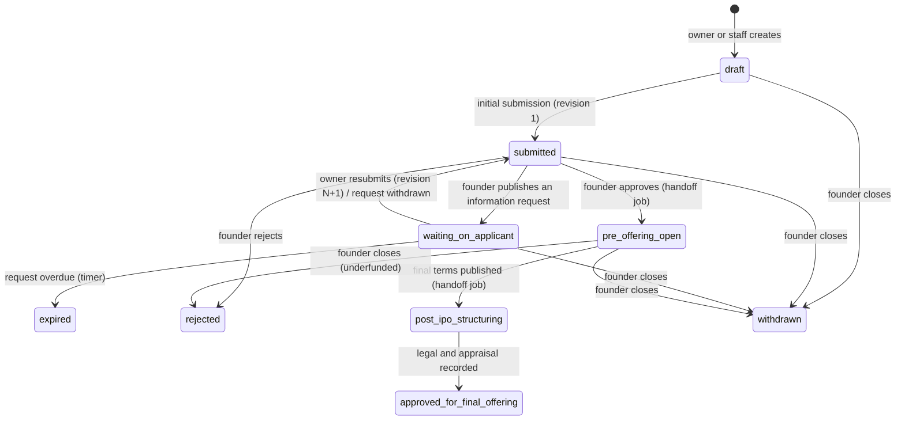

# Module: intake

Valid for main at 48aa967 (2026-11-18).

The `intake` module is the property origination pipeline: an owner declares a residential property and submits evidence, the founder reviews it, asks for more information, approves or rejects it, and an approved case becomes the pre-offering that investors see. After the IPO period the case passes through post-IPO structuring with a legal practice and an appraisal firm. It is the second largest module (about ten thousand lines). Read this page before you change a case stage, a review rule or a partner's access.

## 1. Purpose and bounded context

| Question | Answer |
| --- | --- |
| What does the module own? | 54 routes in six routers (section 3.1), three queues (`case_timers.applicant_reminders`, `case_timers.response_window_expiry`, `case_timers.post_ipo_structuring_handoff`), and the tables of the `intake` database schema except `intake.pivs` (section 4). |
| What is a case? | One row in `intake.intake_cases` for one property and one applicant (the owner), with a `stage` and an append-only trail of submission revisions, evidence, information requests, threads and lifecycle events. |
| Stages | `draft`, `submitted`, `waiting_on_applicant`, `pre_offering_open`, `post_ipo_structuring`, `approved_for_final_offering`, and the terminal `rejected`, `withdrawn`, `expired` (`src/modules/intake/domain/intake-workflow.catalog.ts:3-6`). |
| What does it not own? | The offering and its reservations (`offering` creates the `Piv` and `Offering` rows from the handoff job); KYC (`identity`, read through the eligibility reader); staff roles (`auth`); the escrow campaign (`settlement`). The case closure writes into the offering's tables (section 11). |
| Who may call what? | Owners (customer population) use `/v1/intake-cases`. The founder (`admin_operations` plus staff WebAuthn) uses `/internal/v1/intake-cases`, `/internal/v1/legal-practices` and `/internal/v1/appraisal-firms`. Legal and appraisal partners use their own prefixes, gated by role, WebAuthn and a case-assignment check (section 5.3). |
| Founder-direct review | There is no partner organisation before the IPO: the founder reviews and decides (AD-244); partners act only after `post_ipo_structuring` begins. |

## 2. File map

### 2.1 api (`src/modules/intake/api/`)

| File | Lines | Responsibility |
| --- | --- | --- |
| `intake.router.ts` | 140 | `createIntakeRouter`: the owner's eight routes. |
| `intake.schemas.ts` | 263 | Owner request and response schemas, the case summary shapes. |
| `intake-operations.router.ts` | 474 | `createIntakeOperationsRouter`: the founder's 32 routes; `decodeOriginalFilename`. |
| `intake-operations.schemas.ts` | 686 | Staff schemas: list, detail, readiness, workflow, history, reversal, decisions, uploads. |
| `partner-case.router.ts` | 137 | `createLegalPartnerCaseRouter`, `createAppraisalPartnerCaseRouter`. |
| `partner-case.schemas.ts` | 104 | Partner writeback schemas. |
| `partner-organization.router.ts` | 126 | `createLegalPracticeRouter`, `createAppraisalFirmRouter`. |
| `partner-organization.schemas.ts` | 55 | Organisation schemas. |
| `require-partner-case-assignment.ts` | 82 | `createRequirePartnerCaseAssignment`: the resource check for partners. |

### 2.2 application (`src/modules/intake/application/`)

| File | Lines | Services |
| --- | --- | --- |
| `create-draft-intake.service.ts` | 134 | `CreateDraftIntakeService`: owner entry rules, then the draft. |
| `submit-initial-case.service.ts` | 160 | `SubmitInitialCaseService`: the first revision from the case's evidence. |
| `upload-case-document.service.ts` | 164 | `UploadCaseDocumentService`: type, MIME, size, scan, store. |
| `get-case-document.service.ts` | 32 | `GetCaseDocumentService`: staff download. |
| `read-own-cases.service.ts` | 167 | `ListOwnCasesService`, `GetOwnCaseService`, cursor codecs. |
| `respond-to-information-request.service.ts` | 168 | `ListOwnInformationRequestsService`, `RespondToInformationRequestService`: the owner's answer as revision N+1. |
| `case-message.service.ts` | 97 | Own and staff thread lists and posts (`ListOwnCaseMessagesService`, `PostOwnCaseMessageService`, `ListCaseMessagesForOperationsService`, `PostCaseMessageForOperationsService`). |
| `operations-case.service.ts` | 970 | The founder's services: `ListCasesForOperationsService`, `GetCaseForOperationsService`, `PublishInformationRequestService`, `WithdrawInformationRequestService`, `RecordFounderDecisionService`, `ReviewEvidenceService`, `CloseCaseService`, `CreateStaffIntakeCaseService`, `CreateStaffDraftCaseService`, `SubmitStaffDraftCaseService`, `AssignPartnerOrganizationService`, `ForceExpireInformationRequestService`, `SendManualReminderService`, `RetryPostIpoStructuringHandoffService`. |
| `partner-case.service.ts` | 313 | `ListCasesForPartnerService`, `GetCaseForPartnerService`, `GetPartnerCaseHistoryService`, `RecordLegalStructuringService`, `RecordAppraisalService`. |
| `partner-organization.service.ts` | 148 | Create, list and set the status of legal practices and appraisal firms. |
| `intake-reversal.service.ts` | 204 | The correction (reversal) flow: preview, request, approve, cancel, read. |
| `get-intake-workflow.service.ts` | 206 | `GetIntakeWorkflowService`, `GetIntakeCaseHistoryService`, history cursor codecs. |
| `get-operations-readiness.service.ts` | 37 | `GetOperationsReadinessService`. |
| `case-timer.service.ts` | 65 | `SendApplicantResponseRemindersService`, `ExpireOverdueInformationRequestsService`. |
| `post-ipo-structuring-handoff.service.ts` | 27 | `TransitionCaseToPostIpoStructuringService`: the consumer of the post-IPO job. |

### 2.3 domain, presentation, repository

| File | Lines | Responsibility |
| --- | --- | --- |
| `domain/intake-entry.policy.ts` | 48 | `evaluateIntakeEntry`: who may open a case. |
| `domain/case-submission.policy.ts` | 72 | The evidence vocabulary, `evaluateInitialCaseSubmission`, `evaluateCaseResubmission`. |
| `domain/case-review.policy.ts` | 113 | Review, closure and partner rules, business-day arithmetic. |
| `domain/intake-reversal.policy.ts` | 172 | Reversal commands, statuses, approval refusal, `evaluateReversalActions`. |
| `domain/operations-readiness.policy.ts` | 466 | `evaluateOperationsReadiness`: the blockers and allowed actions of a case. |
| `domain/intake-workflow.catalog.ts` | 36 | Stages and their workflow types. |
| `presentation/intake-labels.ts` | 166 | Display labels for stages, severities, offering and reservation states, document types. |
| `repository/intake.repository.ts` | 796 | `IntakeRepository` and its input and record types. |
| `repository/prisma-intake.repository.ts` | 2743 | `PrismaIntakeRepository`, the one implementation. |
| `repository/intake-case-event.repository.ts` | 102 | The history event types. |
| `repository/partner-organization.repository.ts`, `repository/prisma-partner-organization.repository.ts` | 51, 201 | Organisation repository. |
| `repository/post-ipo-structuring-handoff.repository.ts` | 30 | The port of the post-IPO consumer. |

Wiring: `src/server.ts:133` builds `PrismaIntakeRepository(database, jobQueue, kycRepository)`; `src/server.ts:134` the organisation repository; `src/app.ts:1054-1186` mounts the routers.

> Pending #237: the intake mounts move from `src/app.ts` into `src/composition/compose-intake.ts`; the routers, services and repositories do not change.

## 3. Public surface

### 3.1 Routes

Entries are in [../api/intake-customer.md](../api/intake-customer.md) (owner) and [../api/intake-staff.md](../api/intake-staff.md) (founder and partners).

| Prefix | Routes | Guard |
| --- | --- | --- |
| `/v1/intake-cases` | `POST /` (create draft), `GET /`, `GET /:case_id`, `POST /:case_id/submit`, `GET /:case_id/information-requests`, `POST /:case_id/information-requests/:request_id/respond`, `GET`/`POST /:case_id/messages` (`src/modules/intake/api/intake.router.ts:45-115`) | session, customer |
| `/internal/v1/intake-cases` | `GET /`, `POST /`, `POST /drafts`, `POST /:case_id/submit`, `GET /:case_id`, `GET /:case_id/readiness`, `/workflow`, `/history`, `/reversal-preview`, four `POST /:case_id/commands/<name>` (`return-to-draft`, `reopen-pre-offering`, `reopen-structuring`, `reopen-final-offering-review`), `POST` approve and cancel and `GET` of `/reversal-operations/:operation_id`, `POST`/`GET /:case_id/documents`, `PATCH /:case_id/rooms/:room_id/representative-photo`, `DELETE` of a room and of a room photo, `POST /:case_id/information-requests` with `send-reminder`, `force-expire` and `withdraw`, `POST /:case_id/decisions`, `POST /:case_id/close`, `POST /:case_id/retry-post-ipo-handoff`, `PUT /:case_id/evidence/:evidence_id/review`, `POST /:case_id/partner-assignment`, `GET`/`POST /:case_id/messages` (`src/modules/intake/api/intake-operations.router.ts:120-452`) | staff: `requireAuthentication`, `requireAdminOperations`, `requireStaffWebAuthn` (`:114`) |
| `/internal/v1/legal-practices`, `/internal/v1/appraisal-firms` | `GET /`, `POST /`, `PATCH /:id/status` each (`src/modules/intake/api/partner-organization.router.ts:36-102`) | staff; mounted only when the organisation repository is present |
| `/internal/v1/legal-partner/cases`, `/internal/v1/appraisal-partner/cases` | `GET /`, `GET /:case_id`, `GET /:case_id/history`, `PATCH /:case_id` (`src/modules/intake/api/partner-case.router.ts:44-111`) | role, staff WebAuthn, case assignment |

Counts: 8 owner, 32 founder, 6 organisation, 8 partner (54 in all; the commands loop registers four routes at `intake-operations.router.ts:191-208`). Several founder routes exist only when their service is passed to the router; `createApp` always passes the workflow, history and reversal services and passes the document services only when storage is configured and the partner-assignment service only when the organisation repository is present (`src/app.ts:1104-1120`, `src/server.ts:524-544`). Reversal commands require the headers `If-Match-Stage`, `If-Match-Workflow-Sequence` and `Idempotency-Key`, else `422 intake.reversal_headers_required` (`src/modules/intake/api/intake-operations.router.ts:202-205`). The intake routes mount no shared `Idempotency-Key` middleware; creating a draft and the owner's submission are guarded by the stage rules.

> Pending #245: the intake routers send their body through `sendValidated`, so a body that fails its response schema becomes `500 internal.response_invalid` instead of `422 validation.invalid_field`.

> Pending #225: the ClamAV scanner on main writes a literal backslash-zero instead of a NUL byte after `zINSTREAM`, so every case-document upload through a reachable clamd fails with `503`.

### 3.2 Jobs and queues

| Queue | Kind | Trigger | Handler | Notes |
| --- | --- | --- | --- | --- |
| `case_timers.applicant_reminders` | scheduled `0 8 * * *` | schedule (`src/worker.ts:466`) | `SendApplicantResponseRemindersService` (`src/worker.ts:598`) | Reminder emails at the configured business-day milestones. |
| `case_timers.response_window_expiry` | scheduled `0 * * * *` | schedule (`src/worker.ts:470`) | `ExpireOverdueInformationRequestsService` (`src/worker.ts:601`) | Expires an overdue information request and its case. |
| `case_timers.post_ipo_structuring_handoff` | event | `publishFinalOfferingTerms` in `offering` (`src/modules/offering/repository/prisma-offering.repository.ts:1255`) | `TransitionCaseToPostIpoStructuringService` (`src/worker.ts:763`) | Moves the case to `post_ipo_structuring`; staff can retry it. |

The module also produces `case_timers.pre_offering_open_handoff`, enqueued by founder approval in the same transaction as the decision (`src/modules/intake/repository/prisma-intake.repository.ts:2072-2090`); its consumer is in [offering.md](offering.md). Retries and dead-lettering: [../jobs-and-workers.md](../jobs-and-workers.md).

### 3.3 Audit rows

`intake.case_draft_created`, `intake.case_created_by_staff`, `intake.case_submitted`, `intake.case_approved` and `intake.case_rejected` (the founder's decision, `src/modules/intake/repository/prisma-intake.repository.ts:2095`), `intake.case_withdrawn` and `intake.case_rejected` (the closure, `:2331`), `intake.<command>` for an executed correction (`intake.return_to_draft`, `intake.reopen_pre_offering`, `intake.reopen_structuring`, `intake.reopen_final_offering_review`, `:263`), `intake.legal_practice_created`, `intake.legal_practice_status_updated`, `intake.appraisal_firm_created`, `intake.appraisal_firm_status_updated` (`src/modules/intake/repository/prisma-partner-organization.repository.ts`), `intake.case_resubmitted`, `intake.information_request_published`, `intake.information_request_withdrawn`, `intake.information_request_expired`, `intake.evidence_reviewed`, `intake.case_partner_organization_assigned`, `intake.case_post_ipo_structuring_started`, `intake.case_legal_structuring_recorded`, `intake.case_appraisal_recorded`, `intake.case_approved_for_final_offering`, `intake.room_deleted`, `intake.room_photo_deleted`, `intake.room_photo_representative_selected`, `intake.correction_requested`, `intake.correction_cancelled`, `intake.correction_failed`, and `offering.closed_with_case` (written by the case closure for the offering it closes). A case also keeps its own lifecycle trail in `intake.intake_case_events` (`src/modules/intake/repository/prisma-intake.repository.ts`, written inside each state change).

## 4. Tables

| Table | Access | Notes |
| --- | --- | --- |
| `intake.intake_cases` | read, insert, update | Stage, owner, current revision, review and IPO fields, partner assignment, workflow sequence (`prisma/schema/schema.prisma:259-316`). |
| `intake.properties`, `intake.property_rooms` | read, insert, update, delete | The declared property and its rooms (`prisma/schema/schema.prisma:166-209`). |
| `intake.submission_revisions`, `intake.documentary_screening_evidence` | insert, update | Append-only revisions and their evidence (`prisma/schema/schema.prisma:390-431`). |
| `intake.information_requests`, `intake.case_threads`, `intake.case_messages` | read, insert, update | Requests, lazily created threads (unique per case and lane), messages (`prisma/schema/schema.prisma:482-538`). |
| `intake.intake_case_events`, `intake.intake_case_reversal_operations` | insert, update | Lifecycle trail; correction operations (`prisma/schema/schema.prisma:319-387`). |
| `intake.legal_practices`, `intake.appraisal_firms`, `intake.workstream_assignment_events`, `intake.case_integrity_flags`, `intake.legal_execution_events`, `intake.corridor_clearances` | read, insert, update | Partner organisations and their records (`prisma/schema/schema.prisma:212-257`, `:434-479`, `:541-557`). |
| `intake.pivs` | read | Created by `offering` at the handoff (`prisma/schema/schema.prisma:560-589`). |
| `offering.offerings`, `offering.reservations` | update | Written by the case closure (section 11). |
| `platform.stored_documents` | insert, read | Evidence and room photo metadata. |
| `platform.settings` | read | `intake.minimum_property_value_eur`, `intake.applicant_response_window_business_days`, `intake.information_request_reminder_business_days` (`src/modules/intake/repository/prisma-intake.repository.ts:288`, `:1480`, `:1493`). |
| `identity.kyc_eligibility` | read | Entry check (through the eligibility reader). |
| `audit.audit_log` | insert, read | Section 3.3. |

Model definitions are in [../data-model.md](../data-model.md).

## 5. Domain rules and state machines

### 5.1 Case stage

The corrections (`return_to_draft`, `reopen_pre_offering`, `reopen_structuring`, `reopen_final_offering_review`) move a case back through a four-eyes operation (section 5.4).

### 5.2 Rules

| Rule | Where |
| --- | --- |
| Opening a case needs: KYC `eligible`, a current proof of address, accepted intake terms, a single-title confirmation, property type `residential`, and a declared value at least the minimum setting. | `src/modules/intake/domain/intake-entry.policy.ts:25-48` |
| Initial submission needs stage `draft`, no revision yet, and every one of the four required evidence types, with no evidence type repeated (optional types may accompany them): `ownership_declaration`, `property_facts_sheet`, `encumbrance_declaration`, `photo_set`; resubmission needs `waiting_on_applicant` and a published request. | `src/modules/intake/domain/case-submission.policy.ts:1-70` |
| Allowed document types are the four required, seven optional evidence types, and `room_photo`; allowed content types are PDF, JPEG, PNG, WebP and Office documents; a room photo must be an image; the size cap is 100 MB. | `src/modules/intake/domain/case-submission.policy.ts:11-20`, `src/modules/intake/application/upload-case-document.service.ts:11-16`, `:86-88` |
| A room holds at most five accepted photos; the sixth is refused with `409 intake.room_photo_limit_reached`, checked before the upload and again under a row lock. | `src/modules/intake/application/upload-case-document.service.ts:98-99`, `:123-125` |
| An information request can be published only in stage `submitted`, with a current revision and no active request; it can be withdrawn only while the case waits on the applicant and the request is published. | `src/modules/intake/domain/case-review.policy.ts:5-24` |
| The founder can decide (approve or reject) only in stage `submitted` with a current revision. Approval stores the IPO terms, sets `pre_offering_open` and enqueues the offering handoff in the same transaction (AD-145). | `src/modules/intake/domain/case-review.policy.ts:28-33`, `src/modules/intake/repository/prisma-intake.repository.ts:2072-2090` |
| Closure: `withdrawn` from `draft`, `submitted`, `waiting_on_applicant` or `pre_offering_open`; `rejected` only from `pre_offering_open`; `expired` has no manual path. | `src/modules/intake/domain/case-review.policy.ts:42-51`, `src/modules/intake/repository/prisma-intake.repository.ts:2240-2252` |
| Partner assignment is possible from `post_ipo_structuring` on; partner writeback only in `post_ipo_structuring`. | `src/modules/intake/domain/case-review.policy.ts:59-72` |
| Due dates count business days (Saturday and Sunday excluded; no holiday calendar); a reminder is due on the UTC day that equals publication plus a configured business-day milestone, and the job runs once a day with no sent marker. | `src/modules/intake/domain/case-review.policy.ts:74-105` |
| The readiness view lists blockers (17 codes such as `evidence_pending_review`, `funding_target_not_reached`, `ipo_period_expired`) and the actions (eight, such as `record_founder_decision`, `publish_final_offering_terms`) each blocks. | `src/modules/intake/domain/operations-readiness.policy.ts:43-71`, `:104` |

### 5.3 Partner access

A partner route chain is the role guard, staff WebAuthn, then `createRequirePartnerCaseAssignment`: the account's active organisation for the role must equal the case's assigned organisation and the stage must be `post_ipo_structuring` or `approved_for_final_offering`. A missing case, another organisation, a wrong stage and an account without an active assignment of the role all answer the same `403 authorization.forbidden`, so a partner cannot enumerate cases (`src/modules/intake/api/require-partner-case-assignment.ts:13-62`). The list route `GET /` carries the role guard and WebAuthn only; it lists the cases of the caller's own organisation (`src/modules/intake/api/partner-case.router.ts:44`, `src/modules/intake/application/partner-case.service.ts:44`). The organisation lookup is `AccountRepository.getActivePartnerOrganizationId` (see [account.md](account.md)).

### 5.4 Corrections

A correction is a four-eyes operation: one staff member requests it with the case's current stage and workflow sequence in `If-Match` headers, a different one approves it (`self_approval` is refused), and execution runs under row locks. Statuses `requested`, `pending_approval`, `approved`, `executing` pause the case; only the first two can be cancelled; an approval whose execution died is finished by re-approving by the same account (`src/modules/intake/domain/intake-reversal.policy.ts:36-70`). The policy also lists `withdraw_information_request` as a command; the correction routes register the other four. Reason codes: `operator_input_error`, `wrong_case_selected`, `duplicate_case`, `missing_evidence_correction`, `partner_assignment_correction`, `founder_decision_correction`, `offering_setup_correction`, `compliance_directed_correction`, `system_recovery` (`:3-13`).

## 6. Interaction with other modules

| Other module | Direction | How |
| --- | --- | --- |
| `offering` | intake enqueues; offering enqueues; intake writes | `case_timers.pre_offering_open_handoff` (intake to offering), `case_timers.post_ipo_structuring_handoff` (offering to intake). The case closure writes `offering.offerings` and `offering.reservations` directly (section 11). `src/modules/intake/presentation/intake-labels.ts:1-2` imports two values from the offering domain that the file does not use (section 11). |
| `identity` | intake reads | `KycEligibilityReader` type (`src/modules/intake/repository/prisma-intake.repository.ts:9`) and the display-name service type (`src/modules/intake/application/operations-case.service.ts:2`). |
| `account` | intake reads | `AccountRepository` type for partner organisation lookup (`src/modules/intake/api/require-partner-case-assignment.ts:3`, `src/modules/intake/application/partner-case.service.ts:2`). |
| `auth` | injected | Role and WebAuthn middlewares are built in `src/app.ts` and passed in. |
| `settlement` | none | The readiness policy reads the offering's reservations and pack through the repository. |

## 7. Configuration

| Setting | Effect |
| --- | --- |
| `MINIO_ENDPOINT`, `MINIO_ACCESS_KEY`, `MINIO_SECRET_KEY`, `MINIO_PRIVATE_BUCKET` (and `MINIO_PORT`, `MINIO_USE_SSL`) | The staff document upload and download routes exist only when the four named variables are set (`src/server.ts:524-544`). |
| `CLAMAV_HOST`, `CLAMAV_PORT` | The scanner is always built, with host `127.0.0.1` when `CLAMAV_HOST` is unset and port 3310 by default; they gate no route (`src/server.ts:497`, `src/config/environment.ts:229-230`). |
| SMTP settings | Reminder emails and manual reminders. |
| `platform.settings` rows named in section 4 | Minimum property value, response window in business days, reminder milestones. |

> Pending #236: `CLAMAV_HOST` and `CLAMAV_PORT` move from the `storage-init` service into the staging `&app-environment` anchor (defaults `clamav` and `3310`), so the API and worker containers receive them; on main only `storage-init` does.

The full list is in [../configuration.md](../configuration.md).

## 8. Existing guides

None dedicated to the module. [../document-storage.md](../document-storage.md) covers document storage; [../investor-offering.md](../investor-offering.md) covers closing a case's pre-offering; [../plans/](../plans/) holds the implementation plans.

## 9. Tests

| File | What it covers |
| --- | --- |
| `tests/intake-entry-policy.test.ts`, `tests/case-submission-policy.test.ts`, `tests/case-review-policy.test.ts`, `tests/operations-readiness.policy.test.ts`, `tests/intake-reversal-policy.test.ts`, `tests/intake-case-workflow.test.ts`, `tests/intake-labels.test.ts` | The domain policies, the workflow catalogue and labels. |
| `tests/intake-api.test.ts`, `tests/intake-review-workflow.test.ts`, `tests/intake-readiness-api.test.ts`, `tests/intake-reversal-api.test.ts`, `tests/staff-intake-case-creation-api.test.ts`, `tests/assign-partner-organization-api.test.ts`, `tests/partner-case-api.test.ts`, `tests/partner-organization-api.test.ts`, `tests/require-partner-case-assignment.test.ts` | The routers. |
| `tests/intake-workflow.service.test.ts`, `tests/get-operations-readiness.service.test.ts`, `tests/intake-reversal.service.test.ts`, `tests/case-timer-service.test.ts`, `tests/manual-information-request-actions.service.test.ts`, `tests/withdraw-information-request.service.test.ts`, `tests/assign-partner-organization.service.test.ts`, `tests/partner-case.service.test.ts`, `tests/partner-organization.service.test.ts`, `tests/post-ipo-structuring-handoff.service.test.ts`, `tests/retry-post-ipo-structuring-handoff.service.test.ts` | The services. |
| `tests/intake-offering-handoff.integration.test.ts`, `tests/intake-case-close-offering.integration.test.ts`, `tests/intake-reversal.integration.test.ts`, `tests/staff-intake-case-repository.integration.test.ts`, `tests/partner-writeback-repository.integration.test.ts` | Against a database; skipped without `TEST_DATABASE_URL`, see [../testing.md](../testing.md). |

## 10. Where to put a change

| Change | Place |
| --- | --- |
| A new case stage | `intakeCaseStageValues` and the catalogue, then the policies that list stages, the readiness policy, labels, and `docs/api`. |
| A new evidence type | `submissionEvidenceTypes` in `case-submission.policy.ts` (and, when it is required, `requiredInitialEvidenceTypes` and the readiness policy's copy). |
| A new founder action | A service in `operations-case.service.ts`, a rule in `case-review.policy.ts`, a route in `intake-operations.router.ts`, an audit row and a lifecycle event in the same repository transaction; add the action to the readiness policy if it can be blocked. |
| A new effect on another module | A job via `enqueueTransactionalJob` in the same transaction, not a write into that module's tables. |
| A new partner write | The partner router, a service in `partner-case.service.ts` and a stage check in the policy; the assignment guard must stay in front. |
| A threshold the founder tunes | A `platform.settings` row, read in `prisma-intake.repository.ts`. |

## 11. Known limitations

| Limitation | Evidence | Issue |
| --- | --- | --- |
| Closing a case from `pre_offering_open` closes its offering and cancels its open reservations by writing the offering module's tables from intake's repository, in one transaction, instead of through a job; the approval path in the same file says intake never writes into the offering tables. | `src/modules/intake/repository/prisma-intake.repository.ts:2254-2308`, `:2074-2078`; the correction `reopen_pre_offering` also sets the offering to `closed` from intake's repository (`:255-257`) | none |
| `intake-labels.ts` imports `disclosureDocumentTypes` and `publicOfferingStatuses` from the offering domain and does not use them; the architecture check does not report it because the compiler drops an unused import. | `src/modules/intake/presentation/intake-labels.ts:1-2`, `dependency-cruiser.config.cjs:17-21` | #122 (closed by #202; the work is listed as not done) |
| The readiness policy sums money with `Number()` (reservation amounts, funded amount, target, percentage). | `src/modules/intake/domain/operations-readiness.policy.ts:125`, `:132`, `:133`, `:412` | #122 (workstream W6 not done) |
| The readiness policy keeps its own copies of the required evidence and the eleven disclosure document types. | `src/modules/intake/domain/operations-readiness.policy.ts:72-90` | none |
| Upload and download buffer the whole file in memory (up to 100 MB, about twice that while scanning); no concurrency cap. | `src/modules/intake/application/upload-case-document.service.ts:102-104`, `src/modules/intake/api/intake-operations.router.ts:284` | none |
| The scanner call is wrapped in a bare catch that throws a fixed `503` without the cause and without a log. | `src/modules/intake/application/upload-case-document.service.ts:109-111` | #247 |
| Deleting the stored object after a database change is `.catch(() => undefined)`, with a comment about a purge job that does not exist. | `src/modules/intake/application/upload-case-document.service.ts:47-48`, `:78-80`, `:137-138` | none |
| The upload route converts `X-Revision-Number` with `Number(...)` and no schema, so a non-numeric header reaches the revision lookup as `NaN`; the listing query of the documents route is read from `request.query` by hand, not through a schema. | `src/modules/intake/api/intake-operations.router.ts:232`, `:263-266`, `src/modules/intake/application/upload-case-document.service.ts:93-94` | none |
| Due dates exclude Saturdays and Sundays only; no holiday calendar. | `src/modules/intake/domain/case-review.policy.ts:74-87` | none |
| A missed daily run of the reminder job sends no reminder for that day. | `src/modules/intake/domain/case-review.policy.ts:93-105` | none |
| `PrismaIntakeRepository` is 2743 lines and holds every intake interface. | `src/modules/intake/repository/prisma-intake.repository.ts` | none |
| A response that fails its schema surfaces as `422 validation.invalid_field` with internal field paths and is not logged. Three founder routes send the service result without any response schema: the staff draft submission, the document upload and the document list. | `src/modules/intake/api/intake-operations.router.ts:123`, `:134` (schema parse); `:145`, `:235`, `:272` (no schema); `src/shared/http/error-handler.ts:39-41`, `src/shared/http/error-handler.ts:51-64` | none (see pending #244, #245) |

## 12. Known gaps between the code and the design record

| Statement in the record | Code | Register |
| --- | --- | --- |
| Document uploads into the origination-case domain are validated without malware scanning (AD-130); the record has no metadata table for stored files. | Uploads are scanned by ClamAV and recorded in `platform.stored_documents`; content is sniffed only for room photos. | C-014 |
| The schema of the case and `PIV` tables is `origination` (`origination.origination_cases`). | The schema is `intake` and the case table is `intake_cases`. | C-018 |
| Founder-direct review before the IPO (AD-244). | Built as described; partner roles apply only from post-IPO structuring. | none |

Register entries are in `00-Governance/MIGRATION/CONFLICT_REGISTER.md` on the `origin/main` of the design-record repository; the working checkout read for this page lacks C-009 onward. The record was not edited.

## 13. Not verified

- Behaviour against a real MinIO and clamd; the upload routes were read, not run.
- The contents of the three `platform.settings` rows in any environment.
- Behaviour on PostgreSQL 18; local checks ran on 16.15.
- Whether the staff UI uses the `readiness` and `workflow` routes as the plans describe; only this repository was read.
