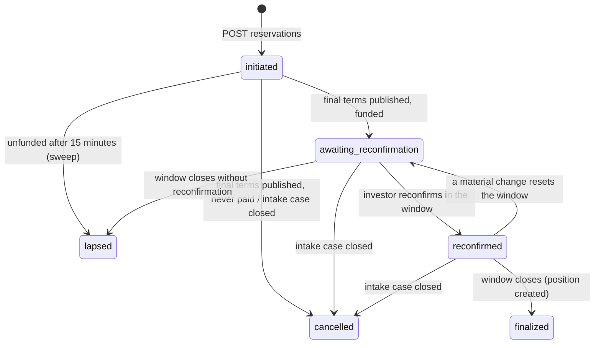

# Module: offering

Valid for main at 48aa967 (2026-11-18).

The `offering` module is the investment product: the public listing of offerings, the investor's detail view, reservations and their funding through the Coinbase onramp, the three-stage finalization with its reconfirmation window, disclosure packs and documents, materiality classification, and late-payment evidence. It is the largest module after `intake` and `auth`. Read this page before you change anything about who may reserve, how a reservation moves, or how money events are recorded.

## 1. Purpose and bounded context

| Question | Answer |
| --- | --- |
| What does the module own? | Fourteen routes in four router files (thirteen API routes and the webhook `POST /webhooks/coinbase-onramp`), eight queues, and the tables `offering.offerings`, `offering.reservations`, `offering.disclosure_packs`, `offering.disclosure_documents`, `offering.materiality_records`, `money.money_events`, `money.onramp_webhook_receipts` and `money.onramp_late_evidence` (section 3, section 4). |
| What does it not own? | The intake case that an offering comes from (`intake`, which creates the `Piv` and closes an offering with its case); positions beyond their creation at the window close (`settlement`, `investor-activity`); the IPO escrow campaign (`settlement`); KYC (`identity`); wallets (`wallet`); sign-in and fresh authentication (`auth`). |
| What does "state" mean here? | Two state machines per reservation, kept apart: `reservation_stage` (the lifecycle) and `capital_state` (the latest money event). A funded reservation in stage `initiated` is a normal in-between state (section 5). |
| What is the funding model? | An investor reserves capacity; a Coinbase CDP onramp session is created in the same request; the purchased EURC goes to the investor's own wallet; VistaBlox holds no funds (`src/modules/offering/application/create-reservation.service.ts:30-36`, `src/modules/intake/repository/prisma-intake.repository.ts:2270-2273`). The funding rail defaults closed (`RESERVATION_FUNDING_RAIL_ENABLED`, section 7). |
| Who may call the routes? | Public listing: nobody is authenticated. Investor routes: customers only (`403 authorization.forbidden`, `src/modules/offering/api/offering.router.ts:156-163`). Staff routes: `requireAuthentication`, `requireAdminOperations`, `requireStaffWebAuthn` (`src/modules/offering/api/offering-operations.router.ts:46`, `src/modules/offering/api/onramp-late-evidence.router.ts:30`). The webhook is authenticated by signature. |

## 2. File map

### 2.1 api

| File | Lines | Responsibility |
| --- | --- | --- |
| `src/modules/offering/api/offering.router.ts` | 165 | `createOfferingRouter` (public `GET /`) and `createInvestorOfferingRouter` (detail, reservation, reconfirm, document download). |
| `src/modules/offering/api/offering.schemas.ts` | 181 | Query, params and response schemas; `investorImageUrl` (HTTPS only). |
| `src/modules/offering/api/offering-operations.router.ts` | 186 | `createOfferingOperationsRouter`: finalize, materiality, disclosure pack, presentation, documents; `decodeOriginalFilename`. |
| `src/modules/offering/api/offering-operations.schemas.ts` | 199 | Schemas of the staff routes. |
| `src/modules/offering/api/onramp-late-evidence.router.ts` | 56 | `createOnrampLateEvidenceRouter`: list and mark reviewed. |
| `src/modules/offering/api/onramp-late-evidence.schemas.ts` | 47 | Schemas of those two routes. |
| `src/modules/offering/api/coinbase-onramp-webhook.router.ts` | 91 | `createCoinbaseOnrampWebhookRouter`: verify, parse, receive. |

### 2.2 application

| File | Lines | Responsibility |
| --- | --- | --- |
| `list-public-offerings.service.ts` | 85 | `ListPublicOfferingsService`: public page with cursor. |
| `get-investor-offering.service.ts` | 144 | `GetInvestorOfferingService`: detail, disclosure pack, change log, raise progress, `reservation_blockers`. |
| `create-reservation.service.ts` | 310 | `CreateReservationService`: blockers, capacity, atomic create, onramp session, replay rules. |
| `reconfirm-reservation.service.ts` | 96 | `ReconfirmReservationService`. |
| `finalize-offering.service.ts` | 97 | `FinalizeOfferingService`: publish final terms and open the window. |
| `commit-offering-finalization.service.ts` | 36 | `CommitOfferingFinalizationService`: the window-close batch. |
| `classify-materiality.service.ts` | 82 | `ClassifyMaterialityService`. |
| `publish-disclosure-pack.service.ts` | 103 | `PublishDisclosurePackService`. |
| `update-offering-presentation.service.ts` | 59 | `UpdateOfferingPresentationService`: featured flag and media. |
| `upload-offering-document.service.ts` | 188 | `UploadOfferingDocumentService`: allowlist, size, ClamAV scan, store. |
| `get-offering-document.service.ts` | 79 | `GetOfferingDocumentService`: staff list and read. |
| `download-disclosure-document.service.ts` | 59 | `DownloadDisclosureDocumentService`: investor download. |
| `disclosure-document-store.ts` | 32 | The port `DisclosureDocumentStore`. |
| `coinbase-cdp-client.ts` | 42 | The port `CoinbaseCdpClient`. |
| `expire-reservations.service.ts` | 44 | `ExpireUnfundedReservationsService`. |
| `poll-onramp-transactions.service.ts` | 392 | `PollOnrampTransactionsService`, `isPurchaseCovering`. |
| `coinbase-onramp-webhook.service.ts` | 179 | `ReceiveCoinbaseOnrampWebhookService`, `ReconcileOnrampWebhookService` and the job schema. |
| `other-stage-onramp-outcome.ts` | 76 | The port and a logging default for an outcome that arrives after the stage. |
| `record-onramp-late-evidence.service.ts` | 89 | `RecordOnrampLateEvidenceService`. |
| `list-onramp-late-evidence.service.ts`, `mark-onramp-late-evidence-reviewed.service.ts`, `onramp-late-evidence-view.ts` | 29, 36, 28 | Staff list, mark reviewed, the view mapping. |
| `check-onramp-late-evidence.service.ts` | 44 | `CheckOnrampLateEvidenceService`: the hourly warn. |
| `send-reconfirmation-reminders.service.ts` | 52 | `SendReconfirmationRemindersService`. |
| `notify-reconfirmation-window-opened.service.ts` | 58 | `NotifyReconfirmationWindowOpenedService`. |
| `open-offering-for-approved-case.service.ts` | 45 | `OpenOfferingForApprovedCaseService`: the handoff consumer. |

### 2.3 domain, infrastructure, repository

| File | Lines | Responsibility |
| --- | --- | --- |
| `domain/reservation-eligibility.policy.ts` | 222 | `computeReservationBlockers`, the eleven blockers, funded states, expiry, escrow readiness. |
| `domain/finalization.policy.ts` | 47 | `canPublishFinalOfferingTerms`, the 168-hour window. |
| `domain/materiality.policy.ts` | 30 | `materialityResetTriggered`. |
| `domain/disclosure-pack.policy.ts` | 74 | The eleven document types, completeness, required version after a reset. |
| `domain/onramp-outcome-recording.policy.ts` | 88 | `decideOnrampRecording` and the recorded-at rule. |
| `domain/onramp-late-evidence.policy.ts` | 66 | `classifyLateOnrampEvidence`. |
| `domain/onramp-late-evidence-alert.policy.ts` | 62 | The alert decision of the hourly warn. |
| `domain/reconfirmation-reminder.policy.ts` | 25 | `isReconfirmationReminderDue`. |
| `domain/public-offering.policy.ts`, `domain/offering-media.policy.ts`, `domain/currency.ts` | 7, 18, 3 | Public statuses; media limits; currency helpers. |
| `infrastructure/http-coinbase-cdp.client.ts` | 353 | `HttpCoinbaseCdpClient`: JWT-signed CDP REST client. |
| `infrastructure/coinbase-onramp-webhook-verifier.ts` | 81 | `CoinbaseOnrampWebhookVerifier`. |
| `repository/prisma-offering.repository.ts` | 1991 | `PrismaOfferingRepository`: the single large implementation of the offering, reservation, finalization, materiality, pack and reminder interfaces. |
| `repository/prisma-offering-document.repository.ts`, `repository/prisma-offering-presentation.repository.ts`, `repository/prisma-onramp-late-evidence.repository.ts` | 133, 77, 189 | Documents, presentation, late evidence. |
| `repository/offering.repository.ts`, `reservation.repository.ts`, `finalize-offering.repository.ts`, `materiality.repository.ts`, `disclosure-pack.repository.ts`, `disclosure-document.repository.ts`, `offering-document.repository.ts`, `offering-presentation.repository.ts`, `offering-intake-handoff.repository.ts`, `reconfirmation-reminder.repository.ts`, `reconfirmation-window-opened-notification.repository.ts`, `onramp-late-evidence.repository.ts`, `offering-repository-options.ts` | 110, 185, 109, 66, 70, 13, 47, 22, 37, 30, 40, 84, 29 | The interfaces and option types. |

(Paths in 2.2 and 2.3 are under `src/modules/offering/<layer>/`.)

Wiring: `src/server.ts:127` builds `PrismaOfferingRepository`; `src/app.ts:591-595` mounts the public router; `src/app.ts:642-716` the investor, late-evidence and operations routers; `src/app.ts:576-586` the webhook behind `express.raw`. The worker builds the timer services (`src/worker.ts`).

> Pending #237: the offering mounts move from `src/app.ts` into `src/composition/compose-offering.ts`; the routers, services and repositories do not change.

## 3. Public surface

### 3.1 Routes

Full entries are in [../api/offering.md](../api/offering.md).

| Method | Path | Authentication | Behaviour |
| --- | --- | --- | --- |
| `GET` | `/v1/offerings` | none (baseline rate limiter only) | Public teaser page: offerings in `pre_offering` or `final_offering`, featured first, newest first, cursor `limit` 1 to 100 (default 20) and `after` (`src/modules/offering/api/offering.schemas.ts:9-12`, `src/modules/offering/api/offering.router.ts:23-33`). |
| `GET` | `/v1/offerings/:offering_id` | session, customer | Detail with terms, current disclosure pack, change log, raise progress, the account's readiness and `reservation_blockers` (`src/modules/offering/api/offering.router.ts:49-58`). `404 offering.not_found`. |
| `POST` | `/v1/offerings/:offering_id/reservations` | session, customer, fresh authentication, `Idempotency-Key` | Creates a reservation and a Coinbase onramp session; `201` with `reservation_id`, `status: "initiated"`, `expires_at` and the onramp URL (`src/modules/offering/api/offering.router.ts:60-87`). `400 idempotency.key_required` without a key of 1 to 128 characters; `409 offering.reservation_not_available` with the blocker list; `422 offering.reservation_amount_exceeds_capacity`; `409 offering.idempotency_key_reused`; `409 offering.reservation_replay_unavailable`. The idempotency middleware in front of the handler answers `400 idempotency.key_required` for a missing or blank key, `409 idempotency.body_mismatch` for a reused key with another body and `503 idempotency.store_unavailable` when the lookup fails; a 5xx answer is not stored and entries are kept 48 hours (`src/shared/http/idempotency.ts:11`, `:22-34`, `:44-54`, `:64`, `:82-89`). A Coinbase failure after the hold exists is `422 offering.coinbase_provider_request_rejected` (another 4xx), `500 offering.coinbase_provider_auth_rejected` (401 or 403), `503 offering.coinbase_provider_unavailable` (network error, timeout, 5xx, 408, 429), `502 offering.coinbase_provider_response_invalid` or `500 offering.coinbase_provider_key_invalid` (`src/modules/offering/infrastructure/http-coinbase-cdp.client.ts:41-46`, `:243-253`, `:315-353`). Mounted only when the Coinbase client and the onramp redirect URL are configured (`src/server.ts:701-710`). |
| `POST` | `/v1/offerings/:offering_id/reservations/:reservation_id/reconfirm` | session, customer, fresh authentication, `Idempotency-Key` | Moves the caller's `awaiting_reconfirmation` reservation to `reconfirmed` (`src/modules/offering/api/offering.router.ts:89-107`); mounted only when `protectedApi.offeringOperations` is present (`src/app.ts:669-671`); errors `404 offering.reservation_not_found`, `409 offering.reservation_not_awaiting_reconfirmation`, `409 offering.reconfirmation_window_closed`, `409 offering.reconfirmation_disclosure_pack_incomplete`, `409 offering.reconfirmation_disclosure_pack_outdated` (`src/modules/offering/application/reconfirm-reservation.service.ts:35-68`). |
| `GET` | `/v1/offerings/:offering_id/documents/:document_id/download` | session, customer | Streams a disclosure document from private storage as an attachment; the object reference and storage URLs never leave the API (`src/modules/offering/api/offering.router.ts:109-132`). The route is always mounted; without MinIO settings the store is `UnavailableDisclosureDocumentStore` and the read answers `503 infrastructure.document_storage_unavailable` (`src/server.ts:498-511`, `src/infrastructure/storage/minio-disclosure-document.store.ts:99-120`). |
| `POST` | `/internal/v1/offerings/:offering_id/finalize` | staff, `Idempotency-Key` | Publishes final terms and opens the 168-hour window (section 5.2). |
| `POST` | `/internal/v1/offerings/:offering_id/materiality-records` | staff | Classifies a post-publication change; `201`. |
| `POST` | `/internal/v1/offerings/:offering_id/disclosure-packs` | staff | Publishes a new pack version; `201`. |
| `PATCH` | `/internal/v1/offerings/:offering_id/presentation` | staff | Featured flag and media URLs; mounted only when the presentation repository is passed. |
| `POST`, `GET` | `/internal/v1/offerings/:offering_id/documents` | staff | Upload a raw file body (type from `X-Document-Type`, name from `X-Original-Filename`) or list; `?document_ref=` streams one back. Mounted only when document storage is configured (`src/modules/offering/api/offering-operations.router.ts:106-143`). |
| `GET` | `/internal/v1/offerings/onramp-late-evidence` | staff | Late onramp evidence list (`src/modules/offering/api/onramp-late-evidence.router.ts:30`). |
| `POST` | `/internal/v1/offerings/onramp-late-evidence/:evidence_id/mark-reviewed` | staff | Marks one entry reviewed (`src/modules/offering/api/onramp-late-evidence.router.ts:36`). |
| `POST` | `/webhooks/coinbase-onramp` | `X-Webhook-Signature` | Verifies, records a receipt, enqueues a re-check, answers `200 { received: true }`; `401 offering.coinbase_webhook_invalid`. The deprecated header `X-Hook0-Signature` is read when `X-Webhook-Signature` is absent (`src/modules/offering/api/coinbase-onramp-webhook.router.ts:56-59`). Mounted only when the Coinbase client and `COINBASE_ONRAMP_WEBHOOK_SECRET` are both set (`src/server.ts:461-467`). |

> Pending #225: the ClamAV scanner on main writes a literal backslash-zero instead of a NUL byte after `zINSTREAM`, so clamd answers `UNKNOWN COMMAND` and every document upload through a reachable clamd fails with `503`; the pull request fixes the byte and adds `npm run clamav:smoke`. #229 duplicates it.

The late-evidence router is mounted before the operations router because the operations router's `/:offering_id/...` paths would otherwise match its prefix (`src/app.ts:681-682`). Idempotency: the shared middleware (`audit.idempotency_keys`) is mounted on reservation creation (`offering.reservation.create`), reconfirmation (`offering.reservation.reconfirm`) and finalization (`offering.finalize`) (`src/app.ts:490-500`); reservation creation also stores the key on the reservation (`client_idempotency_key`), the second mechanism recorded as C-006.

> Pending #244: a new route `POST /v1/offerings/:offering_id/reservations/:reservation_id/payment-session` is added; a Coinbase 4xx after the hold exists is `502 offering.coinbase_provider_request_rejected` (main answers `422`); a response that fails its own schema is `500 internal.response_invalid` (main answers `422 validation.invalid_field`); every 5xx carries a fixed detail; idempotency keys are scoped to account plus path ids. #245 applies the response handling to every remaining router.

> Pending #243: a stored malformed media URL is dropped from the public list, the investor detail and the presentation-update responses; main answers `422` for the whole response.

### 3.2 Jobs and queues

The entries are in [../jobs-and-workers.md](../jobs-and-workers.md).

| Queue | Kind | Trigger | Handler | Exists when |
| --- | --- | --- | --- | --- |
| `case_timers.pre_offering_open_handoff` | event | founder approval in `intake` | `OpenOfferingForApprovedCaseService.execute` (`src/worker.ts:684-704`) | always |
| `case_timers.reservation_unfunded_expiry` | scheduled `* * * * *` | schedule (`src/worker.ts:479`) | `ExpireUnfundedReservationsService` (`src/worker.ts:606`) | always |
| `case_timers.reservation_onramp_poll` | scheduled `* * * * *` | schedule (`src/worker.ts:499`) | `PollOnrampTransactionsService` (`src/worker.ts:622`) | both Coinbase CDP credentials set |
| `case_timers.offering_reconfirmation_window_close` | scheduled `0 * * * *` | schedule (`src/worker.ts:486`) | `CommitOfferingFinalizationService` (`src/worker.ts:611`) | always |
| `case_timers.offering_reconfirmation_reminders` | scheduled `0 * * * *` | schedule (`src/worker.ts:494`) | `SendReconfirmationRemindersService` (`src/worker.ts:616`) | always |
| `case_timers.offering_reconfirmation_window_opened` | event | `publishFinalOfferingTerms`, in the same transaction, only when at least one reservation moved | `NotifyReconfirmationWindowOpenedService` (`src/worker.ts:738`) | always |
| `provider_events.coinbase_onramp_webhook` | event | the webhook route, in the receipt transaction | `ReconcileOnrampWebhookService` (`src/worker.ts:861`) | queue always; consumer only with CDP credentials |
| `maintenance.onramp_late_evidence_alert` | scheduled `0 * * * *` | schedule (`src/worker.ts:593`) | `CheckOnrampLateEvidenceService` (`src/worker.ts:831`) | always |

The module also produces two jobs for other modules: `settlement.open_ipo_escrow_campaign`, enqueued by the handoff (section 6), and `case_timers.post_ipo_structuring_handoff`, a queue owned by `intake` at tier `tier_2` (`src/shared/jobs/job-ownership.ts:27`), enqueued with `{ case_id }` in the transaction that publishes final terms (`src/modules/offering/repository/prisma-offering.repository.ts:1247-1258`).

Ownership in the queue table: `case_timers.pre_offering_open_handoff`, `case_timers.offering_reconfirmation_window_close`, `case_timers.offering_reconfirmation_reminders` and `case_timers.offering_reconfirmation_window_opened` are owned by `offering`; `case_timers.reservation_unfunded_expiry`, `case_timers.reservation_onramp_poll`, `provider_events.coinbase_onramp_webhook` and `maintenance.onramp_late_evidence_alert` by `payments`; the tiers are `tier_1` except the handoff and the reminders, which are `tier_2` (`src/shared/jobs/job-ownership.ts:26-32`, `:38`, `:46`).

### 3.3 Audit rows

Written by the repository inside the state change that causes them, for example `offering.reconfirmation_reminder_sent` and `offering.reconfirmation_window_opened_notification_sent` (the replay guards of the two mail jobs), `offering.closed_with_case` (written by `intake`, section 6) and the finalization, materiality and pack actions in `src/modules/offering/repository/prisma-offering.repository.ts`. The full action list is in [../data-model.md](../data-model.md) under `audit.audit_log`.

## 4. Tables

| Table | Access | Notes |
| --- | --- | --- |
| `offering.offerings` | read, insert, update | One per `Piv`: `status` (`pre_offering`, `final_offering`, `closed`), `featured`, `hero_image_url`, `gallery_image_urls`, `final_offering_published_at`, `platform_rights_end_at`, `effective_rights_end_at`, raise amounts (`prisma/schema/schema.prisma:592-614`). |
| `offering.reservations` | read, insert, update | `reservation_stage`, `amount_eur`, `client_idempotency_key` (unique per account, offering and key), pack version at reservation, `reconfirmed_at`, `reconfirmed_disclosure_pack_id`, `reservation_finalized_at` (`prisma/schema/schema.prisma:616-641`). |
| `offering.disclosure_packs`, `offering.disclosure_documents` | read, insert | Versioned packs and their documents (`prisma/schema/schema.prisma:643-672`). |
| `offering.materiality_records` | read, insert | Classification with `reset_triggered` and the required pack version (`prisma/schema/schema.prisma:674-694`). |
| `money.money_events` | read, insert | Append-only capital-state history per reservation (`prisma/schema/schema.prisma:696-711`). |
| `money.onramp_webhook_receipts` | insert | Minimised receipts, unique on the event id (`prisma/schema/schema.prisma:721-732`). |
| `money.onramp_late_evidence` | read, insert, update | Ops-visibility list, unique on the provider transaction id (`prisma/schema/schema.prisma:749-770`). |
| `platform.stored_documents` | read, insert | Disclosure files' metadata (`prisma/schema/schema.prisma:87-121`). |
| `settlement.position_ledger` | insert | One row per reconfirmed reservation at the window close (`src/modules/offering/repository/prisma-offering.repository.ts:1474-1483`). |
| `intake.pivs`, `intake.properties`, `intake.intake_cases` | read; insert `Piv` and `Offering` at handoff | The property, vehicle and IPO deadline. |
| `identity.kyc_eligibility`, `auth.login_methods`, `account.accounts`, `settlement.wallet_registrations`, `settlement.ipo_escrow_campaigns`, `auth.account_recovery_cases` | read | Reservation readiness and the escrow gate. |
| `platform.settings` | read | `offering.reconfirmation_reminder_interval_hours` (seeded 48). |
| `audit.audit_log` | insert, read | Section 3.3. |

Model definitions are in [../data-model.md](../data-model.md).

## 5. Domain rules and state machines

### 5.1 Reservation stage

Writers: create `src/modules/offering/repository/prisma-offering.repository.ts:751`; `lapsed` `:1019` (sweep) and `:1506` (window close); `awaiting_reconfirmation` `:1158` and `cancelled` `:1183` (final terms published); `reconfirmed` `:1364`; back to `awaiting_reconfirmation` `:1595` (material change); `finalized` `:1487`; `cancelled` by the intake case closure `src/modules/intake/repository/prisma-intake.repository.ts:2286`. The offering `status` becomes `final_offering` only at the window close (`:1514`) and `closed` with the case (`src/modules/intake/repository/prisma-intake.repository.ts:2269`) or by the intake correction `reopen_pre_offering` (`src/modules/intake/repository/prisma-intake.repository.ts:255-257`). The `cancelled` branch of the final-terms publication is structurally unreachable under the current rules, because publication needs the target fully funded (`src/modules/offering/repository/prisma-offering.repository.ts:1172-1186`).

Capital states (`money.money_events.capital_state`): `initiated`, `eurc_purchase_pending`, `purchase_failed`, `eurc_reserved`, `reconfirmation_pending`, `eurc_finalized`, `provider_disputed` (`src/modules/investor-activity/api/investor-activity.schemas.ts:35-50`). Funded means the latest event is `eurc_reserved`, `reconfirmation_pending` or `eurc_finalized` (`src/modules/offering/domain/reservation-eligibility.policy.ts:27-31`).

### 5.2 Rules

| Rule | Where |
| --- | --- |
| Eleven reservation blockers: `account_restricted`, `kyc_not_eligible`, `kyc_renewal_due`, `login_methods_incomplete`, `payment_account_not_ready`, `disclosure_pack_unavailable`, `offering_not_open`, `capacity_exhausted`, `funding_rail_unavailable`, `settlement_escrow_not_ready`, `recovery_cooldown_active`. The same function feeds the detail view (advice) and the write (authoritative, under a row lock on the offering). | `src/modules/offering/domain/reservation-eligibility.policy.ts:1-13`, `:145-207` |
| An offering is open only while `pre_offering`, final terms unpublished, and `ipo_end_at` in the future; no deadline fails closed. | `src/modules/offering/domain/reservation-eligibility.policy.ts:72-74`, `:192-198` |
| Investing needs a `device_key` login method and a Google or Apple one; a KYC state `eligible` with `renewal_due_at` in the future. | `src/modules/offering/domain/reservation-eligibility.policy.ts:33-55` |
| Where the settlement bundle is configured, a reservation needs the escrow campaign observed `open` on the configured contract with its deadline ahead; where it is dormant there is no gate (AD-286). | `src/modules/offering/domain/reservation-eligibility.policy.ts:94-135`, `src/modules/offering/repository/prisma-offering.repository.ts:660-692` |
| A reservation is held for 15 minutes; the sweep lapses an `initiated` reservation that is still unfunded after that, re-checking the funded state under the row lock. | `src/modules/offering/domain/reservation-eligibility.policy.ts:216-222`, `src/modules/offering/application/expire-reservations.service.ts:14-44` |
| A replay of a reservation key returns the stored reservation only while it is `initiated`, unfunded, unexpired and for the same amount; otherwise `409`. | `src/modules/offering/application/create-reservation.service.ts:227-259` |
| A failed onramp session creation records `purchase_failed` for a new reservation, never for a replay. | `src/modules/offering/application/create-reservation.service.ts:174-192` |
| A purchase covers a reservation when the asset is EURC and the credited amount is positive and at least 90% of the reserved EUR. Any covering success wins; nothing is concluded while an attempt is in flight or pages remain; at most 10 pages of transactions are read. | `src/modules/offering/application/poll-onramp-transactions.service.ts:21`, `:355-392` |
| One recording method serves the poll and the webhook job: duplicate, `other_stage`, `already_funded`, `not_awaiting_purchase`, or record; a new row is always later than the latest event. | `src/modules/offering/domain/onramp-outcome-recording.policy.ts:47-62`, `src/modules/offering/repository/prisma-offering.repository.ts:898-964` |
| A successful purchase for a reservation that left `initiated` becomes one late-evidence entry, listed with a reason (lapsed, cancelled, funded already, other); nothing is held, reinstated or refunded. | `src/modules/offering/domain/onramp-late-evidence.policy.ts:56-66` |
| Final terms can be published only while `pre_offering`, unpublished and fully funded (funded EUR at least the target), with a complete disclosure pack; funded reservations move to `awaiting_reconfirmation`, never-paid ones to `cancelled`; the window is 168 hours. | `src/modules/offering/domain/finalization.policy.ts:18-29`, `:39-47`, `src/modules/offering/application/finalize-offering.service.ts:40-75`, `src/modules/offering/repository/prisma-offering.repository.ts:1040-1272` |
| A material change (any classification except `non_material`) resets every reconfirmed reservation and restarts the full window; the pack must then be republished at a newer version before anyone can reconfirm. | `src/modules/offering/domain/materiality.policy.ts:28-30`, `src/modules/offering/domain/disclosure-pack.policy.ts:56-74` |
| A pack is complete when it holds all eleven document types; `full_prospectus` is the only one not marked core reading. | `src/modules/offering/domain/disclosure-pack.policy.ts:9-48` |
| At the window close every `reconfirmed` reservation becomes a position (units equal EUR), the others lapse, and the offering becomes `final_offering`. | `src/modules/offering/repository/prisma-offering.repository.ts:1402-1537` |
| A reminder is due once the interval (default 48 hours) has passed since the last one or since publication, until the window ends. | `src/modules/offering/domain/reconfirmation-reminder.policy.ts:13-25` |
| Media: a hero URL and up to 20 gallery URLs, HTTPS, at most 2048 characters each, hosted outside the platform. | `src/modules/offering/domain/offering-media.policy.ts:6-18` |
| Webhook: `X-Webhook-Signature` carries `t=<unix>` and one or more `v0=<hex>`; `v0` is HMAC-SHA256 over `<t>.<raw body>`; `t` must be within 300 seconds. After the check every delivery is acknowledged. | `src/modules/offering/infrastructure/coinbase-onramp-webhook-verifier.ts:34-72`, `src/modules/offering/api/coinbase-onramp-webhook.router.ts:39-70` |
| The webhook is a trigger: the receipt and the job are written in one transaction, and the worker re-fetches the reservation's transactions from Coinbase. | `src/modules/offering/application/coinbase-onramp-webhook.service.ts:30-91` |
| A poll run that could not check some reservations still tries all of them, then throws `OnrampPollIncompleteError`, so pg-boss retries the run. The webhook job throws `OnrampOutcomeNotVisibleError`, and so is retried, when a terminal event (`onramp.transaction.success` or `onramp.transaction.failed`) arrives for a reservation that has left `initiated` and Coinbase's transaction list does not show the outcome yet; for an `initiated` reservation the minute poll is the backstop. | `src/modules/offering/application/poll-onramp-transactions.service.ts:53-61`, `:99-122`, `src/modules/offering/application/coinbase-onramp-webhook.service.ts:115-133`, `:164-170` |

## 6. Interaction with other modules

| Other module | Direction | How |
| --- | --- | --- |
| `intake` | intake enqueues; offering reads and intake writes | Founder approval enqueues `case_timers.pre_offering_open_handoff`; the consumer creates the `Piv` and `Offering` (`src/modules/offering/repository/prisma-offering.repository.ts:153-283`). Closing a case from `pre_offering_open` closes its offering and cancels its open reservations in the same transaction, written by intake's repository (section 11). Offering reads `intake.pivs`, `properties` and `intake_cases` for the deadline. Publishing final terms enqueues `case_timers.post_ipo_structuring_handoff`, which `intake` consumes (`src/modules/offering/repository/prisma-offering.repository.ts:1252-1258`). |
| `settlement` | offering enqueues; offering reads; offering writes a table | Enqueues `settlement.open_ipo_escrow_campaign` (`src/modules/offering/repository/prisma-offering.repository.ts:266-279`); reads `settlement.ipo_escrow_campaigns` for the gate; inserts `settlement.position_ledger` at the window close. |
| `identity`, `wallet`, `account`, `auth` | offering reads | KYC snapshot (`src/modules/offering/repository/prisma-offering.repository.ts:7`), confirmed wallet registration (`:433`, `:490`), account status, login methods, recovery cooldown, all read in one query of the investor detail. |
| `profile` | profile mirrors a rule | `GetProfileService` copies the investing rule (see [profile.md](profile.md)). |
| `investor-activity` | it reads | Reservations and the newest money event (see [investor-activity.md](investor-activity.md)). |
| `rental` | it reads indirectly | Distributions read `active` positions, which this module never creates. |
| `auth` | injected | The fresh-authentication middleware and the idempotency middleware are built in `src/app.ts` and passed in. |

## 7. Configuration

| Variable | Effect |
| --- | --- |
| `RESERVATION_FUNDING_RAIL_ENABLED` | `true` or `false`, default `false`. Ands with whether a Coinbase client is configured; closed means every reservation attempt answers `409` with `funding_rail_unavailable` (`src/config/environment.ts:272-275`, `src/server.ts:468-475`). |
| `COINBASE_CDP_*` credentials, `COINBASE_CDP_API_BASE_URL`, `COINBASE_CDP_PAY_HOSTED_URL`, `COINBASE_ONRAMP_BLOCKCHAIN` | Enable reservation creation (route mounted) and the poll and webhook consumers; see [../coinbase-cdp-onramp.md](../coinbase-cdp-onramp.md). |
| `COINBASE_ONRAMP_WEBHOOK_SECRET` | With the Coinbase client, mounts the webhook route; unset: no route (`src/app.ts:576-586`, `src/server.ts:461-467`). |
| `MINIO_ENDPOINT`, `MINIO_ACCESS_KEY`, `MINIO_SECRET_KEY`, `MINIO_DISCLOSURES_BUCKET` (and `MINIO_PORT`, `MINIO_USE_SSL`) | All four named variables set: the staff document routes are mounted and packs may quote a `document_ref`; otherwise those routes are absent and the investor download answers `503` (`src/server.ts:498-523`). |
| `CLAMAV_HOST`, `CLAMAV_PORT` | The scanner is always built, with host `127.0.0.1` when `CLAMAV_HOST` is unset and port 3310 by default; they do not gate any route (`src/server.ts:497`, `src/config/environment.ts:229-230`). |
| `CHAIN_*` and the settlement bundle | Whether the escrow gate applies (via `isSettlementBundleConfigured`) and whether the escrow job is enqueued. |
| `platform.settings` `offering.reconfirmation_reminder_interval_hours` | Reminder cadence, seeded to 48. |

> Pending #236: `CLAMAV_HOST` and `CLAMAV_PORT` move from the `storage-init` service into the staging `&app-environment` anchor (defaults `clamav` and `3310`), so the API and worker containers receive them; on main only `storage-init` does.

The full list is in [../configuration.md](../configuration.md).

## 8. Existing guides

[../investor-offering.md](../investor-offering.md) (reservations, funding rail checklist, finalization, materiality, disclosure packs, late payments, escrow gate), [../coinbase-cdp-onramp.md](../coinbase-cdp-onramp.md) (client, webhook), [../document-storage.md](../document-storage.md) (disclosure storage), [../escrow-mint-reconciliation.md](../escrow-mint-reconciliation.md).

## 9. Tests

| File | What it covers |
| --- | --- |
| `tests/investor-offering-api.test.ts`, `tests/investor-offering-service.test.ts`, `tests/offering-operations-api.test.ts` | Public, investor and staff routes and the detail service. |
| `tests/create-reservation-service.test.ts`, `tests/reconfirm-reservation-service.test.ts`, `tests/finalize-offering-service.test.ts`, `tests/commit-offering-finalization-service.test.ts`, `tests/classify-materiality-service.test.ts`, `tests/publish-disclosure-pack-service.test.ts`, `tests/expire-reservations-service.test.ts` | The services. |
| `tests/reservation-eligibility-ipo-period.test.ts`, `tests/reservation-eligibility-login-methods.test.ts`, `tests/settlement-escrow-readiness.policy.test.ts`, `tests/finalization-policy.test.ts`, `tests/materiality-policy.test.ts`, `tests/disclosure-pack-policy.test.ts`, `tests/public-offering-policy.test.ts`, `tests/reconfirmation-reminder-policy.test.ts`, `tests/onramp-outcome-recording-policy.test.ts`, `tests/onramp-late-evidence-policy.test.ts` | The domain policies. |
| `tests/poll-onramp-transactions-service.test.ts`, `tests/coinbase-onramp-webhook-api.test.ts`, `tests/coinbase-onramp-webhook-verifier.test.ts`, `tests/coinbase-onramp-webhook-wiring.test.ts`, `tests/coinbase-onramp-environment.test.ts`, `tests/http-coinbase-cdp-client.test.ts` | Onramp polling, webhook and client. |
| `tests/onramp-late-evidence-*.test.ts` (api, app, late-path, wiring), `tests/check-onramp-late-evidence-service.test.ts`, `tests/record-onramp-late-evidence-service.test.ts` | Late evidence. |
| `tests/send-reconfirmation-reminders-service.test.ts`, `tests/notify-reconfirmation-window-opened-service.test.ts`, `tests/open-offering-for-approved-case.service.test.ts` | The mail jobs and the handoff. |
| `tests/upload-offering-document-service.test.ts`, `tests/get-offering-document-service.test.ts`, `tests/disclosure-document-download.test.ts`, `tests/minio-disclosure-document-store.test.ts` | Documents. |
| `tests/investor-offering-repository.integration.test.ts`, `tests/offering-reservation-interleaving.integration.test.ts`, `tests/onramp-outcome-recording.integration.test.ts`, `tests/onramp-late-evidence.integration.test.ts`, `tests/offering-presentation.integration.test.ts`, `tests/offering-document-upload.integration.test.ts`, `tests/intake-offering-handoff.integration.test.ts`, `tests/intake-case-close-offering.integration.test.ts`, `tests/offering-open-chain-dormant.integration.test.ts`, `tests/offering-wallet-readiness.integration.test.ts`, `tests/minio-disclosure-document-store.integration.test.ts`, `tests/settlement-escrow-gate.integration.test.ts` | Against a database (and a store); skipped without `TEST_DATABASE_URL`, see [../testing.md](../testing.md). |

No test runs against a real Coinbase or a real clamd.

## 10. Where to put a change

| Change | Place |
| --- | --- |
| A new reason a reservation may not be made | A member of `reservationBlockers` and a rule in `computeReservationBlockers`, plus a message in `create-reservation.service.ts`; the repository's write-side check must agree (it uses the same function). |
| A change to how a purchase is judged | `isPurchaseCovering` and `resolveOutcome` in `poll-onramp-transactions.service.ts`; the recording matrix is `onramp-outcome-recording.policy.ts`. Both the poll and the webhook job use it. |
| A new reservation stage or capital state | The writer first, then `investor-activity` (unions and schemas), the migration constraints and the late-evidence policy. |
| A new staff action on an offering | A service here, a route in `offering-operations.router.ts`, an audit row in the repository transaction; mount `Idempotency-Key` if it moves money. |
| A new disclosure document type | `disclosureDocumentTypes` in `disclosure-pack.policy.ts` (a complete pack then needs it too) and the staff schemas. |
| The funding or settlement gate | The policy for the rule, `src/app.ts`/`src/server.ts` for the wiring flag. |
| Anything about the escrow campaign itself | `settlement`. |

## 11. Known limitations

| Limitation | Evidence | Issue |
| --- | --- | --- |
| The reconfirmation reminders do not stop while the disclosure pack is outdated, although reconfirming then fails; whether to tell investors on a republish is open. | `src/modules/offering/repository/prisma-offering.repository.ts:1793-1830`, `:1341`, `:1353` | #248 |
| The 90% funding tolerance and the fact that the credited amount is not recorded on the money event are open. | `src/modules/offering/application/poll-onramp-transactions.service.ts:355-360` | #172 (needs the founder) |
| A late or unmatched payment edge case (a second success on an already funded reservation) is open; decision AD-288. | `src/modules/offering/domain/onramp-outcome-recording.policy.ts:47-62` | #168 (reopened) |
| The Coinbase onramp webhook has not been exercised by a real signed delivery; the JSON key names are assumed. | `src/modules/offering/api/coinbase-onramp-webhook.router.ts:19-31`, `src/modules/offering/infrastructure/coinbase-onramp-webhook-verifier.ts:18-26` | #173 |
| The funding rail stays closed until a human completes the pre-launch checklist per environment. | `.env.example:196` | #7 |
| Offering media URLs are only checked for HTTPS and URL shape; credentials and control characters in a URL are accepted and the original text is stored. | `src/modules/offering/api/offering.schemas.ts:5-7` | #218 |
| One malformed stored media URL makes the whole list or detail fail with `422`. | `src/modules/offering/application/list-public-offerings.service.ts:28-40` | #211 (open, PR #243) |
| Closing an intake case writes the offering's status and its reservations from intake's repository in one transaction instead of through a job (AD-145 and the rule in `AGENTS.md`). | `src/modules/intake/repository/prisma-intake.repository.ts:2254-2308`; the correction `reopen_pre_offering` also sets the offering to `closed` from intake's repository (`:255-257`) | none |
| `README.md` and `docs/dead-letter-jobs.md` say the `pre_offering_open_handoff` replay "opens the offering anyway"; the consumer does not re-check the case stage. | `README.md:66`, `docs/dead-letter-jobs.md:111` | #221 |
| Reservation creation does a Coinbase call outside the database transaction after the hold exists; a Coinbase 4xx leaves a `purchase_failed` hold that the sweep later lapses. | `src/modules/offering/application/create-reservation.service.ts:174-192` | none (see pending PR #244) |
| The window-opened mail and its audit row are two steps; a retry after a failed audit write sends the email again. | `src/modules/offering/application/notify-reconfirmation-window-opened.service.ts:27-58` | none (README retry hazards) |
| `PrismaOfferingRepository` is 1991 lines and holds every offering interface. | `src/modules/offering/repository/prisma-offering.repository.ts` | #181 (composition split in PR #237 does not split it) |
| A response that fails its schema surfaces as `422 validation.invalid_field` with internal field paths and is not logged. | `src/modules/offering/api/offering.router.ts:29`, `src/shared/http/error-handler.ts:39-41`, `src/shared/http/error-handler.ts:51-64` | none (see pending #244, #245) |
| The module imports the `repository` types of `identity` and nothing else, but `intake` and `profile` read its tables or copy its rules; the architecture check ignores type-only imports. | `src/modules/offering/repository/prisma-offering.repository.ts:7`, `dependency-cruiser.config.cjs:1-35` | #122 (closed by #202; the work is listed as not done) |
| The shared idempotency middleware looks a key up by `(Idempotency-Key, endpoint)` only, where `endpoint` is the fixed name given at mount (`offering.reservation.create`, `offering.reservation.reconfirm`, `offering.finalize`). The account and the URL parameters are not part of the lookup, `accountId` is stored and never compared, and a replay compares the body hash only. A request with the same key and the same body from another account, or against another offering or reservation, receives the first caller's cached response and its handler does not run. | `src/shared/http/idempotency.ts:45`, `src/shared/http/idempotency.ts:65-73`, `src/shared/http/idempotency.ts:82-91`, `src/app.ts:490-500`, `prisma/schema/schema.prisma:1097` | #122 (closed by #202; the work is listed as not done) |
| The middleware has no claim step: it reads, runs the handler, then saves. Two concurrent first requests with one key both run the handler. After a unique-key conflict `save` returns the stored row, but the response interceptor ignores the return value and answers with the handler's own body. For reservation creation the per-account `client_idempotency_key` (section 4) is the second layer; reconfirmation and finalisation rely on their own stage checks. | `src/shared/http/idempotency.ts:44-79`, `src/shared/http/idempotency.ts:102-112`, `src/infrastructure/idempotency/prisma-idempotency-store.ts:43-48` | #122 (closed by #202; the work is listed as not done) |
| Disclosure uploads are read into memory in full (limit 100 MB) before the scan, with no cap on concurrent uploads. | `src/modules/offering/application/upload-offering-document.service.ts:11`, `src/modules/offering/application/upload-offering-document.service.ts:77-102` | none |
| The scanner call is wrapped in a binding-less `catch` that throws a fixed `503 offering.document_scanner_unavailable` without the cause and without a log; deleting the stored object after a failed metadata insert is `.catch(() => undefined)`. | `src/modules/offering/application/upload-offering-document.service.ts:105-115`, `src/modules/offering/application/upload-offering-document.service.ts:157` | #247 |

> Pending #244: the request fingerprint of reservation creation, payment-session, reconfirmation and finalisation includes the account and the path ids, so the same key from another account or against another offering or reservation answers `409 idempotency.body_mismatch` instead of the first caller's response; the lookup key stays `(Idempotency-Key, endpoint)` and the find-then-save race between two concurrent first requests stays open.

## 12. Known gaps between the code and the design record

| Statement in the record | Code | Register / decision |
| --- | --- | --- |
| Funding follows AD-260: the escrow contribution is the commitment event and the onramp a wallet top-up. | The code follows the older reservation-and-onramp model; the funding rail and the settlement bundle stay off together until it is settled (AD-285). | C-007 (partly answered by AD-285) |
| One shared idempotency mechanism for every high-risk write (AD-147, AD-057). | Reservation creation also stores a per-reservation `client_idempotency_key`. | C-006 |
| Document uploads into the origination domain are validated without malware scanning (AD-130); the record has no upload rule for staff disclosure documents or a metadata table. | Disclosure uploads are scanned by ClamAV and recorded in `platform.stored_documents`. | C-014 |
| Provider callbacks sit under `/provider/v1`; the secret is `CDP_WEBHOOK_SECRET`. | The route is `/webhooks/coinbase-onramp`; the secret is `COINBASE_ONRAMP_WEBHOOK_SECRET`. | C-015 (decided by AD-289) |
| A provider transaction with no evidence is a break and a Tier 1 incident. | Late evidence is an ops-visibility list and an hourly warn (AD-288). | C-016 |
| The on-chain hash of a purchase is recorded for reconciliation. | It is kept on the webhook receipt and the late-evidence entry; the money event has no hash column. | C-021 |
| The teaser shows photos, description, location and headline raise progress (AD-249). | The featured flag and external images were added without a record entry. | C-023 |
| The schema of the case and `PIV` tables is `origination`. | `intake`. | C-018 |

Register entries are in `00-Governance/MIGRATION/CONFLICT_REGISTER.md` on the `origin/main` of the design-record repository; the working checkout read for this page lacks C-009 onward. The record was not edited.

## 13. Not verified

- Behaviour against a real Coinbase CDP (session tokens, the onramp URL, transaction status, signed webhooks); only the client code and its tests were read.
- Behaviour against a real MinIO or clamd 1.4.6; the scanner's wire behaviour was not run here and rests on the description of pull request #225.
- The staging values of the `COINBASE_*` and `MINIO_*` variables (`.env.staging` is not in the repository).
- Behaviour on PostgreSQL 18, in particular the row locks on the offering and reservation rows.
- Whether the mobile client derives `Idempotency-Key` values deterministically (the mobile repository was not read), and the two idempotency limitations above were derived from the code and not reproduced by a run.
