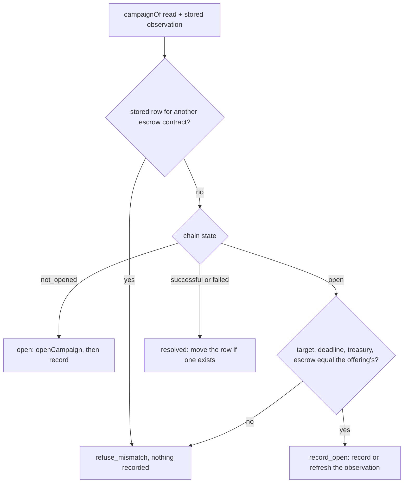

# Module: settlement

Valid for main at 48aa967 (2026-11-18).

The `settlement` module is the platform's on-chain side: it opens and finalizes the IPO escrow campaign of an offering, mints the investors' position tokens when a campaign succeeds, watches the wallet registry contract to confirm wallet claims, and reports the health of that watcher. It has no router and no HTTP route. It runs in the worker process and in one operator command, and it is dormant wherever the chain configuration is absent. Read this page before you change anything that signs with the platform's operator key or reads chain events.

## 1. Purpose and bounded context

| Question | Answer |
| --- | --- |
| What does the module do? | Four jobs and one command (section 3). (1) `settlement.open_ipo_escrow_campaign` opens an offering's campaign on `VistaBloxIpoEscrow` or records that it is already open; the command `npm run settlement:open-ipo-escrow-campaigns` does the same for every open offering. (2) `settlement.finalize_ipo_escrow_campaigns` finalizes campaigns whose deadline passed, mints each contributor's tokens and sweeps the raised amount. (3) `settlement.confirm_wallet_registrations` reads `WalletRegistered` events and confirms wallet claims. (4) `settlement.check_wallet_registry_health` evaluates the watcher's health. |
| Status | Built. Dormant by absent configuration, not by a switch: the campaign and finalizer jobs exist only when the whole settlement bundle (seven variables, section 7) is set, the watcher only when the registry address and the three base `CHAIN_*` variables are set (`src/worker.ts:263-306`). No flag turns the layer off (C-008 in the record). |
| Who calls it? | `src/worker.ts` (the four jobs), `src/cli/open-ipo-escrow-campaigns.ts` (the command), and the API process, which builds `PrismaSettlementRepository` as the reader of token holdings for the `wallet` module (`src/server.ts:559`). The offering handoff enqueues the campaign job (section 6). |
| Custody | The module signs with the platform's own operator key `CHAIN_OPERATOR_PRIVATE_KEY` (campaign open, finalize, mint, sweep). It signs nothing for a user. The record says VistaBlox holds no key that signs for a wallet and no tokens (AD-247); that the worker signs chain writes with a platform-held key is recorded as open conflict C-008. |
| What it does not own | Wallet claims, replacement and expiry (`wallet`, see [wallet.md](wallet.md)); the reservation gate that reads the campaign observation (`offering`, see [offering.md](offering.md)); what an investor sees of positions (`investor-activity`). It owns no HTTP surface. |
| Database tables written | `settlement.ipo_escrow_campaigns`, `settlement.escrow_mint_intents`, `settlement.position_ledger` (escrow-minted positions), `settlement.chain_settlement_events`, `settlement.wallet_registrations` (confirmation and evidence), `platform.settings` (cursor and heartbeat), `audit.audit_log`. |

## 2. File map

| Layer | File | Lines | Responsibility |
| --- | --- | --- | --- |
| api | none | | No router. Nothing is mounted by `createApp`; `src/app.ts:236` imports only a repository type. |
| application | `src/modules/settlement/application/open-ipo-escrow-campaign.service.ts` | 315 | `OpenIpoEscrowCampaignService`: `execute(payload)` (the job), `inspect(request)` (read only), `activate(request)`. Defines the job payload schema `openIpoEscrowCampaignJobSchema`, `IpoEscrowCampaignMismatchError` and the alert event `settlement.ipo_escrow_campaign_mismatch`. |
| application | `src/modules/settlement/application/open-ipo-escrow-campaigns-command.service.ts` | 314 | `OpenIpoEscrowCampaignsCommandService`, `resolveOpenIpoEscrowCampaignsStartup`, `renderIpoEscrowActivationReport`: the logic of the operator command, dry run or confirm, one offering at a time. |
| application | `src/modules/settlement/application/finalize-ipo-escrow-campaigns.service.ts` | 836 | `FinalizeIpoEscrowCampaignsService`: finalize, mint with intent and pinned nonce, record positions, sweep. |
| application | `src/modules/settlement/application/ipo-escrow-campaign-observation.ts` | 59 | `recordObservedIpoEscrowCampaignState`: moves a stored observation to a non-open state; never throws. |
| application | `src/modules/settlement/application/confirm-wallet-registrations.service.ts` | 672 | `ConfirmWalletRegistrationsService`: the watcher (events, matching, confirmation, evidence re-check, cursor). |
| application | `src/modules/settlement/application/run-wallet-registry-watcher.service.ts` | 59 | `RunWalletRegistryWatcherService`: one scheduled run with reporting. |
| application | `src/modules/settlement/application/check-wallet-registry-health.service.ts` | 63 | `CheckWalletRegistryHealthService`: reads the database only and reports the alerts. |
| application | `src/modules/settlement/application/wallet-registry-alert-reporter.ts` | 294 | `WalletRegistryAlertReporter`: structured log events, metrics, heartbeat writes. |
| application | `src/modules/settlement/application/wallet-registry-expiry-gate.ts` | 106 | `WalletRegistryExpiryGate`: tells the wallet expiry sweep whether the watcher may be trusted. |
| domain | `src/modules/settlement/domain/ipo-escrow-campaign.policy.ts` | 204 | Campaign states, differences, `planIpoEscrowCampaignAction`, the activation refusal. |
| domain | `src/modules/settlement/domain/wallet-registration-event.policy.ts` | 116 | `decideRegisteredRowEvent`, `isDifferentTransactionFromRegisteredWallet`, `finalCursor`, `rewindTargetFor`, the evidence depth constants. |
| domain | `src/modules/settlement/domain/wallet-registry-alert-policy.ts` | 285 | `WALLET_REGISTRY_ALERT_EVENTS`, `evaluateWalletRegistryHealth`, `evaluateWalletRegistryRun`. |
| repository | `src/modules/settlement/repository/settlement.repository.ts` | 357 | `SettlementRepository` (campaign observations, mint intents, positions, wallet confirmation, cursor), `PivTokenHoldingsReader`, the record types. |
| repository | `src/modules/settlement/repository/prisma-settlement.repository.ts` | 853 | `PrismaSettlementRepository`, the only implementation; also `walletRegistrationAddressMismatchEventKey`. |
| repository | `src/modules/settlement/repository/wallet-registry-health.repository.ts` | 48 | Interfaces `WalletRegistryHeartbeatWriter` and `WalletRegistryHealthReader`. |
| repository | `src/modules/settlement/repository/prisma-wallet-registry-health.repository.ts` | 151 | `PrismaWalletRegistryHealthRepository`: heartbeat in `platform.settings`, pending, flagged and unresolved-mismatch counts. |
| repository | `src/modules/settlement/repository/wallet-registry-setting-keys.ts` | 10 | The two `platform.settings` keys: `wallet_registry.last_processed_block` and `wallet_registry.watcher_heartbeat`. |
| outside the module | `src/infrastructure/blockchain/` (`chain-client.ts`, `operator-key-lock.ts`, `settlement-bundle.ts`, `wallet-registry-chain-reader.ts`, `transfer-snapshot.ts`) | | The viem clients, the Postgres advisory lock for the operator key, `isSettlementBundleConfigured`, the registry reader. |
| outside the module | `src/cli/open-ipo-escrow-campaigns.ts` (99), `src/cli/open-ipo-escrow-campaigns-arguments.ts` (54) | | The operator command's entry point and argument parser. |

The module imports nothing from another module (a search of its files finds only `shared`, `infrastructure` and its own layers). Wiring: `src/worker.ts:263-358` builds the services, `src/worker.ts:432-445` creates the queues, `src/worker.ts:504-535` schedules them, `src/worker.ts:635-679` and `src/worker.ts:711-733` register the consumers.

## 3. Public surface

### 3.1 Routes

None.

### 3.2 Jobs and queues

The queue entries (retry profile, dead-lettering, ownership) are in [../jobs-and-workers.md](../jobs-and-workers.md). All four are owned by `settlement` at tier `tier_1` (`src/shared/jobs/job-ownership.ts:34-37`).

| Queue | Kind | Trigger | Exists when | Handler |
| --- | --- | --- | --- | --- |
| `settlement.open_ipo_escrow_campaign` | event | `case_timers.pre_offering_open_handoff` ran for an offering with an IPO end whose case is not closed, in the same transaction (`src/modules/offering/repository/prisma-offering.repository.ts:266-279`) | the settlement bundle is configured (`src/worker.ts:432-434`) | `OpenIpoEscrowCampaignService.execute` (`src/worker.ts:711-733`) |
| `settlement.finalize_ipo_escrow_campaigns` | scheduled `0 * * * *` UTC | the schedule (`src/worker.ts:504-513`) | the settlement bundle is configured | `FinalizeIpoEscrowCampaignsService.execute` (`src/worker.ts:635-662`) |
| `settlement.confirm_wallet_registrations` | scheduled `* * * * *` UTC | the schedule (`src/worker.ts:514-525`) | registry address and `CHAIN_NETWORK`, `CHAIN_RPC_URL`, `CHAIN_OPERATOR_PRIVATE_KEY` set | `RunWalletRegistryWatcherService.execute` (`src/worker.ts:664-674`) |
| `settlement.check_wallet_registry_health` | scheduled `*/5 * * * *` UTC | the schedule (`src/worker.ts:526-535`) | the registry address is set, even when the watcher cannot run | `CheckWalletRegistryHealthService.execute` (`src/worker.ts:675-679`) |

> Pending #235: the finalizer job throws, and so retries and dead-letters, when a campaign errored; on main it logs the errors and completes (`src/worker.ts:643-653`).

> Pending #240: the worker and the API check at boot that the RPC serves the configured chain and that the configured contract addresses hold code, and end the process when they do not or when the RPC is unreachable; main has no such check.

The `settlement.confirm_wallet_registrations` schedule is every minute, not hourly as a comment in the service says (`src/modules/settlement/application/confirm-wallet-registrations.service.ts:27-32`) and `README.md:41` puts "every 5 minutes" after the names of both the watcher and its health check; only the health check runs every five minutes (`src/worker.ts:521-535`).

### 3.3 Command

`npm run settlement:open-ipo-escrow-campaigns` runs `node dist/cli/open-ipo-escrow-campaigns.js` (`package.json:18`). It is a dry run unless `--confirm` is given; `--help` prints usage. It must run from a shell in the worker container, where the environment holds the chain settings and the operator key. It refuses unless the bundle is configured and `CHAIN_NETWORK` is `base-sepolia` (`src/modules/settlement/domain/ipo-escrow-campaign.policy.ts:164-204`, `src/cli/open-ipo-escrow-campaigns.ts:1-16`). It lists every offering that is `pre_offering` with final terms unpublished, a token id and an IPO end in the future (`src/modules/settlement/repository/prisma-settlement.repository.ts:212-241`), and for each reports `would_open`, `would_record`, `opened`, `recorded`, `refused_mismatch`, `resolved_on_chain` or `failed` (`src/modules/settlement/application/open-ipo-escrow-campaigns-command.service.ts:78-85`). Exit codes: 0 done or dry run, 1 refused or an offering failed or needs manual action, 2 bad arguments (`src/cli/open-ipo-escrow-campaigns.ts:13-14`). The command and the job use the same service and take the same operator-key lock. The procedure is in [../investor-offering.md](../investor-offering.md); all commands are listed in [../cli.md](../cli.md).

### 3.4 Events and alerts

Log events with a stable `event` and `severity` that an alert rule keys on:

| Event | Severity | Where |
| --- | --- | --- |
| `settlement.ipo_escrow_campaign_mismatch` | error | `src/modules/settlement/application/open-ipo-escrow-campaign.service.ts:31-33`, `:289-304` |
| `settlement.ipo_escrow_campaign_open_failed` | error | `src/modules/settlement/application/open-ipo-escrow-campaigns-command.service.ts:25-27` |
| `settlement.ipo_escrow_campaign_observation_failed` | error | `src/modules/settlement/application/ipo-escrow-campaign-observation.ts:6`, `:47-57` |
| the fifteen `wallet_registry.*` events | error, warn or info | `src/modules/settlement/domain/wallet-registry-alert-policy.ts:16-32` |

Nothing sends these to a person; the worker log is the channel, and the dead-letter webhook covers failed jobs only ([../dead-letter-jobs.md](../dead-letter-jobs.md)). The event catalogue, thresholds and the runbook for the wallet events are in [../wallet-registration-operations.md](../wallet-registration-operations.md). The worker exposes metrics (counters and gauges) whose names start with `vistablox_worker_wallet_registration` (`src/modules/settlement/application/wallet-registry-alert-reporter.ts:24-42`).

### 3.5 Audit rows written

| Action | Where |
| --- | --- |
| `settlement.wallet_registration_confirmed` | `src/modules/settlement/repository/prisma-settlement.repository.ts:566-578` |
| `settlement.wallet_registration_confirmation_conflict` (one row per account and address, key `wallet_registration_confirmation_conflict:chain_event:<account>:<address>`) | `src/modules/settlement/repository/prisma-settlement.repository.ts:596-624` |
| `settlement.wallet_registration_evidence_recorded`, `settlement.wallet_registration_evidence_refreshed` (the action is `settlement.wallet_registration_evidence_<reason>`) | `src/modules/settlement/repository/prisma-settlement.repository.ts:626-684` |
| `settlement.wallet_registration_evidence_flagged` | `src/modules/settlement/repository/prisma-settlement.repository.ts:705-748` |
| `settlement.wallet_registration_address_mismatch` | `src/modules/settlement/repository/prisma-settlement.repository.ts:821-853` |

Campaign opening, finalization and minting write no audit row; their durable record is the three tables in section 4.

## 4. Tables

| Table | Access | Notes |
| --- | --- | --- |
| `settlement.ipo_escrow_campaigns` | read, insert, update | The last observation of a PIV's campaign: `piv_id` (key), `token_id` (unique), escrow contract address, target amount in EURC base units, `deadline_at`, treasury address, `open_tx_hash`, `observed_state` (`not_opened`, `open`, `successful`, `failed`), `observed_at` (`prisma/schema/schema.prisma:935-968`). The reservation gate in `offering` reads it (`src/modules/offering/repository/prisma-offering.repository.ts:670-690`). |
| `settlement.escrow_mint_intents` | read, insert, update | One row per `(piv_id, account_id)`: status `sending`, `mint_sent`, `recorded`; attempt counter, `mint_tx_hash`, pinned `mint_nonce`, `search_from_block` (`prisma/schema/schema.prisma:889-933`). |
| `settlement.position_ledger` | insert, read | One row per escrow-minted position, with `escrow_mint_intent_id` unique so a replay cannot create a second (`prisma/schema/schema.prisma:851-885`). Status is written `active` with `activated_at` set (`src/modules/settlement/repository/prisma-settlement.repository.ts:472-488`). |
| `settlement.chain_settlement_events` | insert | A `mint` event per recorded position (`src/modules/settlement/repository/prisma-settlement.repository.ts:489-498`). |
| `settlement.wallet_registrations` | read, update | `registered_at` and the evidence columns on confirmation; reads for `resolveAccountIdForWallet`. |
| `platform.settings` | read, upsert | The watcher cursor and heartbeat (section 3 above, file `wallet-registry-setting-keys.ts`). |
| `intake.pivs`, `intake.intake_cases`, `offering.offerings` | read | To find PIVs with a passed deadline and offerings open for activation (`src/modules/settlement/repository/prisma-settlement.repository.ts:201-241`). |
| `audit.audit_log` | insert, read | Section 3.5; the health repository reads mismatch rows. |

Model definitions are in [../data-model.md](../data-model.md).

## 5. Domain rules and state machines

### 5.1 IPO escrow campaign

The chain's `CampaignState` is mapped by position: 0 `not_opened`, 1 `open`, 2 `successful`, 3 `failed`; an unknown code throws (`src/modules/settlement/domain/ipo-escrow-campaign.policy.ts:10-26`). `planIpoEscrowCampaignAction` decides what a run does (`src/modules/settlement/domain/ipo-escrow-campaign.policy.ts:131-162`):

| Rule | Where |
| --- | --- |
| A campaign with other parameters is never adopted; the differences are `target_amount`, `deadline`, `treasury`, `escrow_address`. | `src/modules/settlement/domain/ipo-escrow-campaign.policy.ts:50-102` |
| The opening transaction uses `PIV_TREASURY_ADDRESS`, one placeholder address for every PIV (C-008 question 3, the per-PIV treasury, is open). | `src/modules/settlement/application/open-ipo-escrow-campaign.service.ts:209-216`, `src/modules/settlement/application/open-ipo-escrow-campaign.service.ts:243-255` |
| The observation is recorded from a fresh `campaignOf` read after the receipt, so the row holds the chain's values; a reverted transaction or a campaign not open afterwards throws. | `src/modules/settlement/application/open-ipo-escrow-campaign.service.ts:218-241` |
| The job fails (and is retried) on a mismatch; the command reports it instead. | `src/modules/settlement/application/open-ipo-escrow-campaign.service.ts:145-154` |
| The command refuses unless the bundle is configured and the network is `base-sepolia`; the job has no network check (whether it should have is open, issue #176). | `src/modules/settlement/domain/ipo-escrow-campaign.policy.ts:164-204`; `src/worker.ts:270-274` |
| A reservation is accepted only while the stored observation is `open`, its deadline is ahead and it was recorded for the configured escrow contract, where the bundle is configured. | `src/modules/offering/repository/prisma-offering.repository.ts:670-690` |

### 5.2 Finalization and minting

For every PIV with a token and a passed IPO end, the hourly job reads `campaignOf` (`src/modules/settlement/application/finalize-ipo-escrow-campaigns.service.ts:190-261`):

1. A swept campaign is skipped (`:199-208`). A campaign still `open` is finalized with `finalize(tokenId)` under the operator lock (`:210-219`).
2. `failed`: counted, nothing else; contributors withdraw their own contributions (`:221-224`, comment `:111-119`).
3. `successful`: for each contributor wallet `mintForContributor` resolves the account from a confirmed registration only; a wallet with no confirmed registration is `unattributable`, is listed in `errors`, and does not stop the other contributors; the sweep `withdrawRaised` runs only when every contributor has a position (`:230-261`).
4. A contributor who already has a position is skipped; the mint amount is the on-chain `contributionOf`; the recorded position has `unit_count` equal to the cost basis in EUR, the 1-unit-per-EUR convention (`:332-384`).

Minting is made safe against a crash between the chain write and the database write by an `escrow_mint_intents` row written before the send, a pinned operator nonce stored first, and a reconciliation against the chain on every rerun (header comment `src/modules/settlement/application/finalize-ipo-escrow-campaigns.service.ts:16-39`, `:111-142`):

```mermaid
stateDiagram-v2
    [*] --> sending: intent written before the send
    sending --> mint_sent: node returned a hash
    mint_sent --> recorded: receipt success; position and mint event written in one transaction
    sending --> sending: new attempt, new nonce (chain shows none can land)
    mint_sent --> sending: reverted, or nonce used by another transaction
```

The decision table for an intent that is not `recorded` and the manual repair procedure are in [../escrow-mint-reconciliation.md](../escrow-mint-reconciliation.md). Constants: `ESCROW_MINT_IN_FLIGHT_GRACE_MS` 30 minutes for intents written before nonces were pinned (`:40`); the block tag for the operator's confirmed nonce is `ESCROW_MINT_NONCE_BLOCK_TAG`, default `finalized` (`:47-49`); the mint log search starts from the block recorded on the intent, else block 0 (`:786-803`). An intent that is `recorded` while no position exists, or a chain state that does not fit the intent, is refused with an error that says manual reconciliation is required (`:414-419`, `:515-520`, `:592-602`, `:805-828`).

### 5.3 Wallet registry watcher

`ConfirmWalletRegistrationsService.execute` (`src/modules/settlement/application/confirm-wallet-registrations.service.ts:232-323`):

| Step | Rule |
| --- | --- |
| Range | From `cursor - 32 + 1` (an overlap of 32 blocks with the saved cursor, or block 0 while the cursor is 32 or less) to the chain head minus 3 confirmations; when that is more than 2000 blocks, `toBlock` is `fromBlock + 2000` (`:33-45`, `:239-288`). With no cursor it starts at the latest safe block (`:240-248`). |
| Match | An event is matched to a live claim by `registration_commitment`; an event for a replaced, expired or unknown commitment is `unmatched` (`:113-117`). |
| Confirm | A compare-and-set on the claim's address and commitment, `registered_at` and the event identity in one statement; outcomes `confirmed`, `already_registered`, `stale`, `event_taken`, `address_conflict`, `expired` (`src/modules/settlement/repository/prisma-settlement.repository.ts:523-594`, `src/modules/settlement/repository/settlement.repository.ts:203-209`). |
| Sender check | An on-chain sender different from the stored address is an address mismatch: audited once per (account, commitment, sender), announced once, claim stays pending (`:362-388`, `src/modules/settlement/repository/prisma-settlement.repository.ts:821-853`). |
| Already confirmed | `decideRegisteredRowEvent` returns `replay`, `record_evidence`, `refresh` or `conflict`; a conflict is never applied automatically (`src/modules/settlement/domain/wallet-registration-event.policy.ts:25-69`). |
| Re-check | Up to 50 confirmed rows with unverified evidence are compared with the chain per run; a block at least 900 blocks deep is marked verified; a transaction mined again is refreshed; one that is gone is flagged and never reverted (`:170-206`, `:496-614`, `src/modules/settlement/domain/wallet-registration-event.policy.ts:3-14`). |
| Cursor | After judging, the cursor is written and only then are rows flagged, refreshed or verified; a reorganized block rewinds the cursor unless it is deeper than 900 blocks (`:309-320`, `src/modules/settlement/domain/wallet-registration-event.policy.ts:89-116`). |

The expiry gate declares the watcher untrusted (the wallet sweep does nothing) when the policy reports `watcher_stalled`, `cursor_lag` or `cursor_ahead_of_chain`, when the watcher cannot run but has history, or when the snapshot cannot be read (`src/modules/settlement/application/wallet-registry-expiry-gate.ts:8-17`, `:42-69`).

## 6. Interaction with other modules

| Other module | Direction | How |
| --- | --- | --- |
| `offering` | offering enqueues; offering reads | `OpenOfferingForApprovedCaseService` (job `case_timers.pre_offering_open_handoff`) enqueues `settlement.open_ipo_escrow_campaign` inside its transaction, only when the worker built the campaign service (`src/worker.ts:278-287`, `src/modules/offering/repository/prisma-offering.repository.ts:266-279`). The reservation gate reads `settlement.ipo_escrow_campaigns` (`src/modules/offering/repository/prisma-offering.repository.ts:670-690`). The reconfirmation-window close creates the reservation-flow positions in `settlement.position_ledger` itself (`src/modules/offering/repository/prisma-offering.repository.ts:1474-1483`). |
| `wallet` | wallet reads and shares a table | `PrismaSettlementRepository.listTokenHoldings` serves `PivTokenHoldingsReader` for the balance and transfer routes (`src/modules/settlement/repository/prisma-settlement.repository.ts:339-349`). The watcher writes `registered_at` of the row the wallet module creates and expires; the expiry gate is `settlement` code met structurally by the wallet service (`src/worker.ts:373-390`). |
| `rental` | rental reads | Distributions read `active` positions, which only the escrow mint here creates (see [rental.md](rental.md)). |
| `investor-activity`, `profile` | they read | Positions and the wallet status. |
| `auth`, `identity`, `intake`, `account` | none | No import and no job. |

## 7. Configuration

| Variable | Effect |
| --- | --- |
| `CHAIN_NETWORK`, `CHAIN_RPC_URL`, `CHAIN_OPERATOR_PRIVATE_KEY` | All or none (`src/config/environment.ts:490-507`). Needed for any chain client in the worker. |
| `VISTABLOX_PROPERTY_CONTRACT_ADDRESS`, `VISTABLOX_IPO_ESCROW_CONTRACT_ADDRESS`, `EURC_TOKEN_ADDRESS`, `PIV_TREASURY_ADDRESS` | All or none, and only with the three above (`src/config/environment.ts:508-534`). Together they form the settlement bundle (`src/infrastructure/blockchain/settlement-bundle.ts:24-34`); without it the campaign and finalizer jobs do not exist. |
| `VISTABLOX_WALLET_REGISTRY_CONTRACT_ADDRESS` | Independently optional (`src/config/environment.ts:323`). Enables the health check; with the base `CHAIN_*` variables, the watcher. |
| `ESCROW_MINT_NONCE_BLOCK_TAG` | `finalized` (default), `safe` or `latest` (`src/config/environment.ts:369-372`). |
| `WALLET_REGISTRY_PENDING_WARN_AFTER_MINUTES` | Default 5 (`src/config/environment.ts:324`). |
| `WALLET_REGISTRY_WATCHER_STALE_AFTER_MINUTES` | 2 to 1440, default 10 (`src/config/environment.ts:331`). |
| `WALLET_REGISTRY_CURSOR_LAG_ALERT_BLOCKS` | 1 to 1,000,000, default 900 (`src/config/environment.ts:334`). |
| `WALLET_REGISTRY_PENDING_OVERDUE_ALERT_COUNT` | 1 to 10,000, default 1 (`src/config/environment.ts:337`). |
| `WALLET_REGISTRY_UNMATCHED_EVENTS_ALERT_COUNT` | 1 to 10,000, default 5 (`src/config/environment.ts:340`). |

The full list, with the processes that read each, is in [../configuration.md](../configuration.md). The operator key is a secret; it appears in the documentation only as the placeholder name used in `.env.example`.

## 8. Existing guides

| Guide | Covers |
| --- | --- |
| [../wallet-registration-operations.md](../wallet-registration-operations.md) | The watcher, its events and thresholds, the reconciliation procedure. |
| [../escrow-mint-reconciliation.md](../escrow-mint-reconciliation.md) | The mint decision table and the manual repair. |
| [../investor-offering.md](../investor-offering.md) | The reservation gate, the campaign command and the settlement bundle. |
| [../dead-letter-jobs.md](../dead-letter-jobs.md) | What happens to a failed job. |

## 9. Tests

| File | What it covers |
| --- | --- |
| `tests/ipo-escrow-campaign.policy.test.ts`, `tests/settlement-escrow-readiness.policy.test.ts` | The campaign policy and the readiness rule of the gate. |
| `tests/open-ipo-escrow-campaign.service.test.ts`, `tests/open-ipo-escrow-campaigns-command.test.ts`, `tests/ipo-escrow-campaign-readiness.integration.test.ts`, `tests/settlement-escrow-gate.integration.test.ts` | The opening service, the command and its report, the observation row and the gate against a database. |
| `tests/finalize-ipo-escrow-campaigns.service.test.ts`, `tests/finalize-ipo-escrow-mint.integration.test.ts`, `tests/settlement-repository.integration.test.ts` | The finalizer's decisions, the mint against a database, the repository. |
| `tests/operator-key-lock.integration.test.ts`, `tests/settlement-bundle.test.ts`, `tests/chain-settlement-environment.test.ts`, `tests/chain-client.test.ts` | The advisory lock, the bundle test, the environment rules, the chain clients. |
| `tests/confirm-wallet-registrations.service.test.ts`, `tests/confirm-wallet-registrations-evidence.service.test.ts`, `tests/confirm-wallet-registrations-alert-signals.service.test.ts`, `tests/confirm-wallet-registrations-evidence.integration.test.ts`, `tests/wallet-registration-event.policy.test.ts`, `tests/wallet-registry-event-reading.test.ts`, `tests/wallet-registry-chain-reader.test.ts` | The watcher, evidence handling and the event policy. |
| `tests/run-wallet-registry-watcher.service.test.ts`, `tests/check-wallet-registry-health.service.test.ts`, `tests/wallet-registry-alert-policy.test.ts`, `tests/wallet-registry-alert-reporter.test.ts`, `tests/wallet-registry-alert-config.test.ts`, `tests/wallet-registry-alert-environment.test.ts`, `tests/wallet-registry-expiry-gate.test.ts`, `tests/wallet-registry-health.integration.test.ts`, `tests/wallet-registry-heartbeat-isolation.test.ts`, `tests/wallet-registry-mismatch-announcement.integration.test.ts`, `tests/wallet-registry-worker-wiring.test.ts` | The runner, the health check, the alert policy and reporter, the gate, the heartbeat and the wiring. |

Integration files skip without `TEST_DATABASE_URL`; see [../testing.md](../testing.md).

## 10. Where to put a change

| Change | Place |
| --- | --- |
| A new rule on what counts as the offering's campaign | `src/modules/settlement/domain/ipo-escrow-campaign.policy.ts` and its test; the service only applies it. |
| A new chain write with the operator key | In the application layer, wrapped in `operatorKeyLock.run` around the send only (never the receipt wait); add the queue to `JOB_QUEUE_OWNERSHIP` or the dead-letter test fails. |
| A new alert from the watcher | An entry in `WALLET_REGISTRY_ALERT_EVENTS` and a rule in `wallet-registry-alert-policy.ts`, a line in the runbook (a test compares the names with it). |
| A new way to start a campaign (a sweep, a route) | Not built on purpose (AD-286: opening a campaign is a person's decision); decide first. |
| Pay out or redeem | Not built. The distribution calculation is in [rental.md](rental.md). |
| A change to how a claim becomes confirmed by hand | `wallet`, not here. |
| Gate a chain write by network | `ipoEscrowActivationRefusal` for the command; the job has no such check. |

## 11. Known limitations

| Limitation | Evidence | Issue |
| --- | --- | --- |
| A finalizer run that had campaign errors is logged at error level and completes, so pg-boss does not retry it or dead-letter it; the next hourly run is the retry. | `src/worker.ts:643-653` | #206 (open, PR #235) |
| The mint log search has no upper block and, without a recorded start block, starts at block 0; on a long-lived chain the query grows without bound. | `src/modules/settlement/application/finalize-ipo-escrow-campaigns.service.ts:792-803` | #219 |
| The finalizer reads `campaignOf` for every PIV that has a token and a passed deadline on every hourly run, swept campaigns included; the swept check happens after the read. | `src/modules/settlement/repository/prisma-settlement.repository.ts:201-210`, `src/modules/settlement/application/finalize-ipo-escrow-campaigns.service.ts:196-208` | none |
| A campaign swept by someone else (`withdrawRaised` is permissionless) before the mints leaves the unminted contributors unminted; the code comment calls it a known gap. | `src/modules/settlement/application/finalize-ipo-escrow-campaigns.service.ts:199-208` | none |
| The campaign job keeps no transaction hash between attempts: if the receipt wait gives up while the transaction is pending, a retry reads `not_opened` and sends `openCampaign` again, which the contract rejects once the first is mined. The README lists this as a retry hazard. | `src/modules/settlement/application/open-ipo-escrow-campaign.service.ts:175-218`, `README.md:64` | none |
| The campaign job is not limited to a testnet, while the command is. | `src/modules/settlement/domain/ipo-escrow-campaign.policy.ts:164-204`, `src/worker.ts:270-274` | #176 (open, needs the founder) |
| One treasury address, `PIV_TREASURY_ADDRESS`, is used for every campaign. | `src/modules/settlement/application/open-ipo-escrow-campaign.service.ts:243-255` | none (C-008 question 3) |
| An intent with a recorded hash, no receipt and no pinned nonce is never replaced automatically; the manual repair authority is open. | `src/modules/settlement/application/finalize-ipo-escrow-campaigns.service.ts:441-448`, [../escrow-mint-reconciliation.md](../escrow-mint-reconciliation.md) | #207 (closed; gap listed) |
| The evidence re-check drops the error and only counts it; a plain database error is swallowed the same way. | `src/modules/settlement/application/confirm-wallet-registrations.service.ts:503-508`, `src/modules/settlement/application/confirm-wallet-registrations.service.ts:516-521` | none |
| The operator-key lock holds one database transaction, and so one pooled connection, for the whole chain send, up to the wait plus hold limits (60 s and 120 s). | `src/infrastructure/blockchain/operator-key-lock.ts:57-58`, `src/infrastructure/blockchain/operator-key-lock.ts:90-103` | none |
| Alerts are log events only; no delivery. | [../wallet-registration-operations.md](../wallet-registration-operations.md) | #150 (closed by #231; delivery not built) |
| Neither compose file sets `stop_grace_period`, so Docker's default applies when the worker is stopped while a chain write is in flight; a pg-boss retry then repeats the job. (A search of both files finds no `stop_grace_period`.) | `docker-compose.yml`, `docker-compose.staging.yml` | none |
| A position's unit count is its cost basis in EUR (`costBasisToUnitCount` returns its argument): there is no total-supply or price-per-unit model in the code, and the escrow mint and the reservation flow share the convention. | `src/shared/domain/position.ts:1-8`, `src/modules/settlement/application/finalize-ipo-escrow-campaigns.service.ts:367-369` | none |

## 12. Known gaps between the code and the design record

| Statement in the record | Code | Register / decision |
| --- | --- | --- |
| The settlement layer is dormant until a counsel memo clears activation (AD-234). | There is no switch; dormancy is the absence of configuration, and the worker signs with a platform-held key that AD-247 says VistaBlox does not hold. | C-008 (partly answered by AD-286) |
| The funding rail and the settlement bundle stay off together (AD-285); reservations wait for the campaign to be open only where the bundle is configured (AD-286). | The gate exists as described; the campaign job is not testnet-gated. | C-007, C-008; issue #176 |
| `ASYNC_JOBS.md` sets one retry baseline and four serialization keys and names no owner per queue. | Event queues retry 16 times over about three hours, scheduled queues 5; no serialization key; an ownership table exists. The operator-key lock is a database advisory lock, not a pg-boss key. | C-019 |
| `ALERTING.md` keeps a narrow alert catalogue. | The watcher raises fifteen `wallet_registry.*` events and the campaign code three `settlement.*` events. | C-020 |
| Interrupted escrow mints reconciled by "resumable per contributor" (AD-256 addendum). | A pinned nonce, an intent table and a chain reconciliation. | C-024 |
| The record's `CORE_TABLES.md` documents the tables under the schema name `origination` for the PIV tables the finalizer reads. | The schema is `intake`. | C-018 |

Register entries are in `00-Governance/MIGRATION/CONFLICT_REGISTER.md` on the `origin/main` of the design-record repository; the working checkout read for this page lacks C-009 onward. The record was not edited.

## 13. Not verified

- Behaviour against a real chain, a real `VistaBloxIpoEscrow` and `VistaBloxProperty` deployment and a real RPC provider; only the code and its tests were read, and the worker was not run.
- Behaviour on PostgreSQL 18 (local checks ran on 16.15), in particular the advisory lock and the row locks.
- The staging and production values of every `CHAIN_*` and contract variable (`.env.staging` is not in the repository).
- Whether the staging worker has the settlement bundle configured; the staging compose file was not read for each variable.
