# Module: wallet

Valid for main at 48aa967 (2026-11-18).

The `wallet` module handles the customer's self-custodied wallet address: it records the address the customer claims, hands the device the commitment to register on chain, reads balances, prepares (never signs) token transfers, retires stale claims and lets staff reconcile a registration by hand. It never holds a key or signs for a user (AD-240). Read this page before you change how an address becomes confirmed, who may change it, or what a transfer preparation checks.

## 1. Purpose and bounded context

| Question | Answer |
| --- | --- |
| What does the module own? | Six routes: four customer routes under `/v1/investor-profile/wallet` and two staff routes under `/internal/v1/wallet-accounts` (section 3.1); the pending-claim expiry job `maintenance.wallet_registration_expiry`; the table `settlement.wallet_registrations` as far as claims, replacement, expiry and staff reconciliation are concerned. |
| What does it not own? | The confirmation of a claim from the on-chain registry event (the `settlement` module's watcher job `settlement.confirm_wallet_registrations`, see [settlement.md](settlement.md)); the registry's health alerts (`settlement`); the chain clients themselves (`src/infrastructure/blockchain`); fresh authentication (the `auth` module, injected as a probe). |
| What is a claim? | A row in `settlement.wallet_registrations` with `registered_at` null and `expired_at` null. It proves nothing and binds no address; only a confirmed row (`registered_at` set) is exclusive to its account (`prisma/schema/schema.prisma:808-816`, `src/modules/wallet/repository/prisma-wallet.repository.ts:83-101`). |
| Self-custody | The module reads chain state and builds unsigned calldata. `request-wallet-transfer.service.ts` reads one block, simulates the exact transfer at that block and returns the encoded transaction for the device to sign (`src/modules/wallet/application/request-wallet-transfer.service.ts:21-38`). Nothing in it signs or broadcasts. |
| Who may call the routes? | Customer routes: customers only; a staff or partner session passes `requireAuthentication` and is refused with `403 authorization.forbidden` (`src/modules/wallet/api/wallet.router.ts:87-107`). Staff routes: `requireAuthentication`, `requireAdminOperations`, `requireStaffWebAuthn` (`src/modules/wallet/api/wallet-operations.router.ts:24`). |

## 2. File map

| Layer | File | Lines | Responsibility |
| --- | --- | --- | --- |
| api | `src/modules/wallet/api/wallet.router.ts` | 107 | `createWalletRouter(requireAuthentication, isFreshlyAuthenticated, registerWallet, getStatus, getBalance?, requestTransfer?)`. `POST /`, `GET /`, and, when the services are passed, `GET /balance` and `POST /transfers`. Defines the type `WalletFreshAuthenticationProbe`. Every response sets `Cache-Control: no-store`. |
| api | `src/modules/wallet/api/wallet-operations.router.ts` | 43 | `createWalletOperationsRouter(...)`: `GET /:account_id`, and `POST /:account_id/reconcile` only when a reconcile service is passed. |
| api | `src/modules/wallet/api/wallet.schemas.ts` | 154 | Zod schemas for every body and response; `ethAddress` (trim, 20-byte hex, not the zero address, transformed to the canonical lowercase form); the transfer `amount` pattern. |
| application | `src/modules/wallet/application/register-wallet.service.ts` | 117 | `RegisterWalletService`: registry configured, KYC current, then `repository.registerWallet`; maps repository errors to `409` and `403`. |
| application | `src/modules/wallet/application/get-wallet-status.service.ts` | 34 | `GetWalletStatusService`: the account's live (not expired) row, or `404 wallet.not_registered`. Database only. |
| application | `src/modules/wallet/application/get-wallet-balance.service.ts` | 56 | `GetWalletBalanceService` and the port `WalletChainReader` (`getCapitalBalance`, `getTokenBalances`): EURC balance and one balance per held token id. |
| application | `src/modules/wallet/application/request-wallet-transfer.service.ts` | 195 | `RequestWalletTransferService` and the port `WalletTransferChainReader.readTransferSnapshot`: confirmed wallet, held token, amount range, one snapshot, preflight decision, unsigned transaction. |
| application | `src/modules/wallet/application/get-wallet-account-for-operations.service.ts` | 68 | `GetWalletAccountForOperationsService`: staff view of one account's row including an expired claim and the evidence state. |
| application | `src/modules/wallet/application/reconcile-wallet-registration.service.ts` | 242 | `ReconcileWalletRegistrationService`, the port `WalletRegistrationChainVerifier`, `WalletRegistrationVerificationError`: staff confirmation or evidence repair from a transaction hash. |
| application | `src/modules/wallet/application/expire-pending-wallet-registrations.service.ts` | 100 | `ExpirePendingWalletRegistrationsService`: the sweep behind `maintenance.wallet_registration_expiry`. |
| domain | `src/modules/wallet/domain/transfer-preflight-policy.ts` | 92 | `assessTransferPreflight`: the first reason a transfer would fail, in a fixed order. |
| domain | `src/modules/wallet/domain/wallet-claim-expiry-schedule.ts` | 20 | `walletClaimExpiryCron` and the allowed sweep intervals. |
| repository | `src/modules/wallet/repository/wallet.repository.ts` | 186 | Interfaces `WalletRepository`, `WalletRegistrationExpiryRepository`, `WalletRegistryWatcherGate`, `WalletStatusReader`; error classes `WalletAddressConflictError`, `WalletReplacementFreshAuthenticationRequiredError`, `WalletRegistrationChangedError`. |
| repository | `src/modules/wallet/repository/prisma-wallet.repository.ts` | 563 | `PrismaWalletRepository` implements `WalletRepository`, `WalletStatusReader` and `WalletRegistrationExpiryRepository`. |
| outside the module | `src/infrastructure/blockchain/chain-wallet-reader.ts` (29), `src/infrastructure/blockchain/wallet-registration-verifier.ts` (67), `src/infrastructure/blockchain/transfer-snapshot.ts` (304) | | `ViemWalletChainReader` implements both chain-reader ports; `ViemWalletRegistrationVerifier` implements the verifier port; the snapshot reads and simulates at one block. |

Wiring in the API process (`src/server.ts`): `walletRepository` at `:546`; the balance and transfer dependencies (`walletBalances`) are built only when `CHAIN_NETWORK`, `CHAIN_RPC_URL`, `VISTABLOX_PROPERTY_CONTRACT_ADDRESS` and `EURC_TOKEN_ADDRESS` are all set (`:552-568`); the reconciler is built only when `CHAIN_NETWORK`, `CHAIN_RPC_URL` and `VISTABLOX_WALLET_REGISTRY_CONTRACT_ADDRESS` are set (`:689-691`); `src/app.ts:827-873` mounts both routers and throws at start-up when the fresh-authentication probe is missing. In the worker process (`src/worker.ts:373-390`) the expiry service is built with the watcher gate from `settlement`.

> Pending #237: the wallet mounts move from `src/app.ts` into `src/composition/compose-investor-profile.ts`; the routers, services and repository do not change.

## 3. Public surface

### 3.1 Routes

Full entries, with response bodies and error tables, are in [../api/wallet.md](../api/wallet.md).

| Method | Path | Authentication | Mounted when | Behaviour |
| --- | --- | --- | --- | --- |
| `POST` | `/v1/investor-profile/wallet` | session, customer | `protectedApi.wallet` present | Registers the address or replaces a pending claim; answers `201` with `wallet_address`, `registration_commitment`, `registry_contract_address`, `status` (`pending` or `registered`), `requested_at`, `registered_at` (`src/modules/wallet/api/wallet.router.ts:35-51`). `503 wallet.on_chain_registration_unavailable` when the registry address is unset; `403 identity.kyc_required` without current KYC eligibility; `403 authentication.fresh_auth_required`; `409 wallet.registration_address_mismatch`; `409 wallet.address_already_claimed` (`src/modules/wallet/application/register-wallet.service.ts:38-85`). |
| `GET` | `/v1/investor-profile/wallet` | session, customer | same | Address and status of the live row; `404 wallet.not_registered` (`src/modules/wallet/application/get-wallet-status.service.ts:15-33`). |
| `GET` | `/v1/investor-profile/wallet/balance` | session, customer | `wallet.balances` present | EURC balance and one balance per token the account holds (`src/modules/wallet/application/get-wallet-balance.service.ts:22-55`). |
| `POST` | `/v1/investor-profile/wallet/transfers` | session, customer | `wallet.balances` present | Prepares an unsigned token transfer (section 5). |
| `GET` | `/internal/v1/wallet-accounts/:account_id` | staff: admin operations and WebAuthn | `protectedApi.wallet` present | The row including `registration_commitment`, `expired_at` and the evidence block; `404 wallet.account_not_found` (`src/modules/wallet/application/get-wallet-account-for-operations.service.ts:16-58`). |
| `POST` | `/internal/v1/wallet-accounts/:account_id/reconcile` | same | `wallet.walletRegistrationReconciler` present | Confirms a claim or repairs evidence from `transaction_hash` (section 5). |

The wallet routes use no `Idempotency-Key` middleware; idempotency is the repository's (a replay of the same address returns the same row). `POST /` needs fresh authentication only on one path (replacing a pending or expired claim with a different address); the router asks the injected probe after the body is validated and passes a boolean down, so the decision is taken under the row lock (`src/modules/wallet/api/wallet.router.ts:38-48`, `src/modules/wallet/repository/prisma-wallet.repository.ts:140-162`).

> Pending #239: a wallet balance read that fails on the chain answers `503 wallet.chain_unavailable` with a 10-second budget; on main there is no handling and the failure is `500`.

> Pending #244: the wallet router sends its body through `sendValidated`, so a body that fails its response schema becomes `500 internal.response_invalid` instead of `422 validation.invalid_field`; #245 does the same for the routers #244 does not cover.

### 3.2 Jobs and queues

| Queue | Kind | Trigger | Handler | Exists when |
| --- | --- | --- | --- | --- |
| `maintenance.wallet_registration_expiry` | scheduled, owner `settlement`, tier `tier_1` (`src/shared/jobs/job-ownership.ts:44-45`) | `walletClaimExpiryCron(WALLET_REGISTRY_PENDING_EXPIRE_SWEEP_MINUTES)`, default `*/15 * * * *` UTC (`src/worker.ts:584-589`) | `ExpirePendingWalletRegistrationsService.execute` through `runJob` (`src/worker.ts:828-830`) | always; not gated on the registry address or the chain settings |

The job's behaviour, retries and dead-lettering are described in [../jobs-and-workers.md](../jobs-and-workers.md) (entry `maintenance.wallet_registration_expiry`); the operator procedure is in [../wallet-registration-operations.md](../wallet-registration-operations.md).

### 3.3 Audit rows written

All in `audit.audit_log`:

| Action | Written by | Where |
| --- | --- | --- |
| `settlement.wallet_registration_requested` | first registration, or registering again over an expired claim (`changes` then carries `previous_expired_wallet_address`) | `src/modules/wallet/repository/prisma-wallet.repository.ts:195-205`, `src/modules/wallet/repository/prisma-wallet.repository.ts:229-239` |
| `settlement.wallet_registration_replaced` | a pending claim replaced by another address | `src/modules/wallet/repository/prisma-wallet.repository.ts:259-270` |
| `settlement.wallet_registration_expired` | the sweep, one row per expired claim, no actor | `src/modules/wallet/repository/prisma-wallet.repository.ts:343-357` |
| `settlement.wallet_registration_reconciled`, `settlement.wallet_registration_evidence_recorded`, `settlement.wallet_registration_evidence_replaced` | staff reconcile, with the staff account as actor | `src/modules/wallet/repository/prisma-wallet.repository.ts:455`, `src/modules/wallet/repository/prisma-wallet.repository.ts:501` |
| `settlement.wallet_registration_confirmation_conflict` | a staff reconcile lost to another account's confirmed address | `src/modules/wallet/repository/prisma-wallet.repository.ts:528-555` |

A refusal for missing fresh authentication writes no row (`src/modules/wallet/repository/prisma-wallet.repository.ts:140-151`). The confirmation by the watcher writes its own rows from the `settlement` module.

## 4. Tables

| Table | Access | Notes |
| --- | --- | --- |
| `settlement.wallet_registrations` | read, insert, update | One row per account (`account_id` is the key): `wallet_address`, `registration_commitment`, `requested_at`, `registered_at`, the event identity (`registration_tx_hash`, `registration_block_number`, `registration_block_hash`, `registration_log_index`), the re-check state (`registration_evidence_verified_at`, `registration_evidence_flagged_at`, `registration_evidence_flag`) and `expired_at` (`prisma/schema/schema.prisma:816-848`). The partial unique index `wallet_registrations_confirmed_address_key` on `lower(wallet_address)` where `registered_at IS NOT NULL` makes a confirmed address exclusive; `uq_wallet_registrations_chain_event` lets one event back one registration; the check `wallet_registrations_expired_only_pending_check` keeps a row from being both confirmed and expired (comments at `prisma/schema/schema.prisma:808-846`, constants at `src/modules/wallet/repository/prisma-wallet.repository.ts:24-31`). |
| `audit.audit_log` | insert | The actions in section 3.3. |
| `settlement.position_ledger` and the token ids | read through `PivTokenHoldingsReader` | Which tokens an account holds (`src/modules/settlement/repository/settlement.repository.ts`, see [settlement.md](settlement.md)). |

Model definitions are in [../data-model.md](../data-model.md). The table is in the `settlement` database schema although `wallet` writes most of its claim lifecycle; the watcher's confirmation write comes from `settlement`.

## 5. Domain rules and state machines

### 5.1 Claim lifecycle

```mermaid
stateDiagram-v2
    [*] --> pending: POST / (first registration)
    pending --> pending: same address (replay) or new address with fresh authentication
    pending --> registered: watcher sees the event, or staff reconcile
    pending --> expired: sweep after WALLET_REGISTRY_PENDING_EXPIRE_AFTER_HOURS
    expired --> pending: POST / again (new commitment; fresh authentication if the address differs)
    expired --> registered: staff reconcile on matching evidence
    registered --> registered: same address (replay), evidence repair by staff
```

| Rule | Where |
| --- | --- |
| Registering needs a configured registry address and current KYC eligibility (`eligibilityState` is `eligible` and `renewalDueAt` is in the future). The check is KYC only, not the wider investment-eligibility rule. | `src/modules/wallet/application/register-wallet.service.ts:38-63` |
| The registration is serialised per account: the row is locked with `SELECT ... FOR UPDATE`, and the insert uses `ON CONFLICT (account_id) DO NOTHING` with a second pass for the loser of a race. | `src/modules/wallet/repository/prisma-wallet.repository.ts:121-129`, `src/modules/wallet/repository/prisma-wallet.repository.ts:187-194` |
| A different address for an account whose own claim is pending or expired needs `freshAuthentication`; the check comes before any query about other accounts, so a stale session cannot probe which addresses are confirmed. First registration and a replay of the same address never need it. | `src/modules/wallet/repository/prisma-wallet.repository.ts:140-162` |
| Only a confirmed row binds an address. An address confirmed for another account is `409 wallet.address_already_claimed`, also for a replay of a pending claim; an account whose own row is confirmed on another address gets `409 wallet.registration_address_mismatch` (`409 wallet.address_already_claimed` instead when the submitted address is also confirmed for another account); the same confirmed address is an idempotent replay. | `src/modules/wallet/repository/prisma-wallet.repository.ts:164-185` |
| A replay of the same pending address keeps the commitment the device may have signed; a different address overwrites the row in place with a new commitment (the old one stops matching); registering again over an expired row issues a new commitment even for the same address. | `src/modules/wallet/repository/prisma-wallet.repository.ts:214-270` |
| The commitment is 32 random bytes as `0x`-prefixed hex, generated by the service. | `src/modules/wallet/application/register-wallet.service.ts:26-27` |
| An address is canonical lowercase hex at the edge and in the repository; the zero address is refused. | `src/modules/wallet/api/wallet.schemas.ts:11-20`, `src/modules/wallet/repository/prisma-wallet.repository.ts:115` |
| Expiry: a claim whose `requested_at` is at or before `now - expireAfterHours` is expired, oldest first, at most `batchSize` per run (defaults 24 hours and 500), rows locked with `FOR UPDATE SKIP LOCKED`, one audit row each; confirmed rows are never touched and nothing is deleted. | `src/modules/wallet/application/expire-pending-wallet-registrations.service.ts:50-65`, `src/modules/wallet/repository/prisma-wallet.repository.ts:296-361` |
| The sweep runs only when the registry watcher may be trusted: it asks `WalletRegistryWatcherGate.assess`; if the watcher is stale or lagging, or the answer cannot be read, it logs once and reports `checked: 0, acted: 0`. | `src/modules/wallet/application/expire-pending-wallet-registrations.service.ts:54-99`, `src/modules/wallet/repository/wallet.repository.ts:153-171` |
| The cron is `*/N * * * *` for a divisor `N` of 60, `* * * * *` for 1 and `0 * * * *` for 60; any other interval throws `RangeError`. | `src/modules/wallet/domain/wallet-claim-expiry-schedule.ts:9-20` |
| Customer reads (status, balance, transfer, profile) treat an expired claim as no wallet; staff reads and reconcile include it. | `src/modules/wallet/repository/prisma-wallet.repository.ts:278-294` |

### 5.2 Staff reconcile

`POST /internal/v1/wallet-accounts/:account_id/reconcile` takes `transaction_hash`, `0x` followed by 64 hex digits, lowercased by the schema (`src/modules/wallet/api/wallet.schemas.ts:98-104`). The service reads the row (expired included), returns `unchanged` without a chain call when the row already holds a complete, unflagged record of that transaction, otherwise asks the verifier for the `WalletRegistered` event of that transaction for this wallet and commitment, then calls the repository's compare-and-set (`src/modules/wallet/application/reconcile-wallet-registration.service.ts:63-167`). The outcomes (`confirmed`, `evidence_recorded`, `evidence_replaced`, `unchanged`) and the refusals are:

| Situation | Result | Where |
| --- | --- | --- |
| Row pending or expired | `confirmed`: `registered_at` set from the event, evidence written, `expired_at` cleared | `src/modules/wallet/repository/prisma-wallet.repository.ts:445-461` |
| Row confirmed without complete evidence, same transaction or none recorded | `evidence_recorded` | `src/modules/wallet/repository/prisma-wallet.repository.ts:483-486` |
| Row confirmed, flagged or the same transaction mined again | `evidence_replaced`, flag cleared | `src/modules/wallet/repository/prisma-wallet.repository.ts:469-482` |
| Row confirmed by a different event and not flagged, or confirmed with partial evidence for a different transaction | `409 wallet.registration_evidence_conflict` | `src/modules/wallet/repository/prisma-wallet.repository.ts:481`, `src/modules/wallet/repository/prisma-wallet.repository.ts:487-488`, `src/modules/wallet/application/reconcile-wallet-registration.service.ts:150-156` |
| The event backs another account's row | `409 wallet.registration_event_already_used` | `src/modules/wallet/repository/prisma-wallet.repository.ts:519` |
| The account replaced its claim after the read | `409 wallet.registration_changed` | `src/modules/wallet/repository/prisma-wallet.repository.ts:419-424` |
| The address is confirmed for another account | `409 wallet.address_already_claimed` and an audit row | `src/modules/wallet/repository/prisma-wallet.repository.ts:520-524` |
| Transaction not found, reverted, event missing | `422 wallet.registration_transaction_not_found`, `wallet.registration_transaction_reverted`, `wallet.registration_event_not_found` | `src/modules/wallet/application/reconcile-wallet-registration.service.ts:202-225` |
| Fewer than three confirmations | `409 wallet.registration_transaction_unconfirmed` | `src/modules/wallet/application/reconcile-wallet-registration.service.ts:226-232`, `src/infrastructure/blockchain/wallet-registration-verifier.ts:15`, `src/infrastructure/blockchain/wallet-registration-verifier.ts:53` |
| Chain unreadable | `503 wallet.chain_unavailable` | `src/modules/wallet/application/reconcile-wallet-registration.service.ts:233-240` |

### 5.3 Transfer preparation

`POST /v1/investor-profile/wallet/transfers` with `piv_id`, `to_wallet_address` and `amount` (a positive base-10 integer string, `^[1-9][0-9]*$`, no leading zero, `src/modules/wallet/api/wallet.schemas.ts:60-64`) checks in this order (`src/modules/wallet/application/request-wallet-transfer.service.ts:103-194`):

1. The account has a wallet row and it is confirmed; no row or a pending claim is `404 wallet.not_registered` (`:111-119`).
2. The account holds a minted token for the PIV, else `404 wallet.piv_not_held` (`:121-130`).
3. The amount does not exceed 2^256 - 1, else `422 wallet.insufficient_balance` without a chain call (`:132-137`).
4. One snapshot is read and the exact transfer is simulated at that block; a failure to read is `503 wallet.chain_unavailable` (`:139-162`).
5. `assessTransferPreflight` returns the first failure in the order `transfer_lane_closed`, `token_paused`, `recipient_not_authorized`, `insufficient_balance`, `recipient_cannot_receive`, `transfer_would_revert`; each is a `422 wallet.<name>` (`:40-78`, `src/modules/wallet/domain/transfer-preflight-policy.ts:39-92`). A revert is mapped by its decoded error name (`TransferLaneClosed`, `TokenIsPaused` or `EnforcedPause`, `HolderNotAuthorized`, `ERC1155InsufficientBalance`, `ERC1155InvalidReceiver`) and any other revert is `transfer_would_revert` (`src/modules/wallet/domain/transfer-preflight-policy.ts:48-64`).
6. The response carries the unsigned transaction (`chain_id`, `to`, `data`, `value`) and a `preflight` block with the block number and hash, the sender balance and the literals `recipient_authorized: true`, `token_paused: false`, `simulation: "passed"` (`src/modules/wallet/api/wallet.schemas.ts:66-93`).

The snapshot has a 10-second budget (`src/infrastructure/blockchain/transfer-snapshot.ts:31`).

## 6. Interaction with other modules

| Other module | Direction | How |
| --- | --- | --- |
| `identity` | wallet reads | `KycEligibilityReader` type imported from `src/modules/identity/repository/kyc-eligibility-reader.ts` (`src/modules/wallet/application/register-wallet.service.ts:5`), met by the shared `PrismaKycRepository` (`src/server.ts:687`). |
| `settlement` | wallet reads; settlement writes the same table | `PivTokenHoldingsReader` type imported from `src/modules/settlement/repository/settlement.repository.ts` (`src/modules/wallet/application/get-wallet-balance.service.ts:3`, `src/modules/wallet/application/request-wallet-transfer.service.ts:3`), met by `PrismaSettlementRepository` (`src/server.ts:559`). The watcher job `settlement.confirm_wallet_registrations` sets `registered_at` and the evidence on the same row; the health check and the expiry gate are `settlement` code (`src/worker.ts:373-379`). The wallet module declares the port `WalletRegistryWatcherGate` and `settlement` meets it structurally (comment at `src/modules/wallet/repository/wallet.repository.ts:153-159`). |
| `auth` | injected | The fresh-authentication probe is built by `createFreshAuthenticationProbe` and passed in by `src/app.ts:638-641`; the wallet module imports nothing from `auth` (comment at `src/modules/wallet/api/wallet.router.ts:17-21`). |
| `profile` | profile reads | `WalletStatusReader` type imported by `src/modules/profile/repository/prisma-profile.repository.ts:5`; the profile shows `wallet.status` and the two readiness flags (see [profile.md](profile.md)). |
| `offering` | offering reads | The reservation eligibility reads the account's confirmed wallet registration (`src/modules/offering/repository/prisma-offering.repository.ts:433`, `src/modules/offering/repository/prisma-offering.repository.ts:490`) and the reconfirmation-window close copies the confirmed address into the new position (`src/modules/offering/repository/prisma-offering.repository.ts:1457-1460`). |
| Jobs | none enqueued | The module enqueues no cross-module job. |

## 7. Configuration

| Variable | Effect on this module |
| --- | --- |
| `VISTABLOX_WALLET_REGISTRY_CONTRACT_ADDRESS` | Unset: `POST /v1/investor-profile/wallet` answers `503`, and the staff reconcile route is not mounted. |
| `CHAIN_NETWORK`, `CHAIN_RPC_URL` | Together with the registry address: enable the reconcile route (`src/server.ts:689-691`). Together with the two below: enable `GET /balance` and `POST /transfers` (`src/server.ts:552-568`). |
| `VISTABLOX_PROPERTY_CONTRACT_ADDRESS`, `EURC_TOKEN_ADDRESS` | Needed for the balance and transfer routes. |
| `WALLET_REGISTRY_PENDING_EXPIRE_AFTER_HOURS` | 1 to 720, default 24 (`src/config/environment.ts:346`). |
| `WALLET_REGISTRY_PENDING_EXPIRE_SWEEP_MINUTES` | A divisor of 60, default 15 (`src/config/environment.ts:350-361`). |
| `WALLET_REGISTRY_PENDING_EXPIRE_BATCH_SIZE` | 1 to 5000, default 500 (`src/config/environment.ts:362`). |
| `WALLET_REGISTRY_PENDING_WARN_AFTER_MINUTES` | 1 to 1440, default 5; feeds the watcher gate the sweep consults (`src/config/environment.ts:324`, `src/worker.ts:379`). |

> Pending #240: the API also checks at boot that `CHAIN_RPC_URL` serves the chain `CHAIN_NETWORK` names and that the configured property, EURC and registry addresses hold contract code, and ends the process when they do not or when the RPC is unreachable.

The full list, with defaults and which process reads each, is in [../configuration.md](../configuration.md).

## 8. Existing guides

| Guide | Covers |
| --- | --- |
| [../investor-profile.md](../investor-profile.md) | The registration flow, the claim states, replacement and fresh authentication, the transfer contract. |
| [../wallet-registration-operations.md](../wallet-registration-operations.md) | The registry watcher, its alert events and thresholds, and the reconciliation procedure. |
| [../plans/device-bound-auth-backend.md](../plans/device-bound-auth-backend.md) | The plan; it still describes a Safe smart-account design that the record has not adopted (section 12). |

## 9. Tests

| File | What it covers |
| --- | --- |
| `tests/wallet-api.test.ts`, `tests/wallet-fresh-authentication-api.test.ts`, `tests/wallet-zero-address.test.ts` | `POST /v1/investor-profile/wallet`: status codes, the freshness paths with the real probe wiring, the zero address at the edge and the schema. |
| `tests/wallet-service.test.ts` | `RegisterWalletService` and `GetWalletAccountForOperationsService`. |
| `tests/wallet-operations-api.test.ts` | The two staff routes, including the evidence block. |
| `tests/reconcile-wallet-registration.service.test.ts`, `tests/wallet-registration-verifier.test.ts`, `tests/wallet-reconcile-evidence.repository.integration.test.ts` | The reconcile service (an expired claim included), the chain verifier and the repository compare-and-set against a database. |
| `tests/get-wallet-balance-service.test.ts` | The balance service. |
| `tests/request-wallet-transfer-service.test.ts`, `tests/transfer-preflight-policy.test.ts`, `tests/wallet-transfer-amount-contract.test.ts`, `tests/wallet-transfer-unavailable-diagnostics.test.ts`, `tests/wallet-transfer-confirmed-only.integration.test.ts` | Transfer preparation: order of checks, the policy table, the amount contract, the `503` diagnostics, confirmed-only against a database. |
| `tests/expire-pending-wallet-registrations.service.test.ts`, `tests/wallet-claim-expiry.integration.test.ts` | The sweep and its gate; the sweep and its audit rows against a database. |
| `tests/wallet-claim-lifecycle.integration.test.ts`, `tests/wallet-claims-migration.integration.test.ts` | The claim model, parallel registration, the migration. |
| `tests/wallet-address.test.ts`, `tests/prisma-wallet-repository.test.ts`, `tests/wallet-address-canonical-form.integration.test.ts`, `tests/wallet-address-migration.integration.test.ts` | Canonical address form, including a legacy mixed-case row. |
| `tests/wallet-registration-evidence.test.ts`, `tests/wallet-registration-evidence-migration.integration.test.ts`, `tests/wallet-registration-evidence.repository.integration.test.ts` | The shared evidence helpers and their columns. |
| `tests/offering-wallet-readiness.integration.test.ts`, `tests/profile-wallet-activity-repository.integration.test.ts` | The two readers of the row in other modules. |

Integration files skip without `TEST_DATABASE_URL`; see [../testing.md](../testing.md). The watcher, health and alert tests belong to [settlement.md](settlement.md).

## 10. Where to put a change

| Change | Place |
| --- | --- |
| A new rule on who may register or replace an address | `registerWallet` in `src/modules/wallet/repository/prisma-wallet.repository.ts`, because the decision must be taken under the row lock; the service only gates on KYC. |
| A new transfer refusal | A new member of `TransferPreflightFailure` and `FAILURE_PRECEDENCE` in `src/modules/wallet/domain/transfer-preflight-policy.ts`, an entry in `FAILURE_ERRORS` in the service, and a revert name in `REVERT_TO_FAILURE`; the policy test must change with it. |
| Reading another token or chain value | `WalletChainReader` or `WalletTransferChainReader` plus `src/infrastructure/blockchain/chain-wallet-reader.ts`. Keep the reads `eth_call` only. |
| Signing or broadcasting anything | Not in this backend (AD-240, AD-267). The platform's own operator key is a separate thing and lives in `settlement`. |
| The confirmation of a claim from the chain | `settlement` (`confirm-wallet-registrations.service.ts`), not here. |
| A new staff action on a claim | A method on `WalletRepository`, a service, and a route in `src/modules/wallet/api/wallet-operations.router.ts`; write an audit row in the same transaction. |
| Sweep cadence or lifetime | The three `WALLET_REGISTRY_PENDING_EXPIRE_*` variables; the cron rule is `src/modules/wallet/domain/wallet-claim-expiry-schedule.ts`. |

## 11. Known limitations

| Limitation | Evidence | Issue |
| --- | --- | --- |
| `GET /balance` has no error handling and no time budget: a chain failure is `500`, and the capital read can wait on the transport's default retries. The transfer route already maps a read failure to `503`. | `src/modules/wallet/application/get-wallet-balance.service.ts:33-42`, `src/modules/wallet/application/request-wallet-transfer.service.ts:147-160` | #155 (open, PR #239) |
| `GET /balance` reads the account's row without checking that the registration is confirmed, so it answers for a pending claim; the transfer route requires a confirmed row. The record's AD-282 says the balance read is left unchanged for now. | `src/modules/wallet/application/get-wallet-balance.service.ts:23-31`, `src/modules/wallet/application/request-wallet-transfer.service.ts:111-119` | none |
| The reconcile route is not mounted when the chain settings or the registry address are missing, so the call is a `404` from the not-found handler; the `503 wallet.reconciliation_unavailable` branch in the service is reached only by a repository without the method, which the Prisma repository is not. | `src/modules/wallet/api/wallet-operations.router.ts:32`, `src/modules/wallet/application/reconcile-wallet-registration.service.ts:70-78`, `src/server.ts:689-691` | none |
| The customer-context check answers a wallet caller with the text "Investor profiles are available only to customer accounts." The same helper is copied into the profile and investor-activity routers. | `src/modules/wallet/api/wallet.router.ts:98-105` | none |
| The wallet module imports the `repository` types of `identity` and `settlement`, and `src/infrastructure` imports the module's `application` types. The architecture check ignores type-only imports, so none is reported. | `src/modules/wallet/application/register-wallet.service.ts:5`, `src/modules/wallet/application/get-wallet-balance.service.ts:3`, `src/infrastructure/blockchain/chain-wallet-reader.ts:3-4`, `dependency-cruiser.config.cjs:1-35` | #122 (closed by #202; the work is listed as not done) |
| Alerts for a stuck claim or an unhealthy watcher are structured log events only; nothing delivers them to a person. | [../wallet-registration-operations.md](../wallet-registration-operations.md) (delivery not built) | #150 (closed by #231; delivery not built) |
| `docs/wallet-registration-operations.md` says a mismatch reminder repeats "until the claim is confirmed or replaced" and omits expiry, which also ends it. | `docs/wallet-registration-operations.md:45`, `src/modules/settlement/repository/prisma-wallet-registry-health.repository.ts:94-106` | #223 |
| A response that fails its schema surfaces as `422 validation.invalid_field` with internal field paths and is not logged. | `src/modules/wallet/api/wallet.router.ts:50`, `src/modules/wallet/api/wallet.router.ts:60`, `src/modules/wallet/api/wallet.router.ts:67`, `src/modules/wallet/api/wallet.router.ts:81`, `src/shared/http/error-handler.ts:39-41`, `src/shared/http/error-handler.ts:51-64` | none (see pending #244, #245) |

## 12. Known gaps between the code and the design record

| Statement in the record | Code | Register / decision |
| --- | --- | --- |
| The device-bound-auth plan specifies a Safe smart account per customer with the backend relaying UserOperations. | The code follows the ledger: self-custodied device wallets, prepare-only transfers; `docs/plans/device-bound-auth-backend.md` on main still describes the Safe design unmarked. | C-009 (partly answered by AD-281; the paired plan change is pending); issue #148 |
| `wallet_address` is unconditionally unique; the address is replaced only by fresh authentication and a new on-chain event. | Unique only among confirmed rows; a pending claim is replaced in place with fresh authentication; an expiry sweep exists. | C-010 (partly answered by AD-279, AD-282, AD-287) |
| The record has no column that says which on-chain event confirmed a registration. | The row carries the event identity and a re-check state. | C-011 (answered in part by AD-280, AD-283, AD-284; AD-284's alert delivery is not built) |
| `CORE_TABLES.md` documents the table without the evidence and expiry columns, according to the register entries above. | Columns exist as listed in section 4. | C-011, C-010 |

Register entries are in `00-Governance/MIGRATION/CONFLICT_REGISTER.md` on the `origin/main` of the design-record repository; the working checkout read for this page lacks C-009 onward. Not verified: the entries' details were read in summary form only. The record was not edited.

## 13. Not verified

- Behaviour against a real chain RPC, a real `VistaBloxWalletRegistry` contract and a real Base or Base Sepolia node; only the code and its tests were read.
- Behaviour on PostgreSQL 18 (local checks ran on 16.15), in particular the partial unique indexes and `FOR UPDATE SKIP LOCKED`.
- The staging values of the `CHAIN_*` and registry variables (`.env.staging` is not in the repository).
- Whether the mobile app signs and broadcasts the `register` call with the returned commitment as the plan describes; only the server side exists in this repository.
