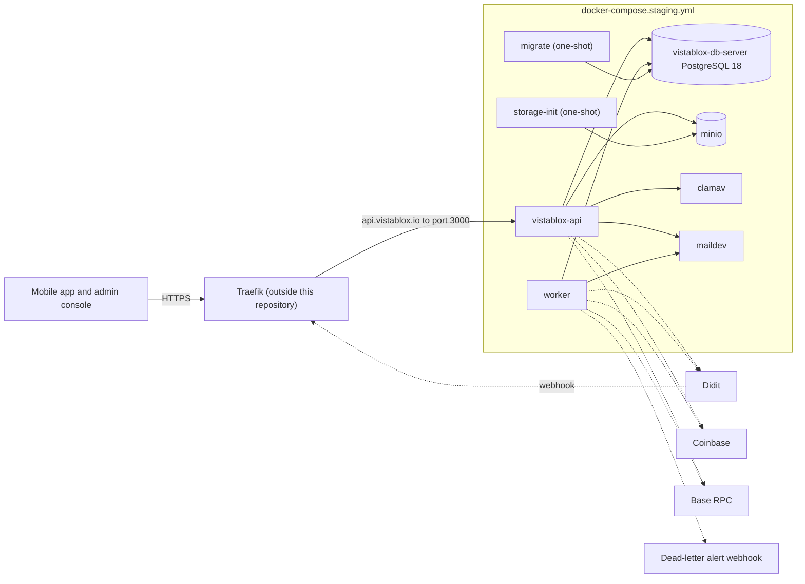
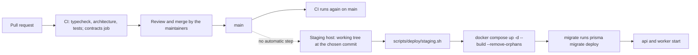
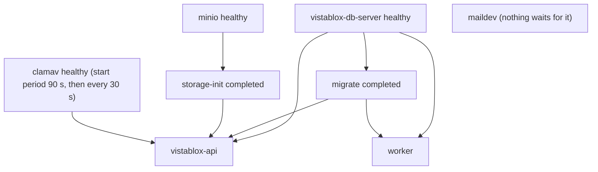

# Operations: build, deploy and run

Valid for main at 48aa967 (2026-11-18).

How the API and the worker are built into images, how the local and staging stacks are composed, how a change gets from a pull request to a running staging stack, how migrations are applied, what the health endpoints check, where logs and alerts go, and where the repository is silent. The readers are the operator who deploys and watches staging and the engineer who changes the Dockerfile, a compose file or the CI workflow. Variables are in [configuration.md](configuration.md); the worker's queues and boot sequence are in [jobs-and-workers.md](jobs-and-workers.md); operator commands are in [cli.md](cli.md).

Citations are `(path:line)` at 48aa967; the function or identifier is named next to the number because line numbers drift. A path that starts with `00-Governance` or `04-Engineering` is in the design-record repository (`vistablox-design-docs`); register entries (`C-nnn`) and AD numbers are read from its `main` branch at commit eadf224 (2026-11-18), because a local checkout of that repository on an older branch holds only C-001 to C-008. A statement that could not be checked is written as `Not verified: ...`, and section 16 collects the reasons. Where the compose files were resolved, that was done with `docker compose config` against made-up values in a scratch directory; no container was started and no daemon was used.

Contents: [1 What runs where](#1-what-runs-where) · [2 The image](#2-the-image) · [3 The local stack](#3-the-local-stack-docker-composeyml) · [4 The staging stack](#4-the-staging-stack-docker-composestagingyml) · [5 Deployment flow](#5-deployment-flow) · [6 Database migrations](#6-database-migrations) · [7 Start order and shutdown](#7-start-order-and-shutdown) · [8 Health and readiness](#8-health-and-readiness) · [9 Logging, metrics and alerting](#9-logging-metrics-and-alerting) · [10 Backups and restores](#10-backups-and-restores) · [11 Runbooks](#11-runbooks) · [12 First administrator](#12-first-administrator) · [13 Domains and certificates](#13-domains-and-certificates) · [14 The diagrams in docs/diagrams](#14-the-diagrams-in-docsdiagrams) · [15 Known limitations](#15-known-limitations) · [16 Not verified](#16-not-verified) · [17 Related documents](#17-related-documents)

## 1. What runs where

Solid arrows are connections inside the compose network; dotted arrows are connections to services outside it, each present only when its variables are set (the conditions are in [configuration.md](configuration.md#5-which-variables-switch-which-feature)). The local stack has the same shape with Valkey and Mailpit and without Traefik.

| Environment | Defined in the repository by | Database | Outgoing mail | Notes |
| --- | --- | --- | --- | --- |
| Local, on the host | `npm run dev` and `npm run worker:dev` with a `.env` file (`package.json:10-11`, `README.md:99-118`) | a local PostgreSQL 18 instance (`README.md:101`) | whatever `SMTP_*` names | AD-257: local PostgreSQL 18 for development and tests; Neon is production-only (`AGENTS.md:11`) |
| Local, containers | `docker-compose.yml` (section 3) | `postgres:18-alpine` (`docker-compose.yml:3`) | Mailpit (`docker-compose.yml:33-36`) | includes a cache, MinIO and ClamAV |
| CI | `.github/workflows/ci.yml` (section 5.1) | a throwaway `postgres:18-alpine` service (`.github/workflows/ci.yml:27-40`) | none | no container of the application is built |
| Staging | `docker-compose.staging.yml`, `scripts/deploy/staging.sh`, `.env.staging` on the host (section 4) | `postgres:18-alpine` in the stack (`docker-compose.staging.yml:3`) | maildev (`docker-compose.staging.yml:242`) | Traefik, DNS and the host are outside the repository |
| Production | nothing | Neon, according to `AGENTS.md:11` and `README.md:112` | not defined | Not verified: no production compose file, environment definition or deploy step is in the repository |

## 2. The image

One `Dockerfile` builds every container of the application (`Dockerfile:1-48`). It is a multi-stage file; a compose service picks a stage with `build.target`.

| Stage | Base | What it does | Used by | Lines |
| --- | --- | --- | --- | --- |
| `deps` | `node:22-alpine` | `npm ci`: all dependencies, dev included | `build` | `Dockerfile:7-10` |
| `build` | `deps` | copies `prisma.config.ts`, the two tsconfig files, `prisma/` and `src/`, then runs `npm run build` (`prisma generate`, then `tsc -p tsconfig.build.json` into `dist/`) | `migrate`, `api`, `worker` | `Dockerfile:12-17`, `package.json:12` |
| `runtime-deps` | `node:22-alpine` | `npm ci --omit=dev` | `api`, `worker` | `Dockerfile:19-22` |
| `migrate` | `build` | default command `npm run db:migrate:deploy` | the `migrate` service | `Dockerfile:24-28` |
| `api` | `node:22-alpine` | `ENV NODE_ENV=production`; copies `node_modules` from `runtime-deps`, `dist` from `build` and `package.json`; `EXPOSE 3000`; command `node dist/server.js` | `vistablox-api` and `api`; also `storage-init`, with another command | `Dockerfile:30-38` |
| `worker` | `node:22-alpine` | `ENV NODE_ENV=production`; same contents as `api`; command `node dist/worker.js` | `worker` | `Dockerfile:40-48` |

What the file does not contain: a `USER` instruction, so the processes run as the base image's default user, which is root (a search of `Dockerfile` for `USER` finds nothing); a `HEALTHCHECK` (the compose files supply the checks, sections 3 and 4); a pinned digest or minor version for the base image (the tag `node:22-alpine` floats, `Dockerfile:7`, `:19`, `:31`, `:42`). `package.json` requires Node `>=22.0.0` (`package.json:6-8`); CI uses `node-version: 22` (`.github/workflows/ci.yml:58`, `:139`).

What the runtime image holds. `dist/`, `package.json` and the production `node_modules`, and no Prisma CLI, TypeScript or schema directory, as `README.md:132` states. The lockfile marks `vitest`, `vite`, `prisma`, `typescript`, `tsx` and `mysql2` as `devOptional` and `dependency-cruiser` as `dev` (`package-lock.json:7808` for `vitest`); npm installs `devOptional` packages when only `dev` is omitted, so by that rule the runtime image holds them. Observed in this pass: `npm ls --omit=dev --all --parseable` over the installed tree lists `vitest`, `vite`, `prisma`, `tsx`, `typescript`, `mysql2` and `@vitest/mocker`, and does not list `dependency-cruiser`. Not verified: no `npm ci --omit=dev` was run and no image was built, so the size of the runtime install is not known. The four operator commands in `dist/cli/` and `npm run` are available in the `api` and `worker` images because `package.json` and `dist/` are copied (`Dockerfile:35-36`, `:46-47`); that `npm` is part of the base image is not verified.

The Docker build context is the repository root minus `.dockerignore`, which excludes `node_modules`, `dist`, `src/generated`, `coverage`, `.git`, `.env`, `.env.*` (except `.env.example`), `*.log`, `docs` and `README.md` (`.dockerignore:1-11`). A `.env` file therefore never enters an image, and `import "dotenv/config"` in the entry points finds none (configuration.md section 1.1).

Two further images are built from `infrastructure/`, each by cloning an upstream repository at a release tag and refusing to continue if the commit differs from a pinned hash (`infrastructure/minio/Dockerfile:1-8`, `infrastructure/maildev/Dockerfile:1-8`):

| Image | Source | Final stage | Notes |
| --- | --- | --- | --- |
| MinIO | `minio/minio` at `RELEASE.2025-10-15T17-29-55Z`, built with `golang:1.24.8-alpine3.22` | `alpine:3.22` with `ca-certificates`, port 9000, volume `/data`, command `server /data` | `infrastructure/minio/Dockerfile:1-23`; why it is built from source is in [document-storage.md](document-storage.md) |
| maildev | `maildev/maildev` at `v2.2.1` | `node:22-alpine`, `USER node`, web 1080 and SMTP 1025, an image-level `HEALTHCHECK` | `infrastructure/maildev/Dockerfile:1-27` |

A staging deploy therefore needs network access from the host to GitHub and to the npm, Go module and Alpine package mirrors whenever one of these images or the application image has to be rebuilt (`--build` in `scripts/deploy/staging.sh:19`). Not verified: how the staging host reaches them.

## 3. The local stack (`docker-compose.yml`)

`cp .env.example .env`, fill in the values, then `docker compose up --build` (`README.md:120-136`). The file `.env` must exist: both application services declare `env_file: .env` (`docker-compose.yml:103-104`, `:148-149`), and compose stops with "env file ... not found" when it is missing (resolved without the file). `.env.example` leaves the six required `DIDIT_*` values blank, which the schema refuses, so `BETTER_AUTH_SECRET` alone is not enough as `README.md:126` suggests (configuration.md, L16).

| Service | Image or build | Published ports | Volumes | Health check | Waits for |
| --- | --- | --- | --- | --- | --- |
| `postgres` | `postgres:18-alpine` (`:3`); user, password and database are fixed development values (`:4-7`) | `5432:5432` on all interfaces (`:8-9`) | `postgres-data:/var/lib/postgresql` (`:10-14`) | `pg_isready`, 5 s interval, 5 s timeout, 10 retries (`:15-19`) | nothing |
| `cache` | `valkey/valkey:8-alpine` (`:22`) | `6379:6379` (`:23-24`) | none | `valkey-cli ping`, same timing (`:25-29`) | nothing |
| `mailpit` | `axllent/mailpit:latest` (`:34`) | `8025:8025`, the web UI (`:35-36`) | none | none | nothing |
| `minio` | build `infrastructure/minio/Dockerfile` (`:38-41`) | none | `minio-data:/data` (`:45-46`) | `wget` on `localhost:9000/minio/health/live`, same timing (`:47-51`) | nothing |
| `clamav` | `clamav/clamav:1.4.6` (`:54`) | none | `clamav-data:/var/lib/clamav`, `clamd.conf` read-only (`:55-57`) | `clamdscan --ping 3`, 30 s interval, 10 s timeout, 10 retries, 90 s start period (`:60-65`); `mem_limit: 2g`, `cpus: 1.0` (`:58-59`) | nothing |
| `storage-init` | build target `api`, command `node dist/infrastructure/storage/ensure-minio-bucket.js` (`:67-71`) | none | none | none | `minio` healthy (`:83-85`) |
| `migrate` | build target `migrate`; `DIRECT_DATABASE_URL` points at `postgres` (`:87-92`) | none | none | none | `postgres` healthy (`:93-95`) |
| `api` | build target `api` (`:97-100`) | `3000:3000` (`:101-102`) | none | `fetch('http://localhost:3000/health/ready')`, 10 s interval, 5 s timeout, 5 retries, 10 s start period (`:131-142`) | `postgres` and `cache` healthy; `migrate` and `storage-init` completed; `clamav` healthy (`:120-130`) |
| `worker` | build target `worker` (`:144-147`) | none | none | none (`docker-compose.yml:144-165` has no `healthcheck`) | `postgres` and `cache` healthy; `migrate` completed (`:159-165`) |

Named volumes: `postgres-data`, `minio-data`, `clamav-data` (`docker-compose.yml:167-170`). There is no `networks:` section (one default network), no `restart:` key on any service, no `logging:` option and no `stop_grace_period` (searched).

Compose overrides these values for the API so that they point into the stack: `DATABASE_URL`, `RATE_LIMIT_CACHE_URL`, `PROFILE_CACHE_URL`, `BETTER_AUTH_URL`, `AUTH_TRUSTED_ORIGINS`, the `SMTP_*` set, the MinIO set and `CLAMAV_HOST`/`CLAMAV_PORT` (`docker-compose.yml:105-119`). The worker gets `DATABASE_URL`, `PROFILE_CACHE_URL` and `SMTP_*` only (`:150-158`); everything else reaches both from `.env` (configuration.md section 3). `docker compose down -v` removes the containers and the named volumes (`README.md:171`).

## 4. The staging stack (`docker-compose.staging.yml`)

### 4.1 Services

| Service | Image or build | Command, role | Restart policy | Health check |
| --- | --- | --- | --- | --- |
| `vistablox-db-server` | `postgres:18-alpine` (`:3`) | the database; user `vistablox`, database `vistablox-db`, password from `POSTGRES_PASSWORD` (`:6-9`) | none (see 4.4) | `pg_isready -U vistablox -d vistablox-db`, 5 s, 5 s, 10 retries (`:16-20`) |
| `maildev` | build `infrastructure/maildev/Dockerfile` (`:24-27`) | email catcher: SMTP 1025 inside the network, web UI 1080 | none | none in compose; the image defines one (`infrastructure/maildev/Dockerfile:26-27`) |
| `minio` | build `infrastructure/minio/Dockerfile` (`:35-38`) | `server /data --console-address :9001` (`:41`); root user and password from `MINIO_ACCESS_KEY` and `MINIO_SECRET_KEY` (`:42-44`) | none | `wget` on `127.0.0.1:9000/minio/health/live`, 5 s, 5 s, 10 retries (`:49-53`) |
| `clamav` | `clamav/clamav:1.4.6` (`:56`) | `clamd` on TCP 3310 with `infrastructure/clamav/clamd.conf` (`:57-59`); `mem_limit: 2g`, `cpus: 1.0` (`:60-61`) | none | `clamdscan --ping 3`, 30 s interval, 10 s timeout, 10 retries, 90 s start period (`:62-67`) |
| `storage-init` | build target `api` (`:71-74`) | one-shot: `node dist/infrastructure/storage/ensure-minio-bucket.js` (`:75`) | `restart: "no"` (`:94`) | none |
| `migrate` | build target `migrate` (`:96-99`) | one-shot: `npm run db:migrate:deploy` (`Dockerfile:28`) | `restart: "no"` (`:104`) | none |
| `vistablox-api` | build target `api` (`:113-116`) | the HTTP server | `unless-stopped` (`:257`) | `fetch('http://localhost:3000/health/ready')`, 10 s, 5 s, 5 retries, 10 s start period (`:258-269`) |
| `worker` | build target `worker` (`:271-274`) | the pg-boss process | `unless-stopped` (`:284`) | `fetch('http://127.0.0.1:3001/health/ready')`, 15 s interval, 5 s timeout, 3 retries, 30 s start period (`:289-300`) |

The service names are `vistablox-api` and `vistablox-db-server`, not `api` and `db`; the existing runbooks run their commands in the service `worker` (`docs/dead-letter-jobs.md:94`, `docs/investor-offering.md:49`, `docs/wallet-registration-operations.md:114`), and section 12 uses `vistablox-api`.

### 4.2 Ports, networks and volumes

| What | Value | Line |
| --- | --- | --- |
| Published on all host interfaces | `vistablox-api` `3000:3000` ("kept published for local diagnostics") and `maildev` `1080:1080` | `docker-compose.staging.yml:117-120`, `:28-29` |
| Published on loopback only | `minio` console `127.0.0.1:9001:9001` | `docker-compose.staging.yml:45-46` |
| Not published | `vistablox-db-server` (a comment says so on purpose), `clamav`, `worker` (its health listener is bound to `127.0.0.1` inside the container), `minio` S3 port 9000 | `docker-compose.staging.yml:10-13`, `src/shared/health/worker-heartbeat.ts:61` |
| Networks | the default network for every service; `vistablox-api` also joins `proxy`, declared `external` with name `proxy` | `docker-compose.staging.yml:121-123`, `:307-310` |
| Named volumes | `staging-postgres-data` (`/var/lib/postgresql`), `staging-minio-data` (`/data`), `staging-clamav-data` (`/var/lib/clamav`) | `docker-compose.staging.yml:14-15`, `:47-48`, `:57-58`, `:302-305` |

Compose expects an `external` network to exist before `up`; the `proxy` network and the Traefik instance that attaches to it are created outside this repository. Not verified: that behaviour was not run, and the network was not inspected.

### 4.3 The `maildev` port

All staging mail goes to maildev: the anchor fixes `SMTP_HOST` to `maildev`, port 1025, with throwaway credentials (`docker-compose.staging.yml:242-247`). That mail includes staff invitation links, customer and staff recovery links and device replacement codes (the 11 methods of `EmailSender`, `src/infrastructure/email/smtp-email-sender.ts:61-73`). The web UI that shows it is on host port 1080 on every interface (`docker-compose.staging.yml:28-29`), while MinIO's console is bound to loopback, "reachable only from this host's browser" in the file's own words (`:39-40`, `:46`). The DevOps plan describes a firewall rule that admits only the local network to port 1080 and records it as "later" (`docs/plans/devops-device-bound-auth.md:27`, `:105-107`). Not verified: whether such a rule exists on the staging host.

### 4.4 Restart policy

`vistablox-api` and `worker` have `restart: unless-stopped`; `migrate` and `storage-init` have `restart: "no"`; the other four services have no `restart` key, and the resolved configuration shows no restart value for them (`docker compose config --format json`: `restart` absent for `vistablox-db-server`, `minio`, `clamav`, `maildev`). A comment at `docker-compose.staging.yml:100-103` says Compose defaults to `unless-stopped` when the key is missing; the resolved output does not show that. Not verified: what Docker does with these containers after a host reboot or a daemon restart; Docker's restart policy ignores `depends_on`, so an application container that Docker restarts can start before its database does, and it then restarts until the database is up (a consequence of the policy as documented by Docker, not observed).

### 4.5 Environment wiring and secrets

The staging services read the host file `.env.staging` in two ways, which is described once, with evidence, in [configuration.md](configuration.md#6-how-a-variable-reaches-the-staging-containers). In short: `vistablox-db-server`, `storage-init`, `migrate`, `vistablox-api` and `worker` load every line of the file (`env_file`), and the anchor `&app-environment` (`docker-compose.staging.yml:133-247`, merged into the worker by `<<: *app-environment` at `:277-278`) overrides the names it lists. Facts that matter to an operator:

- The file is untracked (`.gitignore:3-5`) and, by the rule in `secrets/README.md:3-5`, readable by its owner only (`0600`). It is "the sole source of staging configuration, including secrets". The deploy script tests that the file is readable and that it has a `POSTGRES_PASSWORD=` line; it does not test the file's mode (`scripts/deploy/staging.sh:8-16`).
- `POSTGRES_PASSWORD`, `MINIO_ACCESS_KEY` and `MINIO_SECRET_KEY` are required with `${NAME:?...}` and make `docker compose config` fail when missing (`docker-compose.staging.yml:8`, `:43-44`, `:82-83`, `:108`, `:134-135`, `:235-236`). The `DIDIT_*` entries are not, and a missing value passes `config -q` with a warning (configuration.md section 6.3).
- The database URLs are built in the compose file from `POSTGRES_PASSWORD`; a `DATABASE_URL` line in `.env.staging` is overridden (`docker-compose.staging.yml:134-135`).
- The same compose command line must pass `--env-file .env.staging` every time (configuration.md section 6.3).
- Secrets reach containers as environment variables; the Postgres container receives the application's secrets as well, because it loads the same file (configuration.md section 6.2).

> Pending #236: `CLAMAV_HOST` and `CLAMAV_PORT` move into the anchor, with defaults `clamav` and `3310`, and leave `storage-init`.

> Pending #238: the staging switch `ACCOUNT_RECOVERY_SINGLE_REVIEWER_MODE` is removed from the anchor and from `.env.example`.

### 4.6 The one-shot `storage-init` job

`storage-init` runs the `api` image with the command `node dist/infrastructure/storage/ensure-minio-bucket.js` at each `up` (`README.md:130` says the same of `migrate` in the local stack), after MinIO reports healthy (`docker-compose.staging.yml:75`, `:91-93`). The script parses its own variable set (`src/infrastructure/storage/ensure-minio-bucket.ts:9-18`) and, for each of five buckets, creates the bucket if a head request answers 404, enables versioning on `private`, `kyc`, `disclosures` and `audit`, requests an object-lock configuration on `disclosures` and `audit` (a 400 or 501 answer is tolerated), and gives `quarantine` a lifecycle rule that expires objects after 30 days and aborts incomplete multipart uploads after 2 days (`src/infrastructure/storage/ensure-minio-bucket.ts:25-49`). Other errors end the script with a failure and `vistablox-api` does not start, because it waits for `storage-init` to complete successfully (`docker-compose.staging.yml:253-254`). The job is idempotent; running it again changes nothing that already exists. Bucket purposes are in [document-storage.md](document-storage.md).

### 4.7 ClamAV

`clamd` listens on TCP 3310 on all addresses of its container and is not published; its limits are in `infrastructure/clamav/clamd.conf`: `StreamMaxLength 100M`, `MaxFileSize 100M`, `MaxScanSize 150M`, `MaxRecursion 10`, `MaxFiles 10000`, read timeouts of 120 s, `MaxThreads 2` and `MaxQueue 8` (`infrastructure/clamav/clamd.conf:1-19`). The API connects to it for case-document and disclosure-document uploads (`src/server.ts:497`, `:521`, `:538`) and `vistablox-api` waits for the container to be healthy before it starts (`docker-compose.staging.yml:255-256`). The check runs every 30 s, and failures during the first 90 s (`start_period`) do not count against its 10 retries (`:62-67`); how long a cold volume takes to load signatures is the image's behaviour and was not observed. The signature database is kept in `staging-clamav-data`.

> Pending #225: the scanner writes a literal backslash and zero after `zINSTREAM` instead of a NUL byte (`src/infrastructure/antivirus/clamav-scanner.ts:16`), so on main every upload through a reachable clamd is refused with 503; the pull request fixes the byte and adds `npm run clamav:smoke`.

The configuration of `clamd` does not ask it to flag files that exceed its limits (a search of `infrastructure/clamav/clamd.conf` for `AlertExceedsMax` finds nothing), tracked as #246; an upload that answers 503 because the scan failed keeps no record of the underlying error, tracked as #247 (`src/modules/intake/application/upload-case-document.service.ts:109-111`).

### 4.8 Traefik labels

`vistablox-api` carries the labels that a Traefik instance on the `proxy` network reads: `traefik.enable=true`, `traefik.docker.network=proxy`, a router for ``Host(`api.vistablox.io`)`` on the entry point `websecure` with the certificate resolver `cloudflare`, and a service on port 3000 (`docker-compose.staging.yml:124-130`). The host name, the resolver and the entry point are defined in Traefik's own configuration, which is not in the repository (section 13).

## 5. Deployment flow

### 5.1 What CI does

`.github/workflows/ci.yml` runs on every pull request and on every push to `main` (`:3-6`), with read-only repository permissions (`:8-9`). A new push to a pull request cancels that pull request's earlier run; runs on `main` are never cancelled (`:11-15`). It has two jobs:

| Job | Steps | Limits |
| --- | --- | --- |
| `check` ("typecheck, architecture, tests (with Postgres 18)") | checkout, Node 22 with the npm cache, `npm ci`, `npx prisma generate`, `npx prisma migrate deploy` against a throwaway `postgres:18-alpine` service, `npm run typecheck`, `npm run architecture`, `npm test` with a JSON report, then a guard that fails the job when any integration test other than the MinIO file was skipped or when none ran (`:18-122`) | 20 minutes; dummy, non-secret values for `TEST_DATABASE_URL`, `DATABASE_URL`, `DIRECT_DATABASE_URL`, `BETTER_AUTH_SECRET` (`:42-51`) |
| `contracts` ("contracts (compile, tests, ABI drift)") | `npm --prefix contracts ci`, `npm run contracts:compile`, `npm run contracts:test`, then `npm run contracts:export-abi` and a failure if the committed ABI files under `src/infrastructure/blockchain/abis` change (`:129-169`) | 15 minutes; needs outbound network for the Solidity compiler (`:146-147`) |

What CI does not do: build the application image (the build runs only inside the Dockerfile), run `docker compose config`, audit dependencies, push an image or reach a host. The comment at `:69-70` says the three steps `typecheck`, `architecture` and the test step are exactly `npm run check`. Whether the `check` job is a required status for merging is a repository setting and was not read.

Two further workflows run an AI assistant action: one when an issue, an issue comment, a review or a review comment mentions the assistant, the other on every opened, updated, reopened or ready pull request (the two files in `.github/workflows/` other than `ci.yml`, lines 3-19 of the first and 3-5 of the second). They reference a repository secret for the action's token and read the repository; they build, test and deploy nothing.

### 5.2 What merging to `main` does and does not do

Merging runs CI once more on the merge commit (`.github/workflows/ci.yml:3-6`) and does nothing else. No workflow deploys, no image is pushed to a registry, and no webhook or polling process on a host is defined. `AGENTS.md:27` states it directly: "Merging to `main` does not deploy staging", and that the maintainers (the founder or the DevOps role) review, merge and deploy. The design record says the same for both environments (AD-139; `04-Engineering/ARCHITECTURE/DEPLOYMENT_TOPOLOGY.md:65`): CI validates, and an engineer deploys by hand on the target host.

### 5.3 The staging deploy script

`scripts/deploy/staging.sh` is the whole staged procedure the repository defines (`scripts/deploy/staging.sh:1-19`):

1. It resolves the project root and the two paths `.env.staging` and `docker-compose.staging.yml` (`:4-6`).
2. It stops if `.env.staging` is not readable, or has no line of the form `POSTGRES_PASSWORD=<something>` (`:8-16`).
3. It runs `docker compose --env-file .env.staging -f docker-compose.staging.yml config -q` to validate the resolved file (`:18`).
4. It runs `docker compose ... up -d --build --remove-orphans` (`:19`): images are built on the host from the working tree, containers whose definition or image changed are recreated, and containers of services that no longer exist in the file are removed.

The script does not fetch code, does not choose or print the commit it deploys, does not check `.env.staging`'s mode or contents beyond the password line, does not wait for or report health, and has no rollback. Which commit is in the working tree is whatever the person running the script put there. The record says that person runs `git pull` and then the compose command (AD-139, `04-Engineering/ARCHITECTURE/DEPLOYMENT_TOPOLOGY.md:57`); nothing in the repository checks it. Not verified: who runs the script, from where, and how the host gets the code.

Because `migrate` is a one-shot service that the application services wait for, the script's `up` applies pending migrations as part of the deploy (section 6). When `migrate` fails, Compose reports a failed dependency and does not start the dependent services (standard `service_completed_successfully` behaviour of `depends_on`; not run here). The file does not say whether the previous `vistablox-api` and `worker` containers keep running after a failed `migrate`, so after a failed deploy check `docker compose ps`. Not verified.

After the script returns, an operator can check:

| Check | Command or evidence | Expected |
| --- | --- | --- |
| Every service is up or completed | `docker compose --env-file .env.staging -f docker-compose.staging.yml ps` | `migrate` and `storage-init` exited 0; `vistablox-api`, `worker`, `vistablox-db-server`, `minio`, `clamav` healthy |
| The API answers | `GET /health/ready` through the public host name or `localhost:3000` on the host | `200 {"status":"ok"}` (section 8) |
| The worker finished booting | worker log line `VistaBlox worker started` (`src/worker.ts:899`) and a `healthy` status | present |
| No queue error | no `pg-boss error` line in either log (`src/server.ts:103-105`, `src/worker.ts:90-92`) | none |

The record asks for the same kind of check after a production deploy, including that the worker "is confirmed running and actively consuming its queues" (`04-Engineering/ARCHITECTURE/DEPLOYMENT_TOPOLOGY.md:107-108`); the table above is derived from the code and the compose files, not from a run on the host.

### 5.4 Rollback

The repository has no rollback step. The design record describes it as manual: check out the previous commit on the host and rebuild, since no registry is used (AD-139; `04-Engineering/ARCHITECTURE/DEPLOYMENT_TOPOLOGY.md:71`). Migrations do not roll back with the code: `prisma/migrations` holds 75 `migration.sql` files and no down scripts (counted), so a rebuilt older commit runs against the schema the newer commit left. Whether an older commit works against the newer schema is not checked anywhere.

### 5.5 The repository against the design record

| Topic | Record | Repository | Entry |
| --- | --- | --- | --- |
| Deploy | manual, on the host, no CI credential (AD-139) | matches: no deploy workflow; a manual script | none needed |
| Staging database | a separate non-production Neon branch (`04-Engineering/ARCHITECTURE/DEPLOYMENT_TOPOLOGY.md:44`) | a `postgres:18-alpine` container with a named volume (`docker-compose.staging.yml:2-20`); `AGENTS.md:11` says Neon is production-only | none in the register; `AGENTS.md:11` cites AD-257 for Neon being production-only |
| TLS and proxy | nginx with Certbot (AD-142; `04-Engineering/ARCHITECTURE/DEPLOYMENT_TOPOLOGY.md:25`) | Traefik labels with a `cloudflare` certificate resolver (`docker-compose.staging.yml:124-130`) | none in the register |
| Containers per stack | API, worker and MinIO (`04-Engineering/ARCHITECTURE/DEPLOYMENT_TOPOLOGY.md:20`) | eight services in staging (section 4.1) | none in the register |
| Migration check in CI | a dry run against a seeded disposable Neon branch, a required pull request check (AD-134; `04-Engineering/ARCHITECTURE/DEPLOYMENT_TOPOLOGY.md:54`) | `prisma migrate deploy` on an empty throwaway database that is not seeded (`.github/workflows/ci.yml:66-67`) | AD-134 (the record keeps the dry-run check as current); AD-257 records that the disposable-branch mechanism for integration tests was never built and replaced it with a local PostgreSQL 18 instance |
| Error tracking | Sentry in both processes (AD-087) | no Sentry package or call in `package.json` or `src/` (searched) | none in the register |
| Monitoring | manual, `docker compose ps` and logs (AD-141) | matches (section 9) | none needed |
| Secrets | a restricted `.env` file per host (AD-133, AD-136) | `.env.staging`, mode `0600` by rule (`secrets/README.md:3-5`) | none in the register |

## 6. Database migrations

Migrations are Prisma SQL migrations under `prisma/migrations/` (75 directories, each with one `migration.sql`, counted), applied with `prisma migrate deploy`. The connection comes from `DIRECT_DATABASE_URL`, which `prisma.config.ts` reads and which falls back to a local URL when unset (`prisma.config.ts:4-6`). The schema is `prisma/schema/` with ten schemas (`prisma/schema/schema.prisma:6-9`); the Better Auth tables live in `public` and are not modelled (`README.md:258`). The queue tables are not in the Prisma schema: pg-boss creates and upgrades its own `pgboss` schema when `boss.start()` runs in the API and the worker (`src/server.ts:102-106`, `src/worker.ts:404`; a search of `prisma/` for `pgboss` finds nothing; the library's installation step is described in [jobs-and-workers.md](jobs-and-workers.md#21-boot-sequence)).

| Environment | How migrations are applied | Connection | Who triggers it |
| --- | --- | --- | --- |
| Local, host | `npm run db:migrate:dev` creates and applies a development migration; `npm run db:migrate:deploy` applies existing ones (`README.md:99-110`, `:148-152`) | `DIRECT_DATABASE_URL` from `.env` | the developer |
| Local, containers | the `migrate` service runs on every `docker compose up`; a second run changes nothing (`README.md:130`) | `postgresql://...@postgres:5432/...` set on the service (`docker-compose.yml:91-92`) | compose |
| CI | `npx prisma migrate deploy` on an empty `postgres:18-alpine` service (`.github/workflows/ci.yml:66-67`) | `DIRECT_DATABASE_URL` (`:49`) | the workflow |
| Staging | the `migrate` service inside `docker compose up`; `vistablox-api` and `worker` wait for it (`docker-compose.staging.yml:96-111`, `:251-252`, `:282-283`) | built from `POSTGRES_PASSWORD` against `vistablox-db-server` (`docker-compose.staging.yml:108`) | whoever runs `scripts/deploy/staging.sh` |
| Production | not in the repository | the record names Neon's direct, non-pooled connection (`04-Engineering/ARCHITECTURE/DEPLOYMENT_TOPOLOGY.md:61`, `README.md:112`) | the record says: manual and reviewed, separate from the deploy (`04-Engineering/ARCHITECTURE/DEPLOYMENT_TOPOLOGY.md:67`) |

`AGENTS.md:11` forbids running `db:migrate:deploy` against anything but a local database; the staging stack runs it by design against its own database container. Nothing in the code compares `DIRECT_DATABASE_URL` with a local host (see [cli.md](cli.md) section 2). Not verified: any procedure for production.

Properties of the migration set that an operator needs to know:

- **Forward only.** There are no down migrations.
- **Directory order.** Prisma applies migrations in the order of the directory names. Two directories share the stamp `20260918100000` (`reservation_client_idempotency` and `room_photo_associations`); they touch unrelated objects and apply in name order. The newest directory, `20261121090000_escrow_mint_intent_nonce`, is stamped after four directories that were committed later, stamped `20261117203000` to `20261117204500` (committed 2026-11-17), and after the date of main's last commit (2026-11-18); it was committed on 2026-11-16 (`git log` of the directories). It adds a nullable column and a check that null satisfies (`prisma/migrations/20261121090000_escrow_mint_intent_nonce/migration.sql:9-25`). The design record lists the stamp as register C-024, item 6. A migration stamped between these dates sorts before it, so it runs before it on a fresh database and after it on one that already has it. Not verified: whether `migrate deploy` applies such a migration to a database that already has the newer one; it needs a database and none was run.
- **Guards inside migrations.** Check constraints that Prisma cannot express are added `NOT VALID`, and the migration headers say how to find violating rows; the wallet-address migration `20261113150100_wallet_address_canonical_form` refuses to run while two accounts hold one address in different letter case, and its header holds a read-only query to run first (`README.md:258`).
- **Schema drift is not checked.** Not verified: whether `prisma migrate diff` runs on this repository. A migration adds a foreign key from `account.accounts` to `public.auth_user` (`prisma/migrations/20260831154500_better_auth_core/migration.sql:60-63`) and `public` is not in the datasource's `schemas` list (`prisma/schema/schema.prisma:8`); the comparison needs a database and none was run ([data-model.md](data-model.md#85-schema-drift-checks)). Neither CI nor the deploy script compares `schema.prisma` with the migrated database.
- **PostgreSQL version.** CI and both compose files use 18 (`.github/workflows/ci.yml:29`, `docker-compose.yml:3`, `docker-compose.staging.yml:3`). Not verified: no migration was applied to any version for this chapter.

## 7. Start order and shutdown

### 7.1 Compose level

The worker does not wait for `storage-init` or `clamav` (`docker-compose.staging.yml:279-283`), and neither application container waits for `maildev` or `minio` itself, only for the one-shot job that provisions it. In the local stack the API and worker also wait for `cache` (`docker-compose.yml:120-130`, `:159-165`).

### 7.2 Process level

The API, in `src/server.ts` order: parse the environment (`:98`); create the Prisma client, the `pg` pool that Better Auth uses and the pg-boss instance, and start pg-boss (`:100-106`); create the dead-letter queue and the five event queues the API sends to (`:112-117`); connect the two optional Redis clients with a 3 s connect timeout, continuing without them on failure (`:142-188`); build the services; start listening (`:754`). Readiness therefore answers only after the database and pg-boss are reachable. The worker's sequence, with the health listener starting first and readiness last, is in [jobs-and-workers.md](jobs-and-workers.md#21-boot-sequence) (`src/worker.ts:72-77`, `:899-900`). The API and the worker both create the five shared queues; `createQueue` does nothing for an existing queue and `updateQueue` brings it up to date, so either may start first (`src/shared/jobs/job-queues.ts:47-61`).

> Pending #240: the API and the worker check the chain id and the contract code before they serve, and an unreachable RPC ends the process at boot.

A process that cannot parse its environment, reach PostgreSQL or bind its port ends with an uncaught error and exit code 1; with `restart: unless-stopped` staging restarts it in a loop until the cause is fixed (configuration.md section 1.2; `docker-compose.staging.yml:257`, `:284`).

### 7.3 Shutdown

On `SIGINT` or `SIGTERM` the API stops accepting connections with `server.close`, waits for in-flight requests, then disconnects Prisma, ends the `pg` pool, stops pg-boss and closes the Redis clients together (`src/server.ts:761-784`). There is no timer that forces an exit, readiness is not turned off before the close, and a rejection among the final disconnects is not caught. The worker's shutdown (health listener first, then `boss.stop()`, which waits up to 30 s for running jobs) is in [jobs-and-workers.md](jobs-and-workers.md#22-shutdown). Neither compose file sets `stop_grace_period`, so Docker's default stop timeout applies (documented as 10 seconds; not checked here), which is shorter than the 30 s pg-boss waits; a job still running when Docker kills the worker fails and is retried under its retry profile (see [jobs-and-workers.md](jobs-and-workers.md)).

## 8. Health and readiness

| Endpoint | Process and address | Checks | Success | Failure | Who calls it |
| --- | --- | --- | --- | --- | --- |
| `GET /health/live` | API, `HOST:PORT` (default `0.0.0.0:3000`) | nothing | `200 {"status":"ok"}` | not reachable | nothing in the compose files |
| `GET /health/ready` | API | `SELECT 1` through Prisma | `200 {"status":"ok"}` | `503` with code `infrastructure.database_unavailable` and detail "The database dependency is unavailable." | the `healthcheck` of `vistablox-api` and of the local `api` (`docker-compose.staging.yml:258-269`, `docker-compose.yml:131-142`) |
| `GET /health/live` | worker, `127.0.0.1:3001` inside the container | nothing | `200 {"status":"ok"}` | not reachable | nothing |
| `GET /health/ready` | worker, `127.0.0.1:3001` | boot has finished and the heartbeat timer ran within 30 s | `200 {"status":"ok"}` | `503 {"status":"unavailable"}` | the `healthcheck` of `worker` (`docker-compose.staging.yml:289-300`) |
| `GET /metrics` | worker, `127.0.0.1:3001` | nothing | `200`, Prometheus text format | not reachable | nothing in the repository |

Code: `src/modules/health/health.router.ts:14-31`, `src/infrastructure/database/database-probe.ts:10-12`, `src/app.ts:590`, `src/shared/health/worker-heartbeat.ts:4`, `:35-52`, `:61`, `:95-97`. The API routes are mounted after request logging, CORS and `helmet`, and have no rate limiter (`src/app.ts:504-521`, `:590`). The 503 body is the documented error envelope with a `trace_id` (`src/modules/health/health.router.ts:22-28`).

What the checks leave out. The API's readiness does not look at pg-boss, Redis, MinIO, ClamAV, SMTP, Didit, Coinbase or the chain; the worker's does not look at the database or at the last job run, only at the boot flag and a timer on the same event loop. A wrong `CLAMAV_HOST`, an unreachable RPC or a stopped queue therefore does not turn a container unhealthy. The handler awaits the query without a timeout of its own; the compose check gives up after 5 s (`docker-compose.staging.yml:261-267`). Worker metric names are listed in [jobs-and-workers.md](jobs-and-workers.md#23-health-listener-and-metrics).

## 9. Logging, metrics and alerting

Both processes write one JSON object per line to standard output with `pino` (`src/infrastructure/logging/logger.ts:3-27`): no process id or host name (`base: null`), the level set by `LOG_LEVEL`, and a redaction list that replaces the values of `authorization`, `cookie`, `x-csrf-token`, `x-internal-signature`, `x-passkey-challenge` and `dpop` request headers, `x-original-filename`, the `set-cookie`, `set-auth-token` and `set-passkey-challenge` response headers, and the keys `password`, `token`, `access_token` and `refresh_token` with `[REDACTED]` (`:7-24`). Each API request is logged by `pino-http` with a `trace_id`, taken from an inbound `x-trace-id` header or generated as `req_<ULID>` and returned in the response header (`src/app.ts:505-515`, `src/shared/http/request-context.ts:6-15`). Neither compose file sets a `logging:` option, so the Docker daemon's default driver and rotation apply; Not verified on the host. The commands in the runbooks read the logs with `docker compose --env-file .env.staging -f docker-compose.staging.yml logs --no-log-prefix --since 6h worker` (`docs/dead-letter-jobs.md:83-84`).

Where each alert signal goes:

| Signal | How it is raised | Where it goes | Code | Guide |
| --- | --- | --- | --- | --- |
| A job exhausted its retries | an `error` line `job.dead_lettered` with owner, tier and ids; a JSON `POST` to `DEAD_LETTER_ALERT_WEBHOOK_URL` when set, with a 5 s timeout and no retry | worker log; the webhook receiver (Slack-compatible) | `src/shared/jobs/dead-letter-consumer.ts:62-109`, `src/shared/jobs/dead-letter-alert-webhook.ts:6`, `:65-109` | [dead-letter-jobs.md](dead-letter-jobs.md) |
| Wallet registry watcher and its health check | `wallet_registry.*` log events with a `severity` (stalled watcher, cursor lag, overdue claims, unmatched events, address mismatch) and a `wallet_registry.health_checked` line on every run; gauges and counters | worker log and `/metrics`; nothing delivers them | `src/modules/settlement/domain/wallet-registry-alert-policy.ts:16-32` | [wallet-registration-operations.md](wallet-registration-operations.md) |
| Customer recovery case open too long | a `warn` line `account recovery cases open beyond review threshold` each 15 minutes while any case is older than `ACCOUNT_RECOVERY_ALERT_AFTER_HOURS`; gauge `vistablox_worker_account_recovery_overdue` | worker log and `/metrics` | `src/worker.ts:820-827` | [account-recovery.md](account-recovery.md) |
| KYC session stuck | `warn` lines `KYC session creations stuck beyond threshold` and `KYC sessions awaiting provider resolution beyond threshold`; two gauges | worker log and `/metrics` | `src/worker.ts:808-819` | [didit-kyc.md](didit-kyc.md) |
| Late onramp funding evidence unreviewed | a `warn` line with `event` `offering.onramp_late_evidence_unreviewed` every hour while any exists; gauge | worker log and `/metrics` | `src/modules/offering/application/check-onramp-late-evidence.service.ts:33-43`, `src/modules/offering/domain/onramp-late-evidence-alert.policy.ts:16-18` | [investor-offering.md](investor-offering.md) |
| Rate-limit store failure | `warn` line `rate limit store unavailable; allowing request` per request; at start `rate limit cache unavailable; rate limiting is disabled` | API log | `src/shared/http/rate-limit.ts:54-62`, `src/server.ts:152-158` | [configuration.md](configuration.md) |
| pg-boss error | `error` line `pg-boss error` | API and worker log | `src/server.ts:103-105`, `src/worker.ts:90-92` | [jobs-and-workers.md](jobs-and-workers.md) |
| A DPoP proof refused | `warn` line `dpop proof rejected` with code and path | API log | `src/server.ts:242-244` | [authentication.md](authentication.md) |

Delivery. The only alert that leaves the log is the dead-letter webhook. `AD-089` records Slack or email webhooks as the phase-1 alert channel and `AD-088` records host logs read by hand; AD-141 records that monitoring is manual (`00-Governance/DECISIONS/ARCHITECTURE_DECISIONS.md`, headings `AD-088`, `AD-089`, `AD-141`). Nothing in the repository scrapes `/metrics`, ships logs or sends an email alert, and no process alerts when a container is down or the host is unreachable. The record's error tracker (AD-087) has no code behind it. The record's entries for what the code alerts on are register C-020 (alert events and gauges built on 2026-11-17) and C-022 (dead-letter alerts and the replay command).

> Pending #241: dead-letter alerts are throttled per queue by a new variable `DEAD_LETTER_ALERT_WINDOW_MINUTES`, and an alert carries an "N more" line.

> Pending #235: the escrow finalizer job fails, and so dead-letters, when a campaign errors; on main it logs the errors at `error` level and completes (`src/worker.ts:643-648`).

## 10. Backups and restores

The repository contains no backup job, dump script, snapshot configuration or restore procedure for any environment. What exists is the persistence the compose files give:

| Data | Where it lives in staging | What protects it | Record |
| --- | --- | --- | --- |
| PostgreSQL, including pg-boss jobs and dead-letter entries | volume `staging-postgres-data` (`docker-compose.staging.yml:14-15`, `:303`) | nothing in the repository; dead-letter entries are kept 30 days inside the database (`src/shared/jobs/job-queues.ts:12-22`) | production: Neon point-in-time recovery only (AD-200; `04-Engineering/PLATFORM-OPERATIONS/DISASTER_RECOVERY.md`, section "Core Recovery Posture"); targets of 15 minutes and 4 hours are not met by anything built |
| Documents (MinIO) | volume `staging-minio-data` | versioning on four buckets, object lock on two (section 4.6); no copy elsewhere | AD-140: no separate backup |
| Antivirus signatures | volume `staging-clamav-data` | none | not addressed |
| `.env.staging` | a file on the host | the host's own backup, if any | AD-143: no backup of the secrets file; re-provision from provider dashboards |

`docker compose down -v` deletes the named volumes (Compose behaviour; `README.md:171` states it for the local stack). Not verified: whether the staging host backs up Docker volumes, a restore of any of them, and how a lost `.env.staging` would be rebuilt.

## 11. Runbooks

| Guide | What it covers | Use it when |
| --- | --- | --- |
| [dead-letter-jobs.md](dead-letter-jobs.md) | the dead-letter queue, the alert, ownership of each queue, triage, and `npm run jobs:replay-dead-letter` with its dry run | a dead-letter alert arrives, or `job.dead_lettered` appears in the worker log |
| [wallet-registration-operations.md](wallet-registration-operations.md) | the registry watcher's events and thresholds, expiry of pending claims, safe reconciliation | a `wallet_registry.*` event fires or an investor's wallet stays pending |
| [escrow-mint-reconciliation.md](escrow-mint-reconciliation.md) | what the finalizer decides on an interrupted mint and the manual repair | an escrow mint intent is not `recorded` after its retries |
| [account-recovery.md](account-recovery.md) | the customer full-lockout recovery flow, dual review, the 72-hour cooldown | a customer has lost both login methods |
| [document-storage.md](document-storage.md) | buckets, the initialiser, upload and download rules, the MinIO version posture | storage or upload problems |
| [didit-kyc.md](didit-kyc.md) | Didit sessions, webhooks, stuck-session expiry and reconciliation | verification does not finish |
| [coinbase-cdp-onramp.md](coinbase-cdp-onramp.md) | reservation funding, the webhook and the minute poll | funding does not advance |
| [cli.md](cli.md) | every operator command, its arguments and exit codes, and how to run it in the staging containers | an operator command is needed |

> Pending #233: replaying a dead-lettered job writes an audit row, and `--operator` becomes mandatory with `--confirm`.

## 12. First administrator

The first `admin_operations` staff member cannot be created over HTTP; a command run inside the API container issues the one-time invitation (`src/cli/bootstrap-first-admin.ts:1-16`). In staging:

    docker compose --env-file .env.staging -f docker-compose.staging.yml exec vistablox-api \
      npm run staff:bootstrap-first-admin -- --check

    docker compose --env-file .env.staging -f docker-compose.staging.yml exec vistablox-api \
      npm run staff:bootstrap-first-admin -- --email <email> --display-name "<name>"

`--check` is read-only and prints the number of active staff accounts, of active `admin_operations` holders and of pending bootstrap invitations, and whether bootstrap "would be REFUSED" (`src/cli/bootstrap-first-admin.ts:94-105`). Issuing refuses, with exit code 1 and no change, when an active staff account already holds `admin_operations`; running it again before acceptance revokes the earlier link and issues a new one (`:114-120`, `:127-132`, `src/cli/bootstrap-first-admin-arguments.ts:5-17`). The command prints the accept URL once; the link is single use and expires in 72 hours (`:139-145`). In staging the invitation email goes to maildev, so it is visible in the maildev web UI (section 4.3) as well as printed. The URL points at `STAFF_INVITATION_ACCEPT_URL`, or `<BETTER_AUTH_URL>/staff/accept-invitation` when that is unset (`src/config/environment.ts:658-666`); it is opened on the admin console origin, which must be listed in `WEBAUTHN_ORIGIN` for the passkey to register (configuration.md section 2.5). The first administrator then invites further staff from the admin console. The staff model is in [staff-access.md](staff-access.md); the command's other details are in [cli.md](cli.md).

## 13. Domains and certificates

The repository contains no certificate, DNS record or proxy configuration. What it states:

- `vistablox-api` is routed by Traefik for the host `api.vistablox.io` on the entry point `websecure` with the certificate resolver `cloudflare`, to container port 3000, on the external Docker network `proxy` (`docker-compose.staging.yml:117-130`). Traefik, the resolver and the network are defined elsewhere.
- Port 3000 of the API is also published on the host (`docker-compose.staging.yml:119-120`), so the API can be reached without Traefik. Whether the host firewall allows it is not verified. `TRUST_PROXY` has a blank default in the anchor for this reason: a hop count is safe only while 3000 is not reachable from outside (`docker-compose.staging.yml:157-166`).
- The WebAuthn relying-party identity is pinned to `api.vistablox.io` by default in staging (`docker-compose.staging.yml:140`), and the session cookie carries the prefix `vb`, `SameSite=Lax`, and, when `BETTER_AUTH_URL`'s host has three or more labels, the domain made of that host without its first label (`.vistablox.io` for `api.vistablox.io`), so a sibling subdomain such as the admin console can read it (`src/modules/auth/infrastructure/shared/better-auth.factory.ts:129-132`, `:456-481`).
- The DevOps plan, dated 2026-09-11, describes DNS at Cloudflare with `api.vistablox.io` not proxied and pointing at a dynamic residential address, and a staging host that is a laptop (`docs/plans/devops-device-bound-auth.md:44-45`, `:222`). Not verified: whether that still holds.
- The record names nginx with Certbot for production (AD-142). Not verified: nothing in the repository configures it.

## 14. The diagrams in docs/diagrams

Two draw.io files are in the repository: [docker-architecture.drawio](diagrams/docker-architecture.drawio) and [staging-environment-flow.drawio](diagrams/staging-environment-flow.drawio). A script compared them: both have 113 cells with the same identifiers, labels, styles and geometry, and differ only in the file header, comments, whitespace and how a quote character is escaped; they are one diagram saved twice, titled "VistaBlox API — Staging Environment & Request Flow". Both were added in one commit on 2026-09-25 (`git log` of `docs/diagrams`), before the compose file gained `TRUST_PROXY` (2026-10-18), the wallet registry alert and expiry settings (2026-11-13 and 2026-11-16), `DEAD_LETTER_ALERT_WEBHOOK_URL` and `ESCROW_MINT_NONCE_BLOCK_TAG` (both 2026-11-16), as `git log -S` on the compose file shows. Compared with `docker-compose.staging.yml` at 48aa967:

| What the diagram shows | The compose file | Match |
| --- | --- | --- |
| Traefik routes `api.vistablox.io` to port 3000 | labels `Host(`api.vistablox.io`)`, service port 3000 (`:124-130`) | yes |
| Traefik "TLS: Cloudflare DNS-01" | resolver name `cloudflare`; the challenge type is not in the repository | partly: only the resolver name |
| `admin.vistablox.io` to port 80 | no label for it; the admin console is another stack | not checkable |
| API health check 10 s, 5 s, 5 retries, 10 s start | `:258-269` | yes |
| Worker health check 15 s, 5 s, 3 retries (start period omitted) | `:289-300` (start period 30 s) | yes, except the omitted start period |
| `restart: unless-stopped` on both | `:257`, `:284` | yes |
| PostgreSQL 18, no host port | `:3`, `:10-13` | yes |
| Valkey 8 as a staging service ("cache, no host port") | no cache service exists in the staging file; `RATE_LIMIT_CACHE_URL` and `PROFILE_CACHE_URL` are not set by it (configuration.md section 2.7) | no |
| MinIO console `:9001` on localhost only | `127.0.0.1:9001:9001` (`:45-46`) | yes |
| maildev "web UI :1080 (localhost)" | `1080:1080` on all interfaces (`:28-29`) | no |
| ClamAV "internal only" | no published port | yes |
| Five buckets and three volumes | five buckets (`:84-88`); three named volumes (`:302-305`) | yes |
| `/provider/v1` for Didit and Coinbase callbacks | the routes are `/webhooks/didit` and `/webhooks/coinbase-onramp` (`src/app.ts:576-587`, `:931-934`); no route is under `/provider/v1` (a search of `src/` finds none); the record puts provider callbacks under `/provider/v1` (AD-066), and AD-289 keeps `/webhooks/coinbase-onramp` and records the divergence once, in register C-015 | no |
| "prisma (Neon PG adapter)" from the API to the database | the database is the `vistablox-db-server` container; the adapter is `@prisma/adapter-pg` (`src/infrastructure/database/prisma.ts:1-10`) | the label is wrong for staging |
| Node `node:22-alpine`, API on 3000, worker on 3001 | `Dockerfile:31`, `:42`; worker listener on `127.0.0.1:3001` | yes |
| Modules and worker jobs | a summary; the worker has 25 queues, the diagram names four jobs | incomplete, not wrong |
| `migrate`, `storage-init` and the dependency order | not drawn | missing |

Not checked: the framework versions in the mobile and admin boxes, and the "reconfirmation (168h)" label against the offering code beyond `PLATFORM_RIGHTS_WINDOW_HOURS = 168` (`src/modules/offering/domain/finalization.policy.ts:39`). The Mermaid diagrams in this chapter replace the need for the draw.io files; the files themselves are unchanged.

## 15. Known limitations

| # | Limitation | Evidence | Issue, pull request or record entry |
| --- | --- | --- | --- |
| O1 | The application containers run as root: the `Dockerfile` has no `USER`. | `Dockerfile:30-48` | none |
| O2 | The runtime images install `devOptional` packages (test runner, bundler, Prisma CLI, TypeScript) that `src/` never imports; the size of that install was not measured. | `Dockerfile:22`; `package-lock.json:7808`; `npm ls --omit=dev --all --parseable` | none |
| O3 | Base image tags float (`node:22-alpine`, `postgres:18-alpine`, `valkey/valkey:8-alpine`, `axllent/mailpit:latest`), so a rebuild can change versions. | `Dockerfile:7`; `docker-compose.yml:3`, `:22`, `:34` | none |
| O4 | `maildev` publishes its web UI on every interface (`1080`), and the API publishes `3000` on every interface. | `docker-compose.staging.yml:28-29`, `:119-120` | none; configuration.md L5 |
| O5 | The database, MinIO, ClamAV and maildev services have no restart policy, and Docker's restart policy for the application services does not consider `depends_on` (Docker behaviour, not observed). | `docker-compose.staging.yml:2-67`, `:257`, `:284` | none |
| O6 | Neither compose file sets `stop_grace_period`, so Docker's default timeout applies where pg-boss waits up to 30 s; the API has no forced-exit timer and does not flip readiness before closing. | `src/server.ts:761-784`; `src/worker.ts:902-914` | none |
| O7 | The health checks cover the database (API) or the boot flag and an event-loop timer (worker) only. | section 8 | none |
| O8 | `scripts/deploy/staging.sh` validates the compose file but not the application's schema, does not report health, does not name the deployed commit and has no rollback. A missing `DIDIT_*` value passes its check. | section 5.3; configuration.md section 6.3 | none |
| O9 | The design record's staging database, proxy, container count, CI migration check and error tracker differ from the repository (table in section 5.5). | section 5.5 | AD-134, AD-087, AD-142, AD-257; no register entry |
| O10 | No backup, restore or snapshot procedure exists in the repository. | section 10 | AD-140, AD-143, AD-200 accept this for now |
| O11 | `docker-compose.staging.yml` carries a comment that Compose defaults to `restart: unless-stopped`; the resolved configuration shows no restart value for services without the key. | `docker-compose.staging.yml:100-103` | none |
| O12 | The draw.io diagrams in `docs/diagrams` no longer match the staging file (a cache service, the maildev binding, the callback prefix and the database label). | section 14 | none |
| O13 | ClamAV cannot be used on main (#225, #229), the staging API has no `CLAMAV_HOST` unless the host file sets it (#208), and clamd does not flag files that exceed its limits (#246). | section 4.7; configuration.md L3 | #205, #208, #246, #247; register C-014, item 7 (staging ClamAV host) |
| O14 | Logs go to the Docker daemon's default sink with no shipper, no error tracker and no metrics scraper; only dead-letter alerts leave the host. | section 9 | AD-088, AD-089, AD-141 describe this as the phase-1 position |

## 16. Not verified

- **The staging host.** Nothing about it is in the repository: who deploys, how the code gets there, the host firewall, Docker's daemon configuration (log driver, rotation, restart behaviour after a reboot), whether `.env.staging` has mode `0600`, and the contents of that file (listed in [configuration.md](configuration.md#9-not-verified)).
- **Traefik and DNS.** The `proxy` network, the `cloudflare` resolver, the challenge type, certificate renewal and the `admin.vistablox.io` route are outside the repository.
- **Production.** No production compose file, secret handling, migration procedure, TLS arrangement or monitoring is in the repository; statements about production come from `AGENTS.md`, `README.md` and the design record.
- **Run-time behaviour of the stack.** No image was built and no container was started for this chapter. Compose files were resolved with `docker compose config`; Dockerfile, compose and workflow behaviour was read, not run. The statements about `depends_on` conditions, restart policies, `up --build` and `down -v` are standard Compose behaviour and were not exercised.
- **PostgreSQL 18.** CI and both compose files use `postgres:18-alpine`; no database was run for this chapter.
- **Real providers.** clamd 1.4.6, Coinbase, Didit and the RPC provider were not contacted. The ClamAV statement in section 4.7 rests on pull request #225.
- **Not measured:** the size of the production `node_modules`, whether `prisma migrate diff` runs on this schema, and whether `migrate deploy` accepts an out-of-order migration. The `npm audit` result of 2026-11-20 is in [security.md](security.md#18-dependency-posture).
- **Required status checks and branch protection** of the GitHub repository.

## 17. Related documents

| Topic | Document |
| --- | --- |
| Every variable, boot-time rules, how values reach the staging containers | [configuration.md](configuration.md) |
| Layers, request lifecycle, module structure | [architecture.md](architecture.md) |
| The worker, queues, schedules, dead letters | [jobs-and-workers.md](jobs-and-workers.md) |
| Operator commands | [cli.md](cli.md) |
| Security controls: proxy trust, rate limits, scanning, secrets | [security.md](security.md) |
| Test suites and CI guards | [testing.md](testing.md) |
| Tables and migrations | [data-model.md](data-model.md) |
| Staff accounts and the first administrator | [staff-access.md](staff-access.md) |
| The DevOps plan for device-bound authentication (plan, not built) | [plans/devops-device-bound-auth.md](plans/devops-device-bound-auth.md) |
| Index of all documents | [README.md](README.md) |
