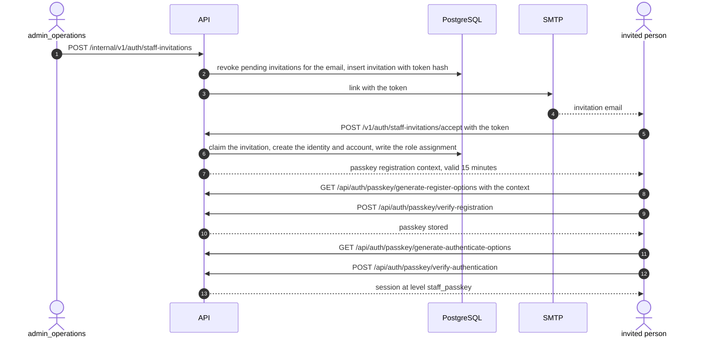
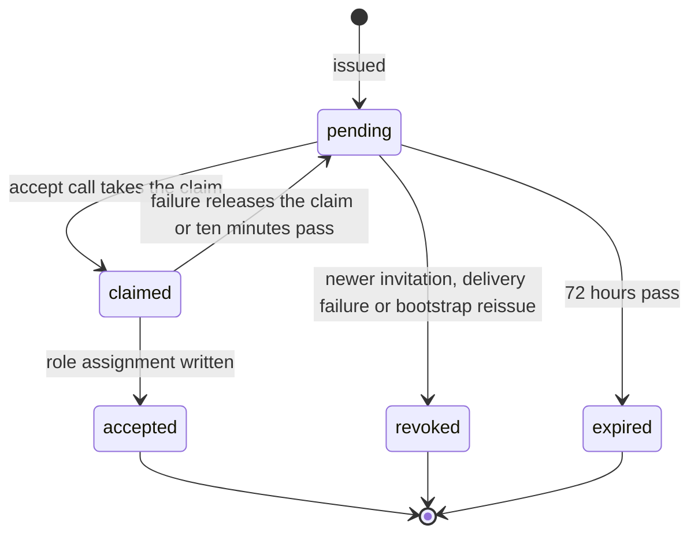
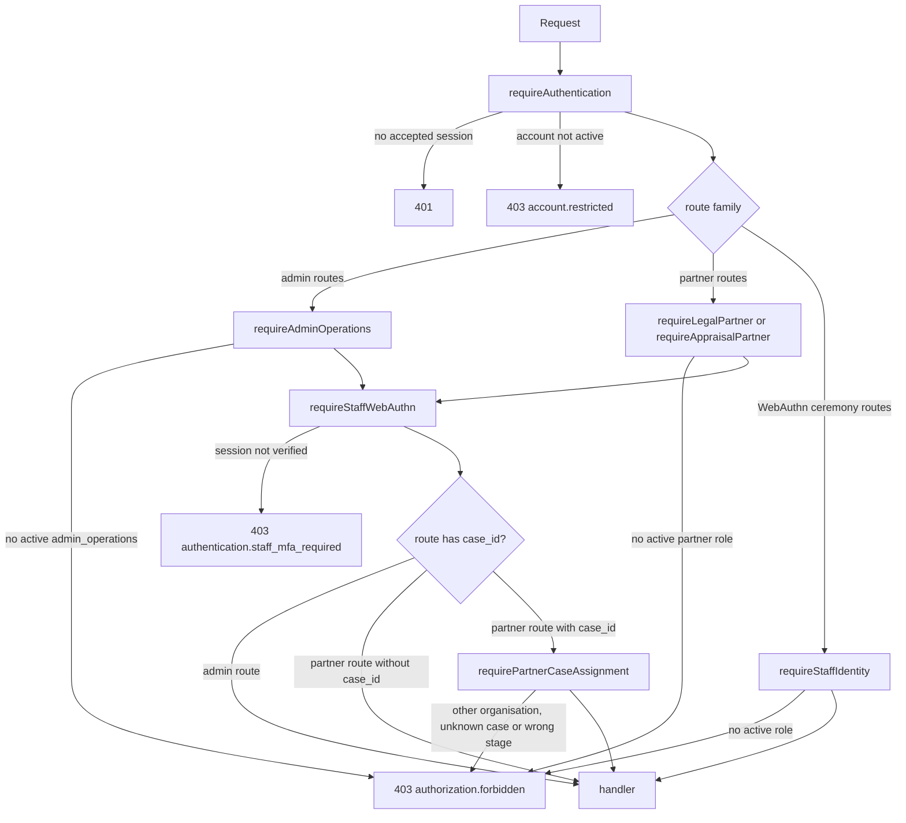

# Staff and partner access

Valid for main at 48aa967 (2026-11-18).

This chapter describes how staff and partners are modelled and how they authenticate and are authorized, as built: the `staff_partner` population and its three roles, the invitation flow and the first-admin bootstrap, passkey sign-in and the WebAuthn proof, what each guard enforces and in which order, dual control, what staff and partners can see, and which role reaches which route. It is read by the founder and the operators who administer staff, by engineers who add an internal route, and by reviewers who must say who can do what. Route-by-route request and response detail is in [api/auth-staff.md](api/auth-staff.md); customer authentication is in [authentication.md](authentication.md).

Citations are `(path:line)` at 48aa967 with the identifier named next to the number. A line that starts with `> Pending #N:` says what an open pull request changes in the statement above it; nothing under such a line is built on main. Statements marked `Not verified` are listed in [Not verified](#not-verified).

Contents: [1 Population and roles](#1-the-staff_partner-population-and-roles) · [2 Invitations](#2-invitations) · [3 Signing in](#3-signing-in-and-the-webauthn-proof) · [4 Guards](#4-what-each-guard-enforces) · [5 Account administration](#5-staff-account-administration) · [6 Dual control](#6-dual-control) · [7 What staff can see](#7-what-staff-and-partners-can-see) · [8 Role matrix](#8-role-by-route-matrix) · [9 Audit](#9-audit-trail) · [10 Gaps against the record](#10-known-gaps-against-the-design-record) · [11 Limitations](#known-limitations) · [Not verified](#not-verified)

## At a glance

| Question | Answer as built |
| --- | --- |
| Who is staff? | A Better Auth user whose `population` is `staff_partner`, with at least one active row in `auth.staff_role_assignments`. Three roles exist: `admin_operations`, `legal_partner`, `appraisal_partner` (`prisma/schema/auth.prisma:91-109`, `prisma/migrations/20260831150000_initial_schema/migration.sql:932-937`) |
| How is a staff identity created? | By invitation only: an `admin_operations` staff member issues it, or, for the first admin, the command `npm run staff:bootstrap-first-admin`. There is no self-registration route (`src/modules/auth/api/staff/staff-invitation-issue.router.ts:17-37`, `package.json:15`) |
| How does staff sign in? | With a passkey only. Email and password sign-in is switched off for every user; Google and Apple sign-in are refused for a staff user (`STAFF_PASSKEY_REQUIRED`) (`src/modules/auth/infrastructure/shared/better-auth.factory.ts:242`, `src/modules/auth/infrastructure/staff/better-auth-staff-account-guard.plugin.ts:63-68`) |
| What is the second factor? | The passkey itself: a session created by a passkey ceremony counts as WebAuthn-verified. A separate step-up credential set exists and is needed only in the transitional case (`src/modules/auth/repository/staff/prisma-staff-webauthn.repository.ts:32-54`) |
| Where is the role checked? | On every request, from the database. A revoked role stops working on the next request; no session needs to be ended (`src/modules/account/repository/prisma-account.repository.ts:41-50`) |
| What limits a partner to its own cases? | The partner's legal practice or appraisal firm must be the one assigned to the case, and the case must be in `post_ipo_structuring` or `approved_for_final_offering` (`src/modules/intake/api/require-partner-case-assignment.ts:26-63`, `src/modules/intake/api/require-partner-case-assignment.ts:13`) |
| Who recovers a staff member? | Another `admin_operations` staff member. No one can recover or offboard their own account (`src/modules/auth/application/staff/staff-account-lifecycle.service.ts:207-216`) |
| Is there dual control? | For customer full-lockout recovery (two reviewers) and for the intake reversal commands (the requester cannot approve). Not for staff administration: one administrator acts alone on any other account ([section 6](#6-dual-control)) |
| How long does a staff session last? | Better Auth's rolling expiry: 30 minutes, refreshed on use. Nothing caps its absolute age (`src/modules/auth/infrastructure/shared/better-auth.factory.ts:194-195`) |

## 1. The staff_partner population and roles

### The population

Every Better Auth user has a `population` field with the values `customer` and `staff_partner`, default `customer` (`src/modules/auth/infrastructure/shared/better-auth.factory.ts:164-169`). The database enforces the two values (`prisma/migrations/20260831154500_better_auth_core/migration.sql:13-14`). The field is not settable through the HTTP API: it is declared with `input: false` on the instance that is mounted, and only a second instance, `staffProvisioningAuth`, is built with `allowPopulationInput: true`; that instance is used in process by the invitation flow and is never handed to `toNodeHandler` (`src/server.ts:370-380`, `src/server.ts:309-369`). Nothing in the schema makes the field immutable after creation (searched `prisma/migrations`: only the value check exists). A staff identity and a customer identity cannot share an email address, because Better Auth keys users by email; the invitation flow refuses an email that already belongs to any Better Auth user (`src/modules/auth/infrastructure/staff/better-auth-staff-identity.provider.ts:9-12`).

Each Better Auth user has one VistaBlox account (`account.accounts`) (`prisma/schema/schema.prisma:11-67`), created by the user-created hook when the identity is created (`src/modules/account/application/account-provisioner.ts:8-13`). The account carries the status (`active`, `recovery_review`, `suspended_restricted`); a staff account is `active` until it is offboarded (`suspended_restricted`). `requireAuthentication` refuses every account that is not `active` (`src/modules/auth/api/shared/require-authentication.ts:77-84`). The Better Auth user also carries `disabledAt`, `disabledReason` and `recoveryRequiredAt`; a user with either `disabledAt` or `recoveryRequiredAt` set resolves to no session (`src/modules/auth/infrastructure/shared/better-auth-session.resolver.ts:61-71`).

### The roles

| Role | Scope | What its routes do | What the code lets it reach |
| --- | --- | --- | --- |
| `admin_operations` | Platform-wide; no organisation | Intake case review, offering operations, account, KYC and wallet lookups, staff administration, customer recovery and closure review | Every `/internal/v1` route except the partner case routes and the WebAuthn ceremony routes ([section 8](#8-role-by-route-matrix)) |
| `legal_partner` | One legal practice (`intake.legal_practices`) | Read an assigned case; record legal document references and mark legal structuring complete (`src/modules/intake/api/partner-case.schemas.ts:55-67`) | `/internal/v1/legal-partner/cases`: list, read, history and write-back, for cases assigned to the practice (`src/app.ts:1155-1170`) |
| `appraisal_partner` | One appraisal firm (`intake.appraisal_firms`) | Read an assigned case; record the appraisal value opinion and document references and mark the appraisal complete (`src/modules/intake/api/partner-case.schemas.ts:71-96`) | `/internal/v1/appraisal-partner/cases`, the same four routes (`src/app.ts:1172-1187`) |

No other role exists: the role guards and the database check list these three (`src/modules/auth/api/staff/require-staff-role.ts:7-38`, `src/modules/auth/api/staff/require-staff-role.ts:54-72`, `prisma/migrations/20260831150000_initial_schema/migration.sql:932-937`). `admin_operations` does not include the partner roles: a legal-partner route answers `403` to an administrator who holds no `legal_partner` assignment (`src/modules/auth/api/staff/require-staff-role.ts:63-65`).

### Role assignments

A role is a row in `auth.staff_role_assignments` (`prisma/schema/auth.prisma:91-109`).

| Column | Meaning |
| --- | --- |
| `assignment_id` | `role_` plus a ULID |
| `account_id` | The staff account |
| `role` | One of the three values |
| `legal_practice_id`, `appraisal_firm_id` | The scope. The check `staff_role_assignment_scope` requires `legal_partner` to have a practice and no firm, `appraisal_partner` a firm and no practice, `admin_operations` neither (`prisma/migrations/20260831150000_initial_schema/migration.sql:932-937`). Both columns are foreign keys to the organisation tables |
| `granted_at`, `revoked_at` | An assignment is active while `revoked_at` is null. Rows are never deleted; revocation sets the timestamp |

An account may hold several assignments, of different roles; the union applies. A check for a role asks only whether an active assignment of that role exists (`src/modules/account/repository/prisma-account.repository.ts:41-50`, `src/modules/account/repository/prisma-account.repository.ts:52-58`). The partner organisation of a partner is read with `findFirst` over the active assignments of that role, without an order (`src/modules/account/repository/prisma-account.repository.ts:60-70`); the grant route refuses a second active assignment of the same role, with a check-then-insert race noted in [Known limitations](#known-limitations).

Assignments come from two places: the invitation (one assignment, written when the invitation is accepted) and the grant route (an additional role for an account that already has an active role). There is no route that creates a role for an account without one.

### Organisations

`intake.legal_practices` and `intake.appraisal_firms` hold `id`, `name`, `country_code` and `status`, which is `active` or `suspended` (`prisma/schema/schema.prisma:212-225`, `prisma/schema/schema.prisma:227-240`, `src/modules/intake/api/partner-organization.schemas.ts:3`). Admin routes create them, list them and change their status (`/internal/v1/legal-practices`, `/internal/v1/appraisal-firms`, [api/intake-staff.md](api/intake-staff.md)). An organisation must exist before an invitation or a grant can name it. The status matters in one place: assigning a case to a suspended organisation is refused (`src/modules/intake/application/operations-case.service.ts:561`, `src/modules/intake/application/operations-case.service.ts:568`, error `src/modules/intake/application/operations-case.service.ts:961-970`). A suspended organisation's staff keep their roles and their access to cases that were already assigned ([Known limitations](#known-limitations)).

## 2. Invitations

An invitation turns an email address into a staff identity with one role.

### Rules

| Rule | As built | Source |
| --- | --- | --- |
| Who issues | A session that passes the admin chain. The first admin has no issuer and is issued by the bootstrap command | (`src/modules/auth/api/staff/staff-invitation-issue.router.ts:17-37`, `prisma/migrations/20260912100000_staff_invitation_cli_bootstrap/migration.sql:19-22`) |
| Token | 32 random bytes, base64url; only the SHA-256 hex is stored, in a unique column | (`src/modules/auth/application/staff/staff-invitation.service.ts:134-137`, `src/modules/auth/application/staff/staff-invitation.service.ts:139-141`) |
| Lifetime | 72 hours from creation | (`src/modules/auth/application/staff/staff-invitation.service.ts:9`) |
| Single use | Accepting sets `accepted_at` and `accepted_account_id`; a second accept answers `409 authentication.staff_invitation_unavailable` | (`src/modules/auth/repository/staff/prisma-staff-invitation.repository.ts:131-199`, `src/modules/auth/application/staff/staff-invitation.service.ts:149-156`) |
| One pending invitation per email | Issuing a new one sets `revoked_at` on every pending invitation for the email, and a partial unique index allows one pending row per email | (`src/modules/auth/repository/staff/prisma-staff-invitation.repository.ts:26-33`, `prisma/migrations/20260831180000_staff_invitations/migration.sql:36-38`) |
| The email must be new | Issuing is refused when a Better Auth user with the email exists, whatever its population | (`src/modules/auth/infrastructure/staff/better-auth-staff-identity.provider.ts:9-12`) |
| Scope is part of the invitation | `role`, `legal_practice_id` and `appraisal_firm_id` are stored on the row and copied into the role assignment at acceptance; a check enforces the same rule as the assignment | (`prisma/schema/auth.prisma:55-89`, `prisma/migrations/20260831180000_staff_invitations/migration.sql:25-28`) |
| Delivery failure revokes | If the email cannot be sent, the invitation is revoked in the same call and the call answers 503 | (`src/modules/auth/application/staff/staff-invitation.service.ts:59-73`) |
| Claim | Accepting first claims the row with a random `claim_id`. A claim older than 10 minutes can be taken over; a failure after the claim releases it | (`src/modules/auth/application/staff/staff-invitation.service.ts:10`, `src/modules/auth/repository/staff/prisma-staff-invitation.repository.ts:94-117`, `src/modules/auth/repository/staff/prisma-staff-invitation.repository.ts:119-129`) |
| No expiry job | Nothing marks an invitation expired or deletes it; an expired row stays and simply fails the claim (searched `src` for any other writer of the table) | (`src/modules/auth/repository/staff/prisma-staff-invitation.repository.ts:106-107`) |

An invitation row is in one of these conditions, derived from its columns; there is no status column:

### What acceptance creates

In order: the Better Auth user (`emailVerified: true`, population `staff_partner`, name the display name) if it does not exist, with its `account.accounts` row; a passkey bootstrap value for the user; then, in one transaction, the role assignment, the accepted invitation and the audit row `authentication.staff_invitation_accepted`. The response carries the account id and the registration context. No session is created: the person registers the passkey with the context and then signs in with it ([section 3](#3-signing-in-and-the-webauthn-proof)). Full request and error detail is in [api/auth-staff.md](api/auth-staff.md#post-v1authstaff-invitationsaccept).

Two timings matter to an operator. The link is valid for 72 hours, but the registration context returned by the accept call is valid for 15 minutes and is shown once (`src/modules/auth/infrastructure/shared/passkey-bootstrap.ts:5`); if the person closes the page before registering a passkey, the invitation is already used and the account has no way to sign in until another administrator starts staff recovery ([Known limitations](#known-limitations)). On staging, `docker-compose.staging.yml` forces all email into the `maildev` catcher, so invitations are read there (`docker-compose.staging.yml:242-247`, `docker-compose.staging.yml:22-24`).

The accept link is `STAFF_INVITATION_ACCEPT_URL`, or the path `/staff/accept-invitation` on the origin of `BETTER_AUTH_URL` when unset, with `?token=`; the recovery link is `STAFF_RECOVERY_REDIRECT_URL`, or the path `/staff/recover-account` on the origin of `BETTER_AUTH_URL`, with `?context=` (`src/config/environment.ts:658-666`, `src/server.ts:733-739`, `src/modules/auth/infrastructure/shared/passkey-bootstrap.ts:34-38`). An absolute path in the default replaces any path that `BETTER_AUTH_URL` carries (`new URL("/staff/...", base)`). Both point at the admin console, which is not in this repository.

### The first admin

The first `admin_operations` staff member cannot be invited by anyone, so a command issues the invitation. It has no HTTP equivalent by design (`src/cli/bootstrap-first-admin.ts:2-15`). Its full reference is in [cli.md](cli.md); the rules that matter here:

| Item | As built | Source |
| --- | --- | --- |
| Command | `npm run staff:bootstrap-first-admin -- --email <email> --display-name <name>`; `--check` prints three counts and changes nothing; `--help` prints usage. It runs `node dist/cli/bootstrap-first-admin.js`, from a shell inside the API container | (`package.json:15`, `src/cli/bootstrap-first-admin-arguments.ts:5-17`) |
| Environment | It loads the container's full environment through `loadEnvironment()`, so every variable the API requires must be present | (`src/cli/bootstrap-first-admin.ts:51-159`) |
| Refusal | It exits 1 with no change when an active account holds an unrevoked `admin_operations` assignment. The check runs before anything else and again inside the transaction, under an advisory lock that makes concurrent runs wait up to 15 seconds | (`src/modules/auth/application/staff/staff-bootstrap.service.ts:55-112`, `src/modules/auth/repository/staff/prisma-staff-bootstrap.repository.ts:158-161`, `src/modules/auth/repository/staff/prisma-staff-bootstrap.repository.ts:45-152`) |
| The email | Must not belong to any Better Auth user, as for a normal invitation | (`src/modules/auth/application/staff/staff-bootstrap.service.ts:55-112`) |
| The row | An ordinary invitation with `issued_via = 'cli_bootstrap'`, no issuer and role `admin_operations`; at most one live bootstrap invitation exists (unique partial index) | (`prisma/migrations/20260912100000_staff_invitation_cli_bootstrap/migration.sql:19-22`, `prisma/migrations/20260912100000_staff_invitation_cli_bootstrap/migration.sql:27-29`) |
| Re-running | Before acceptance, a new run revokes the earlier bootstrap invitation and any pending invitation for the same email (audit rows with no actor, reasons `bootstrap_reissued` and `superseded_by_bootstrap`), then issues a new one | (`src/modules/auth/repository/staff/prisma-staff-bootstrap.repository.ts:45-152`) |
| Output | The accept URL is printed once on standard output and never stored or logged; the email is sent as well, and a failed email does not fail the run | (`src/cli/bootstrap-first-admin.ts:122-144`, `src/modules/auth/application/staff/staff-bootstrap.service.ts:55-112`) |
| Exit codes | 0 done, 1 refused or failed, 2 bad arguments | (`src/cli/bootstrap-first-admin.ts:40-41`, `src/cli/bootstrap-first-admin.ts:2-15`) |
| Audit | `authentication.staff_bootstrap_invitation_issued` (email, role, `issued_via`, expiry, number of invitations revoked) | (`src/modules/auth/repository/staff/prisma-staff-bootstrap.repository.ts:45-152`) |

The command counts only accounts that are `active` with an unrevoked `admin_operations` assignment (`src/modules/auth/repository/staff/prisma-staff-bootstrap.repository.ts:158-161`). It refuses while one exists and works again once none is left; the offboarded identity's email stays taken, so the new invitation needs another address.

## 3. Signing in and the WebAuthn proof

### Passkey sign-in is the only way in

A staff user can create a session only through the two passkey endpoints of Better Auth. The `session.create.before` hook of the staff account guard refuses every other creation, in this order (`src/modules/auth/infrastructure/staff/better-auth-staff-account-guard.plugin.ts:36-41`, `src/modules/auth/infrastructure/staff/better-auth-staff-account-guard.plugin.ts:45-50`, `src/modules/auth/infrastructure/staff/better-auth-staff-account-guard.plugin.ts:51-56`, `src/modules/auth/infrastructure/staff/better-auth-staff-account-guard.plugin.ts:57-62`, `src/modules/auth/infrastructure/staff/better-auth-staff-account-guard.plugin.ts:63-68`, `src/modules/auth/infrastructure/staff/better-auth-staff-account-guard.plugin.ts:94-96`):

| Order | Condition | Refusal |
| --- | --- | --- |
| 1 | The session is created outside any authentication endpoint | `403 SESSION_CONTEXT_REQUIRED` |
| 2 | An OAuth completion path and an unverified provider email | `403 OAUTH_EMAIL_NOT_VERIFIED` |
| 3 | The user has `disabledAt` set (offboarded) | `403 STAFF_ACCOUNT_DISABLED` |
| 4 | The user has `recoveryRequiredAt` set and the path is not `/passkey/verify-registration` | `403 STAFF_ACCOUNT_RECOVERY_REQUIRED` |
| 5 | A staff user on any path other than `/passkey/verify-authentication` or `/passkey/verify-registration` | `403 STAFF_PASSKEY_REQUIRED` |

Email and password is switched off (`src/modules/auth/infrastructure/shared/better-auth.factory.ts:242`), so a staff user's Google or Apple sign-in ends at refusal 5. The refusals 3 and 4 are also answered to customers, although their names say staff ([authentication.md](authentication.md#known-limitations)). The sign-in routes themselves are Better Auth's, mounted at `/api/auth/*` behind the path guard and the tight limiter (`src/app.ts:570-574`); their full reference is in [api/better-auth.md](api/better-auth.md). The four that staff use:

| Step | Request | What it does |
| --- | --- | --- |
| Registration options | `GET /api/auth/passkey/generate-register-options?context=<context>` | For a request without a session: reads the bootstrap value without consuming it, refuses a non-staff user before the WebAuthn prompt (`403 PASSKEY_STAFF_ONLY`) and a missing, unknown or expired context (`401 PASSKEY_BOOTSTRAP_INVALID`) (`src/modules/auth/infrastructure/shared/better-auth.factory.ts:359-368`, `src/modules/auth/infrastructure/shared/better-auth.factory.ts:555-564`, `src/modules/auth/infrastructure/shared/better-auth.factory.ts:604-609`). For a request that carries a session, the plugin takes the session's user and does not call that step (see [the plugin source](#what-the-pinned-passkey-plugin-does)) |
| Registration verify | `POST /api/auth/passkey/verify-registration` with the authenticator response | Stores the passkey. With a context: the context is consumed and must belong to the same user; when it has `replaceCredentials`, every existing passkey of the user is deleted first; whenever the user has `recoveryRequiredAt` set, it is cleared (`src/modules/auth/infrastructure/shared/better-auth.factory.ts:369-404`, `src/modules/auth/infrastructure/shared/better-auth.factory.ts:386-402`). The plugin creates a session here only when the request body sets `createSession: true`; the repository's test registers and then signs in as a separate step and finds exactly one session afterwards, so registration alone created none there (`tests/better-auth-passkey-related-origins.test.ts:240-255`). The guard and the level function allow a session on this path (`src/modules/auth/infrastructure/staff/better-auth-staff-account-guard.plugin.ts:94-96`, `src/modules/auth/infrastructure/shared/better-auth.factory.ts:508-510`) |
| Sign-in options | `GET /api/auth/passkey/generate-authenticate-options` | Challenge for a resident-key sign-in |
| Sign-in verify | `POST /api/auth/passkey/verify-authentication` | Refuses an unknown credential (the plugin answers `401 PASSKEY_NOT_FOUND` before the factory's own check, which answers `401 PASSKEY_NOT_RECOGNIZED` and is reached only if the row is gone between the two lookups), refuses a non-staff owner, creates a session at level `staff_passkey` (`src/modules/auth/infrastructure/shared/better-auth.factory.ts:407-422`, `src/modules/auth/infrastructure/shared/better-auth.factory.ts:654-659`) |

The parameters are as the repository's own test drives them (`tests/better-auth-passkey-related-origins.test.ts:109-134`, `tests/better-auth-passkey-related-origins.test.ts:151-176`). A client with no cookie jar relays the challenge through the headers `set-passkey-challenge` (response) and `x-passkey-challenge` (request) (`src/modules/auth/infrastructure/shared/better-auth-passkey-challenge-header.plugin.ts:41-144`). The plugin is configured with the relying-party id and origins from `WEBAUTHN_RP_ID` and `WEBAUTHN_ORIGIN` (plus `PASSKEY_ANDROID_ORIGINS`), and with `authenticatorSelection` `residentKey: required` and `userVerification: required` (`src/modules/auth/infrastructure/shared/better-auth.factory.ts:349-356`, `src/config/environment.ts:699-715`); what the plugin does with the second setting is in [the plugin source](#what-the-pinned-passkey-plugin-does). A web origin whose host is neither the relying-party id nor a subdomain of it is a WebAuthn related origin (`src/config/environment.ts:702-713`); the related origins are published at `GET /.well-known/webauthn`, when at least one is configured, so that a browser on the admin console's origin may run the ceremony (`src/app.ts:558-566`). The registration context is a random 32-byte value stored as an `auth_verification` row (identifier hashed), valid 15 minutes, single use (`src/modules/auth/infrastructure/shared/passkey-bootstrap.ts:7-32`, `src/modules/auth/infrastructure/shared/better-auth.factory.ts:238-241`, `src/modules/auth/infrastructure/shared/better-auth.factory.ts:566-574`).

For staff, the code issues a registration context in two places: at acceptance of an invitation (`replaceCredentials: false`, for a user who has no passkey yet) and by staff recovery (`replaceCredentials: true`) (`src/modules/auth/infrastructure/staff/better-auth-staff-identity.provider.ts:14-59`, `src/modules/auth/infrastructure/staff/better-auth-staff-account-administrator.ts:29-49`). The customer account administrator also issues contexts (`src/modules/auth/infrastructure/customer/better-auth-customer-account-administrator.ts:54-61`, `src/modules/auth/infrastructure/customer/better-auth-customer-account-administrator.ts:76-83`); a customer's passkey ceremony is refused with `PASSKEY_STAFF_ONLY` (`src/modules/auth/infrastructure/shared/better-auth.factory.ts:640-650`). Without a context, this repository's `afterVerification` hook refuses to enrol a passkey for a user that already has one (`403 PASSKEY_ALREADY_ENROLLED`, "A passkey is already enrolled. Use account recovery to replace it.") (`src/modules/auth/infrastructure/shared/better-auth.factory.ts:372-385`). `POST /api/auth/passkey/delete-passkey` is blocked at the path guard, so a passkey is replaced only through staff recovery (`src/modules/auth/domain/disabled-auth-routes.ts:46`).

The session level is decided where the session is created: a staff user on a passkey path gets `staff_passkey` (`src/modules/auth/infrastructure/shared/better-auth.factory.ts:498-514`). `requireAuthentication` accepts `staff_passkey` and `device_biometric` sessions only (`src/modules/auth/infrastructure/shared/better-auth-session.resolver.ts:61-71`).

### What the pinned passkey plugin does

The sign-in routes are `@better-auth/passkey` routes. The package is not part of this repository: `package-lock.json:495-497` pins version 1.7.2. The answers below were read from the source of that version in an installed copy (`node_modules/@better-auth/passkey/dist/index.mjs`; the line numbers are those of that file) and were not run, except where a repository test is cited.

| Question | Answer from the package source |
| --- | --- |
| Can a signed-in staff user get registration options without a context? | Yes. When the request carries a session, the plugin takes the session's user and does not call the factory's `resolveUser` step (`node_modules/@better-auth/passkey/dist/index.mjs:34-49`). The factory's `afterVerification` hook still refuses to enrol a second passkey when no context is presented (`PASSKEY_ALREADY_ENROLLED`, `src/modules/auth/infrastructure/shared/better-auth.factory.ts:372-385`) |
| Does a verified registration create a session? | Only when the request body sets `createSession: true` (`node_modules/@better-auth/passkey/dist/index.mjs:307`, `node_modules/@better-auth/passkey/dist/index.mjs:384-411`). The default is no session |
| In which order does a registration with a context run? | The plugin verifies the response, calls the factory's `afterVerification` (which consumes the context and, with `replaceCredentials`, deletes the user's existing passkeys), and only then inserts the new passkey (`node_modules/@better-auth/passkey/dist/index.mjs:356-402`) |
| What happens when a user who already has a passkey presents a context with `replaceCredentials: false`? | The `PASSKEY_ALREADY_ENROLLED` check runs only when no context is presented (`src/modules/auth/infrastructure/shared/better-auth.factory.ts:372-385`), so the new passkey is added next to the old one |
| Is user verification enforced at sign-in? | Not by the plugin and not by this repository. The factory's `userVerification: required` reaches the registration options (`node_modules/@better-auth/passkey/dist/index.mjs:177-181`). Authentication options are generated with `userVerification: "preferred"` (`node_modules/@better-auth/passkey/dist/index.mjs:278`), and both response verifications are called with `requireUserVerification: false` (`node_modules/@better-auth/passkey/dist/index.mjs:355`, `node_modules/@better-auth/passkey/dist/index.mjs:483`). `requireUserVerification` appears in `src` only in the step-up ceremony (`src/modules/auth/infrastructure/staff/simple-webauthn.ceremony.ts:55`, `src/modules/auth/infrastructure/staff/simple-webauthn.ceremony.ts:90`) |
| How long does a challenge live? | 300 seconds (`node_modules/@better-auth/passkey/dist/index.mjs:776`) |

### What "WebAuthn-verified" means

`requireStaffWebAuthn` asks one question of the session: is it verified? The repository answers yes in either of two cases (`src/modules/auth/repository/staff/prisma-staff-webauthn.repository.ts:32-54`):

1. The Better Auth session has an active mirror row in `auth.sessions` whose `auth_method_at_login` is `staff_passkey`: that is any session created by a passkey ceremony (`src/modules/auth/repository/staff/prisma-staff-webauthn.repository.ts:36-45`, `src/modules/auth/infrastructure/shared/prisma-session-mirror.ts:20-48`).
2. A row for the session exists in `auth.staff_session_mfa`, written by the step-up routes (`src/modules/auth/repository/staff/prisma-staff-webauthn.repository.ts:47-53`). The code comment calls this transitional support for sessions that completed the former separate ceremony.

On main every staff session is created by a passkey ceremony, so case 1 holds for all of them, provided the mirror row was written (the mirror is a display layer whose write failure does not fail a login) (`src/modules/auth/infrastructure/shared/prisma-session-mirror.ts:20-48`, `src/modules/auth/infrastructure/shared/better-auth-audit.plugin.ts:60-94`). The step-up routes (`/internal/v1/auth/webauthn/*`) are therefore needed only when a session has no mirror row, or to register a step-up credential in advance.

### Two credential sets

| | Sign-in passkey | Step-up credential |
| --- | --- | --- |
| Table | Better Auth `passkey` | `auth.staff_webauthn_credentials` (`prisma/schema/auth.prisma:1-19`) |
| Used for | Creating the session | Marking a session verified |
| Registered through | `/api/auth/passkey/*` with a context | `/internal/v1/auth/webauthn/registration/*` with a staff session |
| Library | `@better-auth/passkey` | `@simplewebauthn/server` directly (`src/modules/auth/infrastructure/staff/simple-webauthn.ceremony.ts:46-66`) |
| Accepted origins | Web origins and `PASSKEY_ANDROID_ORIGINS` | Web origins only (`src/config/environment.ts:699-715`) |
| Resident key | Required | Preferred (`src/modules/auth/infrastructure/staff/simple-webauthn.ceremony.ts:39-42`) |
| How many | One, unless a context is presented | Any number; the second needs a verified session (`src/modules/auth/application/staff/staff-webauthn.service.ts:202-217`) |
| Removed by | Recovery registration with `replaceCredentials` | Staff recovery and offboarding delete every row (`src/modules/auth/repository/staff/prisma-staff-account-lifecycle.repository.ts:58-64`, `src/modules/auth/repository/staff/prisma-staff-account-lifecycle.repository.ts:105-147`) |

A step-up credential cannot sign anyone in. Registering a second one does not give a staff member a second way to sign in: if the only sign-in passkey is lost, the member needs staff recovery by another administrator, as for a single credential ([Known limitations](#known-limitations)). A signed-in user who presents a context with `replaceCredentials: false` can add a second sign-in passkey ([plugin source](#what-the-pinned-passkey-plugin-does)); no route issues such a context to an account that already has a passkey.

### Session handling compared with customers

| Property | Customer | Staff or partner |
| --- | --- | --- |
| Session level | `device_biometric` (and `oauth_pending` before enrolment) | `staff_passkey` (`src/modules/auth/infrastructure/shared/better-auth.factory.ts:25-30`) |
| Created by | Device enrolment or device login | The two passkey endpoints above |
| Lifetime | Idle 5 minutes, absolute 30 minutes, never renewed ([authentication.md](authentication.md#sessions)) | Better Auth's rolling expiry: configured as `expiresIn` 30 minutes and `updateAge` 5 minutes (`src/modules/auth/infrastructure/shared/better-auth.factory.ts:194-195`); the library extends `expiresAt` by 30 minutes on a read once the session has not been updated for 5 minutes (`node_modules/better-auth/dist/api/routes/session.mjs:171-176`, `node_modules/better-auth/dist/api/routes/session.mjs:191-195`, version 1.7.2 per `package-lock.json:3591-3593`, read from the source, not run). No code caps the absolute age. The session mirror records an idle expiry of 30 minutes and an absolute expiry of 12 hours, which nothing reads for a non-device session (`src/modules/auth/infrastructure/shared/better-auth-audit.plugin.ts:51-52`, `src/modules/auth/domain/session-liveness.ts:30-32`) |
| DPoP binding | Always bound | Bound only if a valid proof was presented when the session was created; an unbound session is never required to present one (`src/modules/auth/api/shared/require-authentication.ts:62-66`, `src/modules/auth/api/shared/require-authentication.ts:203-239`) |
| Population check | The offering, KYC, profile, wallet, investor-activity and account-closure routers check `customer` in the handler ([section 8](#8-role-by-route-matrix)) | The role guards check `staff_partner` and the role (`src/modules/auth/api/staff/require-staff-role.ts:22-24`) |
| Fresh authentication | A `device_biometric` session younger than 5 minutes (`src/modules/auth/domain/fresh-authentication.ts:25-32`) | See below |
| Cookie | Bearer token from the device ceremonies | The session cookie, named with the prefix `vb`, scoped to the parent domain when the API host has three or more labels, so the admin console on a sibling subdomain reads it; a bearer token also works (`src/modules/auth/infrastructure/shared/better-auth.factory.ts:456`, `src/modules/auth/infrastructure/shared/better-auth.factory.ts:129-132`, `src/modules/auth/infrastructure/shared/better-auth.factory.ts:461-464`) |
| Ended by | Limits, device replacement, recovery, closure | Sign-out; staff recovery and offboarding delete every session of the user; a role revocation ends no session |
| Second factor | The device biometric key | The passkey itself, checked per request by `requireStaffWebAuthn` |
| Rate limit | Baseline per account | Baseline per account; the ceremony routes also the tight IP limiter |

**Fresh authentication.** The rule "fresh" is a customer rule (`src/modules/auth/domain/fresh-authentication.ts:25-32`). For staff it works differently on each door:

* On the Better Auth hook that guards `/api/auth/unlink-account`, `/revoke-session`, `/revoke-sessions` and `/revoke-other-sessions`, a staff session is skipped: the hook returns before it checks anything (`src/modules/auth/infrastructure/customer/better-auth-fresh-authentication.plugin.ts:71`, `src/modules/auth/infrastructure/customer/better-auth-fresh-authentication.plugin.ts:40-44`).
* On the `/v1` routes that mount `requireFreshAuthentication`, a staff session is not skipped. It goes to a repository check that passes when the mirror row has a `last_fresh_auth_at` within the last 5 minutes. The mirror writes that timestamp, equal to the creation time, for a `staff_passkey` session only (`src/modules/auth/api/customer/require-fresh-authentication.ts:19-34`, `src/modules/auth/repository/customer/prisma-customer-session.repository.ts:79-94`, `src/modules/auth/infrastructure/shared/prisma-session-mirror.ts:39`). Those routes are customer routes; a staff session reaches them only where the handler has no population check.
* No route under `/internal/v1` runs fresh authentication. The proof there is `requireStaffWebAuthn`, which is satisfied for the life of the session, not for a window.
* `POST /internal/v1/auth/webauthn/authentication/verify` does not update `last_fresh_auth_at` (`src/modules/auth/repository/staff/prisma-staff-webauthn.repository.ts:229-300`).

## 4. What each guard enforces

These middleware functions protect the staff routes. Each is a plain Express handler built once at the composition root and passed into the routers (`src/app.ts:603-614`).

> Pending #237: the guards are built in `src/composition/compose-protected-api.ts` and the mounts move to per-module files under `src/composition` (the staff authentication routes to `compose-staff-auth.ts`); behaviour is unchanged, but the `src/app.ts` lines cited in this chapter move.

| Guard | Runs after | Checks | Failure |
| --- | --- | --- | --- |
| `requireAuthentication` | the mount (and the tight limiter, where there is one) | A session of an accepted level; for a bound session, a fresh DPoP proof; the account exists and is `active`; then the baseline limiter and the activity write (`src/modules/auth/api/shared/require-authentication.ts:39-129`) | `401 authentication.required`, `401 DPOP_*`, `403 account.restricted`, `500 account.mapping_missing`, `429 rate_limit.exceeded` |
| `requireAdminOperations` | `requireAuthentication` | Population `staff_partner`, and an unrevoked `admin_operations` assignment for the account (`src/modules/auth/api/staff/require-staff-role.ts:7-38`) | `403 authorization.forbidden`, "The admin operations role is required for this action." |
| `requireLegalPartner`, `requireAppraisalPartner` | `requireAuthentication` | Population `staff_partner`, and an unrevoked assignment of that role. They say nothing about which case (`src/modules/auth/api/staff/require-staff-role.ts:54-72`, `src/modules/auth/api/staff/require-staff-role.ts:48-53`) | `403 authorization.forbidden`, "An active staff or partner role is required for this action." |
| `requireStaffIdentity` | `requireAuthentication` | Population `staff_partner`, and any unrevoked assignment (`src/modules/auth/api/staff/require-staff-role.ts:74-90`) | the same 403 |
| `requireStaffWebAuthn` | the role guard | The session is verified (above) (`src/modules/auth/api/staff/require-staff-role.ts:92-116`) | `403 authentication.staff_mfa_required` |
| `requirePartnerCaseAssignment` (legal and appraisal) | `requireStaffWebAuthn`, on routes with a `case_id` | The caller's organisation for that role equals the case's organisation, and the case stage is `post_ipo_structuring` or `approved_for_final_offering` (`src/modules/intake/api/require-partner-case-assignment.ts:26-63`, `src/modules/intake/api/require-partner-case-assignment.ts:13`) | `403 authorization.forbidden`, "This case is not assigned to your organization, or has not reached a stage open to partner formalization work." |

The partner case check gives one answer for three different conditions: the case does not exist, it is not assigned to the caller's organisation, or it is not at an accessible stage. A partner cannot use it to find out which cases exist (`src/modules/intake/api/require-partner-case-assignment.ts:21-25`, `src/modules/intake/api/require-partner-case-assignment.ts:74-82`). The partner list route has no `case_id`; the service reads the caller's organisation and lists only cases of that organisation at the accessible stages, and an account with no active assignment gets an empty list instead of an error (`src/modules/intake/application/partner-case.service.ts:33-77`, `src/modules/intake/application/partner-case.service.ts:52-54`, `src/modules/intake/repository/prisma-intake.repository.ts:1233-1265`). Write-back is narrower than read access: it is accepted only at `post_ipo_structuring` (`src/modules/intake/application/partner-case.service.ts:146-148`, `src/modules/intake/application/partner-case.service.ts:186-188`).

The order is the same everywhere: authentication, then the role, then the proof, then the case. A customer who calls an internal route gets `authorization.forbidden`, never `staff_mfa_required`; a partner whose session is not verified is turned away before any case lookup. The guards are attached to each router by hand, in `app.ts` and in the router files; nothing checks that a new `/internal/v1` route carries them ([Known gaps](#10-known-gaps-against-the-design-record)).

## 5. Staff account administration

Five routes administer staff accounts ([api/auth-staff.md](api/auth-staff.md#staff-roster-and-role-administration)). All need the admin chain, and every one of them refuses an administrator who targets their own account (`src/modules/auth/application/staff/staff-account-lifecycle.service.ts:207-216`). What each changes, and where:

| Operation | Better Auth user | Sessions | Step-up credentials, challenges, MFA rows | Sign-in passkeys | Role assignments | Account status | Audit action |
| --- | --- | --- | --- | --- | --- | --- | --- |
| Invitation accepted | Created (`staff_partner`) | None created | None | Registered afterwards with the context | One inserted | `active` (new) | `authentication.staff_invitation_accepted` |
| Grant a role | Unchanged | Kept | Kept | Kept | One inserted | Unchanged | `authentication.staff_role_granted` |
| Revoke a role | Unchanged | Kept | Kept | Kept | `revoked_at` set on that row | Unchanged | `authentication.staff_role_revoked` |
| Recover | `recoveryRequiredAt` set; cleared when the new passkey is registered | All deleted | All deleted | Deleted when the new one is registered | Unchanged | Unchanged (`active`) | `authentication.staff_account_recovery_started` |
| Offboard | `disabledAt` and `disabledReason` set | All deleted | All deleted | Kept; the user cannot sign in | All active ones revoked | `suspended_restricted` | `authentication.staff_account_offboarded` |

Sources: (`src/modules/auth/repository/staff/prisma-staff-invitation.repository.ts:131-199`, `src/modules/auth/repository/staff/prisma-staff-account-lifecycle.repository.ts:187-234`, `src/modules/auth/repository/staff/prisma-staff-account-lifecycle.repository.ts:236-278`, `src/modules/auth/infrastructure/staff/better-auth-staff-account-administrator.ts:16-27`, `src/modules/auth/repository/staff/prisma-staff-account-lifecycle.repository.ts:41-84`, `src/modules/auth/infrastructure/shared/better-auth.factory.ts:388-393`, `src/modules/auth/infrastructure/staff/better-auth-staff-account-administrator.ts:51-66`, `src/modules/auth/repository/staff/prisma-staff-account-lifecycle.repository.ts:105-147`).

Four consequences follow from the table and from how the guards read data:

* A role change takes effect on the next request, because the guards query the assignment table every time. Revoking a role does not end the target's sessions or remove their credentials, and an account without roles is still `active` and still signs in; it just fails every role guard.
* Recovery and offboarding end access completely: every session is deleted through Better Auth, so the deletions run its delete hooks (audit row `authentication.session_revoked`, mirror row `revoked`) (`src/modules/auth/infrastructure/shared/better-auth-audit.plugin.ts:231-248`).
* A grant needs the target to hold an active role already, so it only widens an existing staff member; a new person is invited.
* There is no operation that undoes an offboarding, and none that gives a role to an account that has none.

### Operator procedures

| Situation | What to do | Notes |
| --- | --- | --- |
| Add the first administrator | Run the bootstrap command inside the API container; open the printed URL on the admin console; accept; register a passkey | The registration context lasts 15 minutes after accepting ([section 2](#the-first-admin)) |
| Invite a colleague or a partner employee | Create the legal practice or appraisal firm if needed, then `POST /internal/v1/auth/staff-invitations` with the role and the organisation id | The email must be unused; the link lasts 72 hours |
| Give an existing staff member another role | `POST /internal/v1/auth/staff-accounts/:account_id/roles` | Find `account_id` in `GET /internal/v1/auth/staff-accounts` |
| A staff member lost their passkey | Another administrator calls `POST .../recovery`; the member opens the emailed link within 15 minutes and registers a new passkey | Repeat the call if the link expired. The call deletes the member's sessions at once |
| A staff member leaves | `POST .../offboard` with the reason | Irreversible through the API; the email stays taken |
| A partner employee leaves the firm | `POST .../offboard` with `partner_firm_notice`, or revoke the role | The firm's other employees are not affected |
| A customer lost the phone | `POST /internal/v1/account-recovery-cases` and follow [account-recovery.md](account-recovery.md) | Needs two administrators |
| A recovery case sits open | The worker warns | `maintenance.account_recovery_alert` runs every 15 minutes, counts `open` cases older than `ACCOUNT_RECOVERY_ALERT_AFTER_HOURS` (default 24), logs a warning and sets the gauge `vistablox_worker_account_recovery_overdue` (`src/worker.ts:580-583`, `src/worker.ts:820-827`, `src/config/environment.ts:375`, `src/shared/jobs/job-ownership.ts:43`) |

The existing guide [account-recovery.md](account-recovery.md) says that alerting on an open case is not built; the job above exists on main.

## 6. Dual control

| Place | Rule | How it is enforced | Source |
| --- | --- | --- | --- |
| Customer full-lockout recovery | The primary reviewer and the deciding reviewer are two different `admin_operations` accounts | The service refuses the primary reviewer; the update itself carries `NOT reviewed_by_primary = <caller>`; the table has the check `account_recovery_distinct_reviewers` | (`src/modules/auth/application/staff/account-recovery.service.ts:170-172`, `src/modules/auth/repository/staff/prisma-account-recovery.repository.ts:236-239`, `prisma/migrations/20260831150000_initial_schema/migration.sql:940-945`) |
| Intake reversal commands that reopen a case | The staff member who requested the correction cannot approve it | `403 intake.reversal_self_approval_forbidden` | (`src/modules/intake/domain/intake-reversal.policy.ts:49-56`, `src/modules/intake/domain/intake-reversal.policy.ts:147`, `src/modules/intake/application/intake-reversal.service.ts:133-135`, `src/modules/intake/application/intake-reversal.service.ts:166`) |
| Treasury sweep batches | Two distinct approvers | Schema only: the table `money.treasury_sweep_batches` and its check exist, no code or route uses them | (`prisma/schema/schema.prisma:772-788`, `prisma/migrations/20260831150000_initial_schema/migration.sql:948-953`) |
| Staff invitation, role grant and revoke, staff recovery, offboarding | None. One administrator acts alone on any other account, another administrator's included; only the self-action is refused | `rejectSelfAction` | (`src/modules/auth/application/staff/staff-account-lifecycle.service.ts:207-216`) |
| Customer account closure | None, by design: the schema comment says the second reviewer of recovery guards against takeover, which does not apply to a request from an authenticated customer | One reviewer decides | (`prisma/schema/auth.prisma:189-205`, `src/modules/auth/application/shared/account-closure.service.ts:61-97`) |

The customer recovery rule is described step by step in [account-recovery.md](account-recovery.md) and route by route in [api/auth-staff.md](api/auth-staff.md#customer-account-recovery-cases). In staging, `ACCOUNT_RECOVERY_SINGLE_REVIEWER_MODE=true`, accepted only when `APP_ENV=staging`, removes the first two layers of the first row; the database check then makes the decision fail (`src/config/environment.ts:102-105`, `src/config/environment.ts:555-559`, `docker-compose.staging.yml:155-156`). `ACCOUNT_RECOVERY_SKIP_DIDIT_IN_STAGING=true` lets the primary review proceed without a Didit session and marks the audit row (`src/config/environment.ts:106-109`, `src/config/environment.ts:564-568`). Both default to `false` in the staging compose file, and `APP_ENV` is fixed to `staging` there (`docker-compose.staging.yml:154`, `docker-compose.staging.yml:155-156`); which values the staging host sets in `.env.staging` is not known. Unset `APP_ENV` means production, so the relaxations fail closed (`src/config/environment.ts:99`).

> Pending #238: removes `ACCOUNT_RECOVERY_SINGLE_REVIEWER_MODE` end to end, so the same-reviewer refusal always applies; `ACCOUNT_RECOVERY_SKIP_DIDIT_IN_STAGING` stays.

## 7. What staff and partners can see

### Administrators

An `admin_operations` session with a verified passkey reaches every route of the admin chain. The routes read or change customer data as follows; each is documented in the chapter named.

| Data | Route | What it returns | Chapter |
| --- | --- | --- | --- |
| Accounts | `GET /internal/v1/accounts?email=` | Account id, contact email and status of the accounts whose contact email equals the query, case-insensitively (`src/modules/account/api/account.schemas.ts:7-11`, `src/modules/account/application/search-accounts.service.ts:3-16`) | [api/platform.md](api/platform.md) |
| KYC state | `GET /internal/v1/kyc-accounts/:account_id` | The stored KYC eligibility record of one account, `Cache-Control: no-store` | [api/intake-staff.md](api/intake-staff.md), [didit-kyc.md](didit-kyc.md) |
| Wallet registration | `GET /internal/v1/wallet-accounts/:account_id`, `POST .../reconcile` | The account's wallet registration and its chain evidence; the reconcile route records evidence for it | [api/wallet.md](api/wallet.md) |
| Intake cases | `/internal/v1/intake-cases/*` | Every case of every applicant at every stage, with documents, messages, history and review actions | [api/intake-staff.md](api/intake-staff.md) |
| Partner organisations | `/internal/v1/legal-practices`, `/internal/v1/appraisal-firms` | Create, list, suspend | [api/intake-staff.md](api/intake-staff.md) |
| Offerings | `/internal/v1/offerings/*` | Finalize, disclosure packs, materiality, presentation, documents, late payment evidence | [api/offering.md](api/offering.md) |
| Recovery and closure | `/internal/v1/account-recovery-cases/*`, `/internal/v1/account-closure-requests/*` | Case state, live Didit status, corroboration facts, closure reasons | [api/auth-staff.md](api/auth-staff.md) |
| Staff roster | `GET /internal/v1/auth/staff-accounts` | Every staff account, its email, status and role history | [api/auth-staff.md](api/auth-staff.md) |

None of the 15 prefixes mounted under `/internal/v1` logs in as a customer, issues a session or lists a customer's sessions, and a search of `src` for "impersonat", "log in as" and "become user" finds nothing (`src/app.ts:603-614`). The staff reads write no audit row: the three reads in [api/auth-staff.md](api/auth-staff.md#audit-rows-written-by-these-routes) and the case document download write none (`src/modules/intake/application/get-case-document.service.ts:12-23`).

### Partners

A partner reaches four routes under its own prefix and nothing else under `/internal/v1` (`src/app.ts:1155-1170`, `src/app.ts:1172-1187`):

| Route | What it does |
| --- | --- |
| `GET /internal/v1/{legal,appraisal}-partner/cases` | Lists the cases of the caller's organisation that are at `post_ipo_structuring` or `approved_for_final_offering`, newest first, cursor-paginated (`src/modules/intake/application/partner-case.service.ts:33-77`, `src/modules/intake/repository/prisma-intake.repository.ts:1247`) |
| `GET .../cases/:case_id` | One such case |
| `GET .../cases/:case_id/history` | The case's event history, filtered to the event types listed below |
| `PATCH .../cases/:case_id` | Write-back, accepted only at `post_ipo_structuring`: the legal partner records document references and marks legal structuring complete; the appraisal partner records the value opinion and document references and marks the appraisal complete (`src/modules/intake/api/partner-case.schemas.ts:55-67`, `src/modules/intake/api/partner-case.schemas.ts:71-96`, `src/modules/intake/application/partner-case.service.ts:146-148`) |

**What a case shows a partner.** The response schema is the owner's case shape plus the post-IPO fields: case id, stage, revision, the property (type, country, city, address line, land registry reference, owner-declared value, encumbrance flag, structured facts, rooms and their photo references), and the legal and appraisal write-back fields (`src/modules/intake/api/partner-case.schemas.ts:11-18`, `src/modules/intake/api/intake.schemas.ts:112-160`). It has no field for the applicant's identity, the founder's notes or the IPO value, and the schema drops any other field (`src/modules/intake/api/partner-case.schemas.ts:5-9`). Both partner roles read both workstreams; only the write side is split by role.

**What the history shows.** The service keeps only these event types: partner assignment changes, the start of post-IPO structuring, approval for final offering, the hand-off events, and then the legal events for a legal partner or `appraisal_updated` for an appraisal partner (`src/modules/intake/application/partner-case.service.ts:101-109`). Each event is returned with its stored metadata and the actor's account id (`src/modules/intake/application/partner-case.service.ts:121`, `src/modules/intake/application/partner-case.service.ts:125`). The metadata of `partner_assignment_changed` holds both organisation ids, so each partner role sees the other's organisation id (`src/modules/intake/repository/prisma-intake.repository.ts:1139-1143`). The metadata of the hand-off and legal-execution events was not examined (Not verified).

**What a partner cannot reach.** There is no partner route for documents, messages, applicants, customers, KYC, wallets or offerings. A suspended organisation changes nothing here ([Known limitations](#known-limitations)).

### Documents

| Document family | Who uploads | Who reads | Notes |
| --- | --- | --- | --- |
| Intake case documents (photos, declarations, evidence) | Staff, on behalf of the case (`POST /internal/v1/intake-cases/:case_id/documents`); customers have no upload route | Staff: `GET .../documents`, by `document_ref`, scoped to the case and the bucket and to accepted, undeleted files (`src/modules/intake/api/intake-operations.router.ts:260-286`, `src/modules/intake/application/get-case-document.service.ts:12-23`) | A partner sees document references in the case, but no route lets a partner download one |
| Offering disclosure documents | Staff, admin chain | Staff list them; an investor downloads through `GET /v1/offerings/:offering_id/documents/:document_id/download`, which is a customer route (`src/modules/offering/api/offering.router.ts:145-165`) | [document-storage.md](document-storage.md) |

## 8. Role-by-route matrix

Rows are who calls, columns are the route groups. "Yes" means the guards let the call through; the handler can still answer a business error. Every `403` in a staff column is `authorization.forbidden` unless the cell says otherwise.

| Caller | A. Public | B. Customer routes with a `customer` check | C. Customer-style routes with no population check | D. Step-up ceremony | E. Admin routes | F. Legal-partner cases | G. Appraisal-partner cases |
| --- | --- | --- | --- | --- | --- | --- | --- |
| No session | yes | 401 | 401 | 401 | 401 | 401 | 401 |
| Customer (`device_biometric`) | yes | yes, own data | yes, own data | 403 | 403 | 403 | 403 |
| Staff session without an active role | yes | 403 | handler, own account only | 403 | 403 | 403 | 403 |
| `admin_operations`, verified session | yes | 403 | handler, own account only | yes | yes | 403 | 403 |
| `legal_partner`, verified session | yes | 403 | handler, own account only | yes | 403 | yes, for assigned cases at an accessible stage | 403 |
| `appraisal_partner`, verified session | yes | 403 | handler, own account only | yes | 403 | 403 | yes, for assigned cases at an accessible stage |

Notes to the table. An account that holds several roles gets the union of the columns. "Verified session" is the passkey sign-in; an unverified staff session answers `403 authentication.staff_mfa_required` in E, F and G. Column D needs no verified session (it is how one is obtained) and accepts any active role. The account must be `active` in every row. A partner's unassigned or wrong-stage case answers `403`, the same as an unknown case.

| Column | Routes | Guard chain | Where it is set |
| --- | --- | --- | --- |
| A. Public | `/health/*`, `GET /v1/offerings`, `/.well-known/*`, `/api/auth/*` (path-guarded, Better Auth's own authentication), the signed webhooks, `POST /v1/auth/staff-invitations/accept`, and the device routes that run before a session exists | None, or a credential of their own | [api/platform.md](api/platform.md), [api/better-auth.md](api/better-auth.md), [api/auth-customer.md](api/auth-customer.md) |
| B. Customer check | `GET /v1/offerings/:offering_id` and the reservation and document routes; `/v1/kyc` and its sessions; `/v1/investor-profile` (profile, preferences, reservations, positions, wallet); `POST /v1/auth/account-closure` and `/cancel` | `requireAuthentication`, then `context.population !== "customer"` refused in the handler | (`src/modules/offering/api/offering.router.ts:145-165`, `src/modules/identity/api/kyc.router.ts:124-144`, `src/modules/profile/api/profile.router.ts:40-60`, `src/modules/wallet/api/wallet.router.ts:87-107`, `src/modules/investor-activity/api/investor-activity.router.ts:43-63`, `src/modules/auth/api/customer/account-closure.router.ts:53-73`) |
| C. No check | `/v1/intake-cases` (the customer's own cases), `/v1/auth/sessions*`, `/v1/auth/login-methods/*`, `/v1/auth/mobile/replacement/*`, and `/v1/auth/signing-requests/*` (mounted only when the `signing_requests` feature is on) | `requireAuthentication` only; each handler works on the caller's own account | (`src/modules/intake/api/intake.router.ts:45`, `src/modules/auth/api/customer/customer-session.router.ts:27`, `src/modules/auth/api/customer/login-methods.router.ts:27-36`, `src/modules/auth/api/customer/device-replacement.router.ts:27`, `src/app.ts:795-809`, `src/modules/auth/api/customer/signing-requests.router.ts:71-85`) |
| D. Step-up | `/internal/v1/auth/webauthn/*` (four routes) | tight limiter, `requireAuthentication`, `requireStaffIdentity` | (`src/app.ts:1046-1053`) |
| E. Admin | `/internal/v1/auth/staff-invitations`, `/internal/v1/auth/staff-accounts`, `/internal/v1/account-recovery-cases`, `/internal/v1/account-closure-requests`, `/internal/v1/accounts`, `/internal/v1/kyc-accounts`, `/internal/v1/wallet-accounts`, `/internal/v1/offerings` and `/onramp-late-evidence`, `/internal/v1/intake-cases`, `/internal/v1/legal-practices`, `/internal/v1/appraisal-firms` | `requireAuthentication`, `requireAdminOperations`, `requireStaffWebAuthn` | (`src/app.ts:963-985`, `src/app.ts:1069-1076`, `src/app.ts:920-924`, `src/app.ts:865-869`, `src/app.ts:699-703`, `src/app.ts:685-689`, `src/app.ts:1082-1086`, `src/app.ts:1125-1129`, `src/app.ts:1136-1140`, `src/modules/intake/api/intake-operations.router.ts:114-118`, `src/modules/offering/api/offering-operations.router.ts:46`, `src/modules/offering/api/onramp-late-evidence.router.ts:28`, `src/modules/wallet/api/wallet-operations.router.ts:24`, `src/modules/identity/api/kyc-operations.router.ts:17`, `src/modules/account/api/account.router.ts:13`, `src/modules/intake/api/partner-organization.router.ts:34`, `src/modules/intake/api/partner-organization.router.ts:81`) |
| F. Legal partner | `/internal/v1/legal-partner/cases` (four routes) | `requireAuthentication`, `requireLegalPartner`, `requireStaffWebAuthn`, and on `:case_id` routes `requirePartnerCaseAssignment` | (`src/app.ts:1155-1170`, `src/modules/intake/api/partner-case.router.ts:42`) |
| G. Appraisal partner | `/internal/v1/appraisal-partner/cases` (four routes) | the same with `requireAppraisalPartner` | (`src/app.ts:1172-1187`, `src/modules/intake/api/partner-case.router.ts:90`) |

The partner routers and the intake operations router are mounted in the same `protectedApi` block as the staff routes; the legal-practice and appraisal-firm routers are mounted only when the partner-organisation repository is present, which `server.ts` always supplies (`src/app.ts:1123-1129`, `src/server.ts:615`).

## 9. Audit trail

Every state change in the staff routes writes a row to `audit.audit_log` (`prisma/schema/schema.prisma:1065-1083`). The actions, by route, are in [api/auth-staff.md](api/auth-staff.md#audit-rows-written-by-these-routes). Passkey sign-ins are recorded by the Better Auth audit plugin: `authentication.session_created`, `authentication.login_succeeded` with the method `staff_passkey`, and `authentication.login_failed` with the failure code (for example `PASSKEY_STAFF_ONLY`) when a ceremony is refused; a session that ends writes `authentication.session_revoked` with a reason (`src/modules/auth/infrastructure/shared/better-auth-audit.plugin.ts:177-190`, `src/modules/auth/infrastructure/shared/better-auth-audit.plugin.ts:209-226`, `src/modules/auth/infrastructure/shared/better-auth-audit.plugin.ts:274-290`, `src/modules/auth/infrastructure/shared/better-auth-audit.plugin.ts:231-248`, `src/modules/auth/infrastructure/shared/better-auth-audit.plugin.ts:418-433`). A successful passkey sign-in also records the login method `passkey` for the account (`src/modules/auth/infrastructure/shared/better-auth-audit.plugin.ts:196-207`, `src/modules/auth/infrastructure/shared/better-auth-audit.plugin.ts:435-445`, `src/modules/account/application/account-provisioner.ts:25-36`). The staff reads named in [section 7](#7-what-staff-and-partners-can-see) write no audit row; the other read routes were not checked one by one.

## 10. Known gaps against the design record

Where the code and the design record disagree. Nothing here is resolved by this document and the record is not changed. The record's conflict register is `00-Governance/MIGRATION/CONFLICT_REGISTER.md` and its decision ledger is `00-Governance/DECISIONS/ARCHITECTURE_DECISIONS.md` in the design repository; the entries below were read on `origin/main` of that repository, where the register runs from C-001 to C-024 (a local checkout of the repository can be behind it).

| Subject | Record | Code | Entry |
| --- | --- | --- | --- |
| Staff login methods | AD-121, still marked Confirmed: email and password, with Google linkable afterwards, and WebAuthn on every session | Passkey only. Email and password is off and a staff user's Google or Apple sign-in is refused (`src/modules/auth/infrastructure/shared/better-auth.factory.ts:242`, `src/modules/auth/infrastructure/staff/better-auth-staff-account-guard.plugin.ts:63-68`) | AD-258 changes staff sign-in to the passkey plugin and amends AD-168, not AD-121. No register entry found (searched the register for AD-121, staff, passkey, WebAuthn) |
| Role and case checks are declared once and fail closed | AD-153, AD-166, `04-Engineering/IDENTITY-AND-SECURITY/PERMISSION_MATRIX.md` "Enforcement Mechanism": every route declares its roles, shared middleware enforces them, a route without a declaration fails closed | The guards are middleware that each router receives as a parameter and mounts by hand; a router mounted without them is not role-gated (`src/app.ts:603-614`, `src/app.ts:615-625`). No test enumerates the `/internal/v1` routes and checks their guards (searched `tests/`); individual routers have their own guard tests, for example `tests/partner-case-api.test.ts` | No register entry found |
| More than one WebAuthn credential per account | AD-178: an account may register several credentials, so losing one authenticator needs no admin reset | A second step-up credential can be registered, but it cannot sign in; the sign-in passkey is one per account unless a registration context is presented ([section 3](#two-credential-sets)) | No register entry found |
| Web session absolute lifetime | `04-Engineering/IDENTITY-AND-SECURITY/SESSION_LIFETIME_AND_REVOCATION.md`: idle 30 minutes, absolute 12 hours | Rolling 30 minutes; the 12 hours are recorded on the mirror row and enforced nowhere (`src/modules/auth/infrastructure/shared/better-auth.factory.ts:194-195`, `src/modules/auth/infrastructure/shared/better-auth-audit.plugin.ts:51-52`, `src/modules/auth/domain/session-liveness.ts:30-32`) | No register entry found; also in [authentication.md](authentication.md#known-gaps-against-the-design-record) |
| Staff recovery by one administrator | AD-123: any single `admin_operations` user can reset any staff account, another administrator's included | Any other administrator can; no one can recover their own account (`src/modules/auth/application/staff/staff-account-lifecycle.service.ts:207-216`). The record does not say what happens when there is only one administrator | No register entry found |
| Length of the post-recovery restriction | AD-258 says the hold becomes 7 days; AD-277 and `ACCOUNT_RECOVERY_POLICY.md` say 72 hours | 72 hours (`src/modules/auth/application/staff/account-recovery.service.ts:15`) | No register entry found |
| Staging relaxations of customer recovery | AD-015 and AD-209: two reviewers and a fresh Didit check, no environment excepted | Two staging-only switches exist (`src/config/environment.ts:102-105`, `src/config/environment.ts:106-109`, `src/config/environment.ts:555-559`, `src/config/environment.ts:564-568`). C-013 says the Didit switch leaves no mark in the audit entry; on main the primary-review audit row carries `didit_gate_waived: true` when the gate was bypassed (`src/modules/auth/repository/staff/prisma-account-recovery.repository.ts:184-204`; issue #215, closed) | C-013 (open) |

Consistent with the record: staff offboarding is admin-triggered and ends sessions and login (AD-124); staff accounts are provisioned by invitation only (AD-112); the population field separates staff and customer identities and one email cannot hold both (AD-175; the record also calls the field immutable, and the database only checks its two values, see [section 1](#the-population)); legal and appraisal partners are limited to assigned cases from post-IPO structuring on, by organisation and not by named reviewer (AD-248, `PERMISSION_MATRIX.md`); WebAuthn is the only staff factor (AD-122; the record's text for AD-122 does not mention user verification) (`src/modules/intake/api/require-partner-case-assignment.ts:13`, `src/modules/auth/infrastructure/staff/better-auth-staff-account-guard.plugin.ts:63-68`).

## Known limitations

Defects and sharp edges found while reading the code. They are stated as found and are not fixed here. Route-level limitations are in [api/auth-staff.md](api/auth-staff.md#known-limitations).

| # | Finding | Evidence | Issue |
| --- | --- | --- | --- |
| 1 | **The only administrator cannot be recovered.** Nobody can recover or offboard their own account, and the bootstrap command refuses while an active administrator exists. A sole administrator who loses the passkey has no supported way back. The same applies to the first administrator who accepts the invitation and does not register a passkey within the 15 minutes of the registration context: the invitation is used, the role exists, and sign-in is impossible. No procedure for this case is written in the repository (searched `README.md` and `docs`) | (`src/modules/auth/application/staff/staff-account-lifecycle.service.ts:207-216`, `src/modules/auth/application/staff/staff-bootstrap.service.ts:55-112`, `src/modules/auth/repository/staff/prisma-staff-bootstrap.repository.ts:158-161`, `src/modules/auth/infrastructure/shared/passkey-bootstrap.ts:5`) | none found |
| 2 | **Nothing keeps one administrator in place.** Revoking a role and offboarding refuse only the caller's own account. Two administrators can remove each other, and nothing stops the last one from being removed by another before they are | (`src/modules/auth/application/staff/staff-account-lifecycle.service.ts:170-194`, `src/modules/auth/application/staff/staff-account-lifecycle.service.ts:80-113`) | none found |
| 3 | **An offboarded identity, or an account whose last role was revoked, cannot be restored.** Nothing clears `disabledAt`, a grant needs an active role on the target, and an invitation refuses an email that already has a Better Auth user, so the person needs a different email address. Searched `src` for a writer of `disabledAt` other than offboarding: none | (`src/modules/auth/infrastructure/staff/better-auth-staff-account-administrator.ts:61-62`, `src/modules/auth/application/staff/staff-account-lifecycle.service.ts:147`, `src/modules/auth/infrastructure/staff/better-auth-staff-identity.provider.ts:9-12`) | none found |
| 4 | **A staff session has no absolute lifetime.** Better Auth's rolling expiry (30 minutes, refreshed on use) is the only limit; the record's 12 hours is not enforced. The library's refresh behaviour was read from its source, not run ([section 3](#session-handling-compared-with-customers)) | (`src/modules/auth/infrastructure/shared/better-auth.factory.ts:194-195`, `src/modules/auth/infrastructure/shared/better-auth-audit.plugin.ts:51-52`, `src/modules/auth/domain/session-liveness.ts:30-32`) | none found |
| 5 | **Registering a second step-up credential does not protect against losing the passkey.** The two credential sets are separate and only the passkey signs in | [Section 3](#two-credential-sets) | none found |
| 6 | **Guards are attached by hand.** A new `/internal/v1` router that forgets `requireAdminOperations` and `requireStaffWebAuthn` is reachable by any authenticated session of any population; no test enumerates the routes and their guards | (`src/app.ts:603-614`, `src/modules/auth/api/staff/require-staff-role.ts:48-53`) | none found |
| 7 | **A suspended partner organisation changes nothing for its staff.** The role check, the organisation lookup and the case check never read the organisation's status; only assigning a new case is refused | (`src/modules/account/repository/prisma-account.repository.ts:60-70`, `src/modules/intake/api/require-partner-case-assignment.ts:26-63`, `src/modules/intake/application/operations-case.service.ts:561`, `src/modules/intake/application/operations-case.service.ts:568`) | none found |
| 8 | **Staff rows are never cleaned up.** Expired invitations, used or expired WebAuthn challenges and `staff_session_mfa` rows of ended sessions stay (searched `src`, `worker.ts` for any other writer of these tables) | (`prisma/schema/auth.prisma:55-89`, `prisma/schema/auth.prisma:21-38`, `prisma/schema/auth.prisma:40-53`) | none found |
| 9 | **A check-then-insert race grants the same role twice.** No unique index covers an active assignment per account and role | (`src/modules/auth/application/staff/staff-account-lifecycle.service.ts:150-154`, `prisma/schema/auth.prisma:91-109`) | none found |
| 10 | **The rate limits that protect the staff entry points let requests through when the store errors.** The tight limiter on invitation accept and the ceremony routes and the baseline limiter after authentication are skipped while the store fails; the request is only logged. They also do not exist at all without a rate-limit store. The production policy is not decided | (`src/shared/http/rate-limit.ts:55-61`, `src/shared/http/rate-limit.ts:23-27`) | #175 (needs a founder decision) |
| 11 | **User verification is not enforced at passkey sign-in.** The factory asks for `userVerification: required` in the registration options only. The plugin's authentication options use `preferred`, and it verifies both ceremonies with `requireUserVerification: false`; nothing in this repository checks the flag afterwards. Only the step-up ceremony requires it. Read from the package source, not run | (`src/modules/auth/infrastructure/shared/better-auth.factory.ts:349-356`, `node_modules/@better-auth/passkey/dist/index.mjs:177-181`, `node_modules/@better-auth/passkey/dist/index.mjs:278`, `node_modules/@better-auth/passkey/dist/index.mjs:355`, `node_modules/@better-auth/passkey/dist/index.mjs:483`, `src/modules/auth/infrastructure/staff/simple-webauthn.ceremony.ts:55`, `src/modules/auth/infrastructure/staff/simple-webauthn.ceremony.ts:90`) | none found |

## Not verified

* **Better Auth internals.** The `@better-auth/passkey` package (version 1.7.2, `package-lock.json:495-497`) and `better-auth` (version 1.7.2, `package-lock.json:3591-3593`) are not installed in the worktree. What this chapter says about their behaviour was read from the source of those versions in an installed copy ([section 3](#what-the-pinned-passkey-plugin-does)) and from this repository's configuration and tests (`tests/better-auth-passkey-related-origins.test.ts:109-134`, `tests/better-auth-passkey-related-origins.test.ts:151-176`); none of it was run. Not verified: that the installed copy and the deployed image hold the same code, how the plugin's cookie and header handling behaves in a browser on the admin console's origin, and whether any other plugin or hook in the pinned versions changes the behaviour described.
* **The admin console.** It is not in this repository: how it presents the invitation and recovery links, and which origin it runs on, is not known beyond the environment comments.
* **Real authenticators and real email.** No WebAuthn ceremony was run and no email was sent. On staging the compose file forces `SMTP_HOST` to the `maildev` catcher (`docker-compose.staging.yml:242-247`); what production uses is not in the repository.
* **Staging and production configuration.** `.env.staging` is not in the repository and no production configuration was seen: which of `STAFF_INVITATION_ACCEPT_URL`, `STAFF_RECOVERY_REDIRECT_URL`, `WEBAUTHN_RP_ID`, `WEBAUTHN_ORIGIN`, `APP_ENV`, `ACCOUNT_RECOVERY_SINGLE_REVIEWER_MODE`, `ACCOUNT_RECOVERY_SKIP_DIDIT_IN_STAGING`, `ACCOUNT_RECOVERY_ALERT_AFTER_HOURS` and `RATE_LIMIT_CACHE_URL` are set where is unknown.
* **Behaviour that is inferred from constraints and code, not executed:** the 500 for an unknown organisation id, the double grant of one role and the double case opening, the failure of the staff-target completion branch, and the single-reviewer failure. No request was run and no database ran.
* **Behaviour on PostgreSQL 18.** Not checked.
* **Event metadata visible to partners.** Only the metadata of `partner_assignment_changed`, `legal_structuring_updated`, `appraisal_updated`, `case_approved_for_final_offering` and the post-IPO start event was read; the hand-off and legal-execution events were not.
* **The mobile app and the design record's other branches.** The mobile repository was not available. The design record was read on `origin/main` of its repository; its open branches were not read beyond the C-013 text.

## Related documents

* [api/auth-staff.md](api/auth-staff.md): every route of this chapter, with requests, responses and errors
* [authentication.md](authentication.md), [api/auth-customer.md](api/auth-customer.md), [api/better-auth.md](api/better-auth.md): customer authentication and the Better Auth routes
* [account-recovery.md](account-recovery.md): the customer recovery guide (its completion step is out of date, see [api/auth-staff.md](api/auth-staff.md#customer-account-recovery-cases))
* [security.md](security.md), [data-model.md](data-model.md), [configuration.md](configuration.md), [cli.md](cli.md), [jobs-and-workers.md](jobs-and-workers.md)
* [modules/auth.md](modules/auth.md), [modules/account.md](modules/account.md), [modules/intake.md](modules/intake.md)
* [document-storage.md](document-storage.md), [didit-kyc.md](didit-kyc.md)
